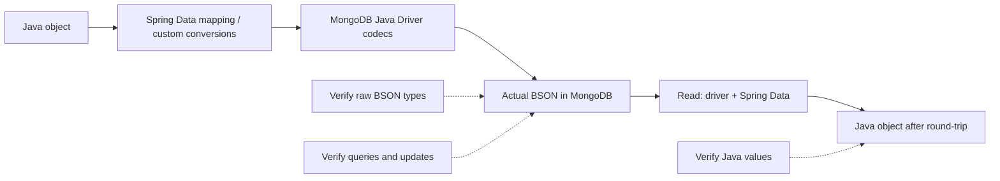

# Testing ObjectId, UUID, Decimal128, Time Types, and Converters

## 1. Why Is Testing BSON Mapping Important?

With **Spring Data MongoDB**, a Java object can be written through `MongoTemplate` or a repository and read back without throwing errors, yet the actual BSON type stored in MongoDB still violates the desired data contract. This is especially dangerous for **ObjectId**, **UUID**, **Decimal128**, time types, and **custom converters**: two values that look identical when printed may differ in type, sort order, precision, or queryability.

For example, the string `"507f1f77bcf86cd799439011"` can be a **String** or an **ObjectId**; a `UUID` can be stored as binary subtype 4 or legacy subtype 3; `BigDecimal` may be saved as a String if not configured for Decimal128; `Instant` holds nanoseconds while BSON Date only stores **millisecond** precision. A custom converter might read and write symmetrically along one code path yet be skipped on direct updates.

Testing aims to guarantee at least four contracts:

1. **Java input → server-stored BSON** has the right type and content.
2. **Server BSON → Java object** decodes cleanly, with clear rules for precision and missing data.
3. **Queries, updates, and indexes** work with the chosen BSON types—not just `save`/`findById`.
4. **Legacy data and production settings** remain compatible across Java driver, Spring Data MongoDB, or converter upgrades.

This lesson uses `MongoTemplate` as the primary example; repositories and reactive access must be tested against the same storage contract.



## 2. Choosing the Right Test Layer per Responsibility

| Layer | Can verify | Cannot prove |
|---|---|---|
| Unit test for conversion helpers | Normalization logic, null checks, string parsing, business rules | That MongoDB stores the right BSON type |
| Direct converter test | `Converter<S, T>` returns expected type and value | That the converter is registered in Spring and applied on every access path |
| Integration test with real MongoDB | `MongoTemplate`/repository mapping, raw BSON, queries, updates, indexes | Legacy production data and real deployment environments |
| Migration/compatibility tests | Reading historical BSON fixtures, catching cross-version changes | Real-world performance or load capacity |
| Performance and fault tests | Converter overhead, throughput, connections, type distribution | Correctness of all edge cases without explicit assertions |

**Prefer integration tests against real MongoDB** (e.g., Testcontainers), because mocked repositories or mocked `MongoTemplate` bypass the exact codec/BSON layer under test. Testcontainers requires Docker or a compatible container runtime.

Test data should live in a dedicated test database/collection rather than a shared environment. Use deterministic identifiers, fixed timestamps, and `BigDecimal(String)` so results remain reproducible.

## 3. A Sample Entity Covering All Key Types

Example document recording a transaction:

```java
import java.math.BigDecimal;
import java.time.Instant;
import java.util.UUID;

import org.bson.types.ObjectId;
import org.springframework.data.annotation.Id;
import org.springframework.data.mongodb.core.mapping.Document;
import org.springframework.data.mongodb.core.mapping.Field;
import org.springframework.data.mongodb.core.mapping.FieldType;

@Document("type_samples")
public record TypeSample(
    @Id ObjectId id,
    UUID requestId,
    @Field(targetType = FieldType.DECIMAL128) BigDecimal total,
    Instant receivedAt
) {}
```

There are four deliberate decisions:

- `id` uses an actual `ObjectId`, avoiding reliance on string-inference rules.
- `requestId` has type `UUID`; the Java driver should be configured with **`UuidRepresentation.STANDARD`** to store standard BSON binary subtype **4**.
- `total` uses `@Field(targetType = FieldType.DECIMAL128)`; in some Spring Data setups `BigDecimal` defaults to String, so tests must inspect the actual BSON type.
- `receivedAt` uses `Instant` to represent a UTC instant; BSON Date stores milliseconds since the epoch.

You do not need to convert every field in your app to these types. What matters is choosing a storage contract upfront, then **writing tests capable of detecting when that contract drifts**.

### Consistent UUID Configuration

With modern Java drivers, configure UUID representation explicitly on the **`MongoClient` actually used by Spring Data**:

```java
import org.bson.UuidRepresentation;
import com.mongodb.MongoClientSettings;

MongoClientSettings settings = MongoClientSettings.builder()
    .uuidRepresentation(UuidRepresentation.STANDARD)
    .build();
```

This is core driver configuration. In Spring Boot, apply the setting in a `MongoClientSettingsBuilderCustomizer` or your application-managed client configuration, then verify `MongoTemplate`/repositories use that client. Package and auto-configuration property names depend on your Spring Boot version; do not rely on implicit defaults.

## 4. Setting Up Integration Tests with MongoDB and Inspecting Raw BSON

Example using JUnit 5, AssertJ, Spring Boot test slice, and Testcontainers. Required dependencies include Spring Data MongoDB, Spring Boot test starter, Testcontainers MongoDB, and Testcontainers JUnit Jupiter; align versions with your active BOM. The configuration example follows Spring Boot 3.x conventions; customizer packages may differ in other versions.

```java
import static com.mongodb.client.model.Filters.eq;
import static org.assertj.core.api.Assertions.assertThat;

import java.math.BigDecimal;
import java.time.Instant;
import java.util.UUID;

import org.bson.BsonBinarySubType;
import org.bson.BsonDocument;
import org.bson.UuidRepresentation;
import org.bson.types.ObjectId;
import org.junit.jupiter.api.Test;
import org.springframework.beans.factory.annotation.Autowired;
import org.springframework.boot.autoconfigure.mongo.MongoClientSettingsBuilderCustomizer;
import org.springframework.boot.test.autoconfigure.data.mongo.DataMongoTest;
import org.springframework.boot.test.context.TestConfiguration;
import org.springframework.context.annotation.Bean;
import org.springframework.data.mongodb.core.MongoTemplate;
import org.springframework.test.context.DynamicPropertyRegistry;
import org.springframework.test.context.DynamicPropertySource;
import org.testcontainers.containers.MongoDBContainer;
import org.testcontainers.junit.jupiter.Container;
import org.testcontainers.junit.jupiter.Testcontainers;
import org.testcontainers.utility.DockerImageName;

@Testcontainers
@DataMongoTest
class TypeSampleMongoTest {

    @Container
    static final MongoDBContainer mongo =
        new MongoDBContainer(DockerImageName.parse("mongo:7.0"));

    @DynamicPropertySource
    static void mongoProperties(DynamicPropertyRegistry registry) {
        registry.add("spring.data.mongodb.uri", mongo::getReplicaSetUrl);
    }

    @TestConfiguration(proxyBeanMethods = false)
    static class UuidConfig {
        @Bean
        MongoClientSettingsBuilderCustomizer standardUuid() {
            return builder ->
                builder.uuidRepresentation(UuidRepresentation.STANDARD);
        }
    }

    @Autowired
    MongoTemplate mongoTemplate;

    @Test
    void preservesJavaValuesAndBsonTypes() {
        ObjectId id = new ObjectId("507f1f77bcf86cd799439011");
        UUID requestId =
            UUID.fromString("123e4567-e89b-12d3-a456-426614174000");
        BigDecimal total = new BigDecimal("12345.6700");
        Instant receivedAt =
            Instant.parse("2026-11-20T13:02:03.123456789Z");

        mongoTemplate.insert(
            new TypeSample(id, requestId, total, receivedAt)
        );

        TypeSample result =
            mongoTemplate.findById(id, TypeSample.class);

        assertThat(result).isNotNull();
        assertThat(result.id()).isEqualTo(id);
        assertThat(result.requestId()).isEqualTo(requestId);
        assertThat(result.total()).isEqualByComparingTo(total);
        assertThat(result.receivedAt()).isEqualTo(
            Instant.ofEpochMilli(receivedAt.toEpochMilli())
        );

        BsonDocument raw = mongoTemplate.getCollection("type_samples")
            .withDocumentClass(BsonDocument.class)
            .find(eq("_id", id))
            .first();

        assertThat(raw).isNotNull();
        assertThat(raw.getObjectId("_id").getValue()).isEqualTo(id);
        assertThat(raw.getBinary("requestId").getType())
            .isEqualTo(BsonBinarySubType.UUID_STANDARD.getValue());
        assertThat(raw.getDecimal128("total")
            .getValue().bigDecimalValue())
            .isEqualByComparingTo(total);
        assertThat(raw.getDateTime("receivedAt").getValue())
            .isEqualTo(receivedAt.toEpochMilli());
    }
}
```

The focus here is container setup, `MongoClient` config, and BSON assertions; adapt imports and Spring Boot settings to your dependencies. In practice, pin the Testcontainers and MongoDB image versions standardized by your project rather than assuming `mongo:7.0` everywhere.

**Why read `BsonDocument`?** `mongoTemplate.findById(...)` verifies round-trip mapping, whereas `withDocumentClass(BsonDocument.class)` reveals that the server actually holds **ObjectId**, **Binary subtype 4**, **Decimal128**, and **BSON Date**. If a converter is misconfigured symmetrically across read and write, comparing mapped Java objects alone can miss the bug.

Never inspect `raw` data that passed through a custom converter to validate that same custom converter: use a driver-level BSON read for independent observation.

## 5. ObjectId: Same Display String, Different BSON Type

`ObjectId` is a dedicated 12-byte BSON type; its 24-hex-digit string form is merely a **display representation**. Using `String` as `@Id` can trigger automatic conversion to ObjectId if the value is convertible. Otherwise, some values may be stored as BSON String. Thus two documents with visually identical `_id` strings are not equivalent in queries.

### Two Valid Identifier Contracts

**Contract A — True ObjectId**: entity declares `@Id ObjectId id` and queries use `ObjectId`.

```java
import org.bson.types.ObjectId;

ObjectId id = new ObjectId("507f1f77bcf86cd799439011");
TypeSample stored = mongoTemplate.findById(id, TypeSample.class);

assertThat(stored).isNotNull();
assertThat(stored.id()).isEqualTo(id);
```

**Contract B — Business key always stored as String**: use `@MongoId(FieldType.STRING)` to prevent implicit conversion to ObjectId.

```java
import org.springframework.data.mongodb.core.mapping.Document;
import org.springframework.data.mongodb.core.mapping.FieldType;
import org.springframework.data.mongodb.core.mapping.MongoId;

@Document("external_ids")
public record ExternalId(
    @MongoId(FieldType.STRING) String id,
    String label
) {}
```

Tests must prove `_id` on the server is BSON String even when the value **looks like an ObjectId**:

```java
String value = "507f1f77bcf86cd799439011";

mongoTemplate.insert(new ExternalId(value, "external"));
BsonDocument raw = mongoTemplate.getCollection("external_ids")
    .withDocumentClass(BsonDocument.class)
    .find(eq("_id", value))
    .first();

assertThat(raw).isNotNull();
assertThat(raw.getString("_id").getValue()).isEqualTo(value);
```

### Edge Cases to Test

| Scenario | Expectation / what to check |
|---|---|
| Valid 24-hex-digit ObjectId | Converted to ObjectId on intentional mapping paths |
| 24-character string with non-hex chars | Must not be assumed to be a valid ObjectId |
| `@MongoId(FieldType.STRING)` with ObjectId-like string | Still stored as BSON String |
| Querying id by `String` vs `ObjectId` | Behavior matches the mapping contract; raw queries do not coerce types arbitrarily |
| Missing/null ID before insert | ID-generation strategy or error is explicit; tests do not depend on randomness |
| Legacy collection mixing String and ObjectId `_id` | Detect heterogeneous types and plan explicit migration |
| Paginating by `_id` | Comparison/sorting uses real BSON types, not string display order |

Although `ObjectId` embeds creation time, it is **not a reliable business timestamp** for a document. When testing creation or modification times, use dedicated timestamp fields.

## 6. UUID: Checking Representation and Binary Subtype

MongoDB has no separate native UUID type alongside ObjectId: the Java driver encodes `UUID` into BSON Binary. The modern standard is **binary subtype 4** with standard byte ordering. Legacy systems may use **subtype 3** under `JAVA_LEGACY`, `C_SHARP_LEGACY`, or `PYTHON_LEGACY` conventions. The same Java `UUID` string encodes to different bytes under different representations.

Never rely on `UUID.toString()` to conclude BSON data compatibility.

### Three-Dimensional Test

1. **Java value**: the round-tripped UUID equals the original UUID.
2. **BSON representation**: subtype is `UUID_STANDARD` (value 4), and byte encoding matches the chosen representation.
3. **Queries**: filtering by `UUID` via `MongoTemplate` or a repository finds the document; raw `Binary` queries with another representation are not treated as equivalent.

The raw check appears in `preservesJavaValuesAndBsonTypes()` above. For fixtures from legacy systems, build a dedicated test reading real subtype 3/4 BSON to identify the legacy representation and verify your conversion strategy. Never tweak byte arrays to “make them match” without confirming which convention produced them.

### A Common Bug

Two applications sharing one database with mismatched settings:

```text
App A: UUID -> STANDARD -> BSON Binary subtype 4
App B: UUID -> JAVA_LEGACY -> BSON Binary subtype 3

Same UUID printed in logs,
but queries and decoding are not guaranteed compatible.
```

In multi-service integration tests, verify **both writers and readers**, as well as queries, share the exact same UUID contract. When migrating from legacy to STANDARD, test reading legacy fixtures and run a verified migration before cutting over in production.

## 7. Decimal128: Testing Currency, Precision, and Scale

Java `double` is binary floating-point; using it directly for money or exact decimals can introduce precision errors. `BigDecimal` is standard in Java, while **BSON Decimal128** represents decimal numbers with up to **34 significant digits** and a bounded exponent range.

Entity configuration:

```java
@Field(targetType = FieldType.DECIMAL128)
BigDecimal total;
```

If this annotation is omitted, check the `BigDecimal` mapping rules for your Spring Data MongoDB version; never assume a field is automatically BSON Decimal128. From `mongosh`, inspect via `$type`:

```javascript
db.type_samples.aggregate([
  { $project: {
      totalBsonType: { $type: "$total" },
      receivedAtBsonType: { $type: "$receivedAt" }
  }}
]);
// Expected: totalBsonType = "decimal", receivedAtBsonType = "date".
```

### Important Boundary Values

| Java value | What to prove |
|---|---|
| `new BigDecimal("0.1")` | No binary representation drift as with `double` |
| `new BigDecimal("12345.6700")` | Numeric value stays exact; verify scale rules if business requires them |
| `new BigDecimal("-0.01")` | Preserves sign and precision |
| `BigDecimal.ZERO` | No error or unexpected BSON type shift |
| Very small/large values near Decimal128 limits | Driver handles within representable range; exceeding limits produces an explicit error |
| Numbers with >34 significant digits | Not silently rounded when strict exactness is required |
| Legacy data stored as String or Double | Detected; controlled migration or compatibility converter exists |

Note that `BigDecimal.equals()` compares **scale** too: `new BigDecimal("1.0").equals(new BigDecimal("1.00"))` is false, whereas `compareTo(...) == 0`. To assert **numeric equality**, use AssertJ's `isEqualByComparingTo`. If business rules require **preserving exact decimal places** (e.g., two decimal digits for currency), write dedicated scale tests and normalize explicitly via domain rules.

Never convert `BigDecimal` via `doubleValue()` before constructing `Decimal128`. When writing directly with the driver:

```java
import java.math.BigDecimal;
import org.bson.types.Decimal128;

BigDecimal value = new BigDecimal("0.10");
Decimal128 encoded = new Decimal128(value);
BigDecimal decoded = encoded.bigDecimalValue();

assertThat(decoded).isEqualByComparingTo(value);
```

### Equality, Sorting, and Aggregation

Write a dedicated query test filtering on a `Decimal128` value:

```java
import org.springframework.data.mongodb.core.query.Criteria;
import org.springframework.data.mongodb.core.query.Query;

Query q = Query.query(
    Criteria.where("total").is(new BigDecimal("12345.6700"))
);
TypeSample match =
    mongoTemplate.findOne(q, TypeSample.class);

assertThat(match).isNotNull();
```

Then test range comparisons (`$gte`/`$lt`), sorting, and `$sum` aggregation over test fixtures. The contract must rely on numeric BSON types rather than lexicographical sorting on decimal strings. Test both `Query`/`Criteria` queries and raw driver queries if the application uses both, since they can pass through different conversion paths.

## 8. Time: UTC, Milliseconds, Timezones, and Range Boundaries

MongoDB BSON Date stores **milliseconds since the Unix epoch** representing an instant in time. Java `Instant` has nanosecond precision. If you write `2026-11-20T13:02:03.123456789Z`, BSON Date stores the timestamp at `.123` seconds, so the round-tripped `Instant` no longer contains the extra `456789` nanoseconds.

### Choose the Precision Rule Before Asserting

```java
import java.time.Instant;

Instant original =
    Instant.parse("2026-11-20T13:02:03.123456789Z");

Instant expected =
    Instant.ofEpochMilli(original.toEpochMilli());

assertThat(expected).isEqualTo(
    Instant.parse("2026-11-20T13:02:03.123Z")
);
```

Round-trip tests should compare against `Instant.ofEpochMilli(original.toEpochMilli())` rather than `original` when inputs have sub-millisecond precision. If business logic genuinely requires nanoseconds, store an additional high-precision field by explicit design along with conversion and query rules.

### Do Not Mix Instants and Local Calendar Times

- `Instant`: an instant on the UTC timeline; suited for events, auditing, and ingestion timestamps.
- `LocalDate`: a calendar date without a timezone; requires an explicit zone when converted into a query time range.
- `LocalDateTime`: local date and time without an offset; during DST transitions it can be ambiguous or non-existent in a timezone.
- `OffsetDateTime` / `ZonedDateTime`: carry offset/zone info in Java, yet **BSON Date does not retain the original timezone name or offset**. Store them separately if they must be restored.

For example, “all orders for a calendar day in Vietnam” must convert the local date to a `[from, to)` range in `Asia/Ho_Chi_Minh` and query using `Instant`:

```java
import java.time.Instant;
import java.time.LocalDate;
import java.time.ZoneId;
import org.springframework.data.mongodb.core.query.Criteria;

ZoneId zone = ZoneId.of("Asia/Ho_Chi_Minh");
LocalDate day = LocalDate.of(2026, 11, 20);

Instant from = day.atStartOfDay(zone).toInstant();
Instant to = day.plusDays(1).atStartOfDay(zone).toInstant();

Criteria timeRange = Criteria.where("receivedAt")
    .gte(from)
    .lt(to); // [from, to) avoids double-counting at boundaries.
```

For timezones with DST, **never assume** a calendar day is always 24 hours; compute the start of the next day in the same zone. Never rely on the runner machine's default timezone, as CI and developer laptops may differ. When using `LocalDateTime` or custom time converters, also test DST transitions, leap days, pre-epoch timestamps, and null.

### Boundary Query Tests

Create at least three records at:

- `from` — must be returned by `$gte`.
- One millisecond before `to` — must be returned.
- `to` — must not be returned by `$lt`.

In integration tests, assert the exact set of returned IDs; avoid checking only the count, which can pass by coincidence if the wrong documents match.

## 9. Custom Converters: Test Both Logic and Registration

A custom converter helps when the domain uses a dedicated value type such as `Money(amount, currency)` while MongoDB must store a subdocument with `amount` as **Decimal128**. Both the **write direction** and **read direction** must be tested.

Example domain object:

```java
import java.math.BigDecimal;
import java.util.Objects;

public record Money(BigDecimal amount, String currency) {
    public Money {
        Objects.requireNonNull(amount, "amount");
        Objects.requireNonNull(currency, "currency");
        if (currency.isBlank()) {
            throw new IllegalArgumentException("currency is blank");
        }
    }
}
```

Write and read converters:

```java
import org.bson.Document;
import org.bson.types.Decimal128;
import org.springframework.core.convert.converter.Converter;
import org.springframework.data.convert.ReadingConverter;
import org.springframework.data.convert.WritingConverter;

@WritingConverter
public final class MoneyWriteConverter
        implements Converter<Money, Document> {

    @Override
    public Document convert(Money source) {
        return new Document("amount",
                new Decimal128(source.amount()))
            .append("currency", source.currency());
    }
}

@ReadingConverter
public final class MoneyReadConverter
        implements Converter<Document, Money> {

    @Override
    public Money convert(Document source) {
        Object amount = source.get("amount");
        if (!(amount instanceof Decimal128 decimal)) {
            throw new IllegalArgumentException(
                "Invalid BSON amount; expected Decimal128"
            );
        }
        return new Money(
            decimal.bigDecimalValue(),
            source.getString("currency")
        );
    }
}
```

Register both with Spring Data MongoDB:

```java
import java.util.List;

import org.springframework.context.annotation.Bean;
import org.springframework.context.annotation.Configuration;
import org.springframework.data.mongodb.core.convert.MongoCustomConversions;

@Configuration
public class MongoConversionConfig {
    @Bean
    MongoCustomConversions mongoCustomConversions() {
        return new MongoCustomConversions(List.of(
            new MoneyWriteConverter(),
            new MoneyReadConverter()
        ));
    }
}
```

An entity using `Money`:

```java
import org.bson.types.ObjectId;
import org.springframework.data.annotation.Id;
import org.springframework.data.mongodb.core.mapping.Document;

@Document("payments")
public record Payment(
    @Id ObjectId id,
    Money price
) {}
```

### Two-Layer Converter Tests

**Unit tests** for the converters verify conversion outputs including invalid inputs:

```java
Money input = new Money(
    new BigDecimal("120.50"), "VND"
);

Document bson = new MoneyWriteConverter().convert(input);
assertThat(bson.get("amount")).isInstanceOf(Decimal128.class);
assertThat(((Decimal128) bson.get("amount")).bigDecimalValue())
    .isEqualByComparingTo("120.50");

Money output = new MoneyReadConverter().convert(bson);
assertThat(output.amount()).isEqualByComparingTo(input.amount());
assertThat(output.currency()).isEqualTo(input.currency());
```

**Integration tests** for registration must run through `MongoTemplate` loaded with `MongoCustomConversions`:

```java
ObjectId id = new ObjectId();
Money price = new Money(
    new BigDecimal("120.50"), "VND"
);

mongoTemplate.insert(new Payment(id, price));

BsonDocument raw = mongoTemplate.getCollection("payments")
    .withDocumentClass(BsonDocument.class)
    .find(eq("_id", id))
    .first();

assertThat(raw).isNotNull();
assertThat(raw.getDocument("price")
    .getDecimal128("amount").getValue().bigDecimalValue())
    .isEqualByComparingTo(price.amount());
assertThat(raw.getDocument("price")
    .getString("currency").getValue())
    .isEqualTo("VND");

Payment loaded = mongoTemplate.findById(id, Payment.class);
assertThat(loaded.price().amount())
    .isEqualByComparingTo(price.amount());
assertThat(loaded.price().currency())
    .isEqualTo(price.currency());
```

For this integration test to run, include `MongoConversionConfig` in the Spring test context, for instance via `@Import(MongoConversionConfig.class)` on the `@DataMongoTest` class if the slice does not load it automatically. A unit test calling `new MoneyWriteConverter()` **cannot replace** this check because it does not prove the bean was registered or that the mapping context uses the converter.

### Scenarios to Test as Converters Evolve

1. **Null or missing fields**: optional values follow the contract; required data raises a clear error.
2. **Legacy BSON types**: records storing `String`/`Double` instead of Decimal128 must be handled by a migration or explicit compatibility branch.
3. **Invalid data**: blank currency, invalid amount, subdocument missing attributes.
4. **Nested objects and lists**: converters still run when the value sits inside a child entity or collection element.
5. **Queries on converted fields**: verify `Criteria` uses the right type and BSON path; do not assume queries take the exact same steps as `insert`.
6. **Partial updates**: `updateFirst`, `findAndModify`, bulk updates, and the raw driver can follow different conversion paths. With the raw driver, the caller must supply contract-compliant BSON.
7. **Migrations after modifying converters**: test against historical data fixtures so a Java change does not break reading old documents.

## 10. Concise Test Matrix to Avoid Missing Edge Cases

| Type | Write and read | Raw BSON check | Query / update | Negative cases |
|---|---|---|---|---|
| ObjectId | ObjectId ID round-trip | `_id` is ObjectId | `findById` and raw `_id` query | ObjectId-like String, malformed ID, mixed types |
| UUID | UUID round-trip | Binary subtype 4, standard bytes | Query by UUID | Legacy subtype 3, mismatched client settings |
| Decimal128 | BigDecimal round-trip | BSON decimal | `$gte`, `$lt`, sort, sum | Exceeded precision, legacy String/Double, null |
| Time | Instant round-trip to ms | BSON date and epoch ms | `[from, to)`, timezones | Nanoseconds, DST, leap day, legacy timestamps |
| Converter | Money ↔ Document | Subdocument and Decimal128 | Queries, nested values, partial updates | Missing field, wrong BSON type, unregistered bean |

Name tests after the **storage rule**, such as `storesUuidAsStandardSubtype4`, `storesBigDecimalAsDecimal128`, `instantRoundTripUsesMillisecondPrecision`, and `stringIdRemainsBsonString`. Such names give much more informative failure messages than `testSave()` or `testFind()`.

A useful test dataset includes both records written by the current app **and** historical BSON fixtures from earlier versions. Fixtures should preserve native BSON types (ObjectId, Binary, Decimal128, Date) rather than plain JSON that strips type information.

## 11. Testing Repositories, Reactive Code, and Real Update Paths

When an application uses multiple ways to interact with MongoDB, cover at least one representative path per mechanism used:

- `MongoTemplate.insert`, `save`, and `findById`: bidirectional document mapping.
- `MongoRepository`: derived query methods, especially involving `@Id`, UUID, and converter-handled fields.
- `MongoTemplate.updateFirst`, `findAndModify`, `BulkOperations`: update value conversion; inspect raw BSON afterward.
- `ReactiveMongoTemplate` or reactive repositories: verify the same BSON contracts and decoding error propagation. In tests, use `StepVerifier` to assert emissions; avoid calling `block()` on event-loop threads in production code.
- **Raw MongoDB driver**: if invoked directly, test that path because it bypasses Spring Data's `MongoCustomConversions`.

Example boundary query using `MongoTemplate`:

```java
import java.time.Instant;
import java.util.List;

import org.springframework.data.mongodb.core.query.Criteria;
import org.springframework.data.mongodb.core.query.Query;

Instant from = Instant.parse("2026-11-20T00:00:00Z");
Instant to = Instant.parse("2026-11-21T00:00:00Z");

Query query = Query.query(Criteria.where("receivedAt")
    .gte(from)
    .lt(to));

List<TypeSample> samples =
    mongoTemplate.find(query, TypeSample.class);

// In the test, compare exact IDs against fixtures inserted at from, before to, and at to.
```

When testing indexes or aggregations over `Decimal128`, do not declare a query correct just because it returns rows: inspect values, BSON types, and `explain` plans if performance is a requirement. Mapping tests and performance tests have different objectives.

In concurrent or parallel test suites, isolate collections/databases and test data per test so execution order cannot skew results. Never mutate `TimeZone.setDefault(...)` JVM-wide during parallel tests; pass an explicit `ZoneId` instead.

## 12. Diagnosing Failures and Troubleshooting Workflow

| Symptom | Common cause | How to confirm |
|---|---|---|
| `findById` returns nothing even though shell shows the document | Mixed String/ObjectId `_id` or wrong query type | Read raw `BsonDocument` and compare `_id` BSON type |
| UUID inserted yet querying by UUID returns nothing | Different UUID representation or legacy subtype | Check subtype 3/4 and `MongoClient` config on both sides |
| Currency reads back differently than expected | Stored as Double, String, or Decimal128, or misused `BigDecimal.equals` | Inspect `$type` and compare with `compareTo` when numeric value matters |
| Timestamp differs at milli/nanosecond precision | BSON Date keeps milliseconds only | Compare `epochMillis` and write precision-aware round-trip tests |
| Hours differ between CI and developer laptop | Relied on default timezone or unzoned `LocalDateTime` | Trace `ZoneId`/`Instant` from input construction to raw BSON |
| Unit converter test passes yet app writes wrong BSON | Bean not loaded into Mongo mapping context | Verify via `@DataMongoTest` with appropriate `@Import` |
| New documents read fine, old documents fail | Schema/converter or driver version changed | Test with historical BSON fixtures and migration tests |
| Partial update writes wrong field type | Update path or raw driver bypassed expected conversions | Read raw BSON right after update and compare against schema |
| Sort/range queries yield strange ordering | Values stored as String instead of Date/Decimal128, or mixed BSON types | Inspect `$type` per document and check indexes/plans |

When troubleshooting, capture the **actual BSON types**, the sent query, client/converter configuration, and dependency versions. Avoid logging sensitive production payloads; reproduce with synthetic fixtures preserving the exact BSON types.

## 13. Acceptance Checklist

1. **Specify data type contracts** per field: ObjectId vs String, UUID subtype/representation, Decimal128 vs String, and UTC Instant precision.
2. **Write integration tests against real MongoDB** with deterministic data; do not rely solely on repository mocks.
3. **Read raw BSON separately** to verify `_id`, binary subtype, decimal, date, and converter output structure.
4. **Verify Java round-trips** with semantically accurate assertions: numeric comparison for `BigDecimal` when appropriate, millisecond precision for `Instant`.
5. **Test queries and updates** through the exact APIs the app uses: `MongoTemplate`, repositories, reactive APIs, and raw driver calls.
6. **Test invalid and legacy data**: mixed ID types, legacy UUIDs, out-of-range `BigDecimal`, unzoned times, and converters facing missing fields.
7. **Isolate tests** across databases, collections, timezones, and driver configs; avoid depending on shared data or wall-clock time.
8. **Verify live configuration**: `MongoCustomConversions` is registered, UUID representation is consistent, and Decimal128 field mappings take effect.
9. **Test migrations during upgrades** of Spring Data MongoDB or Java driver using historical BSON fixtures.
10. **Keep reporting clear**: distinguish which tests guard data types, which guard business logic, and which check performance and boundaries.

In **SPRING_DATA_MONGODB**, testing ObjectId, UUID, Decimal128, time types, and converters means testing the **contract between Java and BSON**. A trustworthy test suite must simultaneously verify round-tripped values, actual BSON types stored in MongoDB, and query/update behavior—catching silent mismatches before production accumulates multi-version data that becomes costly to repair.
