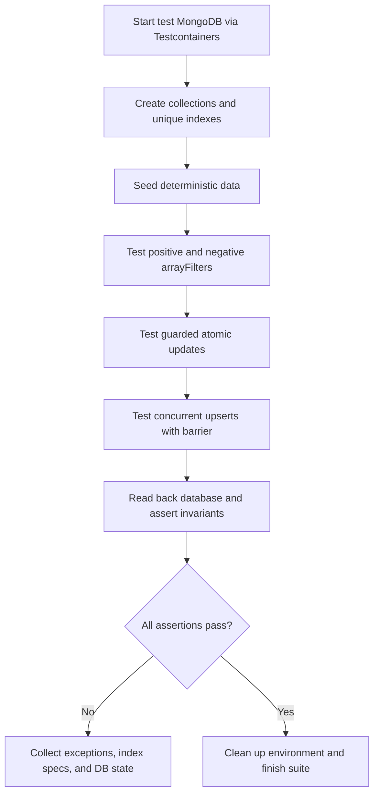

# Testing Array Filters, Atomic Updates, and Concurrent Upserts

> **Chapter:** Testing · **Module:** `SPRING_DATA_MONGODB`. Spring Data MongoDB enables document operations via `MongoTemplate`, repositories, and reactive access. Three operation groups notorious for hard-to-reproduce bugs are updating array elements via `arrayFilters`, conditional state transitions requiring atomicity, and concurrent `upsert` calls. This lesson constructs observable test cases against real MongoDB while highlighting invariants that must be guarded by data design and indexes.

## 1. Objectives and Contracts to Prove

Suppose an order service handles these operations:

- Update `reserved` for **one specific line item** in an `items` array without altering other lines.
- Decrement stock when `available >= 1`. If two requests race for the last remaining unit, **only one request** may succeed.
- Track processing attempts for the same order using `upsert`. If multiple threads create an absent record simultaneously, **exactly one document per business key** may remain, and every successful update must be counted accurately.

These three contracts map to three techniques:

| Problem | MongoDB tool | What tests must confirm |
|---|---|---|
| Selecting array elements | `$[identifier]` + `arrayFilters` | Only matching elements are modified; all others remain untouched |
| Preventing lost updates | Conditional `$inc`/`$set` in query | Condition is evaluated at update time; inventory never goes negative |
| Create-if-absent under contention | `upsert` + **unique index** | No duplicate records created; key collision handled intentionally |

**Atomicity boundary:** a write command targeting a **single document** is atomic in MongoDB, even when modifying multiple array elements within that document. `updateMany()` updates each document atomically **individually**, without turning the entire set into a multi-document transaction. When invariants span multiple documents, remodel your data or use transactions where topology allows.

## 2. Why Integration Tests with Real MongoDB Are Required

Unit tests with Mockito verify business flows like “call `updateFirst` once” or “throw when stock is empty,” yet cannot verify:

- How MongoDB interprets `arrayFilters`, `$[line]`, and nested array paths.
- `matchedCount`, `modifiedCount`, and cases where the document matches but zero array elements match the filter.
- Concurrent execution of `$inc`, query guards, unique indexes, and `upsert`.
- Server errors like `E11000 duplicate key` or restrictions when combining `upsert` with positional array operators.

Therefore, for write invariants, run **integration tests against a real MongoDB server**. Testcontainers is well suited for spinning up an isolated MongoDB per test suite and runs in CI when Docker is available.

### Testing Layers

| Layer | Should test | Should not conclude from this layer |
|---|---|---|
| Service unit tests | Input validation, retry policy, error mapping, calling right repository/template | Atomicity of MongoDB commands |
| MongoDB integration tests | Post-write BSON values, update results, unique indexes, concurrent requests | High production load or p99 latency |
| Load/stress tests | Throughput, timeouts, pool saturation, deadlock/error rates under load | Correctness without explicit data assertions |
| End-to-end tests | REST/API, transaction boundaries, auth, and end-to-end consistency | Exact mechanics of each operator without inspecting the database |

Never substitute integration tests with an in-memory MongoDB mock that lacks full support for the operators under test.

## 3. Preparing the Test Environment

Examples use **Java 17+, Spring Boot 3.x, Spring Data MongoDB, JUnit 5, and Testcontainers**. Testcontainers snippets use the **Testcontainers 1.x** API; on 2.x, artifact names and MongoDB module packages can change, so align dependencies with your project BOM.

Gradle (illustrative dependencies, letting Spring Boot/Testcontainers dependency management resolve compatible versions):

```groovy
dependencies {
    implementation 'org.springframework.boot:spring-boot-starter-data-mongodb'

    testImplementation 'org.springframework.boot:spring-boot-starter-test'
    testImplementation 'org.testcontainers:junit-jupiter'
    testImplementation 'org.testcontainers:mongodb'
}
```

If your project already uses a dedicated test MongoDB replica set instead of Testcontainers, connect via `spring.data.mongodb.uri` and keep the same assertions. Isolate the test database from real environments. The example below creates two temporary collections and cleans them before each test to avoid order dependence.

**Distinguish three annotations:** `@DataMongoTest` creates only the context needed for data-access testing; `@Testcontainers` manages the container; `@DynamicPropertySource` supplies the test server URI to Spring before `MongoTemplate` initializes. These are persistence-layer integration tests and need no HTTP server.

## 4. Array Filter Syntax in MongoDB

An order has an `items` array:

```javascript
{
  _id: "order-1",
  tenantId: "t-1",
  items: [
    { lineId: "L-1", sku: "SKU-A", reserved: 0, cancelled: false },
    { lineId: "L-2", sku: "SKU-B", reserved: 1, cancelled: false },
    { lineId: "L-3", sku: "SKU-B", reserved: 0, cancelled: true }
  ]
}
```

To increment `reserved` only on line `L-2` and only when not cancelled:

```javascript
db.orders.updateOne(
  { _id: "order-1" },
  { $inc: { "items.$[line].reserved": 2 } },
  {
    arrayFilters: [
      { "line.lineId": "L-2", "line.cancelled": false }
    ]
  }
);
```

Expected state: `L-1.reserved = 0`, `L-2.reserved = 3`, `L-3.reserved = 0`. MongoDB evaluates the filter against array elements, then applies `$inc` to matching elements **within a single atomic document update**.

### 4.1. Distinguishing the Three Array Selection Forms

| Syntax in update path | Meaning | Example |
|---|---|---|
| `$` | Positional operator for the first element matching the query's array condition, with its own restrictions | `items.$.reserved` |
| `$[]` | Applies to **every element** in the array | `items.$[].flag` |
| `$[line]` | Applies to elements matching the corresponding `arrayFilters` | `items.$[line].reserved` |

`$[line]` is valid only when identifier `line` is defined in an array filter. Identifiers must follow MongoDB naming rules (starting with a lowercase letter followed by alphanumeric characters); never substitute user-supplied request strings directly as identifiers.

### 4.2. Spring Data Equivalent

```java
Query query = Query.query(Criteria.where("_id").is("order-1"));

Update update = new Update()
    .inc("items.$[line].reserved", 2)
    .filterArray(
        Criteria.where("line.lineId").is("L-2")
                .and("line.cancelled").is(false)
    );

UpdateResult result = mongoTemplate.updateFirst(
    query, update, "orders"
);
```

`Update.filterArray(CriteriaDefinition)` passes `arrayFilters` to the driver. Note that array filter expressions are passed down **without Spring Data field-name mapping**, so paths inside the filter must match the **stored BSON field names**. If an entity uses `@Field("line_id")`, do not write `lineId` in the filter when the database stores `line_id`.

### 4.3. Updating Nested Arrays

Suppose you need to update `qty` for item `SKU-A` inside section `zone-1`:

```javascript
db.warehouses.updateOne(
  { _id: "w-1" },
  { $inc: { "zones.$[zone].items.$[item].qty": 1 } },
  {
    arrayFilters: [
      { "zone.name": "zone-1" },
      { "item.sku": "SKU-A" }
    ]
  }
);
```

Spring Data:

```java
Update update = new Update()
    .inc("zones.$[zone].items.$[item].qty", 1)
    .filterArray(Criteria.where("zone.name").is("zone-1"))
    .filterArray(Criteria.where("item.sku").is("SKU-A"));
```

Every element at every array level that does not match the filter must remain unchanged. A test asserting only “one line was updated” is insufficient: confirm **all neighboring elements** were untouched.

### 4.4. Easily Overlooked Limitations

- `arrayFilters` does not support operators like `$expr`, `$text`, or `$where` inside array filter expressions.
- `arrayFilters` does not auto-create missing array elements. If no element matches the path, the command can match the document yet modify nothing.
- When combining positional array updates with an **insert-creating upsert**, MongoDB imposes strict requirements including **exact equality matches on the array field** for certain upserts using `$[identifier]`/`$[]`; do not treat this as a general way to construct arbitrary arrays.
- Do not confuse document-level filters in `Query` with **element-level** filters in `arrayFilters`. A document can match the query even when zero array elements match `arrayFilters`.

## 5. Reading Update Results: matched, modified, upserted

MongoDB Java Driver's `UpdateResult` provides:

| Method | Meaning | Common misconception |
|---|---|---|
| `getMatchedCount()` | Number of documents matching the top-level filter | Assuming it counts matched array elements |
| `getModifiedCount()` | Number of documents actually changed | Assuming it counts counter increments or modified array elements |
| `getUpsertedId()` | `_id` of the newly inserted document from an upsert, if any | Assuming every successful upsert returns an upsertedId |
| `wasAcknowledged()` | Whether the write concern acknowledged the result | Reading counts under an unacknowledged write concern |

Example when the document exists yet `arrayFilters` targets `lineId = "missing"`:

```java
UpdateResult result = mongoTemplate.updateFirst(
    Query.query(Criteria.where("_id").is("order-1")),
    new Update()
        .inc("items.$[line].reserved", 1)
        .filterArray(Criteria.where("line.lineId").is("missing")),
    "orders"
);

assertEquals(1L, result.getMatchedCount());
assertEquals(0L, result.getModifiedCount());
```

`matchedCount = 1` only proves **the order document exists**. When updating a specific line, check `modifiedCount` and read back the relevant state to confirm the line actually changed. A `$set` writing the exact value already present can also produce `matchedCount=1` and `modifiedCount=0`.

If you need to **distinguish** “order missing” from “order exists without that line,” add `$elemMatch` to the query or execute an explicit verification query; do not turn `modifiedCount` into the sole source of truth for every case.

## 6. Atomicity: Testing Conditional Updates

### 6.1. Why Read → Modify in Java → Save Is Dangerous

Suppose `SKU-A` has exactly one unit left.

```text
available = 1

Thread A: read available = 1
Thread B: read available = 1
Thread A: save available = 0, reports order success
Thread B: save available = 0, also reports success

Database ends at 0, yet both requests received the item.
```

This is a **lost update / check-then-act race**. Without version checks or locking, two threads act on the same stale read. With Spring Data MongoDB, `@Version` can provide optimistic locking on matching operations; however, these test examples focus on **server-side conditional atomic updates**.

### 6.2. Putting the Guard Inside the Update Query

```javascript
db.stock.updateOne(
  { _id: "SKU-A", available: { $gte: 1 } },
  { $inc: { available: -1 } }
);
```

Spring Data:

```java
Query guard = Query.query(
    Criteria.where("_id").is("SKU-A")
            .and("available").gte(1)
);

UpdateResult result = mongoTemplate.updateFirst(
    guard,
    new Update().inc("available", -1),
    "stock"
);

boolean claimed = result.getMatchedCount() == 1;
```

MongoDB evaluates the query guard and applies the write to that document atomically. When two requests race for the last unit, the winner decrements from 1 to 0; the loser no longer matches `available >= 1` and cannot decrement further. Check `matchedCount` to tell whether the guard matched; with an acknowledged `$inc -1`, the matched document changes as expected here.

This is not a multi-document transaction covering both “decrement stock + create order document” if they live in separate documents. Cross-document invariants require transactions or an idempotent/compensating workflow design.

### 6.3. Conditional State Transitions

You can use the query as a **compare-and-set**:

```javascript
db.orders.updateOne(
  { _id: "order-1", state: "NEW" },
  { $set: { state: "PAID" } }
);
```

If two threads try to transition `NEW → PAID`, only one matches the condition. This is effective for one-time state transitions. To guard against arbitrary concurrent edits across multiple fields, include a `version` field in the query and increment it via `$inc` in the same update.

## 7. Concurrent Upserts: Do Not Rely on Luck to Avoid Duplicates

`Upsert` means **update if a matching document exists, or insert otherwise**:

```javascript
db.orderAttempts.updateOne(
  { tenantId: "t-1", orderNo: "O-101" },
  {
    $inc: { attempts: 1 },
    $setOnInsert: { createdAt: ISODate("2026-01-01T00:00:00Z") }
  },
  { upsert: true }
);
```

If two requests concurrently check a key that does not exist yet, both can take the insert branch. **Upsert by itself is not enough to keep business keys unique** without a supporting unique index.

### 7.1. A Unique Index Is a Mandatory Part of the Invariant

```javascript
db.orderAttempts.createIndex(
  { tenantId: 1, orderNo: 1 },
  {
    unique: true,
    name: "uq_order_attempts_tenant_order"
  }
);
```

The unique index forces MongoDB to reject two documents sharing `(tenantId, orderNo)`. The index must exist and finish building **before** concurrent tests start; never assume `@CompoundIndex(unique = true)` on an entity already created the real database index.

Note special rules on sharded clusters: unique indexes are constrained by the shard key and MongoDB version; verify index/topology design accordingly. The test examples below use a collection on a MongoDB replica set.

### 7.2. When Unique Upserts Can Still Throw Duplicate Key Errors

Depending on query shape and conditions, a racing insert may be automatically retried by MongoDB as an update once the winning document exists, or it may return **`E11000 duplicate key`**. MongoDB can only turn a unique-key collision into an update when specific criteria hold—for example, equality predicates covering the unique index keys and an update that does not alter those keys.

Service code must define an explicit handling policy:

1. If the create/upsert succeeds, treat it as one successful write.
2. If duplicate key occurs due to contention, **read or update again by the exact business key**, optionally with a bounded retry.
3. If the duplicate key stems from a different constraint, or no matching document exists after retry, **do not swallow the error** or assume success.

Spring Data surfaces `DuplicateKeyException` via driver exception translation. Catching all exceptions and retrying indefinitely is unsafe: timeouts, disconnects, write concerns, and transactions have different retry semantics.

### 7.3. Do Not Confuse Upsert with Exactly-Once

The test below proves **each upsert command is counted once in the test scenario**. It does not prove exactly-once under network retries: if a client times out after the server already committed, the client cannot tell whether that increment succeeded. For operations that must never count twice on request retries, add a business-level **idempotency key**, such as a unique record per `requestId` or an appropriately designed ledger/transaction.

## 8. Practical Integration Test Suite with JUnit 5 and Testcontainers

The example below uses:

- Two collections `array_atomic_lab` and `upsert_atomic_lab`, dedicated to the suite.
- `MongoTemplate` as the update API.
- A MongoDB container configured by Testcontainers as a single-node replica set.
- `CountDownLatch` to increase overlap across threads; each test also **asserts final state** rather than relying on execution timing.

The Java code uses Testcontainers **1.x** and Spring Boot **3.x** packages; Testcontainers 2.x projects must adjust imports/container modules to match their version.

### 8.1. Test Class and Collection Initialization

```java
import static org.junit.jupiter.api.Assertions.*;

import com.mongodb.client.result.UpdateResult;
import java.util.ArrayList;
import java.util.Date;
import java.util.List;
import java.util.concurrent.Callable;
import java.util.concurrent.CountDownLatch;
import java.util.concurrent.ExecutorService;
import java.util.concurrent.Executors;
import java.util.concurrent.Future;
import java.util.concurrent.TimeUnit;

import org.bson.Document;
import org.junit.jupiter.api.BeforeEach;
import org.junit.jupiter.api.Test;
import org.springframework.beans.factory.annotation.Autowired;
import org.springframework.boot.test.autoconfigure.data.mongo.DataMongoTest;
import org.springframework.dao.DuplicateKeyException;
import org.springframework.data.domain.Sort.Direction;
import org.springframework.data.mongodb.core.MongoTemplate;
import org.springframework.data.mongodb.core.index.Index;
import org.springframework.data.mongodb.core.query.Criteria;
import org.springframework.data.mongodb.core.query.Query;
import org.springframework.data.mongodb.core.query.Update;
import org.springframework.test.context.DynamicPropertyRegistry;
import org.springframework.test.context.DynamicPropertySource;
import org.testcontainers.containers.MongoDBContainer;
import org.testcontainers.junit.jupiter.Container;
import org.testcontainers.junit.jupiter.Testcontainers;
import org.testcontainers.utility.DockerImageName;

@DataMongoTest
@Testcontainers
class AtomicMongoWriteIT {

    private static final String ARRAY_COLL = "array_atomic_lab";
    private static final String UPSERT_COLL = "upsert_atomic_lab";

    @Container
    static final MongoDBContainer MONGO =
        new MongoDBContainer(DockerImageName.parse("mongo:7.0"));

    @DynamicPropertySource
    static void properties(DynamicPropertyRegistry registry) {
        registry.add("spring.data.mongodb.uri", MONGO::getReplicaSetUrl);
    }

    @Autowired
    MongoTemplate template;

    @BeforeEach
    void resetCollections() {
        template.dropCollection(ARRAY_COLL);
        template.dropCollection(UPSERT_COLL);

        // Unique constraint is created BEFORE concurrent tests run.
        template.indexOps(UPSERT_COLL).ensureIndex(
            new Index()
                .on("tenantId", Direction.ASC)
                .on("orderNo", Direction.ASC)
                .unique()
                .named("uq_tenant_order")
        );
    }

    // Tests and helpers from the following sections go inside this class.
}
```

In a real project, place the test class in a package where `@DataMongoTest` discovers your Spring Boot configuration, or declare test configuration explicitly. Do not run parallel suite-wide tests that drop these same two collections.

### 8.2. Test 1 — Array Filter Updates Only the Selected Line

Add inside `AtomicMongoWriteIT`:

```java
@Test
void arrayFilterChangesOnlySelectedLine() {
    Document order = new Document("_id", "order-1")
        .append("items", List.of(
            new Document("lineId", "L-1")
                .append("reserved", 0)
                .append("cancelled", false),
            new Document("lineId", "L-2")
                .append("reserved", 1)
                .append("cancelled", false),
            new Document("lineId", "L-3")
                .append("reserved", 0)
                .append("cancelled", true)
        ));
    template.insert(order, ARRAY_COLL);

    Query query = Query.query(
        Criteria.where("_id").is("order-1")
    );
    Update update = new Update()
        .inc("items.$[line].reserved", 2)
        .filterArray(
            Criteria.where("line.lineId").is("L-2")
                    .and("line.cancelled").is(false)
        );

    UpdateResult result =
        template.updateFirst(query, update, ARRAY_COLL);

    assertTrue(result.wasAcknowledged());
    assertEquals(1L, result.getMatchedCount());
    assertEquals(1L, result.getModifiedCount());

    Document stored = template.findById(
        "order-1", Document.class, ARRAY_COLL
    );
    assertNotNull(stored);

    List<?> items = stored.getList("items", Document.class);
    assertEquals(3, items.size());

    Document first = (Document) items.get(0);
    Document second = (Document) items.get(1);
    Document third = (Document) items.get(2);

    assertEquals(0, first.getInteger("reserved"));
    assertEquals(3, second.getInteger("reserved"));
    assertEquals(0, third.getInteger("reserved"));
}
```

This test proves all three conditions at once: the right document matched, the document changed, and only the **qualifying element** was updated. Asserting `modifiedCount == 1` alone **cannot prove** which array element changed.

### 8.3. Test 2 — Matching Document Without Matching Array Element

```java
@Test
void arrayFilterWithoutMatchingElementDoesNotModifyDocument() {
    template.insert(
        new Document("_id", "order-2")
            .append("items", List.of(
                new Document("lineId", "L-1")
                    .append("reserved", 0)
            )),
        ARRAY_COLL
    );

    UpdateResult result = template.updateFirst(
        Query.query(Criteria.where("_id").is("order-2")),
        new Update()
            .inc("items.$[line].reserved", 1)
            .filterArray(Criteria.where("line.lineId").is("missing")),
        ARRAY_COLL
    );

    assertEquals(1L, result.getMatchedCount());
    assertEquals(0L, result.getModifiedCount());

    Document stored = template.findById(
        "order-2", Document.class, ARRAY_COLL
    );
    assertNotNull(stored);
    Document first = stored.getList("items", Document.class).get(0);
    assertEquals(0, first.getInteger("reserved"));
}
```

This is a key negative test: zero modification is the right outcome for an unmatched array filter, not automatically a write bug.

### 8.4. Test 3 — Two Threads Racing for the Last Unit of Stock

```java
@Test
void conditionalDecrementAllowsOnlyOneWinner() throws Exception {
    template.insert(
        new Document("_id", "SKU-A").append("available", 1),
        ARRAY_COLL
    );

    List<UpdateResult> results = runConcurrently(2, () ->
        template.updateFirst(
            Query.query(
                Criteria.where("_id").is("SKU-A")
                        .and("available").gte(1)
            ),
            new Update().inc("available", -1),
            ARRAY_COLL
        )
    );

    long winners = results.stream()
        .filter(result -> result.getMatchedCount() == 1L)
        .count();

    assertEquals(1L, winners);

    Document stock = template.findById(
        "SKU-A", Document.class, ARRAY_COLL
    );
    assertNotNull(stock);
    assertEquals(0, stock.getInteger("available"));
}
```

Both threads start behind the same barrier without assuming any specific thread scheduling order. The key assertion is **total winners equals 1 and stock is non-negative**. Even if perfect overlap does not happen on every single run, every write uses an atomic guard; you can repeat the test in a stress suite to catch extra application-layer bugs.

### 8.5. Test 4 — Concurrent Upserts on the Same Business Key

```java
@Test
void concurrentUpsertsKeepOneDocumentAndAllIncrements()
        throws Exception {

    String tenant = "t-1";
    String orderNo = "O-101";
    int callers = 12;

    runConcurrently(callers, () -> {
        Query query = Query.query(
            Criteria.where("tenantId").is(tenant)
                    .and("orderNo").is(orderNo)
        );

        Update update = new Update()
            .inc("attempts", 1)
            .setOnInsert("createdAt", new Date());

        try {
            return template.upsert(query, update, UPSERT_COLL);
        } catch (DuplicateKeyException duplicate) {
            // Handle unique-key contention; in this test nothing
            // deletes the contended document concurrently.
            UpdateResult retry = template.updateFirst(
                Query.query(
                    Criteria.where("tenantId").is(tenant)
                            .and("orderNo").is(orderNo)
                ),
                new Update().inc("attempts", 1),
                UPSERT_COLL
            );
            if (retry.getMatchedCount() != 1L) {
                throw duplicate; // Do not mask unexpected errors.
            }
            return retry;
        }
    });

    Query key = Query.query(
        Criteria.where("tenantId").is(tenant)
                .and("orderNo").is(orderNo)
    );

    assertEquals(1L, template.count(key, UPSERT_COLL));

    Document stored = template.findOne(
        key, Document.class, UPSERT_COLL
    );
    assertNotNull(stored);
    assertEquals(callers, stored.getInteger("attempts"));
    assertNotNull(stored.getDate("createdAt"));
}
```

This test performs `$inc` server-side instead of incrementing `attempts` in Java after reading the document. The `DuplicateKeyException` branch performs a single **update by unique key** within a controlled test setup with no deletes; in real systems, define retry policies, idempotency, and constraint classification carefully.

Some environments will never raise `DuplicateKeyException` in this test because the server internally converts qualifying racing upserts into updates. That does not mean the test “didn't run”: asserting **one document and all 12 increments** is the contract under proof.

### 8.6. Concurrent Helper with Barrier and Timeouts

Add inside `AtomicMongoWriteIT`:

```java
private static <T> List<T> runConcurrently(
        int callers, Callable<T> operation) throws Exception {

    ExecutorService executor = Executors.newFixedThreadPool(callers);
    CountDownLatch ready = new CountDownLatch(callers);
    CountDownLatch start = new CountDownLatch(1);

    try {
        List<Future<T>> futures = new ArrayList<>();

        for (int i = 0; i < callers; i++) {
            futures.add(executor.submit(() -> {
                ready.countDown();
                if (!start.await(10, TimeUnit.SECONDS)) {
                    throw new AssertionError("Start barrier timed out");
                }
                return operation.call();
            }));
        }

        assertTrue(
            ready.await(10, TimeUnit.SECONDS),
            "All worker threads must reach the barrier"
        );

        start.countDown();

        List<T> results = new ArrayList<>();
        for (Future<T> future : futures) {
            results.add(future.get(30, TimeUnit.SECONDS));
        }
        return results;
    } finally {
        start.countDown();
        executor.shutdownNow();
    }
}
```

`Future.get()` rethrows failures or timeouts, ensuring worker exceptions are never **silently ignored**. `CountDownLatch` increases contention probability without claiming every request hits the server in the exact same nanosecond. What must hold is the resulting data state across all valid interleavings.

## 9. Testing Intentional Failure Cases and Write Variations

### 9.1. Without a Unique Index, Upserts Can Duplicate

An important design check is verifying **production always has the unique index**:

```javascript
db.orderAttempts.getIndexes();
```

If you remove the unique index and run 12 concurrent upserts for a nonexistent key, multiple documents with the same `tenantId, orderNo` can be created. However, races are non-deterministic: one run **producing no duplicates** does not prove safety. Therefore assert index metadata explicitly rather than writing a test that expects duplicates to appear on demand to “prove” the bug.

### 9.2. Testing `$setOnInsert`

In an upsert:

- If the document **does not exist**, MongoDB inserts it and applies `$setOnInsert`.
- If the document **already exists**, `$setOnInsert` does not overwrite existing data.

Examples include `createdAt` or an initial status. Tests should upsert twice and assert `createdAt` stays unchanged while the `$inc` counter increases with each write. Never mix `$set` and `$setOnInsert` targeting the same conflicting path.

### 9.3. `updateFirst`, `updateMulti`, and `findAndModify`

| Spring Data API | Meaning | Appropriate assertions |
|---|---|---|
| `updateFirst(query, update, ...)` | Updates at most one document | `matchedCount`/`modifiedCount` + final state |
| `updateMulti(query, update, ...)` | Updates multiple documents | Counts by **document**, not across a whole transaction |
| `upsert(query, update, ...)` | Updates or inserts one document | Unique key, `upsertedId`/counts, and post-write data |
| `findAndModify(query, update, options, ...)` | Finds and updates one document, returning before/after state | Test `returnNew(true)` and returned state values |
| `save(entity)` | Writes entity by `_id` | Concurrent tests require `@Version`/appropriate concurrency strategy |

When `findAndModify` uses `FindAndModifyOptions.options().returnNew(true)`, the return value is the **post-update** document rather than an `UpdateResult`. Do not confuse assertions for this API with `modifiedCount`.

## 10. Additional Test Cases to Include

| Test case | Input data | Expected result |
|---|---|---|
| Array filter matching multiple lines | Two lines with same `sku` and status | Both updated; `modifiedCount` still counts **documents** |
| Array filter matching nothing | Document exists, no matching `lineId` | `matchedCount=1`, `modifiedCount=0` |
| Array filter encountering cancelled line | `cancelled=true` | Cancelled line untouched |
| Empty array | `items=[]` | No modification; no items auto-created |
| Stored field name differs from property | `@Field("line_id")` | Filter uses exact BSON path |
| Out-of-stock guard | `available=0` | No decrement; `matchedCount=0` |
| Multiple threads claiming last unit | `available=1`, two requests | One succeeds; `available` ends at 0 |
| Retrying an `$inc` update | Same request invoked again | Clarifies at-least-once semantics and idempotency |
| Upsert on same key with unique index | 12 requests with same `tenantId/orderNo` | Exactly one document and full update count |
| Upsert colliding with another unique index | Two requests with different business keys hitting a secondary constraint | Error not swallowed or retried forever |
| `$setOnInsert` on existing document | Second upsert | Insert-only fields remain unchanged |
| Readback after write | Fetch fresh document from MongoDB | Assert **final stored values**, not just API return |

For reactive access (`ReactiveMongoTemplate`), the same data contracts apply. Use `StepVerifier` to prove publishers emit only after subscription and to verify update results and errors. When testing concurrency, run multiple publishers concurrently (`Flux.merge` or independent subscriptions) and **read back from MongoDB**; a single isolated StepVerifier assertion does not prove concurrent behavior.

## 11. Distinguishing Atomicity, Transactions, and Idempotency

These three concepts are related yet do not replace one another.

**Atomic single-document update**: a single command updates one document without exposing partial updates to concurrent readers. Query guards combined with `$inc`/`$set` enforce single-document invariants.

**Transactions**: multiple commands across multiple documents must succeed or roll back as a unit, generally requiring a replica set or sharded cluster and transaction configuration. Tests must start a transaction, force an error midway, and verify all changes roll back; this is outside the scope of the three core tests above.

**Idempotency**: reprocessing the same request produces the same business outcome. Applying `$inc` twice increments twice; thus, even though each update is atomic, it is **not idempotent**. Under network retries, use an idempotency key and durable decision tracking so the same operation is never applied twice, rather than blindly incrementing on every attempt.

Simple ledger pattern example:

```javascript
// Unique key on {requestId: 1} guards recording the same request.
db.processedRequests.createIndex(
  { requestId: 1 },
  { unique: true, name: "uq_request_id" }
);
```

If “record processed request” and “decrement stock” live in two separate documents, a unique index alone does not make both changes commit together; you need transactions or a recoverable workflow state design.

## 12. Common Mistakes in Integration Tests

### 12.1. Checking Only `modifiedCount`

With multi-element arrays, `modifiedCount=1` only means **one document** changed, not whether one or several elements changed. Read the document back and assert each relevant element, including those that must not change.

### 12.2. Forgetting to Create the Unique Index in Tests

Declaring `@CompoundIndex(unique = true)` on an entity does not guarantee the index is created automatically; Spring Data MongoDB disables auto index creation by default in many modern versions. Create the index in fixture setup and assert it exists before running concurrent upserts.

### 12.3. Launching Threads Without Waiting for Completion

Submitting futures and asserting immediately can inspect database state before updates finish. Use `Future.get()`, explicit timeouts, and exception propagation. Never use `Thread.sleep` to hope the scheduler “ran enough”; sleeping provides no reliable synchronization.

### 12.4. Sharing Mutable `Query` or `Update` Instances Across Threads

`Query`/`Update` objects are mutable builders and must not be assumed thread-safe. Construct fresh `Query` and `Update` instances inside each callable; only share the configured `MongoTemplate`, which is designed for reuse across requests.

### 12.5. Catching Every Exception and Retrying Forever

A duplicate key error can come from:
- Expected unique-key contention, where updating by key makes sense.
- Another unique constraint on the same collection.
- Malformed data or queries violating the contract.

Retry conditionally with bounded attempts, log appropriately, and preserve the root cause. For network errors where commit outcome is unknown, rely on idempotency rather than blindly re-running `$inc`.

### 12.6. Using Unsupported Expressions in `arrayFilters`

`$expr` inside `arrayFilters` is unsupported. If an invariant compares two fields inside the same array element (e.g., `reserved + delta <= quantity`), choose a suitable update strategy such as an aggregation-pipeline update or remodel the data. Never split into “read first, update later” and claim atomicity without a guard or CAS check.

### 12.7. Seeding Fixtures in a Dirty Collection

Tests must isolate data. Use dedicated databases/collections and clean state in `@BeforeEach` or reliable setup/teardown. If running tests in parallel, each test needs its own namespace instead of calling `dropCollection` on a shared one.

## 13. CI Pipeline and Acceptance Criteria

A sensible pipeline for this test group:



**Minimum acceptance criteria:**

1. Array filters modify only the selected elements without touching adjacent elements.
2. When no array element matches, data remains unchanged; reported counts are interpreted accurately.
3. With one unit of stock and two competing operations, only one succeeds; stock never goes negative.
4. Concurrent upserts with a unique index leave **one document** per business key; the counter matches confirmed writes.
5. All worker thread errors surface to the test runner; timeouts are never ignored.
6. Results are repeatable in CI against real MongoDB without depending on test order or leftover data.

Correctness tests do not need extreme load. To study contention or throughput, maintain a separate stress suite with higher iterations, larger datasets, write latency measurements, and connection pool metrics—without replacing correctness invariant assertions.

## 14. Self-Check Questions

1. Why is `matchedCount=1` with `modifiedCount=0` still a valid outcome for `arrayFilters`?
2. If two array elements match the filter, what will `modifiedCount` be for `updateOne`?
3. Why can both `@Version` and `$inc` prevent lost updates in different contexts?
4. When two requests race for the last unit of stock, why must the guard reside in the **same update command** as `$inc`?
5. If concurrent upserts lack a unique index on the business key, what does a single run without duplicates prove?
6. Why can a unique index still throw `DuplicateKeyException` in some concurrent upserts?
7. Why is `$inc` atomic yet **not idempotent** under client retries?
8. If a Java field is mapped with `@Field("line_id")`, which name should the filter for `items.$[line]` use?
9. Which assertions must be added to prove an update really modified only the intended array line?
10. When a business operation must both decrement stock and insert an order in two separate documents, is `updateFirst` with a guard enough?

## 15. Key Takeaways

- Use `$[identifier]` + `arrayFilters` to update conditional array elements; assert **both changed values and values that must remain unchanged**.
- `matchedCount` counts **matched documents** and `modifiedCount` counts **modified documents**, not array elements.
- Put business guards and updates in the same MongoDB command to preserve **single-document** atomicity.
- Concurrent upserts wanting one document per business key require a **server-side unique index**; add bounded retry when genuinely needed.
- `$inc` is atomic but not idempotent; operations subject to retries/timeouts need a dedicated deduplication contract.
- Integration tests against real MongoDB with database readback provide far stronger evidence than mocking `MongoTemplate`.

### References

- [MongoDB Manual — Update Documents](https://www.mongodb.com/docs/manual/tutorial/update-documents/)
- [MongoDB Manual — Array Update Operators](https://www.mongodb.com/docs/manual/reference/operator/update/positional-filtered/)
- [MongoDB Manual — Update with `arrayFilters`](https://www.mongodb.com/docs/manual/reference/method/db.collection.updateOne/)
- [MongoDB Manual — Atomicity and Transactions](https://www.mongodb.com/docs/manual/core/write-operations-atomicity/)
- [MongoDB Manual — Unique Indexes](https://www.mongodb.com/docs/manual/core/index-unique/)
- [MongoDB Manual — Upsert with Unique Index](https://www.mongodb.com/docs/manual/reference/method/db.collection.update/#std-label-upsert-behavior)
- [Spring Data MongoDB Reference — Template Update Operations](https://docs.spring.io/spring-data/mongodb/reference/mongodb/template-crud-operations.html)
- [Spring Data MongoDB API — Update](https://docs.spring.io/spring-data/mongodb/docs/current/api/org/springframework/data/mongodb/core/query/Update.html)
- [Testcontainers — MongoDB Module](https://java.testcontainers.org/modules/databases/mongodb/)
