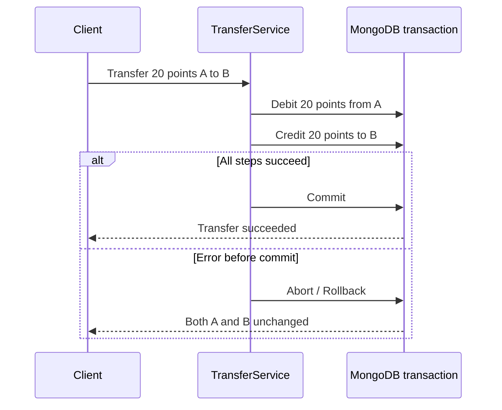
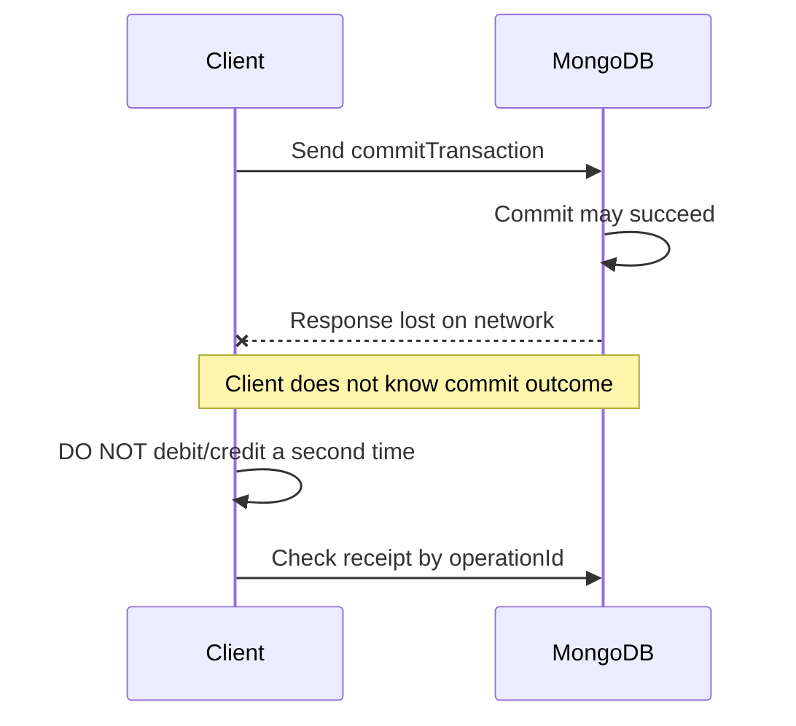

# Testing `@Version`, Rollbacks, and Retries on Transient Errors in Spring Data MongoDB

## 1. Three Easily Confused Scenarios in Write Testing

When using **Spring Data MongoDB** to map documents, persist via repositories or `MongoTemplate`, and execute transactions, an application must know what happens when two requests update the same record simultaneously or MongoDB hits a transient error. A write command returning an error does not always mean data was not written; a retry is not automatically safe either.

Consider a service transferring 20 points from wallet A to wallet B. Three scenarios require distinct tests:

| Scenario | Risk | Core mechanism | What tests must prove |
| --- | --- | --- | --- |
| Two requests update wallet A concurrently | Overwriting newer state with stale data (*lost update*) | `@Version` and optimistic locking | Only one write with the old version succeeds; the other is rejected |
| Debit A succeeded yet credit B fails | Data diverges across documents | MongoDB transactions and rollback | Debit A, credit B, and the transfer receipt all remain uncommitted |
| MongoDB reports a transient error or drops connection near commit | Retrying may double-apply the transfer | Error classification, bounded retry, idempotency | Retry only when safe; ambiguous commit outcomes are reconciled |

Two kinds of versions are distinct: `@Version` (`org.springframework.data.annotation.Version`) **detects write conflicts**, whereas a `schemaVersion` field (if present) is an application field describing document structure. Never use `schemaVersion` as a substitute for optimistic locking.

The content below uses a *loyalty points wallet* example for illustration. All numbers are test data; real financial currencies require additional ledger, rounding, reconciliation, and regulatory domain rules.

## 2. Setting Up a Model and Repository with `@Version`

```java
import org.springframework.data.annotation.Id;
import org.springframework.data.annotation.Version;
import org.springframework.data.mongodb.core.mapping.Document;

@Document("wallets")
public class WalletDocument {
    @Id
    private String id;

    private long points;

    @Version
    private Long revision;

    protected WalletDocument() {
        // For Spring Data MongoDB mapping.
    }

    public WalletDocument(String id, long points) {
        if (points < 0) {
            throw new IllegalArgumentException("points must be non-negative");
        }
        this.id = id;
        this.points = points;
    }

    public String getId() { return id; }
    public long getPoints() { return points; }
    public Long getRevision() { return revision; }

    public void debit(long amount) {
        if (amount <= 0 || points < amount) {
            throw new IllegalArgumentException("Insufficient balance or invalid amount");
        }
        points -= amount;
    }

    public void credit(long amount) {
        if (amount <= 0) {
            throw new IllegalArgumentException("amount must be positive");
        }
        points = Math.addExact(points, amount);
    }
}
```

```java
import org.springframework.data.mongodb.repository.MongoRepository;

public interface WalletRepository
        extends MongoRepository<WalletDocument, String> {
}
```

When Spring Data saves a document that already carries a `revision`, it includes the expected version in the update filter and increments the version via its mapping rules. If another writer has already bumped the record in the database, saving from the stale snapshot throws `OptimisticLockingFailureException`. This mechanism requires an **acknowledged write concern**; never use `WriteConcern.UNACKNOWLEDGED` when relying on optimistic locking outcomes.

Example timeline:

```text
T0  MongoDB: wallet-A {points: 100, revision: 0}
T1  Request X reads wallet-A, revision = 0
T2  Request Y reads wallet-A, revision = 0
T3  X debits 20, saves with filter revision = 0 -> succeeds, revision = 1
T4  Y debits 30 from stale revision = 0, saves -> conflict, does not overwrite X
```

Initial version numbers in this trace are illustrative: Spring Data initializes versions depending on the `@Version` field type (wrapper and primitive types follow different conventions). Tests should inspect the **actual version value after saving** rather than hardcoding what the first version number must be.

### Limitations of `@Version`

`@Version` protects write paths that go through compatible mapping/versioning logic. Code using the native MongoDB driver, import scripts, or updates whose queries omit the version check can modify documents without honoring the entity's optimistic locking contract. When calling `MongoTemplate.updateFirst`/`updateMulti`, verify how Spring Data handles version properties for that specific overload and query; do not assume every update method enforces versioning identically to `repository.save`.

Example of explicit version checking with a native update:

```java
import com.mongodb.client.model.Filters;
import com.mongodb.client.model.Updates;
import com.mongodb.client.result.UpdateResult;
import org.springframework.data.mongodb.core.MongoTemplate;

public boolean updatePointsIfVersionMatches(
        MongoTemplate template, String id, long expectedRevision, long newPoints) {
    UpdateResult result = template.getCollection("wallets").updateOne(
        Filters.and(
            Filters.eq("_id", id),
            Filters.eq("revision", expectedRevision)
        ),
        Updates.combine(
            Updates.set("points", newPoints),
            Updates.inc("revision", 1L)
        )
    );
    return result.getModifiedCount() == 1;
}
```

This is a **compare-and-set** example on a known version; it does not replace business checks (such as preventing negative points), data-type validation, or transactions when multiple documents are involved. Never combine `@Version` and a separate manual revision increment on the same write path without clearly defining which owns incrementing the version.

## 3. Testing Optimistic Locking with Two Independent Snapshots

The most readable and deterministic test loads the same document twice into two separate object instances and writes them sequentially. This reproduces a version race cleanly without depending on thread scheduling.

```java
import static org.junit.jupiter.api.Assertions.*;

import org.junit.jupiter.api.BeforeEach;
import org.junit.jupiter.api.Test;
import org.springframework.beans.factory.annotation.Autowired;
import org.springframework.dao.OptimisticLockingFailureException;
import org.springframework.boot.test.context.SpringBootTest;

@SpringBootTest
class WalletVersionTest {
    @Autowired WalletRepository wallets;

    @BeforeEach
    void reset() {
        wallets.deleteAll();
    }

    @Test
    void staleSnapshotCannotOverwriteNewerDocument() {
        wallets.save(new WalletDocument("wallet-A", 100));

        WalletDocument first = wallets.findById("wallet-A").orElseThrow();
        WalletDocument stale = wallets.findById("wallet-A").orElseThrow();
        assertEquals(first.getRevision(), stale.getRevision());

        first.debit(20);
        WalletDocument saved = wallets.save(first);
        assertNotEquals(stale.getRevision(), saved.getRevision());

        stale.debit(30);
        assertThrows(OptimisticLockingFailureException.class,
            () -> wallets.save(stale));

        WalletDocument inDb = wallets.findById("wallet-A").orElseThrow();
        assertEquals(80, inDb.getPoints());
        assertEquals(saved.getRevision(), inDb.getRevision());
    }
}
```

This test requires real MongoDB to verify the versioned behavior of `save()`. It proves nothing if `WalletRepository` is a mock stubbed to throw an exception. In a large suite, share the test MongoDB container/configuration across integration tests.

To test real concurrent contention, add a test using `CountDownLatch` or a barrier where two threads read the same revision and try to save simultaneously. Assert **both outcomes**: one save succeeds and one is rejected, along with the final stored balance—never check only exception counts in logs.

## 4. Retrying Version Conflicts: Re-Read and Recompute from Fresh State

An optimistic locking conflict does not always need to surface as a user-facing error. If business rules allow, the service can re-read the latest document and **re-apply the business rule**, up to a bounded number of attempts:

```java
import org.springframework.dao.OptimisticLockingFailureException;
import org.springframework.stereotype.Service;

@Service
public class WalletDebitService {
    private final WalletRepository wallets;

    public WalletDebitService(WalletRepository wallets) {
        this.wallets = wallets;
    }

    public void debitWithVersionRetry(String id, long amount) {
        final int maxAttempts = 3;

        for (int attempt = 1; attempt <= maxAttempts; attempt++) {
            WalletDocument wallet = wallets.findById(id).orElseThrow();
            wallet.debit(amount); // Re-validate balance against fresh state.

            try {
                wallets.save(wallet);
                return;
            } catch (OptimisticLockingFailureException conflict) {
                if (attempt == maxAttempts) {
                    throw conflict;
                }
                // Next attempt loads the newer version and re-evaluates rules.
            }
        }
    }
}
```

When two requests debit points concurrently, the second request **must never retry on the stale snapshot**. For example, if 20 points remain after the first debit and the second tries to debit 30, the retry must reject due to insufficient balance. Furthermore, if a client resends **the exact same debit request** after a timeout, this code would debit twice: optimistic locking protects against lost updates, **not business-level request idempotency**. Operations that must execute at most once need a unique `operationId` and processed-record check as shown in the transaction section.

Never retry indefinitely. Under heavy contention, use small retry limits, jittered backoff, latency caps, conflict-rate metrics, and consider redesigning hot documents.

## 5. Transactions and Rollback Across Multiple Documents

MongoDB guarantees atomicity **per single-document write**. Transferring points between two wallets updates at least two documents: debiting A and crediting B. If an error strikes between the steps, single-document atomicity is insufficient; a transaction commits or rolls back all changes together.



MongoDB transactions require a supporting deployment, typically a **replica set** or sharded cluster. In Spring Data MongoDB, configure `MongoTransactionManager` and invoke `@Transactional` methods through a Spring proxy. Merely adding the annotation without a suitable transaction manager does not ensure operations ran inside a transaction.

Example receipt record using `_id` as an idempotency key:

```java
import org.springframework.data.annotation.Id;
import org.springframework.data.mongodb.core.mapping.Document;

@Document("transferReceipts")
public record TransferReceipt(
    @Id String operationId,
    String fromWalletId,
    String toWalletId,
    long amount
) {
    public boolean sameRequest(String from, String to, long value) {
        return fromWalletId.equals(from)
            && toWalletId.equals(to)
            && amount == value;
    }
}
```

```java
import org.springframework.data.mongodb.repository.MongoRepository;

public interface TransferReceiptRepository
        extends MongoRepository<TransferReceipt, String> {
}
```

Transactional service:

```java
import org.springframework.stereotype.Service;
import org.springframework.transaction.annotation.Transactional;

@Service
public class TransferService {
    private final WalletRepository wallets;
    private final TransferReceiptRepository receipts;

    public TransferService(WalletRepository wallets,
                           TransferReceiptRepository receipts) {
        this.wallets = wallets;
        this.receipts = receipts;
    }

    @Transactional
    public void transferOnce(String operationId,
                             String fromId,
                             String toId,
                             long amount,
                             boolean failAfterDebitForTest) {
        if (fromId.equals(toId) || amount <= 0) {
            throw new IllegalArgumentException("Invalid transfer request");
        }

        var existing = receipts.findById(operationId);
        if (existing.isPresent()) {
            if (!existing.get().sameRequest(fromId, toId, amount)) {
                throw new IllegalArgumentException("operationId already used for a different request");
            }
            return; // Retry of an already recorded transfer.
        }

        WalletDocument from = wallets.findById(fromId).orElseThrow();
        WalletDocument to = wallets.findById(toId).orElseThrow();

        from.debit(amount);
        wallets.save(from);

        if (failAfterDebitForTest) {
            throw new IllegalStateException("Simulated failure after debit");
        }

        to.credit(amount);
        wallets.save(to);

        receipts.insert(new TransferReceipt(operationId, fromId, toId, amount));
    }
}
```

`failAfterDebitForTest` is solely a **fault-injection hook for illustrating tests**; in production use test hooks or dedicated test fixtures rather than exposing a client-controllable flag. With `@Transactional`, an unchecked exception before commit triggers rollback by default. For checked exceptions, configure `rollbackFor` when business rules require it.

Checking `findById(operationId)` before `insert(receipt)` **alone does not prevent two concurrent transactions from both seeing no receipt**: both may read empty initially. However, MongoDB's unique `_id` blocks both receipts from committing. A transaction hitting a write conflict or duplicate key must fail the whole transaction; a subsequent attempt inspects the committed receipt and validates payload equality. Never swallow a duplicate key exception inside a transaction and return success when prior steps are not guaranteed committed.

Furthermore, database transactions cannot roll back external side effects such as emails, HTTP calls, non-outbox messages, or Redis updates outside the MongoDB transaction. External side effects require their own idempotency or a transactional outbox pattern.

## 6. Transaction Test Environment Using Real MongoDB

Mock repositories cannot simulate optimistic locking, snapshot isolation, write conflicts, or MongoDB rollbacks. Run integration tests on a MongoDB version matching deployment, using a **replica set** so transactions work.

Illustrative Spring Boot Test + Testcontainers skeleton (verify `MongoDBContainer` imports/packages against your chosen Testcontainers version):

```java
import org.junit.jupiter.api.Test;
import org.springframework.boot.test.context.SpringBootTest;
import org.springframework.boot.test.context.TestConfiguration;
import org.springframework.context.annotation.Bean;
import org.springframework.context.annotation.Import;
import org.springframework.data.mongodb.MongoDatabaseFactory;
import org.springframework.data.mongodb.MongoTransactionManager;
import org.springframework.test.context.DynamicPropertyRegistry;
import org.springframework.test.context.DynamicPropertySource;
import org.testcontainers.containers.MongoDBContainer;
import org.testcontainers.junit.jupiter.Container;
import org.testcontainers.junit.jupiter.Testcontainers;
import org.testcontainers.utility.DockerImageName;

@SpringBootTest
@Testcontainers
@Import(TransferIntegrationTest.TransactionConfig.class)
class TransferIntegrationTest {
    @Container
    static MongoDBContainer mongo =
        new MongoDBContainer(DockerImageName.parse("mongo:7.0"));

    @DynamicPropertySource
    static void mongoProperties(DynamicPropertyRegistry registry) {
        registry.add("spring.data.mongodb.uri", mongo::getReplicaSetUrl);
    }

    @TestConfiguration
    static class TransactionConfig {
        @Bean
        MongoTransactionManager transactionManager(MongoDatabaseFactory factory) {
            return new MongoTransactionManager(factory);
        }
    }
}
```

This is a **configuration skeleton** without test cases yet. You need a matching Spring Boot application/repository/component scan so Spring discovers the beans in the example. With Testcontainers 2.x or other dependency setups, packages and `MongoDBContainer` constructors can differ; use the API matching your project. `getReplicaSetUrl()` connects the client to the container's replica set; never swap in standalone MongoDB and expect `@Transactional` to work.

Do not place `@Transactional` on the test method itself when observing commit/rollback outcomes from an independent caller's perspective. Test fixtures can clear data via repositories before/after each case to avoid state leakage.

## 7. Testing Rollback After Writing the First Document

The objective is not merely checking that the service throws an exception, but confirming **the database actually rolled back**. Place the tests below inside the integration test class configured above, with repository and service fields autowired by Spring:

```java
import static org.junit.jupiter.api.Assertions.*;

import org.junit.jupiter.api.BeforeEach;
import org.junit.jupiter.api.Test;
import org.springframework.beans.factory.annotation.Autowired;

// Fields and tests inside TransferIntegrationTest:
@Autowired WalletRepository wallets;
@Autowired TransferReceiptRepository receipts;
@Autowired TransferService transfers;

@BeforeEach
void prepareData() {
    receipts.deleteAll();
    wallets.deleteAll();
    wallets.save(new WalletDocument("A", 100));
    wallets.save(new WalletDocument("B", 40));
}

@Test
void mustRollBackBothWalletsAndReceiptWhenStepTwoFails() {
    Long revisionA = wallets.findById("A").orElseThrow().getRevision();

    assertThrows(IllegalStateException.class,
        () -> transfers.transferOnce("op-rollback", "A", "B", 20, true));

    WalletDocument afterA = wallets.findById("A").orElseThrow();
    WalletDocument afterB = wallets.findById("B").orElseThrow();

    assertEquals(100, afterA.getPoints());
    assertEquals(40, afterB.getPoints());
    assertEquals(revisionA, afterA.getRevision());
    assertFalse(receipts.existsById("op-rollback"));
}

@Test
void successfulTransferCommitsBothSidesAndItsReceipt() {
    transfers.transferOnce("op-ok", "A", "B", 20, false);

    assertEquals(80, wallets.findById("A").orElseThrow().getPoints());
    assertEquals(60, wallets.findById("B").orElseThrow().getPoints());
    assertTrue(receipts.existsById("op-ok"));

    transfers.transferOnce("op-ok", "A", "B", 20, false);
    assertEquals(80, wallets.findById("A").orElseThrow().getPoints());
    assertEquals(60, wallets.findById("B").orElseThrow().getPoints());
}
```

Notice the test methods have no `@Transactional`; each call to `TransferService` passes through the Spring proxy to open and finish its transaction. The second test also verifies replaying the same `operationId` with identical arguments does not transfer again. Reusing an `operationId` with different arguments must be rejected so a committed ID cannot be hijacked for another operation.

Thorough rollback tests should also inject failures after **both wallets update yet before receipt insertion**, during receipt insert, and during in-transaction write conflicts. Asserting only the exception without reading MongoDB back after the method finishes can miss misconfigured transactions.

## 8. Classifying Errors to Decide Whether to Retry

Not every MongoDB exception is retryable. Retrying requires knowing **where in the read–write–commit lifecycle** the failure happened, whether an operation ID exists, and whether the transaction may already have committed.

| Error / signal | Recommended handling | Reason |
| --- | --- | --- |
| `OptimisticLockingFailureException` | Re-read latest version and recompute; bounded retry if allowed | Stale snapshot rejected; underlying data changed |
| Duplicate key on receipt / unique index | Inspect `operationId` and payload; never blindly treat as success | Could be a duplicate retry or a different data error |
| Error labeled `TransientTransactionError` | May retry the **entire transaction** in a fresh session/transaction when safe | Previous transaction did not finish; retry cleanly from the start |
| Error labeled `UnknownTransactionCommitResult` | Do not blindly re-run business logic; determine outcome or retry **commit** via compatible driver mechanisms | Commit may have succeeded even though the client missed the ack |
| `MongoSocketException`, timeout, general network error | Analyze failure phase, driver labels, and idempotency; avoid blanket retries | Server may have processed the command while the reply was lost |
| Validation, auth, malformed data, insufficient points | Do not retry without changing inputs | Retrying identical inputs repeats the failure and adds load |

MongoDB Java Driver exposes `MongoException.hasErrorLabel(String)` for server/driver error labels. Spring may wrap exceptions in outer wrappers, so inspect the entire `cause` chain rather than checking only `instanceof MongoException` on the top-level exception:

```java
import com.mongodb.MongoException;

public final class MongoErrorLabels {
    private MongoErrorLabels() {}

    public static boolean contains(Throwable failure, String label) {
        for (Throwable cause = failure; cause != null; cause = cause.getCause()) {
            if (cause instanceof MongoException mongo && mongo.hasErrorLabel(label)) {
                return true;
            }
        }
        return false;
    }
}
```

Never assume all errors from `MongoTransactionManager` preserve labels identically across every version: test against your actual driver and configuration, and log exception class, error codes, and labels without logging sensitive payloads.

### Distinguishing Retryable Writes from Transaction Retries

Depending on topology and configuration, MongoDB Driver supports **retryable writes** for eligible single-step write commands when `retryWrites=true`. That is a driver-level mechanism for supported operations and does not replace multi-step business retries or transaction rollbacks. Conversely, adding a Spring-level retry loop should account for driver-level internal retries to avoid multiplying attempts and latency excessively.

## 9. Retry Loop for Restartable Transactions

An orchestration layer **outside** the `@Transactional` bean can re-invoke the transactional method when an error is classified as retryable. Each call through the Spring proxy creates a fresh transaction boundary; never put a retry loop inside a transaction already marked rollback-only.

```java
import org.springframework.stereotype.Service;

@Service
public class TransferRetryFacade {
    private final TransferService transferService;

    public TransferRetryFacade(TransferService transferService) {
        this.transferService = transferService;
    }

    public void transfer(String operationId, String fromId,
                         String toId, long amount) {
        final int maxAttempts = 3;

        for (int attempt = 1; attempt <= maxAttempts; attempt++) {
            try {
                // Spring proxy manages transaction/commit before returning.
                transferService.transferOnce(
                    operationId, fromId, toId, amount, false);
                return;
            } catch (RuntimeException failure) {
                if (MongoErrorLabels.contains(
                        failure, "UnknownTransactionCommitResult")) {
                    // Never blindly replay business logic when commit outcome is unknown.
                    throw new IllegalStateException(
                        "Commit outcome unknown; reconcile operationId",
                        failure);
                }

                boolean transientTransaction = MongoErrorLabels.contains(
                    failure, "TransientTransactionError");
                if (!transientTransaction || attempt == maxAttempts) {
                    throw failure;
                }

                pauseBeforeRetry(attempt);
            }
        }
    }

    private static void pauseBeforeRetry(int attempt) {
        try {
            Thread.sleep(50L * attempt); // Demo: production may add jitter.
        } catch (InterruptedException interrupted) {
            Thread.currentThread().interrupt();
            throw new IllegalStateException("Retry thread interrupted", interrupted);
        }
    }
}
```

This is an **imperative** illustration and is unsuitable for blocking threads inside a reactive pipeline. With `ReactiveMongoTemplate`/Reactive MongoDB and Reactor, manage transactions via the reactive context and non-blocking retry operators, ensuring each retry opens a fresh transaction; never call `Thread.sleep` on event-loop threads.

This loop does not cover every failure variant. In real systems, retry decisions may live inside a driver transaction callback, transaction manager, or explicit coordinator. When multiple layers retry, cap total elapsed time and attempts for the whole request. Most importantly, **never re-run the entire operation after `UnknownTransactionCommitResult` merely because the exception looks “transient.”**

## 10. Why `UnknownTransactionCommitResult` Needs Its Own Test

Consider a connection drop while the client sends `commitTransaction`:



You cannot deduce *transaction failed* merely because the client lost the commit acknowledgment. The driver supports retrying the **commit command** for the same transaction/session under supported conditions; inspect your Spring transaction manager and driver version to verify what is implemented. After exiting the transaction, the application can query the receipt on an appropriate read path to determine the outcome, though **a single read not seeing the receipt does not prove the earlier commit failed** while commit state remains uncertain.

A reliable design uses:

1. A stable `operationId` per transfer request; client retries reuse the exact same ID.
2. A receipt document with unique `_id` written **in the same transaction** as both wallet updates.
3. When commit outcome is unknown, return an indeterminate status or run reconciliation by `operationId` with explicit read/write concerns and wait bounds.
4. If the receipt is found, verify `(fromId, toId, amount)` and committed state before returning success.
5. If still unresolved after verification bounds, raise an alert/investigative state or queue for reconciliation—never issue a brand-new transfer with a new ID.

This prevents confusing **retrying a commit already sent** with **starting a brand-new transfer**.

## 11. Testing Transient Failures in a Controlled Way

Combine two complementary test layers:

**Fast policy tests for retry decisions:** mock/stub the transaction boundary and force the first two calls to throw an error carrying `TransientTransactionError`, succeeding on the third. Assert maximum attempts, backoff behavior, and that all attempts preserve `operationId`. For `UnknownTransactionCommitResult`, assert the facade **never** calls `transferOnce` a second time. This tests retry policy without claiming to prove MongoDB rollback.

**Integration tests with real MongoDB:** use a replica set and controlled fault injection (such as the `failCommand` failpoint if supported by your test MongoDB build, or test-environment network disruption) to simulate network/transaction failures. Verify actual driver error labels, transaction attempt counts, final wallet balances, and receipts. Never enable failpoints in production to run tests.

| Scenario | Outcome to observe |
| --- | --- |
| `TransientTransactionError` before commit | Transaction leaves no partial transfer; safe retry succeeds from clean state |
| Repeated transient errors | Stops at retry limit and surfaces error; never loops infinitely |
| Error after server committed yet client missed ack | No second transfer occurs; reconciles by `operationId` |
| Concurrent writer updates wallet before transaction | No lost updates; conflict classified and handled appropriately |
| Identical `operationId` resent | No double debit/credit; receipt validates matching payload |
| Identical `operationId` with mismatched payload | Rejected; never treated as valid replay |
| Client crashes right after commit | After restart, updated wallets and receipt are still readable from MongoDB |
| MongoDB does not support transactions | Test fails loudly, exposing misconfiguration |

Tests should record error codes, error labels, retry counts, and elapsed duration rather than merely asserting an exception occurred. That helps separate business bugs from slow-environment timeouts.

## 12. Issues Easily Masked by Naive Tests

| Mistake | Why it is dangerous | Better verification |
| --- | --- | --- |
| Mocking `repository.save` and claiming `@Version` works | Mocks do not enforce version checks in MongoDB | Use real MongoDB and save two snapshots from the same revision |
| Using `@Transactional` against standalone MongoDB | Tests fail to mirror production transaction behavior | Run a replica set/sharded test environment and verify the manager |
| Putting `@Transactional` on a self-invoked `this` method | Default Spring proxy is bypassed | Invoke through another bean or valid proxy |
| Asserting only the exception on rollback | Earlier writes might still have committed | Read back all documents, versions, and receipts outside the transaction |
| Retrying inside the same failed transaction | Session/transaction may be aborted and unusable | Start a fresh transaction via an outer boundary |
| Retrying every timeout blindly | Can duplicate already-committed operations | Classify failure phase, enforce idempotency, reconcile commit |
| Generating a new ID on client retry | Impossible to detect duplicate business operation | Keep `operationId` stable across retries |
| Catching exceptions and returning success inside a transaction | Can hide rollback-only state or duplicate failures | Let exceptions roll back; reconcile outside the transaction |
| Assuming Redis/email roll back with MongoDB | Causes external side effects on failed transactions | Use transactional outbox or post-commit idempotent handlers |
| Using `Thread.sleep` to force concurrency races | Flaky under CI load | Use barriers/latches and deterministic synchronization events |

### Write Concern and Read Concern Considerations

Optimistic locking relies on acknowledged writes to detect version mismatches. For critical transactions, deployment environments must configure write concern and read concern matching durability and consistency policies. Never assume passing tests on a single-node test container validate primary failover or replication-level commit timing in a multi-node replica set. Add dedicated failover recovery tests and infrastructure monitoring when high reliability is required.

## 13. Step-by-Step Practice Workflow

1. Create collection `wallets` with documents A (100 points) and B (40 points), using `@Version` and `WalletRepository`.
2. Load A into two independent objects, update and save the first, then try saving the second. Verify `OptimisticLockingFailureException` and final balance/revision.
3. Enable `MongoTransactionManager` on a test MongoDB replica set. Implement `TransferService` updating A, B, and inserting a receipt inside one transaction.
4. Inject a failure after debiting A; verify A, B, and receipt remain unchanged. Also inject a failure at the final step to confirm prior writes roll back.
5. Execute a successful transfer with `operationId = op-101`, then replay the exact same ID and payload. Verify only **one** transfer occurred.
6. Simulate transient errors at the transaction boundary with up to three retries; verify every attempt uses the same `operationId`.
7. Simulate an unknown commit outcome and verify the system switches to reconciliation instead of starting a new transfer with a fresh ID.
8. Record error metrics, retry counts, commits/rollbacks, duplicate-receipt checks, and completion times; run the suite repeatedly to uncover flakiness.

These instructions are test exercises strictly for disposable test environments. Never enable failpoints or insert test wallets in a user-facing MongoDB deployment.

## 14. Completion Criteria

A trustworthy Spring Data MongoDB test suite must prove both **final database state** and **application behavior under failure states**. For the transfer problem, the core invariants are:

```text
If transferring 20 points from A to B succeeds once:
    A decreases by 20; B increases by 20; one receipt exists for operationId.

If the transaction fails and rolls back:
    A is unchanged; B is unchanged; no committed receipt exists.

If two writers compete on the same version:
    Neither writer overwrites newer data with a stale snapshot.

If commit outcome is unknown:
    Do not re-execute the operation under a different operationId;
    reconcile before reporting a definitive outcome to the client.
```

Grounded in these invariants, teams can choose retry, timeout, backoff, transaction, and idempotency policies matching business needs, then diagnose performance using metrics from `MongoTemplate`, repositories, the driver, and live MongoDB. Maintain and re-run this test suite whenever upgrading Spring Data, the MongoDB Driver, or cluster configuration, as exception-wrapping and transaction behaviors can shift across versions.
