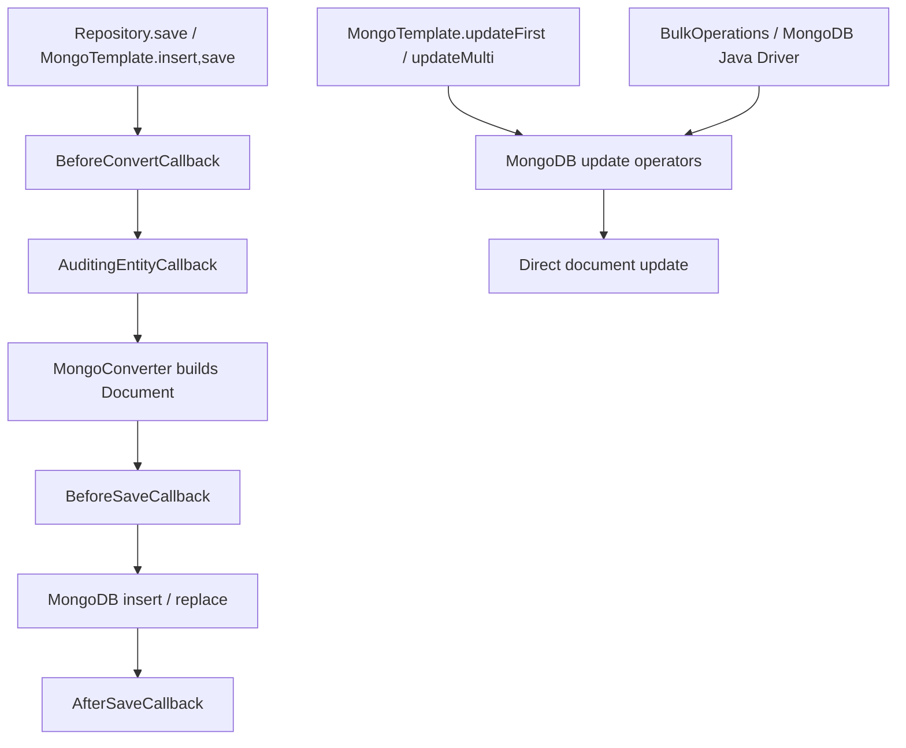

# Testing Callbacks, Auditing, and Writes Outside the Entity Lifecycle

## Objectives and Scope

When using **Spring Data MongoDB**, applications often attach business logic right at entity save time: normalizing codes, validating data, assigning creator identity, recording modification timestamps, or emitting events. These behaviors can be implemented using **entity callbacks**, **MongoDB mapping events**, and **auditing**. An easily missed nuance is that **not every MongoDB write passes through the entity conversion and save lifecycle**.

For example, `MongoRepository.save(invoice)` and `MongoTemplate.save(invoice)` traverse the object-persistence flow; a `MongoTemplate.updateFirst(...)` call executes a direct update on the document. If tests only exercise `save`, the application can miss audit fields and normalization rules during bulk updates, data-fix scripts, or direct MongoDB Java Driver calls.

After this lesson, you will be able to:

- Write and test `BeforeConvertCallback`, `BeforeSaveCallback`, and `AfterSaveCallback`.
- Enable and verify `@CreatedDate`, `@LastModifiedDate`, `@CreatedBy`, and `@LastModifiedBy` with `@EnableMongoAuditing`.
- Distinguish callback unit tests from integration tests that verify actual persisted data in MongoDB.
- Prove via tests that `updateFirst`, bulk writes, and direct MongoDB Driver operations do not automatically invoke entity save callbacks.
- Design direct update paths with explicit audit rules to prevent data drift.

This lesson uses **Java**, **Spring Data MongoDB**, and **Spring Boot** with synchronous APIs (`MongoTemplate`, `MongoRepository`), then points out differences in reactive APIs. Integration test examples illustrate common setups for **Spring Boot 3.x**, **JUnit 5**, and **Testcontainers 1.x**; adjust dependency coordinates and imports if using other versions.

## 1. Map of Write Paths



The diagram shows the stages **conceptually**. Exact ordering across multiple `BeforeConvertCallback` beans depends on `@Order`/`Ordered`; auditing defaults to a `BeforeConvertCallback` with order `100`. Therefore, do not assume every application callback always runs before auditing.

| Write operation | Converts entity to document? | Runs pre-save entity callbacks? | Automatic entity auditing? |
| --- | --- | --- | --- |
| `MongoTemplate.insert(entity)`, `save(entity)` | Yes | Yes | Yes, when enabled and configured properly |
| `MongoRepository.save(entity)` | Yes, via Spring Data infrastructure | Yes | Yes, when enabled and configured properly |
| `MongoTemplate.updateFirst(query, update, Entity.class)` | Does not convert full entity for save | Does not run `save`'s `BeforeConvert`/`BeforeSave` chain | Does not auto-populate audit annotations via entity callbacks |
| `MongoTemplate.updateMulti(...)` | Same direct update | No | No |
| `MongoTemplate.bulkOps(...).updateOne/updateMulti(...)` | Direct bulk write | No | No |
| `MongoCollection.updateOne/updateMany(...)` via Java Driver | Bypasses Spring Data entity lifecycle | No | No |
| `mongosh` / migration scripts | Bypasses Spring Data entity lifecycle | No | No |

**Important distinction:** Spring Data updates still map field names, convert data types, and support `@Version` in applicable cases. That **does not mean** `BeforeConvertCallback` runs or auditing annotations auto-update. Also, `findAndModify` may convert its returned document into an object and emit **read-path** callbacks/events; that still does not invoke `save` callbacks on the update itself.

## 2. Three Key Hooks in the Entity Lifecycle

### `BeforeConvertCallback<T>`

Runs before Spring Data converts the Java object into `org.bson.Document`. This is the right place to normalize or set a field **that needs to be persisted**:

```java
import java.util.Locale;
import org.springframework.core.annotation.Order;
import org.springframework.data.mongodb.core.mapping.event.BeforeConvertCallback;

@Order(0)
public class InvoiceNormalizer implements BeforeConvertCallback<Invoice> {

    @Override
    public Invoice onBeforeConvert(Invoice entity, String collection) {
        if (entity.code != null) {
            entity.code = entity.code.strip().toUpperCase(Locale.ROOT);
        }
        return entity;
    }
}
```

In this example, `"  inv-001  "` is normalized to `"INV-001"` before conversion. `@Order(0)` ensures this callback runs before `AuditingEntityCallback` (order `100`) during the `BeforeConvert` phase.

### `BeforeSaveCallback<T>`

Runs **after** the entity has been converted to a `Document` and before the write command executes. To alter persisted data at this step, modify the passed-in **document**:

```java
import org.bson.Document;
import org.springframework.data.mongodb.core.mapping.event.BeforeSaveCallback;

public class InvoiceWriteMarker implements BeforeSaveCallback<Invoice> {

    @Override
    public Invoice onBeforeSave(
            Invoice entity, Document document, String collection) {
        document.put("writePath", "entity-lifecycle");
        return entity;
    }
}
```

Merely assigning `entity.code = ...` inside `BeforeSaveCallback` may **not be persisted** because `Document` was already constructed earlier. To mutate persisted entity fields, prefer `BeforeConvertCallback`; to touch raw BSON directly, mutate `document`.

### `AfterSaveCallback<T>`

Runs after the save completes. It can record callback invocations in tests or trigger post-save actions that do not depend on re-writing the entity itself:

```java
import java.util.concurrent.atomic.AtomicInteger;
import org.bson.Document;
import org.springframework.data.mongodb.core.mapping.event.AfterSaveCallback;

public class SaveInvocationCounter implements AfterSaveCallback<Invoice> {
    private final AtomicInteger calls = new AtomicInteger();

    @Override
    public Invoice onAfterSave(
            Invoice entity, Document document, String collection) {
        calls.incrementAndGet();
        return entity;
    }

    public int count() {
        return calls.get();
    }

    public void reset() {
        calls.set(0);
    }
}
```

`AfterSaveCallback` is only a convenient observation hook for tests; do not treat an in-JVM counter as sole proof that external systems received a business event. When reliable post-transaction event delivery is required, use a dedicated guarantee such as an outbox.

## 3. Sample Entity with Auditing

The example below uses collection `invoice_samples` and package-private fields to keep test code concise and readable. Classes in the same package can access these fields directly; production code normally uses constructors, getters, and setters matching entity design.

```java
import java.time.Instant;
import org.bson.types.ObjectId;
import org.springframework.data.annotation.CreatedBy;
import org.springframework.data.annotation.CreatedDate;
import org.springframework.data.annotation.Id;
import org.springframework.data.annotation.LastModifiedBy;
import org.springframework.data.annotation.LastModifiedDate;
import org.springframework.data.mongodb.core.mapping.Document;

@Document(collection = "invoice_samples")
public class Invoice {

    @Id
    ObjectId id;

    String tenantId;
    String code;

    @CreatedBy
    String createdBy;

    @CreatedDate
    Instant createdAt;

    @LastModifiedBy
    String lastModifiedBy;

    @LastModifiedDate
    Instant lastModifiedAt;

    public Invoice() {
    }

    public Invoice(String tenantId, String code) {
        this.tenantId = tenantId;
        this.code = code;
    }
}
```

Spring Data supports auditing metadata via these annotations:

| Annotation | Data | What tests should check |
| --- | --- | --- |
| `@CreatedBy` | Creator actor | Matches identity supplied by `AuditorAware` on insert |
| `@CreatedDate` | Creation timestamp | Populated and preserved unchanged when updating an existing entity |
| `@LastModifiedBy` | Modifier actor | Reflects actor on updating `save` |
| `@LastModifiedDate` | Modification timestamp | Updates on updating `save` (when clock is actively controlled) |

By default `@EnableMongoAuditing` sets `modifyOnCreate = true`, meaning last-modified fields can be **populated on initial creation**. Tests should not assume `lastModifiedAt` or `lastModifiedBy` must be `null` after insert.

**Watch out for new-entity detection:** Spring Data relies on metadata such as ID, `@Version`, or `Persistable.isNew()`. If an application pre-assigns IDs without supplying a matching `isNew` strategy, auditing may treat the object as an update. Tests should include pre-assigned IDs if your domain uses them.

## 4. Testable Auditing Configuration

For deterministic tests, control both **actor** and **clock**. Comparing two `Instant.now()` calls on a CI runner is prone to flakiness; instead use a test-controlled `DateTimeProvider`.

```java
import java.time.Instant;
import java.time.temporal.TemporalAccessor;
import java.util.Optional;
import org.springframework.data.auditing.DateTimeProvider;

public class ControlledTimeProvider implements DateTimeProvider {

    private Instant current = Instant.parse("2026-11-20T00:00:00Z");

    public void set(Instant current) {
        this.current = current;
    }

    @Override
    public Optional<TemporalAccessor> getNow() {
        return Optional.of(current);
    }
}
```

This is a stub suited only for single-threaded tests. If tests run in parallel sharing a Spring context, separate contexts or use non-shared clock management to avoid shared mutable state.

```java
import java.util.Optional;
import org.springframework.boot.test.context.TestConfiguration;
import org.springframework.context.annotation.Bean;
import org.springframework.data.domain.AuditorAware;
import org.springframework.data.mongodb.config.EnableMongoAuditing;

@TestConfiguration(proxyBeanMethods = false)
@EnableMongoAuditing(
    auditorAwareRef = "testAuditor",
    dateTimeProviderRef = "testTimeProvider"
)
public class InvoiceMongoTestConfig {

    @Bean
    AuditorAware<String> testAuditor() {
        return () -> Optional.of("ci-test-user");
    }

    @Bean
    ControlledTimeProvider testTimeProvider() {
        return new ControlledTimeProvider();
    }

    @Bean
    InvoiceNormalizer invoiceNormalizer() {
        return new InvoiceNormalizer();
    }

    @Bean
    InvoiceWriteMarker invoiceWriteMarker() {
        return new InvoiceWriteMarker();
    }

    @Bean
    SaveInvocationCounter saveInvocationCounter() {
        return new SaveInvocationCounter();
    }
}
```

This configuration is **imported into the test slice**, not used to replace production `AuditorAware`. In real apps, `AuditorAware` usually pulls the principal from security context, while background jobs define an explicit system actor.

If only `@CreatedDate` and `@LastModifiedDate` are used, an `AuditorAware` bean is not strictly required; however, `@CreatedBy`/`@LastModifiedBy` in this example require an identity source.

## 5. Callback Unit Tests: Checking Logic Without MongoDB

A pure callback can be tested quickly with JUnit 5 without booting Spring:

```java
import static org.junit.jupiter.api.Assertions.assertEquals;
import static org.junit.jupiter.api.Assertions.assertSame;
import org.bson.Document;
import org.junit.jupiter.api.Test;

class InvoiceCallbackUnitTest {

    @Test
    void normalizeCodeBeforeConversion() {
        Invoice invoice = new Invoice("tenant-a", "  inv-001  ");
        Invoice result = new InvoiceNormalizer()
                .onBeforeConvert(invoice, "invoice_samples");

        assertSame(invoice, result);
        assertEquals("INV-001", result.code);
    }

    @Test
    void beforeSaveChangesDocumentThatWillBePersisted() {
        Invoice invoice = new Invoice("tenant-a", "INV-001");
        Document bson = new Document("code", invoice.code);

        new InvoiceWriteMarker()
                .onBeforeSave(invoice, bson, "invoice_samples");

        assertEquals("entity-lifecycle", bson.getString("writePath"));
    }
}
```

Unit tests prove the **callback algorithm** works, yet **do not prove Spring Data registered the bean, invoked it at the right phase, or persisted the fields to MongoDB**. Those require integration tests.

For callbacks emitting events, calling HTTP endpoints, or writing to external systems, unit tests should use mocked collaborators and check arguments and error paths, avoiding live infrastructure in unit tests.

## 6. Integration Tests with `@DataMongoTest` and Testcontainers

An integration test needs real running MongoDB to distinguish:

- Values on the **Java entity before saving**.
- Values **persisted in BSON**.
- Values **read back after an alternative write path**.

`@DataMongoTest` initializes the Spring Data MongoDB test slice. `@Import(InvoiceMongoTestConfig.class)` explicitly wires the lesson's auditing and callback beans; Testcontainers avoids relying on a shared database.

The example uses **Testcontainers 1.x** (`org.testcontainers.containers.MongoDBContainer`). In Testcontainers 2.x, the MongoDB module package changes; pick imports and dependencies matching your project BOM. Docker must be ready to run integration tests.

```java
import static org.junit.jupiter.api.Assertions.*;

import java.time.Instant;
import org.bson.Document;
import org.junit.jupiter.api.BeforeEach;
import org.junit.jupiter.api.Test;
import org.springframework.beans.factory.annotation.Autowired;
import org.springframework.boot.test.autoconfigure.data.mongo.DataMongoTest;
import org.springframework.context.annotation.Import;
import org.springframework.data.mongodb.core.MongoTemplate;
import org.springframework.data.mongodb.core.query.Criteria;
import org.springframework.data.mongodb.core.query.Query;
import org.springframework.data.mongodb.core.query.Update;
import org.springframework.test.context.DynamicPropertyRegistry;
import org.springframework.test.context.DynamicPropertySource;
import org.testcontainers.containers.MongoDBContainer;
import org.testcontainers.junit.jupiter.Container;
import org.testcontainers.junit.jupiter.Testcontainers;
import org.testcontainers.utility.DockerImageName;

import com.mongodb.client.result.UpdateResult;
import static com.mongodb.client.model.Filters.eq;

@Testcontainers
@DataMongoTest
@Import(InvoiceMongoTestConfig.class)
class InvoiceLifecycleIntegrationTest {

    private static final Instant T0 =
            Instant.parse("2026-11-20T08:00:00Z");
    private static final Instant T1 =
            Instant.parse("2026-11-20T09:00:00Z");

    @Container
    static final MongoDBContainer mongo = new MongoDBContainer(
            DockerImageName.parse("mongo:7.0"));

    @DynamicPropertySource
    static void mongoConnection(DynamicPropertyRegistry properties) {
        properties.add("spring.data.mongodb.uri", mongo::getReplicaSetUrl);
    }

    @Autowired
    MongoTemplate template;

    @Autowired
    ControlledTimeProvider time;

    @Autowired
    SaveInvocationCounter saveCalls;

    @BeforeEach
    void resetData() {
        // Drop only the Testcontainers test collection.
        template.dropCollection(Invoice.class);
        time.set(T0);
        saveCalls.reset();
    }

    @Test
    void insertInvokesCallbackAndAuditing() {
        Invoice saved = template.insert(
                new Invoice("tenant-a", "  inv-001  "));

        assertNotNull(saved.id);
        assertEquals("INV-001", saved.code);
        assertEquals("ci-test-user", saved.createdBy);
        assertEquals(T0, saved.createdAt);
        assertEquals(T0, saved.lastModifiedAt);
        assertEquals(1, saveCalls.count());

        // Read raw BSON: verify what was actually persisted.
        Document raw = template.getCollection("invoice_samples")
                .find(eq("_id", saved.id))
                .first();

        assertNotNull(raw);
        assertEquals("INV-001", raw.getString("code"));
        assertEquals("ci-test-user", raw.getString("createdBy"));
        assertEquals(T0, raw.getDate("createdAt").toInstant());
        assertEquals("entity-lifecycle", raw.getString("writePath"));
    }

    @Test
    void saveExistingEntityUpdatesAuditMetadata() {
        Invoice saved = template.insert(
                new Invoice("tenant-a", "inv-002"));

        time.set(T1);
        saved.code = "  inv-002-new  ";
        template.save(saved);

        Invoice reread = template.findById(saved.id, Invoice.class);
        assertNotNull(reread);
        assertEquals("INV-002-NEW", reread.code);
        assertEquals(T0, reread.createdAt);
        assertEquals(T1, reread.lastModifiedAt);
        assertEquals("ci-test-user", reread.lastModifiedBy);
        assertEquals(2, saveCalls.count());
    }

    @Test
    void directUpdateDoesNotRunSaveCallbacksOrAuditing() {
        Invoice saved = template.insert(
                new Invoice("tenant-a", "inv-003"));
        int callbacksAfterInsert = saveCalls.count();

        time.set(T1);
        Query byId = Query.query(Criteria.where("_id").is(saved.id));
        UpdateResult result = template.updateFirst(
                byId,
                new Update().set("code", "  direct-value  "),
                Invoice.class
        );

        assertEquals(1L, result.getMatchedCount());
        assertEquals(callbacksAfterInsert, saveCalls.count());

        Invoice reread = template.findById(saved.id, Invoice.class);
        assertNotNull(reread);
        // Not normalized by InvoiceNormalizer.
        assertEquals("  direct-value  ", reread.code);
        // updateFirst does not invoke AuditingEntityCallback.
        assertEquals(T0, reread.lastModifiedAt);
    }
}
```

**How to read the results:**

- Test 1 verifies `BeforeConvertCallback` (code normalized), auditing (creator and creation time), `BeforeSaveCallback` (`writePath` in raw BSON), and `AfterSaveCallback` (counter).
- Test 2 controls time deterministically without `Thread.sleep(...)`. `createdAt` remains fixed while `lastModifiedAt` advances from `T0` to `T1`.
- Test 3 proves `updateFirst` performs a direct update: data changes, yet leading/trailing spaces remain, modification time stays unchanged, and `AfterSaveCallback` does not increment.

When running tests in parallel, shared clock/counter beans within a Spring context can interfere. Use isolated test instances or non-shared bean state; these examples assume sequential execution within a context.

**Why inspect raw BSON?** Reading back via `MongoTemplate.findById(..., Invoice.class)` can fire read-path callbacks (`AfterConvertCallback`) if registered. Reading via `template.getCollection(...).find(...)` reveals the exact stored document without passing through entity mapping callbacks.

## 7. Testing Write Paths Outside the Entity Lifecycle

### 7.1. `updateFirst`, `updateMulti`, and `findAndModify`

These update commands apply `Update`/MongoDB update operators to existing documents. They **do not convert the full entity for saving** as `save` does, so `BeforeConvertCallback`, `BeforeSaveCallback`, and `AfterSaveCallback` do not execute for that write.

```java
Query selector = Query.query(
        Criteria.where("tenantId").is("tenant-a")
                .and("code").is("INV-001"));

Update change = new Update()
        .set("code", "INV-001-PAID");

template.updateFirst(selector, change, Invoice.class);
```

If the system requires `lastModifiedAt` and `lastModifiedBy` on **every** update path, set them **explicitly** in the update:

```java
Instant now = clock.instant(); // Clock injected into service
String actor = authenticatedActorId; // Taken from authenticated context

Update auditedChange = new Update()
        .set("code", "INV-001-PAID")
        .set("lastModifiedAt", now)
        .set("lastModifiedBy", actor);

UpdateResult result = template.updateFirst(
        Query.query(Criteria.where("_id").is(invoiceId)
                .and("tenantId").is(authorizedTenantId)),
        auditedChange,
        Invoice.class
);

if (result.getMatchedCount() == 0) {
    // No document found within authorized tenant scope.
}
```

In this snippet, `clock` is a `java.time.Clock` injected via the service constructor, `invoiceId` is a valid invoice ID, and `authenticatedActorId` and `authorizedTenantId` come from the security context. Never place arbitrary client-supplied identity values into audit metadata.

When calling `findAndModify`, the update itself is still a direct update. If an entity is returned, mapping the result can invoke read-path callbacks; tests must distinguish **write callbacks** from **read callbacks**. Also verify whether before- or after-update values are requested (e.g., `FindAndModifyOptions.returnNew(true)`) before writing assertions.

### 7.2. BulkOperations

Bulk writes batch commands to reduce round-trips, yet skip per-entity save callbacks:

```java
import org.springframework.data.mongodb.core.BulkOperations;

BulkOperations bulk = template.bulkOps(
        BulkOperations.BulkMode.UNORDERED, Invoice.class);

bulk.updateMulti(
        Query.query(Criteria.where("tenantId").is("tenant-a")),
        new Update().set("code", "BULK-UPDATED"));

bulk.execute();
```

Tests for bulk writes should verify:

1. Affected document count and tenant scoping are right.
2. Business fields actually changed in raw BSON.
3. `lastModifiedAt`, `lastModifiedBy`, and callback-generated fields were not inadvertently left stale.
4. If the system mandates auditing, whether bulk updates explicitly update audit metadata or rely on a separate audit mechanism.

Never treat a successful `BulkWriteResult` as evidence that auditing ran. For bulk operations, rules enforced via entity callbacks must be moved into service-level logic, explicit update fields, or an appropriate database mechanism.

### 7.3. Direct MongoDB Java Driver Access

```java
import static com.mongodb.client.model.Filters.eq;
import static com.mongodb.client.model.Updates.set;

template.getCollection("invoice_samples")
        .updateOne(
                eq("_id", invoiceId),
                set("code", "RAW-UPDATE")
        );
```

This path bypasses `MongoConverter` and all Spring Data callbacks/auditing. It also skips Java-entity field-name mapping and framework-managed features. Tests must inspect raw BSON directly as well as how subsequent entity reads behave.

Note: obtaining `MongoCollection` via `MongoTemplate` does not turn the Java Driver's `updateOne` into Spring Data's `save`.

### 7.4. Bulk Loads or Operations from `mongosh`

Similarly, migration scripts or `db.invoice_samples.updateMany(...)` in `mongosh` have no awareness of JVM-registered callbacks. If migrations insert or update audited fields, decide upfront:

- Where will `createdAt`/`lastModifiedAt` values come from?
- Which migration actor will populate `createdBy`/`lastModifiedBy`?
- Must missing fields be backfilled or schema versions bumped?
- Is a separate migration audit trail needed (who ran it, when, and which document IDs changed)?

Test migrations against a test database with representative data to verify those fields, instead of assuming Spring auditing handles them automatically.

## 8. Minimal Test Matrix

| Scenario | Key assertions | Bugs caught |
| --- | --- | --- |
| `insert(entity)` | `code` normalized, `createdAt`/`createdBy` populated, callback invoked | Callback/audit bean unregistered |
| `save(existingEntity)` | `lastModifiedAt` updated, `createdAt` preserved | Auditing misdetects “new” status |
| `repository.save(entity)` | Matches `template.save` policy | Repository path missing expected config |
| `updateFirst` | Data updated; callback count unchanged; audit untouched | Mistaken belief that update operators run lifecycle callbacks |
| `updateMulti` | Matched count and tenant filter exact; explicit audit if required | Updating wrong tenant or missing audit |
| `bulkOps` | BSON updated accurately; all mandatory fields handled explicitly | Bulk writes bypassing callback rules |
| Java Driver / `mongosh` | Post-update BSON and schema accurate | Non-Spring-Data writes skipping mapping/auditing |
| Right after `findAndModify` | Distinguish before/after returned state and read/write callbacks | Asserting wrong snapshot or wrong callback type |
| Entity with pre-assigned ID | `createdAt`/`createdBy` populated on insert | `isNew` misdetection |
| Missing principal or clock | Intentional behavior, no bogus defaults written | Unnoticed missing audit metadata |

You do not need duplicate tests for every field pair. Choose each test to prove a specific contract: **entity lifecycle**, **direct update path**, **record auditing**, **access scope**, and **persisted state**.

### Separating Tests by Layer

**Unit tests:** call callbacks directly without MongoDB to verify normalization or `Document` mutation. Use fakes/stubs for collaborators; avoid booting a full Spring context.

**Slice integration tests:** use `@DataMongoTest` with real MongoDB/Testcontainers, import needed callback/audit config, and inspect both mapped entities and raw BSON.

**End-to-end/service tests:** exercise real APIs or services to confirm actor/tenant derive from authentication and every update path follows the audit policy. This is the proper place to test authorization and endpoint behavior.

## 9. Reactive MongoDB: Similarities and Differences

With reactive access, Spring Data MongoDB provides `ReactiveBeforeConvertCallback`, `ReactiveBeforeSaveCallback`, and `ReactiveAfterSaveCallback`, along with `@EnableReactiveMongoAuditing` and `ReactiveAuditorAware`. Do not substitute a synchronous `AuditorAware` bean for a reactive auditor in reactive pipelines.

Example reactive auditor configuration for tests:

```java
import org.springframework.context.annotation.Bean;
import org.springframework.context.annotation.Configuration;
import org.springframework.data.domain.ReactiveAuditorAware;
import org.springframework.data.mongodb.config.EnableReactiveMongoAuditing;
import reactor.core.publisher.Mono;

@Configuration
@EnableReactiveMongoAuditing(auditorAwareRef = "reactiveAuditor")
class ReactiveAuditConfig {

    @Bean
    ReactiveAuditorAware<String> reactiveAuditor() {
        return () -> Mono.just("reactive-test-user");
    }
}
```

In reactive tests, use `StepVerifier` to subscribe and verify results; without subscribing, the pipeline may never execute:

```java
StepVerifier.create(reactiveTemplate.insert(
        new Invoice("tenant-a", "  inv-reactive  ")))
    .assertNext(saved -> {
        assertEquals("INV-REACTIVE", saved.code);
        assertEquals("reactive-test-user", saved.createdBy);
    })
    .verifyComplete();
```

For the assertions above to pass, register a matching **reactive** before-convert callback (e.g., a `ReactiveBeforeConvertCallback<Invoice>` performing normalization). The synchronous `InvoiceNormalizer` bean from earlier does not automatically apply to `ReactiveMongoTemplate`. In integration tests, reactive MongoDB configuration and reactive callback/auditing beans must actually be loaded.

Operator-based updates on `ReactiveMongoTemplate` must likewise be treated as direct write paths when evaluating audit policies. Inspect document state after the terminal signal completes.

## 10. Common Errors and How to Diagnose Them

### “`@CreatedDate` Is Still Null After Calling `save`”

Check in order:

1. Is `@EnableMongoAuditing` or `@EnableReactiveMongoAuditing` enabled for the API in use?
2. Did the entity actually go through `MongoTemplate.insert/save` or repository `save`?
3. Is a valid `DateTimeProvider` bean present, and is auditing imported into the test slice?
4. Was the entity misidentified as already existing due to its ID or `Persistable.isNew()`?
5. Did another before-convert callback clear or overwrite the auditing fields?

### “`@LastModifiedDate` Did Not Change After `updateFirst`”

That is normally expected behavior for a **direct update**. Set `lastModifiedAt` explicitly via `Update.set(...)` on this path, or switch to entity-save semantics if performance and consistency fit. Never alter a test to expect a callback that never runs.

### “Callback Runs in Unit Tests Yet Not in Integration Tests”

The unit test invoked the callback manually. Verify the callback bean is registered in the live Spring context, generic types match, and the request uses a callback-supporting API. With `@DataMongoTest`, business beans outside slice auto-configuration may require `@Import`.

### “Changes Made in `BeforeSaveCallback` Were Not Persisted”

Verify you mutated `Document` rather than only mutating the entity. To modify persistent properties before conversion, use `BeforeConvertCallback`.

### “Auditing Tests Flake Occasionally in CI”

Avoid comparing timestamps against `Instant.now()` within tight windows or using `Thread.sleep` to force time deltas. Supply a deterministic `DateTimeProvider` and advance time intentionally. Avoid sharing mutable clock/counter state across parallel tests.

### “Ordered Callback Tests Always Fail Under Another Config”

Check `@Order`/`Ordered`; auditing entity callback defaults to order `100`. With legacy `AbstractMongoEventListener`, events can be dispatched asynchronously if an event multicaster uses an executor; do not rely on asynchronous event order for synchronous data mutations. Entity callbacks are usually preferable when deterministic data transformation is needed.

### “Nested Objects Do Not Receive Events Like Root Entities”

MongoDB mapping events bind to **root entities**; do not assume every nested object inside a document triggers callbacks as an independent document. If auditing or normalization must apply to child objects, verify object mapping and invoke the logic from the root entity callback or domain layer.

## 11. Practice Exercises

### Exercise 1 — Verifying Before-Convert and Before-Save Callbacks

Create a `BeforeConvertCallback<Invoice>` that uppercases `code` and a `BeforeSaveCallback<Invoice>` that sets `document.put("writePath", "entity-lifecycle")`. Write:

1. Unit tests for each callback.
2. An integration test invoking `MongoTemplate.insert`.
3. Assertions using the raw MongoDB Driver proving both `code` and `writePath` exist accurately in BSON.

**Acceptance criteria:** unit tests verify the algorithms; the integration test proves Spring Data invokes the beans in order and persists the fields.

### Exercise 2 — Difference Between `save` and `updateFirst`

On an entity with `@CreatedDate` and `@LastModifiedDate`:

1. Insert at fixed time `T0` and assert `createdAt = T0`.
2. Save the entity at `T1` and assert `lastModifiedAt = T1` while `createdAt = T0`.
3. Update via `updateFirst` at `T2` **without setting** audit fields; verify `lastModifiedAt` remains `T1`.
4. Update again via `updateFirst` with `set("lastModifiedAt", T2)`; verify the timestamp updates.

**Acceptance criteria:** tests clearly distinguish what Spring handles via auditing callbacks from what the application must explicitly update in direct updates.

### Exercise 3 — Bulk Updates Without Breaking Tenant Boundaries

Create two invoices in the same status for `tenant-a` and `tenant-b`. Run `bulkOps(...).updateMulti` with a selector scoped only to `tenant-a`. Verify the matched count, confirm `tenant-b` is untouched, and verify all mandatory audit fields follow policy.

**Acceptance criteria:** assertions check **real BSON**, verify tenant access scope, and do not mistake `execute()` for invoking entity callbacks.

## 12. Review Checklist

- When picking a write API, did you identify whether it passes through the entity lifecycle?
- When writing callbacks, did you distinguish `BeforeConvert` from `BeforeSave`?
- Do tests inspect persisted database data rather than only Java objects?
- Do `AuditorAware` and `DateTimeProvider` produce deterministic values in tests?
- For `updateFirst`/bulk/driver writes, is an explicit audit-update policy defined?
- Are both ID-scoped and tenant-scoped write paths—including bulk operations—tested?
- Are tests independent without relying on execution order or sleeps waiting for callbacks?
- For reactive APIs, do tests subscribe and register the reactive callback/auditor types?

## References

- [Spring Data MongoDB — Lifecycle Events and Entity Callbacks](https://docs.spring.io/spring-data/mongodb/reference/mongodb/lifecycle-events.html)
- [Spring Data MongoDB — Auditing](https://docs.spring.io/spring-data/mongodb/reference/mongodb/auditing.html)
- [Spring Data Commons — Auditing](https://docs.spring.io/spring-data/mongodb/reference/data-commons/auditing.html)
- [Spring Data MongoDB — MongoOperations API](https://docs.spring.io/spring-data/mongodb/docs/current/api/org/springframework/data/mongodb/core/MongoOperations.html)
- [Spring Data MongoDB — BeforeSaveCallback API](https://docs.spring.io/spring-data/mongodb/docs/current/api/org/springframework/data/mongodb/core/mapping/event/BeforeSaveCallback.html)
- [Spring Data MongoDB — EnableMongoAuditing API](https://docs.spring.io/spring-data/mongodb/docs/current/api/org/springframework/data/mongodb/config/EnableMongoAuditing.html)
- [Spring Boot — Testcontainers](https://docs.spring.io/spring-boot/reference/testing/testcontainers.html)
