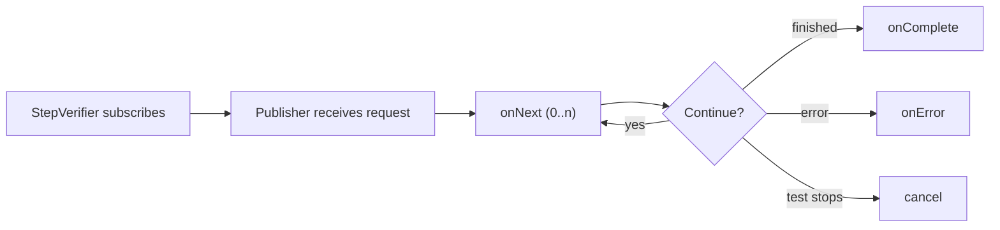

# Testing Reactive Streams with StepVerifier: Change Streams and Tailable Cursors

## Objectives

This lesson belongs to the **Testing** chapter of **SPRING_DATA_MONGODB**: using Spring Data MongoDB to connect, map documents, and work with MongoDB via templates/repositories while testing queries, aggregations, indexes, transactions, and reactive access. The focus here is **verifying asynchronous behavior** of `ReactiveMongoTemplate`, **change streams**, and **tailable cursors** with Reactor Test's `StepVerifier`.

After this lesson, you will be able to:

- Express expectations on `Mono`/`Flux`: subscription, `onNext`, `onError`, `onComplete`, requests, and cancellation.
- Choose `verifyComplete()` for finite sequences and `thenCancel()` for long-lived event streams.
- Test reactive CRUD/repositories against real MongoDB and verify returned data.
- Use a **replica set** to test change streams and a **capped collection** to test tailable cursors.
- Distinguish **logic tests using stubbed publishers** from **MongoDB integration tests**; avoid false positives, race conditions, hung tests, and leaked subscriptions.
- Diagnose common errors involving timeouts, seeded data, `resume token`, request counts, and event ordering.

## 1. Why Do Reactive Streams Need Different Testing Patterns?

An application may read a single document via `Mono`, query hundreds of documents via `Flux`, or continuously watch MongoDB events. All three are `Publisher`s, yet their **termination conditions** differ:

| Source | Spring Data MongoDB example | Behavior | Typical expectation |
| --- | --- | --- | --- |
| Finite `Mono` | `ReactiveMongoTemplate.findById(...)`, `insert(...)` | Zero or one item, then completes or errors | `assertNext(...).verifyComplete()` |
| Finite `Flux` | `find(...)`, `findAll(...)` | Zero or more items, then completes | `expectNextCount(n).verifyComplete()` |
| Change stream | `template.changeStream(...).listen()` | Watches new changes, normally never completes on its own | `assertNext(...).thenCancel().verify(timeout)` |
| Tailable cursor | `template.tail(query, Entity.class)` | Keeps a cursor open on a **capped collection** to read newly appended docs | `assertNext(...).thenCancel().verify(timeout)` |

Reactive Streams signal flow:



After `onComplete` or `onError`, a publisher emits no further signals; `cancel` is an action where the **subscriber asks to stop receiving**, not a completion signal from the publisher. For long-lived sources, waiting for `onComplete` can hang a test indefinitely.

Important point: **publishers are normally lazy**. Constructing a `Mono`/`Flux` triggers no I/O; MongoDB operations generally start only upon subscription. Thus `StepVerifier.create(...)` defines the scenario, and `verify(...)` triggers actual verification.

## 2. Getting Started with StepVerifier

`StepVerifier` lives in package `reactor.test` inside **`io.projectreactor:reactor-test`**, used only for testing. It asserts signals in sequence and throws `AssertionError` if actual signals diverge from expectations.

```java
import java.time.Duration;
import reactor.core.publisher.Flux;
import reactor.test.StepVerifier;

Flux<String> names = Flux.just("An", "Bình")
    .map(String::toUpperCase);

StepVerifier.create(names)
    .expectNext("AN")
    .expectNext("BÌNH")
    .verifyComplete();
```

For items where exact `equals` matching is not suitable, use `expectNextMatches` or `assertNext`:

```java
import static org.junit.jupiter.api.Assertions.assertTrue;

StepVerifier.create(Flux.just("sensor-17"))
    .assertNext(value -> assertTrue(value.startsWith("sensor-")))
    .verifyComplete();
```

Essential APIs:

| API | Meaning |
| --- | --- |
| `expectSubscription()` | Confirms subscription arrived; **does not prove** the MongoDB connection/cursor is already open on the server |
| `expectNext(x)` | Next item must equal `x` |
| `expectNextMatches(p)` | Next item must satisfy predicate |
| `assertNext(consumer)` | Runs JUnit/AssertJ assertions directly on the next item |
| `expectNextCount(n)` | Skips item details and asserts exactly `n` items arrive |
| `expectComplete()` / `verifyComplete()` | Source must complete normally after prior expectations |
| `expectError(...)` / `verifyError(...)` | Source must terminate with the matching error |
| `thenRequest(n)` | Subscriber requests `n` additional items (backpressure) |
| `expectNoEvent(duration)` | No signals occur during this duration; place **after** `expectSubscription()` when needed |
| `thenCancel()` | Ends the scenario by cancelling the subscription |
| `verify(Duration.ofSeconds(n))` | Runs verification with a **real-time timeout** |

### Testing Backpressure

```java
StepVerifier.create(Flux.just(10, 20), 0)
    .expectSubscription()
    .thenRequest(1)
    .expectNext(10)
    .thenRequest(1)
    .expectNext(20)
    .verifyComplete();
```

`create(publisher, 0)` sets initial demand to 0. Forgetting `thenRequest` stalls the test because no demand was granted. In integration tests, do not assume emitting multiple items means the driver fetched all rows at once: batching, prefetch, and demand all affect retrieval.

### Distinguishing `verifyComplete`, `thenCancel`, and `take`

```java
// Finite source completing naturally.
StepVerifier.create(Flux.just("a", "b"))
    .expectNext("a", "b")
    .verifyComplete();

// Unbounded source: subscriber cancels explicitly.
StepVerifier.create(Flux.concat(Flux.just("ready"), Flux.never()))
    .expectNext("ready")
    .thenCancel()
    .verify(Duration.ofSeconds(3));

// take(1) cancels upstream itself and emits onComplete downstream.
StepVerifier.create(
        Flux.concat(Flux.just("ready"), Flux.never()).take(1))
    .expectNext("ready")
    .verifyComplete();
```

`take(1)` turns an infinite stream into a finite check. However, when the test's goal is verifying **explicit subscriber cancellation**, `thenCancel()` communicates intent more clearly.

**Always bound integration tests with timeouts:** calling bare `verify()` or `verifyComplete()` without a timeout lets a stalled stream hang forever. To bound `verifyComplete()`, write `expectComplete().verify(Duration.ofSeconds(10))`.

## 3. Setting Up a Real MongoDB Environment

### Dependencies

Gradle Groovy DSL example using Spring Boot with versions managed consistently via BOM:

```groovy
dependencies {
    implementation 'org.springframework.boot:spring-boot-starter-data-mongodb-reactive'

    testImplementation 'org.springframework.boot:spring-boot-starter-test'
    testImplementation 'io.projectreactor:reactor-test'

    // Testcontainers 2.x; align version via compatible BOM.
    testImplementation 'org.testcontainers:testcontainers-junit-jupiter'
    testImplementation 'org.testcontainers:testcontainers-mongodb'
}
```

Testcontainers **2.x** uses package `org.testcontainers.mongodb.MongoDBContainer` and module `testcontainers-mongodb`. Projects on **1.x** typically use `org.testcontainers.containers.MongoDBContainer` and `org.testcontainers:mongodb`; pick artifacts and imports matching your version and never mix both. Maven setups use equivalent dependencies in `test` scope.

### MongoDB Replica Set for Change Streams

Change streams require a **replica set** or **sharded cluster**. For automated integration tests, `MongoDBContainer` can run a single-node replica set; ordinary standalone MongoDB cannot support this requirement.

```java
import org.junit.jupiter.api.Test;
import org.springframework.beans.factory.annotation.Autowired;
import org.springframework.boot.test.context.SpringBootTest;
import org.springframework.test.context.DynamicPropertyRegistry;
import org.springframework.test.context.DynamicPropertySource;
import org.springframework.data.mongodb.core.ReactiveMongoTemplate;
import org.testcontainers.junit.jupiter.Container;
import org.testcontainers.junit.jupiter.Testcontainers;
import org.testcontainers.mongodb.MongoDBContainer;

@SpringBootTest
@Testcontainers
class ReactiveMongoStreamIT {

    @Container
    static final MongoDBContainer mongo =
        new MongoDBContainer("mongo:7.0").withReplicaSet();

    @DynamicPropertySource
    static void configureMongo(DynamicPropertyRegistry properties) {
        properties.add("spring.data.mongodb.uri", mongo::getReplicaSetUrl);
        properties.add("spring.data.mongodb.database", () -> "stepverifier_it");
    }

    @Autowired
    ReactiveMongoTemplate template;

    // Tests in the following sections belong inside this class.
}
```

This example assumes **Docker** is available and dependencies match Spring Boot. At runtime, Testcontainers launches MongoDB and exposes the replica set connection; never hardcode `localhost:27017` since host/port vary in CI.

If using `@DataMongoTest` with the reactive driver, make sure the slice enables matching reactive config and beans; `@SpringBootTest` is used here for straightforward connection setup. Run integration tests in a dedicated database with unique collection names or per-test cleanup. Never run tests against production.

### Minimal Running Domain Model

```java
import org.springframework.data.annotation.Id;
import org.springframework.data.mongodb.core.mapping.Document;

@Document("sensor_readings")
public record SensorReading(
    @Id String id,
    String deviceId,
    double temperatureC
) {}

@Document("sensor_tail")
public record TailEvent(
    @Id String id,
    String message
) {}
```

These records require Java with `record` support (e.g., Java 17+). `id` is supplied explicitly so tests have deterministic assertions without relying on generated IDs.

## 4. Testing Finite Reactive Operations

A scenario verifying both writing and reading a document with `ReactiveMongoTemplate`:

```java
import java.time.Duration;
import java.util.UUID;

import static org.junit.jupiter.api.Assertions.*;

@Test
void insertThenFindById() {
    String id = "reading-" + UUID.randomUUID();

    var operation = template
        .insert(new SensorReading(id, "sensor-17", 4.5))
        .flatMap(saved -> template.findById(saved.id(), SensorReading.class));

    StepVerifier.create(operation)
        .assertNext(reading -> {
            assertEquals(id, reading.id());
            assertEquals("sensor-17", reading.deviceId());
            assertEquals(4.5, reading.temperatureC(), 0.00001);
        })
        .expectComplete()
        .verify(Duration.ofSeconds(10));
}
```

Chaining `flatMap` after `insert` guarantees the lookup executes only **after the insert succeeds**. If `findById` emits empty, `assertNext` fails instead of silently passing.

Also cover missing-document and error scenarios:

```java
@Test
void missingDocumentReturnsEmptyMono() {
    StepVerifier.create(
        template.findById("missing-id", SensorReading.class)
    )
        .expectComplete()
        .verify(Duration.ofSeconds(10));
}

@Test
void validationFailurePropagatesError() {
    // This is a stubbed publisher to test error-branch handling,
    // NOT real MongoDB throwing this error itself.
    StepVerifier.create(
        Mono.<SensorReading>error(new IllegalArgumentException("invalid sensor"))
    )
        .expectErrorMatches(error ->
            error instanceof IllegalArgumentException
                && error.getMessage().contains("invalid"))
        .verify(Duration.ofSeconds(3));
}
```

The second snippet requires `import reactor.core.publisher.Mono;`. For real MongoDB errors, create a controlled failure condition (such as violating a unique index in the test database) and assert the appropriate exception type. Avoid matching server error text verbatim since wording varies across versions.

## 5. Change Streams: Testing Insert/Update/Delete Events

Change streams emit notifications for changes in a collection, database, or cluster without tailing the raw oplog directly. Spring Data MongoDB provides a reactive API like:

```java
import org.springframework.data.mongodb.core.ChangeStreamEvent;
import reactor.core.publisher.Flux;

Flux<ChangeStreamEvent<SensorReading>> events = template
    .changeStream(SensorReading.class)
    .watchCollection("sensor_readings")
    .listen();
```

Each `ChangeStreamEvent` can expose `operationType`, `resumeToken`, `timestamp`, `collectionName`, `getBody()` (full document when available), and raw `getRaw()`.

**Note:** `getBody()` can be `null` for deletes and some updates unless full-document lookup is enabled. When asserting DELETE events, inspect `getOperationType()` and the document key from the raw event or corresponding accessor; never assume a full Java body always exists.

### StepVerifier Pattern for Listening to Insert Events

```java
import java.time.Duration;
import java.util.UUID;
import com.mongodb.client.model.changestream.OperationType;
import org.springframework.data.mongodb.core.ChangeStreamEvent;
import reactor.core.publisher.Flux;
import reactor.test.StepVerifier;

@Test
void changeStreamReceivesInsert() {
    String id = "event-" + UUID.randomUUID();

    Flux<ChangeStreamEvent<SensorReading>> inserts = template
        .changeStream(SensorReading.class)
        .watchCollection("sensor_readings")
        .listen()
        .filter(event ->
            event.getOperationType() == OperationType.INSERT
                && event.getBody() != null
                && id.equals(event.getBody().id()));

    StepVerifier.create(inserts)
        .expectSubscription()
        .then(() -> template
            .insert(new SensorReading(id, "sensor-42", 5.2))
            .block(Duration.ofSeconds(5)))
        .assertNext(event -> {
            assertEquals(OperationType.INSERT, event.getOperationType());
            assertEquals("sensor-42", event.getBody().deviceId());
            assertNotNull(event.getResumeToken());
        })
        .thenCancel()
        .verify(Duration.ofSeconds(15));
}
```

This is an **intuitive scenario** showing how to pair a write action with an event expectation, yet it contains an **important race condition**: `expectSubscription()` only confirms Reactor subscribed—it **does not guarantee the MongoDB server has opened the change stream**. If the insert executes before the server establishes the stream, the event can be missed and the test times out.

In CI, resolve this race deliberately:

1. **Use a valid resume token** captured from a baseline event, write the target documents, and open the stream with `resumeAfter(token)`. Subscribing after the insert can still replay events occurring after that token while retained in the oplog.
2. Or use a **signal confirming the stream opened at the driver/server** (such as instrumentation or a command listener observing cursor creation) before letting the writer run.
3. Avoid relying on `Thread.sleep(500)` or `thenAwait(...)` as synchronization guarantees; CI load and MongoDB startup latency fluctuate.

### Testing Replay with a Resume Token

Assume the integration fixture already captured `BsonValue checkpointToken` from **an actual earlier event** within the same watch scope while that token still resides in oplog history. Place the helper below **inside the test class**, accepting the token and target ID from the fixture:

```java
import org.bson.BsonValue;
import org.springframework.data.mongodb.core.ChangeStreamOptions;
import org.springframework.data.mongodb.core.ReactiveMongoTemplate;

void verifyReplayedInsert(
        ReactiveMongoTemplate template,
        BsonValue checkpointToken,
        String expectedId) {

    ChangeStreamOptions options = ChangeStreamOptions.builder()
        .resumeAfter(checkpointToken)
        .build();

    Flux<ChangeStreamEvent<SensorReading>> replay = template.changeStream(
        "sensor_readings", options, SensorReading.class);

    // Fixture already inserted document expectedId after checkpointToken.
    // Subscriber can start later and still read the event from the oplog.
    StepVerifier.create(replay
            .filter(event -> event.getOperationType() == OperationType.INSERT)
            .filter(event -> event.getBody() != null
                && expectedId.equals(event.getBody().id()))
            .take(1))
        .assertNext(event -> {
            assertEquals(expectedId, event.getBody().id());
            assertNotNull(event.getResumeToken());
        })
        .expectComplete()
        .verify(Duration.ofSeconds(15));
}
```

This helper verifies **after fixture setup**: pass a real token in `checkpointToken`, insert a document with ID `expectedId` after that checkpoint, then invoke `verifyReplayedInsert(template, checkpointToken, expectedId)`. It demonstrates avoiding the “late subscriber” race via **checkpoint replay**; you cannot fabricate an arbitrary token. With concurrent writers, filter by `operationType`, `documentKey`/ID, or a unique correlation ID so events from other tests do not leak in. Never assume events are delivered strictly once when using retries/resumes.

### Testing Updates and Deletes

- **INSERT:** check `OperationType.INSERT`, `getBody()`, and inserted fields.
- **UPDATE:** check `OperationType.UPDATE` and `getRaw().getUpdateDescription()`; to obtain the full updated document, configure full-document lookup via `ChangeStreamOptions`.
- **DELETE:** check `OperationType.DELETE` and the document key from the raw event; `getBody()` may be `null`.
- **Resume:** verify `resumeAfter` continues after a persisted token; never assume you can resume forever once the oplog trims older history.
- **Cancel:** `thenCancel()` ensures the test subscriber closes the stream actively rather than holding cursors open indefinitely.

Change streams can complete or error when a collection is dropped/renamed, permissions change, or an unresumable error occurs. Testing those cases requires dedicated fixtures and should avoid matching full exception message strings.

## 6. Tailable Cursors: Streaming a Capped Collection

A **tailable cursor** watches new documents appended to a **capped collection**. Unlike change streams, it emits the **queried documents** directly rather than `operationType` change events. It fits append-only logs and event buffers.

Capped collections have a bounded size; when full, MongoDB automatically evicts oldest documents to make room. They must be created **explicitly**, for example using `CollectionOptions`:

```java
import org.springframework.data.mongodb.core.CollectionOptions;
import org.springframework.data.mongodb.core.ReactiveMongoTemplate;

String collection = "sensor_tail_test";

template.createCollection(
        collection,
        CollectionOptions.empty()
            .capped()
            .size(1024 * 1024)
            .maxDocuments(1000))
    .block(Duration.ofSeconds(10));
```

`size(...)` is mandatory when creating a capped collection. If a normal collection with that name already exists, calling `tail` does not magically make it capped; verify collection metadata or use a dedicated test collection name.

Reactive API:

```java
import org.springframework.data.mongodb.core.query.Query;
import reactor.core.publisher.Flux;

Flux<TailEvent> stream = template.tail(
    new Query(),
    TailEvent.class,
    "sensor_tail_test"
);
```

A tailable cursor can **close immediately** if the initial query matches zero documents, or if the last document position tracked by the cursor gets overwritten in the capped collection. Therefore, tests should **seed one matching document before subscribing**, size the collection so writes do not wrap around, and avoid attaching `$sort` to tail queries.

### Marker Pattern: Seed First, Write Next After the Cursor Emits

This example uses a unique collection name per run so tests never interfere:

```java
import java.time.Duration;
import java.util.UUID;
import org.springframework.data.mongodb.core.CollectionOptions;
import org.springframework.data.mongodb.core.query.Query;
import reactor.core.publisher.Flux;
import reactor.test.StepVerifier;

import static org.junit.jupiter.api.Assertions.assertEquals;

@Test
void tailableCursorReadsExistingThenNewDocument() {
    String collection = "sensor_tail_" +
        UUID.randomUUID().toString().replace("-", "");

    template.createCollection(
        collection,
        CollectionOptions.empty().capped().size(1024 * 1024))
        .block(Duration.ofSeconds(10));

    try {
        template.insert(new TailEvent("seed", "READY"), collection)
            .block(Duration.ofSeconds(5));

        Flux<TailEvent> tail = template.tail(
            new Query(), TailEvent.class, collection);

        StepVerifier.create(tail)
            .assertNext(first -> {
                assertEquals("seed", first.id());
                assertEquals("READY", first.message());
            })
            .then(() -> template
                .insert(new TailEvent("next", "TEMPERATURE_CHANGED"),
                        collection)
                .block(Duration.ofSeconds(5)))
            .assertNext(second -> {
                assertEquals("next", second.id());
                assertEquals("TEMPERATURE_CHANGED", second.message());
            })
            .thenCancel()
            .verify(Duration.ofSeconds(15));
    } finally {
        template.dropCollection(collection)
            .block(Duration.ofSeconds(10));
    }
}
```

Key point: `assertNext(first)` confirms the **seed arrived from the real cursor**. Only after receiving the marker do we insert `next`, avoiding the “write before cursor is ready” race on the new-event step. `thenCancel()` cancels the subscription after seeing the expected event, and `finally` drops **only this test's own collection**.

To consume only new events, design cursor positioning and checkpoints explicitly; seeding ensures the cursor has at least one document to tail rather than filtering out older data by itself.

### Reactive Repositories with `@Tailable`

```java
import org.springframework.data.mongodb.repository.ReactiveMongoRepository;
import org.springframework.data.mongodb.repository.Tailable;
import reactor.core.publisher.Flux;

public interface TailEventRepository
        extends ReactiveMongoRepository<TailEvent, String> {

    @Tailable
    Flux<TailEvent> findByMessage(String message);
}
```

Whether using `@Tailable` on a repository or `ReactiveMongoTemplate.tail(...)`, the backing collection **must still be a capped collection**. With a filtered query like `message`, if no matching document exists when the cursor starts, the cursor may close before new events arrive. In integration tests, pre-seed at least one matching record or design an appropriate tailing strategy.

## 7. Safely Testing Timeouts, Cancellation, and Backpressure

### Do Not Confuse Verification Timeouts with Publisher Timeouts

```java
StepVerifier.create(Flux.never())
    .expectSubscription()
    .expectNoEvent(Duration.ofMillis(100))
    .thenCancel()
    .verify(Duration.ofSeconds(2));
```

Here `expectNoEvent` asserts **no onNext/onComplete/onError** occurs for 100 ms; `thenCancel` closes the stream. `verify(Duration.ofSeconds(2))` is merely the upper bound for **the entire test**. It does not test business stream timeouts, nor does it prove MongoDB works if the source is `Flux.never()`.

To test a business timeout:

```java
import java.util.concurrent.TimeoutException;

StepVerifier.create(
        Flux.<String>never().timeout(Duration.ofMillis(150)))
    .expectError(TimeoutException.class)
    .verify(Duration.ofSeconds(2));
```

For change streams or tailable cursors, `timeout` can mean “no new events arrived within N seconds,” which is **not always an operational error**: an idle source is legitimately silent. Pick timeouts per business SLA (heartbeat, data freshness) rather than applying them mechanically to every stream.

### Verifying Actual Subscription Cancellation

At the unit level, use `doOnCancel` to observe cancellation signals:

```java
import java.time.Duration;
import java.util.concurrent.atomic.AtomicBoolean;
import reactor.core.publisher.Flux;
import reactor.test.StepVerifier;

AtomicBoolean cancelled = new AtomicBoolean();

Flux<String> stream = Flux.<String>never()
    .doOnCancel(() -> cancelled.set(true));

StepVerifier.create(stream)
    .expectSubscription()
    .thenCancel()
    .verify(Duration.ofSeconds(2));

assertTrue(cancelled.get());
```

In MongoDB integration tests, `doOnCancel` confirms cancellation **reached the Reactor layer**, not necessarily that the server closed the cursor instantaneously; verifying server-side resource cleanup requires inspecting server/driver metrics.

### Virtual Time: Only for Reactor Schedulers

```java
StepVerifier.withVirtualTime(() ->
        Flux.interval(Duration.ofSeconds(1)).take(2))
    .expectSubscription()
    .thenAwait(Duration.ofSeconds(1))
    .expectNext(0L)
    .thenAwait(Duration.ofSeconds(1))
    .expectNext(1L)
    .verifyComplete();
```

`withVirtualTime` advances virtual time on Reactor schedulers managed by the scheduler factory. Construct the publisher **inside the lambda** so operators bind to the virtual scheduler. It **does not speed up MongoDB Server, network I/O, oplog, cursors, or Testcontainers**. For real MongoDB integration tests, use real clocks, bounded timeouts, and signal/marker synchronization.

## 8. Test Design Strategy to Prevent Flakiness

| Risk | Symptom | Mitigation |
| --- | --- | --- |
| Standalone MongoDB for change streams | Server error: `$changeStream` unsupported | Test on replica set/sharded cluster; Testcontainers can run a single-node replica set |
| `expectSubscription` then writing immediately | Intermittent missed events | Use checkpoint/resume tokens or a server cursor-open signal; never substitute sleep |
| Tailable query on regular collection | Error: cursor not tailable | Create collection with `capped().size(...)`; verify collection type |
| Tailing when zero documents match | Stream terminates prematurely | Seed a matching marker before tailing; verify version-specific behavior |
| Waiting for `verifyComplete()` on unbounded streams | Test hangs | Use `thenCancel().verify(timeout)` or `take(n)` where suitable |
| `thenRequest` gives insufficient demand | Test stalls waiting for items | Check initial demand and `thenRequest(n)` |
| Parallel tests sharing a collection | Interleaved events, wrong assertions | Unique collections/IDs per test, filter by correlation ID, clean fixtures |
| Calling `getBody()` on deletes | `NullPointerException` | Check `operationType`, read raw/`documentKey`, handle nullable body |
| Timing tests with fixed `sleep` | Passes/fails randomly in CI | Synchronize on readiness signals/markers/replay and bound verification |
| Failing to dispose subscriptions | Hanging tests, lingering cursors | Use `thenCancel()`, `take`, and `finally` cleanup |

Operational habits to keep in mind:

1. **Isolate test data:** unique IDs/collections or dedicated databases; seed before, clean after. Never drop a collection another test uses.
2. **Attach correlation IDs:** change streams can see unrelated events if multiple tests share a replica set.
3. **Assert content before timing:** prioritize IDs, fields, and operation types; use timeouts strictly to bound tests, never assuming events arrive at exact timestamps.
4. **Never test against real user data:** run against an isolated cluster with test credentials and configured Docker/CI paths.
5. **When testing resume:** store tokens from real events, understand oplog retention, test disconnect/cancel, and verify only post-checkpoint events process.
6. **Inspect server state when needed:** `StepVerifier` finishing does not guarantee all server-side cleanup completed synchronously.

## 9. Practice Exercises

Prepare Spring Boot, Spring Data MongoDB reactive, Reactor Test, and a MongoDB replica set via Testcontainers or a test environment. Complete these tasks:

1. Create `SensorReading` and write a `StepVerifier` test for `insert(...).flatMap(findById(...))`, asserting `id`, `deviceId`, and `temperatureC`.
2. Write a `findById` missing-document test asserting `expectComplete()` with zero `onNext` signals.
3. Open a change stream on `sensor_readings`, observe one `INSERT`, and verify `getOperationType()`, `getBody()`, and `getResumeToken()`; explain the race when writing too early.
4. Capture a resume token from a baseline event and restart the stream from that token on the same collection; verify the event replays without mixing in other tests.
5. Create a 1 MiB capped collection, seed a `READY` marker, open a tailable cursor, append a second event, assert both, and cancel.
6. Intentionally test against a normal (uncapped) collection to observe the tailable cursor failure; document the error and how to detect collection type from metadata.
7. Compare `Flux.never().timeout(...)` with `StepVerifier.verify(Duration)`, explaining which tests business contracts vs. test safety bounds.
8. Try `create(publisher, 0)` with `thenRequest(1)` to observe backpressure, and then test omitting the request with a bounded timeout.

**Completion criteria:** tests verify exact values and signals, enforce finite timeouts, avoid hanging on `onComplete` for infinite streams, explain replica set and capped collection requirements, and eliminate stream-initialization races.

## 10. Official References

- [Project Reactor — Testing (StepVerifier and virtual time)](https://projectreactor.io/docs/core/release/reference/testing.html)
- [Project Reactor — StepVerifier Javadoc](https://projectreactor.io/docs/test/release/api/reactor/test/StepVerifier.html)
- [Spring Data MongoDB — Change Streams](https://docs.spring.io/spring-data/mongodb/reference/mongodb/change-streams.html)
- [Spring Data MongoDB — Tailable Cursors](https://docs.spring.io/spring-data/mongodb/reference/mongodb/tailable-cursors.html)
- [Spring Data MongoDB — ReactiveMongoTemplate Javadoc](https://docs.spring.io/spring-data/mongodb/reference/api/java/org/springframework/data/mongodb/core/ReactiveMongoTemplate.html)
- [Spring Data MongoDB — ChangeStreamOptions Javadoc](https://docs.spring.io/spring-data/mongodb/reference/api/java/org/springframework/data/mongodb/core/ChangeStreamOptions.html)
- [MongoDB — Change Streams](https://www.mongodb.com/docs/manual/changeStreams/)
- [MongoDB — Capped Collections](https://www.mongodb.com/docs/manual/core/capped-collections/)
- [Testcontainers for Java — MongoDB Module](https://java.testcontainers.org/modules/databases/mongodb/)
