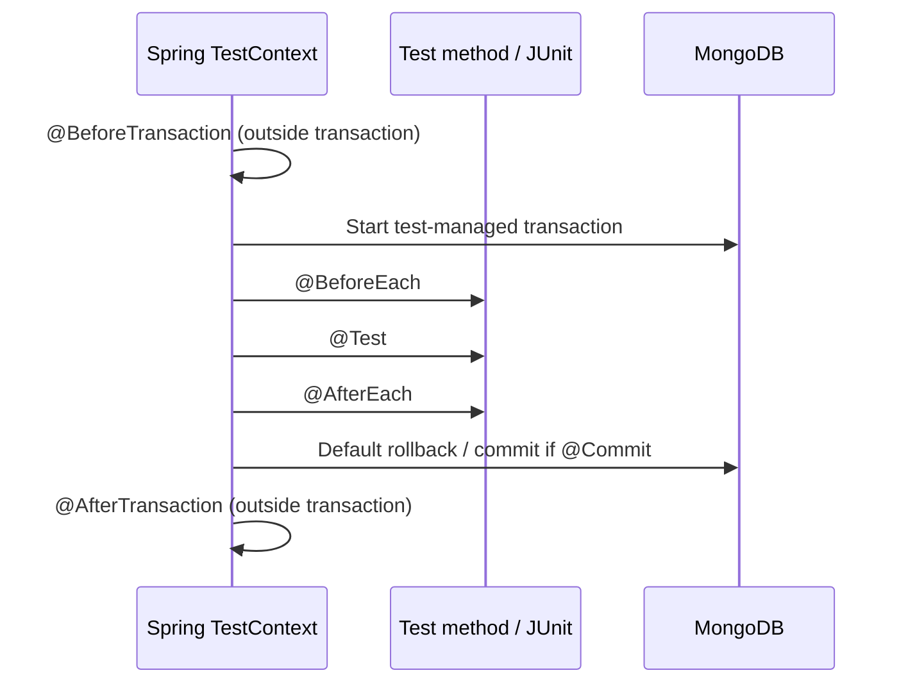

# Test Data Isolation and Cleanup After Commit

## 1. Why Do MongoDB Tests Leak Data Easily?

In **Spring Data MongoDB** applications, `MongoRepository`, `MongoTemplate`, and `ReactiveMongoTemplate` typically target the same test MongoDB deployment. If two tests share a collection, documents left by an earlier test can cause the next test to read wrong results, hit duplicate key errors, or over-count records. In transactional tests, the problem is subtler: a test may assume everything rolled back while a service committed in a separate transaction or wrote data after commit.

Consider an order service:

- Collection `orders` stores orders.
- Collection `outbox_events` stores events for a background worker to process.
- Method `placeOrder()` saves the order inside a MongoDB transaction and may trigger a post-commit action.
- Two parallel tests both use customer `customer-01` and identical sample fixtures.

If test A leaves a committed order behind, test B may fail when counting `orders` or asserting its own events. Conversely, if cleanup wipes the entire `orders` collection, test A may delete test B's documents mid-flight.

Lesson goals:

1. Choose an appropriate isolation scope: container, database, collection, or per-test ownership key.
2. Understand the difference between **rolling back a test transaction**, **real commit**, and **post-commit cleanup**.
3. Write integration tests with Testcontainers, `MongoTransactionManager`, and `MongoTemplate`.
4. Clean up committed documents without touching another test's data.
5. Handle tests involving `@TransactionalEventListener(AFTER_COMMIT)`, asynchronous tasks, and reactive flows.
6. Verify cleanup by reading back from the database, even when assertions fail.

## 2. Three Questions to Answer Before Choosing a Cleanup Strategy

### 2.1. Which Test Owns the Data?

Every test must identify the exact documents it is allowed to delete. Common strategies:

| Isolation scope | Implementation | Benefits | Trade-offs |
| --- | --- | --- | --- |
| **Dedicated `MongoDBContainer`** | Separate MongoDB container per test or test group | Strong process and data isolation; easy full teardown | Startup time and resource cost; balance at suite level |
| **Dedicated database** | Unique database name per suite/test via URI/config | Easy full-database drop without affecting other tests if unique | Spring context and `MongoTemplate` must target that DB; watch context cache |
| **Dedicated collection** | Route operations to uniquely named collections | Easy scope control | Repository mappings and index names must be managed; dynamic names may not cover all write paths |
| **Per-test `testRunId` field** | Tag every document created by the test with a UUID and filter during cleanup | Fits when many tests share schemas/collections | Every write path must propagate `testRunId`; untagged writes need another approach |
| **Tracked created IDs** | Record each created `_id` and delete by ID list | Avoids altering business schemas | Easy to miss documents created by listeners, workers, or side effects |

**Never run `dropDatabase()`, `dropCollection()`, `repository.deleteAll()`, or `remove(new Query(), ...)` on a database shared across multiple tests.** Those commands exceed ownership boundaries and are especially dangerous under parallel execution.

### 2.2. Does the Test Need to Observe Committed Data?

If you only verify saving and reading within the same transaction, rolling back at the end of the test may suffice. If the requirement is “after the service returns, another reader sees the data,” “`AFTER_COMMIT` fires,” or “the outbox is written and processed post-commit,” the test must execute a **real commit** and inspect state **outside that committed transaction**.

These mechanisms are not equivalent:

| Mechanism | At end of test/transaction | Sufficient to test post-commit behavior? |
| --- | --- | --- |
| Default Spring `@Transactional` test | Spring Test normally **rolls back** the test-managed transaction | No; `AFTER_COMMIT` listeners do not run because no commit occurs |
| `@Transactional` test + `@Commit` or `@Rollback(false)` | Commits the test-managed transaction | Potentially; must clean up **after** the transaction and account for side effects |
| `TransactionTemplate.execute(...)` in a test **without** `@Transactional` | Transaction commits when the callback returns cleanly | Well suited; `@AfterEach` runs outside that finished transaction |
| Service using `REQUIRES_NEW` | Commits its own inner transaction while outer transaction remains open | Test-managed rollback will not undo data committed in the inner transaction |
| Async writes or handoff to another worker | May execute after the test method finishes | Requires synchronization and separate cleanup/resource handling |

Note: `@Transactional` only governs resources managed by the **matching transaction manager**. If an app uses both JDBC and MongoDB, a `DataSourceTransactionManager` does not wrap `MongoTemplate` operations. Choose `MongoTransactionManager` or `ReactiveMongoTransactionManager`.

### 2.3. What Criteria Define a Passing Isolation Strategy?

An isolated test passes quality checks when:

- Running alone and running inside the full suite produce identical outcomes.
- It reads its own committed data after commit when business rules require it.
- After cleanup, **zero documents owned by the test** remain in any inspected collection.
- Data belonging to other tests remains intact.
- Repeating runs or shuffling execution order triggers no stale-data errors.

## 3. MongoDB Transactions and the Spring Test Lifecycle

### 3.1. Prerequisites for MongoDB Transactions to Work

MongoDB multi-document transactions require a supporting topology, typically a **replica set** or **sharded cluster**. A regular standalone MongoDB does not satisfy this requirement. With Testcontainers, `MongoDBContainer` runs MongoDB as a replica set suitable for testing.

In a blocking Spring Data MongoDB app, declare the transaction manager:

```java
import org.springframework.context.annotation.Bean;
import org.springframework.context.annotation.Configuration;
import org.springframework.data.mongodb.MongoDatabaseFactory;
import org.springframework.data.mongodb.MongoTransactionManager;

@Configuration
class MongoTransactionConfig {

    @Bean
    MongoTransactionManager mongoTransactionManager(
            MongoDatabaseFactory databaseFactory) {
        return new MongoTransactionManager(databaseFactory);
    }
}
```

Adding `@Transactional` without configuring the right transaction manager and topology does not make MongoDB transactions succeed. On the reactive stack, use **`ReactiveMongoTransactionManager`** and Reactor Context instead of the blocking manager.

### 3.2. Callback Order in Test-Managed Transactions

For a Spring Test using `@Transactional`, the typical lifecycle is:



This leads to a common mistake:

```java
@Transactional
@Test
void shouldCreateOrder() {
    orderService.placeOrder(...);
}

@AfterEach
void cleanup() {
    orderRepository.deleteAll();
}
```

In a test-managed transaction, `@AfterEach` **normally runs before the transaction ends**. `deleteAll()` inside that callback participates in the test transaction; if the test rolls back, the deletion rolls back too. If the service committed in an independent transaction or async task, that data survives. If the test commits, `@AfterEach`'s delete may commit, yet **post-commit** side effects can still write new uncleaned documents afterward. Moreover, `deleteAll()` wipes other tests' data regardless.

To clean up after a Spring-managed test transaction finishes, use `@AfterTransaction`. For tests **without** `@Transactional` on the class/method that commit explicitly via `TransactionTemplate`, `@AfterEach` can clean up safely once `TransactionTemplate` completes.

### 3.3. `@Commit`, `@AfterTransaction`, and Timely Cleanup

When you want Spring Test itself to manage a committed transaction, follow this pattern:

```java
import org.junit.jupiter.api.Test;
import org.springframework.test.annotation.Commit;
import org.springframework.test.context.transaction.AfterTransaction;
import org.springframework.transaction.annotation.Transactional;

// Dependencies and MongoDB test context are configured at class level.
@Test
@Transactional("mongoTransactionManager")
@Commit
void writeInTestTransaction() {
    // Write document tagged with testRunId; Spring Test commits after @AfterEach.
}

@AfterTransaction
void cleanupCommittedRows() {
    // Runs after the test-managed transaction has ended.
    // Delete only documents tagged with this test's testRunId.
}
```

This illustrates the **lifecycle**, not a complete standalone test class. `@AfterTransaction` applies solely to Spring Test's **test-managed transactions**. It does not run automatically after service-managed or `TransactionTemplate` transactions; in those cases, organize verification and teardown outside the transaction explicitly.

## 4. Integration Test Example with Real Commit and Safe Cleanup

The complete example below uses:

- Spring Boot + Spring Data MongoDB + JUnit Jupiter + AssertJ.
- **Testcontainers MongoDB** with a replica set for real transactions.
- `TransactionTemplate` to commit explicitly without placing `@Transactional` on the test.
- UUID `testRunId` identifying documents created by that test run.
- `@AfterEach` deleting only the test's own documents **after commit**, without wiping the whole collection.

This sample uses `Document` to focus on transactions and cleanup; the same principles apply to `@Document`-mapped entities and repositories.

```java
import java.util.UUID;

import org.bson.Document;
import org.junit.jupiter.api.AfterEach;
import org.junit.jupiter.api.Test;
import org.junit.jupiter.api.extension.ExtendWith;
import org.springframework.beans.factory.annotation.Autowired;
import org.springframework.boot.test.context.SpringBootTest;
import org.springframework.boot.test.context.TestConfiguration;
import org.springframework.context.annotation.Bean;
import org.springframework.context.annotation.Import;
import org.springframework.data.mongodb.MongoDatabaseFactory;
import org.springframework.data.mongodb.MongoTransactionManager;
import org.springframework.data.mongodb.core.MongoTemplate;
import org.springframework.data.mongodb.core.query.Criteria;
import org.springframework.data.mongodb.core.query.Query;
import org.springframework.test.context.DynamicPropertyRegistry;
import org.springframework.test.context.DynamicPropertySource;
import org.springframework.transaction.support.TransactionTemplate;
import org.testcontainers.containers.MongoDBContainer;
import org.testcontainers.junit.jupiter.Container;
import org.testcontainers.junit.jupiter.Testcontainers;
import org.testcontainers.utility.DockerImageName;

import static org.assertj.core.api.Assertions.assertThat;

@Testcontainers
@SpringBootTest
@Import(OrderPersistenceIT.TxConfig.class)
class OrderPersistenceIT {

    @Container
    static final MongoDBContainer mongo =
        new MongoDBContainer(DockerImageName.parse("mongo:7.0"));

    @DynamicPropertySource
    static void mongoProperties(DynamicPropertyRegistry registry) {
        registry.add("spring.data.mongodb.uri", mongo::getReplicaSetUrl);
    }

    @TestConfiguration
    static class TxConfig {
        @Bean
        MongoTransactionManager mongoTransactionManager(
                MongoDatabaseFactory databaseFactory) {
            return new MongoTransactionManager(databaseFactory);
        }
    }

    @Autowired
    MongoTemplate template;

    @Autowired
    MongoTransactionManager mongoTransactionManager;

    // JUnit Jupiter creates a new test instance per @Test by default.
    // This ID belongs exclusively to one test run and is never shared.
    private final String testRunId = UUID.randomUUID().toString();

    private Query ownedOrders() {
        return Query.query(Criteria.where("testRunId").is(testRunId));
    }

    @Test
    void committedOrderIsVisibleOutsideTransaction() {
        String orderId = "it-" + testRunId;
        TransactionTemplate tx = new TransactionTemplate(mongoTransactionManager);

        tx.executeWithoutResult(status ->
            template.insert(
                new Document("_id", orderId)
                    .append("testRunId", testRunId)
                    .append("status", "PAID"),
                "orders"
            )
        );

        // TransactionTemplate has already committed on return.
        // The read below executes outside the completed transaction.
        Document saved = template.findById(orderId, Document.class, "orders");

        assertThat(saved).isNotNull();
        assertThat(saved.getString("status")).isEqualTo("PAID");
        assertThat(saved.getString("testRunId")).isEqualTo(testRunId);
    }

    @Test
    void rollbackDoesNotLeaveOrderBehind() {
        String orderId = "it-rollback-" + testRunId;
        TransactionTemplate tx = new TransactionTemplate(mongoTransactionManager);

        tx.executeWithoutResult(status -> {
            template.insert(
                new Document("_id", orderId)
                    .append("testRunId", testRunId)
                    .append("status", "PENDING"),
                "orders"
            );
            status.setRollbackOnly();
        });

        assertThat(template.findById(orderId, Document.class, "orders"))
            .isNull();
    }

    @AfterEach
    void cleanupCommittedDocuments() {
        // Test method has no @Transactional.
        // @AfterEach runs outside the finished TransactionTemplate transaction.
        template.remove(ownedOrders(), "orders");
        assertThat(template.count(ownedOrders(), "orders")).isZero();
    }
}
```

**Notes for running in practice:**

1. Ensure Docker and compatible Testcontainers MongoDB/JUnit Jupiter plus `spring-boot-starter-test` dependencies match your Spring Boot version. The example uses the compatible `MongoDBContainer` API of Testcontainers 1.x/2.x; verify Maven artifacts and packages against your actual dependencies.
2. `spring.data.mongodb.uri` in `@DynamicPropertySource` must be what the app actually uses; if the app builds a custom `MongoClient`, confirm that URI also targets the container.
3. Keep `@Transactional` off the test class/method, because an enclosing test transaction causes `TransactionTemplate` to join it and alters commit timing.
4. `@AfterEach` deletes only `orders` matching the test's `testRunId`. If a service also writes `outbox_events`, `audit_logs`, or related collections, clean up **all of those collections** with the same ownership key.
5. Omit `@Import` if the app already defines `MongoTransactionManager`; avoid duplicate bean declarations. When multiple transaction managers exist, qualify the exact bean name.

`rollbackDoesNotLeaveOrderBehind` confirms rollback works within its transaction scope; `committedOrderIsVisibleOutsideTransaction` confirms post-commit visibility. Both clean up via `testRunId` so tests remain idempotent.

### 4.1. Cleaning Up Multiple Collections by Ownership Key

If placing an order creates both outbox and audit records, propagate one `testRunId` across every side effect:

```java
@AfterEach
void cleanup() {
    Query owned = Query.query(Criteria.where("testRunId").is(testRunId));

    // Order chosen to respect data relationships and app listeners.
    template.remove(owned, "outbox_events");
    template.remove(owned, "audit_logs");
    template.remove(owned, "orders");

    assertThat(template.count(owned, "outbox_events")).isZero();
    assertThat(template.count(owned, "audit_logs")).isZero();
    assertThat(template.count(owned, "orders")).isZero();
}
```

When you cannot add `testRunId` to a schema, generate unique `_id` values, track every created ID, and delete by ID list. If a service writes across many collections without easy traceability, **a dedicated database per test or suite** is more reliable than guessing which documents to delete.

### 4.2. Cleanup Must Still Run When Assertions Fail

JUnit invokes `@AfterEach` after normal test execution even when an assertion fails. Still, cleanup can fail on disconnects, abrupt process termination, or container crashes. To limit impact:

- Use disposable environments spun up and torn down by Testcontainers/CI rather than relying solely on `@AfterEach` always completing.
- Keep cleanup **idempotent**: deleting the same subset twice must not harm other data.
- When cleanup fails, let the test fail loudly instead of swallowing exceptions, since subsequent suites may hit leftover data.
- For dedicated databases/collections, teardown may drop the entire namespace after verifying ownership and naming; never do this on shared namespaces.

## 5. When `@Transactional` and `@Commit` Fit Better

Occasionally you need to test Spring's test-managed transaction support itself or work within an existing `@Transactional` test structure. Use `@Commit` to commit and `@AfterTransaction` for cleanup:

```java
@SpringBootTest
class CommitLifecycleIT {

    @Autowired
    MongoTemplate template;

    private final String testRunId = UUID.randomUUID().toString();

    @Test
    @Transactional("mongoTransactionManager")
    @Commit
    void emitsCommittedOrder() {
        template.insert(
            new Document("_id", "committed-" + testRunId)
                .append("testRunId", testRunId),
            "orders"
        );
        // At this point, the test transaction has NOT committed yet.
    }

    @AfterTransaction
    void cleanupAfterTestCommit() {
        Query owned =
            Query.query(Criteria.where("testRunId").is(testRunId));
        template.remove(owned, "orders");
        assertThat(template.count(owned, "orders")).isZero();
    }
}
```

This assumes `MongoTransactionManager` and a MongoDB replica set are configured, with imports matching section 4. `@AfterTransaction` runs outside the test-managed transaction **after Spring Test completes commit/rollback**. If the test needs to assert data exists **post-commit** before cleanup, run those checks at the start of `@AfterTransaction` before deleting, or use `TransactionTemplate` for explicit step-by-step control.

**Do not overuse `@Commit` on ordinary repository tests:** most tests only check mapping, queries, and rollbacks, so real commits plus post-commit cleanup can slow down the suite. Reserve real commits for requirements that must prove post-commit behavior.

## 6. Post-Commit Side Effects: Listeners, Outbox, and Async Tasks

### 6.1. Post-Commit Events Never Fire in Auto-Rollback Tests

Spring supports phase-bound callbacks:

```java
@TransactionalEventListener(phase = TransactionPhase.AFTER_COMMIT)
public void afterOrderCommitted(OrderCreated event) {
    // Perform action after the transaction finishes committing.
}
```

If a test relies on `@Transactional`'s default rollback, `AFTER_COMMIT` never runs. A test passing merely because `placeOrder()` returned does not prove the listener works. To test the listener, force a real commit (via `TransactionTemplate` or `@Commit`) and observe post-commit outcomes.

If the listener **writes back to MongoDB** after commit, note: during `AFTER_COMMIT`, some transaction resources may still be bound to the thread; open a fresh transaction (e.g., via a separate service with `@Transactional(propagation = REQUIRES_NEW)`) when durable synchronous transactional writes are needed. Never assume any save inside an `AFTER_COMMIT` listener automatically joins a new committing transaction.

In the **outbox pattern**, outbox documents are normally inserted **inside the same transaction** as the order so both commit or roll back atomically. Post-commit work may simply wake a worker; test message-processing workers independently or in integration tests with controlled task execution.

### 6.2. Preventing Cleanup from Racing Ahead of Side Effects

A race scenario:

```text
Test: commits order
Listener: schedules async audit write
Test: @AfterEach deletes existing orders and audits
Listener: writes audit late
Next test: sees leftover audit document
```

To handle this:

1. Give tests a **bounded wait** for outcomes (Awaitility, StepVerifier, or a completion signal from a fake executor/worker) instead of arbitrary `Thread.sleep()`.
2. Propagate a `testRunId`/correlation ID so workers and listeners tag every resulting record.
3. Run cleanup only after all test-owned tasks finish, cancel safely, or their processor shuts down.
4. For event-driven flows with multiple consumers, prefer stubbed queues/topics, controlled workers, or dedicated databases; deleting MongoDB rows alone is insufficient if external side effects occur.

Example using Awaitility to wait for a committed outbox record:

```java
await().atMost(Duration.ofSeconds(5)).untilAsserted(() ->
    assertThat(template.count(
        Query.query(Criteria.where("testRunId").is(testRunId)),
        "outbox_events"
    )).isEqualTo(1)
);
```

This snippet requires `import static org.awaitility.Awaitility.await;` and `java.time.Duration`. It illustrates an observable condition; if business logic deletes outbox records after dispatch, await another durable signal (processed status, recorded spy invocation, or received message) to avoid flakiness.

## 7. Parallel Tests and Namespace Management

### 7.1. Using UUIDs and Isolating Referenced Data

It is not just orders—every potentially colliding fixture needs unique IDs:

```java
String runId = UUID.randomUUID().toString();
String customerId = "customer-" + runId;
String orderId = "order-" + runId;
String email = "integration+" + runId + "@example.test";
```

A unique index on `email` or `orderNumber` collides if every test inserts `test@example.com`. Append a unique suffix to unique fields and clean up strictly by `runId`, `_id`, or tracked IDs.

If each test owns its own collection, ensure indexes and mappings are created properly; if each test owns its own database, use valid prefixed names such as `it_orders_<uuid>` and verify the name before dropping during teardown.

### 7.2. Why `@DirtiesContext` Does Not Replace Cleanup

`@DirtiesContext` tells Spring Test to rebuild the `ApplicationContext`. It resets mutated Spring bean state or configuration, yet **never deletes documents in MongoDB**. Even when a fresh context boots, it can connect right back to the same database full of stale records.

Similarly, `repository.deleteAll()` in `@BeforeEach` only looks clean by wiping pre-existing rows; under parallel execution, it can wipe active rows owned by a concurrent test. Proper cleanup deletes **only owned resources** after they are no longer in use.

### 7.3. Never Share Containers Past the Spring Context Lifecycle

A `static @Container` lives for one test class, while Spring caches `ApplicationContext` instances across classes. If a cached context points to a stopped container, the next class reusing it fails to connect. For large suites, choose one consistent strategy:

- Keep a shared container alive across the whole suite with explicit lifecycle management.
- Or prevent context reuse whenever the backing datasource/container stops.
- Or give each class its own container with distinct context configuration so stale connections are never reused.

Never try to paper over container lifecycle mismatches by adding retries; fix the URI, container start/stop lifecycle, and context caching.

## 8. Reactive Transactions and Cleanup

Reactive access via `ReactiveMongoTemplate` or `ReactiveMongoRepository` does not rely on thread-bound transactions like `MongoTransactionManager`. Reactive transaction state flows through the **Reactor Context**; coordinate transactions with `ReactiveMongoTransactionManager` and `TransactionalOperator`.

Illustrative commit-then-cleanup flow (with beans preconfigured):

```java
import org.bson.Document;
import org.springframework.data.mongodb.core.ReactiveMongoTemplate;
import org.springframework.data.mongodb.core.query.Criteria;
import org.springframework.data.mongodb.core.query.Query;
import org.springframework.transaction.reactive.TransactionalOperator;
import reactor.test.StepVerifier;

Document order = new Document("_id", "reactive-" + testRunId)
    .append("testRunId", testRunId)
    .append("status", "PAID");

StepVerifier.create(
    reactiveTemplate.insert(order, "orders")
        .as(transactionalOperator::transactional)
).expectNextCount(1).verifyComplete();

// Transaction publisher completed before cleanup begins.
Query owned = Query.query(Criteria.where("testRunId").is(testRunId));

StepVerifier.create(reactiveTemplate.remove(owned, "orders"))
    .expectNextCount(1)
    .verifyComplete();
```

This snippet fits into a reactive test having `testRunId`, `reactiveTemplate`, and `transactionalOperator`. In `@AfterEach`, reactive teardown must **subscribe and wait for completion**; returning or creating an unsubscribed `Mono` deletes nothing. Never replace awaiting publishers with `Thread.sleep`, and do not confuse client backpressure with MongoDB commit completion.

Do not blindly carry blocking `@Transactional` rollback assumptions into reactive publishers: reactive transactions bind to subscription/Context, and completion timing must be verified with `StepVerifier` or equivalent.

## 9. Verification and Troubleshooting Checklist

| Symptom | Common cause | How to check and fix |
| --- | --- | --- |
| Passes alone, fails in suite | Leftover documents or unique keys from earlier test | Use unique runId/DB; query counts before and after tests |
| `@Transactional` test passes yet `AFTER_COMMIT` never ran | Spring Test rolled back by default | Use real commit and inspect listener outcomes post-transaction |
| Data remains after `@AfterEach` | Cleanup ran inside rolled-back test transaction or wrote after cleanup | Use `@AfterTransaction` / explicit commit and await side effects |
| Error “Transaction numbers are only allowed…” | MongoDB not running in a transaction-capable topology | Use properly configured replica set/Testcontainers |
| `@Transactional` fails to roll back MongoDB docs | Wrong transaction manager or separate transaction | Check manager bean, propagation, reactive context, and write path |
| Cleanup deletes another test's fixtures | `deleteAll`, `dropCollection`, or filter missing runId | Tag with `testRunId` and delete strictly by ownership |
| Reactive test ends yet documents remain | Cleanup publisher never subscribed or awaited | Verify/await delete `Mono`; check for errors |
| Leftover outbox/audit after commit | Worker or after-commit listener wrote late | Wait for side effects and clean auxiliary collections too |
| Tests fail to connect to MongoDB after earlier run | Context cache pointing to a stopped container | Align container lifecycle and Spring context caching |

### 9.1. Reliable Testing Workflow

1. **Create unique fixtures**: UUIDs for `testRunId`, document IDs, and unique fields; never depend on other tests' data.
2. **Execute the operation under test**: roll back when proving atomicity; commit explicitly when proving visibility or after-commit hooks.
3. **Verify outside the transaction**: read back from MongoDB post-commit; if needed, use a separate client/read step to avoid observing uncommitted state.
4. **Await side effects**: for listeners/workers, wait on completion signals or bounded polling.
5. **Clean up strictly by ownership**: remove from every affected collection after the transaction finishes and background work stops.
6. **Readback to confirm zero leftovers**: count records matching `testRunId` and assert 0; never equate returned delete counts with full coverage.
7. **Run suites shuffled and in parallel**: expose namespace clashes, unique-key collisions, and race conditions instead of relying on fixed test ordering.

For long-lived shared test databases (e.g., shared CI environments), you may add scheduled sweeping of old prefixed records by timestamp. However, that sweeper must validate test-environment namespaces, scope strictly, and never substitute for per-test cleanup.

## 10. Practice Exercises

A project uses `OrderService`, `OrderRepository`, and `OutboxRepository`. `placeOrder()` commits an order, then an `AFTER_COMMIT` listener updates status and writes `audit_logs`. Three integration tests run in parallel: one tests rollback, one tests commit, and one tests async event processing.

1. Choose an isolation strategy for the three tests (dedicated database vs. `testRunId`) and explain when the alternative is preferable.
2. Write pseudo-code for the rollback test: start a transaction, write `orders` and `outbox_events`, mark rollback-only, and assert outside the transaction that zero documents exist for `testRunId`.
3. Write a commit test with `TransactionTemplate` and `MongoTemplate`, verifying the order is readable post-commit and cleaned up safely in `@AfterEach`.
4. If using `@Transactional` and `@Commit` on the test method, why should you consider `@AfterTransaction` for post-commit cleanup?
5. A listener writes `audit_logs` after 300 ms. Describe the race when `@AfterEach` cleans immediately, and propose a wait mechanism without `Thread.sleep(300)`.
6. The project defines both `JpaTransactionManager` and `MongoTransactionManager`. How do you ensure `MongoTemplate` operations use the intended transaction manager?
7. With `ReactiveMongoTemplate`, why can constructing a `Mono<DeleteResult>` in `@AfterEach` without subscribing delete nothing?
8. Design an end-of-test assertion checking `orders`, `outbox_events`, and `audit_logs` have 0 documents for `testRunId`, while documents tagged with another test's `testRunId` remain intact.

**Hint:** Auto-rollback transaction tests verify only part of the system. Testing commits and listeners requires real commits; reliable cleanup requires explicit data ownership and letting post-commit work finish before deletion. `@AfterTransaction` pairs with Spring Test-managed transactions, whereas `@AfterEach` suits tests committing explicitly via `TransactionTemplate` with no enclosing test transaction.

## References

- [Spring Framework — Test-managed Transactions](https://docs.spring.io/spring-framework/reference/testing/testcontext-framework/tx.html)
- [Spring Framework — `@AfterTransaction`](https://docs.spring.io/spring-framework/reference/testing/annotations/integration-spring/annotation-aftertransaction.html)
- [Spring Framework — `@TransactionalEventListener`](https://docs.spring.io/spring-framework/reference/data-access/transaction/event.html)
- [Spring Data MongoDB — Transactions](https://docs.spring.io/spring-data/mongodb/reference/mongodb/client-session-transactions.html)
- [Spring Data MongoDB — MongoTemplate API](https://docs.spring.io/spring-data/mongodb/reference/mongodb/template-api.html)
- [Spring Boot — Testcontainers](https://docs.spring.io/spring-boot/reference/testing/testcontainers.html)
- [Testcontainers — MongoDB Module](https://java.testcontainers.org/modules/databases/mongodb/)
- [MongoDB — Transactions](https://www.mongodb.com/docs/manual/core/transactions/)
- [Project Reactor — Testing with StepVerifier](https://projectreactor.io/docs/core/release/reference/testing.html)
