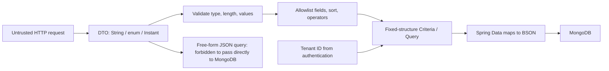

# Parameter Binding and Preventing NoSQL Injection in Dynamic Filters

When an application uses **Spring Data MongoDB** for searching, users are often allowed to supply multiple conditions: status, creation date, email, sort order, or keywords. The more flexible the filter, the more critical the boundary between **data values** entered by the user and **query structure** decided by the application. If an arbitrary JSON string or object from an HTTP request is allowed to become a MongoDB condition, a user can manipulate operators, field paths, and the scope of accessed data.

**NoSQL injection** is a condition where untrusted input is interpreted as part of a query structure or expression rather than purely as data. In MongoDB, risks commonly involve operator keys starting with `$`, dynamic query expressions, user-selected field names, and JSON queries built via string concatenation.

In the `SPRING_DATA_MONGODB` module, we will practice **strongly typed value binding** via repositories and `MongoTemplate`/`Criteria`, designing allowlists for dynamic filters, bounding resource-intensive queries, testing against a real MongoDB instance, and monitoring in operations. This also serves as a foundation when building aggregations, indexes, reactive access, and multi-tenant handling.

## 1. Understanding the Exact Trust Boundary

Suppose an API supports:

```http
GET /orders?status=PAID&buyerEmail=an@example.test&sortBy=createdAt&limit=20
```

The application needs to turn these parameters into an equivalent query:

```javascript
db.orders.find({
  tenantId: "tenant-from-auth",
  status: "PAID",
  buyerEmail: "an@example.test"
}).sort({ createdAt: -1, _id: 1 }).limit(20)
```

In this example, `tenantId` comes from the server-authenticated identity. The user is allowed to choose the **values** for `status` and `buyerEmail`, but cannot replace `$eq` with another operator, inject `$or` to bypass the tenant condition, or pick arbitrary field paths.

An illustrative payload of input that **must be rejected** when the API expects a string:

```json
{
  "status": { "$ne": null }
}
```

Here the `status` value is an object containing a MongoDB operator, not a string like `"PAID"`. If the API accepts `Map<String,Object>` and passes it straight into the query structure, the condition can take on a completely different meaning than intended. With a DTO having a `String status` field and a validation step, an object-shaped request must be rejected; it must never be converted into an arbitrary filter.



| Component | Who decides? | Safe example |
| --- | --- | --- |
| Collection name | Server | `orders` |
| Filtered fields | Server, via allowlist | `status`, `buyerEmail`, `createdAt` |
| Operators and `AND/OR` logic | Server | `eq` for status, `gte` for dates |
| Comparison values | Client after validation | `"PAID"`, `Instant` |
| Sort field and direction | Client picks from allowlist | `createdAt DESC` |
| Result count limit | Server upper bound | 1–100 documents |
| Current tenant | Server security context | Authenticated ID |
| Returned projection | Server | Only fields the API is permitted to return |

Do not think of "parameter binding" in MongoDB as completely identical to SQL prepared statements. With Spring Data, `?0` in `@Query` or `Criteria.where(...).is(value)` creates a condition whose value is converted to BSON according to its data type. This mechanism **does not automatically sanitize** field names, JSON fragments, aggregation pipelines, or entire user-controlled objects.

## 2. Binding Values via Repositories

### 2.1. Prefer derived queries when the query shape is fixed

A repository can represent a pre-designed query:

```java
package example.orders;

import java.util.List;
import org.springframework.data.mongodb.repository.MongoRepository;

public interface OrderRepository extends MongoRepository<Order, String> {
    List<Order> findByTenantIdAndStatus(String tenantId, String status);
}
```

Spring Data generates the corresponding condition from the method name and passes `tenantId` and `status` as values. Security still depends on **the server obtaining tenantId from the authenticated user**, and checking access rights properly; method naming alone does not perform authorization.

### 2.2. When using `@Query`, bind with placeholders

Example declaring a **static** BSON query:

```java
import java.util.List;
import org.springframework.data.mongodb.repository.Query;

public interface OrderRepository extends MongoRepository<Order, String> {
    @Query("{ 'tenantId': ?0, 'status': ?1 }")
    List<Order> findForTenantWithStatus(String tenantId, String status);
}
```

In Spring Data MongoDB repository queries, placeholders `?0` and `?1` are bound to Java parameters. **String parameters are escaped during binding**, so a string containing characters that look like MongoDB syntax is still treated as string data; it does not turn into a query operator.

Do not replace placeholders with string concatenation to build JSON:

```java
// DO NOT use with request input:
String json = "{ 'status': '" + userSuppliedStatus + "' }";
// If data is improperly interpolated into JSON, the user
// can alter the query structure or make the query invalid.
```

If complex optional conditions are needed, build `Criteria` using controlled Java branches instead of concatenating JSON fragments. Queries using SpEL `?#{...}` also require separate scrutiny: expressions can construct BSON structures, and letting untrusted arguments control operators/fragments breaks the security boundary. Do not assume every SpEL expression performs "escaped string binding" like `?0`.

## 3. Building Controlled Dynamic Filters with `MongoTemplate`

Example use case: users can filter orders by status, buyer email, and creation timestamp; and choose to sort by `createdAt`, `total`, or `status`, up to 100 records. Every query is always scoped to an authenticated tenant.

### 3.1. Strongly typed DTO

File `OrderSearchFilter.java`:

```java
package example.orders;

import java.time.Instant;

public record OrderSearchFilter(
        String status,
        String buyerEmail,
        Instant createdFrom,
        String sortBy,
        String sortDirection,
        Integer limit
) {}
```

At the HTTP layer, let Spring/Jackson bind query parameters or JSON body into a strongly typed DTO, then return `400 Bad Request` for type mismatches. With `createdFrom` typed as `Instant`, the client sends a valid ISO 8601 timestamp; do not allow the client to send an object containing an operator instead of a timestamp.

The DTO is the first step: **a DTO does not replace validation**. String values must be checked for length, allowed value sets, and business rules before constructing a query.

### 3.2. Service constructing conditions from an allowlist

File `OrderSearchService.java`:

```java
package example.orders;

import java.util.ArrayList;
import java.util.List;
import java.util.Locale;
import java.util.Set;
import org.bson.Document;
import org.springframework.data.domain.Sort;
import org.springframework.data.mongodb.core.MongoTemplate;
import org.springframework.data.mongodb.core.query.Criteria;
import org.springframework.data.mongodb.core.query.Query;
import org.springframework.stereotype.Service;

@Service
public class OrderSearchService {
    private static final Set<String> ALLOWED_STATUSES =
            Set.of("NEW", "PAID", "CANCELLED");

    private final MongoTemplate mongoTemplate;

    public OrderSearchService(MongoTemplate mongoTemplate) {
        this.mongoTemplate = mongoTemplate;
    }

    public List<Document> search(
            String authenticatedTenantId, OrderSearchFilter filter) {
        if (authenticatedTenantId == null ||
                authenticatedTenantId.isBlank()) {
            throw new IllegalArgumentException("Missing tenant identity");
        }
        if (filter == null) {
            throw new IllegalArgumentException("Missing filter");
        }

        // Server-determined condition is always present.
        List<Criteria> parts = new ArrayList<>();
        parts.add(Criteria.where("tenantId").is(authenticatedTenantId));

        if (filter.status() != null && !filter.status().isBlank()) {
            String status = filter.status().trim()
                    .toUpperCase(Locale.ROOT);
            if (!ALLOWED_STATUSES.contains(status)) {
                throw new IllegalArgumentException("Invalid status");
            }
            parts.add(Criteria.where("status").is(status));
        }

        if (filter.buyerEmail() != null
                && !filter.buyerEmail().isBlank()) {
            String email = filter.buyerEmail().trim()
                    .toLowerCase(Locale.ROOT);
            if (email.length() > 254 || !email.contains("@")) {
                throw new IllegalArgumentException("Invalid email filter");
            }
            // Only suitable when stored emails are normalized accordingly.
            parts.add(Criteria.where("buyerEmail").is(email));
        }

        if (filter.createdFrom() != null) {
            parts.add(Criteria.where("createdAt")
                    .gte(filter.createdFrom()));
        }

        String sortField = switch (
                filter.sortBy() == null ? "createdAt" : filter.sortBy()) {
            case "createdAt" -> "createdAt";
            case "total" -> "total";
            case "status" -> "status";
            default -> throw new IllegalArgumentException("Invalid sortBy");
        };

        String requestedDirection = filter.sortDirection() == null
                ? "desc"
                : filter.sortDirection().toLowerCase(Locale.ROOT);
        Sort.Direction direction = switch (requestedDirection) {
            case "asc" -> Sort.Direction.ASC;
            case "desc" -> Sort.Direction.DESC;
            default -> throw new IllegalArgumentException(
                    "Invalid sort direction");
        };

        int limit = filter.limit() == null ? 20 : filter.limit();
        if (limit < 1 || limit > 100) {
            throw new IllegalArgumentException("Invalid limit");
        }

        Query query = Query.query(
                new Criteria().andOperator(parts.toArray(new Criteria[0])));
        query.with(Sort.by(direction, sortField)
                .and(Sort.by(Sort.Direction.ASC, "_id")));
        query.limit(limit);
        query.fields()
                .include("_id")
                .include("status")
                .include("buyerEmail")
                .include("createdAt")
                .include("total");

        return mongoTemplate.find(query, Document.class, "orders");
    }
}
```

This code illustrates the **safe query boundary**; in a real application, map `Document` to a response DTO containing only allowed public fields. Returning raw MongoDB documents from an API can expose internal fields if projections change.

What makes the service above safer than an arbitrary JSON filter?

1. **Field names** are literals in code or chosen via `switch`. The client cannot pass `$where`, `tenantId`, or an arbitrary nested path as a filter field name.
2. **Operators** `is` and `gte` are selected by the server per field type. The client does not supply a `Map` containing `$ne` or `$or`.
3. **Values** are validated and kept as Java types such as `String`, `Instant`, and `Integer`; Spring Data then encodes them into appropriately typed BSON.
4. **Tenant condition** is always added as an `AND` branch at the root query level. The tenant ID is never taken from the request.
5. **Sort and limit** are restricted via an allowlist and upper bound, preventing overly expensive or out-of-scope queries.
6. **Fixed projection** reduces the chance of returning fields outside the API contract and reduces BSON payload size over the network.

The `email.contains("@")` check is minimal validation for illustrative purposes, **not a complete validator for all valid email formats**. Choose format, length, and normalization rules matching your stored data; if emails are stored in mixed case, exact matching against a lowercased string may miss records. Do not use uncontrolled regexes to patch this.

## 4. Query Construction Patterns with Injection Risks

### 4.1. Never turn client JSON directly into a query

Two anti-patterns to recognize:

```java
// DO NOT use with raw JSON directly from an HTTP request:
BasicQuery query = new BasicQuery(rawFilterJson);

// DO NOT use with untrusted JSON:
org.bson.Document filter = org.bson.Document.parse(rawFilterJson);
mongoTemplate.getCollection("orders").find(filter);
```

`BasicQuery` and `Document.parse(...)` **are not inherently buggy APIs**. They are useful with developer-controlled BSON/JSON. Risk arises when `rawFilterJson` comes from users, arbitrarily editable configurations, or untrusted external systems: fields like `$or`, `$ne`, `$regex`, etc., can become live operators.

Do not try to fix this by stripping every `$` character from the JSON string and continuing to parse: that is not schema validation and can corrupt valid data. The right approach is to **accept only a defined DTO structure**, validate each choice, and construct the query from trusted branches.

### 4.2. Dynamic field names are also risky input

Example to avoid:

```java
// Client is allowed to specify an arbitrary field name: risk of bypassing API contract.
Criteria criterion = Criteria.where(requestedField).is(requestedValue);
```

Even when `requestedValue` is a String, `requestedField` can target sensitive fields, nested fields, unindexed fields, or special names that alter intended query behavior. If an API must support a selectable list of fields, map each public key to a fixed internal field:

```java
String actualField = switch (requestedField) {
    case "status" -> "status";
    case "created" -> "createdAt";
    default -> throw new IllegalArgumentException("Unsupported field");
};
```

Do not pass `requestedField` to build a projection or `Sort.by(requestedField)` before passing through an allowlist. For nested fields, allow only explicitly published paths; never assume every dot-separated string is valid.

### 4.3. Do not accept an arbitrary `Object` to select operators

A controller accepting `@RequestBody Map<String,Object> filters` and using the entire map as a BSON query is hard to control. If clients need operations like "greater than", "in set", or "starts with", design a **small, explicitly schema-defined filter language**:

```json
{
  "status": "PAID",
  "createdFrom": "2026-01-01T00:00:00Z",
  "sortBy": "createdAt",
  "sortDirection": "desc",
  "limit": 20
}
```

Each field is deserialized into a deterministic Java type; the service picks the operator. If supporting an `IN`-style condition, cap the number of elements, reject mistyped values, and apply resource limits. Never accept raw MongoDB objects like `{"$in":[...]}` just to avoid writing a parser.

## 5. Protecting Regex Conditions and Fuzzy Search

Another form of injection is **regex injection**: a user enters a keyword that is interpreted as a regular expression. This can make conditions match more broadly than intended and consume high CPU on complex patterns.

If the business requirement is genuinely "name starts with keyword", bound the length and escape metacharacters:

```java
import java.util.regex.Pattern;
import org.springframework.data.mongodb.core.query.Criteria;

String prefix = userPrefix == null ? "" : userPrefix.trim();
if (prefix.isEmpty() || prefix.length() > 40) {
    throw new IllegalArgumentException("Invalid prefix");
}

Pattern literalPrefix = Pattern.compile(
        "^" + Pattern.quote(prefix),
        Pattern.CASE_INSENSITIVE);
Criteria criterion = Criteria.where("displayName").regex(literalPrefix);
```

With input like `.*`, `Pattern.quote(...)` ensures the user searches for the exact **literal dot and asterisk characters**, rather than turning them into a wildcard. Length caps, timeouts, and query resource limits remain necessary: a case-insensitive regex may not utilize a standard index as effectively as an exact lookup, especially across differing collations. For large datasets, consider a normalized field for prefix search or a dedicated search capability rather than allowing arbitrary regex execution.

If a system must support **user-authored regex** as a specialized feature, treat it as a distinct high-risk capability: gated permissions, parser validation, pattern/CPU/time limits, and monitoring. Do not share it with general search endpoints.

## 6. Keeping Authorization Conditions Independent from User Filters

**The absence of NoSQL injection does not mean authorization is guaranteed.** A properly bound query can still leak data if the tenant ID is taken from the HTTP request instead of the authenticated identity, or if the application forgets to insert the tenant scope on a query branch.

Safe design for multi-tenant systems:

- Obtain `authenticatedTenantId` from the verified principal/token and check the caller's permissions.
- Construct the fixed tenant condition at an outer `AND` level wrapping optional conditions.
- Never allow clients to overwrite `tenantId` or `ownerId`, or manipulate logic to drop the authorization condition.
- Ensure other access paths such as `findById`, `updateFirst`, `remove`, bulk operations, and aggregations enforce equivalent authorization boundaries.
- When using `$lookup` in aggregations, separately evaluate read permissions on the joined collection; a tenant condition on the input collection does not automatically guarantee the joined collection belongs to the right tenant.

Example combining status and tenant filters in Spring Data:

```java
Criteria safeCriteria = new Criteria().andOperator(
        Criteria.where("tenantId").is(authenticatedTenantId),
        Criteria.where("status").is(validatedStatus));

Query safeQuery = Query.query(safeCriteria);
```

When supporting `OR` across multiple user conditions, nest the `OR` **inside** one branch of the `AND` with the tenant condition. Separately test scenarios where a document matches the user filter but belongs to another tenant to ensure it is never returned.

## 7. Aggregation, Reactive, and Write Operations

### 7.1. Aggregation: controlling pipeline stages

For aggregations, build stages only using Spring Data APIs or application-controlled fragments. Example:

```java
import org.springframework.data.mongodb.core.aggregation.Aggregation;
import org.springframework.data.mongodb.core.query.Criteria;

Aggregation aggregation = Aggregation.newAggregation(
        Aggregation.match(new Criteria().andOperator(
                Criteria.where("tenantId").is(authenticatedTenantId),
                Criteria.where("status").is(validatedStatus))),
        Aggregation.group("status").count().as("orders"));
```

This is a skeletal example: `validatedStatus` has already passed allowlist checks at the calling layer. Never take client-supplied `$match`, `$project`, `$lookup`, or arbitrary expressions and append them directly to the pipeline. Likewise, server-side code/expression evaluation operators such as `$where` or JavaScript execution operators should not be used to implement ordinary text filtering.

### 7.2. `ReactiveMongoTemplate` follows the same boundaries

Binding and validation principles do not change when moving from `MongoTemplate` to `ReactiveMongoTemplate`:

```java
// query is a Query built from validated values and allowlists.
reactiveMongoTemplate.find(query, Document.class, "orders");
```

The publisher executes upon subscription. Never defer validation until "after the query is constructed/dispatched"; ensure the query builder is an explicit function validated before database access. In reactive applications, propagate the authenticated tenant context using appropriate security/reactor context mechanisms; avoid relying on arbitrary ThreadLocals that lose tenant scope across thread switches.

### 7.3. Updates and deletes must be similarly restricted

NoSQL injection does not affect only `find`. An endpoint that modifies or deletes documents must clearly separate:

1. **Filter identifying target documents:** includes tenant/owner scope and validated IDs.
2. **List of updatable fields:** decided by the application or mapped from an allowlist.
3. **Update operators:** `set`, `inc`, etc., chosen by business logic—never accepting arbitrary `$set`/`$unset` objects from requests.
4. **Limit on affected document count:** distinguish `updateFirst`/`updateMulti` or `delete` with specific criteria; perform authorization and auditing before executing.

An update using a fixed tenant condition:

```java
import org.springframework.data.mongodb.core.query.Update;

Query query = Query.query(new Criteria().andOperator(
        Criteria.where("_id").is(validatedOrderId),
        Criteria.where("tenantId").is(authenticatedTenantId)));
Update update = new Update().set("status", validatedStatus);
mongoTemplate.updateFirst(query, update, "orders");
```

Never accept a BSON update document directly from a client simply because the driver supports it.

## 8. Bounding Resource-Intensive Queries

Beyond injection that alters condition semantics, a syntactically valid filter can still be overly expensive. For example, a query with many `$in` elements, a broad regex, sorting on an unindexed field, or pagination using deep `skip` can force the server to scan many documents and cause the application to consume excessive memory.

| Risk | Mitigation |
| --- | --- |
| Returning too many documents | Cap `limit` and page size, use projections |
| Overly long ID lists | Cap `$in` array size, condition count, and string lengths |
| CPU-intensive regex | Escape characters, limit length, use suitable indexes/search |
| Unindexed sorts | Allow sorting only on designed fields and inspect execution plans |
| Filters on arbitrary nested fields | Allowlist paths and supported operator types |
| Long-running queries | Set appropriate query deadlines alongside API timeouts |
| Losing tenant scope across branches | Attach authorization as a mandatory condition and test separately |

For frequent queries, use `explain("executionStats")` in a test environment with representative data to inspect `totalDocsExamined`, `totalKeysExamined`, `nReturned`, and stages such as `COLLSCAN`, `IXSCAN`, and `SORT`. Indexes can support both filtering and authorization: for instance, a tenant + status + createdAt query may warrant evaluating a compound index `{ tenantId: 1, status: 1, createdAt: -1 }`. Do not add indexes based on guesswork: indexes increase write overhead and must be chosen according to actual workloads.

Do not use `explain` or the duration of a single query to extrapolate total HTTP request latency. You must also measure pool wait time, command counts, BSON payload size, and Java mapping overhead when diagnosing performance.

## 9. Testing NoSQL Injection Defenses

### 9.1. Essential test cases

| Input / scenario | Expected result |
| --- | --- |
| `status=PAID` | Results within same tenant, matching status |
| `status={"$ne":null}` sent as a JSON object | Rejected if DTO requires String |
| Status string resembling JSON | Rejected because it is not in allowlist; not interpreted as an operator |
| `sortBy=$where` or unpublished field | Rejected, no query generated |
| `limit=1000000` or negative value | Rejected per API bounds |
| Very long email/string | Rejected before querying |
| `prefix=.*` in literal search | Matches literal characters only, does not match all names |
| Tenant B document matching every filter | Never appears in Tenant A results |
| Update/delete with Tenant B ID | Does not modify Tenant B document |

For controllers binding JSON bodies into DTOs with `String` fields, verify the HTTP layer returns `400` when a field is an object/array. Depending on Jackson configuration, ensure no custom converter coerces arbitrary structures into strings and bypasses validation. Service-layer tests must also verify that disallowed fields/sorts/statuses are rejected before the database is called.

### 9.2. Integration testing against real MongoDB

Use Testcontainers or a MongoDB test service to verify there is no cross-tenant access. The snippet below shows the core of a test configured with `@DataMongoTest`, connected to a test MongoDB instance and importing `OrderSearchService`:

```java
import java.time.Instant;
import java.util.List;
import org.bson.Document;
import org.junit.jupiter.api.Test;
import static org.assertj.core.api.Assertions.*;

@Test
void searchNeverReturnsOrdersOfAnotherTenant() {
    mongoTemplate.getCollection("orders").insertMany(List.of(
            new Document("_id", "a-1")
                    .append("tenantId", "tenant-A")
                    .append("status", "PAID")
                    .append("buyerEmail", "an@example.test")
                    .append("createdAt", java.util.Date.from(Instant.EPOCH))
                    .append("total", 100),
            new Document("_id", "b-1")
                    .append("tenantId", "tenant-B")
                    .append("status", "PAID")
                    .append("buyerEmail", "an@example.test")
                    .append("createdAt", java.util.Date.from(Instant.EPOCH))
                    .append("total", 200)));

    OrderSearchFilter filter = new OrderSearchFilter(
            "PAID", null, null, "createdAt", "desc", 20);

    List<Document> found = searchService.search("tenant-A", filter);
    assertThat(found).hasSize(1);
    assertThat(found.get(0).getString("_id")).isEqualTo("a-1");
}

@Test
void rejectsUnapprovedSortBeforeQuery() {
    OrderSearchFilter filter = new OrderSearchFilter(
            "PAID", null, null, "$where", "desc", 20);

    assertThatThrownBy(() -> searchService.search("tenant-A", filter))
            .isInstanceOf(IllegalArgumentException.class)
            .hasMessageContaining("sortBy");
}
```

These two tests assume `mongoTemplate` and `searchService` are injected, and the `orders` collection belongs exclusively to the test suite and is cleaned before each test. For shared or parallel MongoDB test instances, create separate databases per job/test to avoid interfering with each other's data. Testing query logic against real MongoDB complements mocked unit tests because it confirms how Spring Data translates `Criteria` into BSON and how the server evaluates the filter.

### 9.3. Testing repository `@Query`

For static repository queries, test inputs containing special characters and payloads represented **as strings**. Verify they do not alter query structure and do not return documents from another tenant. For objects carrying a `$ne` key, send them through the HTTP layer to verify validation errors, as a repository method declared with `String` should never receive an object directly.

## 10. Monitoring, Logging, and Error Handling

API design should return controlled errors for invalid filters rather than trying to "fix" input into a broader query. HTTP validation errors typically map to `400 Bad Request`; authorization errors to `403 Forbidden` when appropriate; and MongoDB infrastructure failures to handled server error categories.

When investigating incidents, log information such as filter category, rejected field name, error code, trace ID, and execution duration. **Do not log full emails, access tokens, BSON queries containing personal data**, or full request bodies just to look for `$` signs. Use aggregated metrics for rejected request counts, timed-out queries, mapping errors, and latency distributions. Metric tags must maintain low cardinality; avoid placing query strings and user IDs in tags.

If sensitive queries require auditing, record events according to data and access policies: actor, object type, tenant scope, timestamp, allow/deny outcome, and correlation ID. Auditing does not replace query-level permission checks.

## 11. Misconceptions to Avoid

| Misconception | Reality |
| --- | --- |
| MongoDB does not use SQL, so it has no injection | JSON/BSON has operators and expressions; dynamic queries can still be manipulated |
| Escaping quotes is enough | Does not address client-controlled BSON objects/operators or field names |
| Using `Criteria` is always safe | Only safe within controlled structure, fields, operators, and values |
| `@Query` with `?0` lets you safely bind any JSON snippet | String value binding differs from injecting raw query fragments or SpEL-built operators |
| The string `{"$ne":null}` is always an operator | Only becomes an operator when parsed/embedded as query structure; a literal string remains data |
| Validating in the controller is enough | Other services/jobs may call query builders; validation boundaries belong where queries are built |
| Having a tenant filter means no authorization is needed | Tenant ID must be server-authenticated, and other read/write paths still need permission checks |
| Limiting `limit` is enough to prevent overload | The server may scan/sort huge amounts of data before returning a small page |
| Escaping regexes guarantees fast execution | Literal regexes may still fail to use indexes optimally and need resource bounds |

## 12. Practice Exercises

**Exercise 1 — Write a safe filter.** Create an endpoint to filter orders by status, creation date, and email. Allow only defined fields, validate types, and cap results. Use `MongoTemplate` and `Criteria`, ensuring the tenant ID comes from authentication.

**Exercise 2 — Verify `@Query` binding.** Create a repository using `@Query("{ 'tenantId': ?0, 'status': ?1 }")`. Test a valid status, a string containing JSON-like characters, and a request body where status is an object. Distinguish value escaping from rejecting schema-invalid payloads.

**Exercise 3 — Sort and regex.** Implement an allowlist for three sort choices, handle `sortBy=$where`, and test literal prefix search `.*` using `Pattern.quote(...)`. Use `explain("executionStats")` to evaluate whether a regex or sort condition could cause a large scan.

**Exercise 4 — Tenant isolation.** Seed the same status and email across two tenants. Exercise all read, update, and delete paths in the service; ensure requests from Tenant A cannot read, modify, or delete Tenant B records.

**Exercise 5 — Aggregation and reactive.** Reuse the same DTO/validation to build `Aggregation.match(...)` and `ReactiveMongoTemplate` queries. Verify that selecting an unsupported field or supplying an operator as a JSON object is rejected before any command is sent.

**Completion criteria:** Learners distinguish data values from BSON query structure, know how to bind parameters via Spring Data MongoDB, control fields/operators/sorts with allowlists, enforce tenant scoping, restrict overly expensive filters, and test NoSQL injection scenarios against real MongoDB.
