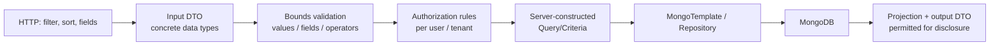

# Restricting Allowed Fields, Operators, Sorts, and Projections from Input

When building search APIs on **Spring Data MongoDB**, applications often accept filters, sort fields, and lists of fields to display from HTTP requests. This is an important security boundary: users are allowed to search data within published features, but must not arbitrarily choose every MongoDB operator, BSON path, or confidential field that MongoDB can process.

For example, the endpoint `GET /api/products` allows filtering products by `sku`, `active`, and price range, sorting by name or creation date, and selecting certain result fields. If the application passes raw client-supplied JSON or field names directly into `Query`/`Document`, callers can alter query semantics, trigger very expensive computations, or access data outside their permissions.

This lesson in the **Security and Operations** chapter shows how to design **allowlists** for fields, operators, sorts, and projections; construct strongly typed `Criteria`; enforce authorization conditions and query cost limits; and test both valid inputs and out-of-bounds attempts. The focus is on `MongoTemplate` and repositories, though the principles also apply to aggregations, updates, and reactive access.

## 1. Clearly Seeing the Trust Boundary

A search API should pass through the following pipeline:



**Design principle:** the client sends **values and choices within a defined range**; the server decides the query structure, operators, storage field names, authorization policy, and returnable data.

| Input component | What should the user be allowed to choose? | What must the server control? |
| --- | --- | --- |
| Filter | `sku` value, status, bounded price range | Field list, BSON/Java types, `eq`/`gte`/`lte` operators |
| Sort | A published sort key and `asc`/`desc` direction | Mapping key to real property, number of keys, tie-breaker |
| Projection | Subset of published fields | Field-level authorization, confidential fields, output DTO structure |
| Pagination | Page or cursor within allowed range | Maximum `limit`, offset, record count, total cost |
| Authorization | Never trusted directly from client input | `tenantId`/`ownerId` taken from authenticated principal |

A legitimately authenticated request can still send dangerous or very expensive input. Authentication identifies the caller; **authorization, input validation, and query budgeting** determine what they may ask for and receive.

## 2. Common Mistakes When Letting Clients Control Queries

### 2.1. Query selector injection

MongoDB uses keys starting with `$` as operators. If an application trusts input JSON as a MongoDB condition, a user value expected to be a string can turn into a condition object:

```json
{
  "sku": {
    "$ne": null
  }
}
```

The meaning changes from "SKU equals a specific string" to "SKU is not null". Doing the same with `$in`, `$exists`, `$or`, `$expr`, or other complex operators can broaden result sets, bypass filters, or increase system load.

**Prevention:** define `sku` as `String` in the DTO, reject objects/arrays, validate format, and build `Criteria.where("sku").is(sku)` explicitly. Never deserialize client JSON filters directly into `org.bson.Document` and pass them to MongoDB.

### 2.2. Allowing arbitrary field names

Unsafe example:

```java
// fieldName input comes directly from HTTP request:
Query query = Query.query(
    Criteria.where(fieldName).is(userValue)
);
```

Users can probe unpublished fields such as `passwordHash`, `internalCost`, `billing.secret`, or nested paths. Even if confidential fields are not returned directly, filtering on secret values can cause **leaks via result existence or record counts**.

Allow only predefined fields and pair each field with its exact allowed operators and data types. Do not rely solely on rules like "does not start with `$`" or "contains only letters and dots": an innocent-looking name can still be an unauthorized field.

### 2.3. Unbounded sort and projection

```java
// Both statements pass untrusted field names to MongoDB.
query.with(Sort.by(clientSortField));
query.fields().include(clientRequestedField);
```

Arbitrary sorting can request sorting on unindexed fields, arrays, or resource-heavy fields. Arbitrary projection can expose sensitive fields, internal contact details, or nested structures the API never intended to publish.

Malicious input does not have to contain a `$` operator: `sort=passwordHash` or `fields=internalNotes` is also an improper request if the server does not enforce an allowlist.

## 3. Designing Allowlists from the API Contract

Suppose the `products` collection has the following fields:

```javascript
{
  _id: "p-100",
  tenantId: "tenant-a",
  sku: "SKU-100",
  name: "Keyboard",
  priceInCents: NumberLong("259000"),
  active: true,
  createdAt: ISODate("2026-01-10T08:00:00Z"),
  internalCostInCents: NumberLong("180000"),
  supplierNotes: "Private supplier terms"
}
```

The public API supports only:

| API input | Target Java/BSON field | Allowed operator | Value type and bounds |
| --- | --- | --- | --- |
| `sku` | `sku` | Exact equality (`eq`) | Structured SKU string, max 40 chars |
| `active` | `active` | Equality (`eq`) | Boolean |
| `minPrice` | `priceInCents` | Greater than or equal (`gte`) | Non-negative bounded `Long` |
| `maxPrice` | `priceInCents` | Less than or equal (`lte`) | Non-negative `Long`, not less than min |
| `sort=created` | `createdAt` | Sort `asc/desc` | Predefined key |
| `sort=name` | `name` | Sort `asc/desc` | Predefined key |
| `sort=price` | `priceInCents` | Sort `asc/desc` | Predefined key |
| `fields=id,name,price` | `id`, `name`, `priceInCents` | Include projection | Subset of published fields |

`tenantId` is **added by the server to every query from the current principal** and does not appear in the list of user-selectable fields. The fields `internalCostInCents` and `supplierNotes` are excluded from filter, sort, and projection allowlists.

Allowlists should be separated by purpose. A field permitted for display **is not necessarily** permitted for filtering or sorting; a field used in authorization conditions may never be returned. A single shared `ALLOWED_FIELDS` set across all operations is usually too broad.

### 3.1. Prefer API-contract names

Instead of letting clients pass Java property names or BSON paths, define external keys such as `created`, `price`, and `name`, then map them to server-chosen properties:

```java
private static final Map<String, String> SORT_KEYS = Map.of(
    "created", "createdAt",
    "name", "name",
    "price", "priceInCents"
);
```

The benefit is being able to change stored names in MongoDB or `@Field("created_at")` without breaking the public API. When using `MongoTemplate.find(query, Product.class)`, Spring Data maps entity properties according to mapping rules. Conversely, when using Java Driver's `MongoTemplate.getCollection(...)` directly, field names sent must be **actual BSON field names**.

## 4. Defining Requests with Concrete Data Types

Do not accept a generic `Map<String, Object> filters` and allow arbitrary entries to create `Criteria`. For a predefined API, an explicit DTO is much easier to control:

```java
import java.util.List;

public record ProductSearchRequest(
    String sku,
    Boolean active,
    Long minPrice,
    Long maxPrice,
    String sort,
    String direction,
    List<String> fields,
    int page,
    int size
) {}
```

At the HTTP layer, bind only supported parameters. For JSON bodies, configure **unknown field** handling per the API contract: reject unknown fields when a strict contract is required rather than silently ignoring options the caller thought were applied.

Combine Bean Validation with business checks. For example:

- `page` from 0 to an acceptable ceiling; `size` from 1 to 100.
- `minPrice` and `maxPrice` non-negative, within the chosen currency domain, `minPrice <= maxPrice`.
- `sku` matching the system's supported format, e.g., `[A-Z0-9-]{1,40}`.
- `sort` within `created/name/price`; `direction` only `asc` or `desc`.
- Each projection field must belong to the allowed set, with no arbitrary paths or overly long lists.

Explicit Java types block many malformed shapes right at request binding. However, Java types alone are not enough: a huge `Long`, a list of 100,000 items, or a megabyte-long string can still exhaust resources if values and request sizes are not bounded.

## 5. Building Safe `Query` Objects with `MongoTemplate`

The example below demonstrates the service deciding field names and operators itself. Authorization data `tenantId` must come from the authentication system, **not passed from an HTTP form**.

Entity used in the example:

```java
import java.time.Instant;
import org.springframework.data.annotation.Id;
import org.springframework.data.mongodb.core.mapping.Document;

@Document("products")
public record Product(
    @Id String id,
    String tenantId,
    String sku,
    String name,
    Long priceInCents,
    Boolean active,
    Instant createdAt,
    Long internalCostInCents,
    String supplierNotes
) {}
```

Query-building service:

```java
import java.time.Duration;
import java.util.ArrayList;
import java.util.List;
import java.util.Map;
import java.util.Set;

import org.springframework.data.domain.PageRequest;
import org.springframework.data.domain.Sort;
import org.springframework.data.mongodb.core.MongoTemplate;
import org.springframework.data.mongodb.core.query.Criteria;
import org.springframework.data.mongodb.core.query.Query;

public final class ProductSearchService {
    // Illustrative limit; must align with actual pricing domain.
    private static final long MAX_PRICE = 1_000_000_000_000L;
    private static final Map<String, String> SORT_KEYS = Map.of(
        "created", "createdAt",
        "name", "name",
        "price", "priceInCents"
    );
    private static final Set<String> VISIBLE_FIELDS = Set.of(
        "id", "sku", "name", "priceInCents", "active", "createdAt"
    );
    private final MongoTemplate mongoTemplate;

    public ProductSearchService(MongoTemplate mongoTemplate) {
        this.mongoTemplate = mongoTemplate;
    }

    // tenantId must come from server-verified authentication info.
    public List<Product> findProducts(
            String tenantId, ProductSearchRequest request) {
        if (request == null) {
            throw new IllegalArgumentException("Missing search criteria");
        }
        if (tenantId == null || tenantId.isBlank()) {
            throw new IllegalArgumentException("Missing valid tenant");
        }
        if (request.page() < 0 || request.page() > 1000
                || request.size() < 1 || request.size() > 100) {
            throw new IllegalArgumentException("Pagination out of bounds");
        }
        if ((request.minPrice() != null
                && (request.minPrice() < 0
                    || request.minPrice() > MAX_PRICE))
                || (request.maxPrice() != null
                && (request.maxPrice() < 0
                    || request.maxPrice() > MAX_PRICE))) {
            throw new IllegalArgumentException("Price out of valid range");
        }
        if (request.minPrice() != null && request.maxPrice() != null
                && request.minPrice() > request.maxPrice()) {
            throw new IllegalArgumentException("Invalid price range");
        }

        String sortField = request.sort() == null
            ? null : SORT_KEYS.get(request.sort());
        if (sortField == null) {
            throw new IllegalArgumentException("Sort field not allowed");
        }
        if (request.direction() == null) {
            throw new IllegalArgumentException("Missing direction");
        }
        Sort.Direction sortDirection =
            switch (request.direction()) {
                case "asc" -> Sort.Direction.ASC;
                case "desc" -> Sort.Direction.DESC;
                default -> throw new IllegalArgumentException(
                    "Direction not allowed");
            };

        List<String> requestedFields = request.fields() == null
            ? List.of("id", "sku", "name", "priceInCents")
            : request.fields();
        if (requestedFields.isEmpty() || requestedFields.size() > 6
                || requestedFields.stream().anyMatch(
                    field -> field == null || !VISIBLE_FIELDS.contains(field))) {
            throw new IllegalArgumentException("Invalid projection");
        }
        requestedFields = List.copyOf(requestedFields);

        List<Criteria> rules = new ArrayList<>();
        rules.add(Criteria.where("tenantId").is(tenantId));

        if (request.sku() != null) {
            if (!request.sku().matches("[A-Z0-9-]{1,40}")) {
                throw new IllegalArgumentException("Invalid SKU");
            }
            rules.add(Criteria.where("sku").is(request.sku()));
        }
        if (request.active() != null) {
            rules.add(Criteria.where("active").is(request.active()));
        }
        if (request.minPrice() != null) {
            rules.add(Criteria.where("priceInCents")
                .gte(request.minPrice()));
        }
        if (request.maxPrice() != null) {
            rules.add(Criteria.where("priceInCents")
                .lte(request.maxPrice()));
        }

        Query query = Query.query(
            new Criteria().andOperator(rules.toArray(new Criteria[0]))
        );
        Sort stableSort = Sort.by(
            new Sort.Order(sortDirection, sortField),
            new Sort.Order(Sort.Direction.ASC, "id")
        );
        query.with(PageRequest.of(
            request.page(), request.size(), stableSort
        ));
        query.maxTime(Duration.ofSeconds(2));

        // Include only published properties in the read result.
        query.fields().include("id");
        for (String field : requestedFields) {
            query.fields().include(field);
        }

        return mongoTemplate.find(query, Product.class);
    }
}
```

Key takeaways:

1. **No field name is passed raw from the request into `Criteria.where(...)` or `Sort.Order(...)`.** Sort keys go through `SORT_KEYS`, and filters use hardcoded fields only.
2. **Values cannot be used as query structure.** SKU is a validated String, price is Long, status is Boolean; clients cannot send `{"$ne":null}` as an operator.
3. **The tenant condition is forcibly injected.** Dynamic filters are only `AND`ed with the server-chosen authorization condition and cannot be overridden by a client-supplied `$or`.
4. **Sort includes an ID tie-breaker.** When multiple documents share the same price or creation date, a stable order makes pagination predictable. For deep pagination, `skip` remains costly; consider cursor/keyset pagination.
5. **Projection includes only allowlisted properties.** With entity mapping, unselected fields may read back as `null` or default values. Never pass such partially loaded entities to a subsequent `save`, as it risks overwriting missing data.
6. **Time limits do not replace indexes.** `maxTime` is a secondary safeguard; measure against real workloads and handle timeouts cleanly.

The code returns `List<Product>` to keep the focus on `Query`. **Never return this entity directly from an HTTP controller.** In the web layer, map it to a DTO or response object containing only public fields, because the entity holds internal properties. Query projection helps reduce network transfer, but **the DTO/serialization contract is the final boundary of outgoing data**.

### 5.1. Ensuring projections do not create data leak paths

A simple approach is a fixed response DTO:

```java
public record ProductSummary(
    String id,
    String sku,
    String name,
    Long priceInCents,
    Boolean active
) {
    static ProductSummary from(Product product) {
        return new ProductSummary(
            product.id(),
            product.sku(),
            product.name(),
            product.priceInCents(),
            product.active()
        );
    }
}
```

If an API genuinely supports dynamic `fields`, construct the response from an allowed field-to-value registry or pre-designed projection DTOs; never use arbitrary reflection based on client-sent field names. When using a fixed DTO as above, the query must fetch all properties read by the mapper. Therefore, **align query projections with the output DTO structure**.

When clean model separation is needed, define responses such as `ProductSummary` and `ProductDetail` per endpoint and use static projections for each. This is usually easier to test and enforce field-level permissions than an overly flexible `fields` API.

## 6. Restricting Operators: Grant Only What Is Truly Needed

MongoDB supports many operators, yet a public endpoint should expose only those directly required. The table below suggests policies for a typical search API:

| Group | Common operators | Recommended decision |
| --- | --- | --- |
| Equality | `$eq` | Accept on declared fields, with explicit value types |
| Range | `$gte`, `$gt`, `$lte`, `$lt` | Accept only on numeric/date fields with valid bounds |
| Value set | `$in` | Only if required by business logic; cap element count and item length |
| Inequality/exclusion | `$ne`, `$nin` | Do not grant by default; can produce poorly selective queries |
| Structure checks | `$exists`, `$type` | Only when required by feature; never allow probing confidential fields |
| Logical | `$or`, `$nor`, `$and` | Server builds expressions with bounded branch count/depth |
| Arrays | `$elemMatch`, `$all` | Use only on defined paths and structures |
| String patterns | `$regex` | Reject arbitrary regex by default; if supported, bound pattern, length, and resources |
| Expressions/code | `$expr`, `$where`, `$function` | Do not expose to general filter APIs |
| Pipeline/writes | `$lookup`, `$graphLookup`, `$out`, `$merge` | Never accept arbitrarily from clients; build from controlled internal workflows |

Operators like `$ne` and `$regex` are not always vulnerabilities by themselves. Risk arises when **purpose, data types, fields, query budgets, and access controls are unbounded**. A search feature with a legitimate regex need can still be implemented if designed and tested separately.

### 6.1. The `$in` case

If an API needs to filter by a list of SKUs, cap the list size before building the query:

```java
List<String> skus = requestSkus;
if (skus == null || skus.isEmpty() || skus.size() > 30
        || skus.stream().anyMatch(
            sku -> sku == null || !sku.matches("[A-Z0-9-]{1,40}")
        )) {
    throw new IllegalArgumentException("Invalid SKU list");
}

Criteria condition = Criteria.where("sku").in(
    skus.stream().distinct().toList()
);
```

The maximum element count is a product rule, not a fixed MongoDB limit. A list of thousands of items can affect command size, planning cost, and performance depending on indexes/data. If filtering large lists is a frequent need, design a batch workflow or dedicated process instead of leaving `$in` parameters unbounded.

### 6.2. Regex and string search

Avoid accepting raw regex strings verbatim:

```java
// Unsafe if pattern is completely client-controlled:
Criteria.where("name").regex(userPattern);
```

Complex regexes can burn CPU; regexes that cannot use indexes well can scan huge datasets. If business logic only requires exact matching, use `is(...)`. If prefix search is required, **escape input as a literal** and anchor it, with a strict length cap:

```java
import java.util.regex.Pattern;

String prefix = requestPrefix;
if (prefix == null || prefix.isBlank() || prefix.length() > 32) {
    throw new IllegalArgumentException("Invalid prefix");
}
String safePattern = "^" + Pattern.quote(prefix);
Criteria startsWith = Criteria.where("name").regex(safePattern);
```

`Pattern.quote(...)` prevents special characters in the prefix from being interpreted as user-authored regex; it **does not guarantee** fast queries. Index efficiency depends on pattern, collation, and MongoDB version. For multilingual full-text search, consider a dedicated search feature instead of turning a listing endpoint into an arbitrary regex engine.

## 7. Safe, Stable, and Operable Sorting

A query like `sort={"arbitraryField":-1}` not only introduces field-level security risks but also creates unpredictable queries that may sort in memory and impose heavy load.

Principles to apply:

1. **Allowlist sort keys:** map `created` to `createdAt`, `price` to `priceInCents`. Reject arbitrary dot paths such as `supplier.secretRank`.
2. **Restrict sort direction:** only `asc` or `desc`; never accept raw MongoDB sort objects from clients.
3. **Limit number of sort keys:** for simple endpoints, one user-chosen key plus one fixed tie-breaker key is usually sufficient.
4. **Stable tie-breaker:** include `id`/`_id` to reduce jitter when records share the same key; concurrent writes can still affect offset pagination.
5. **Design indexes for actual filters and sorts:** for instance, in a multi-tenant system, queries on `tenantId`, `active` sorted by `createdAt` may require a measured compound index.

Example candidate index:

```javascript
db.products.createIndex({
  tenantId: 1,
  active: 1,
  createdAt: -1,
  _id: 1
});
```

The index above suits **specific query shapes**. For sorting by `name` or `price`, index and collation needs may differ. Use `explain("executionStats")` on real queries to inspect `totalDocsExamined`, `totalKeysExamined`, and sort stages; do not create an index solely because a field name is in an allowlist.

Never let clients pass arbitrary `hint` or `collation` values. Those parameters directly influence query plans, comparison semantics, and resource consumption. If different collation modes are required, design bounded presets paired with compatible indexes.

## 8. Projection: Limiting Read and Disclosed Data

Projection controls which fields the server returns. MongoDB includes `_id` by default unless explicitly excluded; when building inclusion projections, clarify your rule for IDs. Do not mix inclusion and exclusion in an ordinary projection, except for the special `_id` case.

Static projection example:

```java
Query query = Query.query(
    Criteria.where("tenantId").is(trustedTenantId)
);
query.fields()
    .include("id")
    .include("sku")
    .include("name")
    .include("priceInCents");

List<Product> products = mongoTemplate.find(query, Product.class);
```

This query fetches only necessary properties, reducing BSON transferred to the client. However, an entity with missing or null fields resulting from projection **must not be treated as a complete aggregate for direct updates**.

Two protection layers must work together:

- **Database projection:** fetch only needed data, saving I/O and avoiding bringing confidential fields into application memory unnecessarily.
- **Response projection/DTO:** determine what data is actually allowed in JSON, GraphQL, CSV, or messages returned to users.

If a field is viewable only by administrators, check permissions **before adding the field to the projection**, and ensure the output mapper obeys the same policy. Using `@JsonIgnore` or a custom serializer can guard one specific output path, but cannot replace field-level authorization when an API supports multiple response formats.

### 8.1. Be careful with nested projections

Allowing `fields=address` can return an entire subdocument:

```javascript
{
  address: {
    city: "Hanoi",
    street: "Street A",
    accessNote: "Internal info"
  }
}
```

If only `address.city` may be disclosed, define the specific public field or use a DTO exposing only `city`. Do not assume allowlisting a parent field name is safe for all current and future child fields.

Likewise, projections on nested paths inside arrays follow specific MongoDB result structuring rules. Test actual BSON and JSON outputs against multi-element data rather than inferring solely from Java entities.

## 9. Ensuring Authorization Filters Cannot Be Replaced

A multi-tenant endpoint must scope data to the current tenant. Risk arises when `tenantId` is taken from the query string or when client-supplied filters can overwrite this condition:

```java
// Flawed authorization design: caller decides tenantId.
Query query = Query.query(
    Criteria.where("tenantId").is(httpRequestTenantId)
);
```

Retrieve the tenant from the verified principal/token and attach the condition server-side:

```java
Criteria scope = Criteria.where("tenantId").is(currentTenantId);
Criteria userAllowed = Criteria.where("active").is(true);

Query query = Query.query(
    new Criteria().andOperator(scope, userAllowed)
);
```

The `AND` condition above preserves scope when expanding valid filters. Nonetheless, **tenant filtering in queries is only part of authorization** and does not replace permission checks when reading/updating a specific resource. Other paths like `findById`, `updateFirst`, aggregations, and bulk operations must enforce the same scope.

If applying field-level access—such as allowing only admins to see `supplierNotes`—enforce the role check at the application layer and build corresponding projection/response policies. Never assume that "the field isn't shown on the UI screen" means the API has protected it.

## 10. Aggregation and Update Inputs Need Dedicated Policies

### 10.1. Aggregation

Aggregation pipelines can perform filtering, lookups, grouping, projections, and write stages. Never accept an arbitrary `List<Document> pipeline` from a client:

```java
// Avoid designs that turn an HTTP body into a pipeline:
// mongoTemplate.aggregate(userProvidedPipeline, "products", Document.class);
```

Instead, construct pipelines from **fixed task templates**. For example, reporting the count of active products for the current tenant:

```java
import org.springframework.data.mongodb.core.aggregation.Aggregation;
import org.springframework.data.mongodb.core.aggregation.AggregationResults;
import org.springframework.data.mongodb.core.query.Criteria;

Aggregation aggregation = Aggregation.newAggregation(
    Aggregation.match(
        Criteria.where("tenantId").is(currentTenantId)
            .and("active").is(true)
    ),
    Aggregation.count().as("total")
);

AggregationResults<org.bson.Document> result =
    mongoTemplate.aggregate(
        aggregation, "products", org.bson.Document.class
    );
```

In practice, pay attention to inputs for `$lookup`, `$group`, group counts, pipeline depth, `allowDiskUse`, and time limits. Even server-constructed stages require cost analysis when datasets grow very large.

### 10.2. Update: preventing mass assignment

Do not apply raw user-sent JSON onto an entity and call `save(...)` if the API should only edit `name` and `active`. Doing so could allow clients to modify `tenantId`, `internalCostInCents`, roles, or sensitive states.

Use an explicit DTO and `Update`:

```java
import org.springframework.data.mongodb.core.query.Update;

public record ProductPatch(String name, Boolean active) {}

public void patchProduct(String tenantId, String productId,
                         ProductPatch patch) {
    Query query = Query.query(
        Criteria.where("tenantId").is(tenantId)
            .and("id").is(productId)
    );
    Update update = new Update();

    if (patch.name() != null) {
        if (patch.name().isBlank() || patch.name().length() > 120) {
            throw new IllegalArgumentException("Invalid name");
        }
        update.set("name", patch.name());
    }
    if (patch.active() != null) {
        update.set("active", patch.active());
    }
    if (update.getUpdateObject().isEmpty()) {
        throw new IllegalArgumentException("No fields to update");
    }

    mongoTemplate.updateFirst(query, update, Product.class);
}
```

This example illustrates field selection; in production code, verify update permissions per resource and inspect `matchedCount`/`modifiedCount` to distinguish non-existent, unauthorized, and unchanged cases. Depending on API semantics, consider optimistic locking/`@Version` to prevent concurrent overwrites.

Never pass keys from a JSON patch directly into `Update.set(key, value)`. Even when using only `$set`, a client-supplied key can target internal fields or unauthorized nested paths.

## 11. Resource Bounds and Preventing Overly Expensive Queries

A query valid in syntax and authorization can still cause overload. For instance, continuous requests with very broad filters, unindexed sorts, high offsets, or returning many documents with large arrays.

Apply limits across multiple layers:

| Layer | Control | Purpose |
| --- | --- | --- |
| HTTP | Body/URL size limits, rate limiting, concurrency | Prevent excessive requests and abnormal payloads |
| DTO | String length, element count, and nesting depth caps | Avoid oversized or hard-to-validate inputs |
| Query builder | Field/operator allowlists, predicate count cap, `size`/`page` | Keep query shapes predictable |
| MongoDB | Suitable indexes, `maxTime`/time limits, least DB privileges | Limit impact of slow queries |
| Response | DTOs, pagination, byte caps, controlled streaming | Prevent leaks or returning excessive data volumes |
| Observability | Monitor `p95/p99`, `docsExamined`, timeouts, rejection rates | Detect load-inducing usage patterns |

For instance, an endpoint needing only 20–100 products at a time should enforce `limit` before returning results. With `page`-based pagination, high offsets still force MongoDB to skip many results; if traversing hundreds of thousands of documents is needed, switch to **keyset pagination** using a stable sort key pair and a validated cursor.

Do not automatically return `countDocuments` on every query when data is large and the UI does not need an exact total. Counting carries its own cost; use pagination strategies and `hasNext` indicators when appropriate.

Multi-tenant systems should design indexes with the tenant condition in mind. For example:

```javascript
// Candidate index for tenant + active filter, sorted by createdAt.
db.products.createIndex({
  tenantId: 1,
  active: 1,
  createdAt: -1,
  _id: 1
});
```

Verify with `explain` on representative data; do not assume the index above optimizes every filter/sort combination. Safe query constraints and index design must evolve together.

## 12. Logging, Errors, and Safe Operations

When a request is rejected, the API should return a clear message such as "Unsupported sort field" or "Page size exceeds limit". There is no need to echo the entire raw filter string back in error messages.

In logs/metrics, record:

- Route or query category, **normalized** sort key name, predicate count, and page size.
- Accept/reject status and categorized reason (invalid field, type mismatch, size too large).
- End-to-end latency, returned document count, timeouts, and driver/server errors.
- Request correlation metadata in a form that leaks no secrets; avoid logging sensitive identifiers, tokens, or plaintext from protected fields.

If using `CommandListener` or the MongoDB profiler, remember query data can contain input values or security criteria. Apply redaction/log access restrictions and enable detailed verbosity only where appropriate for the environment. Do not log full request JSON as the default way to investigate query injection.

The application's database account should also adhere to least privilege. A read-only API should not have privileges to create/drop collections or perform arbitrary writes. Database permissions act as an additional defense layer: they do not replace user authorization, but limit damage if a query builder has a bug.

## 13. Testing Allowlists and Real Behavior

Unit tests verify rejected choices; integration tests against real MongoDB verify that filters/projections do not leak data and queries use proper BSON types.

### 13.1. Input test matrix

| Input | Expectation |
| --- | --- |
| `sku=SKU-100` | Returns matching SKU within tenant scope |
| `sku={"$ne":null}` as a JSON object | Binding/validation rejects; object is not converted into a MongoDB operator |
| `sort=created&direction=desc` | Applies allowed sort and ID tie-breaker |
| `sort=internalCostInCents` | Rejected before calling MongoDB |
| `fields=id,name` | Does not return `supplierNotes` or `internalCostInCents` |
| `fields=supplierNotes` | Rejects projection field |
| `size=100000` or `page=-1` | Rejected per bounds |
| `minPrice > maxPrice` | Rejects invalid price range |
| `sku` longer than 40 characters | Rejected before querying |
| Client attempts to pass `tenantId=tenant-b` | Ignored as a trust source; only the principal's tenant is applied |
| Querying via arbitrary raw filter/pipeline | Unsupported by endpoint; no path converts arbitrary objects to `Document` |

Authorization tests should seed at least two tenants with products sharing the same SKU and status. Run queries as Tenant A's principal and assert zero Tenant B records appear, even when the user filter omits `sku`. Test `findById`, `update`, aggregate, and export paths, not just the search endpoint.

### 13.2. Inspecting the constructed `Query`

If you extract `Query` construction into a pure method taking a validated request, unit tests can inspect the criteria/fields/sort it produces:

```java
Query query = buildQuery(
    "tenant-a",
    validSearchRequest
);

org.bson.Document filter = query.getQueryObject();
org.bson.Document projection = query.getFieldsObject();
org.bson.Document order = query.getSortObject();

// Assert normalized structures:
// - filter contains server-enforced tenant condition
// - sort contains only allowlisted keys and tie-breaker
// - projection contains only published fields
```

This is a test outline; `buildQuery(...)` is a method extracted from the service above, not a built-in Spring Data API. To verify mapping when entities use `@Field(...)`, write integration tests sending queries via `MongoTemplate` or inspect the BSON mapped by the framework; `query.getQueryObject()` reflects the `Query`-level structure and may not equal the final post-mapping command.

### 13.3. End-to-end integration tests from HTTP to MongoDB

Use `@SpringBootTest` with MongoDB Testcontainers when verifying request binding, authentication, authorization, query mapping, and JSON serialization together:

1. Seed the collection with two tenants having distinct confidential `supplierNotes`.
2. Send a valid request from Tenant A; assert all documents belong to Tenant A and contain only public fields.
3. Send a body with a JSON object instead of a String for `sku`; assert HTTP 4xx per the API contract.
4. Attempt disallowed sorts and projections; assert rejection before query creation.
5. Attempt large sizes, invalid price ranges, and abnormally long prefixes/regexes; assert no expensive queries run against the database.
6. Verify that all update paths modify only permitted fields and cannot change `tenantId`.

When testing performance, never rely on a dataset of just a few documents to conclude that sorts/indexes are safe. Generate data with realistic distributions and measure `explain("executionStats")`, returned record counts, driver latency, and behavior under concurrent load.

## 14. Practice Exercise

Design a multi-tenant `GET /api/products` endpoint with optional filters `sku`, `active`, `minPrice`/`maxPrice`, sorting by `created/name/price`, and returning a paginated product list.

Requirements:

1. Define a strongly typed input DTO without raw MongoDB JSON filters.
2. Write separate allowlist tables for filters, sorts, and projections; explicitly ensure confidential fields never appear in any group.
3. Use `Criteria` to construct filters, automatically attach `tenantId` from the principal, and reject operators outside defined types.
4. Accept only `asc/desc`, limit `size`, and add a stable tie-breaker.
5. Return a public DTO, verifying JSON never includes `internalCostInCents` or `supplierNotes`.
6. Write tests for `{"$ne":null}` input, disallowed sort names, sensitive projections, invalid price ranges, excessive sizes, and cross-tenant queries.
7. Choose candidate indexes for the query shapes and evaluate them with `explain` on representative data.

**Completion criteria:** every path from HTTP input to `Criteria`, `Sort`, projection, and update passes through defined rules; authorization conditions cannot be overridden; sensitive data never appears in responses; valid queries are resource-bounded; and tests prove all of these behaviors.

## 15. Takeaways

- **Accept only defined values and choices.** Clients must not supply BSON field names, MongoDB operators, or entire pipelines to general endpoints.
- **Allowlists must be purpose-specific.** Filtering, sorting, projection, and updating have distinct permissions; a readable field is not automatically filterable or editable.
- **Use typed DTOs and server-built Criteria.** Never convert untrusted JSON/`Map` inputs into MongoDB query structures.
- **Authorization must be a mandatory server condition.** Tenant/owner scope comes from the authenticated principal and applies across reads, writes, and aggregations.
- **Projection does not replace response DTOs.** Control both the data read from the database and the data permitted in API responses.
- **Bound resource costs alongside syntax.** Pagination, indexes, timeouts, `$in` element counts, and string lengths all matter.
- **Test rejection cases.** A secure API must prove it blocks selector injection, out-of-scope queries, unauthorized sorts/projections, and oversized inputs.
