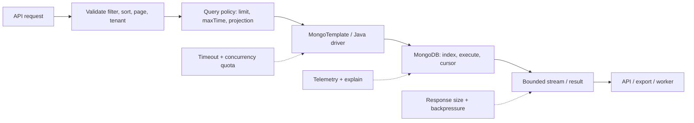

# Bounding Query Time, Result Size, and Resource-Intensive Queries

## 1. Why Is Query Bounding a Security and Operational Requirement?

In a **Spring Data MongoDB** application, queries constructed via `MongoTemplate`, repositories, or reactive APIs often accept filters, time ranges, result pages, and sort options from users. A syntactically valid query can still read millions of documents, sort in memory, run heavy aggregations, or hold cursors open for too long. When multiple concurrent requests do this, the issue can cascade from a single endpoint to the entire system.

For example, an order reporting API takes `tenantId`, `from`, `to`, and `limit`. Without constraints:

- A user picks a ten-year range, forcing MongoDB to scan massive amounts of data.
- `limit=1000000` causes the service to load huge numbers of documents into heap memory, triggering GC pressure or `OutOfMemoryError`.
- Sorting on an unindexed field forces the server to perform a RAM- or disk-intensive sort.
- An aggregation query using `$lookup` or `$unwind` blows up intermediate result sizes.
- Multiple concurrent queries saturate connections, CPU, and I/O, slowing down other tenants.

Therefore, **bounding queries is part of protecting availability**. The goal is to design a verifiable resource budget: how many documents each request may fetch, over what time window, for how long it may execute, how much concurrency it may consume, and how many bytes the API may return.



This **Security and Operations** lesson focuses on bounding execution time, result size, and resource-intensive queries in **SPRING_DATA_MONGODB**. The principles apply similarly to `MongoTemplate`, repositories, and reactive access, though specific configuration points may vary by Spring Data MongoDB and MongoDB Java Driver versions.

## 2. Distinguishing Commonly Confused Limits

| Mechanism | What does it limit? | What does it NOT limit by itself? |
|---|---|---|
| `Query.limit(n)` / MongoDB `limit(n)` | **Total number of documents** returned by the query | Total bytes; execution time; CPU/IO spent searching and sorting |
| `Query.cursorBatchSize(n)` | Number of documents requested per cursor batch | Total documents and memory accumulated by the application itself |
| Projection `fields().include(...)` | Fields returned in each document | Documents scanned or execution time |
| `Query.maxTime(Duration)` / `maxTimeMS` | Server-side execution budget for supported MongoDB operations | End-to-end deadline of the entire request or application-side processing time |
| Client/network timeout | Driver-configured wait time for connections/commands | Guaranteeing the server stopped all work when the client gave up |
| HTTP deadline / request timeout | Time to serve the request at the API layer | Any running DB work unless cancellation/timeouts are propagated |
| Page size and concurrency quota | Returned data volume and concurrent requests served | Query plan efficiency on MongoDB |
| `allowDiskUse` for aggregation | Permits eligible stages to spill temporarily to disk | Total resources or time consumed |

**Proper bounding requires multiple layers.** `limit(100)` only guarantees returning at most 100 documents, yet if MongoDB has to scan millions of records to find 100 matches, CPU/IO cost remains high. Conversely, `maxTimeMS(1000)` may fail a query as intended, yet does not reduce the byte size of a small result set composed of huge documents.

MongoDB caps a single BSON document at **16 MiB**. That is a per-document ceiling, **not a sensible API limit**: even a few dozen documents near that limit can create an enormous response, stalling clients or exhausting heap memory.

## 3. Setting a Query Budget from Business Requirements

Before writing a `Query`, determine what usage pattern the endpoint serves:

| Endpoint type | Example starting budget | Recommended handling |
|---|---|---|
| UI listing | 20–100 documents/page; bounded time range | Indexes, projections, pagination with stable ordering |
| Filtered search | Restricted filter/sort fields, max 100 documents, short timeout | Allowlisted sorts/filters, reject overly broad queries |
| Aggregate dashboard | Bounded date range and returned group count | Aggregation with early `$match`, indexes, and time limits |
| Large data export | Finite pages and job quotas; may run longer than standard HTTP | Background application job, keyset pagination/checkpoints, streaming to sink |
| Admin tasks | Low concurrency, audited, clear scope | Dedicated permissions and approved resource budget |

These numbers are **policy examples**, not MongoDB defaults. Proper thresholds must be calibrated from real data, p95/p99 latency, heap limits, and multi-tenant capacity.

An operable policy should declare explicit attributes:

```text
search.orders:
  maxPageSize: 100
  maxDateRangeDays: 31
  maxQueryTimeMs: 1500
  allowedSorts: [createdAt_desc, createdAt_asc]
  maxConcurrentRequestsPerTenant: 4
  maxHttpResponseBytes: 1048576

export.orders:
  pageSize: 500
  maxConcurrentJobsPerTenant: 1
  requiresAsyncJob: true
```

This is an **application-tier** policy outline, not a configuration MongoDB natively understands. Based on this policy, service code must implement validation, timeouts, cursors, and response size bounds.

## 4. Bounding Results with `MongoTemplate`

Suppose the `orders` collection contains `tenantId`, `createdAt`, `totalCents`, `status`, and other fields, potentially including a large `items` array. The endpoint returns a list of orders by tenant and time range, selecting only the fields needed.

```java
import java.time.Duration;
import java.time.Instant;
import java.util.Date;
import java.util.List;

import org.bson.Document;
import org.springframework.data.domain.Sort;
import org.springframework.data.mongodb.core.MongoTemplate;
import org.springframework.data.mongodb.core.query.Criteria;
import org.springframework.data.mongodb.core.query.Query;

public final class OrderQueryService {
    private static final int MAX_PAGE_SIZE = 100;
    private static final Duration QUERY_BUDGET =
        Duration.ofMillis(1500);

    private final MongoTemplate mongoTemplate;

    public OrderQueryService(MongoTemplate mongoTemplate) {
        this.mongoTemplate = mongoTemplate;
    }

    public List<Document> findRecentOrders(
            String authorizedTenantId,
            Instant from,
            Instant to,
            int requestedPageSize) {

        if (authorizedTenantId == null || authorizedTenantId.isBlank()) {
            throw new IllegalArgumentException("Tenant is required");
        }
        if (from == null || to == null || !from.isBefore(to)) {
            throw new IllegalArgumentException("Invalid time range");
        }
        if (Duration.between(from, to).compareTo(Duration.ofDays(31)) > 0) {
            throw new IllegalArgumentException("Time range exceeds 31 days");
        }
        if (requestedPageSize < 1 || requestedPageSize > MAX_PAGE_SIZE) {
            throw new IllegalArgumentException("Page size is out of range");
        }

        Query query = Query.query(
            Criteria.where("tenantId").is(authorizedTenantId)
                .and("createdAt")
                .gte(Date.from(from))
                .lt(Date.from(to))
        );

        query.fields()
            .include("_id")
            .include("createdAt")
            .include("totalCents")
            .include("status");

        query.with(Sort.by(
            Sort.Order.desc("createdAt"),
            Sort.Order.desc("_id")
        ));
        query.limit(requestedPageSize);
        query.cursorBatchSize(Math.min(requestedPageSize, 100));
        query.maxTime(QUERY_BUDGET);

        return mongoTemplate.find(query, Document.class, "orders");
    }
}
```

Key design decisions:

1. **`authorizedTenantId` comes from the authentication/authorization context**, never trusting an arbitrary client-supplied `tenantId`.
2. The time window enforces `from < to` and at most 31 days; using a half-open interval `[from, to)` avoids overlapping records across adjacent queries.
3. `limit` caps the document count on the return path; reject oversized page sizes rather than accepting unbounded values.
4. **Projection** selects only a few fields, avoiding sending a large `items` array unnecessarily in the HTTP response.
5. Ordering by `createdAt` then `_id` keeps pagination deterministic when multiple orders share the same timestamp.
6. `maxTime` instructs MongoDB to cap operation execution time; exceeding the budget raises a timeout error that the API layer must handle.
7. `cursorBatchSize` reduces documents per network batch, yet `find(...)` returning a `List` still retains **all returned documents** in memory. Hence both `limit` and projection remain necessary.

On the database, a candidate index for this filter and sort is:

```javascript
db.orders.createIndex({
  tenantId: 1,
  createdAt: -1,
  _id: -1
});
```

Whether an index is appropriate depends on data distribution, write frequency, filter conditions, and `explain("executionStats")` output. Do not add indexes for every sort option if the workload does not need them, as indexes increase write cost and storage usage.

## 5. Time Limits: Server-Side and Application-Side Deadlines

### `maxTimeMS` protects the MongoDB operation, not the entire request

In `mongosh`, you can set an execution time limit on an operation:

```javascript
db.orders.find({
  tenantId: "tenant-a",
  createdAt: {
    $gte: ISODate("2026-11-01T00:00:00Z"),
    $lt: ISODate("2026-11-20T00:00:00Z")
  }
}).sort({ createdAt: -1, _id: -1 })
  .limit(100)
  .maxTimeMS(1500);
```

In Spring Data MongoDB, `query.maxTime(Duration.ofMillis(1500))` passes the budget to the driver/server using the current version's API. When MongoDB detects the operation has exceeded its limit, the query can terminate with **MaxTimeMSExpired** (commonly error code `50`).

Understand the practical limitations:

- This is a **server-side execution limit via supported mechanisms**, not a guarantee of stopping to the exact millisecond.
- It excludes Java object processing, JSON serialization, HTTP upload/download, or downstream service calls.
- Multi-batch cursors, idle intervals between `getMore` calls, transactions, and special commands have distinct rules; do not assume a single `maxTimeMS` governs the entire job duration.
- `maxTimeMS` does not turn an unindexed query into a good query: slow queries still consume resources before being aborted.

### Different timeout layers

| Layer | Example | What it protects |
|---|---|---|
| Selecting MongoDB server | `serverSelectionTimeoutMS` | Prevents driver from waiting indefinitely when no eligible server is found |
| Establishing connection | `connectTimeoutMS` | Limits TCP/TLS handshake connection setup time |
| Socket/network read | `socketTimeoutMS` or newer driver timeout mechanisms | Prevents waiting indefinitely for network responses |
| Client-side operation deadline | `timeoutMS` / CSOT if supported by driver version | Budget for the entire client operation per driver contract |
| Server query execution | `maxTimeMS` | Limits execution time on the MongoDB server |
| Application request | HTTP deadline, gateway timeout | Limits request serving time from the client's perspective |
| Async job | Job timeout and cancellation token | Prevents background tasks from running past allowed limits |

Because timeout semantics and configuration options vary across MongoDB Java Driver 4.x/5.x and newer releases, check your **actual driver version** before configuring `timeoutMS` or connection string options.

**A client-side timeout does not guarantee the server stopped working.** When a request is cancelled, ensure cursors are closed, subscriptions cancelled, and used resources cleaned up. For operations with side effects, design idempotency before retrying: never blindly repeat a write whose commit status is unknown.

### Responding when a query times out

Never return stack traces or collection/index internals to users. APIs should return an error with an application code and correlation ID for log lookup. Example:

```json
{
  "code": "QUERY_BUDGET_EXCEEDED",
  "message": "Request exceeded processing limit. Please narrow your filters.",
  "requestId": "req-8a71"
}
```

The HTTP status code depends on the API contract and timeout source; generally distinguish **invalid input** (returning 4xx) from **valid query accepted by the server but exceeding budget** (a service load/timeout error, returning 503 or 504 depending on policy). Never collapse all timeouts into "not found".

## 6. Controlling Actual Return Size

`Query.limit(100)` controls document count, yet a 1 KiB document and a 5 MiB document have drastically different impacts. Manage **three distinct sizes**: BSON payload from MongoDB, mapped Java objects, and serialized HTTP response.

### Projection and DTOs

If an endpoint only needs order ID, timestamp, and status, do not return `items`, `addresses`, binary payloads, or internal fields.

```javascript
db.orders.find(
  { tenantId: "tenant-a" },
  { _id: 1, createdAt: 1, status: 1 }
).limit(100);
```

Projection reduces returned data and can enable index-only (covered) queries when predicates and fields are covered. However, **projection alone does not limit scan or sort costs** when the query plan is inefficient.

### For exports or large datasets: resource-bounded streaming

```java
import java.time.Duration;
import org.bson.Document;
import org.springframework.data.util.CloseableIterator;
import org.springframework.data.mongodb.core.query.Query;

Query query = /* query already validated for auth, filter, sort */;
query.cursorBatchSize(200);
query.maxTime(Duration.ofSeconds(3));

try (CloseableIterator<Document> cursor =
         mongoTemplate.stream(query, Document.class, "orders")) {

    long emitted = 0;
    final long maxRows = 50_000;

    while (cursor.hasNext()) {
        if (emitted >= maxRows) {
            break;
        }

        Document row = cursor.next();
        writeOneRow(row);  // Write to a throttled sink.
        emitted++;
    }
}
```

`writeOneRow` is an illustrative domain function that must be backed by a sink with finite capacity/buffering. `try-with-resources` guarantees cursor closure even if the user cancels the export or an exception occurs. This snippet limits **exported row count**, not byte count; if a byte quota is required, track encoded output bytes and stop before exceeding the limit. Avoid writing to an HTTP response whose status code can no longer be changed once partial streamed bytes have been sent.

For very large or long-running exports, **asynchronous jobs with checkpoints, quotas, and destination files** are far easier to govern than holding long-lived HTTP requests or cursors. Use keyset pagination when resuming across restarts is needed.

### Batch size is not a memory limit

The driver may fetch batches smoothly, yet the application can still OOM if it calls `collectList()`, `toList()`, unbounded `ArrayList.add(...)`, uses unbounded queues, or holds many concurrent batches in flight.

In a reactive pipeline:

```java
import reactor.core.publisher.Mono;
import org.bson.Document;
import org.springframework.data.mongodb.core.query.Query;

Query query = /* validated filter */;
query.cursorBatchSize(128);
query.maxTime(java.time.Duration.ofSeconds(3));

Mono<Void> result = reactiveMongoTemplate
    .find(query, Document.class, "orders")
    .concatMap(row -> writeRowAsync(row))
    .then();
```

`writeRowAsync` is an application function returning `Mono<Void>`. In Reactor, `concatMap` bounds concurrency; certain operators still maintain configured prefetch/buffers. If using `flatMap`, set explicit concurrency and prefetch bounds. **Backpressure does not replace page limits, projections, or good query plans.**

## 7. Query Patterns Prone to Resource Exhaustion

| Query pattern | Why is it expensive? | Mitigation |
|---|---|---|
| Unfiltered `find({})` on large collections | Scans excessive documents | Mandate business filters, pagination, indexes |
| `skip(1000000)` | MongoDB still skips over all preceding results | Use keyset/cursor pagination on sort keys |
| Sorting on unindexed fields | May require large server-side in-memory/disk sorts | Allowlist sorts, index common query shapes |
| Unanchored `$regex` or free-form patterns | Poor index usage; patterns can burn CPU | Bound patterns, validate input, consider search indexes/solutions |
| `$lookup` with many matches per document | Joins inflate intermediate results, consuming RAM/IO | Bound fan-out, filter early, index join keys |
| `$unwind` on large arrays | Multiplies document count inside pipeline | Cap array sizes, filter and project appropriately |
| `$group` / `$sort` / `$setWindowFields` on large data | Blocking stages may require high RAM or disk spill | Narrow `$match`, add indexes, split reports or pre-aggregate rollups |
| `$facet` with many branches | Each branch processes data with its own resource limits | Cap branch count, input volume, and results |
| Deep `$graphLookup` / densely connected graphs | High branching factor, heavy CPU and memory usage | Bound depth per business need, constrain graph data |
| `countDocuments` on broad filters | Still evaluates matching records | Avoid unnecessary counts; cache or estimate when semantics allow |
| Many concurrent queries on the same large dataset | Accumulates CPU/IO, connections, and resource contention | Per-tenant quotas, rate/concurrency limits, admission control |

Using `Page<T>` can trigger a separate **count query** to calculate total pages. If the UI only needs to know whether a next page exists, use `Slice<T>` (where repositories fit) or fetch up to `pageSize + 1` documents instead of always counting all records.

### Dynamic API queries are an attack surface

Never take client-supplied JSON and convert it directly into an arbitrary MongoDB query or pipeline. Users can specify complex filters/sorts beyond product boundaries, causing heavy server load or unauthorized data access.

Instead, request DTOs accept only valid fields; the service builds `Criteria`, `Sort`, and pipelines itself:

- Allowlist filterable/sortable fields; prevent clients from selecting internal fields or arbitrary MongoDB operators.
- Enforce `tenantId` from the authorization context across **all query paths**, including aggregations, lookups, and counts.
- Bound query time, date ranges, search string lengths, `$in` element counts, and OR branch counts.
- For regexes, disallow uncontrolled complex patterns; if only prefix matching is supported, validate input format and use appropriate indexes.
- For system-constructed aggregations, govern allowed stages, `$facet` branches, joins, and resource thresholds.

**No single server parameter prevents all resource-exhaustion queries.** Input bounding and access control at the service layer remain an essential line of defense.

## 8. Aggregation: Bounding Time, Memory, and Intermediate Data

Aggregations are frequently used for analytics via `MongoTemplate.aggregate`. Place a selective `$match` early and choose stages matching business semantics. Example summing totals by status:

```javascript
db.orders.aggregate(
  [
    {
      $match: {
        tenantId: "tenant-a",
        createdAt: {
          $gte: ISODate("2026-11-01T00:00:00Z"),
          $lt: ISODate("2026-11-20T00:00:00Z")
        }
      }
    },
    {
      $group: {
        _id: "$status",
        count: { $sum: 1 },
        totalCents: { $sum: "$totalCents" }
      }
    },
    { $sort: { totalCents: -1 } },
    { $limit: 20 }
  ],
  { maxTimeMS: 2000, allowDiskUse: false }
);
```

`maxTimeMS` bounds execution time for supported operations; `allowDiskUse: false` forbids spilling temporary data to disk for stages subject to that control, meaning a heavy aggregation may **fail on memory limits**. This is often preferable for interactive endpoints when protecting shared resources outweighs completing an oversized report.

In modern MongoDB versions, certain aggregation stages have roughly a **100 MiB** memory ceiling before spilling or erroring; default behavior of `allowDiskUseByDefault` has also evolved across versions (notably from MongoDB 6.0). Not all stages and operators enforce identical limits. Verify version-specific behavior during capacity planning.

In Spring Data, use `AggregationOptions` to configure pipeline limits. Common builder API example:

```java
import java.time.Duration;
import org.springframework.data.mongodb.core.aggregation.Aggregation;
import org.springframework.data.mongodb.core.aggregation.AggregationOptions;
import org.springframework.data.mongodb.core.aggregation.MatchOperation;
import org.springframework.data.mongodb.core.aggregation.GroupOperation;
import org.springframework.data.mongodb.core.query.Criteria;
import org.bson.Document;

MatchOperation match = Aggregation.match(
    Criteria.where("tenantId").is(authorizedTenantId)
);
GroupOperation group = Aggregation.group("status")
    .count().as("count");

AggregationOptions options = AggregationOptions.builder()
    .maxTime(Duration.ofSeconds(2))
    .allowDiskUse(false)
    .build();

Aggregation pipeline = Aggregation.newAggregation(match, group)
    .withOptions(options);

var rows = mongoTemplate.aggregate(
    pipeline, "orders", Document.class
).getMappedResults();
```

Note that this example bounds **time** and spill policy, yet does not cap returned group count. With a small domain of business statuses, group count is domain-bounded; when grouping by high-cardinality values, add a `limit` or redesign the aggregation model. `getMappedResults()` materializes all results in Java; for large result sets, stream results or offload the aggregation to a batch job compatible with your Spring Data version.

### Never apply `$limit` carelessly

Placing `$limit` before `$sort` reduces resource consumption but **changes the meaning** of a global top-N: the pipeline will only sort the first arbitrarily fetched documents. For "20 newest orders", keep logical order as filter → sort → limit; a matching index lets MongoDB execute it efficiently. For "top 20 statuses by revenue", group by status and sort the grouped output before limiting.

An early `$match`, `$project` to drop unneeded fields, and a proper index are usually far more effective than simply enabling `allowDiskUse`.

## 9. Pagination and Checkpoints Instead of Unbounded Results

For list UIs, initial pages can use `limit(pageSize)`. If deep browsing is supported, avoid large offsets/`skip`; switch to **keyset pagination** on a stable key tuple such as `(createdAt, _id)`.

Next page when sorting descending:

```javascript
db.orders.find({
  tenantId: "tenant-a",
  $or: [
    { createdAt: { $lt: lastCreatedAt } },
    { createdAt: lastCreatedAt, _id: { $lt: lastId } }
  ]
})
.sort({ createdAt: -1, _id: -1 })
.limit(100)
.maxTimeMS(1500);
```

This assumes `lastCreatedAt` and `lastId` come from the final document of the previous page. Index `{ tenantId: 1, createdAt: -1, _id: -1 }` is a strong candidate.

Design considerations:

1. Cursor/page tokens must be validated or signed so clients cannot tamper with boundaries, tenants, or filters.
2. Sort keys should be immutable/stable; if `createdAt` changes between reads, documents can be missed or duplicated.
3. When documents are inserted or deleted during pagination, pages do not automatically form a global snapshot. If a report needs a consistent dataset, establish a cutoff timestamp and design appropriate snapshot/versioning semantics.
4. For retryable exports, persist checkpoints **after output is confirmed written**; destination writes must be idempotent to prevent duplicates upon job restart.

Keyset pagination bounds data per read, yet you still must cap total pages or job duration if users could otherwise paginate indefinitely.

## 10. Limiting Concurrency and Protecting Tenants

Even when every query has `limit` and `maxTime`, hundreds of simultaneous queries can exhaust connection pools or server capacity. Apply resource policies at multiple tiers:

- **API gateway/rate limiter:** throttle requests per user, tenant, and endpoint class.
- **Service-level semaphore/bulkhead:** cap concurrent queries/exports; fail fast or reject cleanly when queues are full.
- **MongoClient pool settings:** configure connection limits and wait times for the workload; never treat pool size as a substitute for request throttling.
- **Job queues:** give exports, reports, and heavy aggregations lower concurrency than interactive lookup APIs.
- **Access separation:** separate reporting read accounts from admin accounts; never grant privileged commands or cross-tenant access just to run searches.

Example workload budget breakdown:

```text
UI search:
  100 rows/request
  1.5 s server query budget
  4 concurrent requests per tenant

Analytics:
  2 s server query budget
  bounded date range
  1 concurrent aggregation per tenant

Export:
  async job
  500 rows/page
  1 active export per tenant
  checkpoint + output size quota
```

These values are illustrative. Avoid mixing heavy reporting workloads into pools serving low-latency interactive requests without isolation and admission control.

## 11. Observing Slow Queries and Identifying Root Causes

### Reading `explain("executionStats")`

A query with `limit(100)` can still be very expensive if it scans many documents or sorts without an index. Run `explain` on representative filters:

```javascript
db.orders.find({
  tenantId: "tenant-a",
  createdAt: {
    $gte: ISODate("2026-11-01T00:00:00Z"),
    $lt: ISODate("2026-11-20T00:00:00Z")
  }
}, { _id: 1, createdAt: 1, status: 1 })
.sort({ createdAt: -1, _id: -1 })
.limit(100)
.explain("executionStats");
```

Pay attention to:

| Metric/signal | Operational question |
|---|---|
| `winningPlan` and `IXSCAN` / `COLLSCAN` | Is the query using an appropriate index? |
| `totalDocsExamined` vs `nReturned` | Is it reading many documents only to return very few? |
| `totalKeysExamined` | Is it scanning an overly wide index range? |
| Sort stage, spill, and memory indicators | Is there a RAM- or disk-intensive sort/group? |
| `executionTimeMillis` | Is server-side execution cost within budget? |
| `getMore` and batch count | Is the client reading incrementally, holding cursors open long, or making excessive round-trips? |

`explain("executionStats")` itself causes the DB to perform work; run it in suitable environments or windows. Query plan tuning must rely on **real data selectivity**, not merely index existence.

### System-wide monitoring

Beyond slow query logs from MongoDB profiler/diagnostic logging (or Atlas Query Profiler), services should collect:

- P50/p95/p99 latency by endpoint and query category, separating pool wait, DB execution, and serialization.
- Counts of `maxTimeMS` expirations, network timeouts, retries, and cancellations.
- Documents/bytes returned, page counts, response size limits hit, and job output sizes.
- `COLLSCAN` rate, examined/returned ratio, sort spills, CPU/IO, queue wait, and open cursor count.
- Heap/RSS, GC pauses, connection pool utilization, and active requests per tenant.
- Authorization errors or queries rejected for violating policies.

Do not log sensitive data or full queries containing PII for diagnostics. Log **query shapes**, namespaces, policy codes, policy-compliant tenant identifiers, timestamps, and correlation IDs.

The profiler and current-operations tools consume resources and require appropriate privileges. When an operation causes an incident, consider killing it only after identifying the exact operation and its impact on transactions/jobs; do not build automated `killOp` scripts triggered by a naive threshold.

## 12. Testing Bounds and Failure Scenarios

A useful test suite proves both normal outputs and rejection of oversized work.

| Test case | Expected outcome |
|---|---|
| `pageSize=100`, valid filter | Returns at most 100 documents with allowed fields |
| `pageSize=0` or `pageSize=100000` | Rejected per policy; no unbounded query dispatched |
| Date range exceeding 31 days | Clear input error returned; MongoDB query never runs |
| Different tenant passed in parameters | DB filter still uses authenticated tenant |
| Sort field not on allowlist | Rejected; never sorts on arbitrary fields |
| Query runs longer than server budget | Observable timeout occurs; API hides stack traces |
| Page containing very large documents | Total response byte cap is enforced |
| Export consumer stops mid-stream | Cursor/subscription closed; job persists checkpoint properly |
| Concurrent requests exceed quota | Excess requests rejected or queued within finite policy |
| Aggregation with large group or broad join | Resource-heavy plan detected; timeout/quota enforced |
| Valid query missing an index | Benchmark catches large scan/sort and missed latency target |

Test timeouts carefully: CI performance fluctuates, so do not rely on a sleep inside MongoDB and assert it always exceeds an exact millisecond mark. Verify `maxTime` is attached to the query, run integration tests against real MongoDB, and run separate benchmarks with large enough datasets to observe timeout behavior.

### Example testing bound logic before hitting the DB

```java
import static org.assertj.core.api.Assertions.assertThatThrownBy;

import java.time.Instant;
import java.time.temporal.ChronoUnit;

import org.junit.jupiter.api.Test;

class QueryPolicyTest {

    @Test
    void rejectsExcessiveDateRange() {
        Instant from = Instant.parse("2026-01-01T00:00:00Z");
        Instant to = from.plus(60, ChronoUnit.DAYS);

        assertThatThrownBy(() ->
            queryService.findRecentOrders(
                "tenant-a", from, to, 50
            )
        ).isInstanceOf(IllegalArgumentException.class);
    }

    @Test
    void rejectsUnboundedPageSize() {
        Instant from = Instant.parse("2026-11-01T00:00:00Z");
        Instant to = Instant.parse("2026-11-02T00:00:00Z");

        assertThatThrownBy(() ->
            queryService.findRecentOrders(
                "tenant-a", from, to, 50_000
            )
        ).isInstanceOf(IllegalArgumentException.class);
    }
}
```

This is an excerpt from a test class where `queryService` is properly initialized/injected. It tests business policy; **integration tests** must additionally verify actual BSON queries, `limit`, `maxTime`, indexes, and cursor behavior.

## 13. Incident Triage and Query Improvement Workflow

When a MongoDB endpoint spikes CPU/IO or causes widespread timeouts, follow this order:

1. **Scope impact:** endpoint, tenant, rate, latency, connection pool, query shape, and blast radius.
2. **Apply entry-point limits:** cap concurrency, temporarily narrow filters/pages, or defer exports to shed load; keep error messages clear.
3. **Measure query plans:** run `explain` with representative queries, compare `docsExamined` to `nReturned`, inspect sorts and indexes.
4. **Shrink input and output:** add selective filters, projections, change pagination, split reports/aggregations if needed.
5. **Design workload-driven indexes:** ensure filters and sorts are covered, measuring write/storage overhead.
6. **Align budgets consistently:** server time, application deadlines, response byte caps, per-tenant quotas, and concurrent job limits.
7. **Regression test:** replay the workload and measure p95/p99, CPU/IO, GC, and timeouts before raising quotas.
8. **Monitor post-change:** alert if new query shapes or data growth render existing limits inadequate.

Never resolve slow queries solely by raising `maxTimeMS`, enlarging pools, or blindly enabling `allowDiskUse`; that merely shifts failures from timeouts into CPU/disk saturation or out-of-memory crashes.

## 14. Production Deployment Checklist

1. **Classify endpoints** into lookups, dashboards, exports, and admin tasks, each with its own budget.
2. **Always validate inputs**: tenant from authorization, filter/sort allowlists, bounded date ranges and array element counts.
3. **Set `limit` and projections** on list APIs; never fetch full documents when only a few fields are needed.
4. **Set deliberate `maxTime`** on queries/aggregations and deadlines on clients/HTTP/jobs; handle timeouts consistently.
5. **Manage cursors and downstream sinks**: close on completion/cancellation, avoid `collectList` or unbounded queues.
6. **Use keyset pagination/checkpoints** for large sets; avoid deep `skip` and multi-million-row HTTP responses.
7. **Tune query plans** with indexes backed by `explain`; avoid uncontrolled sorts and high fan-out joins.
8. **Bound aggregations** by domain groups, early filters, result limits, and appropriate `allowDiskUse` policies.
9. **Cap concurrency per tenant and workload** so one customer or report cannot starve shared capacity.
10. **Observe and test failures**: timeouts, query scans, response bytes, cancellations, retries, and overload under realistic conditions.

With **Spring Data MongoDB**, operational safety does not come from a single `limit` call or `maxTimeMS` value. Systems need **input bounds**, **indexed queries**, **time and result-size limits**, **explicitly managed cursor/stream lifecycles**, and **concurrency quotas**. Together, these controls keep `MongoTemplate`, repositories, and reactive access predictable even as data volumes and users grow.
