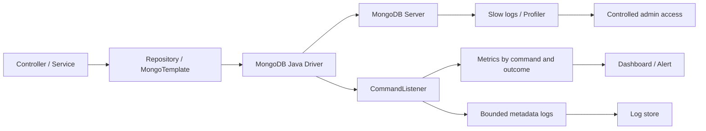

# Monitoring Commands, Query Logs, and Sensitive Data in Parameters

> **Chapter:** Security and Operations · **Module:** `SPRING_DATA_MONGODB`. When using Spring Data MongoDB for queries and updates via `MongoTemplate`, repositories, or reactive access, observing MongoDB activity helps diagnose errors, latency, and inefficient queries. However, commands and queries can contain emails, phone numbers, tokens, transaction details, or personal data in both **filter criteria and written documents**. This lesson covers collecting just enough operational signals, governing logs, and testing that sensitive data is never leaked.

## 1. The Problem: Enabling Logs to Find Slow Queries and Accidentally Leaking Data

An account lookup service queries by email:

```java
Query query = Query.query(
    Criteria.where("email").is(emailFromRequest)
);
Customer customer = mongoTemplate.findOne(query, Customer.class);
```

When latency spikes, an engineer turns on `DEBUG` logging for the MongoDB driver and sees a command conceptually like:

```javascript
{
  find: "customers",
  filter: { email: "sensitive-test@example.invalid" },
  limit: 1,
  $db: "shop"
}
```

This puts **sensitive data in query parameters** into logs even though the application never called `logger.info("email={}", email)`. An `$in` query can hold thousands of customer identifiers; an `update` can hold addresses, payment details, or personal data inside `$set`. `aggregate` commands can place inputs inside pipelines, and `findAndModify` carries both filters and updates.

Investigating a slow query typically only requires knowing:

- What command type was it: `find`, `aggregate`, `update`, `insert`, `getMore`?
- Did it succeed or fail, how long did it take, and at what frequency?
- Is the bottleneck in MongoDB, the connection pool, the network, the application, or call volume?
- Which query shape is slow and is it using the right index?

These questions **do not require writing raw BSON values** into application logs, dashboards, or tracing backends.

### Boundaries to distinguish

| Observation source | Where it is collected | What can it see? | Sensitivity risk |
|---|---|---|---|
| MongoDB Java Driver `CommandListener` | Inside application process | Start/success/failure events; if actively read, can access BSON commands or responses | Very high if logging `getCommand()`, `getResponse()`, or exception messages |
| Driver loggers | Inside application process | Connection, protocol, and command details depending on logger/level/version | DEBUG/TRACE may include query/response payloads |
| Spring Data MongoDB loggers | Inside application process | Template operations, `Query` criteria, mapping, or lifecycle events | May contain filters, updates, and business fields |
| MongoDB server slow query log | On server/cluster | Duration, namespace, plan summary, and command fields per configuration | May store query parameters in server logs |
| Database profiler (`system.profile`) | Inside configured database | Operation records, stats, command details | Persists potentially sensitive data; requires access control |
| Metrics/tracing | Observability platform | Latency, errors, spans, tags, and certain attributes | Uncontrolled tags/attributes can still leak parameters |
| Database auditing | Separate auditing mechanism, if licensed/configured | Access events, privileges, admin actions per audit policy | Policy-dependent; not synonymous with a query profiler |

**Principle:** send only data genuinely needed for observability to log/metrics/tracing systems, and treat every place storing these signals as a data store with its own access controls and retention limits.

## 2. What Is a MongoDB Command and How Does It Relate to Spring Data?

A Java call:

```java
mongoTemplate.find(
    Query.query(Criteria.where("tenantId").is(tenantId)),
    Order.class
);
```

is translated by Spring Data into a command sent through the MongoDB Java Driver. The driver can emit **Command Monitoring** events for executed commands.



Commands may differ from repository method names. For instance:

- Repository `findByEmail` typically becomes a `find` command.
- `mongoTemplate.updateFirst(...)` typically produces an `update` command.
- Aggregation pipelines use the `aggregate` command; reading further from a cursor can emit `getMore`.
- `bulkOps` can produce bulk operations whose command names and batching depend on driver/MongoDB versions.

Command monitoring observes **server round-trips**, not a 1:1 mapping with HTTP requests. One request can execute multiple commands, the driver may retry eligible operations, and cursors may continue issuing `getMore` after the initial `find`/`aggregate`.

### 2.1. Three fundamental event types

The `com.mongodb.event.CommandListener` API consists of:

- `commandStarted(CommandStartedEvent event)`: command starts; provides `commandName`, request ID, database name, and BSON command (should not be logged).
- `commandSucceeded(CommandSucceededEvent event)`: command finishes; provides command name, elapsed time, request ID, and BSON response (should not be logged).
- `commandFailed(CommandFailedEvent event)`: command fails; provides command name, elapsed time, request ID, and `Throwable` (message may contain sensitive data).

The driver omits or redacts certain sensitive security commands per specification, yet **you must never rely on this** to protect business commands like `find`, `update`, and `aggregate`.

`CommandListener` operates at the driver level; it does not automatically know which emails, tokens, or business fields are sensitive. Ensuring safe logging is the application's responsibility.

## 3. Designing Telemetry with Allowlists

### 3.1. Classify data upfront

A practical policy:

| Data category | Examples | Policy |
|---|---|---|
| Low-cardinality metadata | `command=find`, `outcome=success` | Permitted as metric tags |
| Timing / counts | `durationMs`, error counts, command counts | Permitted for measurement, aggregation, and alerting |
| Short random correlation IDs | Trace ID, request ID within understood scope | Include in logs/traces only when needed; never as metric labels |
| Customer query values | Email, phone, address, account ID, tenant ID | Exclude from logs and metric tags by default |
| Authentication parameters | URI credentials, passwords, secrets, tokens, API keys | Never log or include in exception/trace attributes |
| Raw BSON command / response | `getCommand().toJson()`, `getResponse().toJson()` | Never store raw in production telemetry |
| Environment metadata | Hostname, database/collection name | Evaluate whether tenant or internal topology is disclosed before use |

**Allowlists beat denylists:** denylisting `password` and `token` misses new fields such as `customer.profile.phone`, `identityNumber`, or sensitive data inside `$in` arrays and multi-stage pipelines.

### 3.2. Query shapes can replace raw query values

To group slow queries, we typically want to identify the **structure**:

```text
find customers WHERE email = ?
find orders WHERE tenantId = ? AND status = ? SORT createdAt DESC
aggregate orders MATCH tenantId = ? GROUP BY status
```

rather than storing live values:

```text
find customers WHERE email = "sensitive-test@example.invalid"
```

Query shape normalization must be performed via structured parsers/representations or platform-supported query-shape mechanisms. **Do not** rely on simple regex string replacement over BSON JSON: values can live in arrays, nested operators, numbers, dates, regexes, `$expr`, pipelines, and multiple Extended JSON formats.

Field or collection names can occasionally be sensitive too; publish shape labels to shared observability systems only after reviewing permissions and cardinality. In environments where tenants have dedicated databases or collections, logging namespaces directly as metric tags can explode cardinality and accidentally disclose tenant identities.

## 4. Spring Boot: Attaching a `CommandListener` That Collects Only Safe Metadata

Example using Spring Boot 3.x, the synchronous MongoDB Java Driver, and Micrometer (provided by Spring Boot Actuator). The application uses Spring Boot's MongoDB auto-configuration; if manually constructing `MongoClient`, attach the listener in that client's configuration.

Illustrative dependencies:

```groovy
dependencies {
    implementation 'org.springframework.boot:spring-boot-starter-data-mongodb'
    implementation 'org.springframework.boot:spring-boot-starter-actuator'
}
```

### 4.1. Configuring the listener with `MongoClientSettingsBuilderCustomizer`

```java
import com.mongodb.event.CommandFailedEvent;
import com.mongodb.event.CommandListener;
import com.mongodb.event.CommandStartedEvent;
import com.mongodb.event.CommandSucceededEvent;
import io.micrometer.core.instrument.MeterRegistry;
import io.micrometer.core.instrument.Timer;
import java.util.Locale;
import java.util.Set;
import java.util.concurrent.TimeUnit;
import org.slf4j.Logger;
import org.slf4j.LoggerFactory;
import org.springframework.boot.autoconfigure.mongo.MongoClientSettingsBuilderCustomizer;
import org.springframework.context.annotation.Bean;
import org.springframework.context.annotation.Configuration;

@Configuration(proxyBeanMethods = false)
public class MongoCommandTelemetryConfig {

    @Bean
    MongoClientSettingsBuilderCustomizer safeMongoCommandMonitoring(
            MeterRegistry meterRegistry) {

        return builder -> builder.addCommandListener(
            new SafeCommandListener(meterRegistry)
        );
    }

    static final class SafeCommandListener implements CommandListener {

        private static final Logger log =
            LoggerFactory.getLogger(SafeCommandListener.class);

        private static final Set<String> ALLOWED_COMMANDS = Set.of(
            "find", "aggregate", "getmore", "insert", "update",
            "delete", "findandmodify", "count", "distinct",
            "createindexes", "dropindexes", "committransaction",
            "aborttransaction"
        );

        private final MeterRegistry registry;

        SafeCommandListener(MeterRegistry registry) {
            this.registry = registry;
        }

        private static String safeCommand(String name) {
            if (name == null) {
                return "other";
            }
            String normalized = name.toLowerCase(Locale.ROOT);
            return ALLOWED_COMMANDS.contains(normalized)
                ? normalized : "other";
        }

        private void measure(String command, String outcome, long nanos) {
            Timer.builder("mongodb.driver.command.duration")
                .description("Driver command duration by safe command name")
                .tag("command", safeCommand(command))
                .tag("outcome", outcome)
                .register(registry)
                .record(nanos, TimeUnit.NANOSECONDS);
        }

        @Override
        public void commandStarted(CommandStartedEvent event) {
            // By default, do not emit 1 log per command.
            // Do not read event.getCommand() to build log messages.
        }

        @Override
        public void commandSucceeded(CommandSucceededEvent event) {
            long elapsed = event.getElapsedTime(TimeUnit.NANOSECONDS);
            measure(event.getCommandName(), "success", elapsed);
        }

        @Override
        public void commandFailed(CommandFailedEvent event) {
            long elapsed = event.getElapsedTime(TimeUnit.NANOSECONDS);
            measure(event.getCommandName(), "failure", elapsed);

            if (log.isDebugEnabled()) {
                log.debug(
                    "mongo command failed: command={}, durationMs={}, "
                        + "failureType={}",
                    safeCommand(event.getCommandName()),
                    TimeUnit.NANOSECONDS.toMillis(elapsed),
                    event.getThrowable().getClass().getSimpleName()
                );
            }
            // Do not automatically write getThrowable().getMessage() or
            // stack traces into the default log stream.
        }
    }
}
```

Here, the command name can only belong to a small set of values, the outcome is strictly `success` or `failure`, and duration is numeric. No `databaseName`, BSON filter, command JSON, response JSON, user ID, or query parameter enters logs or metrics.

Specifically, never write:

```java
// DO NOT use in production:
log.debug("Mongo command: {}", event.getCommand().toJson());
log.debug("Mongo response: {}", event.getResponse().toJson());
log.error("Mongo failed", event.getThrowable());
```

These forbidden lines illustrate leak paths to catch during code review. Stack traces or error messages can contain namespaces, query components, duplicate unique key values, or exception text from other layers. If debugging requires stack traces, enforce access control and proper classification/redaction rather than forwarding them unconditionally to shared logs.

### 4.2. Reading metrics without exploding cardinality

The `mongodb.driver.command.duration` metric is grouped by:

- `command`: one of the allowlisted values, otherwise `other`;
- `outcome`: `success` or `failure`.

Never attach `requestId`, `traceId`, `customerId`, `tenantId`, `email`, `queryJson`, or `connectionId` as metric tags. Such fields can create millions of distinct time series or disclose sensitive details.

Micrometer may export a `Timer` under specific names/units depending on the registry. For instance, Prometheus applies naming rules and converts units to seconds; always inspect the actual exported metric names rather than assuming every backend uses exact Java string names.

### 4.3. Special notes on `getMore` and listener execution

`getMore` can wait for data while reading a cursor, especially with **change streams or tailable cursors**. A slow `getMore` does not necessarily indicate an unindexed query. Build separate dashboards for such operations or avoid lumping all commands into a single p95 metric.

Driver callbacks may run on driver/I/O threads. Listener code must be **fast and non-blocking**: never query MongoDB inside the callback to persist logs (causing recursion), never perform synchronous HTTP calls to a central collector, and never serialize full command JSON. If further processing is needed, use bounded queues with explicit drop/count policies under overload.

## 5. Distinguishing Driver Logs and Spring Data MongoDB Logs

### 5.1. MongoDB Java Driver loggers

Exact logger names may vary by driver version, but common groups include:

- `org.mongodb.driver.protocol.command` — protocol/command details;
- `org.mongodb.driver.connection` — connection lifecycle;
- `org.mongodb.driver.cluster` — topology, discovery, and cluster state;
- `org.mongodb.driver.operation` — driver operations.

At `DEBUG` or `TRACE`, command loggers can log command structures or query values. While the driver redacts certain sensitive commands, **business data inside `find`/`update`/`aggregate` must never be assumed safely masked**.

In Spring Boot, logging levels can be configured as:

```yaml
logging:
  level:
    root: INFO
    org.mongodb.driver.protocol.command: WARN
    org.mongodb.driver.connection: WARN
    org.springframework.data.mongodb.core: WARN
```

This is a cautious baseline for daily operations, not a substitute for auditing logs emitted by other libraries. If temporary investigation in a controlled environment is required, enable DEBUG on a strict time limit only after reviewing what data will be emitted, who can read logs, and how to revert it. Never leave DEBUG enabled long-term in production just to catch one slow query.

### 5.2. Spring Data can log `Query` or `Update`

In Spring Data MongoDB, calls like:

```java
Query query = Query.query(
    Criteria.where("email").is(emailFromRequest)
);
Update update = new Update()
    .set("contactPhone", phoneFromRequest);

mongoTemplate.updateFirst(query, update, Customer.class);
```

can expose values when code logs:

```java
// DO NOT log objects containing request values:
log.info("query={}, update={}", query, update);
log.info("payload={}", requestDto);
```

Even with driver command DEBUG disabled, application code or custom interceptors can still log parameters. Audit all loggers, AOP aspects, exception handlers, access logs, trace attributes, and data-access interceptors.

**Safer pattern:**

```java
long started = System.nanoTime();

try {
    var result = mongoTemplate.updateFirst(query, update, Customer.class);
    log.debug(
        "customer update completed: operation={}, matched={}",
        "contact-update",
        result.getMatchedCount()
    );
} finally {
    long elapsedMs = TimeUnit.NANOSECONDS.toMillis(
        System.nanoTime() - started
    );
    // Emit metrics or aggregate counts without printing query/update/DTO.
}
```

This illustrates the **data boundary**; if emitting service-level metrics, avoid double-counting them alongside driver listener metrics since the two layers measure different scopes. Service metrics include mapping and business logic; driver metrics measure commands only.

### 5.3. Parameters in exceptions and automatic logging

Several error types easily carry raw data:

- `DuplicateKeyException` or MongoDB duplicate key errors can include index names and duplicate key values.
- `MongoCommandException` or driver exceptions can include server-returned error messages.
- HTTP-layer logging filters or payload loggers can dump the very parameters used in queries.
- Automatic APM instrumentation capturing `db.statement`, `db.query.text`, or similar attributes may record full commands with literal values, depending on instrument/version/config.

Never assume "logging only exceptions" is safe. Choose **error codes, exception types, and command categories** for default observability; when full details are required, gate them behind controlled support workflows with short retention and restricted permissions.

## 6. Server-Side Observation: Slow Query Log and Database Profiler

### 6.1. Slow operation logging

The MongoDB server can write operations exceeding slow thresholds into diagnostic/structured logs. Records may contain:

- The command or a truncated representation of the command;
- Namespace, plan summary, and index/query metadata;
- Duration, keys/documents examined, and cursor/lock/yield stats depending on version;
- Client details and correlation metadata depending on configuration.

Exact fields depend on MongoDB version, query engine, and deployment environment. **Do not assume server logs mask all sensitive values** simply because the driver redacts a few special commands.

Managed MongoDB services (such as Atlas) offer slow-operation monitoring and Performance Advisor; access controls and ability to toggle the profiler directly may differ from self-managed deployments. Always follow the documentation and permissions of your specific cluster.

### 6.2. Database profiler and `system.profile` collection

The MongoDB database profiler records database operation details into the `system.profile` system collection of the configured database. Basic modes are typically:

| Profiling level | General meaning |
|---|---|
| `0` | Profiler disabled for operations |
| `1` | Records slow operations per configured threshold/settings |
| `2` | Records all eligible operations, incurring higher overhead |

**Never leave level 2 enabled in production routinely.** The profiler adds I/O and CPU overhead, and its records can persist **commands with sensitive parameters** right inside the database. Furthermore, profiler levels are independent from server logging; disabling the profiler does not mean server slow logs are off.

Example checking current status in `mongosh`:

```javascript
use shop

const before = db.getProfilingStatus();
printjson(before);
```

Only in an **authorized lab/staging environment**, if supported by the deployment and capacity allows, can you test slow operation profiling:

```javascript
// Lab example: adjust threshold and sampleRate per server/version.
db.setProfilingLevel(1, {
  slowms: 100,
  sampleRate: 0.1
});

// Run a short test workload with synthetic data.
```

When reading, **project only needed metadata**:

```javascript
db.system.profile.find(
  {},
  {
    _id: 0,
    ts: 1,
    ns: 1,
    millis: 1,
    planSummary: 1,
    keysExamined: 1,
    docsExamined: 1
  }
).sort({ ts: -1 }).limit(20);
```

Projection limits what is **returned by this query**, but does not delete sensitive fields already stored in `system.profile`. Anyone with full collection read access can still view them. Once the experiment finishes, revert profiling per the runbook, for example:

```javascript
// before is the saved db.getProfilingStatus() output from the same session.
db.setProfilingLevel(before.was, {
  slowms: before.slowms,
  sampleRate: before.sampleRate
});
```

Syntax and support for `sampleRate` and options vary by version and managed platform; verify status after reverting rather than treating examples as universal across all clusters. If you lack permissions to alter profiling, use the cluster's official observability tools.

### 6.3. The profiler is not an audit log

**Profilers/slow logs** exist for performance diagnostics. **Database auditing** (when supported and configured) tracks data access and administrative events per policy, with dedicated permissions, filtering, and storage. Never claim compliance evidence simply because `system.profile` contains records.

When investigations require answering "who viewed or modified what information", rely on audit policies, application logs, and authorization controls rather than query logs that may drop events, sample, or retain data they should not keep.

## 7. Connecting Telemetry from Application to MongoDB

### 7.1. Correlation ID, request ID, and trace ID

There are at least three distinct identifiers:

| Identifier | Scope | Usage |
|---|---|---|
| HTTP/request trace ID | Request lifecycle across application | Correlate service logs and traces |
| MongoDB driver `requestId` | Correlates command events within the driver's connection/request scope | Driver-level debugging when needed |
| MongoDB server operation metadata | Server-side command/operation, tool- and version-dependent | Join with server logs when solidly matched |

**Never equate** the MongoDB driver `requestId` with an HTTP request ID. With reactive processing and I/O threads, standard thread-bound `MDC` does not automatically follow subscriber contexts. Use tracing instrumentation supported by your Spring Boot/driver stack with explicit attribute policies; never infer trace IDs from command events alone.

If attaching a MongoDB `comment` or query comment to help locate operations, **include only a short, bounded random internal identifier—never embed emails, tokens, JWTs, tenant names, or request payloads**. Comments can also appear in server logs and profiler records.

### 7.2. Using duration, error, and pool metrics for diagnosis

A slow HTTP query can stem from several sources:

```text
HTTP request 320 ms
├─ Validate/serialize/app work       15 ms
├─ Wait for connection / scheduling 170 ms
├─ Mongo command                     80 ms
└─ Network/response/other            55 ms
```

Numbers are illustrative. `CommandSucceededEvent` measures driver-level command time, not total time consumed by the application. If the service hits connection pool saturation, command metrics may look fast while request latency spikes. Combine:

- HTTP server latency and error rates;
- MongoDB command duration/errors by command type;
- Connection pool utilization, wait times, and checkout timeouts;
- Server CPU/I/O, replication lag, and slow operations;
- Distributed traces linking application steps.

Never turn collection names, users, or query values into metric dimensions just to slice dashboards deeply.

## 8. Safe Query Logging Through Business Examples

### 8.1. Reading by email

**Unsafe:**

```java
log.info("Searching customer by email={}", emailFromRequest);
log.debug("Mongo query={}", query.getQueryObject().toJson());
```

**Safer for default logs:**

```java
log.debug(
    "customer lookup finished: operation={}, found={}",
    "customer-by-email",
    customer != null
);
```

Use an application-defined `operation` label with a bounded set of values, not the email. If error rates need grouping by customer tier, group by an approved non-identifying category.

### 8.2. Updates with multiple sensitive fields

An update command:

```javascript
db.customers.updateOne(
  { _id: "customer-test-001" },
  {
    $set: {
      "contact.email": "private-test@example.invalid",
      "contact.phone": "000-TEST-ONLY"
    }
  }
);
```

These values are **synthetic test data**, yet in production they represent personal information. If an interceptor logs entire `Update` objects or BSON commands, data flows along:

```text
HTTP input → Query / Update → Driver command → Log formatter
                                         └──→ Log agent → Central storage
                                                          └──→ Dashboard / Ticket
```

Once data enters central logs, setting the logging level back to `WARN` **does not erase** already-collected records. Retention, policy-compliant deletion, and auditing of downstream copies are required.

### 8.3. Aggregation pipelines and nested values

Example with parameters inside `$match`:

```javascript
db.orders.aggregate([
  { $match: { tenantId: "tenant-example", contactEmail: "private-test@example.invalid" } },
  { $group: { _id: "$status", total: { $sum: 1 } } }
]);
```

Sensitive data can appear anywhere in a pipeline, not just in `find.filter`. A redaction rule targeting only a root-level `email` key misses `$match.contactEmail`, `$or` arrays, and other stages.

**Code review rule:** unless you can prove a command representation is safely normalized across all supported operators, do not emit it into logs. Default to operation labels, allowlisted command names, durations, and outcomes.

## 9. Testing Log and Metric Privacy

### 9.1. Testing with a synthetic sentinel

Use a non-real string with an easily recognizable pattern, such as `SENSITIVE_TEST_SENTINEL_7E42`. Send it through queries and updates in integration tests, then assert that **application-generated logs never contain the sentinel**.

Spring Boot/JUnit 5 example assuming the test context has a `MongoTemplate` connected to an isolated test database:

```java
import static org.assertj.core.api.Assertions.assertThat;

import org.junit.jupiter.api.Test;
import org.junit.jupiter.api.extension.ExtendWith;
import org.springframework.beans.factory.annotation.Autowired;
import org.springframework.boot.test.autoconfigure.data.mongo.DataMongoTest;
import org.springframework.boot.test.system.CapturedOutput;
import org.springframework.boot.test.system.OutputCaptureExtension;
import org.springframework.data.mongodb.core.MongoTemplate;
import org.springframework.data.mongodb.core.query.Criteria;
import org.springframework.data.mongodb.core.query.Query;

@DataMongoTest
@ExtendWith(OutputCaptureExtension.class)
class MongoLoggingPrivacyIT {

    @Autowired
    MongoTemplate template;

    @Test
    void queryParameterNeverAppearsInApplicationConsole(CapturedOutput logs) {
        String sentinel = "SENSITIVE_TEST_SENTINEL_7E42";

        Query query = Query.query(
            Criteria.where("contactEmail").is(sentinel)
        );

        template.find(query, org.bson.Document.class, "customers_test");

        assertThat(logs.getAll()).doesNotContain(sentinel);
    }
}
```

**Limitation of this test:** `CapturedOutput` only inspects stdout/stderr captured within the test suite. It does not prove that APM agents, log forwarders, MongoDB server logs, profilers, or cloud exports also exclude parameters. Separate verification is needed for each sink and instrumentation policy deployed.

### 9.2. Verifying exact listener behavior

A dedicated test suite for `SafeCommandListener` should confirm:

1. A `commandSucceeded` event for `find` increments the corresponding timer without any email value tags.
2. An unlisted command name is tagged `command=other`, preventing unbounded cardinality.
3. `commandFailed` records `outcome=failure` and never logs messages, BSON commands, or stack traces containing the sentinel.
4. Both succeeded and failed commands record durations without relying on `commandStarted` logging.
5. Production/staging logging levels do not accidentally enable raw protocol command logging.

Mocked events work for unit tests, yet **never replace integration tests verifying real loggers and the driver**. If a test intentionally enables driver DEBUG logging, use synthetic data and ensure output is never shipped to production log sinks.

### 9.3. Pre-release configuration checks

| Check | Requirement |
|---|---|
| Production logging levels | No `DEBUG/TRACE` on command or query loggers outside controlled troubleshooting windows |
| Custom `CommandListener` | Reads only allowed metadata; never logs BSON commands/responses |
| Application/AOP loggers | Never log `Query`, `Update`, or DTO/HTTP bodies containing sensitive data |
| Metric labels | Bounded cardinality; no emails, tokens, userIds, tenantIds, or query JSON |
| Tracing attributes | Never capture raw statements/commands unless safely sanitized |
| Server slow logs/profiler | Governed by access controls, retention, and explicit sampling/profiling policy |
| Credentials in Mongo URI | Never logged at client startup, health endpoints, or exceptions |
| CI sentinel test | Sentinel absent from all verified sinks |
| Centralized log access | Role-based access, access auditing, and bounded retention |
| Disabling diagnostic levels | Expiration time defined and reversion to baseline confirmed |

## 10. Production Rollout and Leak Response

### 10.1. Safe production defaults

- Use lightweight `CommandListener`/metrics to track duration and error rates.
- Enable detailed logging only when required, with a fixed expiration and clear owner.
- Protect credentials in connection URIs, configs, and exception logs.
- Restrict access to logs, profiler output, and audits; encrypt in transit and at rest per organizational policy.
- Configure the shortest retention needed for operations and automated expiration deletion.
- Avoid pasting sensitive log snippets into tickets, emails, chats, or broadly accessible dashboards.
- Evaluate overhead of the profiler, listeners, and log exporters so observability never bottlenecks the primary service.

During incidents, **prefer** command-type/duration/error metadata, slow query metrics, and `explain` with synthetic/minimized data in a controlled environment. If analyzing a live command containing personal data is unavoidable, follow formal data-access, protection, and deletion procedures.

### 10.2. If sensitive parameters are discovered in logs

Incident response sequence by scope:

1. **Stop further leakage:** disable the logger or interceptor emitting raw data; inspect driver, Spring Data, custom listeners, and APM.
2. **Contain:** identify timeframe, source, sinks, data categories, who has access, and any downstream copies; avoid copying sensitive payloads into investigation tickets.
3. **Assess impact:** distinguish personal data, business data, and secrets/credentials; if secrets leaked, trigger credential rotation/revocation immediately.
4. **Remediate existing records:** coordinate with log admins, retention, backups, and security incident processes; changing log config alone does not purge already-shipped logs.
5. **Prevent recurrence:** add sentinel tests, logging review checks, and tag/attribute audits before the next release.

Throughout every step, minimize exposure to real user data during log incident investigations.

## 11. Practice Lab: Measuring Slowness Without Logging Parameters

**Context:** A `GET /orders` API reads tenant and status from requests and queries via `MongoTemplate`. Operations needs to see whether `find` is slow or failing more often; data engineers need to know which query shapes need indexes.

Execute in a test environment using synthetic data:

1. Configure `SafeCommandListener` per section 4 and enable Actuator/metrics with access restrictions.
2. Send a `find` query with synthetic `tenantId` and `status`; confirm timers show `command=find` and `outcome=success`.
3. Pass a sentinel in `Criteria.where("contactEmail")` and verify application logs contain no trace of it.
4. Trigger an intentional MongoDB error in a test; confirm metrics record `outcome=failure` while logs omit command JSON, exception messages, and query parameters.
5. Observe `getMore` with a cursor/Change Stream and distinguish idle data waiting from `find` query slowness.
6. Inspect `explain("executionStats")` for the query shape on synthetic data to evaluate indexes without pasting user values into tickets.
7. If lab permissions allow the profiler, query projected metadata from `system.profile`, verify access controls, and restore the prior profiling level afterward.
8. Inspect actual log exporter/tracing sinks to verify the sentinel is absent everywhere declared free of raw parameters.

### Diagnostic evaluation scenarios

| Symptom | Possible cause | Investigation direction |
|---|---|---|
| High HTTP p95, low command latency | Connection wait, app logic, network, or serialization | Check connection pool, traces, and end-to-end latency |
| Slow `getMore` command | Cursor waiting for data, especially Change Streams | Separate command types; review cursor semantics |
| Slow `find` with high server scan counts | Index mismatch with filter/sort | Run data-controlled `explain` |
| Metrics have hundreds of thousands of series | Emails/users/tenants/request IDs attached as tags | Remove dynamic tags; restrict to finite allowlists |
| Logs clean yet APM leaks parameters | Trace instrumentation records database statement | Configure attribute scrubbing in tracer/exporter |
| Spring Data DEBUG off yet queries still log | Custom listener, driver logger, HTTP logger, or server profiler | Inspect each layer and sink individually |
| `system.profile` contains sensitive commands | Profiler recorded live operations | Restrict access and retention; narrow profiler scope |

## 12. Self-Check Questions

1. Why can a `CommandListener` leak emails even when service code never logs parameters?
2. How do `CommandStartedEvent.getCommand()` and `CommandSucceededEvent.getResponse()` differ from `getCommandName()` metadata in risk?
3. Why are database/collection names not always safe metric tags?
4. Why cannot MongoDB's `requestId` automatically serve as an HTTP trace ID?
5. Does a long `getMore` duration in a Change Stream prove a query has a bad index?
6. Why is regex replacement over `toJson()` unreliable for redaction?
7. If `system.profile.find()` projects only metadata, does that remove sensitive fields already stored in the profiler?
8. Once driver loggers are reverted to `WARN`, what must still be done about older entries in the log store?
9. Is a `CapturedOutput` test showing no sentinel sufficient to prove server slow logs and tracing are safe?
10. When catching `DuplicateKeyException`, why should you avoid logging the raw `Throwable` to general logs?
11. Which metrics and query shapes should be prioritized when investigating slow queries before considering raw data?
12. What is the difference between performance logs/metrics and database auditing?

## 13. Takeaways

- **Command monitoring:** `CommandListener` exposes driver-level events and durations; DEBUG loggers can see full command contents, so collect only needed metadata.
- **Slow query monitoring:** combine application metrics, MongoDB server logs, `explain`, and the profiler when permitted; understand each source's scope and overhead.
- **Protect parameters:** filter values, updates, aggregations, responses, and exceptions can all be sensitive. Prefer allowlists and aggregate metrics.
- **Protect telemetry:** bound metric tags, trace attributes, access controls, and retention, and run sentinel tests across every sink.
- **Safe operations:** detailed logging must have a clear goal, expiration, and rollback plan; never assume turning off DEBUG erases previously written data.

### References

- [MongoDB Java Driver — Command Monitoring](https://www.mongodb.com/docs/drivers/java/sync/current/logging-monitoring/monitoring/)
- [MongoDB Java Driver — Logging](https://www.mongodb.com/docs/drivers/java/sync/current/logging-monitoring/logging/)
- [MongoDB Manual — Database Profiler](https://www.mongodb.com/docs/manual/tutorial/manage-the-database-profiler/)
- [MongoDB Manual — Analyze Query Performance](https://www.mongodb.com/docs/manual/tutorial/analyze-query-plan/)
- [MongoDB Manual — Diagnostic Log Messages](https://www.mongodb.com/docs/manual/reference/log-messages/)
- [MongoDB Manual — Auditing](https://www.mongodb.com/docs/manual/core/auditing/)
- [Spring Data MongoDB — Logging](https://docs.spring.io/spring-data/mongodb/reference/mongodb/logging.html)
- [Spring Boot — Observability](https://docs.spring.io/spring-boot/reference/actuator/observability.html)
- [Micrometer — Timers](https://docs.micrometer.io/micrometer/reference/concepts/timers.html)
