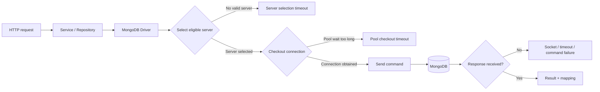

# Health Indicators, Pool Metrics, and Server Selection Errors in Spring Data MongoDB

In a Java application using **Spring Data MongoDB**, an API process may appear healthy yet fail to query MongoDB because the primary was lost, DNS/TLS was misconfigured, or the connection pool saturated. In such moments, the key operational question is not just **"Is MongoDB alive?"** but **"Can the application select an eligible server, check out a connection from the pool, and complete data operations within acceptable latency?"**

This lesson in the **Security and Operations** chapter of `SPRING_DATA_MONGODB` connects document mapping and operations via `MongoTemplate`/repositories with queries, aggregations, indexes, transactions, reactive access, and performance testing. It focuses on three tools: **health indicators**, **connection pool metrics**, and **diagnosing server selection errors**, combined with access controls, secure configuration, and controlled failure testing.

## 1. Three Layers of Connection Health Checks

Distinguish the possible failure points in a `repository.findById(...)` or `mongoTemplate.find(...)` call:



| Layer | Question to answer | Primary signs |
| --- | --- | --- |
| **Server discovery/selection** | Can the driver find a server matching the read preference/write operation and topology? | `MongoTimeoutException` waiting for a matching server, `UNKNOWN` topology, no primary visible |
| **Connection pool** | Once a server is selected, is a connection available and checked out in time? | Checkout wait, `ConnectionCheckOutFailedEvent`, wait queue/checkout timeout errors |
| **Command and data** | Does the sent command execute and return valid results? | `CommandListener`, socket read/write errors, authorization errors, duplicate keys, server overload |

**A failure at an earlier layer prevents later layers from running at all.** Never react to "timeout" by immediately raising `maxPoolSize` or assuming MongoDB is overloaded. Server selection can fail even before the pool is touched.

At the same time, a passing `ping` command does not prove that writes, collection permissions, p95 latency, transactions, or aggregations are working properly.

## 2. MongoDB Health Indicator with Spring Boot Actuator

### 2.1. What does the health indicator do?

When an application includes Spring Boot Actuator and appropriate MongoDB auto-configuration, Boot typically registers a **MongoDB health contributor** (often named `mongo`) to check MongoDB connectivity/health via the driver or template. The synchronous stack uses `MongoHealthIndicator`; the reactive stack has a corresponding reactive health contributor. The exact command executed by the health indicator can vary across Spring Boot versions, so do not assume every Boot release runs only `ping`.

Observed statuses typically include:

- `UP`: the contributor's health check completed successfully at invocation time.
- `DOWN`: the contributor could not complete the check and reported failure.
- `UNKNOWN`/other states: depends on contributor organization, health groups, and status mapping.

Common paths are `GET /actuator/health` and, if probes are enabled, `GET /actuator/health/liveness` and `GET /actuator/health/readiness`. Never infer from a single HTTP 200 that **every** contributor in a health group is `UP`; verify group membership and configured status mappings.

### 2.2. Configuring health and readiness

Example Spring Boot configuration in `application.yml`:

```yaml
spring:
  data:
    mongodb:
      uri: ${MONGODB_URI}

management:
  endpoint:
    health:
      probes:
        enabled: true
      show-details: when_authorized
      group:
        readiness:
          include: readinessState,mongo
  endpoints:
    web:
      exposure:
        include: health,info
```

In this example, `${MONGODB_URI}` is populated from an **environment variable or secret manager**; never store passwords directly in source code. When deploying Spring Boot with environment variables, the actual configuration uses the appropriate Spring placeholder, such as an `MONGODB_URI` variable injected by the deployment platform.

**Why include `mongo` in readiness?** If the API cannot serve critical requests without MongoDB connectivity, readiness should reflect this so the load balancer stops routing traffic to instances whose dependency is unavailable. Conversely, putting MongoDB into **liveness** can trigger mass container restarts during a shared database outage; liveness should reflect whether the process itself can operate and recover, per deployment design.

In most systems, keep readiness lightweight yet representative of **essential** dependencies. A heavy health query running frequently can add load to MongoDB or cause false negatives when the server is busy. Verify security and timeouts on health endpoints.

### 2.3. Performing a simple check with MongoTemplate

When diagnosing in tests or implementing a custom probe, you can run `ping` on the configured database:

```java
import org.bson.Document;
import org.springframework.data.mongodb.core.MongoTemplate;

public final class MongoPingProbe {
    private final MongoTemplate template;

    public MongoPingProbe(MongoTemplate template) {
        this.template = template;
    }

    public boolean canPing() {
        Document result = template.executeCommand(new Document("ping", 1));
        return result.get("ok") instanceof Number
                && ((Number) result.get("ok")).doubleValue() == 1.0;
    }
}
```

This example intentionally lets driver/Spring Data errors propagate to the caller; in a real `HealthIndicator`, translate exceptions into `Health.down(exception)` and limit exposed details. Never print full connection URIs, credentials, TLS settings, or internal stack traces on public endpoints.

**A health check proves only what it actually tests.** It can pass with `ping` privileges even while the application's MongoDB user lacks write privileges on `orders`. If a service relies on transactions, majority write concern, or secondary reads, add **integration tests and business-operation metrics**; never turn a health check into a continuous data-writing workload without explicit purpose and cost analysis.

## 3. Liveness, Readiness, and Startup: Using Each Role Properly

| Endpoint | Core question | Should it depend on MongoDB? | Consequence on failure |
| --- | --- | --- | --- |
| **Liveness** | Is the process responsive and able to self-recover? | Usually **no**, to avoid restart loops during external dependency outages | Orchestrator may restart the container |
| **Readiness** | Should this instance receive new traffic right now? | Possibly **yes**, if MongoDB is mandatory to serve requests | Orchestrator temporarily stops routing traffic |
| **Startup** | Has the application finished initializing? | Depends on startup work and initial connection time | Grants extra startup grace before liveness/readiness checks run |

No single policy fits every microservice. A service buffering messages in a queue may still accept requests briefly while MongoDB is unreachable; a payment service requiring synchronous writes generally must gate readiness on database health. Base the decision on the API contract and outage behavior.

If readiness flips `DOWN` during a brief few-second MongoDB blip, understand how the load balancer and recovery behave. Tune probe intervals, timeouts, and failure thresholds carefully; never replace metrics and alerts with `UP`/`DOWN` status alone.

## 4. Connection Pool: Reusing Connections, Not Opening One per Query

The MongoDB Java Driver maintains **connection pools** for each server in a `MongoClient`'s topology. Typical flow:

1. A thread or reactive pipeline needs to execute a command.
2. The driver selects an eligible server.
3. The driver **checks out** an available connection, or waits/creates one per pool settings.
4. Once finished, the connection is **checked in** for reuse.
5. Connections may be closed due to idle expiry, max lifetime, errors, or topology changes.

`MongoTemplate` and repositories normally share connections from a configured `MongoClient`; calling `saveAll`, `find`, or bulk operations **does not create a separate TCP connection per call**.

### Key quantities

| Metric | Meaning | How to read it |
| --- | --- | --- |
| **Checked-out / in-use** | Connections currently borrowed | Sustained high values may indicate heavy load or long-running queries |
| **Available / idle** | Connections ready in the pool | Being low under heavy load is not necessarily an error if checkouts remain fast |
| **Pending/waiting requests** | Requests waiting to borrow a connection | Meaningful when correlated with wait times and tail latency |
| **Checkout time / wait** | Time spent waiting for a connection | Distinguishes pool saturation from server selection |
| **Checkout failures** | Number of failed checkouts | Break down by timeout, closed pool, or connection error |
| **Created / closed connections** | Connections opened/closed by the pool | Spikes during pool warm-up, failover, or unstable networking |
| **Peak checked-out** | High-water mark of borrowed connections | Compare against `maxPoolSize` and throughput |

Exact metric names depend on driver, Spring Boot, Micrometer, and listener wiring. Never assume every app automatically exports `mongodb.pool.*`; verify how instrumentation is enabled and where metrics are exposed (`/actuator/metrics`, Prometheus, APM).

### Do not confuse client and server metrics

- **Client-side pool:** measures connections of **one MongoClient** in one application instance, typically with one pool per server.
- **MongoDB server connections:** observes connections from all applications, `mongos` instances, monitors, and other clients.
- **Total process TCP sockets:** may also include topology monitoring connections, HTTP, Redis, and other services.

Thus server-side `connections.current`, a listener's `connectionCreated` count, and per-request `checkout` counts **cannot be used interchangeably**.

## 5. Collecting Pool Metrics with `ConnectionPoolListener`

### 5.1. A minimal listener

The example below uses MongoDB Java Driver event interfaces and thread-safe counters. Because this snippet does not tag by server, it **aggregates across all pools of the observed MongoClient**. When monitoring replica sets or sharded deployments, split by server address/pool if topology analysis is needed while avoiding overly high tag cardinality.

```java
import com.mongodb.event.ConnectionPoolListener;
import com.mongodb.event.ConnectionCreatedEvent;
import com.mongodb.event.ConnectionClosedEvent;
import com.mongodb.event.ConnectionCheckedOutEvent;
import com.mongodb.event.ConnectionCheckedInEvent;
import com.mongodb.event.ConnectionCheckOutFailedEvent;

import java.util.concurrent.atomic.AtomicInteger;
import java.util.concurrent.atomic.LongAdder;

public final class MongoPoolProbe implements ConnectionPoolListener {
    private final AtomicInteger checkedOut = new AtomicInteger();
    private final AtomicInteger peakCheckedOut = new AtomicInteger();

    private final LongAdder created = new LongAdder();
    private final LongAdder closed = new LongAdder();
    private final LongAdder checkouts = new LongAdder();
    private final LongAdder checkoutFailures = new LongAdder();

    @Override
    public void connectionCheckedOut(ConnectionCheckedOutEvent event) {
        checkouts.increment();
        int now = checkedOut.incrementAndGet();
        peakCheckedOut.accumulateAndGet(now, Math::max);
    }

    @Override
    public void connectionCheckedIn(ConnectionCheckedInEvent event) {
        checkedOut.decrementAndGet();
    }

    @Override
    public void connectionCreated(ConnectionCreatedEvent event) {
        created.increment();
    }

    @Override
    public void connectionClosed(ConnectionClosedEvent event) {
        closed.increment();
    }

    @Override
    public void connectionCheckOutFailed(
            ConnectionCheckOutFailedEvent event) {
        checkoutFailures.increment();
    }

    public Snapshot snapshot() {
        return new Snapshot(
                checkedOut.get(),
                peakCheckedOut.get(),
                checkouts.sum(),
                created.sum(),
                closed.sum(),
                checkoutFailures.sum());
    }

    public record Snapshot(
            int checkedOut, int peakCheckedOut,
            long checkouts, long created, long closed,
            long checkoutFailures) {}
}
```

`checkedOut` increments on checkout and decrements on checkin; `peakCheckedOut` is the **peak since listener startup** and does not reset on `snapshot()`. Counters reflect observed events, not total OS TCP sockets across the process. When pools are cleared, topologies change, or connections error out, cross-check driver pool events and built-in pool metrics to build a production-grade gauge.

If checkout duration is needed, use listeners/events or instrumentation supporting checkout wait histograms in the driver/Micrometer. Never estimate checkout wait simply from `MongoTemplate.find(...)` latency, which also includes server selection, command execution, and mapping.

### 5.2. Registering the listener in Spring Boot

When Spring Boot auto-configures `MongoClient`, use `MongoClientSettingsBuilderCustomizer` (imported from the package matching your Spring Boot version) to attach the listener to pool settings **before the client is created**:

```java
import org.springframework.boot.autoconfigure.mongo.MongoClientSettingsBuilderCustomizer;
import org.springframework.context.annotation.Bean;
import org.springframework.context.annotation.Configuration;

@Configuration(proxyBeanMethods = false)
class MongoMonitoringConfig {

    @Bean
    MongoPoolProbe mongoPoolProbe() {
        return new MongoPoolProbe();
    }

    @Bean
    MongoClientSettingsBuilderCustomizer mongoPoolCustomizer(
            MongoPoolProbe probe) {
        return builder -> builder.applyToConnectionPoolSettings(
                pool -> pool.addConnectionPoolListener(probe));
    }
}
```

If an application manually declares multiple `MongoClient` beans, auto-configuration customizers may not apply to all of them: attach listeners to the **exact client actually used by repositories and MongoTemplate**. Never create a new `MongoClient` per request or just to measure individual commands; every client owns its own pools and resources.

### 5.3. Exposing metrics to Micrometer

With Actuator/Micrometer, bind `Gauge`/`FunctionCounter` to the listener above. Example `MeterBinder` inside a configuration class:

```java
import io.micrometer.core.instrument.Gauge;
import io.micrometer.core.instrument.FunctionCounter;
import io.micrometer.core.instrument.binder.MeterBinder;
import org.springframework.context.annotation.Bean;

@Bean
MeterBinder mongoPoolMeterBinder(MongoPoolProbe probe) {
    return registry -> {
        Gauge.builder("app.mongo.pool.checked_out", probe,
                p -> p.snapshot().checkedOut())
            .description("Connections currently checked out")
            .register(registry);

        FunctionCounter.builder(
                "app.mongo.pool.checkouts", probe,
                p -> p.snapshot().checkouts())
            .register(registry);

        FunctionCounter.builder(
                "app.mongo.pool.checkout_failures", probe,
                p -> p.snapshot().checkoutFailures())
            .register(registry);

        FunctionCounter.builder(
                "app.mongo.pool.connections_created", probe,
                p -> p.snapshot().created())
            .register(registry);
    };
}
```

This `@Bean` belongs inside a valid `@Configuration` class alongside the `MongoPoolProbe` bean. The names `app.mongo.pool.*` are **custom example metrics**, not guaranteed default metric names across every Spring Boot release. When exported to Prometheus, registry conventions may convert dots/units and append `_total` to counters.

In production, add stable tags such as `application`, `mongo_client`, or server ID if needed. **Avoid tagging by user ID, dynamic tenant ID, request ID, or full URI**, as that inflates cardinality and can leak secrets. With multiple pools, collect per-pool metrics first and aggregate on dashboards.

Never write metric code that logs full commands/documents, JWTs, or URIs with usernames/passwords. Collect latency and error metrics from proper instrumentation or APM while keeping sensitive fields to a minimum.

## 6. Distinguishing Server Selection Timeout from Pool Checkout Timeout

### 6.1. Server selection occurs before checkout

The MongoDB Driver uses topology state to pick a server matching the operation's requirements. For example:

- **Writes** normally require a primary or write-capable endpoint for the active topology.
- **Reads** depend on `ReadPreference`, tag sets, max staleness, and member state.
- **Replica sets** without a primary during an election or network partition cause writes to wait.
- **Sharded clusters** require reachable `mongos` instances and valid topology.
- **DNS SRV**, TLS, firewalls, hostnames, or a wrong `replicaSet` name can make discovered hosts unreachable.

Typical error format:

```text
com.mongodb.MongoTimeoutException:
Timed out after 30000 ms while waiting for a server
that matches ... Client view of cluster state is ...
```

**"Timed out after 30000 ms"** here is an example of one timeout configuration; do not treat 30 seconds as universal. Read the **entire cause chain** and topology state inside the exception (while masking sensitive internal URIs/hosts before sharing). Spring Data may translate the exception into a `DataAccessException`; trace down to the root cause.

### 6.2. Checkout timeout occurs after an eligible server is found

If the driver found a server yet could not borrow a connection, wait-queue or pool checkout timeouts occur—for instance `MongoWaitQueueTimeoutException` depending on driver/API version. Accompanying signs typically include:

- `checkedOut` near the pool ceiling;
- rising checkout wait times;
- rising `connectionCheckOutFailed`, specifically with timeout reasons;
- rising p95/p99 latency under high concurrency even though the topology has healthy servers.

This is distinct from **no primary** or **DNS resolution failure**. Increasing `maxPoolSize` only helps when the pool itself is the bottleneck and MongoDB has sufficient capacity to handle extra concurrent work.

### 6.3. Other errors often lumped together as "connection errors"

| Symptom | Likely layer | Appropriate check |
| --- | --- | --- |
| `MongoTimeoutException` waiting for server, topology `UNKNOWN` | Server discovery/selection | DNS, SRV, TLS, network, firewalls, replica set/host names |
| No eligible primary for writes | Replica set election/availability | Topology, heartbeats, primary state, inter-node networking |
| Excessive connection pool wait | Pool saturation | Checkout wait, in-use count, pool limit, concurrency, slow queries |
| `MongoSocketOpenException` / `MongoSocketReadException` | Opening socket or reading response | Network path, firewalls, TLS, socket timeout, server load |
| `MongoSecurityException` / authentication failure | MongoDB authentication | Credentials, authSource, auth mechanism, KMS/secret rotation if relevant |
| `MongoCommandException` with not authorized | Command authorization | Roles/privileges on DB/collection, recent user changes |
| `MongoWriteConcernException` or write concern timeout | Acknowledgment/replication | Replication lag, majority availability, topology, write concern |
| Duplicate key error `E11000` | Unique index/data logic | Unique fields, upsert/race handling, idempotency |

Exact exception names vary by MongoDB Java Driver version and Spring Data exception translation. **Diagnose using root causes, command context, timelines, and metrics**, rather than grouping everything under the word "timeout".

## 7. Server Selection Error Diagnostic Workflow

When an API returns MongoDB access errors, first record the **error start timestamp**, application version, topology, and recent changes (deploys, certificate/credential rotation, DNS edits, IP allowlist updates, failovers).

### Step 1: Determine the blast radius

- **One instance or all?** One container/instance failing points to local config, DNS cache, network namespace, or local pool. All instances failing points to a shared dependency/topology issue.
- **Writes only or reads too?** Failing writes while secondary reads succeed can point to elections, primary loss, and read preference.
- **One database/collection or all commands?** `ping` may succeed while CRUD fails due to missing privileges or broken indexes/mappings.
- **Continuous or bursty?** Bursty errors at peak load often correlate with pool/server saturation; failover spikes coincide with topology logs.
- **Triggered after an event?** Cross-reference deploys, `mongos` restarts, certificate updates, route/firewall changes, or pool setting updates.

### Step 2: Read the server selection reason, not just the first line

Useful details in driver exceptions/logs include `readPreference`/operation type, visible server list, `UNKNOWN`/`CONNECTED` states, topology type, and underlying socket/TLS/DNS errors. If logs contain sensitive URIs or internal hostnames, **redact** them before sharing.

Note: **"connected successfully to one host"** does not mean the driver found a valid server for writes. For example, a secondary may be reachable yet ineligible for operations requiring a primary.

### Step 3: Verify network and configuration from the application's actual runtime environment

Check DNS and DNS SRV/TXT (if using `mongodb+srv://`), firewalls/allowlists, IPs/ports, security groups, TLS certificate chain/hostname verification, and routes to every node reported by topology. Run checks **from the same container, VM, or network** the application uses, since a developer laptop may have completely different network paths.

Re-verify the redacted URI, replica set name, auth mechanism, and authentication database. Never disable TLS certificate validation just to "quick-test" in production; doing so hides real misconfigurations and increases security risk.

### Step 4: Cross-check topology and pool metrics

With properly scoped monitoring permissions, check:

- Primary/secondary status, failovers/elections, replication lag, and `mongos` health.
- `ConnectionPoolListener`: `checkedOut`, `checkouts`, `created`, `closed`, checkout failures; ideally with checkout wait histograms and per-server pools.
- `CommandListener`/APM: latency, failed commands, operation types; filter to avoid logging raw data or secrets.
- MongoDB server metrics: connections, CPU, disk, lock contention, slow queries, and indexes as allowed by monitoring permissions.

If selection timeouts occur while **no eligible server exists**, pool metrics may look completely normal. If server selection succeeds yet checkout failures climb, focus on pool saturation, query latency, and concurrency.

### Step 5: Verify post-recovery behavior

Following a **transient incident**, the driver can recover topology without restarting the application if networking and config are sound. Confirm new requests read/write target collections, readiness returns `UP`, pool congestion clears, and errors stop repeating. Check side effects on in-flight calls, retryable writes, and business idempotency.

Never blindly retry non-idempotent writes indefinitely: on network errors, the server **may have already committed the operation** before the client lost the response. Use idempotency keys/unique constraints and bounded retry policies where needed.

## 8. Configuring Timeouts Layer by Layer

The MongoDB Driver exposes distinct timeouts, each serving a specific purpose:

| Setting | Effect | Should NOT be mistaken for |
| --- | --- | --- |
| **Server selection timeout** | Max time driver waits to find a matching server | Execution limit for a query once dispatched |
| **Connect timeout** | Max time to establish a socket connection during connect | Total time for any MongoDB operation to finish |
| **Socket/read timeout** | Legacy limit waiting to read data from a socket | Time spent waiting for a connection in the pool |
| **Pool max wait / checkout timeout** | Max wait to check out a connection from the pool | Time spent finding a primary |
| **Server-side maxTimeMS** | Limits server execution time for supported commands/queries | Replacing all client-side connection timeouts |

Example customizer for Spring Boot using the synchronous MongoDB driver (adjust to your version):

```java
import java.util.concurrent.TimeUnit;
import org.springframework.boot.autoconfigure.mongo.MongoClientSettingsBuilderCustomizer;
import org.springframework.context.annotation.Bean;

@Bean
MongoClientSettingsBuilderCustomizer mongoTimeouts() {
    return builder -> {
        builder.applyToClusterSettings(cluster ->
                cluster.serverSelectionTimeout(5, TimeUnit.SECONDS));

        builder.applyToSocketSettings(socket ->
                socket.connectTimeout(3, TimeUnit.SECONDS)
                      .readTimeout(10, TimeUnit.SECONDS));

        builder.applyToConnectionPoolSettings(pool ->
                pool.maxWaitTime(2, TimeUnit.SECONDS));
    };
}
```

The values **5/3/10/2 seconds are only examples to distinguish APIs**, not universal production defaults. Choose timeouts based on SLOs, app-to-MongoDB RTT, real failover durations, transaction workloads, and retry behavior. Overly short timeouts cause spurious errors during jitter/failovers; overly long timeouts tie up threads and connections under load.

Some driver versions provide an additional **client-side operation timeout** mechanism; verify the documentation and interaction with legacy timeouts for your deployed version. If also using URI options, cross-check `serverSelectionTimeoutMS`, `connectTimeoutMS`, and `socketTimeoutMS` against programmatic config to avoid conflicting settings.

## 9. Readiness and Pool Metrics Must Be Read Together

Build a simple dashboard with:

| Panel | Purpose | Warning signs |
| --- | --- | --- |
| Mongo health/readiness per instance | Know whether an instance lost readiness to serve traffic | Sustained DOWN, UP/DOWN flapping |
| Server selection failures/latency | Know whether the driver lost the ability to locate eligible servers | Timeouts spiking after failover or network changes |
| Pool checked-out/available/waiting | Track pool usage and waiting requests | Checked-out near cap alongside rising wait |
| Connection checkout failures | Detect pool saturation or closed pools | Failures rising during peak traffic |
| Connections created/closed | Detect churn, cold starts, connection drops | Continuous abnormal open/close spikes |
| MongoDB command p95/p99 & error rate | Know whether data operations are slow or failing | P95 climbing while health still reads UP |
| Application endpoint p95/p99 | Measure real end-user impact | SLO breaches correlated with DB metric shifts |
| Server CPU/IO/replication/topology | Identify database-side ceilings | Elections, lag, IO saturation |

Avoid hardcoding universal absolute thresholds across all systems. **Establish baselines under real load** and alert on error rates, utilization percentages, checkout latency, p95/p99, and duration of degradation. Sustained checkout failures paired with rising p95 matter far more than a single startup event failure.

Synchronize clocks and timestamps across application logs, APM, driver metrics, and database monitoring to correlate incidents. Attach request IDs/correlation IDs to application traces rather than raw tenant/user IDs in metric tags.

## 10. Security When Enabling Health and Observability

- **Do not expose connection internals.** `/actuator/health` may return an overall status, while exception details, hostnames, topologies, and metrics should be restricted to authenticated operators. `show-details: when_authorized` is only one piece; configure actual role/security rules.
- **Separate infrastructure checks from business privileges.** App MongoDB auth/roles should cover permitted operations, never granting admin rights just so health endpoints report "richer details".
- **Keep TLS strict.** When diagnosing certificate failures, fix trust stores, hostnames, and certificate validity; never enable `tlsAllowInvalidCertificates` as a production fix.
- **Never log URIs with passwords, secrets, or payloads.** Redact connection strings, credentials, auth tokens, and sensitive database names before adding them to incident reports.
- **Bound CommandListener logging.** Record command type, duration, server, request correlation, and sanitized error codes; never push raw `find`/`aggregate` bodies containing personal data into metrics.
- **Isolate observability permissions.** Monitoring services need minimal metrics permissions; never expose full data-access credentials on public dashboards.
- **Never use health probes that mutate data** unless backed by a dedicated synthetic transaction with clear rollback/cleanup, scoped permissions, and bounded cost.

## 11. Controlled Failure Testing

To trust health checks and alerts, run integration/chaos tests in an **isolated environment**, such as MongoDB Testcontainers or a test replica set. Never intentionally sever production networks just to test a runbook.

### Test case matrix

| Simulated scenario | Expected health/readiness | Expected pool/driver behavior | What to verify |
| --- | --- | --- | --- |
| MongoDB running and user authorized | `mongo` UP | Commands/checkouts succeed | Business CRUD works properly |
| MongoDB stopped or route lost | After timeout, mongo health drops | Server selection timeout or socket errors | Readiness reflects critical dependency loss |
| Primary temporarily lost in replica set | May go DOWN/degraded depending on probe and topology | Selection waits for eligible server | Writes fail cleanly; resume after recovery |
| Small pool, high concurrent queries | Health may stay UP or slow down | High checked-out, rising checkout wait/failures | Avoid misdiagnosing pool saturation as "server down" |
| Wrong credentials | Mongo health/CRUD fails | Authentication exception | No passwords/URIs leaked in responses/logs |
| Wrong TLS hostname/CA | Mongo health/CRUD fails | TLS handshake/socket errors; topology may show UNKNOWN | Never "fix" by disabling verification |
| MongoDB under heavy load | Health may stay UP | High command p95, rising pool wait | Alerts fire on metrics/SLOs, not health status alone |
| After fixing the fault | Mongo health returns UP | Normal commands/checkouts, error rate drops | Reads/writes show no lost or duplicated data from retries |

A real MongoDB read test using `MongoTemplate`:

```java
import static org.assertj.core.api.Assertions.assertThat;
import org.bson.Document;
import org.junit.jupiter.api.Test;
import org.springframework.beans.factory.annotation.Autowired;
import org.springframework.boot.test.autoconfigure.data.mongo.DataMongoTest;
import org.springframework.data.mongodb.core.MongoTemplate;

@DataMongoTest
class MongoReachabilityIT {
    @Autowired MongoTemplate template;

    @Test
    void pingCompletesOnTestMongo() {
        Document result = template.executeCommand(new Document("ping", 1));
        assertThat(((Number) result.get("ok")).doubleValue())
                .isEqualTo(1.0);
    }
}
```

This test requires a reachable test MongoDB instance (an embedded setup if supported by the environment, or Testcontainers with matching Spring configuration). It checks only **ping**, not Actuator endpoints, readiness groups, or authorization. To test readiness, add `@SpringBootTest`/HTTP tests with Actuator, proper security, and dependency-loss simulation, then assert status after real timeout intervals.

### How to test pools without creating false positives

1. Attach `ConnectionPoolListener` to the exact client under test and capture before/after snapshots.
2. Warm up the connection pool before measuring steady-state behavior.
3. Run a bounded read/write workload and confirm the listener records events; **`created` may be 0** because the pool reuses connections.
4. Run concurrent operations in the test environment with a small `maxPoolSize`, then observe checkout wait/failures.
5. After the workload stops, verify checked-out connections return to baseline; guard against leaked unclosed cursors/streams.
6. Avoid asserting exact event counts across driver versions, retries, topology shifts, or auxiliary server commands; assert stronger invariants such as zero checkout failures at low load and zero leaked connections after completion.

## 12. Production Incident Runbook

When `MongoTimeoutException` occurs or MongoDB readiness flips `DOWN`:

1. **Assess impact:** which APIs are failing, one instance or the whole fleet, start time, reads vs writes, and changes in error rate and p95.
2. **Inspect topology and root cause:** read the server selection reason, topology type, primary state, DNS/SRV, TLS, network/firewalls, and recent config changes.
3. **Inspect pool metrics:** in-use, waiting, checkout failures, created/closed. Distinguish server selection failures from pool checkout waits.
4. **Inspect the server:** replica set/`mongos`, CPU/IO, replication lag, slow queries/indexes, and connection limits within monitoring permissions.
5. **Fix the right layer:** resolve hostname/cert/allowlist/primary issues; for pool saturation, tune queries/concurrency first and resize pools based on capacity; for auth errors, fix credentials/roles safely.
6. **Confirm recovery:** readiness returns steadily to `UP`, p95/error rates drop, critical CRUD/transactions work, and retries caused no duplicates or corrupt writes.
7. **Write a postmortem:** document timeline, key metrics, root cause, time to detect/resolve, and preventive actions. Redact all secrets before sharing.

### Self-check questions

- An API shows `ConnectionPoolListener.created = 0` while `checkouts = 200`. Does that mean there are no MongoDB connections? **No:** the pool may have created connections during warmup and reused them.
- Health is `UP`, yet writes to `orders` fail with `not authorized`. Is that contradictory? **No:** health checks may execute commands with different privilege requirements than business writes.
- Does `MongoTimeoutException` after 5 seconds automatically prove `maxPoolSize` is too small? **No:** check the server selection reason and checkout metrics. Enlarging the pool will not fix DNS or a missing primary.
- Why not always tie MongoDB to liveness? Because a shared DB outage could restart every application pod even when the processes are healthy and would recover automatically once the DB returns.
- Why monitor p95/p99 and checkout wait while health stays UP? Because health is an instantaneous point check and does not reflect load capacity or user wait times.

**Key takeaway:** With Spring Data MongoDB, **health indicators** report the status of a dependency check, **connection pool metrics** reflect connection borrowing, creation, and reuse, while **server selection** determines whether the driver can locate an eligible server before borrowing a connection. To diagnose accurately and operate safely, combine all three with command latency, topology, access privileges, SLOs, and controlled failure testing.
