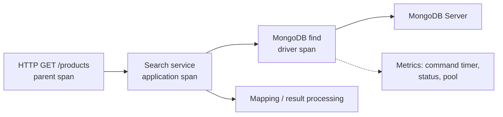
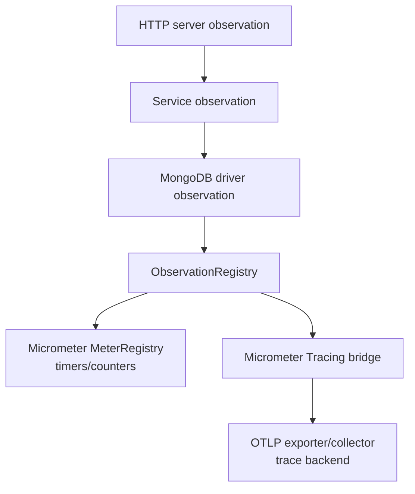

# Micrometer, Observation, and Tracing by Driver and Spring Data Version

When an endpoint using **Spring Data MongoDB** starts responding slowly, knowing "MongoDB is slow" is usually not enough to diagnose it. A single `MongoTemplate.find(...)` call may wait on the connection pool, send multiple `find`/`getMore` commands over the network, receive BSON, and map it into Java entities; a repository method may likewise issue multiple commands. You need to observe each layer rather than guessing from total HTTP request duration.

**Micrometer Metrics**, **Micrometer Observation**, and **distributed tracing** are three related but distinct tools. They answer different questions: *How many MongoDB commands ran and what is their p95?*; *Is this call recorded through a unified instrumentation mechanism?*; *Where does the slow command sit along HTTP → service → repository → MongoDB?*

A key takeaway of this lesson is that **integration changes across versions**:

- Spring Boot can auto-configure Micrometer listeners to measure commands and connection pools.
- Spring Data MongoDB starting from 4.0 provides `MongoObservationCommandListener` and context propagation for driver-level observation.
- MongoDB Java Driver **5.7 and above** supports native observability via `ObservabilitySettings`. Spring Data's own observability classes were marked deprecated as of **Spring Data MongoDB 5.1** in favor of the driver's native capability.

Therefore, configuration must start by **checking actual versions**, actively choosing one primary instrumentation path, and verifying metrics/spans after the application sends real commands. Examples in this lesson are organized as version-specific choices; never paste every approach onto the same `MongoClient`.

## 1. Distinguishing Metrics, Observation, and Tracing

| Concept | Observed data | Best suited for question | Limitations |
| --- | --- | --- | --- |
| **Micrometer Metrics** | Counters, timers, gauges, and tags | Command volume, latency distributions, errors, active connections | Does not by default tell which specific HTTP request issued a command |
| **Micrometer Observation** | Start/stop/error lifecycle + context + conventions; can emit metrics and traces via handlers | Measuring an operation under one unified instrumentation contract | `ObservationRegistry` does not export traces without a tracing handler/exporter |
| **Distributed tracing** | Trace ID, span ID, parent–child links, timestamps, errors, and selected attributes | Where did this specific request spend time: HTTP, service, or MongoDB command? | Sampling may drop traces; spans do not replace the MongoDB profiler |
| **MongoDB server profiler/`explain`** | Execution details, query plan, docs/keys examined, server-side time | Is there an index scan, collection scan, or expensive sort? | Does not fully measure network, pool wait, or Java mapping |

Example request flow:



A command timer and a command span may appear together yet carry different semantics: a timer aggregates many executions under low-cardinality tags, whereas a span represents one specific execution inside a sampled trace. Never count spans to compute total system command volume when sampling is active.

**Observation is not logging.** You can enable metrics without capturing query payloads, and add tracing while still keeping sensitive details out of attributes/span events. In multi-tenant systems, telemetry privacy is part of operational design.

## 2. Identifying Exact Versions Before Configuring

Check the full version stack: **Spring Boot**, **Spring Data MongoDB**, **MongoDB Java Driver**, **Micrometer**, and your tracing/exporter libraries. Spring Boot usually manages dependency versions, yet an application may have overridden the driver or manually instantiated multiple `MongoClient` beans.

| Environment | Integration path to consider | Notes |
| --- | --- | --- |
| Spring Boot with Actuator + auto-configured client | Use Boot's built-in command/pool metrics first | Check properties and metric names for your exact Boot line |
| Spring Data MongoDB **4.0–5.0**, driver lacks native observability | Use `MongoObservationCommandListener` with `ContextProviderFactory` if Observation/tracing is needed | Configure explicitly; avoid registering duplicate command listeners alongside Boot |
| MongoDB Java Driver **5.7+** | Prefer `MongoClientSettings.Builder.observabilitySettings(ObservabilitySettings)` | Provides native Micrometer Observation for operations/commands/transactions |
| Spring Data MongoDB **5.1+** | Prefer driver-native when using a compatible driver | Package `org.springframework.data.mongodb.observability` is deprecated as of 5.1 |
| App manually creating `MongoClient`/multiple clusters | Attach instrumentation to **each client to measure**, sharing the registry | Boot auto-configuration may not apply to manual clients |

**Distinguish two version families:**

1. **Spring Data version** determines the presence of adapters like `MongoObservationCommandListener` and `ContextProviderFactory`.
2. **MongoDB Java Driver version** determines whether native `ObservabilitySettings` exists; it was introduced in **driver 5.7**.

Do not assume "the project uses Spring Boot 3.x" means driver 5.7 APIs are available. Inspect actual resolved dependencies and Spring Boot's managed versions before copying code.

### 2.1. Property name changes across Spring Boot lines

In **Spring Boot 3.5** documentation, flags to disable command metrics use:

```properties
management.metrics.mongo.command.enabled=false
management.metrics.mongo.connectionpool.enabled=false
```

In **Spring Boot 4.x** documentation, the corresponding properties use:

```properties
management.metrics.mongodb.command.enabled=false
management.metrics.mongodb.connectionpool.enabled=false
```

These are **two variants for different versions**, not four flags to declare simultaneously. If configuration has no effect, check the configuration metadata of the exact Spring Boot artifact in use. Disabling these listeners is only necessary when you deliberately replace the default metrics path; apps needing only Boot metrics can rely on auto-configuration.

## 3. Built-In Micrometer Metrics from Spring Boot Actuator

For a compatible Spring Boot application, start with the core dependencies:

- Spring Data MongoDB starter for repositories, `MongoTemplate`, and `MongoClient`.
- `spring-boot-starter-actuator` for Micrometer/metrics endpoints and auto-configuration.
- A registry exporter if exporting metrics to a monitoring backend, such as `micrometer-registry-prometheus`. Having Actuator alone does not export metrics to Prometheus by default.

On Spring Boot lines with MongoDB metrics auto-configuration, common meters include:

| Micrometer meter name | Type | Meaning |
| --- | --- | --- |
| `mongodb.driver.commands` | Timer | Java Driver command duration |
| `mongodb.driver.pool.size` | Gauge | Total connections in the pool |
| `mongodb.driver.pool.checkedout` | Gauge | Connections currently in use |
| `mongodb.driver.pool.waitqueuesize` | Gauge | Requests waiting for a connection |
| `mongodb.driver.pool.checkoutfailed` | Counter (depending on binder/version) | Failed connection checkouts |

Default command timers typically carry tags like `command`, `cluster.id`, `server.address`, and `status`. Pool metrics may carry `cluster.id` and `server.address`. Exact tag names and structures depend on the Micrometer/binder version and customizers; inspect the live endpoint.

**Boundary note:** the `mongodb.driver.commands` timer measures a **driver command**, not an entire `MongoTemplate.find(...)` call. A multi-batch find can emit `find` plus multiple `getMore` commands. Pool wait time, mapping `Document` to entities, service logic, and JSON serialization are not included in that timer.

### 3.1. Enabling observation endpoints in a test environment

Example for a Boot app with a configured Micrometer registry:

```properties
management.endpoints.web.exposure.include=health,info,metrics,prometheus
management.tracing.enabled=true
```

When Actuator and the matching exporter are active, inspect via HTTP in **test environments**:

```text
GET /actuator/metrics
GET /actuator/metrics/mongodb.driver.commands
GET /actuator/metrics/mongodb.driver.pool.checkedout
GET /actuator/prometheus
```

`/actuator/prometheus` is only available when the corresponding registry/exporter and endpoint are enabled. **Never expose all actuator endpoints publicly on the Internet.** Restrict access via authentication, network policies, or a dedicated management port. A meter may not appear until the application has initialized its pool/sent commands and the registry records samples.

In production, design endpoint security and metric scraping paths alongside your monitoring stack. Never enable all Actuator endpoints solely to test MongoDB metrics.

### 3.2. What do the metrics tell you?

Suppose request volume climbs, application p95 slows down, and `mongodb.driver.pool.waitqueuesize` rises. This signals investigating **connection checkout**: the pool may be busy or commands are holding connections too long. Rising pool wait **does not prove** `maxPoolSize` must be increased; causes can include slow queries, long-lived cursors, high load, or improper connection usage.

If `getMore` commands appear frequently with high total duration, check batch size, document count, payload size, and cursor consumption. If command timers look healthy while the endpoint remains slow, measure Spring mapping, business processing, and serialization.

Never mistake command timer p95 for "MongoDB server time". It measures a client/driver boundary and includes network round-trips and protocol handling.

## 4. Manually Registering Micrometer Listeners When Managing `MongoClient`

If your application **manually creates** `MongoClient` and wants Micrometer binder metrics, register the Micrometer-provided listeners directly.

Example for environments with a compatible MongoDB Java Driver and `io.micrometer:micrometer-core`:

```java
import com.mongodb.ConnectionString;
import com.mongodb.MongoClientSettings;
import com.mongodb.client.MongoClient;
import com.mongodb.client.MongoClients;
import io.micrometer.core.instrument.MeterRegistry;
import io.micrometer.core.instrument.binder.mongodb.MongoMetricsCommandListener;
import io.micrometer.core.instrument.binder.mongodb.MongoMetricsConnectionPoolListener;
import org.springframework.data.mongodb.core.MongoTemplate;

public final class InstrumentedMongoFactory {

    public static MongoClient createClient(
            String mongoUri, MeterRegistry registry) {

        MongoMetricsCommandListener commands =
            new MongoMetricsCommandListener(registry);
        MongoMetricsConnectionPoolListener pool =
            new MongoMetricsConnectionPoolListener(registry);

        MongoClientSettings settings = MongoClientSettings.builder()
            .applyConnectionString(new ConnectionString(mongoUri))
            .addCommandListener(commands)
            .applyToConnectionPoolSettings(
                builder -> builder.addConnectionPoolListener(pool))
            .build();

        return MongoClients.create(settings);
    }

    public static MongoTemplate createTemplate(
            MongoClient client, String database) {
        return new MongoTemplate(client, database);
    }
}
```

If Spring Boot already attaches `MongoMetricsCommandListener` or `MongoMetricsConnectionPoolListener` to Boot-managed clients, **do not add them a second time** hoping for extra detail: duplicate registration produces overlapping measurements, inflated metrics, or confusing records.

An application using both synchronous and reactive clients must inspect each `MongoClient`. `ReactiveMongoTemplate` does not share the synchronous driver client instance; instrumenting the sync client does not automatically instrument the reactive client.

On newer versions, consider the **driver-native Observation** path below when tracing is a primary goal. Traditional Micrometer binder listeners measure metrics, but do not produce full distributed traces on their own.

## 5. Integrating Observation on MongoDB Java Driver 5.7+

Starting with **MongoDB Java Driver 5.7**, `com.mongodb.observability.ObservabilitySettings` supports Micrometer Observation directly on `MongoClientSettings`. This is the approach recommended by recent Spring Data MongoDB documentation.

In a Spring Boot project with `ObservationRegistry` and a compatible `MongoClientSettingsBuilderCustomizer`:

```java
import com.mongodb.observability.ObservabilitySettings;
import io.micrometer.observation.ObservationRegistry;
import org.springframework.context.annotation.Bean;
import org.springframework.context.annotation.Configuration;
// In Spring Boot 3.x, the import is typically:
import org.springframework.boot.autoconfigure.mongo.MongoClientSettingsBuilderCustomizer;

@Configuration(proxyBeanMethods = false)
public class MongoDriverObservabilityConfiguration {

    @Bean
    MongoClientSettingsBuilderCustomizer mongoNativeObservability(
            ObservationRegistry registry) {
        return settings -> settings.observabilitySettings(
            ObservabilitySettings.micrometerBuilder()
                .observationRegistry(registry)
                // Do not attach raw commands containing user data to traces.
                .enableCommandPayloadTracing(false)
                .build()
        );
    }
}
```

**Prerequisites:**

1. `MongoClientSettings.Builder.observabilitySettings(...)` and `ObservabilitySettings.micrometerBuilder()` exist only in supporting drivers from **5.7+**. On driver 5.6 or earlier, this code will not compile.
2. The `MongoClientSettingsBuilderCustomizer` type and package may move across Spring Boot generations. The snippet shows typical Boot 3.x usage; on Boot 4.x, check the exact API package for your release.
3. `ObservationRegistry` needs an appropriate handler/tracer to convert Observations into spans, plus an exporter and sampling configured to see traces in a backend.
4. The `MongoClient` used by `MongoTemplate`/repositories must be built from the customized builder. If the project creates its client manually in another `@Bean` bypassing Boot's builder, customizers will not apply.
5. Replace legacy Observation adapters with the native path in a **controlled transition** so both do not emit duplicate spans for the same command.

Newer drivers may create multiple observation levels (operation, command, transaction), so span counts need not equal repository call counts. Distinguish HTTP/service spans, operation spans, and command spans before calculating durations or building dashboards.

### 5.1. Preventing payload leaks in tracing

Drivers supporting native observability offer options such as `enableCommandPayloadTracing(...)` and `maxQueryTextLength(...)`. Command text can contain filter values, sensitive fields, or business metadata.

Example **unsuitable** for production without security review:

```java
// Use only after reviewing risks and trace access permissions:
ObservabilitySettings.micrometerBuilder()
    .observationRegistry(registry)
    .enableCommandPayloadTracing(true)
    .maxQueryTextLength(10000)
    .build();
```

Truncating characters **is not anonymization**: sensitive values can appear right at the start of a command. By default in real systems, **disable command payload capture**; if temporarily required, implement explicit redaction, strict access control, and tight retention.

With older Spring Data instrumentation or different exporters, attached trace attributes may differ. Always inspect actual data emitted to your observability backend rather than judging solely from configuration code.

## 6. Observation via Spring Data MongoDB 4.0–5.0 Mechanism

Before upgrading to MongoDB Java Driver 5.7+, Spring Data MongoDB 4.0+ provided `MongoObservationCommandListener` to create Observations from command events, paired with `ContextProviderFactory` for context propagation.

In Spring Boot with a compatible `MongoClientSettingsBuilderCustomizer`:

```java
import io.micrometer.observation.ObservationRegistry;
import org.springframework.context.annotation.Bean;
import org.springframework.context.annotation.Configuration;
import org.springframework.boot.autoconfigure.mongo.MongoClientSettingsBuilderCustomizer;
import org.springframework.data.mongodb.observability.ContextProviderFactory;
import org.springframework.data.mongodb.observability.MongoObservationCommandListener;

@Configuration(proxyBeanMethods = false)
public class LegacyMongoObservationConfiguration {

    @Bean
    MongoClientSettingsBuilderCustomizer mongoLegacyObservation(
            ObservationRegistry registry) {
        return settings -> settings
            .contextProvider(ContextProviderFactory.create(registry))
            .addCommandListener(new MongoObservationCommandListener(registry));
    }
}
```

**This is a compatibility approach for older library generations.** Classes in `org.springframework.data.mongodb.observability` were marked deprecated in **Spring Data MongoDB 5.1**, and Spring Data docs recommend moving to driver-native observability once on driver 5.7+. Avoid adding legacy code to greenfield projects already using a driver with native support.

When enabling the legacy approach on Boot 3.x lines, documentation also recommends disabling Boot's auto-configured command metric listener to avoid overlapping recordings. Example on Boot 3.x:

```properties
# Apply only when explicitly choosing Spring Data legacy observation.
management.metrics.mongo.command.enabled=false
management.tracing.enabled=true
```

On Boot 4.x, look up exact property names and auto-configuration packages in version docs. Never arbitrarily stack legacy + native + command timer listeners together. After any change, boot the app and send one simple request to confirm span/metric counts match emitted commands.

### 6.1. When are command metrics alone enough?

If your goal is a dashboard of command rates and connection pool health, **Actuator/Micrometer metrics may already be sufficient**. Adding tracing introduces exporters, sampling, propagation, and privacy rules. Do not collect 100% traces at high load without a clear need for per-request investigation.

If your goal is tracing *an individual request* across services, tracing links spans in context; choose the Observation path matching your driver and configure the appropriate bridge/exporter.

## 7. Connecting Observation to Distributed Tracing

An `ObservationRegistry` serves as a central integration hub. Depending on configuration, a single Observation can:

- Emit metrics via `DefaultMeterObservationHandler`.
- Emit spans via a Micrometer Tracing handler/bridge.
- Export to backends like OpenTelemetry Collector, Tempo, or Jaeger via an exporter.

Conceptual flow:



On Spring Boot 3.x, a typical dependency set for OpenTelemetry via Micrometer Tracing includes:

```text
org.springframework.boot:spring-boot-starter-actuator
io.micrometer:micrometer-tracing-bridge-otel
io.opentelemetry:opentelemetry-exporter-otlp
```

Tracing artifacts, exporter configs, and auto-configuration modules **differ on Boot 4.x**; rely on your version's BOM and reference docs to avoid mismatches. Verify metrics, spans, and context propagation end-to-end rather than assuming dependencies on the classpath guarantee trace export.

Example **test-environment** sampling configuration in a compatible Spring Boot app:

```properties
management.tracing.enabled=true
# For testing only to capture every trace; choose an appropriate rate in production.
management.tracing.sampling.probability=1.0
```

Sampling is a common reason why an endpoint works yet some requests lack traces in the backend. **Command metrics still record** even when trace sampling is low; never use trace span counts as total query volume.

### 7.1. Creating Observations for business operations

Driver tracing shows which commands ran, while application spans explain what the user was doing. Using `ObservationRegistry`:

```java
import io.micrometer.observation.Observation;
import io.micrometer.observation.ObservationRegistry;
import org.springframework.data.mongodb.core.MongoTemplate;
import org.springframework.data.mongodb.core.query.Query;
import java.util.List;

public final class ProductReadService {
    private final MongoTemplate mongoTemplate;
    private final ObservationRegistry registry;

    public ProductReadService(
            MongoTemplate mongoTemplate, ObservationRegistry registry) {
        this.mongoTemplate = mongoTemplate;
        this.registry = registry;
    }

    public List<Product> loadProducts(Query query) {
        return Observation.createNotStarted(
                "app.mongo.load-products", registry)
            .lowCardinalityKeyValue("operation", "product-list")
            .observe(() -> mongoTemplate.find(query, Product.class));
    }
}
```

Here `Product` is an application entity. The code creates an Observation with **stable** name and tags—never putting SKUs, emails, usernames, or request IDs into low-cardinality tags. When trace context propagates properly, driver spans link cleanly under the active business span.

**Timing boundary:** an Observation around `mongoTemplate.find(...)` includes server selection, pool wait, network, BSON decoding, entity mapping, and list materialization. Driver command spans measure a different boundary; never subtract arbitrary spans to deduce exact mapping time without finer instrumentation.

### 7.2. Reactive and context propagation

With `ReactiveMongoTemplate`, publishers are **lazy**: constructing a `Flux` has not yet sent a command. Timing a method that merely *returns* a Flux does not measure when the query actually runs.

Key points to verify:

- Measure from **subscription** to complete/error/cancel when timing the full reactive stream.
- In Reactor, context propagates via Reactor `Context` and operators; spawning manual threads, calling `subscribe()` outside the request chain, or switching schedulers can break tracing links unless context propagation is configured.
- Never insert `block()` into WebFlux production code just to simplify observation. Use instrumentation designed for reactive pipelines and drivers.
- When a Flux consumes multiple batches, `find` followed by `getMore` may occur; confirm traces link all commands to the business flow.
- If using both sync and reactive drivers in one service, confirm both clients are instrumented.

With `@Async`, `CompletableFuture`, or custom executors, observation context may not automatically jump from HTTP threads to worker threads. Use Spring-version-compatible context propagation/`TaskDecorator` mechanisms rather than sharing trace IDs via unsafe global variables.

## 8. Tags, Cardinality, and Telemetry Security

**Low-cardinality tags** have a small, finite set of values suitable for metric time series. **High-cardinality attributes** can be useful inside traces, yet should not be used arbitrarily as metric labels.

| Element | Safe for metrics? | Reason |
| --- | --- | --- |
| Command name: `find`, `aggregate`, `getMore` | Yes | Relatively small finite set |
| Status: `SUCCESS`/`FAILED` | Yes | Clear error/outcome grouping |
| Normalized workload name: `catalog-read` | Yes | Independent of user data |
| `tenantId`, `userId`, `orderId`, `traceId` | Avoid in metric labels | Value set grows rapidly, risks data exposure |
| Query JSON, identifiers, tokens, emails | Never store in metrics/spans by default | Contains sensitive data and creates access/retention risk |
| `server.address`, `cluster.id` | Evaluate carefully | Helpful operationally, but may expose internal topology |

Anti-pattern example:

```java
// Never embed dynamic input into metric names or low-cardinality tags:
Observation.createNotStarted("mongo.find." + customerId, registry);
```

A unique request ID per request creates millions of time series if used as a metric label. In tracing, request/trace IDs are correlation metadata that still require access policies and bounded retention.

Even with query payloads disabled, **span attributes, baggage, exception messages, profiler entries, and structured logs** can still leak sensitive details. Trace viewers need separate authorization; export pipelines need TLS, retention limits, and proper redaction.

## 9. Reading Traces Accurately with MongoDB Architecture

Suppose an HTTP request takes 400 ms:

| Measurement | Illustrative duration | Initial interpretation |
| --- | ---: | --- |
| HTTP span | 400 ms | Includes pre/post-MongoDB logic, serialization, and framework overhead |
| Service Observation around `MongoTemplate.find` | 300 ms | Includes client-side query handling and result materialization |
| `find` command | 35 ms | Single command and first batch response |
| Three `getMore` commands | 35 + 45 + 50 ms | Incremental cursor fetches |
| MongoDB `explain.executionTimeMillis` | 12 ms | Measurement of a separate explain run, not the exact request span |

These timings are **illustrative assumptions**, not benchmark results. Never deduce that 300 − (35 + 35 + 45 + 50) = 135 ms equals mapping time: spans may interleave, execute at different instants, and cover different scopes. Checkout wait, server selection, codecs, converters, and app work between batches may also contribute.

To isolate bottlenecks:

1. Locate HTTP and service spans for high-p95/p99 requests.
2. Check actual command counts, names, and durations.
3. Inspect pool metrics (`checkedout`, `waitqueuesize`, checkout failures) over the same window.
4. Cross-check profiler/slow query logs and `explain("executionStats")` to evaluate plans and server time separately.
5. Inspect document/byte counts, batch sizes, projections, custom converters, and Java serialization times.

An `aggregate` command can scan many documents yet return a tiny result. If the server shows high CPU or `COLLSCAN`/sorts, enlarging the pool will not cure the slow query. Conversely, seeing low `executionTimeMillis` and concluding the endpoint "cannot be slow because of MongoDB" is equally flawed.

## 10. Recording Errors, Retries, and Transactions

Commands can fail and be automatically retried by the driver when eligible; one logical operation can involve multiple command attempts. Hence:

- **Command error counters** reflect failed command attempts, not necessarily failed HTTP requests.
- If a driver retry succeeds, the client may see no final exception even though a failed command/span occurred.
- Transactions may emit `startTransaction` (implicit on first command), `commitTransaction`, or `abortTransaction` depending on execution flow; read traces against operation/transaction boundaries.
- With sampling enabled, do not expect every retry to leave a stored trace; rely on metrics/driver monitoring for accurate counts.
- Never put verbatim exception messages into high-cardinality labels or fields containing user data.

With reactive transactions, Session and Context must stay bound to the pipeline; improper context propagation can detach spans from the parent request or execute operations outside the intended transaction. Test both MongoDB behavior and propagation.

## 11. Testing Instrumentation

Use integration tests against real MongoDB (e.g., Testcontainers) for command emission, paired with an in-memory registry/test tracing exporter to assert metrics and spans.

### 11.1. Counting commands with `SimpleMeterRegistry`

Test example illustrating **manual listener** command metrics without Boot auto-configuration:

```java
import com.mongodb.ConnectionString;
import com.mongodb.MongoClientSettings;
import com.mongodb.client.MongoClient;
import com.mongodb.client.MongoClients;
import io.micrometer.core.instrument.simple.SimpleMeterRegistry;
import io.micrometer.core.instrument.binder.mongodb.MongoMetricsCommandListener;
import org.bson.Document;

// mongoUri must point to an isolated test MongoDB, such as Testcontainers.
try (SimpleMeterRegistry registry = new SimpleMeterRegistry()) {
    MongoClientSettings settings = MongoClientSettings.builder()
        .applyConnectionString(new ConnectionString(mongoUri))
        .addCommandListener(new MongoMetricsCommandListener(registry))
        .build();

    try (MongoClient client = MongoClients.create(settings)) {
        client.getDatabase("observability_test")
              .getCollection("records")
              .insertOne(new Document("_id", "r-1"));
        client.getDatabase("observability_test")
              .getCollection("records")
              .countDocuments();

        // Query registry using exact metric name + tags for your Micrometer version.
        // For example, inspect "mongodb.driver.commands" and filter by "command" tag.
        long meterCount = registry.find("mongodb.driver.commands")
            .timers()
            .stream()
            .mapToLong(timer -> timer.count())
            .sum();

        if (meterCount < 2) {
            throw new AssertionError("Expected MongoDB commands were not observed");
        }
    }
}
```

This test primarily confirms the listener is attached and recording metrics. To test failure tags/states, trigger a **safe** intentional error in the test DB (e.g., duplicate key against a unique index) and check the recorded Micrometer output. Keep test namespaces and names isolated so parallel tests sharing a database do not skew command counts.

### 11.2. Testing Observation and parent–child traces

For driver-native 5.7+ or legacy Spring Data, tests should verify:

1. A test HTTP request creates a parent span when tracing is enabled and sampled.
2. `MongoTemplate.find(...)` creates a MongoDB observation/span inside that same trace.
3. Span names/attributes follow current conventions; command count may differ from operation count due to `getMore` or retries.
4. On driver errors, the observation finishes with the appropriate error state without leaking filter contents.
5. With reactive APIs, spans remain attached to the expected trace across subscriptions and supported scheduler switches.
6. There are **never two** duplicate MongoDB spans caused by wiring both legacy `MongoObservationCommandListener` and native `ObservabilitySettings`.

Tests using `ObservationRegistry` alone do not prove traces export to a backend. To test export, configure a tracing bridge and test exporter, assert span counts and parent/child relationships, and wait appropriately for asynchronous collector export.

## 12. Diagnostic Matrix When Metrics or Traces Are Missing

| Symptom | Possible cause | How to verify |
| --- | --- | --- |
| `/actuator/metrics` lacks MongoDB meters | No commands sent yet, endpoint not exposed, Actuator/registry missing, or client uninstrumented | Issue a real `find`; check active `MongoClient` and exposed endpoints |
| Metrics appear but no traces | Missing tracing bridge/exporter, sampling, Observation not wired, or broken context propagation | Check registry handlers, sampling rate, exporter config, and one sampled request |
| One request produces two identical command spans | Both legacy and native instrumentation attached | Inspect `MongoClientSettings` and manually registered listeners |
| Metric count exceeds HTTP request count | One request ran multiple commands, `getMore`, count, retries, DBRef, or errors | Break down counts by command name and trace logic instead of assuming 1:1 |
| Pool gauges appear but command timer does not | Only pool listener attached, command metrics flag disabled, or client uses another path | Check both listener configurations independently |
| Configuration property has no effect | Prefix changed across Boot lines, wrong config module | Cross-check documentation/metadata for exact Spring Boot version |
| Compile error on `ObservabilitySettings` | MongoDB Java Driver older than 5.7 or version mismatch | Inspect driver version in dependency tree |
| MongoDB span detached from HTTP trace | Broken propagation across Reactor, executors, `@Async`, or separate client | Trace one request end-to-end; check context providers/hooks |
| Metrics consume excessive RAM/monitoring storage | Tags contain user ID, tenant, query, or dynamic paths | Cut cardinality; use stable operation names |
| Traces contain user data | Command payload tracing enabled, full queries logged, unredacted exceptions/logs | Disable payload capture; audit attributes/exporters and access rights |

### Example difference between metric errors and trace errors

Suppose a `find` times out and the driver retries and succeeds. The `mongodb.driver.commands` meter may record one failed attempt and one succeeded attempt; the logical operation span may succeed or show an internal retry event depending on instrumentation. Cross-check attempt events against service outcomes to avoid paging on "every failed command fails the endpoint".

For connection checkout timeouts, no command event may be emitted at all because the driver never dispatched a command. In that case, pool metrics and service-level end-to-end latency are far more informative than command timers.

## 13. Production Deployment Checklist

Before releasing, execute in order:

1. **Pin versions** of Spring Boot, Spring Data MongoDB, Java Driver, Micrometer, and tracing bridge. Lock the BOM so APIs do not silently drift.
2. **Choose one primary path for MongoDB Observation:** driver-native 5.7+ or legacy Spring Data for older stacks; use Boot metrics as designed and avoid duplicate listeners.
3. **Define observation scope:** commands, pools, service operations, and HTTP. Pick low-cardinality tags; audit every field for sensitive data leaks.
4. **Configure exporters/sampling and access control:** Actuator, Prometheus/OTLP, or monitoring systems must be network-restricted and authenticated.
5. **Run end-to-end smoke tests:** a single `find`, a multi-batch read, an error case, a reactive read if used, and a request producing HTTP → MongoDB traces.
6. **Build dashboards:** command latency and error rate by command; pool checkedout/wait queue/checkout failures; endpoint p95/p99; DB slow queries/profiler for correlation.
7. **Run realistic load tests:** measure instrumentation overhead, added latency, span/time-series volume, and sampling rates; strip unneeded attributes.
8. **Plan version migrations:** when migrating from legacy Spring Data to driver-native, remove legacy config, check span/tag name differences, and update dashboard/alert queries.

Metrics should be analyzed as **distributions over time and load**, never single averages. If pool wait queues climb alongside p99 latency, identify queries or cursors holding connections before raising pool sizes. If server `explain` shows massive scans, optimizing indexes/queries helps far more than turning on extra tracing.

## 14. Practice Lab

**Scenario:** A Spring Data MongoDB API searches paid orders using `MongoTemplate` and Spring Boot Actuator. During peak hours, p99 climbs while `executionTimeMillis` from `explain` for a similar query remains low.

Requirements:

1. Identify your exact version stack and select the right instrumentation path (Boot metrics, Spring Data legacy Observation, or driver-native 5.7+).
2. Send 10 read requests for orders; observe the `mongodb.driver.commands` timer and pool gauges; distinguish `find` from `getMore`.
3. Enable Observation/tracing with a test exporter; locate the HTTP → service → MongoDB trace and count actual commands.
4. Inspect the trace backend to verify plaintext queries, customer IDs, and tokens **are not recorded** in attributes or payloads.
5. Simulate pool saturation and compare `checkedout`/wait queue against command duration. Explain why checkout wait may not show up in command timers.
6. Collect `explain("executionStats")` and profiler/slow queries in test to separate server execution time from total application time.
7. Practice migrating from the legacy listener to native (if versions support it), confirming zero duplicate spans and working dashboards/alerts.

| Check | Passing criterion |
| --- | --- |
| Command metrics present after real commands | Timers/counters/gauges visible from instrumented `MongoClient` |
| MongoDB trace nested under HTTP request | Correct parent/child or context linkage in trace tool |
| No duplicate instrumentation | Single active Observation path chosen for the command scope |
| No sensitive data leaks | No plaintext filters, user IDs, or tokens in metric tags or span attributes |
| Server vs client time distinguished | Does not conflate `explain`, command timer, pool wait, and service time |
| Sampling/cardinality policy in place | Time-series count and span volume fit operational limits |

**Completion criteria:** learners pick the right version-specific integration, configure and observe metrics/traces, explain multi-layer latency, detect duplicate listeners, and keep sensitive data out of monitoring systems.

## 15. Key Takeaways

- **Metrics, Observation, and tracing are related yet distinct:** metrics aggregate; Observation standardizes lifecycle; tracing links work per request.
- **MongoDB Java Driver 5.7+** provides `ObservabilitySettings.micrometerBuilder()`; **Spring Data MongoDB 5.1+** deprecates the older Observation adapters.
- **Spring Boot may already measure MongoDB commands and pools.** Check auto-configuration before attaching extra listeners.
- **Property prefixes differ across Boot lines:** `management.metrics.mongo.*` is common in Boot 3.x; `management.metrics.mongodb.*` in Boot 4.x docs.
- **One repository call can trigger many commands; one command timer does not measure the whole HTTP request.** Combine service spans, pool metrics, and profiler/`explain` to locate root causes.
- **Observability does not automatically guarantee security:** keep identifiers/query strings out of metric tags, disable payload capture when unnecessary, and protect exporters and retention.
- **Verify with real data:** issue commands, inspect metrics/spans, and test errors, retries, reactive context, and multi-batch reads before trusting dashboards.

## Version Reference Documentation

- [Spring Data MongoDB — Observability](https://docs.spring.io/spring-data/mongodb/reference/observability/observability.html): transition to native `ObservabilitySettings`, legacy examples, and compatibility notes.
- [MongoDB Java Driver — `ObservabilitySettings` API](https://mongodb.github.io/mongo-java-driver/5.11/apidocs/driver-core/com/mongodb/observability/ObservabilitySettings.html): API introduced in 5.7.
- [MongoDB Java Driver — `MicrometerObservabilitySettings.Builder` API](https://mongodb.github.io/mongo-java-driver/5.12/apidocs/driver-core/com/mongodb/observability/micrometer/MicrometerObservabilitySettings.Builder.html): configuring registry, payload tracing, and conventions.
- [Micrometer — MongoDB Metrics Instrumentation](https://docs.micrometer.io/micrometer/reference/reference/mongodb.html): `MongoMetricsCommandListener` and `MongoMetricsConnectionPoolListener`.
- [Spring Boot 3.5 — Metrics](https://docs.spring.io/spring-boot/3.5/reference/actuator/metrics.html) and [Spring Boot 4.x — Metrics](https://docs.spring.io/spring-boot/4.0/reference/actuator/metrics.html): cross-checking properties and manual MongoDB metrics setup.

> **Note:** packages, properties, and span emission behavior can change when upgrading Spring Boot, Spring Data MongoDB, MongoDB Java Driver, or Micrometer. Always consult docs matching your exact dependencies and run instrumentation tests against that exact combination before production rollout.
