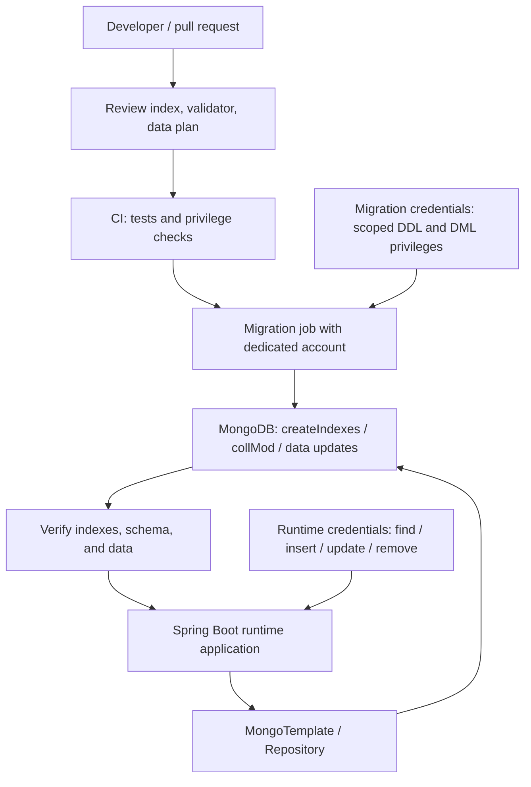
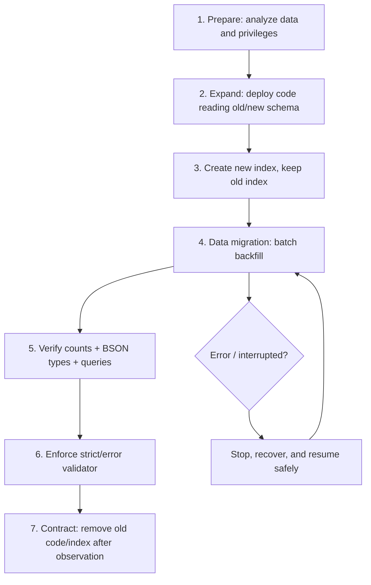

# Controlling Permissions for Index Creation, Validator Changes, and Migrations

## 1. The Problem: Who Is Allowed to Modify MongoDB Structure?

In a **Spring Data MongoDB** system, a service uses `MongoTemplate` or repositories for daily document reads, writes, and queries. However, three categories of operations have impact far beyond an ordinary request:

- **Creating, modifying, or dropping indexes:** changes how MongoDB accesses data, consumes additional RAM and disk, and can affect write throughput and node latency.
- **Changing validators:** alters rules allowing inserts/updates, potentially causing live write traffic to be suddenly rejected.
- **Running data or schema migrations:** can touch millions of documents, requiring backward compatibility with older data and application versions plus rollback controls.

If every Spring Boot runtime instance holds privileges to alter indexes, validators, and bulk data, a misconfiguration, concurrent deployment, or compromised account can disrupt the entire database. Therefore, you must **separate the identity and lifecycle of the long-running runtime application from schema/migration tooling**.

This lesson belongs to the **Security and Operations** chapter of **SPRING_DATA_MONGODB**. Its goal is to design least-privilege MongoDB permissions, execute structural changes through reviewed workflows, and write tests verifying the application holds only the exact permissions required.



**Principle:** schema changes must be managed deployment operations; API requests must never escalate privileges just to work around a missing index or validator.

## 2. Distinguishing DML, DDL, and Account Administration Privileges

MongoDB enforces **role-based access control (RBAC)**. A role combines privilege actions scoped to resources: collections, databases, or the cluster. An account can inherit privileges from multiple roles, so inspect **effective privileges**, not just role names.

| Task | Typical privilege actions | Notes |
|---|---|---|
| Read documents | `find` | Enforce collection/tenant scoping in the application layer by design |
| Insert, update, delete data | `insert`, `update`, `remove` | Needed for normal writes and many data migrations |
| List indexes | `listIndexes` | Metadata-only inspection privilege |
| Create indexes | `createIndex` | Required for `createIndexes`/`createIndex()` |
| Drop indexes | `dropIndex` | Grant separately only when a plan genuinely requires dropping an index |
| Change validator or collection options | `collMod` | Broader than validation alone; can also alter TTL/index options |
| Create collections | `createCollection` | Grant separately when migrations create new collections |
| Bypass document validation | `bypassDocumentValidation` | Only for deliberate exceptional operations |
| Create roles or grant privileges | `createRole`, `grantRole`, and related admin actions | Never grant to application runtime |

The server-side action name matters more than the Java API name. For example, `MongoTemplate.indexOps(...).ensureIndex(...)` ultimately requests index creation on MongoDB; wrapping it in Spring Data does not bypass server privilege checks.

**Warning about built-in roles:**

- `readWrite` does not stop at CRUD; in MongoDB it also includes **`createIndex`, `dropIndex`**, and certain collection management actions. Hence **`readWrite` does NOT satisfy "the application cannot create indexes"**.
- `dbAdmin` allows schema/index administration tasks including `collMod`; its scope is usually broader than any individual migration needs.
- `root`, `dbOwner`, or cluster/database-wide admin roles are unsuitable for runtime accounts.
- Atlas and self-managed clusters differ in user/role provisioning mechanisms; check your deployment type and version before configuring.

To enforce true least privilege, prefer **custom roles scoped to exact collections and actions**, inspect effective privileges after assignment, and test both operations that should succeed and operations that must be denied.

## 3. Recommended Account Separation Model

A system with a `shop.orders` collection can separate four distinct identities:

| Identity | Responsibility | Desired privileges | Active window |
|---|---|---|---|
| `orders-runtime` | Serve APIs, repositories, `MongoTemplate` | CRUD on target collections; no `createIndex`/`dropIndex`/`collMod` | While the application runs |
| `schema-migrator` | Create indexes, update `orders` validator | Only approved DDL actions, plus `find`/`listIndexes` for verification | During migration execution |
| `data-migrator` | Backfill and transform documents | `find`, `update`, occasionally `insert`, and strictly needed actions | Per migration run |
| `db-security-admin` | Provision users/roles, recover access in incidents | Controlled user/role management privileges | Only during authorized ops |

Not every system needs strictly four separate users. What matters is **never letting runtime credentials inherit schema privileges via another role**, and never embedding high-privilege credentials inside all runtime pods/instances merely because migrations run occasionally.

### Example MongoDB custom roles

Run the snippet below **using an admin account authorized to create roles** during provisioning, targeting the `shop` database. Adjust to match your actual collections and endpoints:

```javascript
const shop = db.getSiblingDB("shop");

// Runtime can only access data in the orders collection.
shop.createRole({
  role: "ordersRuntime",
  privileges: [
    {
      resource: { db: "shop", collection: "orders" },
      actions: [ "find", "insert", "update", "remove" ]
    }
  ],
  roles: []
});

// Schema migration may only modify indexes/validators on orders.
shop.createRole({
  role: "ordersSchemaMigrator",
  privileges: [
    {
      resource: { db: "shop", collection: "orders" },
      actions: [ "find", "listIndexes", "createIndex", "collMod" ]
    }
  ],
  roles: []
});

// Data migration may only read and update orders data.
shop.createRole({
  role: "ordersDataMigrator",
  privileges: [
    {
      resource: { db: "shop", collection: "orders" },
      actions: [ "find", "update" ]
    }
  ],
  roles: []
});
```

To assign roles to accounts, administrators use `createUser`/`grantRolesToUser` or Atlas database user management per organizational policy. Never commit real passwords or user-creation commands containing secrets into source code or tests.

Depending on how tooling discovers collections, check whether `listCollections` or `listIndexes` is needed to **read metadata**. Grant the exact resource privilege needed rather than attaching `dbAdmin`. Never grant `createCollection`/`dropCollection` merely because the app uses `MongoTemplate`: provision collections through a separate workflow when required by your operational model.

**Notice the "schema migrator" role above lacks `dropIndex`.** When an approved change requires dropping an index, create a temporary role or grant scoped time-bound access and revoke it afterward rather than leaving permanent drop privileges attached for convenience.

### Privilege scope and what RBAC cannot replace

MongoDB RBAC restricts down to resource/collection level, yet **does not inspect `tenantId` inside individual documents**. A service with `find` on `shop.orders` must still enforce tenant scoping via authentication/authorization and protect sensitive fields appropriately.

A MongoDB role also does not replace release reviews: someone holding `collMod` could weaken a validator to `warn` or alter collection options beyond the intended plan. Combine least privilege with change reviews, auditing/logs, and deployment tracking.

## 4. Index Creation Privileges and Operational Impact

Indexes accelerate filters, sorts, and uniqueness checks, but indexes are not free. Building one on a large collection requires MongoDB to read documents, compute index keys, use CPU/IO/disk, handle concurrent writes, and satisfy replica set/sharded cluster index commit quorum rules.

Example for listing orders by tenant and timestamp:

```javascript
db.getSiblingDB("shop").orders.createIndex(
  { tenantId: 1, createdAt: -1 },
  { name: "idx_orders_tenant_createdAt_desc" }
);
```

This command requires `createIndex` on the target collection. If the runtime account holds only `find/insert/update/remove`, the command must be denied as designed.

### Three risk categories when building indexes

1. **Capacity and load risk:** a new index consumes disk, adds write/replication overhead, and can elevate latency during the build.
2. **Data risk:** a unique index build fails if duplicates already exist; partial/sparse/collation mismatches can cause unexpected query or uniqueness behavior.
3. **Deployment risk:** multiple instances racing to run `ensureIndex` or trigger DDL simultaneously make releases unpredictable; index builds waiting on replica set commit quorum can stall when nodes are down.

On MongoDB versions supporting concurrent replica set index builds, commit quorum and write concern serve distinct purposes; never lower quorum arbitrarily to mask replica issues. Before building a large index, verify free disk space, cluster load, estimated duration, shard/secondary impact, and a mitigation plan.

### Spring Data: annotations do not mean the index exists

`@Indexed` or `@CompoundIndex` is **metadata telling Spring Data the desired index**. It does not prove the database currently has that index.

```java
import java.time.Instant;

import org.springframework.data.annotation.Id;
import org.springframework.data.mongodb.core.index.CompoundIndex;
import org.springframework.data.mongodb.core.mapping.Document;

@Document("orders")
@CompoundIndex(
    name = "idx_orders_tenant_createdAt_desc",
    def = "{ 'tenantId': 1, 'createdAt': -1 }"
)
public record Order(
    @Id String id,
    String tenantId,
    Instant createdAt,
    String status
) {}
```

Since Spring Data MongoDB 3.0, **auto-index creation is disabled by default**. Enabling it makes the application attempt index creation on startup/entity scanning, triggering permission errors or uncontrolled DDL.

With separated privileges, keep runtime auto-index disabled and move DDL to a migration job:

```properties
# Runtime configuration (verify against your exact Spring Boot version)
spring.data.mongodb.auto-index-creation=false
```

Example migration job using `MongoTemplate` configured with **credentials holding `createIndex`**:

```java
import org.springframework.data.domain.Sort;
import org.springframework.data.mongodb.core.MongoTemplate;
import org.springframework.data.mongodb.core.index.Index;

// migrationTemplate uses the migration job's dedicated MongoClient/credentials.
Index index = new Index()
    .on("tenantId", Sort.Direction.ASC)
    .on("createdAt", Sort.Direction.DESC)
    .named("idx_orders_tenant_createdAt_desc");

migrationTemplate.indexOps("orders").ensureIndex(index);
```

`ensureIndex` creates an index matching the Spring Data definition. It **does not bypass RBAC**, review changes, or automatically repair an existing conflicting index with different options/names. If an incompatible index already exists, handle conflicts explicitly—never drop old indexes reflexively.

### Verifying indexes before and after changes

```javascript
const shop = db.getSiblingDB("shop");

printjson(shop.orders.getIndexes());

printjson(shop.orders.find({
  tenantId: "tenant-a",
  createdAt: {
    $gte: ISODate("2026-11-01T00:00:00Z"),
    $lt: ISODate("2026-11-20T00:00:00Z")
  }
}).sort({ createdAt: -1 }).explain("executionStats"));
```

Compare `winningPlan`, `totalKeysExamined`, `totalDocsExamined`, latency, disk/CPU usage, and write throughput before and after on a representative workload. To evaluate optimizer impact where supported by your MongoDB version, **hidden indexes** let you hide an index from the query planner using `collMod`. Note that hidden indexes still incur write maintenance overhead.

## 5. Changing Validators: `collMod` Is a Sensitive DDL Operation

**Schema validation** in MongoDB enforces document structure and types on the server, complementing Jakarta Bean Validation, mapping/converters, and service validation. For example, requiring every order to carry `tenantId`, `status`, and `schemaVersion`.

MongoDB uses `collMod` to modify the validator on an existing collection. This is distinct from `update` on documents.

```javascript
const shop = db.getSiblingDB("shop");

shop.runCommand({
  collMod: "orders",
  validator: {
    $jsonSchema: {
      bsonType: "object",
      required: [ "tenantId", "status", "schemaVersion" ],
      properties: {
        tenantId: { bsonType: "string" },
        status: {
          bsonType: "string",
          enum: [ "CREATED", "PAID", "CANCELLED" ]
        },
        schemaVersion: {
          bsonType: "int",
          enum: [ 2 ]
        }
      }
    }
  },
  validationLevel: "strict",
  validationAction: "error"
});
```

This command requires the `collMod` privilege on the target resource. A runtime account with only `update` cannot change validators.

**Validator components:**

- `validator` is the validation expression; here `$jsonSchema` specifies BSON types, required fields, and allowed enums.
- `validationLevel: "strict"` checks all supported inserts and updates. Updating a validator **does not retroactively fix or backfill legacy documents**: an invalid legacy document may only fail later when updated.
- `validationLevel: "moderate"` validates inserts and updates to already-valid documents; existing invalid legacy documents can still be updated without passing validation in the same way. This serves as a transition mode whose consequences must be understood.
- `validationAction: "error"` rejects invalid writes; `"warn"` allows writes while logging warnings. Use `warn` to observe violations during rollout, **never mistaking it for schema enforcement**.

Newer MongoDB versions introduce additional validation actions/levels. Use only options supported by **your deployed server and feature compatibility version**; never copy settings blindly from newer docs onto older clusters.

### Auditing legacy data before enabling `strict/error`

If a collection holds millions of orders missing `schemaVersion`, setting the validator above will not upgrade old documents to version 2. When the app tries to update `status` on an old order, the update can fail because the resulting document still lacks `schemaVersion`.

Audit how many records fail the target schema, have wrong BSON types, or contain out-of-enum `status` values, as well as any clients/jobs still writing the old schema. Switch to strict enforcement only after compliance is verified.

Never temporarily grant `collMod` to the API service just to "relax" a validator during errors. Schema adjustments belong in reviewed migrations.

### Permission to bypass validation

For supported commands, `bypassDocumentValidation` works only when the principal holds the **`bypassDocumentValidation`** privilege action. While occasionally useful in special migrations, misusing it can introduce invalid data into the collection.

Never grant `bypassDocumentValidation` to runtime accounts or by default to all migrators. Design migrations to produce valid documents; if an exception is unavoidable, bound the role, duration, dataset, logging, and post-migration reconciliation. Some validation modes restrict bypassing; verify version behavior.

`collMod` alters many collection properties beyond `validator`—for instance, TTL index expiration settings and other supported index options. That makes `collMod` far more sensitive than tweaking a Java validation rule.

## 6. Safe Migrations with Expand → Migrate → Contract

A good migration is more than a single `updateMany`. It must keep **coexisting application versions running during rollout**, legacy data, validators, and indexes compatible throughout.

Example requirement: add `schemaVersion: 2` to `shop.orders` documents while adding an index for listing orders by tenant and timestamp. Recommended workflow:



### Phase 1 — Preflight and planning

Before writing data:

1. Confirm **MongoDB, Java driver, Spring Data MongoDB, FCV versions**, and related index/validator constraints.
2. Inventory current schema, indexes, collection size, anomalous data, key query plans, and all sharing services.
3. Determine which roles need `createIndex`, `collMod`, `find`, `update`, `insert`, or other privileges; map each step to its executing identity.
4. Verify backup/restore procedures and how to recover data or resume migration; define checkpoints and success criteria.
5. Choose a deployment window with monitoring, disk/replication lag headroom, and an on-call owner.

An index build or `collMod` can affect collection locks/metadata and cluster performance. Even though many operations run online alongside writes, evaluate and monitor them on large collections.

### Phase 2 — Expand: application supports both old and new schemas

Deploy an application version that reads documents lacking `schemaVersion` while writing new documents with `schemaVersion = 2`. During rolling deployments, ensure older running pods are not rejected by a new validator before rollout completes.

When renaming fields or changing BSON types (e.g., migrating `total` from String to Decimal128), dual-read/dual-write logic or temporary conversion adapters may be needed. Never enforce a new `required` rule while any active writer still omits that field.

### Phase 3 — Index migration

Create indexes using the approved `schema-migrator` account. Keep old indexes during transition unless there is an explicit plan and reason to drop them. Check `getIndexes()` and `explain` after completion.

For unique indexes, detect duplicates **before** starting the build; never wait for the build to fail to discover conflicts. Check field BSON types, collations, partial index filters, and uniqueness rules on sharded collections.

### Phase 4 — Repeatable data backfill

A simple migration adding `schemaVersion` can run in batches. The `mongosh` snippet below shows **one batch** of up to 200 IDs; the job loops until no documents remain:

```javascript
const shop = db.getSiblingDB("shop");

const ids = shop.orders
  .find(
    { schemaVersion: { $exists: false } },
    { _id: 1 }
  )
  .limit(200)
  .toArray()
  .map(doc => doc._id);

if (ids.length > 0) {
  const result = shop.orders.updateMany(
    {
      _id: { $in: ids },
      schemaVersion: { $exists: false }
    },
    { $set: { schemaVersion: 2 } }
  );

  printjson({
    examinedBatch: ids.length,
    matched: result.matchedCount,
    modified: result.modifiedCount
  });
}
```

Properties to preserve:

- The filter `schemaVersion: { $exists: false }` paired with `$set` makes batch retries **idempotent**. On retry after failure, already-migrated documents are not modified again.
- `updateMany` has no `limit(200)` like `find`; you must **fetch a batch of IDs first and update by ID**, or use another controlled batching strategy.
- `updateMany` updates multiple documents yet is **not atomic across the whole batch** by default; each document update is atomic individually. Do not assume a mid-batch failure rolls back earlier updates.
- On huge collections, replace repeated head scans with **`_id` keyset pagination, durable checkpoints, and final reconciliation**, bounding concurrency.
- Persist checkpoints only after batch completion is confirmed; logs should distinguish matched, modified, failed, and retried counts. Use an appropriate write concern for critical migrations.

If a migration converts types or computes totals, use deterministic transformations with input checks; cumulative operators like `$inc` are often non-idempotent under retries. Design migrations around **source state → target state** with explicit preconditions rather than "re-run to add more".

### Phase 5 — Data reconciliation

Before enabling strict enforcement, check for documents missing the target version:

```javascript
const shop = db.getSiblingDB("shop");

print("Missing or non-v2 schema version:");
print(shop.orders.countDocuments({
  schemaVersion: { $ne: 2 }
}));

print("Unexpected status:");
print(shop.orders.countDocuments({
  status: { $nin: [ "CREATED", "PAID", "CANCELLED" ] }
}));

// Verify actual BSON types.
printjson(shop.orders.aggregate([
  { $group: {
      _id: { $type: "$schemaVersion" },
      count: { $sum: 1 }
  }}
]).toArray());
```

`countDocuments` and aggregations on huge collections can be expensive; run them in budgeted maintenance windows, or combine segmented checks/sampling with full validation where needed. Never rely solely on `modifiedCount`: final valid record counts, BSON types, business invariants, and query results form the real acceptance bar.

### Phase 6 — Enforce and Contract

Only once all writers produce the new schema and data is clean:

1. Using `schema-migrator`, apply `collMod` with the reviewed validator, `validationLevel: "strict"`, and `validationAction: "error"`.
2. Test that valid inserts succeed and inserts missing required fields fail.
3. Test updating legacy documents and verify all write paths: repositories, `MongoTemplate`, batch jobs, and event consumers.
4. Monitor `DocumentValidationFailure` errors (commonly code `121`), latency, replication lag, and audit logs.
5. After an observation window, remove legacy compatibility code and obsolete collections/fields/indexes **in a separate reviewed migration**.

**Never wrap DDL changes and backfills into a single transaction expecting full rollback.** Administrative commands such as `createIndexes` and `collMod` have distinct operational contracts and transaction limitations; design verifiable step-by-step rollout/rollback plans.

## 7. Orchestrating Migrations: Run Once, Resume Safely

In multi-pod Spring Boot deployments, configuring `ApplicationRunner` or `@PostConstruct` so every pod runs migrations on startup causes races and risk. Instead, run a **dedicated migration job** in CI/CD or via an appropriate migration runner.

An orchestration pipeline looks like:

```text
CI/CD
  |
  +--> Build + unit/integration tests
  |
  +--> Review migration plan (ID, checksum, preconditions)
  |
  +--> Acquire migration lease/lock
  |
  +--> Run schema/data migration with dedicated credentials
  |
  +--> Verify BSON, indexes, validator and invariants
  |
  +--> Record applied migration ID, checksum, version, duration
  |
  +--> Release lease
  |
  +--> Enable dependent application rollout
```

Practical requirements:

- **Unique migration IDs** (e.g., `2026_11_20_009_orders_schema_v2`) and checksums detect whether a step already ran or changed since its last run.
- Use a **distributed lock/lease** or orchestration gate so only one runner executes schema migrations. Leases need expiry, renewal, and dead-runner recovery; "holding a lock" does not roll back partial DDL.
- Track states `STARTED`, `APPLIED`, `VERIFIED`, and `FAILED`; after a crash, inspect **actual MongoDB state** before re-running.
- Store migration history in a dedicated collection with explicit privileges for it. The example roles above only access `shop.orders`, so they **cannot write migration logs** if you introduce `shop.schema_migrations` without updating privileges.
- Never reuse runtime credentials or embed admin secrets inside request-serving container images.
- Throttle batch rates, concurrency, and timeouts while watching replication lag; split work rather than mutating whole collections in one giant operation.

Never claim "exactly once" execution solely because a history collection exists. Crashes between a DB command and recording history can force re-execution; steps must be **idempotent, precondition-checked, and postcondition-verified**.

## 8. Index/Validator Declarations in Spring Data: Separating Responsibilities

Spring Data MongoDB accesses collections via `MongoTemplate`, `MongoRepository`, aggregations, and reactive APIs. Keep two scopes distinct:

- **Java mapping/metadata:** `@Document`, `@Indexed`, `@CompoundIndex`, custom converters, and Jakarta Bean Validation describe how the application views documents.
- **MongoDB server structure:** physical indexes, validators, collection options, roles/privileges, and applied migrations.

Never treat entity annotations as the single source of truth. Adding `@Indexed(unique = true)` in Java without creating the index in MongoDB means the database **does not yet enforce uniqueness** when auto-index creation is off.

### Separating `MongoClient` by role

Runtime applications use a least-privilege URI:

```properties
# Runtime: secret provided by secret manager; never commit real values.
spring.data.mongodb.uri=${MONGODB_RUNTIME_URI}
spring.data.mongodb.auto-index-creation=false
```

Migration jobs use separate credentials:

```properties
# Migration job runs independently in a controlled environment.
spring.data.mongodb.uri=${MONGODB_MIGRATION_URI}
spring.data.mongodb.auto-index-creation=false
```

These are **configs for two independent processes**, not two URIs placed into the same runtime config to toggle per request. How environment variables/secrets are injected depends on your deployment platform.

In Spring Data, `MongoTemplate` delegates to a `MongoClient`, and MongoDB authorizes actions based on that connection's principal. Creating a bean named `adminMongoTemplate` backed by runtime credentials **does not grant extra privileges**, and retrying `Unauthorized` errors never fixes missing permissions.

If one process genuinely needs multiple clients, explicitly isolate beans, connection pools, lifecycles, audits, and usage scopes; separate jobs are usually cleaner to govern.

## 9. Testing Authorization as a Security Contract

Reading config files is not enough to prove least privilege. Test against a MongoDB instance with authentication/authorization enabled and production-equivalent users/roles.

### Privilege test matrix

| Operation | Runtime | Schema migrator | Data migrator |
|---|---|---|---|
| Read `shop.orders` | Allowed | Allowed | Allowed |
| Normal document insert/update/delete | Allowed per runtime role | Not granted by default | Update only in example |
| Create new index | **Denied** | Allowed | Denied |
| Drop index | **Denied** | Denied in example | Denied |
| Change validator via `collMod` | **Denied** | Allowed | Denied |
| `bypassDocumentValidation` | **Denied** | Denied in example | Denied in example |
| Create role/user or grant role | **Denied** | Denied | Denied |
| Read out-of-scope collections | **Denied** | Denied | Denied |

Example `mongosh` verification on a **test-only** database:

```javascript
// Log in as user with ordersRuntime role.
// Permitted read:
db.getSiblingDB("shop").orders.findOne();

// If index does not yet exist, this must be denied:
// db.getSiblingDB("shop").orders.createIndex({ status: 1 });

// Changing validator below must also be denied:
// db.getSiblingDB("shop").runCommand({
//   collMod: "orders", validationAction: "warn"
// });
```

Never test privilege boundaries by attempting index creation or validator edits directly in production. In integration tests, spin up **MongoDB with RBAC enabled**, provision users via a bootstrap account, then connect separately as runtime and migrator to verify behavior. Errors typically surface as `Unauthorized`, though Spring Data exception translation varies by driver version; assert error codes/behavior cleanly rather than brittle full message strings.

**Note:** testing `createIndex` on an already-existing index can return success or take a no-op branch depending on command/version. Always test against a new test collection/index to get reliable proof that runtime cannot create indexes.

### Testing validator changes and migrations

1. Before migrating, verify older app code reads legacy documents and new-schema documents as expected.
2. Run staging migrations using identical roles, steps, and sequence as production.
3. With `strict/error` active, verify intentionally invalid writes are rejected while valid writes succeed.
4. Inspect legacy records before, during, and after backfill—especially missing fields, mismatched BSON types, and currency/timestamp conversions.
5. Interrupt a backfill mid-run, restart it, and verify counters do not drift and no duplicates appear.
6. Verify unique index creation against a fixture with duplicates fails clearly.
7. Watch latency, CPU, disk, replication lag, and write throughput during index builds/backfills.
8. Post-migration, verify with runtime credentials that `collMod`, `createIndex`, and `bypassDocumentValidation` remain denied.

These checks protect both **data correctness** and **privilege boundaries**, two independent goals.

## 10. Rollback and Incident Handling

Schema rollbacks are usually harder than rolling back Java binaries. Once a validator enforces `schemaVersion: 2`, rolling back to older app code that omits that field causes write failures. Prepare rollback plans before turning on strict enforcement.

| Incident | How to recognize | Remediation |
|---|---|---|
| Runtime fails creating indexes on startup | `Unauthorized`, `createIndexes` in stack trace | Disable auto-index on runtime; move index creation to migration job |
| Index build slow or failing | High CPU/IO, low disk, duplicate key errors, commit quorum waiting on nodes | Identify root error, shed load or fix data/cluster; check build state before retrying |
| `collMod` breaks writes | `DocumentValidationFailure`, spike in insert/update errors | Identify old writers or invalid docs; follow approved validator relaxation plan if needed |
| Backfill stalls mid-run | Migration stuck in `STARTED`, many old-version docs remain | Inspect DB state and resume idempotent batches from checkpoint |
| Two migrations run concurrently | Duplicate migration logs / lease conflicts | Halt extra runner, verify applied state, fix orchestration locking |
| Broad role accidentally given to runtime | Effective privileges show `createIndex/collMod` | Revoke privilege, rotate secrets if needed, inspect audit logs and impact |
| Old code rollback fails | Validator requires new fields or schema is incompatible | Follow runbook to restore compatible contract before rolling back app binaries |
| Index change slows queries | `explain`/latency regresses, optimizer picks poor plan | Compare plans and keep/hide/drop index via reviewed change |

A rollback runbook should specify:

- Who is authorized to run `collMod` or index actions, and who approves them.
- Expected index/validator states per version, with pre- and post-check commands.
- Whether rolling back to the previous validator is safe or whether new data must be transformed first.
- Handling of one-way transformed documents, backups, and sensitive data.
- Threshold metrics that trigger halting rollout and incident escalation.

**Dropping new indexes/fields is a contract step that impacts rollback ability**, so defer it until after an observation period confirms no older app version needs them. Never drop indexes automatically simply because an annotation changed in code.

## 11. Observability, Auditing, and Change Governance

Tag every migration with an ID, commit/release version, executing account, timestamp, status, duration, and verification outcome. Track:

- **Privilege integrity:** runtime role edits, new credentials, or `createIndex`/`collMod`/`bypassDocumentValidation` granted out-of-band.
- **Indexes:** index count, index size, build progress, cache impact, before/after query plans, duplicate key errors.
- **Validators:** live collection metadata, validation failure counts on writes, rejected document categories.
- **Data migrations:** scanned/matched/modified counts, remaining legacy documents, retries, checksums/checkpoints.
- **Resources:** CPU, disk, I/O, replication lag, connection pools, p95/p99 latency, and free disk space during migrations.
- **Auditing:** which principal executed DDL and whether it matches an approved migration ID.

MongoDB profiler, server logs, Atlas monitoring/auditing, or SIEM systems can support this depending on deployment tier and configuration. Never log credentials, KMS tokens, or sensitive values. Some managed platforms restrict admin/role actions via the Atlas control plane; align with your actual governance model.

In CI/CD, migration reviews should show a **clear diff**: before/after index keys and options, old/new validators, fields updated by data migrations, impact on legacy writers, benchmark results, and rollback plan. Migrations failing preconditions must abort cleanly before mutating bulk data.

## 12. Implementation Checklist

1. **Separate credentials:** runtime gets only needed DML; schema migrator, data migrator, and security admin get scoped accounts.
2. **Never rely on `readWrite` to prove "no index creation":** verify actual privileges, because that built-in role includes index creation/drop rights.
3. **Disable runtime auto-index** when architecture requires managed schema migrations; `@Indexed`/`@CompoundIndex` are metadata until indexes physically exist.
4. **Restrict `collMod`:** reserve for reviewed workflows, recognizing it edits validators and other collection options.
5. **Phase validator enforcement with rollout:** fix legacy data and writers before enabling `strict/error`; use `warn` for controlled observation.
6. **Never grant `bypassDocumentValidation` by default:** issue only time-boxed exceptions followed by data reconciliation.
7. **Migrate via Expand → Migrate → Contract:** dual-compatible app code, new indexes, idempotent backfill, verify, enforce, then clean up.
8. **Single runner with lease/lock and migration history:** record ID, checksum, status, and checkpoints to survive restarts.
9. **Test RBAC against real MongoDB:** verify allowed operations succeed and runtime DDL fails.
10. **Prepare rollback and monitoring:** backups/restores, preconditions, index builds, validation errors, replication lag, query latency, and audits.
11. **Check version compatibility:** index builds, validators, and schema capabilities depend on your MongoDB server/FCV, Java driver, and Spring Data MongoDB versions.

### Official References

- [MongoDB — Privilege Actions](https://www.mongodb.com/docs/manual/reference/privilege-actions/): `createIndex`, `collMod`, `bypassDocumentValidation`, and user/role privileges.
- [MongoDB — Built-In Roles](https://www.mongodb.com/docs/manual/reference/built-in-roles/): inherited privileges of `readWrite`, `dbAdmin`, and common roles.
- [MongoDB — Modify Schema Validation](https://www.mongodb.com/docs/manual/core/schema-validation/update-schema-validation/): using `collMod`, validation levels/actions, and impact on existing data.
- [MongoDB — Index Builds on Populated Collections](https://www.mongodb.com/docs/manual/core/index-creation/): index build resources, replication, and commit quorum.
- [Spring Data MongoDB — Index Creation](https://docs.spring.io/spring-data/mongodb/reference/mongodb/mapping/mapping-index-management.html): index annotations, `IndexOperations`, and auto-index creation.

In **SPRING_DATA_MONGODB**, data operation privileges and database structure modification privileges should be governed as two independent contracts. `MongoTemplate` and repositories serve ongoing traffic; migration jobs carry narrow privileges, bounded lifetimes, and dedicated verification to create indexes, update validators, and transform data. When roles, rollout ordering, idempotency, and post-checks are designed together, teams can evolve schemas while keeping operational risk and recovery under control.
