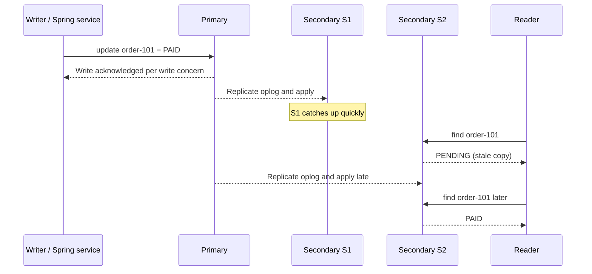
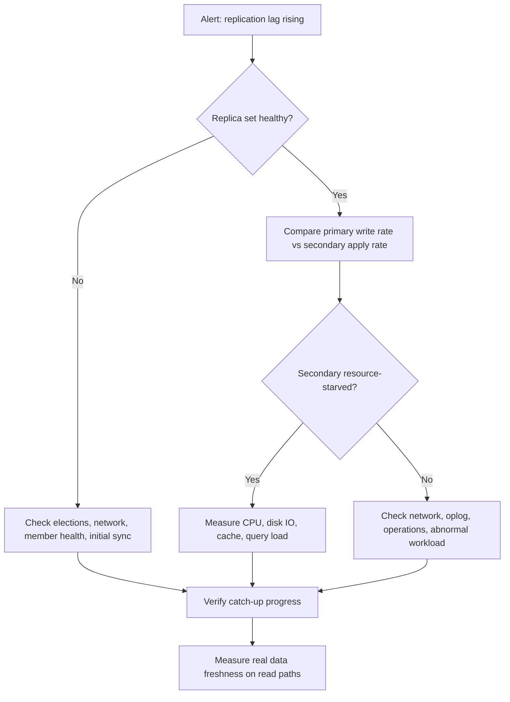

# Observing Replication Lag and Read Preference Impact in Spring Data MongoDB

## 1. Why Does Replication Lag Directly Affect Query Results?

In a **MongoDB replica set**, the **primary** node receives write operations. **Secondary** nodes replicate and apply those operations from the oplog. Thanks to replication, the system provides failover resilience and can distribute certain read traffic to secondaries. However, **data on a secondary is not guaranteed to reflect the latest write on the primary**.

Suppose a Spring Data MongoDB application manages order status:

```json
{
  "_id": "order-101",
  "status": "PENDING",
  "amount": 1500000
}
```

At 10:00:00, an API updates `status` to `PAID` on the primary. Secondary S1 applies the change at 10:00:00.3, while secondary S2 applies it at 10:00:08. During that interval:

- Reads against the primary can see `PAID` provided other consistency conditions are met.
- Reads against S1 or S2 **may** see `PENDING`, depending on timing, node selection, and read concern.
- If the application displays payment status from a lagging secondary, the user can observe stale status even though the update request succeeded.

**Replication lag** is generally understood as the delay between a secondary's oplog replication/application progress and the primary's. It is not the same as **network latency** (how long it takes to connect and return a query), nor does it by itself fully describe the staleness observed by a specific request.

In the **SPRING_DATA_MONGODB** module, choices involving `MongoTemplate`, repositories, indexes, aggregations, and transactions all require considering where queries execute. An ID lookup is normally fast yet can return stale data if routed to a lagging secondary. A heavy aggregation on a secondary can offload the primary while also reflecting older data than reality.

## 2. Timeline from Write to Secondary Read



Note on the diagram: when the server acknowledges a write depends on **write concern**. `w: 1` and `w: "majority"` differ in write durability guarantees; neither **means every secondary has applied** the operation when the response returns.

Key operational milestones carry distinct meanings:

| Milestone | Description | Effect on queries |
| --- | --- | --- |
| Primary receives and executes write | Data processed on the write-accepting node | Primary reads can observe newer state |
| Oplog entry shipped to secondary | Secondary received the entry to apply | Not enough to guarantee an ordinary read sees the change |
| Secondary applies oplog | Secondary's data state advances | Reads on this node may see the new state, depending on read concern and timing |
| Write acknowledged as `majority` | Meets majority acknowledgment rule | Does not require every secondary to have caught up |
| Secondary read completes | Result depends on node, timing, read concern, and session | May be older than primary even when query latency is tiny |

Exact sequencing depends on MongoDB version, topology, write/read concerns, and system load. When measuring lag, separate **oplog apply delay**, **node selection delay**, **query latency**, and **result freshness**.

## 3. Measuring Replication Lag with MongoDB Tools

### 3.1. Inspecting replica set status

On a replica set, use `rs.status()` or the `replSetGetStatus` command in `mongosh`:

```javascript
const status = db.adminCommand({ replSetGetStatus: 1 });

status.members.forEach(member => {
  printjson({
    name: member.name,
    state: member.stateStr,
    optimeDate: member.optimeDate,
    health: member.health
  });
});
```

`members[].stateStr` shows member roles/states such as `PRIMARY`, `SECONDARY`, and others. `optimeDate` reflects the timestamp of the oplog operation corresponding to the member's reported progress. It is an observation point for **replication progress**, not an absolute freshness clock for individual queries.

An approximate way to compute the gap from secondary progress to primary within the same status snapshot:

```javascript
const status = db.adminCommand({ replSetGetStatus: 1 });
const primary = status.members.find(member => member.stateStr === "PRIMARY");

if (!primary || !(primary.optimeDate instanceof Date)) {
  throw new Error("No valid PRIMARY optimeDate sample available");
}

for (const member of status.members) {
  if (member.stateStr !== "SECONDARY") continue;

  if (!(member.optimeDate instanceof Date)) {
    print(`${member.name}: no valid optimeDate yet`);
    continue;
  }

  const lagSeconds =
    (primary.optimeDate.getTime() - member.optimeDate.getTime()) / 1000;

  printjson({
    member: member.name,
    lagSeconds,
    secondaryOptimeDate: member.optimeDate,
    primaryOptimeDate: primary.optimeDate
  });
}
```

This is a **relative measurement at sampling time**, useful for learning and quick checks. Member state is exchanged via heartbeats and updates with slight delay; exact fields can vary across MongoDB versions. Small negative values or fluctuations can appear due to sampling mechanics and timing: do not conclude a secondary is ahead of the primary without inspecting samples and topology.

**Never compute lag naively as `Date.now() - secondary.optimeDate`.** If no writes occurred for an hour, the last oplog timestamp will be an hour old even though the secondary is completely caught up with the primary. Comparing progress across members is far more accurate.

### 3.2. What to measure beyond a single lag number

| Signal | Why monitor it |
| --- | --- |
| Last applied/last durable optime per member | Distinguish whether a secondary has not applied vs has not persisted durably |
| Optime gap relative to primary | Detect secondaries falling behind primary during write load |
| Member state and primary changes | Lag can climb during elections, resyncs, initial syncs, or network faults |
| Oplog window / age of retained oplog | A secondary lagging too long risks falling off the oplog and needing full resync |
| CPU, IO, disk queue, network, replication apply throughput | Find root causes rather than merely raising alert thresholds |
| p95/p99 read latency per node and query type | Separate slow secondaries from stale secondaries |
| Rate of stale reads observed by clients | Measure business impact, not just infrastructure numbers |

On MongoDB Atlas or dedicated monitoring platforms, use the built-in *Replication Lag* and replication/host metrics. Confirm **exact metric definitions per tool, version, and sampling method** before comparing dashboard charts against `optimeDate` scripts. Some metrics track applied gaps while others focus on replication history or observation delays.

For privileges, replica set status commands need appropriate monitoring rights, such as `clusterMonitor` per your MongoDB policy. Never embed root accounts or connection strings with passwords inside metric collection scripts.

## 4. Read Preference Governs Where the App Can Read From

**Read preference** is the rule the MongoDB Driver uses to pick a server for eligible read operations. If unconfigured, the default is normally `primary`. Main modes:

| Read preference | Node selection scope | When appropriate | Key points to remember |
| --- | --- | --- | --- |
| `primary` | Primary only | Business reads needing fresh data, write flows, sensitive state checks | Primary bears full read load |
| `primaryPreferred` | Prefer primary; fall back to secondary if no eligible primary | Flows preferring primary yet tolerating fallback | Fallback can return stale data; does not preserve write availability without primary |
| `secondary` | Eligible secondaries only | Delay-tolerant analytics/reports; offloading reads from primary | Fails with server selection error if no secondary matches |
| `secondaryPreferred` | Prefer secondary; fall back to primary if no eligible secondary | Listings, dashboards, and reads not needing immediate freshness | Neither guarantees queries always hit secondaries nor guarantees fresh data |
| `nearest` | Primary or secondary with lowest network latency | Low-network-latency reads accepting corresponding consistency | "Nearest" is based on network latency, **not freshest data** |

`nearest` does not mean MongoDB picks the node with lowest replication lag. The driver uses heartbeat/selection latencies and a latency window (such as `localThresholdMS`) to build a list of nearby nodes, then selects among that group. A secondary close in network latency yet lagging in oplog application can still be chosen.

Likewise, `secondaryPreferred` does not guarantee every query goes to a secondary: when no secondary is available or matches tags/staleness, the driver can route to the primary. Hence when testing load distribution and consistency, **observe which server actually received the read** rather than trusting URIs or annotations blindly.

### 4.1. Comparison scenario

Suppose at the same instant:

```text
Primary P       : order-101 = PAID,    optime 10:00:20
Secondary S1    : order-101 = PAID,    optime 10:00:19.5
Secondary S2    : order-101 = PENDING, optime 10:00:08

Network round-trip from application:
  P  = 8 ms
  S1 = 20 ms
  S2 = 5 ms
```

If a query routes to S2 because S2 has the lowest network latency, it can return `PENDING` even though the read completes in milliseconds. With `secondaryPreferred`, the app may pick any eligible secondary per driver rules, not necessarily S1 with lower lag. To constrain node eligibility, add tag sets and staleness bounds; to guarantee reading a specific prior write, use stronger consistency mechanisms.

## 5. `maxStalenessSeconds` and Tag Sets: Node Filters, Not Consistency Guarantees

MongoDB supports `maxStalenessSeconds` so the driver excludes secondaries whose **estimated lag** exceeds a threshold. Effective limits depend on heartbeats and server selection rules; per MongoDB Driver specifications, the typical minimum is **90 seconds** and must also respect heartbeat frequency constraints.

Illustrative URI example:

```text
mongodb://mongo-1.example.test:27017,mongo-2.example.test:27017,mongo-3.example.test:27017/shop?replicaSet=rs0&readPreference=secondaryPreferred&maxStalenessSeconds=120
```

Meaning: prefer secondaries, keeping only those within the driver's estimated staleness bound. If none qualify, `secondaryPreferred` falls back to the primary. Under `secondary`, the query may find no eligible node and hit a server selection timeout.

**Never set `maxStalenessSeconds=1` expecting sub-second freshness.** This parameter has a minimum bound and acts as a server selection filter, not a proof that a specific query's data is under one second old. Define freshness SLOs from business needs and verify with tests, or use causal consistency / primary reads.

Tag sets filter nodes by labels configured on replica set members, such as `region=ap-southeast-1` or `workload=analytics`. Tags must be explicitly configured on the replica set; adding tags in a URI when servers lack matching tags will not conjure them up.

Practical caveats:

- A same-region secondary may have low network latency yet lag more than a secondary in another region.
- Use tags to isolate heavy reporting onto designated nodes, then watch CPU/IO and lag on them.
- Hidden or specially configured secondaries have specific eligibility restrictions; never assume every replica set member is a regular read candidate.
- Under `primaryPreferred`/`secondaryPreferred` fallback, reads can silently shift nodes across requests unless telemetry tracks them.

## 6. Configuring Spring Data MongoDB: Separating Read Paths by Business Need

### 6.1. Setting a default via URI

Spring Boot accepts read preference in the connection string:

```yaml
spring:
  data:
    mongodb:
      uri: "mongodb://mongo-1.example.test:27017,mongo-2.example.test:27017,mongo-3.example.test:27017/shop?replicaSet=rs0&readPreference=primary"
```

This sets `primary` as the default so flows not evaluated for eventual consistency never accidentally hit secondaries. Hostnames are illustrative placeholders; production configs require TLS, authentication, and secret management per infrastructure policy. Never write real connection strings with credentials into logs or public docs.

Setting a client-wide default of `secondaryPreferred` affects repository and `MongoTemplate` reads broadly. Scrutinize this carefully when one service handles both transactions/authorization checks and dashboard queries.

### 6.2. Setting read preference per query with `MongoTemplate`

For a read path that tolerates lag, Spring Data MongoDB can specify read preference directly on `Query`:

```java
import com.mongodb.ReadPreference;
import java.util.List;
import org.springframework.data.mongodb.core.MongoTemplate;
import org.springframework.data.mongodb.core.query.Criteria;
import org.springframework.data.mongodb.core.query.Query;
import org.springframework.stereotype.Service;

@Service
public class CatalogReadService {
    private final MongoTemplate mongoTemplate;

    public CatalogReadService(MongoTemplate mongoTemplate) {
        this.mongoTemplate = mongoTemplate;
    }

    public List<ProductDocument> listVisible(String categoryId) {
        Query query = Query.query(
            Criteria.where("categoryId").is(categoryId)
                .and("visible").is(true)
        );
        query.withReadPreference(ReadPreference.secondaryPreferred());
        return mongoTemplate.find(query, ProductDocument.class);
    }
}
```

`ProductDocument` is an application `@Document` entity with `categoryId` and `visible` fields. Keeping secondary read preference scoped to specific queries makes code reviews of consistency paths far clearer. Verify exact API syntax against your project's pinned Spring Data MongoDB version.

When calling the MongoDB Java Driver directly through a `MongoTemplate`-managed connection:

```java
import com.mongodb.ReadPreference;
import com.mongodb.client.model.Filters;
import org.bson.Document;
import org.springframework.data.mongodb.core.MongoTemplate;

public Document findVisibleRaw(MongoTemplate template, String productId) {
    return template.getCollection("products")
        .withReadPreference(ReadPreference.secondaryPreferred())
        .find(Filters.and(
            Filters.eq("_id", productId),
            Filters.eq("visible", true)
        ))
        .first();
}
```

This native driver snippet works with raw `Document` objects, making the application responsible for type conversion, validation, and mapping. A query requiring the latest state can choose `ReadPreference.primary()` over a secondary default, provided the choice remains compatible with any active transaction.

**Determine consistency requirements per use case** instead of forcing every repository query onto one read preference. Overview dashboards may read secondaries, while post-payment status checks or pre-write validations often require primary reads with suitable read/write concerns.

## 7. Read Preference vs Read Concern vs Write Concern

Three concepts solve three different problems:

| Concept | Question answered | Examples |
| --- | --- | --- |
| **Read preference** | Which node does the driver pick for reads? | `primary`, `secondaryPreferred` |
| **Read concern** | Which visibility/commit guarantee must read data satisfy? | `local`, `majority`, `snapshot`, `linearizable` where supported |
| **Write concern** | How many nodes/durability criteria must acknowledge before a write succeeds? | `w:1`, `w:"majority"` |

`readConcern: "majority"` ensures reads see majority-committed data per MongoDB semantics, yet **does not force a lagging secondary to return the latest primary version** for an independent query. A secondary can return an older majority-committed snapshot.

Similarly, an acknowledged `w:"majority"` write does not mean all secondaries have applied it yet. Pairing `writeConcern: majority` with `readConcern: majority` forms the foundation for **causal consistency**, yet guaranteeing a specific read observes a prior write also requires a session and proper operation ordering.

Practical query choices might look like:

- Analytics dashboard tolerating seconds of delay: `secondaryPreferred` plus lag monitoring and freshness SLOs.
- Detail page right after an edit needing *read-your-writes*: primary read or an appropriate **causally consistent session**, budgeting timeouts if secondaries lag behind.
- Authorization checks, balance mutations, or payment state transitions: never rely naively on an unboundedly lagging secondary; define transaction, concurrency, and consistency boundaries upfront.

## 8. Causal Consistency: Reading Prior Writes Through a Session

**Causal consistency** enforces causal ordering across operations within the same session under MongoDB-supported conditions. When reading after a write, the session can make a secondary read **wait** until that node catches up enough rather than immediately returning stale data. Achieving causal consistency requires compatible configuration—specifically `majority` write concern and `majority` read concern within a causally consistent session, with sequential operations inside that session.

Example using the MongoDB Java Driver with an explicit session; in Spring projects, the client can still be managed by Spring Boot while `MongoTemplate` serves other paths:

```java
import com.mongodb.ClientSessionOptions;
import com.mongodb.ReadConcern;
import com.mongodb.ReadPreference;
import com.mongodb.WriteConcern;
import com.mongodb.client.MongoClient;
import com.mongodb.client.MongoCollection;
import com.mongodb.client.model.Filters;
import com.mongodb.client.model.Updates;
import org.bson.Document;

public final class OrderReadYourWrites {
    private final MongoClient mongoClient;

    public OrderReadYourWrites(MongoClient mongoClient) {
        this.mongoClient = mongoClient;
    }

    public Document payThenReadFromSecondary(String orderId) {
        MongoCollection<Document> orders = mongoClient
            .getDatabase("shop")
            .getCollection("orders")
            .withWriteConcern(WriteConcern.MAJORITY);

        try (var session = mongoClient.startSession(
                ClientSessionOptions.builder().causallyConsistent(true).build())) {

            orders.updateOne(
                session,
                Filters.eq("_id", orderId),
                Updates.set("status", "PAID")
            );

            return orders
                .withReadPreference(ReadPreference.secondary())
                .withReadConcern(ReadConcern.MAJORITY)
                .find(session, Filters.eq("_id", orderId))
                .first();
        }
    }
}
```

This pattern demonstrates sharing one session with majority concerns. Production code must check `matchedCount`, handle missing documents, handle server selection errors, and handle slow secondaries. `ReadPreference.secondary()` is used intentionally here to test secondary reads; if no secondary is eligible, the command can time out or fail. Do not ship this as a production payment API without idempotency, concurrency control, auditing, and thorough testing.

**Note:** causal consistency does not make every secondary instantaneously up-to-date; it changes **when a read is allowed to finish**. If secondary lag is large, read latency rises and commands can time out. Never execute concurrent operations concurrently on a single `ClientSession`.

Within MongoDB multi-document transactions, read preferences must respect MongoDB's transaction rules—typically transactions require primary reads. Never attach a secondary read preference to an operation inside a transaction assuming it behaves like an outside query. Spring's `@Transactional(readOnly = true)` does not automatically route queries to secondaries either.

## 9. Read Preference and Security/Operational Implications

Because this lesson belongs to **Security and Operations**, treat replication lag as a factor that can affect access control decisions, not just speed.

For example, document access is revoked on the primary, yet the authorization record on a secondary still says allowed. If permission checks read from a lagging secondary while sensitive payloads come from another source, a user may briefly retain access after revocation.

Practical rules:

1. **Authentication/authorization checks requiring immediate effect** should choose read sources and consistency guarantees meeting that requirement; never assume `secondaryPreferred` is safe by default.
2. For audit views or read-only dashboards, lag within defined SLOs may be acceptable, provided UIs/APIs clearly indicate data may trail real-time events.
3. When a workflow mutates permissions/quotas and immediately acts on that change, enforce a consistent read model or transaction tested for that flow.
4. Separate service data access accounts from replica set monitoring accounts; lag dashboards do not need privileges to modify business data.
5. Enable TLS, authentication, secret management, and log/metric protection. When logging server selection, store only node hostnames, query categories, and correlation IDs—never log raw queries with secrets or full responses.

Read preference never replaces application RBAC/authorization. Poor node selection can introduce *stale authorization decisions* if data contracts are not designed upfront.

## 10. Diagnosing Rising Replication Lag

When lag charts spike, trace from symptom to root cause instead of simply raising `maxStalenessSeconds` or blindly forcing every read back to the primary.



| Symptom | Hypothesis to check | Diagnostic action |
| --- | --- | --- |
| Lag rises on only one secondary | Lower IO/CPU, flaky network, heavy queries on that node | Compare host metrics and applied progress per member |
| All secondaries lag during heavy writes | Write throughput exceeds total apply capacity | Track oplog rate, batch/bulk writes, secondary hardware capacity |
| Lag spikes during secondary analytics aggregations | Analytical reads contend with oplog application | Check `explain()`, indexes, CPU/IO, cap reporting concurrency |
| Secondary frequently drops out of SECONDARY state | Initial sync, resync, heartbeat failures, or misconfiguration | Inspect member states and server logs |
| No lag on charts yet app sees stale data | Caching, read concern, different node picked, or bad lag measurement | Check cache key/TTL, sessions, target node address, and data revisions |
| Reads suddenly shift to primary | Secondaries disqualified by tags/staleness or failing | Inspect server selection, topology, errors, and primary load |

Replication lag does not always originate purely from writes. Sending poorly indexed queries to secondaries forces them to compete for CPU, disk, and memory against oplog application. Eliminating collection scans or adding proper indexes can improve both read latency and secondary catch-up speed.

### 10.1. Lag, caching, and aggregations

Caching an aggregation result read from a secondary means total user-visible staleness combines **replication lag plus cache age**. If a secondary lags by 6 seconds and results are cached for 30 seconds, a client can observe data even staler than either bound individually.

To govern freshness, track both source data timestamp and cache computation timestamp against business SLOs. A 30-second TTL does not guarantee 30-second max staleness if the query read lagging data before caching. For critical figures, attach processing watermarks/timestamps or read from primary as required.

## 11. Tracking Which Node Actually Executed a Query

When URIs specify `secondaryPreferred`, checking replica set metrics alone does not prove which server served a specific request. Add MongoDB Java Driver telemetry such as **command monitoring** or approved server-selection logging. In `CommandStartedEvent`, the driver exposes connection/server metadata; record hostname, command type, timing, and correlation IDs while avoiding logging bodies containing customer data.

Always distinguish three facts:

- **Requested read preference:** configured on MongoClient, MongoDatabase/MongoCollection, or Query.
- **Actually selected server:** the node receiving the driver's command, determined by topology, latency, tags/staleness, and operational state.
- **Freshness of returned data:** determined by node progress, read concern, session, and query timing; node address alone does not prove latest data.

During error handling, log safe diagnostic fields: request ID, feature name, requested read preference, read concern, server address, read latency, error code, timeouts, and vetted business revision/timestamps. Never log URIs with credentials or dump full sensitive documents.

## 12. Testing Stale Reads and Server Selection on a Real Replica Set

Integration tests against standalone MongoDB cannot test secondary read preferences. A **single-node replica set** in Testcontainers supports transactions and many repository tests, yet cannot simulate real secondary lag. To test this lesson's concepts, use an environment with **at least one primary and one secondary**—ideally a multi-node replica set configured for testing.

### 12.1. Core test scenario

1. Start a test replica set, prepare the `orders` collection, and confirm all members are healthy.
2. Write `order-101 = PENDING`, confirm all members see the initial state, and record optimes.
3. Write `order-101 = PAID` on primary with the chosen write concern; record ack timestamp.
4. Query the same ID using `primary`, `secondary`, and `secondaryPreferred`; record which server handled each query and its returned state.
5. Induce controlled write load or replication delay **in the test environment**, measuring the optime gap before/after and its effect on freshness.
6. Test `secondary` when no secondary is eligible: assert server selection error/timeout; test `secondaryPreferred` and observe fallback to primary if eligible.
7. Test a causally consistent session with majority concerns: when reading from a secondary, verify the app either observes the written state or fails cleanly with a timeout if the secondary cannot catch up in time.
8. Restore replica set state, reconcile data, and confirm the test leaves no lingering lag-inducing configuration.

**Never claim to have proven stale reads just because a secondary read happened to return fresh data.** In small test environments, replication finishes almost instantly; tests require truly controlled delay conditions (version-appropriate network shaping/failpoints or measurable lag) plus verification of which server actually served the read.

### 12.2. Test case matrix

| Scenario | Expectation to verify |
| --- | --- |
| `primary` read after acknowledged write | Never accidentally hits a lagging secondary via routing |
| `secondary` read while secondary lags | May observe stale state; node and timestamp telemetry recorded |
| `secondaryPreferred` with healthy secondaries | Prefers eligible secondaries per driver rules |
| `secondaryPreferred` with no eligible secondary | Falls back to primary per configuration and topology |
| `secondary` when all secondaries unavailable | Server selection fails after configured timeout |
| `nearest` with low-latency yet lagging secondary | Low network latency selection does not mean latest data |
| `maxStalenessSeconds` exceeded | Over-stale secondary excluded from candidate set per driver rules |
| `readConcern: majority` reading lagging secondary | Does not confuse majority-committed on secondary with primary latest |
| Causal session reading after majority write | Preserves causal order or times out; never returns pre-write state |
| Secondary aggregation under heavy load | Monitor latency and impact on oplog apply / replication lag |
| Caching secondary results | Observe combined staleness of data source plus cache age |

To avoid flaky timing tests, never rely on fixed `Thread.sleep` assumptions that replication has or has not finished. Use bounded polling, barriers, or member status checks, logging measured optimes/timestamps and exit criteria. Any lag-injection test must restore clean state in cleanup.

## 13. Setting Operational SLOs and Alerts

Design alert thresholds from business impact rather than copying one number across every system. Examples:

| Read path | Allowed staleness (example) | Design choice |
| --- | --- | --- |
| Immediate-effect permission checks | Very low per security requirements | Enforce suitable consistency; avoid unmonitored secondaries |
| Just-updated order status | Read-your-writes required | Primary or suitable causal session; test timeouts |
| Public catalog page | Several seconds acceptable | Allow secondaries; monitor staleness and cache |
| Hourly reporting dashboard | Tens of seconds or more acceptable | Offload reads; display last data timestamp |

These values are **illustrative examples**, not universal SLAs. Base alerts on at least three signals: per-member replication lag, server selection error/timeout rates, and real data freshness observed on critical read paths.

When lag exceeds target:

- Check primary/secondary states and whether lag reflects recent write bursts.
- Identify affected queries, requested read preference, and serving nodes.
- Assess impact on sensitive workflows (permissions, orders, balances) rather than looking only at host charts.
- If necessary, temporarily route affected critical reads to primary while shedding excess load; fix root causes before re-enabling secondary offload.
- Document the timeline and update tests to prevent recurrence.

## 14. Common Mistakes

| Mistake | Consequence | Prevention |
| --- | --- | --- |
| Assuming `secondaryPreferred` always reads secondaries | Fails to notice primary fallback or rising primary load | Track actual server selection |
| Assuming `nearest` returns the freshest replica | Picks a nearby lagging node | Distinguish network latency from replication progress |
| Using `Date.now() - optimeDate` as replication lag | False high-lag alerts during idle write periods | Compare primary and secondary optimes in the same sample |
| Assuming `readConcern: majority` guarantees latest reads | Secondary can serve an older majority-committed state | Use causal sessions or primary reads when required |
| Setting tiny `maxStalenessSeconds` for sub-second freshness | Invalid configuration or misunderstood behavior | Respect minimum bounds and server-filter semantics |
| Testing only on single-node MongoDB | Misses secondary stale-read behavior | Test with multi-node replica sets and controlled lag |
| Reading newly revoked permissions from unmonitored secondaries | Can grant access based on stale permissions | Match consistency guarantees to security SLOs |
| Ignoring cache layers when debugging stale data | Cache holds older snapshot past query time | Track cache age alongside source data age |
| Blaming all lag on the network | Misses CPU/IO limits or heavy secondary aggregations | Compare host metrics with oplog apply and query profiles |
| Running monitoring scripts with cluster-wide write credentials | Expands operational blast radius | Use least-privilege monitoring accounts and protect credentials |

## 15. Capstone Practice Exercise

Build a Spring Data MongoDB API with an `orders` collection containing `_id`, `status`, `updatedAt`, and `revision`. Implement three distinct read paths: an endpoint showing a just-paid order, a dashboard order listing endpoint, and an aggregation endpoint counting orders by status.

**Practice steps:**

1. Start a test replica set with a primary and at least one secondary; inspect member states and optime progress with `replSetGetStatus`.
2. Build an API using repository/`MongoTemplate` to update `status` with proper write-concurrency controls; record ack timestamps.
3. Route the post-update status endpoint with `primary` and the listing endpoint with `secondaryPreferred`; log the serving node, response time, and observed `revision`.
4. Induce slow secondary application in the test environment; compare the optime gap against responses from both endpoints.
5. Test `secondary`, `secondaryPreferred`, `nearest`, and valid `maxStalenessSeconds`; record fallback conditions and server selection errors.
6. Implement a causal session flow with `WriteConcern.MAJORITY`/`ReadConcern.MAJORITY`; verify secondary reads do not return pre-write state when conditions hold.
7. Briefly cache a dashboard query result and measure cache age alongside lag to distinguish both staleness sources.
8. Collect charts of replication lag, read latency, error rate, node selection, and test outputs; compare against each endpoint's SLO.

**Completion criteria:** explain why querying the same `_id` can return different values on primary vs secondary, measure replication progress gaps, identify which node served each read, know when `secondaryPreferred` falls back, and select appropriate read preferences/read concerns for specific business flows. Never rely on single-node measurements to draw conclusions about multi-node replication lag.
