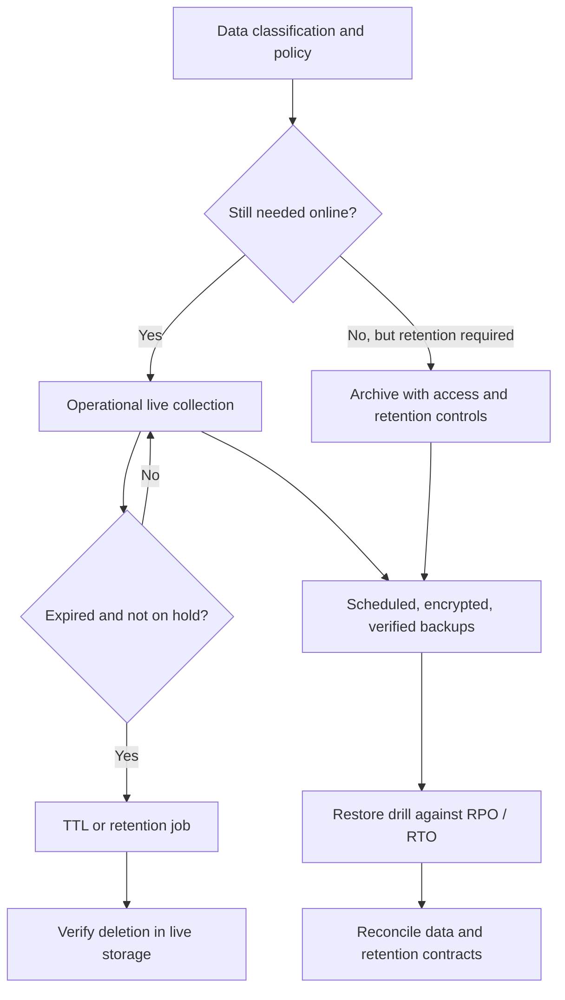
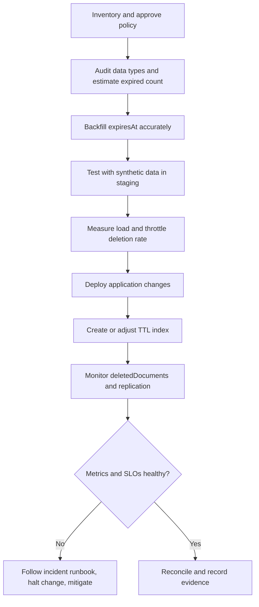

# Data Retention, TTL, Backups, and Restore Drills

> **Chapter:** Security and Operations · **Module:** `SPRING_DATA_MONGODB`. Spring Data MongoDB handles storing, querying, mapping documents, and working with repositories, `MongoTemplate`, or reactive APIs. Yet data's lifecycle does not end when an application calls `save()`: you must define how long data is kept, how MongoDB purges expired data, what backups preserve, and whether the service can actually recover during an outage. This lesson connects **data retention → TTL → backup → restore drill** into a verifiable lifecycle.

## 1. Goal: Governing the Data Lifecycle, Not Just Adding One Index

Suppose a system maintains these collections:

- `loginSessions`: temporary login sessions that must expire after a short window.
- `auditEvents`: audit records retained per internal policy and legal obligations.
- `orders`: transactional orders containing data kept longer than login sessions.
- `exportJobs`: temporary export outputs deleted after customer download or expiration.
- `restoreEvidence`: evidence from backup verification and restore drills.

Applying a blanket 30-day TTL across every collection risks wiping orders still needed for reconciliation or events under legal preservation. Conversely, keeping everything forever inflates storage costs, expands data exposure, and increases what must be protected.

**A complete policy must answer:**

1. **Which data** should be retained, classified by business owner and sensitivity?
2. **When does the clock start**: creation, completion, account closure, or end of an obligation?
3. **Upon expiration**, do we hide from reads, delete from live storage, move to an archive, or purge all copies?
4. **Which recovery objectives** must backups satisfy, how are they encrypted, and how long are they kept separately?
5. When restoring older data, how do we avoid **resurrecting expired or deletion-requested data**?
6. Is there concrete proof the system meets **RPO/RTO**, or merely a job reporting "backup successful"?

This lesson uses technical examples rather than prescribing default legal retention periods. Exact durations must come from approved organizational policies, applicable regulations, and data characteristics.

## 2. Distinguishing Retention, TTL, Archiving, and Backups

| Concept | Purpose | Common mechanism | What it does NOT guarantee by itself |
|---|---|---|---|
| **Retention policy** | Rules for keeping/deleting data by category and obligation | Policy matrix + operational controls | Does not enforce itself without jobs/indexes |
| **TTL index** | Automatically deletes eligible expired documents from a collection | `mongod` background TTL monitor | Not instantaneous deletion; does not delete backups |
| **Archive** | Moves older data to colder, less-accessed storage | Verified export + catalog + access controls | Not a full-system disaster recovery backup |
| **Backup** | Creates recoverable restore points after loss or corruption | Snapshots, backup services, `mongodump` | Worthless without tested restores |
| **Point-in-time recovery (PITR)** | Restores to an arbitrary valid historical timestamp | Base snapshot + continuous oplog/change stream captured by backup system | Not equivalent to a single `mongodump --oplog` |
| **Restore drill** | Proves recovery capability under simulated failure | Restore into isolated environment + verify app and data invariants | Not satisfied merely by checking that a backup file exists |



Specifically, **TTL in production is not a backup purge policy**. Snapshots or archives taken before a document expired may still retain copies after live deletion. Separate retention, deletion, and access controls are required for those copies.

## 3. Building a Data Retention Policy Matrix

A matrix agreed upon by product, operations, information security, and data owners should cover:

| Data category | Start milestone | Recommended mechanism | Exception conditions | Verification method |
|---|---|---|---|---|
| Login sessions | Server-computed `expiresAt` | TTL index on absolute expiry | Incident/investigation hold policies | Expired session ratio, access tests |
| Temporary export files | `completedAt` or `expiresAt` | TTL on metadata + object-storage cleanup job | Active export or preservation hold | Metadata and object both disappear |
| Operational logs | Event timestamp | Log store retention; TTL if stored in MongoDB | Approved ongoing investigation | Retention config + deletion reports |
| Orders | Business-defined milestone | Archive or conditional batch job | Disputes/reconciliation/evidence holds | Batch output and reconciliation |
| Drill evidence | Drill timestamp | Dedicated bounded repository | Active audit window | Manifest and purge schedule |
| Backups | Creation time + backup tier | Backup storage lifecycle policy | Incident or legal preservation request | Snapshot inventory, age, access controls |

The table above illustrates **technology selection**, not specific day counts for each data type.

### 3.1. Use `expiresAt` or `createdAt`?

The two designs have different semantics:

- `createdAt + expireAfterSeconds`: every document has the same lifetime from creation; fits fixed rules.
- `expiresAt + expireAfterSeconds: 0`: each document carries its own absolute deadline; fits varying session lifetimes or deliberate extensions.

For example, if Session A expires in 15 minutes and Session B expires in 2 hours, `expiresAt` expresses per-document expiration cleanly. Conversely, if every event lasts a fixed window from `createdAt`, duration-based TTL can be simpler.

**Timestamps are business-critical data:** control who can update `expiresAt`, validate values, synchronize infrastructure clocks, and prevent clients from pushing expiration far into the future.

### 3.2. When data must be preserved

If a subset of documents requires a **legal hold** or investigation freeze, never attach an unconditional TTL across the entire collection. Options include:

- Moving held records to a separate collection without TTL, with dedicated access controls and hold-release workflows.
- Designing a **partial TTL index** targeting only the eligible subset, after verifying filter semantics, MongoDB version support, and state transitions.
- Running a retention worker that checks business state and audit requirements before deleting, with concurrency guards on each operation.

Your design must ensure that updating hold flags never unexpectedly exposes held documents to immediate deletion. When exact-second deletion or complex compliance rules apply, TTL alone is insufficient.

## 4. How TTL Indexes Operate in MongoDB

TTL (*time to live*) is a property on a **single-field index** over a BSON Date field (or an array of Date values in supported cases). MongoDB runs a background TTL monitor to locate and delete expired documents.

Absolute-expiration example:

```javascript
use retention_lab

db.loginSessions.createIndex(
  { expiresAt: 1 },
  {
    name: "ttl_login_sessions_expires_v1",
    expireAfterSeconds: 0
  }
);
```

With `expireAfterSeconds: 0`, a document becomes eligible for deletion once `expiresAt` is no longer in the future. With `expireAfterSeconds: 86400` on `createdAt`, it becomes eligible **24 hours** after `createdAt`.

```text
createdAt ──────(retention = 24 hours)────> eligible for deletion
expiresAt ────────────────────────────────> eligible for deletion
                                               │
                                               v
                                      TTL monitor checks
                                               │
                                               v
                                         MongoDB deletes
```

**Key point:** "eligible for deletion" differs from "already deleted". The background TTL monitor runs periodically—typically around every **60 seconds**—and can fall behind under heavy load or massive expiration backlogs. Never rely on TTL to enforce a business action down to the exact millisecond.

### 4.1. Important technical limitations

- Standard TTL requires a **single-field index**; compound indexes do not provide standard TTL behavior even if `expireAfterSeconds` is passed.
- You cannot create a TTL index on `_id`.
- Values must be **BSON Date**; strings like `"2026-12-01T00:00:00Z"` are not processed as dates by the TTL monitor.
- Missing fields or non-Date values are generally skipped by TTL; validate schema/mapping to avoid accidental infinite retention.
- If the field is an **array of Dates**, MongoDB evaluates the earliest date in the array; test against real data before relying on this.
- In a replica set, the **primary** executes TTL deletions and secondaries replicate those delete operations.
- **Hidden** indexes are still maintained and still enforce TTL: `hidden: true` hides the index from the query planner, not from TTL deletion.
- TTL deletions are real deletes that generate I/O, replication traffic, and write load.
- Time-series collections have distinct retention/TTL mechanisms and rules; consult version docs rather than copying standard collection patterns.

### 4.2. TTL does not replace expiration checks in the application

Suppose a session expires at 12:00:00, yet the TTL monitor has not purged the document by 12:00:20. Checking only "does the session document still exist in MongoDB?" would still grant access to an expired session.

The application must enforce **logical expiration** at authentication time:

```java
public boolean isSessionValid(Session session, Instant now) {
    return session != null
        && session.getExpiresAt() != null
        && session.getExpiresAt().isAfter(now)
        && !session.isRevoked();
}
```

Or filter expired sessions directly in the MongoDB query:

```javascript
db.loginSessions.findOne({
  _id: "session-test-001",
  expiresAt: { $gt: new Date() },
  revoked: false
});
```

Use trusted clocks, NTP synchronization, and explicit clock-skew tolerances. TTL is an **asynchronous physical storage cleanup mechanism**; session validity must be enforced by business rules at access time.

## 5. Practicing TTL with `mongosh`

Run against the test database `retention_lab`, never a production collection.

### 5.1. Creating test data with per-document expiration

```javascript
use retention_lab

const now = new Date();

db.loginSessions.insertMany([
  {
    _id: "session-test-expired",
    createdAt: new Date(now.getTime() - 3600_000),
    expiresAt: new Date(now.getTime() - 60_000),
    revoked: false
  },
  {
    _id: "session-test-valid",
    createdAt: now,
    expiresAt: new Date(now.getTime() + 3600_000),
    revoked: false
  }
]);

db.loginSessions.createIndex(
  { expiresAt: 1 },
  {
    name: "ttl_login_sessions_expires_v1",
    expireAfterSeconds: 0
  }
);
```

Inspect index metadata:

```javascript
db.loginSessions.getIndexes();
```

`session-test-expired` is already eligible for TTL, yet **may not vanish immediately** upon index creation. To verify the application rejects expired access right away, query with `expiresAt > now` or validate expiry in the service rather than waiting on the TTL monitor.

### 5.2. Inspecting TTL metrics

```javascript
// Observe server-level TTL activity (requires appropriate privileges):
db.serverStatus().metrics.ttl;

// Count expired sessions still present at measurement time:
db.loginSessions.countDocuments({
  expiresAt: { $lte: new Date() }
});
```

`metrics.ttl.deletedDocuments`, `passes`, and `subPasses` (depending on version) reveal TTL activity. Server counters are **server-wide totals**, not isolated to one collection; cross-check collection document counts and counter growth rates.

Running `db.serverStatus()` requires elevated monitoring privileges. In managed services, use provider dashboards/metrics when direct admin commands are restricted.

### 5.3. Changing TTL duration on an existing index

Do not call `createIndex` with the same key and a new `expireAfterSeconds` expecting it to update the existing index automatically. On supported MongoDB versions, use `collMod` through a controlled migration:

```javascript
db.runCommand({
  collMod: "loginSessions",
  index: {
    name: "ttl_login_sessions_expires_v1",
    expireAfterSeconds: 0
  }
});
```

This command re-applies the same value purely to illustrate syntax. If you shorten another index from 30 days to 7 days, **huge numbers of documents can become eligible for deletion at once**. Before changing it, count affected records, estimate load, and follow a runbook. Never hide a TTL index hoping to pause deletions.

## 6. TTL in Spring Data MongoDB

### 6.1. Mapping `Instant` to a BSON Date field

Example entity:

```java
import java.time.Instant;

import org.springframework.data.annotation.Id;
import org.springframework.data.mongodb.core.index.Indexed;
import org.springframework.data.mongodb.core.mapping.Document;

@Document("loginSessions")
public class Session {

    @Id
    private String id;

    private Instant createdAt;

    @Indexed(name = "ttl_login_sessions_expires_v1", expireAfter = "0s")
    private Instant expiresAt;

    private boolean revoked;

    // Constructors, getters, and setters per application design.
}
```

`@Indexed(expireAfter = "0s")` declares the TTL index metadata while Spring Data maps Java time types to MongoDB Date values. Before deploying, verify the **actual stored BSON type** of `expiresAt` is Date, not String or a custom structure incompatible with TTL.

**Important:** annotations are metadata and do not prove the index exists on MongoDB. Since Spring Data MongoDB 3.0, **auto-index creation is off by default**. In production, use a centrally governed migration job and verify index specs afterward rather than letting every instance modify indexes on startup.

### 6.2. Creating TTL indexes explicitly with `MongoTemplate`

With `MongoTemplate`, create indexes via `IndexOperations` inside a privileged migration job:

```java
import java.time.Duration;

import org.springframework.data.domain.Sort;
import org.springframework.data.mongodb.core.MongoTemplate;
import org.springframework.data.mongodb.core.index.Index;

public final class SessionTtlMigration {

    private final MongoTemplate mongoTemplate;

    public SessionTtlMigration(MongoTemplate mongoTemplate) {
        this.mongoTemplate = mongoTemplate;
    }

    public String createTtlIndex() {
        Index index = new Index()
            .on("expiresAt", Sort.Direction.ASC)
            .expire(Duration.ZERO)
            .named("ttl_login_sessions_expires_v1");

        return mongoTemplate.indexOps(Session.class)
            .ensureIndex(index);
    }
}
```

`ensureIndex` creates an index matching the definition, yet cannot alter every property of an existing index. Changing TTL duration, key patterns, partial filters, or converting a non-TTL index to TTL may require `collMod` or a dedicated migration strategy depending on version. Verify via `getIndexes()` on the server rather than trusting the returned index name alone.

A repository enforcing expiration logic:

```java
import java.time.Instant;
import java.util.Optional;

import org.springframework.data.mongodb.repository.MongoRepository;

public interface SessionRepository extends MongoRepository<Session, String> {

    Optional<Session> findByIdAndExpiresAtAfterAndRevokedFalse(
        String id, Instant now
    );
}
```

The repository condition excludes expired sessions **before TTL physically deletes them**. If business logic needs immediate logout revocation, use `revoked` or explicit invalidation; TTL never replaces revocation.

### 6.3. Complex expiration and cleanup workflows

Avoid unconditional TTL when deletion depends on multiple collections, external storage, or legal holds. Instead, implement a **retention worker**:

1. Select a small batch of documents eligible by `expiresAt` and deletable status.
2. Record a minimal manifest without logging sensitive contents.
3. Move/reconcile archives or delete linked external storage objects if required by policy.
4. Delete conditionally while re-checking status to avoid purging documents just renewed or placed on hold.
5. Record counts, progress, and errors; throttle rate and support clean resumption after interruption.

Example guarded delete:

```java
Query expired = Query.query(
    Criteria.where("_id").is(documentId)
        .and("expiresAt").lte(Instant.now())
        .and("legalHold").ne(true)
);

DeleteResult result = mongoTemplate.remove(expired, "exportJobs");
```

For multi-document sweeps, design batching and safe retry policies. `remove` across many documents is not a single cross-system transaction; coordinating archive state and deletion across two stores requires business-level consistency checks.

## 7. Retention Policies and Pre-Existing Data

### 7.1. Backfilling and data quality before enabling TTL

On legacy collections, `expiresAt` may be missing or have wrong types:

```javascript
db.loginSessions.aggregate([
  {
    $group: {
      _id: { type: { $type: "$expiresAt" } },
      count: { $sum: 1 }
    }
  }
]);
```

Strings, `null`, or missing fields do not behave like BSON Dates under TTL. Before creating the index:

- Profile data by BSON type, date ranges, missing fields, and outliers.
- Define expiration milestones for legacy documents; never assign arbitrary deadlines to records missing timestamps.
- Backfill in batches with checkpoints, rollback plans, and write-load monitoring.
- Count how many documents are **already expired** if TTL were turned on right now.
- Align product, data owners, and operations on deletion impact.

**Never enable TTL blindly on hundreds of millions of already-expired documents** just because `createIndex` succeeds. Sudden bulk background deletes trigger heavy I/O and replication load that can breach SLOs. Consider rate-limited batch cleanup before and after adding TTL.

### 7.2. Safe migration sequence



Shortening retention periods doesn't just build an index—it can trigger **a wave of immediate deletions**. Check impacts on customer UIs, report consistency, data extracts, and backup policies.

## 8. Backups Solve a Different Problem from TTL

TTL purges data per policy, whereas backups must enable recovery from:

- Accidental deletion of documents or collections due to operator error or app bugs.
- Data corruption from faulty migrations or backfills.
- Node loss or volume corruption beyond topology self-healing limits.
- Major infrastructure incidents or severe misconfigurations.
- Divergence between MongoDB and external systems such as object storage, queues, or search indexes.

**A replica set is not a backup.** Replication preserves availability; an accidental valid delete on the primary replicates promptly to secondaries, as do valid TTL deletes. Having three live replicas provides no historical restore point for lost data.

### 8.1. RPO and RTO

- **Recovery Point Objective (RPO):** acceptable data loss measured as the time gap between the restore point and the failure time.
- **Recovery Time Objective (RTO):** maximum acceptable duration to restore the service to its defined operating state.

Suppose internal targets are **15-minute RPO** and **60-minute RTO**. Nightly backups alone cannot achieve that: a midnight backup followed by a 17:00 outage loses most of the day unless continuous change capture and corresponding restore tooling exist.

Include **detection time, backup retrieval, data restore, index/config rebuild, verification, and traffic cutover** inside RTO. Restoring raw database files alone is incomplete if the application needs another 30 minutes to restart and reconcile data.

### 8.2. Choosing a backup strategy

| Option | Pros | Limits/conditions |
|---|---|---|
| Managed service automated backups | Scheduled snapshots, retention policies, PITR per tier/plan | Must enable features, verify storage regions, permissions, and restore flow |
| Filesystem/storage snapshots | Suits large datasets and high-volume restores | Requires snapshot consistency with journal/data and topology |
| `mongodump` / `mongorestore` | Convenient for logical backups, labs, or small datasets | Resource-heavy; no arbitrary PITR alone; sharded clusters need dedicated procedures |
| Snapshots + continuous oplog capture | Achieves tight RPO and point-in-time recovery | Backup system must capture and validate uninterrupted oplog sequences |
| Application-layer exports | Useful for selected business records | Does not replace full metadata, indexes, or transactional consistency |

MongoDB and managed providers publish distinct procedures for replica sets, sharded clusters, managed tiers, and server versions. On sharded clusters, consistent backups require **coordination across shards and config servers**, never just dumping one `mongos` assuming cross-shard atomicity.

### 8.3. Encryption, permissions, and backup lifecycle

Backups can contain sensitive records already purged from live MongoDB. Therefore:

- Encrypt in transit and at rest; manage KMS keys and key recovery separately.
- Separate privileges for **creating backups**, **reading backups**, and **restoring into target environments**.
- Never put URIs with passwords into shell history, CI logs, or artifact names; use secret stores and scoped service accounts.
- Apply dedicated retention/expiration policies to snapshots, archived logs, and offsite copies.
- Verify backups replicate to an independent failure domain per policy.
- Never store manifests full of sensitive data in drill logs or tickets.
- Establish procedures for deletion requests under immutable backups: any restore must re-apply valid deletion policies.

## 9. Examples of `mongodump`, `mongorestore`, and PITR Limits

### 9.1. Consistent logical backup for **a test replica set**

While a replica set receives writes, `mongodump --oplog` captures oplog entries generated **during the dump window** to produce a consistent restore point as of dump completion.

CLI example for lab replica set `rsLab` using a credential-free connection string. Ensure MongoDB Database Tools are installed and the account holds required privileges:

```bash
mongodump \
  --uri="mongodb://127.0.0.1:27017/?replicaSet=rsLab" \
  --archive="./backup-lab-rs.archive.gz" \
  --gzip \
  --oplog
```

Key limitations:

1. `--oplog` applies to a **full dump of a replica set member** and cannot be combined with `--db`, `--collection`, `--query`, or partial dump filters specified in the docs.
2. `--oplog` does not support sharded cluster backups in this manner; use dedicated sharded cluster backup procedures.
3. Certain schema/config operations such as renaming a collection during the dump can cause `--oplog` to fail.
4. Oplog data in the archive **covers only changes during the dump run**, not a continuous history allowing arbitrary point-in-time recovery days later.
5. In production, large logical dumps impose heavy load; measure resource cost and schedule within maintenance windows.

### 9.2. Restoring to an **isolated lab MongoDB**

Spin up a clean test MongoDB cluster isolated from production networks, credentials, and applications. Verify version compatibility, restore privileges, and free disk space first:

```bash
mongorestore \
  --uri="mongodb://127.0.0.1:27018/" \
  --archive="./backup-lab-rs.archive.gz" \
  --gzip \
  --oplogReplay
```

`--oplogReplay` applies captured oplog changes for a consistent restore point; it is **not** arbitrary timestamp PITR. Never run `--drop` or full restores against production during practice: `--drop` deletes target collections before restoring.

Command success alone does not prove the application works. Verify data, indexes, mappings, permissions, timestamps, seed/metadata, and business flows after restoring.

### 9.3. What does true PITR require?

To recover to timestamp `T` after an accidental deletion, the backup platform needs:

1. A consistent **base snapshot** taken before `T`.
2. An uninterrupted **continuous change stream** (such as oplogs continuously archived and retained long enough by the backup system) from the base snapshot through `T`.
3. Tooling to pick a **restore timestamp** and enforce ordering and consistency, especially across sharded/transactional workloads.
4. A verification workflow confirming recovery stopped at `T` without replaying corrupt/accidental deletes after `T`.

The live oplog inside a replica set is not a substitute for long-term backups: it is a capped rolling window that overwrites under write volume. Managed backup services can provide PITR, with granularity and retention windows determined by tier and configuration.

## 10. Restore Drills: Proving Recovery Capability

A **restore drill** is a practiced recovery into a safe environment with measurable targets and documented evidence—not checking that a backup file exists.

### 10.1. Defining the scenario and preconditions

Hypothetical scenario: a faulty migration corrupted `orders` state over a time window. The drill aims to retrieve the nearest valid backup, restore it into an isolated test cluster, verify consistency, and assess readiness for application cutover.

Define upfront:

| Item | Details to lock in |
|---|---|
| Simulated incident | Accidental deletion/corruption of a business collection |
| Target RPO | Approved by service owner, e.g., 15 minutes |
| Target RTO | Approved by service owner, e.g., 60 minutes |
| Restore point | Snapshot/PITR timestamp recorded in manifest |
| Target environment | Isolated cluster disconnected from production traffic |
| Scope | Full database or specified subset; realistic scale |
| Security | Backup read privileges, encryption keys, network isolation, cleanup |
| Approvers | System owner and data owner |
| Pass criteria | Counts, queries, indexes, app smoke tests, TTL, actual elapsed times |

When backups contain personal data, the drill environment requires equivalent access controls and protection; use synthetic or suitably anonymized backups if the goal is purely testing technical mechanics.

### 10.2. Eight-step runbook

1. **Select backup:** verify timestamp, MongoDB/Database Tools versions, topology, retention, and artifact integrity; record ID/manifest without logging secrets.
2. **Provision target:** build a clean isolated cluster; verify networking, encryption keys, disk capacity, version/FCV, and permissions.
3. **Hold background tasks:** keep application traffic, scheduled jobs, consumers, and retention workers disabled. Watch especially for **TTL purging older documents** once indexes rebuild.
4. **Execute restore:** run snapshot or logical/PITR restore per procedure; log start time, end time, errors, collection counts, and operations.
5. **Verify data:** reconcile counts, checksums/samples, business keys, cross-collection references, index specs, schemas, and state at the target timestamp.
6. **Verify application:** run repository/`MongoTemplate`/aggregation smoke tests, critical transactions, and business flows against test data or a restricted environment.
7. **Measure results:** calculate actual RPO from the restore point and actual RTO per definition; check alignment with external systems like object storage, queues, and search indexes.
8. **Report and clean up:** document pass/fail, defects, and recommendations; securely destroy temporary clusters and drill data copies per policy.

### 10.3. Specific hazard: immediate TTL deletion after restore

Suppose a backup taken 14 days ago contains sessions whose `expiresAt` fell last week. Restoring them into a current MongoDB instance **with active TTL indexes** causes the TTL monitor to start deleting those expired records.

If the goal is **forensic extraction or inspecting the full snapshot**, use an isolated restore workflow that controls TTL/indexes before verification per your version and tool capabilities. Simply restoring and waiting a few minutes alters the dataset you intended to inspect.

Conversely, if the goal is **returning the service to live operations**, **never resurrect expired login sessions as valid**. APIs must enforce `expiresAt` even before the TTL monitor runs. Handle TTL according to the approved restore objective.

### 10.4. Reconciling data after restore in practice

Example verification on the lab database:

```javascript
use retention_lab

// Index status after restore:
db.loginSessions.getIndexes();

// Restored document count:
db.loginSessions.countDocuments({});

// Expired sessions still present in the database:
db.loginSessions.countDocuments({
  expiresAt: { $lte: new Date() }
});

// Query returning only currently valid sessions:
db.loginSessions.find({
  expiresAt: { $gt: new Date() },
  revoked: false
}).limit(10);
```

Extend checks to `orders` and other business collections: compare key IDs, schema versions, unique indexes, transaction statuses, monetary totals/reconciliations, and referenced records. Matching document counts alone **is not enough** if fields were partially corrupted.

### 10.5. Drill report template

| Item | Evidence | Status |
|---|---|---|
| Backup ID and timestamp | Manifest, UTC timestamp | PASS/FAIL |
| Artifact integrity | Checksum or provider verification check | PASS/FAIL |
| Size / restore duration | Sanitized job logs | PASS/FAIL |
| Collection count and index specs | `listCollections`, `getIndexes` | PASS/FAIL |
| Business data | Counts, samples, invariant checks | PASS/FAIL |
| TTL and retention contracts | Checks on `expiresAt`, retention workers, backup retention | PASS/FAIL |
| Application smoke tests | Core APIs/repositories/queries | PASS/FAIL |
| Actual RPO | Latest recoverable timestamp | Measured |
| Actual RTO | Total time until service reaches required operational level | Measured |
| Cleanup and data safety | Confirmation of temporary cluster / artifact deletion | PASS/FAIL |

## 11. Availability, Security, and Recovery Intersections

### 11.1. Backups must not blindly overwrite current data

Accidentally deleting a batch of orders does not mean you should overwrite the whole cluster with an old backup and lose every valid new order. Use **selective restore**: restore into a temporary environment, extract and reconcile the lost documents, or reconstruct a consistent state while checking keys, transactions, dependencies, and version conflicts.

### 11.2. External dependencies also need recovery

If MongoDB stores metadata pointing to files in object storage, restoring MongoDB without matching objects leaves **orphaned references**. If services feed Change Streams into search indexes or message consumers, restoring to an earlier point can invalidate stored **resume tokens** or checkpoints. Plan how to rebuild secondary projections/indexes, handle duplicates, and replay from reliable business checkpoints.

### 11.3. Encryption keys are part of the backup workflow

A snapshot without access to its decryption key is useless. With field-level encryption, KMS, and credential rotation, backup/restore drills must verify key recovery, key versions, user roles, and app configuration needed to read restored data.

Never paste keys or credentials into drill reports. Record **key management locations and responsible owners**, and test access through approved authorization workflows.

### 11.4. Privilege governance and operation logs

Backup privileges should not equal restore privileges. Never grant destructive restore permissions to application runtime accounts just to test `mongorestore`. When drills touch sensitive data, restrict access, limit temporary cluster lifetimes, secure logs, and govern who may retrieve backups.

## 12. Testing Approach in Spring Data MongoDB

Do not write unit tests expecting TTL to delete a document **at exactly 60 seconds**. The TTL monitor runs in the background depending on server schedule and load, making strict timing assertions flaky.

Split tests across layers:

| Layer | What to test | How to implement |
|---|---|---|
| Unit test | Expiry calculation, revocation logic, retention contracts | Inject `Clock` and use fixed instants |
| Integration test | BSON Date mapping, TTL index spec, queries excluding expired sessions | Real MongoDB / Testcontainers |
| TTL behavior test | Expired documents are eventually purged | Bounded polling with generous timeout, never fixed sleeps |
| Restore drill | Consistent backup/restore, indexes/schemas intact, RPO/RTO met | Isolated environment with runbook |

### 12.1. Unit testing expiration with `Clock`

```java
import java.time.Clock;
import java.time.Duration;
import java.time.Instant;

public final class SessionExpiryPolicy {

    private final Clock clock;

    public SessionExpiryPolicy(Clock clock) {
        this.clock = clock;
    }

    public Instant expiresAt(Duration ttl) {
        if (ttl.isNegative() || ttl.isZero()) {
            throw new IllegalArgumentException("ttl must be positive");
        }
        return Instant.now(clock).plus(ttl);
    }

    public boolean isExpired(Instant expiry) {
        return !expiry.isAfter(Instant.now(clock));
    }
}
```

Test:

```java
import static org.junit.jupiter.api.Assertions.*;

import java.time.Clock;
import java.time.Duration;
import java.time.Instant;
import java.time.ZoneOffset;
import org.junit.jupiter.api.Test;

class SessionExpiryPolicyTest {

    @Test
    void expiryBoundaryIsExclusiveForValidSession() {
        Instant fixed = Instant.parse("2026-01-01T12:00:00Z");
        Clock clock = Clock.fixed(fixed, ZoneOffset.UTC);
        SessionExpiryPolicy policy = new SessionExpiryPolicy(clock);

        assertTrue(policy.isExpired(fixed));
        assertFalse(policy.isExpired(fixed.plusSeconds(1)));
        assertEquals(fixed.plusSeconds(300),
            policy.expiresAt(Duration.ofMinutes(5)));
    }
}
```

This proves application rules deterministically regardless of when the TTL monitor runs.

### 12.2. Integration testing index specs rather than guessing

With `MongoTemplate` targeting a test MongoDB instance, create the index via migration code and verify server metadata via the driver:

```java
import static org.junit.jupiter.api.Assertions.*;

import java.util.ArrayList;
import java.util.List;

import org.bson.Document;
import org.junit.jupiter.api.Test;
import org.springframework.beans.factory.annotation.Autowired;
import org.springframework.boot.test.autoconfigure.data.mongo.DataMongoTest;
import org.springframework.data.mongodb.core.MongoTemplate;

@DataMongoTest
class SessionIndexIT {

    @Autowired
    MongoTemplate template;

    @Test
    void ttlIndexHasExpectedKeyAndDuration() {
        String coll = "session_ttl_lab";

        template.getCollection(coll).createIndex(
            new Document("expiresAt", 1),
            new com.mongodb.client.model.IndexOptions()
                .name("ttl_session_lab_v1")
                .expireAfter(0L, java.util.concurrent.TimeUnit.SECONDS)
        );

        List<Document> indexes = new ArrayList<>();
        template.getCollection(coll).listIndexes().into(indexes);

        Document ttl = indexes.stream()
            .filter(i -> "ttl_session_lab_v1".equals(i.getString("name")))
            .findFirst()
            .orElseThrow();

        assertEquals(1, ttl.get("key", Document.class).getInteger("expiresAt"));
        assertEquals(0L, ((Number) ttl.get("expireAfterSeconds")).longValue());
    }
}
```

In real test suites, isolate collections per test or clean up safely, and check existing fixture indexes to avoid conflicts. For an actual TTL deletion integration test, insert a document with a past Date, use **bounded polling with a timeout** (e.g., Awaitility), and re-read the collection rather than asserting a fixed second.

### 12.3. Testing backup and restore separately

A MongoDB connectivity test cannot replace verifying backup storage permissions, snapshot decryption, version compatibility, and actual restore duration. Restore drills must be recurring scheduled exercises with documented evidence, named owners, and clear measurement goals.

## 13. Diagnosing Common Incidents

| Symptom | Possible cause | Verification / remediation |
|---|---|---|
| Expired documents remain | TTL monitor hasn't run yet, heavy load, wrong BSON type | Check `getIndexes`, Date types, `metrics.ttl`, resources |
| Expired session can still log in | Relying solely on document existence without checking `expiresAt` | Enforce logical expiry and revocation flag immediately |
| Deletion rate spikes right after creating TTL | Lots of legacy data was already expired | Plan batched backfill/cleanup and monitor load |
| Hidden TTL index still deletes documents | Hidden indexes still enforce TTL | Never use hidden as a pause switch for retention |
| TTL skips legacy records | Field stored as string, missing Date, or mapping bug | Check `$type`/BSON; fix schema/backfill |
| Raised TTL duration yet behavior unchanged | Changed annotation without migrating live index | Inspect index spec and run `collMod` per version |
| Backup exists yet cannot restore | Corrupt archive, missing keys/roles, version mismatch, full disk | Run restore drills with manifests, checksums, and preflight checks |
| Restored data immediately disappears again | Backup's TTL timestamps are already in the past | Separate forensic extraction vs operational recovery; govern TTL safely |
| Small target RPO with only daily backups | No continuous change logs captured | Implement PITR or revise approved objectives |
| API still fails after restore | Missing indexes, keys, external objects, projections, or consumer state | Run full smoke tests and reconcile dependencies |
| Assumed replica set equals backup | Accidental deletes/TTL replicate across members | Maintain independent backups with restore points |
| Restore drill exposes sensitive data | Test cluster/backups/logs poorly restricted | Isolate, encrypt, clean up, and apply least privilege |

## 14. Reference Operational Runbooks

### 14.1. Daily

- Check backup job status, age of latest successful backup, and failure alerts.
- Check storage capacity, replica set health, and lag; watch for abnormal TTL deletion spikes.
- Confirm collections under retention policies maintain expected index specs and Date schemas.
- Check manual archive/purge jobs and downstream dependencies for lingering failures.

### 14.2. Whenever changing retention or TTL

- Gather approved policy, owner, and list of impacted data categories.
- Estimate how many documents become eligible for deletion under the new rule.
- Backfill and test in staging; measure deletion load under traffic.
- Prepare a controlled rollback, recognizing already-deleted data cannot be recovered simply by reverting TTL duration.
- Run the migration job, verify index specs, and monitor deletions/replication.
- Archive before/after evidence and notify dependent teams.

### 14.3. Periodic restore drills

- Pick a real backup point per an approved scenario and log start time.
- Restore into an isolated cluster with required keys, roles, tools, and capacity.
- Verify application behavior, business data, TTL behavior, dependent services, and RPO/RTO metrics.
- Record actionable findings; update runbooks, permissions, and monitoring.
- Tear down the temporary environment and secure or purge drill artifacts containing data per policy.

## 15. Self-Check Questions

1. How does `expireAfterSeconds: 0` on `expiresAt` differ from a 30-day TTL on `createdAt`?
2. Why must a session still present in MongoDB past its deadline never remain valid for authentication?
3. Does a hidden TTL index stop MongoDB from deleting documents?
4. Why count already-expired documents before adding TTL to a legacy collection?
5. By what criteria do you separate orders needing archiving from sessions suitable for automatic TTL deletion?
6. Can a three-node replica set replace backups if an application accidentally drops a collection?
7. What does `mongodump --oplog` guarantee, and what does it **not** guarantee regarding PITR?
8. Why cannot a full `--oplog` dump be arbitrarily combined with `--db` or `--collection`?
9. When restoring an older backup with TTL enabled, what happens to expired sessions?
10. Which concrete verification steps do a 15-minute RPO and 60-minute RTO demand?
11. Why can restoring MongoDB without restoring object storage or search projections break the application?
12. How do you verify that `@Indexed(expireAfter = "0s")` is actually deployed on the database?
13. When legal holds apply, why can an unconditional TTL conflict with business policy?
14. Why must backups carry their own lifecycle and access controls separate from live data?
15. What minimum evidence proves a restore drill succeeded?

## 16. Takeaways

- **Retention** is a business rule and data governance obligation; TTL is merely one enforcement mechanism for eligible records.
- **TTL** uses a Date field in a single-field index, runs asynchronously in batches, and can lag; applications must enforce logical expiration immediately.
- **Hidden TTL indexes still delete**, and shortening TTL durations can immediately mark vast numbers of legacy records for deletion.
- **Backups differ from replication and archiving**; storing a copy proves nothing without verified recovery.
- **PITR** requires a base backup plus a continuous change log; a single `mongodump --oplog` does not allow recovery to arbitrary timestamps.
- **Restore drills** must measure actual RPO/RTO and verify data, indexes, encryption keys, dependent systems, and post-restore retention.
- **Backups holding sensitive data** need dedicated encryption, access controls, retention limits, and deletion-handling workflows.

### References

- [MongoDB Manual — TTL Indexes](https://www.mongodb.com/docs/manual/core/index-ttl/)
- [MongoDB Manual — Expire Data from Collections by Setting TTL](https://www.mongodb.com/docs/manual/tutorial/expire-data/)
- [MongoDB Manual — Hidden Indexes](https://www.mongodb.com/docs/manual/core/index-hidden/)
- [MongoDB Manual — Backup Methods for Self-Managed Deployments](https://www.mongodb.com/docs/manual/core/backups/)
- [MongoDB Manual — Back Up and Restore with MongoDB Tools](https://www.mongodb.com/docs/manual/tutorial/backup-and-restore-tools/)
- [MongoDB Database Tools — mongodump](https://www.mongodb.com/docs/database-tools/mongodump/)
- [MongoDB Database Tools — mongorestore](https://www.mongodb.com/docs/database-tools/mongorestore/)
- [MongoDB Manual — Backup Sharded Clusters](https://www.mongodb.com/docs/manual/administration/backup-sharded-clusters/)
- [Spring Data MongoDB Reference — Index Management](https://docs.spring.io/spring-data/mongodb/reference/mongodb/mapping/mapping-index-management.html)
- [Spring Data MongoDB API — Indexed](https://docs.spring.io/spring-data/mongodb/docs/current/api/org/springframework/data/mongodb/core/index/Indexed.html)
- [Spring Data MongoDB API — Index](https://docs.spring.io/spring-data/mongodb/docs/current/api/org/springframework/data/mongodb/core/index/Index.html)
