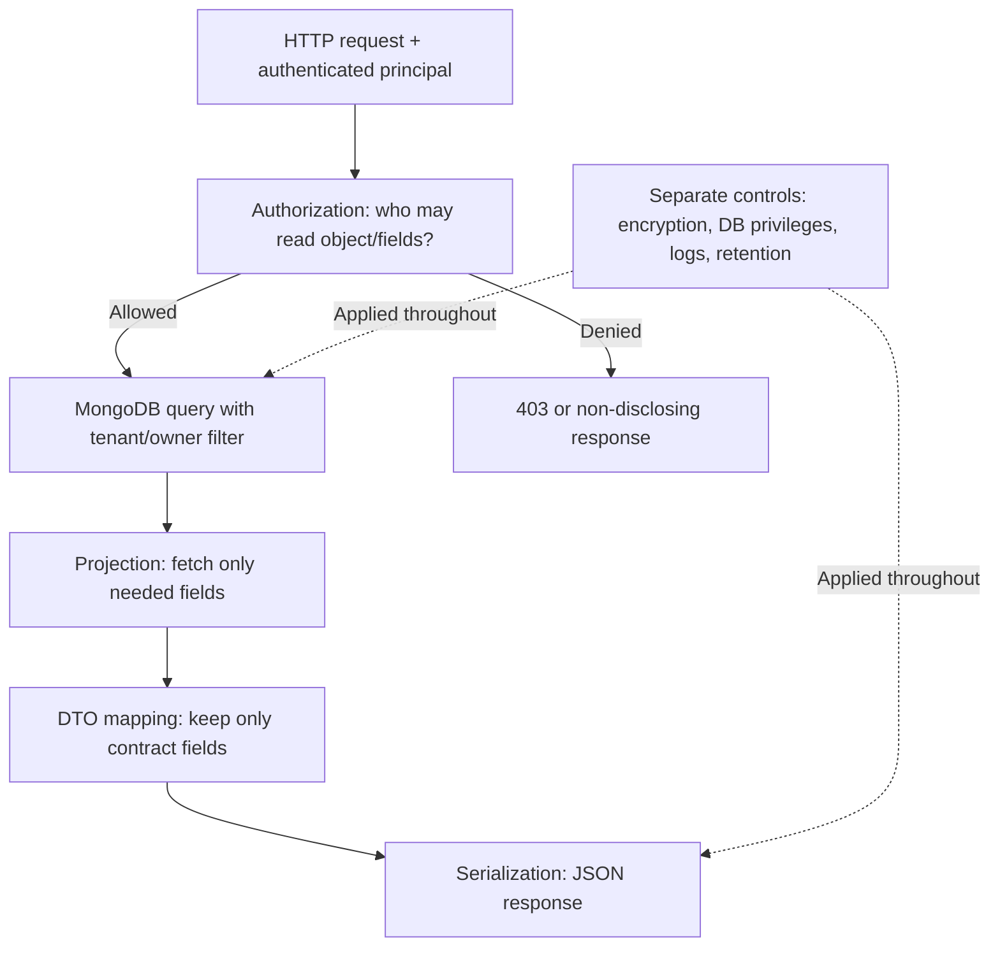

# Response DTOs, Controlling Internal Fields, and Personal Information

## Learning Objectives

In applications using **Spring Data MongoDB**, stored documents typically hold far more data than an API is permitted to return. A customer document may include display name, email, phone number, tenant, verification status, fraud signals, support notes, and a hashed password. If a controller returns the entity or a BSON `Document` directly, a small schema change can accidentally leak internal fields or personally identifiable information (PII).

This lesson in the **Security and Operations** chapter focuses on designing **response contracts**, enforcing object-level and field-level access controls, minimizing how much data MongoDB returns, and verifying that sensitive data never escapes through unintended output channels.

After this lesson, you will be able to:

- Classify fields stored in MongoDB by disclosure level and authorized audience.
- Design **allowlisted response DTOs** rather than returning `@Document` entities or `Map` objects directly.
- Distinguish **authorization**, **MongoDB query projection**, **DTO mapping**, and **JSON serialization**.
- Enforce authorization in the service layer and filter by tenant/owner inside queries.
- Govern personal data across logs, exceptions, aggregations, exports, caches, and operations.
- Write tests proving no internal fields leak even as storage models evolve.

## 1. Why Never Return MongoDB Documents Directly?

Suppose the `customers` collection stores profiles:

```json
{
  "_id": "c-1042",
  "tenant_id": "tenant-a",
  "displayName": "Minh Anh",
  "email": "minhanh@example.test",
  "phone": "+84000000123",
  "password_hash": "$2b$12$...",
  "risk_score": 92,
  "internal_notes": ["Requires additional profile review"],
  "verification_status": "PENDING",
  "createdAt": "2026-11-01T10:00:00Z"
}
```

Administrative and operational fields live in **the same document** for workflow convenience. Yet an endpoint rendering a customer card for another user may need only:

```json
{
  "id": "c-1042",
  "displayName": "Minh Anh"
}
```

If the controller returns `CustomerDocument` directly, serialization libraries like Jackson expose every accessible property as JSON fields. Even if `@JsonIgnore` hides certain fields today, another developer adding a new property later can unintentionally expand the API response.

**Principle:** storage models and outbound API models must be treated as separate contracts. **Explicitly allowlisted DTOs** provide a far more stable boundary than trying to remember to exclude every future internal field.

### 1.1. Classifying by intended purpose

| Stored field | Data category | Recommended output rule |
| --- | --- | --- |
| `_id` | Object identifier | Return only when the caller is authorized to know the object; never treat an ID as proof of authorization |
| `displayName` | Display profile info | Public DTO may include if business rules permit |
| `email`, `phone` | Personal data (PII) | Only on authorized endpoints/tasks; consider partial masking |
| `tenant_id` | Routing/authorization metadata | Normally kept internal; mandatory for multi-tenant query scoping |
| `password_hash`, keys, tokens | Authentication secrets or auth material | Never return in profile APIs, normal exports, or logs |
| `risk_score`, `internal_notes` | Internal workflows | Never return on customer APIs; restrict to separately authorized ops flows |
| `verification_status` | Business state | Choose DTO by role and purpose; avoid leaking internal investigation reasons |

This table is a **design example**, not a universal legal classification for every organization. Permitted outputs must follow data-processing purposes, security policies, and applicable regulations.

### 1.2. Common leak paths

- Returning MongoDB entities directly as `ResponseEntity<CustomerDocument>` or `List<CustomerDocument>`.
- Returning unfiltered `org.bson.Document`, `Map<String,Object>`, or `AggregationResults<Document>`.
- Passing an entity to `ResponseEntity.ok(...)` while relying on serialization annotations to stay complete.
- Logging entity/DTO `toString()`, full request/response bodies, MongoDB queries with parameters, or raw exception details.
- Reusing one broad DTO across public cards, self-service profile pages, and admin tools.
- Letting clients freely pick `fields=email,risk_score,internal_notes` without a role-scoped field allowlist.
- Returning errors like "email already exists" or "this ID belongs to another tenant" when doing so discloses existence of inaccessible objects.

## 2. Four Control Layers with Distinct Responsibilities



| Layer | What problem it solves | What it does NOT replace |
| --- | --- | --- |
| **Authentication/authorization** | Who may read which customer and which field groups | Does not strip fields from JSON if code returns the wrong model |
| **MongoDB projection** | Transfers only needed fields from DB to application | Does not prove the caller is authorized to read those fields |
| **Response DTO** | Stabilizes JSON contract, emitting only declared fields by default | Does not stop queries from over-reading sensitive fields or accessing wrong objects |
| **Jackson serialization** | Converts DTOs to JSON; can apply additional hiding rules | Does not replace permission checks or bounded queries |
| **Encryption, DB privileges, operations** | Reduces impact if access or storage is compromised elsewhere | Does not replace response DTOs |

A well-designed endpoint uses **multiple layers together**. If a query accidentally fetches the whole document, DTO mapping still caps JSON output. If DTO mapping has a flaw, response contract tests catch it; if JSON is narrow yet targets the wrong tenant, authorization blocks it.

## 3. Separating Storage Entities and Response DTOs

The entity models what Spring Data MongoDB maps:

```java
import org.springframework.data.annotation.Id;
import org.springframework.data.mongodb.core.mapping.Document;
import org.springframework.data.mongodb.core.mapping.Field;

@Document("customers")
public class CustomerDocument {

    @Id
    private String id;

    @Field("tenant_id")
    private String tenantId;

    private String displayName;
    private String email;
    private String phone;

    @Field("password_hash")
    private String passwordHash;

    @Field("risk_score")
    private Integer riskScore;

    @Field("internal_notes")
    private List<String> internalNotes;

    @Field("verification_status")
    private String verificationStatus;

    // Constructors and getters/setters omitted.
}
```

`passwordHash` is a **hashed value**, not a plaintext password. Even hashed, it remains sensitive data and must never appear in profile APIs. Similarly, `tenantId` and `riskScore` are internal metadata, not public data simply because they have getters.

Define dedicated DTOs by purpose:

```java
// Public card/profile API after checking view permission.
public record CustomerCardResponse(
        String id,
        String displayName
) {}

// Self-service account info API.
public record CustomerSelfResponse(
        String id,
        String displayName,
        String email,
        String phone
) {}

// Admin view needing verification status, without hashes or internal notes.
public record CustomerOpsResponse(
        String id,
        String displayName,
        String verificationStatus
) {}
```

`CustomerSelfResponse` should be used only when the caller is genuinely authorized to view **unmasked** email and phone values. If a use case only needs a contact hint, define another DTO with masked values rather than putting raw PII into a public DTO and trusting the frontend to hide it.

### 3.1. Explicitly allowlisted field mapping

```java
public final class CustomerResponseMapper {
    private CustomerResponseMapper() {}

    public static CustomerCardResponse toCard(CustomerDocument document) {
        return new CustomerCardResponse(
                document.getId(),
                document.getDisplayName()
        );
    }

    public static CustomerSelfResponse toSelf(CustomerDocument document) {
        return new CustomerSelfResponse(
                document.getId(),
                document.getDisplayName(),
                document.getEmail(),
                document.getPhone()
        );
    }

    public static CustomerOpsResponse toOps(CustomerDocument document) {
        return new CustomerOpsResponse(
                document.getId(),
                document.getDisplayName(),
                document.getVerificationStatus()
        );
    }
}
```

The mapper touches only needed fields. If the entity later gains `internalApiToken` or `investigationReason`, existing DTOs will not automatically expose them. With MapStruct or automated mappers, configure explicit mappings and contract tests so model growth never silently leaks new fields.

**Never use `BeanUtils.copyProperties(...)` or uncontrolled reflection directly from entities into broad response objects** in security-sensitive flows; matching property names is not a valid criterion for disclosure.

### 3.2. Why is `@JsonIgnore` only a secondary layer?

Jackson's `@JsonIgnore` hides a property when serializing a specific object. However, it **does not govern MongoDB reads** and does not protect export paths bypassing Jackson (CSV exports, aggregations, logs, events, caches).

Do not confuse it with:

- Spring Data's `@Transient`: controls persistence mapping, **not JSON disclosure rules**.
- `@Field`: maps Java field names to BSON keys, **not which fields an API returns**.
- `@JsonProperty(access = WRITE_ONLY)`: controls Jackson JSON behavior on certain request models, **not MongoTemplate queries or other export sinks**.
- `@Encrypted` in Spring Data MongoDB: describes client-side encryption for fields when the driver is configured, **not hiding decrypted fields from DTOs/JSON**.

Annotations may serve as defense-in-depth, yet **the primary outbound contract must remain an allowlisted DTO**.

## 4. Authorizing at the Service Layer Before Mapping

API callers can tamper with paths, query strings, and tenant headers. Receiving a `customerId` in the URL does not prove the caller may read that customer.

A solid rule: resolve tenant and caller identity from the **authenticated principal**; if users may switch tenants, verify principal permissions for the chosen tenant. Queries must bind tenant scope on the target object to prevent cross-tenant exposure.

Example resolved application identity after authentication:

```java
public record RequestIdentity(
        String userId,
        String tenantId,
        String customerId
) {}
```

Service for `GET /api/customers/me` never takes another person's ID from the request:

```java
@Service
public class CustomerProfileService {

    private final CustomerRepository repository;

    public CustomerProfileService(CustomerRepository repository) {
        this.repository = repository;
    }

    public CustomerSelfResponse getMyProfile(RequestIdentity identity) {
        CustomerDocument customer = repository
                .findByIdAndTenantId(
                        identity.customerId(),
                        identity.tenantId())
                .orElseThrow(() ->
                        new ResponseStatusException(HttpStatus.NOT_FOUND));

        return CustomerResponseMapper.toSelf(customer);
    }
}
```

Spring Data MongoDB repository:

```java
public interface CustomerRepository
        extends MongoRepository<CustomerDocument, String> {

    Optional<CustomerDocument> findByIdAndTenantId(
            String id,
            String tenantId);
}
```

Combining `id + tenantId` prevents returning customers from another tenant. In production, **authorization** must also verify caller permissions on the object: `identity.customerId()` must be reliably bound to the principal or checked via policy; knowing a tenant never implies permission to read every PII record in that tenant.

For `GET /api/customers/{id}/card`, the service must decide whether the caller is allowed to view `id`'s card and return `CustomerCardResponse`. Sensitive ops endpoints require dedicated authorization—never let a client parameter like `?role=admin` switch DTO types.

### 4.1. Why sometimes return 404?

If an object sits outside what a caller is allowed to know exists, returning "this customer belongs to another tenant" leaks existence. Depending on API policy, returning a uniform `404` for "not found or not authorized to know it exists" may be appropriate; `403` fits when the resource's existence is already known and action is denied. **Adopt a consistent policy** and never leak tenant IDs or sensitive reasons in errors.

## 5. MongoDB Projection: Minimizing Data Read from the Source

DTOs block leaks into JSON, yet loading full entities still pulls unnecessary data across the database driver, JVM heap, and service code. When only a display name is needed, instruct MongoDB to return only required fields.

### 5.1. Querying with `MongoTemplate`

Example using `org.bson.Document` as an **intermediate repository/service result**, immediately mapped to a DTO. Because it queries `Document.class` directly, it uses the **actual BSON field name** `tenant_id`:

```java
public CustomerCardResponse getCard(
        String customerId,
        RequestIdentity identity) {

    authorizationService.requireCanViewCard(identity, customerId);

    Query query = Query.query(
            Criteria.where("_id").is(customerId)
                    .and("tenant_id").is(identity.tenantId()));

    query.fields()
            .include("_id")
            .include("displayName");

    Document row = mongoTemplate.findOne(
            query, Document.class, "customers");

    if (row == null) {
        throw new ResponseStatusException(HttpStatus.NOT_FOUND);
    }

    return new CustomerCardResponse(
            row.getString("_id"),
            row.getString("displayName"));
}
```

This snippet illustrates a service method with injected `mongoTemplate` and `authorizationService`; `_id` here is a BSON string so `getString("_id")` applies. If storing `ObjectId`, convert IDs according to your system's mapping rules instead of calling `getString`.

Checklist for this pattern:

1. **Permissions:** `requireCanViewCard` performs real policy enforcement, not a placeholder call.
2. **Filter:** `_id` and `tenant_id` are enforced together in the same query, preventing cross-tenant reads.
3. **Projection:** returns only `_id` and `displayName`; MongoDB includes `_id` by default unless explicitly excluded.
4. **DTO:** never return raw `Document row` from a controller, even when the query currently projects just two fields.

When querying with an entity class instead of `Document.class`, Spring Data uses mapping metadata from Java properties (such as `tenantId`) to resolve BSON names. Stay consistent in field naming and test actual projections, especially with `@Field`, aggregations, and read-model DTOs.

### 5.2. Interface projections in repositories

For frequent queries needing only display fields, define a dedicated projection:

```java
public interface CustomerCardView {
    String getId();
    String getDisplayName();
}

public interface CustomerRepository
        extends MongoRepository<CustomerDocument, String> {

    Optional<CustomerCardView> findProjectedByIdAndTenantId(
            String id, String tenantId);
}
```

This is a **closed interface projection** whose getters match entity properties. Spring Data can restrict fetched fields using projection metadata. The service should still map it to the official response DTO:

```java
CustomerCardView view = repository
        .findProjectedByIdAndTenantId(customerId, identity.tenantId())
        .orElseThrow(() ->
                new ResponseStatusException(HttpStatus.NOT_FOUND));

return new CustomerCardResponse(
        view.getId(),
        view.getDisplayName());
```

As with `MongoTemplate`, repository methods do not check whether the caller may view `customerId`: authorization must run in the service or policy layer first. Test against real MongoDB to verify the query actually projects only expected fields, because **different projection styles optimize differently**.

### 5.3. Never `save` a partially projected entity

If you load `CustomerDocument` projecting only `_id` and `displayName`, remaining entity properties become `null` or defaults. Calling `repository.save(projectedEntity)` afterward can overwrite existing fields or cause unintended updates.

Instead:

- Use dedicated DTOs/read models for read-only flows.
- Use targeted updates scoped by `_id` and tenant when editing specific fields.
- When full entities are needed for updates, load full required business state with appropriate concurrency control.

## 6. Input DTOs Also Need Allowlisting: Preventing Internal Field Mass Assignment

Response DTOs protect **outbound** data; request DTOs protect **inbound** data. A common vulnerability is binding an entity directly as `@RequestBody` and calling `save`, allowing callers to submit `tenantId`, `riskScore`, or `verificationStatus` in JSON.

Example allowing a user to change only their display name:

```java
public record UpdateDisplayNameRequest(
        @NotBlank
        @Size(max = 80)
        String displayName
) {}
```

The service updates **strictly permitted fields**, scoped by tenant and owner:

```java
public void updateOwnDisplayName(
        RequestIdentity identity,
        UpdateDisplayNameRequest request) {

    Query filter = Query.query(
            Criteria.where("_id").is(identity.customerId())
                    .and("tenantId").is(identity.tenantId()));

    Update changes = new Update()
            .set("displayName", request.displayName());

    UpdateResult result = mongoTemplate.updateFirst(
            filter, changes, CustomerDocument.class);

    if (result.getMatchedCount() == 0) {
        throw new ResponseStatusException(HttpStatus.NOT_FOUND);
    }
}
```

Here `MongoTemplate.updateFirst(..., CustomerDocument.class)` uses mapping metadata to translate `tenantId` to `tenant_id`. User input flows strictly into the predefined `displayName` update and never becomes an arbitrary `$set`.

**Testing mass assignment:** submit JSON containing `"riskScore": 0` or `"tenantId": "other-tenant"` and assert those fields remain unchanged. Under strict API policies, configure request validation to reject unknown fields outright so client errors surface clearly; whether rejected or ignored, never map them onto entities.

## 7. Rules for Hiding, Showing, and Masking PII

Not every PII field needs to be returned in full. Tailor outputs to each function:

| Function | May need | Should NOT return automatically |
| --- | --- | --- |
| Customer card for authorized list viewers | Display name, app ID | Email, phone, tenant metadata, internal notes |
| "My Account" page | Email, phone if used for contact management | Password hashes, risk scores, investigation notes |
| Confirming OTP delivery channel | **Partially masked** email/phone | Full contact details if unnecessary |
| Customer support tool | Case-relevant status, minimal data | Auth material, tokens, out-of-scope internal records |
| Summary reports | Counts, ratios, aggregated totals | Raw documents and unneeded PII fields |

Example DTO for a phone confirmation hint screen:

```java
public record ContactHintResponse(
        String maskedPhone
) {}
```

Masked values must be produced **in the backend after authorization**, following policy on how many characters may be shown. Even `***0123` still relates to a person; never treat masked data as fully anonymous. For sensitive accounts, merely confirming whether a phone number exists can be abused.

### 7.1. PII lives beyond fields named `email`

In MongoDB, personal data can appear in:

- Nested objects like `billingAddress`, `shippingAddress`, and `contacts[]`.
- Event arrays containing `actorName` or `freeTextNote`.
- Custom fields inside `metadata` or `attributes`.
- GridFS attachments or object-storage references.
- `$lookup` / aggregation outputs joining multiple collections.
- Timestamps, locations, devices, or combinations of attributes that become identifying together.

Therefore, reviewing **data semantics** matters more than scanning a fixed list of field names. If an API lets users attach custom metadata, enforce schemas, moderation rules, retention policies, and explicit export contracts.

## 8. Aggregations, Pagination, and Aggregated Data

MongoDB aggregations can output shapes distinct from the source entity. Returning `AggregationResults<Document>` or `List<Map<String,Object>>` directly from an API risks exposing unexpected fields whenever `$lookup` or internal fields are added to pipelines.

Restrict fields in both the pipeline and the mapper:

```javascript
db.orders.aggregate([
  { $match: { tenant_id: "tenant-a", status: "PAID" } },
  { $group: { _id: "$customerId", orderCount: { $sum: 1 } } },
  {
    $project: {
      _id: 0,
      customerId: "$_id",
      orderCount: 1
    }
  },
  { $limit: 100 }
])
```

In the application, map results into a typed `CustomerOrderCount` with `customerId` and `orderCount` fields, then convert to a response DTO. The tenant filter must come from the authenticated context; `"tenant-a"` above is illustrative, never hardcoded in production.

**Note:** aggregated data can still disclose personal details or reveal facts about very small groups. Before publishing summary reports, evaluate authorization, minimum group-size thresholds, and re-identification risks.

For list endpoints:

- Cap page sizes and use suitable sorts/indexes to avoid loading excessive data.
- Return minimal summary DTOs rather than reusing detail DTOs.
- Never allow arbitrary client filters/sorts to probe sensitive fields.
- Verify counts, statistics, and pagination metadata never leak existence of restricted tenants or objects.

## 9. Operations: Logs, Errors, Traces, Caches, and Exports

An API emitting safe JSON can still leak PII through operational tooling and side channels.

### 9.1. Logging and tracing

Never log `CustomerDocument`, `CustomerSelfResponse`, full request/response JSON, or `toString()` on objects holding PII. Specifically, Java `record` types generate a `toString()` containing all component values; a DTO is not automatically safe to log.

Log minimal operational metadata instead:

```java
log.info("Customer profile requested: operation={}, actorId={}, traceId={}",
        "read-own-profile",
        identity.userId(),
        traceId);
```

In privacy-sensitive systems, restrict log access, retention, and display even for `actorId` per policy. Inspect MongoDB driver debug logs, command monitoring, and APM instrumentation, as they can capture query filters containing PII like emails.

### 9.2. Error messages

Avoid:

```text
Customer c-1042 in tenant-b has email minhanh@example.test
```

Return a minimal public message or stable error code such as `CUSTOMER_NOT_FOUND`. Write technical troubleshooting details to access-controlled security/operational logs without exposing personal data to unauthorized callers.

### 9.3. Caching and events

Key cached entries by tenant, identity, and **access level**. Never key caches solely by `customerId` if different viewers see different scopes or permissions change. Guard against a "self" DTO cached for one user leaking to a public card endpoint.

When publishing domain events, message queues, webhooks, or search indexes, define **dedicated payload contracts**. Never serialize raw MongoDB entities straight into outbound events. Downstream consumers must know permitted fields and retention limits.

### 9.4. Exports and admin tools

CSV, Excel, backups, reconciliation jobs, and support consoles are **independent data output channels**. Each channel must enforce role-based field selection, audit exports, bound recipients, bound query scope, and enforce file retention. For user-facing CSVs, sanitize values so spreadsheet tools do not interpret cell contents as formulas, following safe CSV export practices.

Backup or raw database access must never be equated with permission to disclose PII to end users. Separate operational reader roles, encryption key admins, and report exporters.

## 10. Protecting Stored Data: Necessary, Yet Not Sufficient

Response DTOs guard API egress. For PII stored inside MongoDB, also evaluate:

1. **MongoDB RBAC:** application accounts hold only needed database/collection privileges, never admin rights for routine queries.
2. **TLS:** encrypt traffic between applications and MongoDB.
3. **Encryption at rest / client-side encryption:** depending on threat model, sensitive fields can use **Client-Side Field Level Encryption (CSFLE)** or similar mechanisms. Even when clients can decrypt, DTOs must still strip unauthorized fields.
4. **Minimization and retention:** avoid collecting unneeded PII; enforce retention, deletion, anonymization, or separate archival for aging records.
5. **Privileged access controls:** internal support/reconciliation staff also need purpose-scoped permissions and access auditing.
6. **Backups and non-prod environments:** never copy live production PII into test/staging without proper legal basis and safeguards.

Distinguish **password hashing**, **reversible encryption**, and **response masking**: all three serve different purposes. Never replace dedicated password hashing with reversible encryption, and never treat frontend masking as removing PII from data in transit.

## 11. Testing: Proving No Internal Fields Leak

Tests asserting only HTTP `200` are insufficient. Verify the **entire JSON contract**, authorization, query projections, and side-channel outputs.

### 11.1. Testing DTOs via serialization

Example using JUnit and Jackson to verify the exact fields of a public DTO:

```java
@Test
void cardDtoContainsOnlyApprovedFields() {
    CustomerCardResponse dto =
            new CustomerCardResponse("c-1042", "Minh Anh");

    JsonNode json = new ObjectMapper().valueToTree(dto);

    Set<String> names = new HashSet<>();
    json.fieldNames().forEachRemaining(names::add);

    assertThat(names).containsExactlyInAnyOrder("id", "displayName");
    assertThat(json.has("email")).isFalse();
    assertThat(json.has("passwordHash")).isFalse();
    assertThat(json.has("riskScore")).isFalse();
    assertThat(json.has("internalNotes")).isFalse();
}
```

This tests the record in isolation. **End-to-end endpoint integration tests** must also seed documents populated with PII and internal fields, call the API as different principals, and assert the serialized JSON produced across controller, mapper, and serializer.

### 11.2. Authorization test matrix

| Scenario | Expected result |
| --- | --- |
| Account owner calls `/me` | Receives only approved fields in `CustomerSelfResponse` |
| Unauthorized caller requests another ID | Denied or non-disclosing response; no PII returned |
| Tenant A user requests Tenant B ID | No Tenant B data returned even when ID exists |
| Support agent lacking special permission | Cannot see `risk_score` / `internal_notes` |
| Staff authorized for verification status | Receives only approved ops DTO fields |
| New property `recoveryToken` added to entity | Existing response DTOs do not automatically expose the new property |
| Update API sent extra `tenantId`, `riskScore` | Internal fields remain untouched |
| Aggregation adds `$lookup` to sensitive collection | Response does not automatically expand with joined fields |
| Debug/trace enabled while running PII request | Logs/traces contain no plaintext or policy-violating payloads |
| CSV/report export or outbound event payload | Contains strictly fields defined in that channel's contract |

In multi-tenant suites, test **identical IDs across two tenants** (if ID format permits) plus IDs existing solely in Tenant B to catch missing tenant predicates. Response assertions should verify values, key names, and **explicit absence** of forbidden fields.

### 11.3. Testing projections at the MongoDB layer

An integration test suite with real MongoDB or Testcontainers can:

1. Insert a document populated with `email`, `phone`, `password_hash`, `risk_score`, and `internal_notes`.
2. Execute the customer-card query.
3. Verify the projection requests only `_id` and `displayName` (and any genuinely permitted query fields), using controlled command monitoring or read-model query tests.
4. Confirm the query includes the tenant predicate and never reads another tenant's documents.
5. Confirm the returned DTO contains only permitted fields.

**Projection optimizes transfer and shrinks surface area**, yet if authorization checks require internal fields, load them only within a trusted step and never pass them into outbound responses.

### 11.4. Regression tests

After changing `@Field` mappings, upgrading Spring Data/Jackson, adding entity fields, modifying aggregations, or adding export endpoints, re-run these suites. Inspect exception handlers and logging paths closely, as leaks frequently occur off the happy path.

## 12. Practice Scenario: Designing Two Profile APIs

**Problem:** a customer platform exposes two APIs:

- `GET /api/customers/{id}/card`: for callers permitted to browse customer lists, showing only ID and display name.
- `GET /api/customers/me`: returns email/phone for the authenticated account holder only.

The `customers` collection also stores `tenant_id`, `risk_score`, `internal_notes`, and `password_hash`.

**Recommended implementation:**

1. Create `CustomerDocument` for persistence and two independent DTOs: `CustomerCardResponse` and `CustomerSelfResponse`.
2. In `/card`, enforce authorization for viewing that ID, query with a tenant filter, and project only `_id`/`displayName`.
3. In `/me`, resolve `customerId` and `tenantId` from the authenticated principal without letting clients specify arbitrary targets.
4. Map every field explicitly into DTOs; never serialize entities or `Document` objects.
5. Accept narrow request DTOs on profile-update endpoints; never allow updating `tenant_id`, `risk_score`, or `password_hash` via generic saves.
6. Write cross-tenant tests, forbidden-field tests, entity-evolution tests, and log/error-response tests.
7. Measure queried data volume and verify projections via integration tests; add closed repository projections or DTO read models when optimizing.

**Self-check questions:**

1. Why is `@JsonIgnore` on `passwordHash` not enough to protect every data output channel?
2. Is a MongoDB projection fetching only `displayName` sufficient to prove the caller is authorized to view that customer?
3. If `recoveryToken` is added to the entity, what guarantees the customer-card DTO will not expose the new field?
4. Why cannot `@Transient`, `@Field`, and `@Encrypted` replace API authorization?
5. If an API returns the right DTO yet logs the entire document, is PII considered protected?
6. When using aggregation with `$lookup`, why must you re-verify output contracts?

## Takeaways

- **Never return raw `@Document` or `org.bson.Document` objects from external APIs** when documents contain internal fields or PII.
- **Allowlisted DTOs** define your response contract; keep DTOs narrow per permission level and use case.
- **Authorization** decides who can read which object and fields; **projection** trims data fetched from MongoDB; **DTO mapping** and **serialization** bound final JSON output.
- In multi-tenant systems, scope queries to trusted tenant contexts while still enforcing object-level authorization.
- **Request DTOs** and targeted updates prevent mass assignment of internal fields.
- Govern **aggregations, logs, exceptions, caches, events, exports, and backups**: JSON responses are not the only PII leak channel.
- **Encryption, DB RBAC, TLS, and retention** complement egress controls; they do not make every stored field safe to expose.
- Claim strong protection only with **JSON contract tests, authorization tests, projection tests, and regression tests**.

A Spring Data MongoDB application can leverage `MongoTemplate`, repositories, aggregations, and reactive access across rich business workflows while still keeping **storage models** strictly separated from **disclosable data contracts**. Protecting personal data begins with deliberate field selection per use case and continues across database, service, controller, and operational layers.
