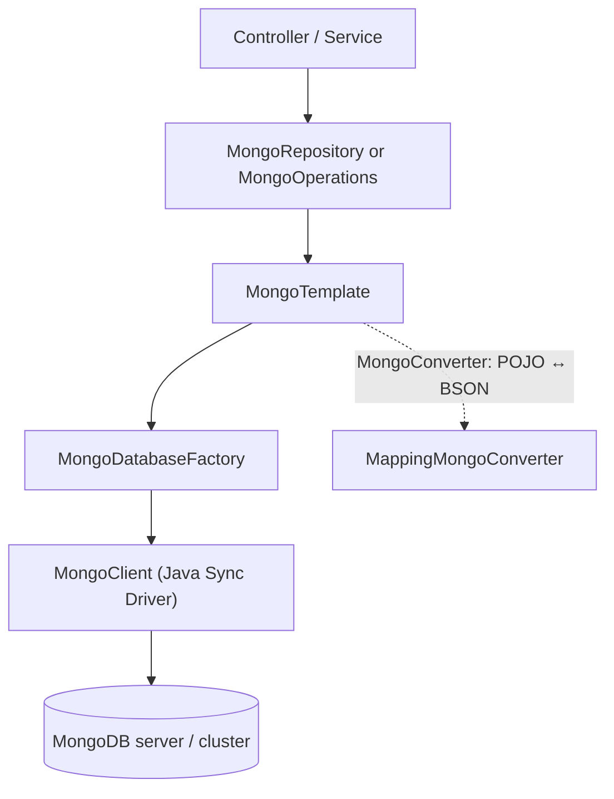
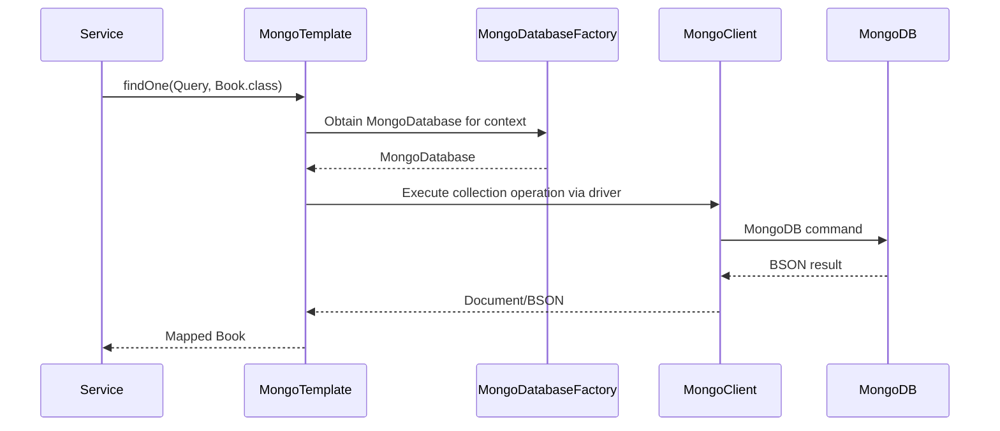

# Roles of MongoClient, MongoDatabaseFactory, and MongoTemplate

## 1. Where Do These Three Components Sit in the Spring Data MongoDB Architecture?

When a Java application works with MongoDB, you frequently encounter three similar names: `MongoClient`, `MongoDatabaseFactory`, and `MongoTemplate`. They have distinct responsibilities and form a chain from low-level connectivity to high-level data operations.

- **`MongoClient`** belongs to the **MongoDB Java Driver**. It is the entry point for communicating with MongoDB: managing connection settings, server selection, connection pooling, sessions, and executing driver commands.
- **`MongoDatabaseFactory`** belongs to **Spring Data MongoDB**. It is the abstraction that supplies a `MongoDatabase` to Spring Data based on the configured database and execution context, while also participating in session/transaction integration and exception translation.
- **`MongoTemplate`** belongs to **Spring Data MongoDB**. It provides the Java-object-oriented document operations API: mapping, queries, updates, aggregation, indexes, callbacks, and utility operations.

All three components serve the goals of **SPRING_DATA_MONGODB**: connecting, mapping documents, and operating on MongoDB via templates or repositories, then extending into advanced queries, aggregation, indexes, transactions, reactive access, testing, and performance diagnostics.



The path above is a conceptual model. Repositories are implemented by Spring Data on top of the MongoDB operations infrastructure; other infrastructure classes, such as mapping converters, are also configured and used by Spring. **Do not interpret the diagram to mean every method must execute through one rigid, fixed call chain.**

### Quick Responsibility Table

| Question | Primary responsible component |
| --- | --- |
| Where are URI connections, replica sets, authentication, TLS, and pooling configured? | `MongoClient` / `MongoClientSettings` |
| Which database is the application operating against? | `MongoDatabaseFactory` and database configuration |
| Where are Java objects mapped to documents, and where are `Query` and `Update` built? | `MongoTemplate` with `MongoConverter` |
| Want to call `findByEmail` without writing the query manually? | Spring Data repository |
| Want to manipulate BSON directly without Spring Data mapping? | MongoDB driver API via `MongoClient` |
| Want non-blocking access inside a Reactor pipeline? | The corresponding **reactive** components |

## 2. MongoClient: Driver Connection and Resource Management

### 2.1. What is `MongoClient`?

On the synchronous branch, the official client type is:

```java
com.mongodb.client.MongoClient
```

The MongoDB Java Sync Driver creates clients via `com.mongodb.client.MongoClients`. A client represents the connection configuration to a MongoDB deployment and typically owns connection pools; the driver opens network connections when executing commands and selects servers based on topology.

```java
import com.mongodb.client.MongoClient;
import com.mongodb.client.MongoClients;
import com.mongodb.client.MongoCollection;
import org.bson.Document;

try (MongoClient client = MongoClients.create(
        "mongodb://localhost:27017")) {

    MongoCollection<Document> books = client
        .getDatabase("catalog")
        .getCollection("books");

    Document book = books.find(
        new Document("isbn", "978-0000000001")
    ).first();
}
```

This is a **standalone driver usage** example: `getDatabase` returns an object representing the database; `getCollection` returns the collection object, and `find` operates on BSON `Document`s. The driver API does not automatically apply Spring Data's `@Document` annotation, field naming rules, or custom converters.

In a long-running Spring Boot application, `MongoClient` should be managed as a **shared bean**, typically one instance per connection configuration. Do not create and close a client for each HTTP request: doing so wastes pools, handshakes, and topology discovery, and makes lifecycle management harder. When the client is a Spring-owned bean, Spring manages closing its resources when the application context shuts down.

### 2.2. Decisions Made at the Client Layer

`MongoClientSettings` or the connection string controls several important settings:

- URI, host, port, and connection details for the deployment.
- Credentials, authentication mechanism, and TLS; store secrets in environment variables or a secret manager rather than hard-coding them.
- Connection pool: size, checkout wait time, connection lifetime.
- Timeouts and server selection: connection, server selection, and response wait times as configured in the driver.
- Read preference, write concern, retryable reads/writes, and options suited to the topology.
- Observing commands/connection pools via listeners or metrics/tracing integration.

Example connection string for a development environment:

```text
mongodb://localhost:27017/catalog?maxPoolSize=50&serverSelectionTimeoutMS=5000
```

The numbers `50` and `5000` are illustrative only; measure the workload before setting values in production. A large pool cannot fix a query missing an index, while a pool that is too small can force requests to wait for a connection.

**Note:** `MongoClient` is thread-safe for concurrent access by driver design. By contrast, a `ClientSession` is created for a specific sequence of operations and should not be shared arbitrarily across independent threads or requests.

## 3. MongoDatabaseFactory: The Boundary Between the Driver and Spring Data

### 3.1. Primary Responsibilities

`org.springframework.data.mongodb.MongoDatabaseFactory` is the abstraction Spring Data MongoDB uses to obtain an appropriate `MongoDatabase` for the current operation.

A common implementation is `SimpleMongoClientDatabaseFactory`. It binds the configured client to a default database:

```java
import com.mongodb.client.MongoClient;
import org.springframework.data.mongodb.MongoDatabaseFactory;
import org.springframework.data.mongodb.core.SimpleMongoClientDatabaseFactory;

MongoDatabaseFactory factory =
    new SimpleMongoClientDatabaseFactory(client, "catalog");
```

The example assumes the `client` variable has already been created by the driver and remains alive throughout its usage. The factory frees Spring Data code from needing to know MongoDB client initialization logic in every service.

In Spring's architecture, the factory plays several key roles:

1. **Selecting the default database:** the template uses the factory to retrieve the target database instead of passing the database name string on every query.
2. **Hiding driver details:** Spring Data components work against a shared abstraction and configuration mechanism.
3. **Supporting session and transaction integration:** when a transaction manager is present, operations can participate in the appropriate session/transaction context.
4. **Providing exception translation:** helps represent driver errors using Spring Data's exception hierarchy.
5. **Enabling infrastructure flexibility:** supports multi-database setups, custom factories, or controlled database selection strategies.

**The factory is not a second pool** and does not replace `MongoClient`. Actual pooling and connections remain managed by the driver. Nor does the factory expose a domain query API like `find(Query, Book.class)`; that is the template's responsibility.

### 3.2. Distinguishing the Factory from `MongoDatabase`

`MongoDatabase` belongs to the driver and represents a specific database:

```java
MongoDatabase db = factory.getMongoDatabase();
```

`MongoDatabaseFactory` is the contextual database provider. A `MongoDatabase` object lets you invoke collection APIs, commands, and driver features; however, if you want `@Document` mapping and Spring Data `Criteria`, operate through the template.

### 3.3. The Factory and Sessions in Transactions

For multi-document transactions, Spring Data needs to associate operations with the appropriate session. `MongoTransactionManager` for the synchronous branch coordinates with `MongoDatabaseFactory` so operations participate in the session/transaction via Spring's transaction management mechanism.

This does not mean **merely creating a factory makes transactions work automatically**. You need a transaction manager, `@Transactional` or `TransactionTemplate` boundaries, and a MongoDB deployment that supports transactions. Direct driver commands should not be assumed to join a transaction just because they share the same client; you must pass and use the appropriate session when needed.

## 4. MongoTemplate: High-Level Data API for Applications

### 4.1. Why Do We Need a Template?

`MongoTemplate` implements `MongoOperations`. Instead of manually converting POJOs to BSON and working with raw documents, the application can work directly with Java objects:

- `insert`, `save`, `find`, `findOne`, `findById`, `remove`.
- `updateFirst`, `updateMulti`, `findAndModify`, `upsert`, and bulk operations.
- `Query`, `Criteria`, `Update`, sorting, projection, pagination.
- `Aggregation`, aggregation stages, statistics, and pipeline queries.
- `indexOps` for index management; `execute` for direct collection-level operations when needed.
- Coordinates `MongoConverter`, entity callbacks, annotation mapping, and exception translation.

Example entity:

```java
import java.math.BigDecimal;
import org.springframework.data.annotation.Id;
import org.springframework.data.mongodb.core.mapping.Document;

@Document(collection = "books")
public record Book(
    @Id String id,
    String isbn,
    String title,
    BigDecimal price,
    boolean available
) {}
```

`@Document` binds the type to the `books` collection, and `@Id` maps the identifier property to `_id` in MongoDB. Spring Data converters also handle many Java types; if data requires specialized BSON formats, custom conversions may be needed.

### 4.2. Querying and Updating with `MongoTemplate`

```java
import java.math.BigDecimal;
import java.util.List;
import org.springframework.data.domain.Sort;
import org.springframework.data.mongodb.core.MongoTemplate;
import org.springframework.data.mongodb.core.query.Criteria;
import org.springframework.data.mongodb.core.query.Query;
import org.springframework.data.mongodb.core.query.Update;
import org.springframework.stereotype.Service;

@Service
public class BookCatalogService {

    private final MongoTemplate template;

    public BookCatalogService(MongoTemplate template) {
        this.template = template;
    }

    public List<Book> findAvailable(String titleKeyword) {
        Query query = Query.query(
            Criteria.where("available").is(true)
                .and("title").regex(titleKeyword, "i")
        );
        query.with(Sort.by(Sort.Direction.ASC, "title"));
        query.limit(50);
        return template.find(query, Book.class);
    }

    public boolean changePrice(String bookId, BigDecimal price) {
        Query query = Query.query(Criteria.where("_id").is(bookId));
        Update update = new Update().set("price", price);
        return template.updateFirst(query, update, Book.class)
            .getModifiedCount() > 0;
    }
}
```

The example above shows that the template knows the collection from `Book` and uses the converter to map data. For a search input accepting arbitrary user text, consider character limits and regex escaping: `titleKeyword` should not be used as raw regex if the requirement is simply literal string matching. Using a regex without an anchored prefix can also prevent the query from using an index effectively. This code illustrates the template API; when building real search functionality, design dedicated indexes and search rules.

`getModifiedCount() == 0` does not distinguish between "not found" and "value was already equal to the requested value." If exact business outcomes are needed, inspect `getMatchedCount()` along with optimistic locking requirements or a richer representation of the update result.

### 4.3. Aggregation and Indexes via Template

```java
import org.springframework.data.mongodb.core.aggregation.Aggregation;
import org.springframework.data.mongodb.core.aggregation.AggregationResults;
import org.springframework.data.mongodb.core.index.Index;
import org.springframework.data.domain.Sort;

// Create an index for a known query pattern.
template.indexOps(Book.class)
    .ensureIndex(new Index().on("isbn", Sort.Direction.ASC).unique());

// Count the number of books currently available for sale.
Aggregation pipeline = Aggregation.newAggregation(
    Aggregation.match(Criteria.where("available").is(true)),
    Aggregation.count().as("total")
);

AggregationResults<org.bson.Document> result =
    template.aggregate(pipeline, Book.class, org.bson.Document.class);
```

`MongoTemplate` lets you write pipelines against declared objects and mappings, but **aggregation still executes on the MongoDB server**. Latency and performance depend on data, indexes, stage order, and the number of documents processed. In real systems, indexes should be managed cleanly through migrations/deployments; do not create indexes arbitrarily on every request.

### 4.4. How Do Templates and Repositories Relate?

Repositories are generally well suited for CRUD operations and derived query methods:

```java
import java.util.Optional;
import org.springframework.data.mongodb.repository.MongoRepository;

public interface BookRepository
        extends MongoRepository<Book, String> {

    Optional<Book> findByIsbn(String isbn);
}
```

Repositories use the underlying Spring Data MongoDB infrastructure, including mapping and operations/template. When business logic needs complex dynamic queries, bulk operations, or aggregation pipelines, you can complement them with `MongoTemplate` in services or custom repositories. You do not have to choose "only repositories" or "only templates" for an entire application.

## 5. Configuration in Spring Boot: Automatic vs. Manual

### 5.1. When Spring Boot Auto-configures

With a Spring Boot 3.x application that has the sync starter and URI configuration:

```xml
<dependency>
    <groupId>org.springframework.boot</groupId>
    <artifactId>spring-boot-starter-data-mongodb</artifactId>
</dependency>
```

```yaml
spring:
  data:
    mongodb:
      uri: mongodb://localhost:27017/catalog
```

Spring Boot can automatically configure `MongoClient`, `MongoDatabaseFactory`, converters, `MongoTemplate`, and the corresponding repository components based on the classpath and auto-configuration conditions. The application simply injects the beans it needs:

```java
@Service
public class CatalogUseCase {
    private final MongoTemplate template;

    public CatalogUseCase(MongoTemplate template) {
        this.template = template;
    }
}
```

In other Spring Boot versions, **property names and auto-configuration conditions must be verified against the exact version in use**. The example above specifically targets the common Boot 3.x configuration style. When supplying manual beans, verify which auto-configurations back off and which beans are still created automatically.

### 5.2. When You Need to Create Beans Manually

Example of a configuration that explicitly controls all three layers:

```java
import com.mongodb.client.MongoClient;
import com.mongodb.client.MongoClients;
import org.springframework.context.annotation.Bean;
import org.springframework.context.annotation.Configuration;
import org.springframework.core.env.Environment;
import org.springframework.data.mongodb.MongoDatabaseFactory;
import org.springframework.data.mongodb.core.MongoTemplate;
import org.springframework.data.mongodb.core.SimpleMongoClientDatabaseFactory;

@Configuration
public class MongoInfrastructureConfig {

    @Bean(destroyMethod = "close")
    public MongoClient mongoClient(Environment env) {
        String uri = env.getRequiredProperty("app.mongodb.uri");
        return MongoClients.create(uri);
    }

    @Bean
    public MongoDatabaseFactory mongoDatabaseFactory(
            MongoClient mongoClient) {
        return new SimpleMongoClientDatabaseFactory(
            mongoClient, "catalog"
        );
    }

    @Bean
    public MongoTemplate mongoTemplate(
            MongoDatabaseFactory mongoDatabaseFactory) {
        return new MongoTemplate(mongoDatabaseFactory);
    }
}
```

Add `app.mongodb.uri` to environment-specific configuration, such as a localhost development URI; production credentials should be supplied via environment variables or a secret manager.

**Bean lifecycle:** the client is created once; the factory and template use that client. When Spring closes the context, the client's destroy method closes the connection pool. If a factory is created with a client owned elsewhere, understand who is responsible for closing the client to prevent premature closing or resource leaks.

**Do not blindly combine two configurations:** when Spring Boot is auto-configuring MongoDB, adding all manual beans into the same app without considering conditions can produce multiple clients/templates, bean conflicts, or repositories pointing to the wrong database. Only override the beans you actually need to customize and inspect the dependency graph.

## 6. What Happens When a Request Calls `find`?

Suppose a controller calls `BookRepository.findByIsbn("978-0000000001")` or a service calls `template.findOne(query, Book.class)`.



The diagram omits callbacks, converters, sessions, and internal infrastructure classes. It illustrates the division of responsibilities:

1. The service expresses the business request; the repository or template builds the corresponding operation.
2. The factory provides the right database, where transaction context may influence the session.
3. The driver client dispatches the operation to MongoDB, manages connections, and receives BSON.
4. The mapping converter is used by the template to convert the data into an entity.
5. Exceptions from Spring Data operations are generally translated into the `DataAccessException` hierarchy so the application can handle them according to its policy.

From here, you can diagnose issues at the right layer: wrong URI/timeout/pool at the client; wrong database name at the factory; wrong mapping or query at the template; slow query due to indexes and execution plans at the server.

## 7. Transactions: Coordinated Role of Factory and Template

An update to a **single document** is atomic according to MongoDB rules. If a service updates two documents/collections and requires both to succeed together, a transaction may be necessary.

With synchronous Spring Data MongoDB:

```java
import org.springframework.context.annotation.Bean;
import org.springframework.context.annotation.Configuration;
import org.springframework.data.mongodb.MongoDatabaseFactory;
import org.springframework.data.mongodb.MongoTransactionManager;

@Configuration
public class MongoTransactionConfig {

    @Bean
    public MongoTransactionManager transactionManager(
            MongoDatabaseFactory databaseFactory) {
        return new MongoTransactionManager(databaseFactory);
    }
}
```

Example service updating inventory and creating an order:

```java
import com.mongodb.client.result.UpdateResult;
import org.springframework.data.mongodb.core.MongoTemplate;
import org.springframework.data.mongodb.core.query.Criteria;
import org.springframework.data.mongodb.core.query.Query;
import org.springframework.data.mongodb.core.query.Update;
import org.springframework.stereotype.Service;
import org.springframework.transaction.annotation.Transactional;

@Service
public class PurchaseService {

    private final MongoTemplate template;

    public PurchaseService(MongoTemplate template) {
        this.template = template;
    }

    @Transactional
    public void placeOrder(String productId, int quantity) {
        if (quantity <= 0) {
            throw new IllegalArgumentException("quantity must be > 0");
        }

        UpdateResult updated = template.updateFirst(
            Query.query(Criteria.where("_id").is(productId)
                .and("stock").gte(quantity)),
            new Update().inc("stock", -quantity),
            "products"
        );

        if (updated.getMatchedCount() == 0) {
            throw new IllegalStateException("Not enough stock");
        }

        template.insert(
            new org.bson.Document("productId", productId)
                .append("quantity", quantity),
            "orders"
        );
    }
}
```

The code illustrates the mechanism; production requires order identifiers, duplicate request protection, retry handling, and complete business constraints. `@Transactional` only applies when invoked through a Spring proxy or equivalent transaction mechanism with a suitable transaction manager. MongoDB multi-document transactions require a supported topology, typically a replica set or sharded cluster; do not assume a standalone server behaves identically. Transactions carry overhead: do not use them to compensate for a poorly designed document model.

The factory enables the template to attach operations to the session/transaction context. Conversely, obtaining a collection directly via `MongoClient` and executing operations without the proper `ClientSession` can cause commands to execute outside the transaction.

## 8. What Are the Equivalent Components on the Reactive Branch?

Spring Data MongoDB provides a dedicated family of reactive APIs. Class names may look similar, but client types and programming models differ significantly:

| Layer | Synchronous | Reactive |
| --- | --- | --- |
| MongoDB driver | `com.mongodb.client.MongoClient` | `com.mongodb.reactivestreams.client.MongoClient` |
| Client creation | `com.mongodb.client.MongoClients` | `com.mongodb.reactivestreams.client.MongoClients` |
| Factory | `MongoDatabaseFactory` | `ReactiveMongoDatabaseFactory` |
| Factory implementation | `SimpleMongoClientDatabaseFactory` | `SimpleReactiveMongoDatabaseFactory` |
| Template | `MongoTemplate` | `ReactiveMongoTemplate` |
| Repository | `MongoRepository` | `ReactiveMongoRepository` |
| Common return types | `Book`, `List<Book>`, `Optional<Book>` | `Mono<Book>`, `Flux<Book>` |
| Transaction manager | `MongoTransactionManager` | `ReactiveMongoTransactionManager` |

Example wiring the reactive branch with explicitly imported types:

```java
import com.mongodb.reactivestreams.client.MongoClient;
import com.mongodb.reactivestreams.client.MongoClients;
import org.springframework.context.annotation.Bean;
import org.springframework.context.annotation.Configuration;
import org.springframework.data.mongodb.ReactiveMongoDatabaseFactory;
import org.springframework.data.mongodb.core.ReactiveMongoTemplate;
import org.springframework.data.mongodb.core.SimpleReactiveMongoDatabaseFactory;

@Configuration
public class ReactiveMongoInfrastructureConfig {

    @Bean(destroyMethod = "close")
    public MongoClient reactiveMongoClient() {
        return MongoClients.create("mongodb://localhost:27017");
    }

    @Bean
    public ReactiveMongoDatabaseFactory reactiveMongoDatabaseFactory(
            MongoClient reactiveMongoClient) {
        return new SimpleReactiveMongoDatabaseFactory(
            reactiveMongoClient, "catalog"
        );
    }

    @Bean
    public ReactiveMongoTemplate reactiveMongoTemplate(
            ReactiveMongoDatabaseFactory factory) {
        return new ReactiveMongoTemplate(factory);
    }
}
```

In Spring Boot, the `spring-boot-starter-data-mongodb-reactive` starter can auto-configure these beans, so manual declarations like the example are not always necessary. Do not place both synchronous and reactive manual configuration classes in the same application unless you intentionally manage both infrastructures.

Example using the reactive template:

```java
import reactor.core.publisher.Flux;
import org.springframework.data.mongodb.core.ReactiveMongoTemplate;
import org.springframework.data.mongodb.core.query.Criteria;
import org.springframework.data.mongodb.core.query.Query;

public Flux<Book> availableBooks(ReactiveMongoTemplate template) {
    Query query = Query.query(Criteria.where("available").is(true));
    return template.find(query, Book.class);
}
```

In reactive programming, operations returning a `Publisher` execute when subscribed; do not call `block()` on a non-blocking request-handling thread to convert to synchronous style. Reactive transactions use Reactor context rather than relying solely on ThreadLocal like the synchronous branch. The reactive driver **does not automatically make an unindexed MongoDB query faster**.

## 9. When an Application Uses Multiple Databases or Multiple Tenants

Suppose a system has `catalog` and `reporting` databases. Two templates can share the same client if they target the same deployment and share access policies, but they need explicit factory/database configuration:

```java
@Bean("catalogTemplate")
MongoTemplate catalogTemplate(MongoClient client) {
    return new MongoTemplate(
        new SimpleMongoClientDatabaseFactory(client, "catalog")
    );
}

@Bean("reportingTemplate")
MongoTemplate reportingTemplate(MongoClient client) {
    return new MongoTemplate(
        new SimpleMongoClientDatabaseFactory(client, "reporting")
    );
}
```

The snippet illustrates two templates inside a configuration class that has the required Spring and driver imports. When injecting, use `@Qualifier` or bean names to avoid ambiguity. If repositories for each database are configured separately, bind each repository package to the proper `mongoTemplateRef` instead of letting all of them fall back to the default template.

For multi-tenancy, avoid using a global variable storing the "current database" and mutating it per request: concurrent requests can execute simultaneously and mix tenant data. Use a controlled, authenticated tenant-selection mechanism, create/cache resources according to appropriate connection policies, and ensure transactions/traces never cross into the wrong tenant.

Separating databases does not automatically isolate access permissions: credentials and roles on the MongoDB server must be configured to enforce the desired data isolation level.

## 10. Common Configuration Errors and How to Diagnose Them

| Symptom | First layer to check | Specific checks |
| --- | --- | --- |
| Cannot connect, server selection timeout | `MongoClient` / network / deployment | URI, DNS, TLS, auth, ability to elect primary, timeouts, driver logs |
| Application runs but data appears in the wrong database | `MongoDatabaseFactory` / URI | Database name in connection string, factory, template, and repository beans |
| Connection count spikes sharply on every request | `MongoClient` lifecycle | Is a client being created in a controller/service instead of a shared bean? |
| `MongoTemplate` cannot be injected | Spring context / auto-configuration | Starter, bean creation conditions, duplicate bean names, manual configs |
| Read documents have missing or wrong fields | `MongoConverter` / mapping | `@Id`, field names, BSON types, custom conversions, legacy schema |
| Queries slow down as data grows | `Query` / MongoDB server | Filters, sort, projection, `explain("executionStats")`, indexes |
| Transaction error or operations run outside transaction | Factory, transaction manager, session | Replica set, `@Transactional`, matching manager and client/session used |
| Reactive API still blocks requests | Service architecture | Are there `block()` calls or sync driver/template calls in the pipeline? |
| High pool wait time while database CPU is low | Driver pool / concurrency | Pool checkout wait, maxPoolSize, concurrent request count, connection hold time |

### 10.1. Do not equate connection errors with query errors

`MongoClient` can initialize successfully before the first operation actually contacts the server; therefore, "bean created" does not prove MongoDB is ready. You need proper readiness/health checks and runtime error handling, rather than simply verifying that the constructor did not throw an exception.

### 10.2. Do not optimize solely by switching API layers

Queries via `MongoTemplate` and via a repository can emit equivalent MongoDB commands. A slow repository method will not necessarily become faster when rewritten with a template. Compare **actual commands, indexes, result sizes, network latency, pool wait, and p95/p99** before drawing conclusions.

### 10.3. Observe all layers

- **Application:** per-request tracing, time spent in service/repository, error rates, concurrent request counts.
- **Driver:** connection pool metrics, connection checkout wait time, command monitoring, timeouts, server selection.
- **Spring Data:** query mapping, entity callbacks, conversion errors, and `DataAccessException` exceptions.
- **MongoDB server:** slow queries, controlled profiler usage, `explain`, index usage, cache, CPU, and I/O resources.

When enabling query logs or tracing, avoid writing credentials and sensitive document data to logs. In multi-tenant environments, attach safe tenant labels to distinguish configuration issues without leaking data contents.

## 11. Testing Configuration and Behavior

### 11.1. Unit testing

Services using `MongoOperations` or repository interfaces can be unit tested with mocks when you only need to verify query criteria or business branches. However, mocks do **not** verify BSON mapping, indexes, transactions, or MongoDB server compatibility.

### 11.2. Integration testing

Use a real MongoDB instance (for example via Testcontainers) to verify:

1. `MongoTemplate` points to the right database/collection and maps `@Id` as expected.
2. Custom converters, indexes, aggregations, and error handling work against real BSON data.
3. Repositories and templates share the same configuration when intended to share a database.
4. Transactions actually commit/rollback when running against MongoDB with a supported topology.
5. The reactive branch produces expected `Mono`/`Flux` contents, error signals, and completion; this can be tested with `StepVerifier`.

In Spring Boot applications, `@DataMongoTest` is one way to create a MongoDB-focused test slice. With Testcontainers, configure test connections to the corresponding container and ensure a clean database between test cases. When testing transactions, use an appropriate replica set configuration instead of relying on a plain standalone MongoDB instance.

### 11.3. Configuration diagnostic exercise

Create two environments: `catalog_dev` and `catalog_test`. Run the same injected repository and `MongoTemplate`, and verify:

- When running with the dev profile, data goes only into the dev database.
- When running with the test profile, data goes into the test database.
- When given an invalid URI, read/write commands report observable and explainable connection errors.
- When an index matching a query pattern is missing, `explain` shows the difference before and after creating the index.

What needs to be proven is not merely "it connects," but **right database, right mapping, right transaction, and right operational behavior**.

## 12. Applied Exercise

You are building a book inventory service with MongoDB that has two features: looking up a book by ISBN and executing an order transaction that decrements stock.

1. Draw the connection diagram `Service → MongoTemplate → MongoDatabaseFactory → MongoClient → MongoDB`. Mark clearly where BSON mapping occurs.
2. Configure Spring Boot to connect to the `catalog` database. Confirm the system has only the expected number of client/template beans.
3. Write the `Book` entity, `BookRepository`, and an equivalent dynamic query via `MongoTemplate`.
4. Add a unique index for ISBN; explain why service-level validation cannot replace a unique index under concurrent requests.
5. Create a transaction via `MongoTransactionManager` to decrement stock and insert an order. Test rollback when order insertion fails.
6. Describe how to migrate reading the book list to `ReactiveMongoTemplate` and what changes in result types, driver, factory, and transaction context.
7. When latency increases, inspect the query plan, pool wait, timeouts, and MongoDB resources in sequence to locate the bottleneck.

**Self-check:** If you already have `MongoClient`, why does the application still need `MongoTemplate`? Does the factory own a separate connection pool? Is creating `MongoTransactionManager` enough for every direct driver command to participate in a transaction? Can repositories and templates coexist in the same service?

## Key Takeaways

**`MongoClient` manages communication and connection resources at the driver layer; `MongoDatabaseFactory` provides the database and integrates Spring Data context; `MongoTemplate` provides the Java-object API for querying, mapping, updating, and aggregation.** Repositories are built on the operations infrastructure and suit declarative queries. Using each layer in its proper role keeps Spring Boot configuration clean, keeps synchronous/reactive choices consistent, scopes transactions properly, makes mapping testable, and points performance investigations to where bottlenecks actually arise.
