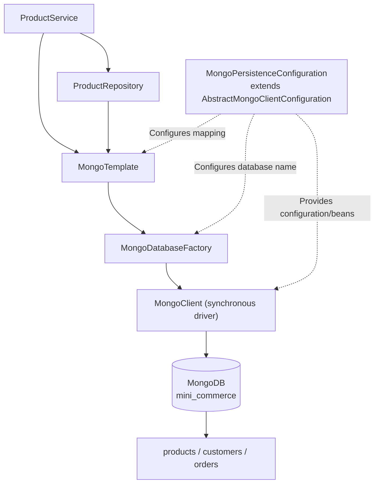

# Manual Configuration Using AbstractMongoClientConfiguration

## 1. Lesson Objectives

In **Spring Data MongoDB**, an application can rely on Spring Boot auto-configuration to create `MongoClient`, `MongoDatabaseFactory`, and `MongoTemplate`. When you need explicit control over how the client is initialized, the database name, the entity scan scope, or certain mapping settings, you can extend `AbstractMongoClientConfiguration` and declare your configuration in Java.

This topic belongs to **Configuration and Architecture**. Examples throughout use the **Mini Commerce** application with collections `products`, `customers`, and `orders`, preparing for lessons on document mapping, repositories, MongoTemplate, queries, aggregation, indexes, transactions, testing, and performance diagnostics.

After completing this lesson, you will be able to:

- Explain the core beans required for Spring Data MongoDB to operate and the responsibilities of `AbstractMongoClientConfiguration`.
- Implement a complete manual configuration class using URIs safely and selecting the database consistently.
- Distinguish between `getDatabaseName()`, `mongoClient()`, `getMappingBasePackages()`, and `autoIndexCreation()`.
- Use `MongoRepository` or `MongoTemplate` over the connection you created.
- Recognize when to keep Spring Boot auto-configuration, when manual configuration is appropriate, and how Reactive MongoDB differs.
- Self-verify connectivity, mapping, indexes, and common errors without confusing "application started" with "database connected successfully."

**Prerequisites:** A Java/Spring Boot project with `spring-boot-starter-data-mongodb` declared, a reachable MongoDB instance, and basic familiarity with `@Configuration`, dependency injection, and `@Document`. The Java code in this lesson illustrates the **synchronous/imperative** branch.

## 2. Why and When Should You Configure Manually?

In small projects, the simplest approach is usually configuring a URI in `application.yml` and letting Spring Boot create the MongoDB beans automatically. Depending on the Spring Boot version, the URI can be configured via `spring.data.mongodb.uri` (Boot 3.x) or `spring.mongodb.uri` (Boot 4.x).

However, there are cases where explicit configuration control is needed:

| Requirement | Default auto-configuration | Configuration via `AbstractMongoClientConfiguration` |
| --- | --- | --- |
| Single database, simple URI | Usually sufficient | Unnecessary |
| Need to construct `MongoClientSettings` yourself | Customizable via Boot customizers/properties | Explicitly constructs the full client |
| Explicitly specify database and entity scan packages | Uses defaults derived from application structure | Explicitly declared via overridden methods |
| Teaching/learning MongoDB bean structure | Many details are hidden by Boot | Clearly shows each layer's responsibilities |
| Creating multiple MongoDB clients/databases | Requires dedicated bean configurations | This single configuration class is only a baseline; multiple clients require separate factory/template/repository design |
| Using Reactive MongoDB | Boot provides corresponding reactive starter/configuration | **Do not use** this synchronous configuration class to replace reactive configuration |

**Principle:** If the default configuration meets your needs, prefer it. Extend `AbstractMongoClientConfiguration` when you need to own architectural decisions and accept responsibility for managing the client, URI, package scanning, indexes, and resource lifecycles. Within one application, avoid creating two sets of beans with the same function unless there is a clear requirement.

## 3. Component Architecture

A request fetching a product by SKU can go through a repository or `MongoTemplate`, but ultimately both use the database factory and the MongoDB driver:



Key components:

| Component | Role |
| --- | --- |
| `com.mongodb.client.MongoClient` | Synchronous client from the MongoDB Java Driver; holds connection, topology, TLS, and pool settings |
| `MongoDatabaseFactory` | Abstraction providing database access to Spring Data for a given client/database name |
| `MongoTemplate` | Synchronous MongoDB operations API: CRUD, `Query`, `Update`, aggregation, indexes, etc. |
| `MappingMongoConverter` | Converts between Java objects and BSON documents using mapping metadata |
| `MongoRepository` | Repository interface built on Spring Data MongoDB infrastructure; convenient for CRUD and query methods |
| `AbstractMongoClientConfiguration` | Base configuration class providing mapping, template, factory integration, and extension points; developers override the required choices |

**Do not confuse two similarly named clients**: `com.mongodb.client.MongoClient` is the **synchronous** client; `com.mongodb.reactivestreams.client.MongoClient` is the **reactive** client. Importing the wrong type often causes override errors or missing bean errors.

## 4. Declaring Dependencies

With Maven, assuming Spring Boot parent or BOM is used for version management:

```xml
<dependencies>
    <dependency>
        <groupId>org.springframework.boot</groupId>
        <artifactId>spring-boot-starter-data-mongodb</artifactId>
    </dependency>
</dependencies>
```

With Gradle Groovy DSL:

```groovy
dependencies {
    implementation 'org.springframework.boot:spring-boot-starter-data-mongodb'
}
```

With Gradle Kotlin DSL:

```kotlin
dependencies {
    implementation("org.springframework.boot:spring-boot-starter-data-mongodb")
}
```

Choose the declaration matching your current build tool. The starter brings in Spring Data MongoDB, the synchronous driver, and mapping/repository components. When using the Spring Boot BOM, avoid pinning separate versions for `spring-data-mongodb` or `mongodb-driver-sync` without verifying compatibility.

## 5. Configuring a Dedicated URI for the Java Class

In this example, we deliberately use the application property **`app.mongodb.uri`**. This is a **custom property**, read via `@Value` in the configuration class; it is not Spring Boot's default URI key. This choice makes the configuration source transparent in the Java example and independent of auto-configuration property name differences across Boot releases.

In `src/main/resources/application.yml`:

```yaml
app:
  mongodb:
    uri: "${MONGODB_URI:mongodb://localhost:27017/mini_commerce}"
```

Meaning:

- `MONGODB_URI` is the environment variable used during deployment; if unset, the example runs locally with `mongodb://localhost:27017/mini_commerce`.
- `mini_commerce` is the database required for this lesson.
- In practice, the URI may be `mongodb://...` or `mongodb+srv://...` depending on the MongoDB deployment type.
- The database name after `/` in the URI is used as the **single source of truth** for `getDatabaseName()` in the example below.

**Never commit credentials into source code or YAML.** In production, supply the URI via a secret manager, environment variables, or a secure configuration system. The URI can contain passwords, `authSource`, TLS, and other parameters; never write raw sensitive URIs to logs or expose them in error messages sent to HTTP clients.

If the application runs in Docker, `localhost` in the URI refers to the application container itself; use the MongoDB hostname/service name on the shared network or an appropriately routed endpoint.

## 6. Complete Configuration with AbstractMongoClientConfiguration

Suppose the project has the following packages:

```text
com.example.minicommerce
├── MiniCommerceApplication.java
├── config/
│   └── MongoPersistenceConfiguration.java
├── domain/
│   ├── Product.java
│   ├── Customer.java
│   └── Order.java
├── repository/
│   └── ProductRepository.java
└── service/
    └── ProductService.java
```

Create `MongoPersistenceConfiguration.java`:

```java
package com.example.minicommerce.config;

import java.util.Collection;
import java.util.List;

import com.mongodb.ConnectionString;
import com.mongodb.MongoClientSettings;
import com.mongodb.client.MongoClient;
import com.mongodb.client.MongoClients;

import org.springframework.beans.factory.annotation.Value;
import org.springframework.context.annotation.Configuration;
import org.springframework.data.mongodb.config.AbstractMongoClientConfiguration;
import org.springframework.data.mongodb.repository.config.EnableMongoRepositories;

@Configuration
@EnableMongoRepositories(
    basePackages = "com.example.minicommerce.repository"
)
public class MongoPersistenceConfiguration
        extends AbstractMongoClientConfiguration {

    private final ConnectionString connectionString;

    public MongoPersistenceConfiguration(
            @Value("${app.mongodb.uri}") String uri) {
        this.connectionString = new ConnectionString(uri);

        String database = connectionString.getDatabase();
        if (database == null || database.isBlank()) {
            throw new IllegalArgumentException(
                "app.mongodb.uri must contain a database name");
        }
    }

    @Override
    public MongoClient mongoClient() {
        MongoClientSettings settings = MongoClientSettings.builder()
            .applyConnectionString(connectionString)
            .applicationName("mini-commerce")
            .build();

        return MongoClients.create(settings);
    }

    @Override
    protected String getDatabaseName() {
        return connectionString.getDatabase();
    }

    @Override
    protected Collection<String> getMappingBasePackages() {
        return List.of("com.example.minicommerce.domain");
    }

    @Override
    protected boolean autoIndexCreation() {
        return false;
    }
}
```

### 6.1. Analyzing each extension point

**`mongoClient()` — Initializing the synchronous client.** Spring Data invokes the configured client bean to access MongoDB. `MongoClients.create(settings)` builds the client from the URI settings while also setting `applicationName` to identify the client in observability tools. The client handles connection pooling and connection management and should be created once and reused; **never create a new client per request**.

**`getDatabaseName()` — Specifying the database.** The configuration class needs to know which database `MongoTemplate` operates on. Here it reads the database directly from the URI instead of hard-coding a different name in this method. The check in the constructor rejects URIs missing a database name, preventing accidental writes into an unintended database.

**`getMappingBasePackages()` — Entity discovery scope.** Returns the packages containing classes annotated with `@Document` and other mapping metadata. Explicitly declaring this scope is helpful in large projects or when the domain package does not sit under the application root package. It does not replace repository scanning.

**`@EnableMongoRepositories` — Repository scanning.** This annotation points to the package containing interfaces like `ProductRepository`. It differs from `getMappingBasePackages()`: one locates **repositories**, while the other locates **entities/mapping metadata**. In simple Boot applications, repositories can be auto-detected; here we declare the annotation explicitly to illustrate manual configuration.

**`autoIndexCreation()` — Index creation policy.** The example returns `false` so indexes are not created implicitly on startup. This is a cautious choice when real data exists, because unique index creation can fail if duplicate documents already exist, and index creation should be controlled via migrations/deployment workflows. In a lab environment you can temporarily enable it for learning, provided you know whether the indexes actually exist.

### 6.2. Where are the beans created?

`AbstractMongoClientConfiguration` provides the infrastructure beans/configurations for synchronous MongoDB; it constructs `MongoDatabaseFactory`, the mapping converter, and `MongoTemplate` using the chosen client and database name. Therefore, for a single connection without special requirements, **do not declare an extra manual `@Bean MongoTemplate`**. Creating duplicate beans or accidentally constructing a separate factory makes it hard to determine which client/database the template uses.

In Spring Boot, conditional auto-configurations back off when the application already supplies beans at the corresponding extension points. However, check the actual beans if the application has other `@Configuration` classes, both synchronous and reactive dependencies, or multiple repositories. Do not assume the application "only has one client" if the classpath and configuration permit creating multiple client types.

## 7. Using the Configuration with Documents and Repositories

First, create a minimal document at `domain/Product.java`. This is a learning version; a full model can add price (`BigDecimal`/`Decimal128`), category, sale status, and creation timestamp.

```java
package com.example.minicommerce.domain;

import org.springframework.data.annotation.Id;
import org.springframework.data.mongodb.core.mapping.Document;

@Document(collection = "products")
public class Product {

    @Id
    private String id;

    private String sku;
    private String name;
    private int stock;

    public Product() {}

    public Product(String sku, String name, int stock) {
        this.sku = sku;
        this.name = name;
        this.stock = stock;
    }

    public String getId() { return id; }
    public void setId(String id) { this.id = id; }

    public String getSku() { return sku; }
    public void setSku(String sku) { this.sku = sku; }

    public String getName() { return name; }
    public void setName(String name) { this.name = name; }

    public int getStock() { return stock; }
    public void setStock(int stock) { this.stock = stock; }
}
```

Next, define the repository in the `com.example.minicommerce.repository` package:

```java
package com.example.minicommerce.repository;

import java.util.Optional;
import org.springframework.data.mongodb.repository.MongoRepository;
import com.example.minicommerce.domain.Product;

public interface ProductRepository
        extends MongoRepository<Product, String> {
    Optional<Product> findBySku(String sku);
}
```

Because `@EnableMongoRepositories` and `getMappingBasePackages()` point to those packages, Spring can discover both the repository and `Product` metadata. When calling the repository, you do not have to pass the URI or database name in each method.

A service illustrating both data access paths:

```java
package com.example.minicommerce.service;

import java.util.Optional;

import org.springframework.data.mongodb.core.MongoTemplate;
import org.springframework.data.mongodb.core.query.Criteria;
import org.springframework.data.mongodb.core.query.Query;
import org.springframework.stereotype.Service;

import com.example.minicommerce.domain.Product;
import com.example.minicommerce.repository.ProductRepository;

@Service
public class ProductService {

    private final ProductRepository repository;
    private final MongoTemplate mongoTemplate;

    public ProductService(
            ProductRepository repository,
            MongoTemplate mongoTemplate) {
        this.repository = repository;
        this.mongoTemplate = mongoTemplate;
    }

    public Optional<Product> findBySkuWithRepository(String sku) {
        return repository.findBySku(sku);
    }

    public Optional<Product> findBySkuWithTemplate(String sku) {
        Query query = Query.query(Criteria.where("sku").is(sku));
        return Optional.ofNullable(
            mongoTemplate.findOne(query, Product.class));
    }
}
```

Both methods return the same data because they use the same configured MongoDB connection. Repositories fit simple queries or CRUD, while `MongoTemplate` enables dynamic `Criteria` composition, projections, conditional updates, and aggregation in later lessons.

## 8. Customizing MongoClientSettings in a Controlled Way

The strength of manual configuration is full control over driver-level client settings. Alongside the URI, you can tune pooling, timeouts, TLS, read preference, retry behavior, or application name. Adjust these only when there is a real requirement and observed metrics, because driver defaults and the URI itself are often already adequate.

Example customizing connection pool and server-selection timeout **by replacing the `settings` construction inside `mongoClient()`**:

```java
MongoClientSettings settings = MongoClientSettings.builder()
    .applyConnectionString(connectionString)
    .applyToConnectionPoolSettings(pool ->
        pool.maxSize(50))
    .applyToClusterSettings(cluster ->
        cluster.serverSelectionTimeout(5, TimeUnit.SECONDS))
    .applicationName("mini-commerce")
    .build();

return MongoClients.create(settings);
```

This snippet requires adding `import java.util.concurrent.TimeUnit;`. The values of `50` max connections and `5` seconds only illustrate the API and are **not optimal settings for every system**.

| Setting | Meaning | Consequences if misconfigured |
| --- | --- | --- |
| Connection pool size | Number of connections managed per server by the client | Too small creates queuing; too large puts pressure on MongoDB |
| Server selection timeout | How long to wait to find a server capable of handling the operation | Too short causes errors during cluster state transitions; too long hangs requests |
| TLS and certificates | Protects connections and authenticates the server | Wrong truststore/certs can cause connection failures |
| Auth credentials / `authSource` | Authenticates against the right database and permissions | Wrong privileges cause errors on the very first query |
| Read preference / write concern | Selects where to read from and write durability guarantees | Thoughtless settings cause stale reads or alter write guarantees |
| Application name | Identifies the application in MongoDB/driver telemetry | Inconsistent values make monitoring multiple services difficult |

`ConnectionString` and `MongoClientSettings` must be coordinated consistently: if the same setting appears in both the URI and the builder, application order determines the final value. The example above calls `applyConnectionString` first, then explicitly sets pool/timeouts. In production, document the configuration source and verify with metrics and safe logs.

## 9. Indexes, Converters, and Transactions in Configuration

### 9.1. Index management

When mapping:

```java
@Document(collection = "products")
public class Product {
    @Id
    private String id;

    @Indexed(unique = true)
    private String sku;

    // Other fields...
}
```

`@Indexed(unique = true)` is a metadata declaration. If `autoIndexCreation()` returns `false`, the annotation **does not guarantee** the index exists. To enforce unique SKUs, create the index via controlled migrations/scripts, such as in `mongosh`:

```javascript
use mini_commerce
db.products.createIndex({ sku: 1 }, { unique: true })
db.products.getIndexes()
```

Before creating a unique index on a collection with existing data, clean up any duplicate SKU records. If you enable auto-index in a learning environment, understand that index creation errors can fail startup or prevent constraints from applying as expected. For production, manage indexes as monitored schema changes.

### 9.2. Converters and how data types are stored

Spring Data MongoDB maps many common Java types such as `String`, `Instant`, collections, and embedded objects. However, for business data like **monetary amounts**, explicitly specify the BSON format:

```java
@Field(targetType = FieldType.DECIMAL128)
private BigDecimal price;
```

When using this example, import `java.math.BigDecimal`, `org.springframework.data.mongodb.core.mapping.Field`, and `FieldType`. For specialized domain types, you can configure custom read/write converters in the mapping infrastructure appropriate for your Spring Data version. Do not rush to write custom converters when annotations or default mapping already suffice; each converter adds testing responsibility across old and new data.

### 9.3. Transactions require a separate bean and a suitable topology

If the use case creates an `Order` while simultaneously decrementing `Product.stock` across multiple documents, a multi-document transaction may be needed to ensure all succeed or roll back together. In addition to the client/template configuration, you can declare a synchronous transaction manager:

```java
package com.example.minicommerce.config;

import org.springframework.context.annotation.Bean;
import org.springframework.context.annotation.Configuration;
import org.springframework.data.mongodb.MongoDatabaseFactory;
import org.springframework.data.mongodb.MongoTransactionManager;
import org.springframework.transaction.annotation.EnableTransactionManagement;

@Configuration
@EnableTransactionManagement
public class MongoTransactionConfiguration {

    @Bean
    public MongoTransactionManager transactionManager(
            MongoDatabaseFactory factory) {
        return new MongoTransactionManager(factory);
    }
}
```

This is an **optional add-on configuration** for transaction scenarios, not a prerequisite for normal CRUD. MongoDB must run as a **replica set or sharded cluster that supports transactions**; a plain standalone instance is not enough. You must test rollbacks, write conflicts, bounded retries, and idempotency. Configuring the manager does not automatically prevent inventory races; conditional updates remain critical.

## 10. Differences with Reactive and Multi-Database Setups

**`AbstractMongoClientConfiguration` is for synchronous MongoDB.** If the application uses `spring-boot-starter-data-mongodb-reactive`, the corresponding components are `ReactiveMongoTemplate`, `ReactiveMongoRepository`, and the reactive driver. The base configuration class to consult is `AbstractReactiveMongoConfiguration` (or Boot's reactive auto-configuration), using the `MongoClient` type from `com.mongodb.reactivestreams.client`.

Do not convert synchronous code by changing `MongoTemplate` to `ReactiveMongoTemplate` while keeping the same `mongoClient()`: client APIs, factory beans, repositories, and return types are completely different. A Reactor pipeline should keep I/O calls non-blocking and avoid calling `block()` on an event loop.

If you have multiple databases:

- Each client/database may require its own `MongoDatabaseFactory` and `MongoTemplate` with clear bean names.
- Bind each repository group to the proper template with `@EnableMongoRepositories(mongoTemplateRef = "...")` if needed.
- Designate the default bean via qualifiers/`@Primary`, rather than letting autowiring pick arbitrarily.
- Manage separate transaction managers per infrastructure, and do not assume transactions automatically span two distinct MongoDB clients/databases.

The single-database configuration class in this lesson is a foundation for understanding the mechanics, not a ready-made template for multi-cluster architectures.

## 11. Verifying the Manual Configuration

An application can start up before the driver has executed a single query. Therefore, you must verify that **beans were created**, **the database is actually reachable**, and **mapping works properly**.

### Step 1 — Verify the URI and MongoDB

Use `mongosh` to connect to the `mini_commerce` database and run:

```javascript
db.runCommand({ ping: 1 })
db.products.insertOne({
  sku: "LAP-001",
  name: "Mini Mechanical Keyboard",
  stock: 20
})
db.products.findOne({ sku: "LAP-001" })
```

The insert example should only be run once in a test environment; if a unique index was already created, inserting the same SKU again will be rejected. Once sample data exists, omit the insert step and query only.

### Step 2 — Verify real queries inside the application

Inject `ProductService` and call `findBySkuWithRepository("LAP-001")` and `findBySkuWithTemplate("LAP-001")`. Both methods should return the same product with matching `sku`, `name`, and `stock` fields.

You can use a `ping` check in an integration test or a component run during development startup:

```java
import org.bson.Document;
import org.springframework.data.mongodb.core.MongoTemplate;

// mongoTemplate is injected by Spring:
Document result = mongoTemplate.getDb()
    .runCommand(new Document("ping", 1));

// Print or assert the "ok" field in tests to confirm connectivity.
```

Do not set up an infinite database health probe or log a URI containing passwords. In production, use appropriate health indicators and observability to monitor connectivity status.

### Step 3 — Verify the right beans and database

If two `MongoTemplate` beans or multiple `MongoDatabaseFactory` beans appear, inspect other `@Configuration` classes and active auto-configurations. When running integration tests with Testcontainers, remember to pass **`app.mongodb.uri`** into the test environment/properties, since this is a custom key rather than Boot's default key.

You can verify that `mongoTemplate.getDb().getName()` returns `mini_commerce` and `db.products.getIndexes()` contains the indexes that were actually created. When testing transactions, the MongoDB container must also run as an appropriate replica set.

### Step 4 — Verify under realistic load

For customer order history queries, use `explain("executionStats")` to verify the `{ customerId: 1, placedAt: -1 }` index; for inventory updates, verify that the `stock >= quantity` condition executes atomically. Configuring the client properly is only the starting point; performance also depends on document design, query shapes, indexes, pooling, connection counts, and workload.

## 12. Common Errors and Troubleshooting

| Symptom | Possible cause | How to inspect/resolve |
| --- | --- | --- |
| Cannot override `mongoClient()` | Imported reactive `MongoClient` or wrong base configuration class | Use `com.mongodb.client.MongoClient` and `AbstractMongoClientConfiguration` |
| Missing `app.mongodb.uri` property error | Missing YAML entry, wrong profile, or wrong environment variable name | Check effective configuration and injected value (never log secrets) |
| Error saying URI has no database | URI path lacks a database name | Append `/mini_commerce` or intentionally switch the database-resolution strategy |
| `MongoTimeoutException` / server selection timeout | MongoDB is down, incompatible network/DNS/TLS/port | Check endpoint, network, certificates, and topology |
| `Authentication failed` | Wrong credentials, `authSource`, or permissions | Verify user, authentication database, URI encoding, and roles |
| `No qualifying bean of type MongoTemplate` | Starter/scan/config not loaded or configuration conflict | Check starter, `@Configuration`, package scan, and bean definitions |
| `No qualifying bean ... ProductRepository` | Repository is outside `@EnableMongoRepositories` scope | Adjust package or repository scan configuration |
| Query returns empty despite existing data | Reading wrong database/collection, mismatched ID/field types | Check `getDatabaseName()`, `@Document`, and actual BSON |
| Duplicate SKUs despite `@Indexed(unique = true)` | Index not created because `autoIndexCreation=false` | Check `db.products.getIndexes()` and create index via migration |
| Multiple MongoClient/Template beans | Multiple configs of the same kind declared, or both sync and reactive added | Inspect bean names, qualifiers, and imported configurations |
| `@Transactional` does not commit/rollback as expected | Missing suitable manager, self-invocation bypassing proxy, standalone MongoDB | Check manager, boundaries, proxy, and replica set topology |
| Pool exhausted, slow queries | Pool too small for load or slow/unindexed queries | Measure latency, `explain`, connection pool metrics, and adjust with evidence |

## 13. Checklist and Hands-on Exercises

After completing the lesson, learners should be able to demonstrate:

1. The project has the **synchronous** starter and a valid `MongoPersistenceConfiguration extends AbstractMongoClientConfiguration` class.
2. The configuration class reads the URI from `app.mongodb.uri`, derives the `mini_commerce` database properly, and rejects URIs without a database specified.
3. `mongoClient()` returns `com.mongodb.client.MongoClient`; both the repository and `MongoTemplate` use that same connection.
4. `getMappingBasePackages()` points to the entity package, while `@EnableMongoRepositories` points to the repository package.
5. Product `LAP-001` can be read through **both the repository and `MongoTemplate`**.
6. Actual index status is verified and you understand why `@Indexed` does not create indexes automatically when `autoIndexCreation()` returns `false`.
7. You can explain when to keep Boot auto-configuration, when manual configuration helps, and why this pattern does not replace reactive configuration.

**Extension exercise:** Add a query listing active products using `MongoTemplate`; create an index to support the filter and measure the result with `explain`. Then implement updating `Product.stock` conditionally on sufficient inventory, preparing for creating `Order` records and multi-document transactions. Upon completion, learners will have a clear, verifiable MongoDB configuration solid enough to advance to aggregation, transactions, reactive access, testing, and performance analysis.

## References

- [Spring Data MongoDB Reference](https://docs.spring.io/spring-data/mongodb/reference/) — Java configuration, MongoTemplate, object mapping, repositories, and transactions.
- [Spring Data MongoDB API: AbstractMongoClientConfiguration](https://docs.spring.io/spring-data/mongodb/docs/current/api/org/springframework/data/mongodb/config/AbstractMongoClientConfiguration.html) — extension points and configuration beans.
- [MongoDB Java Sync Driver Documentation](https://www.mongodb.com/docs/drivers/java/sync/current/) — URIs, `MongoClientSettings`, connection pooling, and TLS.
