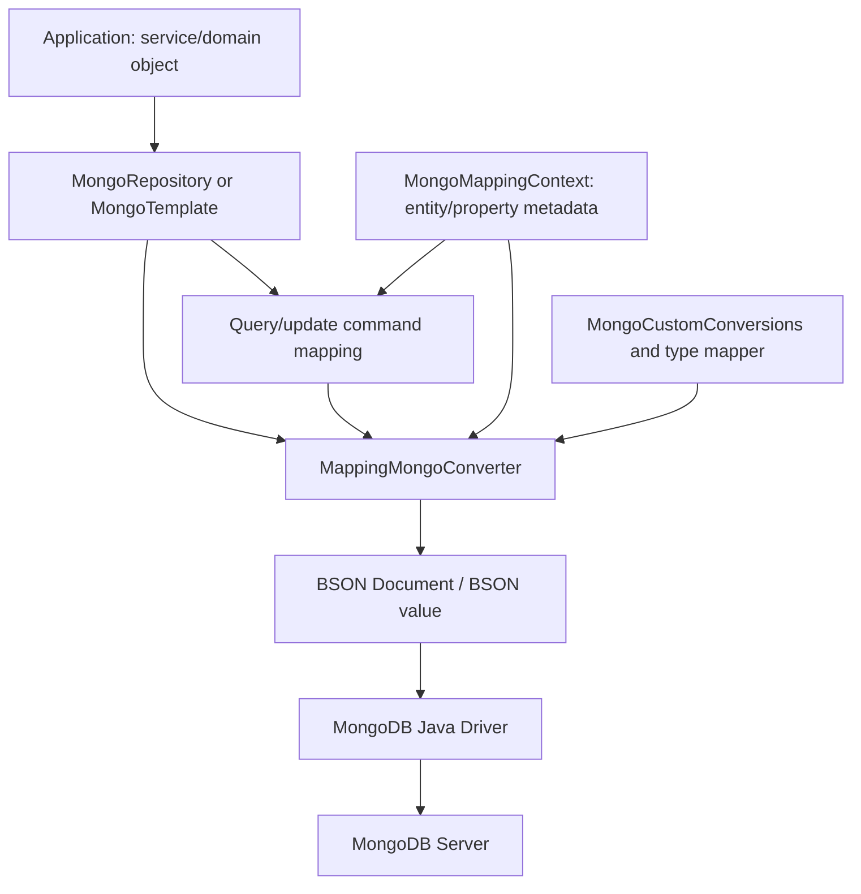

# MongoMappingContext, MappingMongoConverter, and Mapping Metadata

## 1. Problem Statement and Learning Objectives

A Java application may define a `PurchaseOrder` object with properties `orderNo`, `shippingAddress.city`, and `totalAmount`. In MongoDB, the actual document may store the corresponding fields as `order_no`, `shippingAddress.city_name`, and `total_amount` with BSON type `Decimal128`. What mechanism allows Spring Data MongoDB to understand that these two representations refer to the same data?

In the **SPRING_DATA_MONGODB** module, the goal is to use Spring Data MongoDB to connect, map documents, work with `MongoTemplate` or repositories, design queries and aggregations, optimize indexes, test, and diagnose performance. The **Configuration and Architecture** section explains the mapping layer sitting between the Java model and MongoDB, focusing on three concepts:

- **`MongoMappingContext`:** discovers and manages metadata about entities, properties, and mapping annotations.
- **`MappingMongoConverter`:** uses metadata and converters to write Java objects as BSON documents and read BSON back into objects.
- **Mapping metadata:** information about stored field names, IDs, data types, subtypes, nested structures, references, and conversion rules.

After this lesson, you will be able to trace the path of a write/read operation, inspect physical field names, use `@Field` and related annotations, configure custom conversions safely, distinguish entity mapping from query mapping, and analyze common mapping errors. Examples use Java 17+ and modern Spring Data MongoDB conventions; specific APIs should be checked against your actual dependency version when integrating.

## 2. Position in the Spring Data MongoDB Architecture

When an application calls `repository.save(order)` or `mongoTemplate.save(order)`, the MongoDB driver does not inherently understand the application's `@Document`, `@Field`, or nested object types. Spring Data provides the mapping layer to handle this.



The diagram is a conceptual representation. In actual implementation, components share metadata and support both reading and writing; a query command does not necessarily pass sequentially through every block exactly as drawn.

| Component | Primary responsibility | Not directly responsible for |
| --- | --- | --- |
| `MongoMappingContext` | Builds/looks up metadata about persistent entities and properties | Performing network I/O, executing MongoDB queries |
| `MappingMongoConverter` | Converts Java objects ⇄ BSON data according to metadata and conversion rules | Designing indexes, validating every business invariant |
| `MongoCustomConversions` | Registers converters for custom types or specialized representations | Setting collection names or enforcing data permissions |
| `QueryMapper` / `UpdateMapper` | Translates property names/values in queries/updates to MongoDB representations | Picking optimal indexes instead of the MongoDB query planner |
| `MongoTemplate` | Coordinates operations, queries, updates, aggregation, and converters | Replacing underlying driver connection management |
| `MongoRepository` | CRUD and query API at the repository level | Bypassing the template's mapping mechanism completely |
| MongoDB Java Driver | Encodes/decodes BSON at the driver level, communicates with the server | Interpreting Spring Data annotations on its own |

One important point: **metadata is not a data document**. Metadata describes how to transform a Java type into a MongoDB document. It is not a schema validator residing on the MongoDB server, nor is it a set of records stored inside a collection.

## 3. MongoMappingContext: Repository of Entity and Property Metadata

### 3.1. What does the context know?

`MongoMappingContext` is the MongoDB-specific mapping context implementation within Spring Data's shared mapping metadata system. When a domain class is discovered and analyzed, the context creates metadata objects such as:

- `MongoPersistentEntity<?>`: represents a mapped entity type; provides identifier info, collection name, and the list of properties.
- `MongoPersistentProperty`: represents a property; provides Java property name, BSON field name, type, annotations, and persistence characteristics.
- Constructor/parameter metadata: supports instantiating objects when reading data, including immutable objects or Java `record`s.
- MongoDB-specific annotation info: `@Document`, `@Field`, `@Id`/`@MongoId`, `@TypeAlias`, index metadata, and references.

Metadata is built and reused across the lifecycle of the mapping context. Changing annotations in source code does not automatically update existing documents in MongoDB; you typically deploy the new application version and run data migrations if physical structure changes.

### 3.2. Entities and physical documents do not align 1-to-1

Java example:

```java
@Document(collection = "purchase_orders")
record PurchaseOrder(String orderNo, ShippingAddress shippingAddress) {}

record ShippingAddress(String city) {}
```

`PurchaseOrder` is an entity mapped to the `purchase_orders` collection. `ShippingAddress` is a nested Java type, normally stored as an **embedded document** inside the same record rather than automatically becoming a `shipping_address` collection. The mapping context still needs to understand `ShippingAddress`'s properties to map nested paths.

Entity discovery can occur via configuration, entity scanning, and/or when a type is first used. The set of registered entities is especially important for polymorphic type aliases and certain metadata-driven features; do not assume every class on the classpath immediately appears in the context.

### 3.3. Reading metadata programmatically

In a Spring Boot application configured with Spring Data MongoDB, you can inject `MongoMappingContext` into a component to inspect mappings. The example in Section 4 will define the full `PurchaseOrder`:

```java
import org.springframework.data.mongodb.core.mapping.MongoMappingContext;
import org.springframework.data.mongodb.core.mapping.MongoPersistentEntity;
import org.springframework.data.mongodb.core.mapping.MongoPersistentProperty;

public class MappingInspector {
    private final MongoMappingContext context;

    public MappingInspector(MongoMappingContext context) {
        this.context = context;
    }

    public void inspect() {
        MongoPersistentEntity<?> entity =
            context.getRequiredPersistentEntity(PurchaseOrder.class);
        MongoPersistentProperty orderNo =
            entity.getRequiredPersistentProperty("orderNo");

        System.out.println(entity.getCollection());       // purchase_orders
        System.out.println(orderNo.getName());             // orderNo
        System.out.println(orderNo.getFieldName());        // order_no
    }
}
```

Here, `getName()` is the Java property name, while `getFieldName()` is the field name mapped to MongoDB. This is a useful way to catch bugs caused by mixing up Java names and BSON names when writing queries or indexes.

**Limitation:** Metadata describes *how the system expects to map* data. It does not guarantee that every document existing in the collection conforms to those fields. MongoDB allows documents with varying structures; verify data and validation rules separately.

## 4. Complete Example: The Same Entity in Java and MongoDB

Let us design a purchase order with a string ID, an embedded address, multiple line items, and an exact monetary amount.

### 4.1. Domain model and annotations

```java
import java.math.BigDecimal;
import java.util.List;
import org.springframework.data.mongodb.core.mapping.Document;
import org.springframework.data.mongodb.core.mapping.Field;
import org.springframework.data.mongodb.core.mapping.FieldType;
import org.springframework.data.mongodb.core.mapping.MongoId;

@Document(collection = "purchase_orders")
public record PurchaseOrder(
    @MongoId(FieldType.STRING) String id,
    @Field("order_no") String orderNo,
    @Field(name = "total_amount", targetType = FieldType.DECIMAL128)
    BigDecimal totalAmount,
    ShippingAddress shippingAddress,
    List<OrderLine> items
) {}

record ShippingAddress(
    @Field("city_name") String city,
    String district
) {}

record OrderLine(String sku, int quantity) {}
```

Each annotation has a dedicated purpose:

- `@Document(collection = "purchase_orders")` declares the default collection for the root entity.
- `@MongoId(FieldType.STRING)` specifies storing the ID under `_id` as a BSON String; especially useful when business codes must remain string IDs.
- `@Field("order_no")` renames the stored field while Java code keeps using `orderNo`.
- `@Field(name = "total_amount", targetType = FieldType.DECIMAL128)` specifies both the physical name and the `Decimal128` representation for `BigDecimal`.
- `@Field("city_name")` sits inside a nested type; the corresponding full path is `shippingAddress.city_name`.
- `List<OrderLine>` maps to a BSON array of nested documents.

The example uses `record` to demonstrate constructor-based reading. Real code can use classes with constructors, getters/setters, or other instantiation strategies supported by Spring Data. The ID field uses `@MongoId` to avoid depending on the rule that converts `@Id String` into an ObjectId.

### 4.2. Creating an object and writing to BSON

```java
import java.math.BigDecimal;
import java.util.List;

PurchaseOrder order = new PurchaseOrder(
    "purchase-004",
    "PO-2026-004",
    new BigDecimal("350000"),
    new ShippingAddress("Hanoi", "Hoan Kiem"),
    List.of(new OrderLine("BOOK-01", 2))
);
```

When passed through `MappingMongoConverter` under common default settings, the BSON document has the following primary content:

```javascript
{
  "_id": "purchase-004",
  "order_no": "PO-2026-004",
  "total_amount": NumberDecimal("350000"),
  "shippingAddress": {
    "city_name": "Hanoi",
    "district": "Hoan Kiem"
  },
  "items": [
    { "sku": "BOOK-01", "quantity": 2 }
  ],
  "_class": "com.example.PurchaseOrder"
}
```

`_class` is an **example of a type discriminator**, not a mandatory field generated by the MongoDB server. The actual package name varies across applications; type mapper or type alias settings can alter or remove this field. Its purpose and trade-offs are explained in Section 7.

### 4.3. Inspectable name/type mapping table

| Java property | BSON field/path | Conversion/meaning |
| --- | --- | --- |
| `id` | `_id` | Mongo ID, stored as String via `@MongoId(FieldType.STRING)` |
| `orderNo` | `order_no` | Renamed by `@Field` |
| `totalAmount` | `total_amount` | `BigDecimal` → BSON Decimal128 |
| `shippingAddress.city` | `shippingAddress.city_name` | Deep access into nested document |
| `shippingAddress.district` | `shippingAddress.district` | Default name preserved |
| `items` | `items` | `List<OrderLine>` → BSON array of documents |

Do not assume a document containing a `total_amount` field will always read cleanly into a valid `BigDecimal`. If legacy data holds an invalid string or a type that cannot be converted under the active configuration, the application can still fail during reads.

## 5. MappingMongoConverter: Bidirectional Conversion

### 5.1. Write direction

When a `PurchaseOrder` is saved:

1. The converter identifies the entity type and reads metadata from the mapping context.
2. It determines each property to write and its corresponding BSON name, considering annotations and conversion rules.
3. Simple values are converted to appropriate BSON types; nested objects and collections are traversed and mapped structurally.
4. The type mapper mechanism may write a discriminator to support reconstructing runtime types on read.
5. The result is a BSON document that the driver can send to MongoDB.

This is a conversion process, **not** MongoDB natively understanding Java classes. For instance, the server only sees `"order_no"` and has no knowledge that the application has a property named `orderNo`.

### 5.2. Read direction

When reading a record:

1. The driver returns a BSON document to the application.
2. The converter determines the target type, sometimes consulting the type discriminator when the structure requires distinguishing subtypes.
3. Metadata indicates which Java property receives each BSON field and which converter is needed.
4. Embedded documents, arrays, and special values are converted back to Java types.
5. Object instantiation creates an instance and populates values using the appropriate constructor/properties.

Missing fields, `null` fields, wrong physical names, mismatched BSON types, constructors missing required data, and missing type aliases can all affect the read path. A document read failure is not necessarily caused by a wrong query; often the query finds the right document, but the converter cannot reconstruct the entity.

### 5.3. Testing a round trip without querying the database

If your application has a `MongoConverter` bean, you can test mapping directly:

```java
import org.bson.Document;
import org.springframework.data.mongodb.core.convert.MongoConverter;

public class MappingRoundTrip {
    private final MongoConverter converter;

    public MappingRoundTrip(MongoConverter converter) {
        this.converter = converter;
    }

    public PurchaseOrder roundTrip(PurchaseOrder original) {
        Document bson = new Document();
        converter.write(original, bson);

        System.out.println(bson.get("order_no"));
        System.out.println(bson.get("total_amount").getClass().getSimpleName());

        return converter.read(PurchaseOrder.class, bson);
    }
}
```

With `original` from Section 4, `bson.get("order_no")` prints the order number; the money field is expected to be `org.bson.types.Decimal128`. This step tests mapping in isolation, but it **does not replace** integration tests against MongoDB since it does not verify actual persistence, indexes, the query planner, or network connectivity.

### 5.4. Do not equate mapping with JSON serialization

A Java object may be serialized to JSON by Jackson, but Jackson inspects different annotations and converters than Spring Data MongoDB. REST API JSON field names and BSON field names can differ:

```text
REST API JSON:    orderNo
Java property:    orderNo
MongoDB BSON:     order_no
```

Therefore, `@JsonProperty` belongs to API serialization and is not equivalent to MongoDB's `@Field`. When API payloads and storage follow different conventions, use separate DTOs and an appropriate domain/application mapping layer.

## 6. Important Annotations and Metadata

| Component | Primary effect | Notes |
| --- | --- | --- |
| `@Document` | Identifies entity and collection | Declaring it does not create the collection or indexes automatically |
| `@Id` | Marks the identifier property | String IDs have rules converting valid hex strings to ObjectId depending on value |
| `@MongoId` | Controls how the Mongo ID is mapped | Use when an explicit ID type is needed |
| `@Field` | BSON field name, optional target type representation | Changing the annotation does not migrate old documents |
| `@Transient` | Excludes property from persistence read/write | Suitable for derived or temporary state |
| `@TypeAlias` | Assigns a short type discriminator | Requires a registration/resolution strategy for reading |
| `@Indexed` / `@CompoundIndex` | Describes desired index metadata | Actual index creation depends on configuration/deployment policy |
| `@DBRef` / `@DocumentReference` | Describes document references | May require extra reads, unlike embedded documents |

### 6.1. Distinguishing String IDs and ObjectIds

MongoDB stores `_id` with a concrete BSON type. With `@Id String id`, Spring Data MongoDB can convert valid hex strings into BSON ObjectIds according to ID mapping rules. This can surprise teams if another client queries `_id` as a String.

Distinguish the two representations:

```javascript
// BSON ObjectId:
{ _id: ObjectId("656789abcdef0123456789ab") }

// BSON String:
{ _id: "656789abcdef0123456789ab" }
```

Values that look identical have **different BSON types** and are not treated as equal IDs. If your system standardizes on String IDs, `@MongoId(FieldType.STRING)` makes that intent explicit. If choosing ObjectId, use the appropriate property type and stay consistent across documents, references, queries, and tests.

### 6.2. `@Field` and its effect on nested paths

An application call may use Java names:

```java
Query query = Query.query(
    Criteria.where("orderNo").is("PO-2026-004")
        .and("shippingAddress.city").is("Hanoi")
);

PurchaseOrder result =
    mongoTemplate.findOne(query, PurchaseOrder.class);
```

Given `PurchaseOrder` from Section 4, entity-aware query mapping corresponds to:

```javascript
db.purchase_orders.findOne({
  order_no: "PO-2026-004",
  "shippingAddress.city_name": "Hanoi"
});
```

**Takeaway:** Code uses domain property paths, whereas BSON queries use physical field paths in the collection. Never mix the two naming systems casually—especially when moving from `MongoTemplate` to direct driver operations or hand-built BSON `Document`s.

### 6.3. Index metadata does not mean an index exists

Example:

```java
import org.springframework.data.mongodb.core.index.Indexed;

@Document("customers")
record Customer(
    @MongoId(FieldType.STRING) String id,
    @Indexed String email
) {}
```

`@Indexed` supplies metadata for index analysis/creation, but does not guarantee a production collection already has the index. You must decide whether to enable auto-index creation, run migrations, or invoke `IndexOperations`. In many Spring Data MongoDB setups, **automatic index creation is disabled by default**. In production, controlled migration workflows that inspect existing indexes and version changes are generally preferred.

If duplicate data exists, adding a unique index will fail. Metadata cannot fix actual data on its own.

## 7. Type Information: `_class`, `@TypeAlias`, and Polymorphic Types

### 7.1. Why is a discriminator needed?

For a property declared as an interface or superclass, the converter sometimes needs to know the **concrete runtime type** to reconstruct the object:

```java
interface PaymentMethod {}

@TypeAlias("card")
record CardPayment(String lastFourDigits) implements PaymentMethod {}

@TypeAlias("bank")
record BankTransfer(String bankCode) implements PaymentMethod {}

@Document("payments")
record Payment(
    @MongoId(FieldType.STRING) String id,
    PaymentMethod method
) {}
```

A payment document might contain:

```javascript
{
  "_id": "payment-01",
  "method": {
    "lastFourDigits": "1234",
    "_class": "card"
  },
  "_class": "com.example.Payment"
}
```

This is an illustrative document: when the `card` type alias is registered/recognized, the converter resolves `CardPayment` when reading the `PaymentMethod` property. In applications whose classes live in different packages, the full default discriminator name also changes.

### 7.2. Conditions for type aliases to work

`@TypeAlias` assigns a short name to a type. When reading a document whose type has not yet been written during the current application lifecycle, the mapping context must **already know** the corresponding class, for instance via entity scanning or registering an appropriate initial entity set. If the context does not recognize the alias, object instantiation may fail or produce the wrong subtype.

In polymorphic models, test the scenario of **starting a fresh application instance and reading legacy data**, not just writing and reading back within the same process run.

### 7.3. Should `_class` be disabled?

You can customize the type mapper—for example, configuring `DefaultMongoTypeMapper(null)` to omit the discriminator field written by the converter. However, this is not a universal optimization for every application:

- Properties typed as interfaces or superclasses may lack enough information to resolve subtypes on read.
- Old and new documents may carry inconsistent metadata.
- Data shared across multiple application versions may encounter compatibility issues.

Only change how type information is written after evaluating which entities require polymorphism, planning migrations, and testing reads of existing data. The key point is that `_class` is a **mapping layer** concern, not a mandatory MongoDB system field.

## 8. `MongoCustomConversions`: When Java Types Need Custom Representations

### 8.1. Use cases

Spring Data MongoDB includes built-in conversion rules for many standard types. However, an application may have **value objects** like `PhoneNumber`, `Money`, custom identifiers, or types needing a specific BSON representation.

By default, a domain object not treated as a simple type may be embedded as a nested document. If you want to store `PhoneNumber` as an E.164 string instead of `{ value: "..." }`, you can define explicit converters.

### 8.2. `ReadingConverter` and `WritingConverter`

```java
import org.springframework.core.convert.converter.Converter;
import org.springframework.data.convert.ReadingConverter;
import org.springframework.data.convert.WritingConverter;

record PhoneNumber(String value) {}

@WritingConverter
final class PhoneNumberWriteConverter
    implements Converter<PhoneNumber, String> {

    @Override
    public String convert(PhoneNumber source) {
        return source.value();
    }
}

@ReadingConverter
final class PhoneNumberReadConverter
    implements Converter<String, PhoneNumber> {

    @Override
    public PhoneNumber convert(String source) {
        return new PhoneNumber(source);
    }
}
```

Register with `MongoCustomConversions`:

```java
import java.util.List;
import org.springframework.context.annotation.Bean;
import org.springframework.context.annotation.Configuration;
import org.springframework.data.mongodb.core.convert.MongoCustomConversions;

@Configuration
class PhoneNumberConversionConfiguration {

    @Bean
    MongoCustomConversions mongoCustomConversions() {
        return new MongoCustomConversions(List.of(
            new PhoneNumberWriteConverter(),
            new PhoneNumberReadConverter()
        ));
    }
}
```

In a Spring Boot application, the conversions bean integrates with the converter created by auto-configuration. When changing configuration mechanisms, verify that your project's default/shared converters remain properly registered. The example here only illustrates a **bidirectional converter pair**.

**Why use `@ReadingConverter` and `@WritingConverter`?** Types such as `String` can be considered store simple types. These annotations clarify conversion direction and prevent ambiguous registration. Registered converters apply based on their source/target type signatures; avoid overly broad global converters that cause unintended transformations.

### 8.3. Choosing `@Field(targetType)` or a custom converter?

| Requirement | Usually appropriate choice |
| --- | --- |
| Rename the stored property | `@Field("stored_name")` |
| Store `BigDecimal` as BSON `Decimal128` | `@Field(targetType = FieldType.DECIMAL128)` |
| Value object needing custom serialization rules | Custom `Converter` |
| Change JSON API field format | DTO/Jackson; a different layer |
| Transform existing stored document structures | Data migration; converters do not rewrite old documents automatically |

Custom converters should be tested in both read and write directions, especially for `null` values, boundary cases, pre-existing data, and class version changes.

## 9. Configuring Mapping in an Application

### 9.1. Prefer default configuration first

In a Spring Boot application with Spring Data MongoDB and valid connection settings, you can normally inject `MongoTemplate`, `MongoConverter`, and `MongoMappingContext` without creating `MappingMongoConverter` manually.

```java
import org.springframework.stereotype.Service;
import org.springframework.data.mongodb.core.MongoTemplate;
import org.springframework.data.mongodb.core.convert.MongoConverter;
import org.springframework.data.mongodb.core.mapping.MongoMappingContext;

@Service
class MappingDiagnostics {
    MappingDiagnostics(
        MongoTemplate template,
        MongoConverter converter,
        MongoMappingContext context
    ) {
        // Beans provided by Spring Data configuration.
    }
}
```

Only configure the converter manually when you have a concrete requirement: custom conversions, a global naming strategy, custom type mapper, reference resolution, or mapping control beyond annotations. If you replace an auto-configured bean with a manual one and forget to wire custom conversions or related callbacks, read/write behavior can change.

### 9.2. Example of manually constructing `MappingMongoConverter`

The snippet below shows wiring the three core components and a `DbRefResolver`:

```java
import org.springframework.context.annotation.Bean;
import org.springframework.context.annotation.Configuration;
import org.springframework.data.mongodb.MongoDatabaseFactory;
import org.springframework.data.mongodb.core.convert.DefaultDbRefResolver;
import org.springframework.data.mongodb.core.convert.MappingMongoConverter;
import org.springframework.data.mongodb.core.convert.MongoCustomConversions;
import org.springframework.data.mongodb.core.mapping.MongoMappingContext;

@Configuration
class ExplicitMongoConverterConfig {

    @Bean
    MappingMongoConverter mappingMongoConverter(
        MongoDatabaseFactory factory,
        MongoMappingContext mappingContext,
        MongoCustomConversions conversions
    ) {
        var resolver = new DefaultDbRefResolver(factory);
        var converter = new MappingMongoConverter(resolver, mappingContext);
        converter.setCustomConversions(conversions);
        converter.afterPropertiesSet();
        return converter;
    }
}
```

This is an **advanced configuration example**, not a mandatory requirement for using Spring Data MongoDB. When using Spring Boot, cross-check active auto-configurations and consider other options already applied in the project. An application needing to rename only a few fields should start with `@Field` before replacing core beans.

### 9.3. Changing field naming conventions system-wide

The mapping context can use a `FieldNamingStrategy` to determine default field names. For example, a project might convert `placedAt` to `placed_at`. When a naming convention applies across many properties, a naming strategy reduces repetitive annotations.

However, changing the naming strategy on a system with existing data can cause new code to query `placed_at` while old documents still hold `placedAt`. That is a physical schema change requiring a migration plan or backward compatibility; the new naming strategy **does not rename stored fields automatically**.

In smaller projects, applying `@Field` to specific properties is often easier to review than a broad global change.

## 10. How Is Metadata Used During Queries and Updates?

Converters mainly handle **values**, while query/update mapping handles both **path names** and certain value representations.

### 10.1. Field name mapping in queries

```java
import org.springframework.data.mongodb.core.query.Criteria;
import org.springframework.data.mongodb.core.query.Query;

Query query = Query.query(
    Criteria.where("orderNo").is("PO-2026-004")
);
```

When executing this query with entity type `PurchaseOrder.class` via `MongoTemplate`, the query mapper knows `orderNo` corresponds to `order_no`. By contrast, direct driver usage:

```javascript
db.purchase_orders.find({ orderNo: "PO-2026-004" }); // Does not match physical field

db.purchase_orders.find({ order_no: "PO-2026-004" }); // Matches the sample document
```

When writing raw BSON filters through the driver, use physical field names and actual BSON types. Do not assume every `Document` or `Bson` filter is automatically remapped by Spring Data.

### 10.2. Path mapping in updates

```java
import org.springframework.data.mongodb.core.query.Update;

Update update = new Update().set("shippingAddress.city", "Hai Phong");
mongoTemplate.updateFirst(
    Query.query(Criteria.where("orderNo").is("PO-2026-004")),
    update,
    PurchaseOrder.class
);
```

With the model from Section 4, MongoDB receives an operation semantically equivalent to:

```javascript
db.purchase_orders.updateOne(
  { order_no: "PO-2026-004" },
  { $set: { "shippingAddress.city_name": "Hai Phong" } }
);
```

Queries and updates must be associated with the **right domain type** so the mapping context knows the property paths. In complex custom aggregations or update pipelines, verify the translated field names—especially when using raw expressions and custom conversions.

### 10.3. Indexes and aggregation relate to metadata but have distinct responsibilities

Annotation metadata can be used when resolving index definitions. `MongoTemplate.indexOps(...)` and index-creation tools govern index creation/modification operations, while the MongoDB server chooses the query execution plan.

For aggregation, the framework applies entity-based mapping when using the corresponding typed APIs, but not every field string inside custom expressions is automatically renamed in obvious ways. When building pipelines manually, inspect the resulting BSON and test against real data.

**Distinguish three layers:**

1. Spring Data metadata describes how Java properties are stored.
2. Query/update/aggregation mapping generates the appropriate BSON commands.
3. The MongoDB server executes commands and picks indexes; `explain("executionStats")` evaluates performance.

## 11. Lifecycle Callbacks, Auditing, and Validation Are Separate Pieces

In practice, these mechanisms often appear alongside mapping but perform different jobs:

| Mechanism | Example | Role |
| --- | --- | --- |
| Mapping converter | `@Field("order_no")` | Translates Java/BSON names and values |
| Entity callbacks | `BeforeConvertCallback`, `BeforeSaveCallback` | Intercepts supported save/read lifecycle stages |
| Auditing | `@CreatedDate`, `@LastModifiedDate` with auditing enabled | Maintains timestamp and user metadata according to rules |
| Bean Validation / service validation | Positive quantity, valid status | Enforces data and business constraints |
| MongoDB schema validation | `$jsonSchema` rules on the collection | Rejects invalid documents at the database layer |
| Repository / service | Only view orders belonging to the current tenant | Enforces authorization and coordinates business logic |

Do not expect `MappingMongoConverter` by default to enforce business constraints such as `quantity > 0` or `orderNo` uniqueness. Unique indexes enforce uniqueness at the server; validation and authorization must be designed separately.

Callbacks and auditing may not fire on direct driver writes or bulk/update operations. When updating via `MongoTemplate.updateFirst(...)`, verify whether timestamp fields update as expected and set them explicitly in `Update` when required.

## 12. Diagnosing Mapping Errors Layer by Layer

When data reads back as `null`, has the wrong type, or fields appear unexpectedly renamed, trace from domain to BSON:

### 12.1. Inspect metadata first

```java
var entity = context.getRequiredPersistentEntity(PurchaseOrder.class);
var orderNo = entity.getRequiredPersistentProperty("orderNo");
System.out.println(orderNo.getFieldName()); // order_no

var addressEntity =
    context.getRequiredPersistentEntity(ShippingAddress.class);
var city = addressEntity.getRequiredPersistentProperty("city");
System.out.println(city.getFieldName());    // city_name
```

Unexpected metadata indicates an issue with annotations, naming strategy, type registration, or mapping configuration before looking at queries.

### 12.2. Inspect BSON before and after conversion

You can call `MongoConverter.write()` to inspect the expected document. To inspect the document **actually stored** in the collection, use `mongosh` or the driver directly:

```javascript
db.purchase_orders.findOne(
  { _id: "purchase-004" },
  { order_no: 1, total_amount: 1, shippingAddress: 1, _class: 1 }
);
```

Do not print entire documents containing sensitive data to production logs. If enabling query logs to investigate field names, do so only in a safe scope and watch out for personal data and credentials.

### 12.3. Evaluating individual symptoms

| Symptom | Hypothesis | How to check |
| --- | --- | --- |
| `orderNo` reads as `null` | BSON field is `orderNo` instead of `order_no`, or data is missing | Compare `getFieldName()` against the actual document |
| `BigDecimal` fails to read or loses precision | Unexpected BSON type; conflicting custom converter | Check actual BSON type (Decimal128/String/Double) and conversion rules |
| Service query finds nothing, `mongosh` matches | Mixed up Java vs. BSON names; query not bound to the entity | Inspect query mapper and emitted filter |
| Cannot instantiate subtype | Missing/unrecognized `_class` or alias | Check type mapper, registered classes, and legacy data |
| Object saves but temporary field disappears | Property has `@Transient` or is not mapped | Inspect persistent properties metadata |
| Index missing despite `@Indexed` | Index creation not executed or auto-index disabled | Check `getIndexes()`, configuration, and migrations |
| Reading many references is slow | References resolved via additional queries | Count queries; consider embedding or projections |
| After changing `@Field`, old data cannot be read | Physical field not migrated | Plan field rename/backfill and backward compatibility |

### 12.4. Do not confuse mapping bugs with performance issues

Correct mapping can still yield slow queries due to missing indexes, inefficient array filters, oversized documents, or `N+1` reference resolution. Once BSON and queries are verified, run `explain("executionStats")`, inspect examined documents/index keys, and count database calls.

Likewise, a good index cannot fix a query mapping the wrong field name. Verify correctness first, then measure performance on a representative workload.

## 13. Notes on Version Upgrades and Domain Refactoring

Mapping metadata ties directly to packages, classes, property names, and annotations. A seemingly pure Java change can affect persisted data long-term:

| Change | Potential impact |
| --- | --- |
| Rename `orderNo` to `purchaseNumber` while keeping `@Field("order_no")` | BSON can remain unchanged; Java query/repository methods must be updated |
| Change `@Field("order_no")` to `@Field("purchase_number")` | Existing data still sits under `order_no`; requires migration or compatible reads |
| Rename class/package with default discriminator | Legacy documents may contain the old class name in `_class` |
| Add/remove `@TypeAlias` | Old and new documents may have different discriminators |
| Switch `BigDecimal`/Decimal128 to String | Changes stored representation; requires conversion tests and migration |
| Change embedded document to reference | Alters data boundaries and query count; requires migration |

When upgrading Spring Boot, Spring Data, or the MongoDB driver, test reading a sample of documents saved under the previous version. Never test only fresh documents written by the current converter; that can miss compatibility issues with real data.

## 14. Guided Practice Exercises

Assume the system already uses `PurchaseOrder` from Section 4 and needs to adjust a few mapping rules.

### Exercise 1 — Deduce the document from annotations

**Prompt:** Java saves:

```java
new PurchaseOrder(
    "purchase-005",
    "PO-2026-005",
    new BigDecimal("450000"),
    new ShippingAddress("Da Nang", "Hai Chau"),
    List.of(new OrderLine("PEN-02", 3))
);
```

**Solution:** Expected data paths after conversion:

```text
_id                       = "purchase-005"             (BSON String)
order_no                  = "PO-2026-005"             (BSON String)
total_amount              = 450000                    (BSON Decimal128)
shippingAddress.city_name = "Da Nang"
shippingAddress.district  = "Hai Chau"
items[0].sku              = "PEN-02"
items[0].quantity         = 3
```

Depending on the type mapper configuration, the document may also include `_class`. Neither `items` nor `district` has a renaming annotation, so both retain their Java property names.

### Exercise 2 — Write the query properly at both layers

**Prompt:** Find order `PO-2026-005` shipping to Da Nang. Write the query using `MongoTemplate` and the equivalent query in `mongosh`.

**Solution — Java:**

```java
var query = Query.query(
    Criteria.where("orderNo").is("PO-2026-005")
        .and("shippingAddress.city").is("Da Nang")
);
var order = mongoTemplate.findOne(query, PurchaseOrder.class);
```

**Solution — mongosh:**

```javascript
db.purchase_orders.findOne({
  order_no: "PO-2026-005",
  "shippingAddress.city_name": "Da Nang"
});
```

Java uses **domain property** names in a typed query context; `mongosh` uses **physical field** names.

### Exercise 3 — Analyze breakage after renaming a field

**Prompt:** The team changes `@Field("order_no")` to `@Field("purchase_no")` without modifying existing data. Why can old orders no longer be found?

**Solution:** The new query mapper emits criteria against `purchase_no`, while existing records still contain `order_no`. The new annotation only changes application metadata; it does not update documents. You must choose a migration strategy, such as a controlled rename/backfill to the new field, updating related indexes, and supporting a transition period if multiple application versions run concurrently.

### Exercise 4 — Choose how to map a monetary type

**Prompt:** Prices require exact precision to two decimal places and the application uses `BigDecimal`. Do you need to write a global custom converter to store `Decimal128`?

**Solution:** Not yet. For a specific property, start with `@Field(targetType = FieldType.DECIMAL128)`. Test the Java ⇄ BSON Decimal128 round trip and existing data. Custom converters are suited for value objects or specialized conversion rules beyond standard target-type options.

## 15. Checklist When Reviewing Mapping Design

| Review question | Evidence to inspect |
| --- | --- |
| Which collection does the entity store in? | `@Document`, collection metadata, and sample data |
| Do Java property names differ from BSON names? | `@Field`, naming strategy, `getFieldName()` output |
| Are IDs String or ObjectId? | `@Id`/`@MongoId`, actual BSON data, queries by ID |
| Are monetary types exact? | `BigDecimal`, `Decimal128`, round-trip tests |
| Can polymorphic types be read back after restart? | `_class`/aliases, entity registration, tests on legacy data |
| Do any custom converters have overly broad impact? | `MongoCustomConversions` list, bidirectional tests |
| Do queries/updates use the right field names? | Query mapper, BSON sent to MongoDB |
| Do indexes actually exist and get used? | `getIndexes()`, migrations, `explain()` |
| Are schema changes backward-compatible with old data? | Migration/backfill plan and upgrade tests |

### Key Takeaways

1. `MongoMappingContext` **describes** how entities and properties map; it does not persist data itself.
2. `MappingMongoConverter` **performs** reading/writing between Java objects and BSON using metadata, conversion rules, and type information.
3. Java names and BSON names can differ; `@Field` and naming strategies control mapping, while query/update mapping translates paths when given the proper type context.
4. `@MongoId`, `@TypeAlias`, and `@Field(targetType = ...)` deeply affect data representation and readability; understand them before changing them.
5. Index metadata, validation, auditing, and transactions are separate mechanisms; do not treat successful mapping as a guarantee of valid data or fast queries.
6. The reliable way to verify is cross-checking **domain model → mapping metadata → actual BSON → actual query**, then measuring performance with the right tools.
