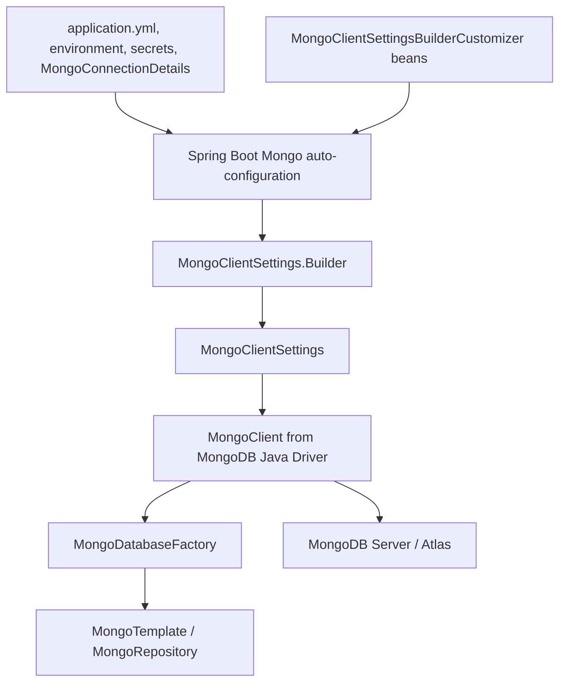
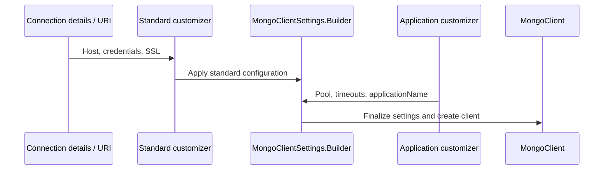

# MongoClientSettingsBuilderCustomizer and Driver Settings

In a **Spring Data MongoDB** application, Spring Boot can automatically configure `MongoClient`, `MongoDatabaseFactory`, `MongoTemplate`, and repositories. However, "connecting to MongoDB" is only the start of the story. The MongoDB Java Driver also governs how connection pools are created, how server selection waits, and how timeouts, retries, TLS, read/write concerns, and diagnostic events are applied.

This lesson belongs to the **Configuration and Architecture** chapter of the `SPRING_DATA_MONGODB` module. You will learn how to use `MongoClientSettingsBuilderCustomizer` to tune the driver in a Spring Boot application, keep connection configuration consistent, and verify behavior when operating on documents via `MongoTemplate` or `MongoRepository`. These techniques also tie into aggregation, indexes, transactions, reactive access, testing, and performance analysis.

**Goal:** understand Spring Boot's extension point, and know how to write and verify an intentional driver configuration. Numbers in the examples illustrate the mechanisms and are not optimal defaults for every application.

## 1. Learning Objectives

Upon completion, you will be able to:

1. Distinguish `MongoClientSettings.Builder`, `MongoClientSettings`, `MongoClientSettingsBuilderCustomizer`, and `MongoClient`.
2. Write customizer beans for **Spring Boot 3.5** or **Spring Boot 4.x** with the correct imports.
3. Configure and evaluate pooling, timeouts, server selection, application name, retries, and read/write concern.
4. Distinguish connection string parameters from Java customizers, and resolve application-order conflicts.
5. Explain what changes when declaring a `MongoClient` bean manually or running multiple clients.
6. Test settings with unit and integration tests, and observe metrics to tune with real numbers.

## 2. Where Does the Extension Point Sit in the Architecture?



The diagram depicts the imperative flow. For reactive applications, Spring Boot uses the reactive MongoDB client/factory and corresponding APIs; settings are still evaluated against the driver and topology, though the execution model differs.

| Component | Responsibility |
| --- | --- |
| `MongoClientSettings.Builder` | Accumulates driver settings before constructing an immutable settings object. |
| `MongoClientSettings` | Immutable object holding finalized settings: pool, socket, cluster, TLS, concern, listeners, etc. |
| `MongoClientSettingsBuilderCustomizer` | **Spring Boot** functional interface with callback `customize(MongoClientSettings.Builder)` to append/update settings during initialization. |
| `MongoClient` | Driver-created client; manages pools, topology, and sends commands to MongoDB. Typically reused throughout the application lifecycle. |
| `MongoDatabaseFactory` | Bridge between the MongoDB driver and Spring Data. |
| `MongoTemplate` / repository | APIs for document operations, queries, aggregation, and CRUD; relies on the underlying client. |

### Why use a customizer?

In projects using `spring-boot-starter-data-mongodb`, auto-configuration already wires the driver, URI, connection details, and lifecycle. Registering a customizer adjusts the parameters you need **without manually constructing `MongoClient`** and duplicating the entire configuration. This is the right approach when you simply need to cap pool size, set timeouts, or supply an application name.

If the application needs **two independent clusters**, multiple clients with distinct credentials, or special lifecycles, you may need to define clients/factories manually. In that case, you must manage their respective configurations, connection pools, and metrics/transaction integrations yourself.

## 3. Correct Imports in Spring Boot 3.5 and 4.x

The name `MongoClientSettingsBuilderCustomizer` remains the same, but its package moved in Spring Boot 4:

| Spring Boot line | Interface import | Connection URI |
| --- | --- | --- |
| **3.5.x** | `org.springframework.boot.autoconfigure.mongo.MongoClientSettingsBuilderCustomizer` | `spring.data.mongodb.uri` |
| **4.0/4.1.x** | `org.springframework.boot.mongodb.autoconfigure.MongoClientSettingsBuilderCustomizer` | `spring.mongodb.uri` |

The MongoDB Driver API uses `com.mongodb.MongoClientSettings`; do not confuse **Spring Boot's** customizer interface with driver classes. When copying code from documentation for another release line, common errors are missing imports or unrecognized URI properties.

Maven example (letting the Spring Boot BOM manage driver versions):

```xml
<dependencies>
    <dependency>
        <groupId>org.springframework.boot</groupId>
        <artifactId>spring-boot-starter-data-mongodb</artifactId>
    </dependency>
    <dependency>
        <groupId>org.springframework.boot</groupId>
        <artifactId>spring-boot-starter-test</artifactId>
        <scope>test</scope>
    </dependency>
</dependencies>
```

Do not pin explicit versions for `mongodb-driver-sync`, `mongodb-driver-core`, or `bson` without a clear reason. The BOM keeps driver modules synchronized. Inspect the dependency tree to confirm the final resolved versions.

## 4. Complete Example: Tuning the MongoDB Java Driver

Suppose the `inventory-api` application connects to a local MongoDB instance for this lesson. With **Spring Boot 4.x**, base configuration:

```yaml
# src/main/resources/application.yml
spring:
  application:
    name: inventory-api
  mongodb:
    uri: "mongodb://localhost:27017/inventory_lab"
```

If using **Boot 3.5**, replace with:

```yaml
spring:
  data:
    mongodb:
      uri: "mongodb://localhost:27017/inventory_lab"
```

In authenticated environments, provide the URI via a secret manager or environment variable:

```yaml
spring:
  mongodb:
    uri: "${MONGODB_URI}"
```

### 4.1. Creating the `MongoClientSettingsBuilderCustomizer` bean

The example below is written for **Spring Boot 4.x**:

```java
package dev.learning.inventory.config;

import java.util.concurrent.TimeUnit;

import org.springframework.boot.mongodb.autoconfigure.MongoClientSettingsBuilderCustomizer;
import org.springframework.context.annotation.Bean;
import org.springframework.context.annotation.Configuration;
import org.springframework.core.annotation.Order;

@Configuration(proxyBeanMethods = false)
public class MongoDriverConfiguration {

    @Bean
    @Order(100)
    MongoClientSettingsBuilderCustomizer mongoClientTuning() {
        return settings -> {
            // Useful when inspecting logs and the profiler on MongoDB.
            settings.applicationName("inventory-api");

            // Pools are created per server in the topology.
            settings.applyToConnectionPoolSettings(pool -> pool
                    .maxSize(60)
                    .minSize(5)
                    .maxConnectionIdleTime(60, TimeUnit.SECONDS));

            // Wait to locate an eligible server in the cluster.
            settings.applyToClusterSettings(cluster ->
                    cluster.serverSelectionTimeout(5, TimeUnit.SECONDS));

            // Timeout when opening a TCP connection.
            settings.applyToSocketSettings(socket ->
                    socket.connectTimeout(3, TimeUnit.SECONDS));
        };
    }
}
```

**What happens when the application starts:**

1. Spring Boot collects `MongoClientSettingsBuilderCustomizer` beans.
2. Boot applies standard connection details and invokes each callback in order.
3. The builder is built into `MongoClientSettings` to create the driver client.
4. `MongoTemplate` and repositories use the newly configured client.

`@Order(100)` expresses the intent that the application customizer runs after customizers with lower order values. Boot's standard customizer implements `Ordered` and typically applies the URI/connection details. If two callbacks modify the same setting, the later callback determines the final value. Check ordering whenever you want to **override** a URI setting.

### 4.2. Same example with Spring Boot 3.5

Change the import:

```java
// Spring Boot 3.5.x:
import org.springframework.boot.autoconfigure.mongo.MongoClientSettingsBuilderCustomizer;
```

Builder calls such as `applicationName`, `applyToConnectionPoolSettings`, and `applyToSocketSettings` belong to the Java Driver API; verify against the exact driver version pulled in by your Spring Boot BOM when using advanced APIs.

### 4.3. Continuing to use `MongoTemplate` and repositories

The customizer operates at the **driver** layer and requires no code changes at the repository layer:

```java
import org.springframework.data.mongodb.core.MongoTemplate;
import org.springframework.stereotype.Service;

@Service
public class InventoryDiagnostics {
    private final MongoTemplate template;

    public InventoryDiagnostics(MongoTemplate template) {
        this.template = template;
    }

    public boolean ping() {
        return template.executeCommand("{ ping: 1 }")
                .getDouble("ok") == 1.0;
    }
}
```

When using the Boot-configured client, repository queries, `MongoTemplate` updates, and aggregations all operate through the corresponding driver settings.

## 5. URI, `MongoConnectionDetails`, and Customizer Ordering

Spring Boot can read endpoints and credentials from `spring.mongodb.*` (Boot 4) or `spring.data.mongodb.*` (Boot 3.5), or it can use `MongoConnectionDetails` supplied by another mechanism such as service connections. `StandardMongoClientSettingsBuilderCustomizer` then applies the connection string and standard settings onto the builder.



Common configuration sources:

| Source | Best suited for |
| --- | --- |
| **URI** | Host, port, replica set, username, authentication database, and many options like `maxPoolSize`. |
| **Application properties** | Per-environment configuration, integrating with Spring Boot and secret management. |
| **MongoConnectionDetails** | Supplying connection details via service bindings or other integrations. |
| **Builder customizer** | Configuring the driver in Java, consistent policies, listeners, or complex options. |
| **MongoClientSettings bean** | Explicitly supplying initial settings; understand how auto-configuration behavior changes. |
| **Manual MongoClient bean** | Full control over the client; you assume responsibility for configuration and lifecycle. |

### Example of configuration override

```yaml
spring:
  mongodb:
    uri: "mongodb://localhost:27017/inventory_lab?maxPoolSize=100"
```

If your customizer runs **after** the connection string is applied and calls `pool.maxSize(60)`, the final pool value is 60. If the order is reversed, the connection string can overwrite it to 100. For maintainability, pick **one authoritative source** per setting group and avoid declaring the same option at multiple layers.

### When declaring `MongoClient` manually

Example:

```java
@Bean
com.mongodb.client.MongoClient customClient() {
    return com.mongodb.client.MongoClients.create(
            "mongodb://localhost:27017/inventory_lab");
}
```

This is an **illustrative manual client creation**, not meant to coexist in the sample application above. When you declare a `MongoClient` bean manually, Spring Boot normally does not create the default client; customizer callbacks used in Boot's default client creation flow **are not invoked automatically** when you call `MongoClients.create(...)` directly. You must handle URI, settings, metrics, SSL, and closing the client properly yourself.

Similarly, if you declare a `MongoClientSettings` bean manually, check the documentation for your Boot version: standard properties may not be applied via the exact same initial auto-configuration path, though builder customizers can still participate when Boot builds the client.

## 6. Connection Pool: Parameters and Real Impact

A `MongoClient` creates a connection pool for **each MongoDB server** it interacts with. The driver also opens connections for topology monitoring. Therefore, `maxSize(60)` sets a **per-pool limit**, not an absolute socket cap across the entire application.

| API in `ConnectionPoolSettings.Builder` | Meaning | If misconfigured |
| --- | --- | --- |
| `maxSize(n)` | Ceiling on connections in the pool to a single server | Too small causes queuing; too large increases sockets and server pressure. |
| `minSize(n)` | Minimum number of connections to maintain | Too high leaves many idle connections open. |
| `maxConnecting(n)` | Number of connections allowed to establish concurrently | Too low slows warm-up; too high causes connection storms. |
| `maxConnectionIdleTime(t, unit)` | Maximum idle lifetime | Too low increases connection churn; too high may hit network idle timeouts. |
| `maxConnectionLifeTime(t, unit)` | Maximum connection lifetime | Short durations increase reconnect frequency. |
| `maxWaitTime(t, unit)` | Pool checkout wait time in supported versions | API/URI option may be deprecated in newer drivers; check client-level timeout mechanisms for your version. |

Example modifying several pool settings:

```java
settings.applyToConnectionPoolSettings(pool -> pool
        .maxSize(80)
        .minSize(5)
        .maxConnecting(4)
        .maxConnectionIdleTime(2, TimeUnit.MINUTES));
```

Do not start by setting `maxSize` very high. Pool sizing should reflect concurrent requests, transaction duration, application instance count, MongoDB server count, and actual server capacity.

### Example connection budget calculation

Suppose there are **4 application instances**, each using one `MongoClient`, and each client maintains pools to **3 servers** in a replica set. With `maxSize=60`, operational connections can reach **4 × 3 × 60 = 720** when every pool reaches maximum size, excluding monitoring sockets. This is a **theoretical ceiling**, not the number of connections always open.

As application replicas scale up, the connection budget grows proportionally. Watch limits on the MongoDB cluster, proxies, firewalls, active connection counts, and pool checkout wait times.

## 7. Timeouts: Understanding Which Stage Is Blocked

The MongoDB Driver has multiple timeouts; setting all of them to the same value makes diagnostics harder.

| Scenario | Corresponding API | Explanation |
| --- | --- | --- |
| **Server selection** | `applyToClusterSettings(c -> c.serverSelectionTimeout(...))` | Waits to locate a node satisfying read preference and topology. |
| **TCP connect** | `applyToSocketSettings(s -> s.connectTimeout(...))` | Waits to open a TCP socket to the host. |
| **Socket read** | `applyToSocketSettings(s -> s.readTimeout(...))` | Waits for data on the socket; too low can abort valid operations. |
| **Pool checkout wait** | `maxWaitTime` or client-level timeout depending on driver line | Waits for an available connection when the pool is exhausted. |
| **Server execution limit** | `maxTimeMS` on supported queries/commands | Limits command execution time on the server; not equivalent to all client-side timeouts. |

Example:

```java
settings.applyToClusterSettings(c ->
        c.serverSelectionTimeout(5, TimeUnit.SECONDS));
settings.applyToSocketSettings(s -> {
    s.connectTimeout(3, TimeUnit.SECONDS);
    s.readTimeout(20, TimeUnit.SECONDS);
});
```

If `MongoTimeoutException` states no primary could be found, check networking, replica set health, read preference, and cluster state. If the pool is full, adjusting server selection timeout may not address the root cause. For slow aggregations, check `explain`, indexes, and query complexity before raising timeouts.

## 8. Read Preference, Read Concern, Write Concern, and Retries

Beyond pooling, the builder can set client-wide data policies:

```java
import com.mongodb.ReadConcern;
import com.mongodb.ReadPreference;
import com.mongodb.WriteConcern;

// Body inside lambda: settings -> { ... }
settings.readPreference(ReadPreference.primary());
settings.readConcern(ReadConcern.MAJORITY);
settings.writeConcern(WriteConcern.MAJORITY);
settings.retryReads(true);
settings.retryWrites(true);
```

| Option | Effect | Considerations |
| --- | --- | --- |
| `ReadPreference.primary()` | Prefers primary for reads | Suitable when the app needs fresh data; can increase load on primary. |
| `ReadPreference.secondaryPreferred()` | Allows preferring secondaries | May read stale data due to replication lag. |
| `ReadConcern.MAJORITY` | Requests majority read concern | Does not automatically turn multiple queries into snapshot or serializable transactions. |
| `WriteConcern.MAJORITY` | Acknowledges writes according to majority rules | Can increase latency, but valuable when higher durability across failovers is needed. |
| `retryReads(true)` | Driver automatically retries eligible read commands | Does not fix all network or server errors. |
| `retryWrites(true)` | Driver automatically retries eligible write commands | Does not replace idempotency when an HTTP client retries a business request. |

Do not force the entire application to use identical read/write concerns if different business flows have different requirements. These can be overridden at the collection, operation, or session level where appropriate.

**Remember:** driver retries only apply under supported conditions. Financial transfers, order creation, and inventory reservations still require idempotency keys, result verification, and business-level retry strategies.

### Does a customizer automatically enable transactions?

No. Multi-document transactions require a supporting MongoDB deployment (an appropriate replica set or sharded cluster), a Spring Data transaction manager, and proper transaction context. `MongoClientSettingsBuilderCustomizer` configures the driver rather than creating `@Transactional` boundaries. For reactive applications, a reactive transaction manager and reactive context are required.

## 9. TLS, Certificates, and Protecting Secrets

In production, keep passwords out of source code and configure TLS using appropriate Spring Boot properties. Boot 4 example:

```yaml
spring:
  mongodb:
    uri: "${MONGODB_URI}"
    ssl:
      enabled: true
```

If using a Spring Boot SSL bundle defined in your project:

```yaml
spring:
  mongodb:
    uri: "${MONGODB_URI}"
    ssl:
      bundle: mongo-client
```

`mongo-client` is a bundle name provided by the actual configuration system; the snippet alone is incomplete unless you register certificates and truststores for that bundle. With Boot 3.5, check `spring.data.mongodb.ssl.*` properties for that release line.

The driver also offers the API:

```java
settings.applyToSslSettings(ssl -> ssl.enabled(true));
```

This only enables SSL/TLS; it **does not configure truststores, CAs, hostname verification, or client certificates on its own**. Never use `invalidHostNameAllowed(true)` to bypass certificate errors in real environments. When using `mongodb+srv://`, also check DNS SRV/TXT records and cluster network/TLS policies.

Connection strings can contain credentials; avoid printing full URIs to logs. When passwords contain special characters, encode them properly per URI syntax.

## 10. Metrics and MongoDB Driver Performance Diagnostics

When using Spring Boot Actuator/Micrometer with an auto-configured MongoDB client, Boot can attach listeners and export metrics for commands and connection pools.

| Metric | Interpretation |
| --- | --- |
| `mongodb.driver.commands` | Duration and status of commands executed by the driver. |
| `mongodb.driver.pool.size` | Total maintained connections in the pool, including idle and in-use. |
| `mongodb.driver.pool.checkedout` | Number of connections currently checked out. |
| `mongodb.driver.pool.waitqueuesize` | Number of requests waiting for a connection in the pool. |

How to read these numbers:

- `checkedout` climbing near pool size with a persistently high wait queue: possible pool saturation or commands holding connections too long.
- Very few connections used while many remain open: review min pool size and application replica count.
- Command latency rises while pool wait stays low: check indexes, queries, server CPU, I/O, and network.
- Metrics disappear after creating `MongoClient` manually: check whether listeners are still attached to the client.

Use `applicationName("inventory-api")` to identify the service in server logs, profilers, and observability tools. Do not generate random names per request, as that explodes cardinality and complicates aggregation.

If adding a `CommandListener`, consider overhead and data protection: logging full commands can expose sensitive data.

## 11. Imperative vs. Reactive: Configuring the Right Client

| Aspect | Imperative | Reactive |
| --- | --- | --- |
| Starter | `spring-boot-starter-data-mongodb` | `spring-boot-starter-data-mongodb-reactive` |
| Driver client | `com.mongodb.client.MongoClient` | `com.mongodb.reactivestreams.client.MongoClient` |
| Template | `MongoTemplate` | `ReactiveMongoTemplate` |
| Repository | `MongoRepository` | `ReactiveMongoRepository` |
| Transaction manager | `MongoTransactionManager` | `ReactiveMongoTransactionManager` |
| Results | Synchronous values/lists | `Mono` / `Flux` |

In the corresponding auto-configuration, Spring Boot can apply builder customizers when constructing the client. If an application mixes imperative and reactive starters, verify which client/factory is actually used, configuration ordering, and which metrics belong to which client.

Reactive APIs do not magically turn blocking code into non-blocking code. Avoid calling blocking `MongoTemplate` directly on an event loop when building reactive pipelines.

## 12. Testing the Configuration

Separate testing into two levels: **testing the builder** and **testing the live application connection**.

### 12.1. Unit tests without MongoDB

Because a customizer is a callback on the builder, you can assert on the resulting settings values:

```java
package dev.learning.inventory.config;

import static org.junit.jupiter.api.Assertions.assertEquals;

import com.mongodb.MongoClientSettings;
import java.util.concurrent.TimeUnit;
import org.junit.jupiter.api.Test;

class MongoDriverConfigurationTest {

    @Test
    void appliesExpectedDriverSettings() {
        var customizer =
                new MongoDriverConfiguration().mongoClientTuning();

        var builder = MongoClientSettings.builder();
        customizer.customize(builder);
        var settings = builder.build();

        assertEquals("inventory-api", settings.getApplicationName());
        assertEquals(60, settings.getConnectionPoolSettings().getMaxSize());
        assertEquals(5, settings.getConnectionPoolSettings().getMinSize());
        assertEquals(5_000L,
                settings.getClusterSettings()
                        .getServerSelectionTimeout(TimeUnit.MILLISECONDS));
    }
}
```

This test only proves that **one customizer** runs correctly. It does not prove Boot's other customizers ran in the intended order or that the server is reachable.

### 12.2. Integration tests with real MongoDB

```java
package dev.learning.inventory.config;

import static org.junit.jupiter.api.Assertions.assertEquals;

import org.bson.Document;
import org.junit.jupiter.api.Test;
import org.springframework.beans.factory.annotation.Autowired;
import org.springframework.boot.test.context.SpringBootTest;
import org.springframework.data.mongodb.core.MongoTemplate;

@SpringBootTest
class MongoConnectionIntegrationTest {

    @Autowired
    MongoTemplate mongoTemplate;

    @Test
    void pingsConfiguredServer() {
        Document result = mongoTemplate.executeCommand("{ ping: 1 }");
        assertEquals(1.0, result.getDouble("ok"));
    }
}
```

This test assumes the application has a test MongoDB configured via a separate URI or Testcontainers. A `ping` shows the client can communicate with the server, **not** that pool size, TLS policy, and retries are configured as desired. To verify pooling, inspect metrics and run controlled load tests.

When testing transactions, use a replica set or a topology supporting transactions. When testing queries and aggregations, run against the server version matching your target environment.

### 12.3. Testing ordering conflicts

Add a test with two customizers modifying `maxSize` and apply them in a simulated order to understand override effects. Then run an integration test with a URI containing `maxPoolSize` and verify the resulting behavior. For thorough testing, what matters is **the settings on the active client**, not just an isolated builder bean.

## 13. Common Errors and Investigation Guide

| Error / symptom | Possible cause | How to handle |
| --- | --- | --- |
| Cannot import `MongoClientSettingsBuilderCustomizer` | Using package from a different Boot line | Pick the import matching Boot 3.5 or 4.x; check the BOM. |
| Customizer has no effect | Declared a manual `MongoClient` bean or a later customizer overrides it | Check auto-configuration, bean types, and `@Order`. |
| Connection pool waits too long | Too many concurrent operations, small pool, slow commands | Inspect pool/latency metrics, optimize queries, and size pool appropriately. |
| `MongoTimeoutException` during server selection | Wrong topology/URI, DNS, network, or read preference | Check server selection diagnostics and replica set state. |
| `MongoSocketOpenException` | Cannot open TCP connection | Check host, port, firewall, and connect timeout. |
| SSL handshake failure | Invalid truststore, certificate, or hostname | Configure CA/truststore, SSL bundle, and DNS properly. |
| Authentication failed | Wrong credentials or `authSource` | Verify user and authentication database; never log passwords. |
| Secondary reads return stale data | Secondary read preference with replication lag | Consider primary reads where read-after-write consistency is needed. |
| Retries cause duplicate business operations | Application requests lack idempotency | Design request IDs, unique constraints, and retry result handling. |
| Actuator shows no Mongo metrics | Client bypassed instrumentation or missing dependencies | Check Actuator/Micrometer and client listeners. |

The investigation sequence should be: confirm version → confirm active client bean → check URI/connection details → check customizers and ordering → `ping` → observe pool/command latency → adjust one parameter group at a time and re-measure.

## 14. Practice Exercises

**Exercise 1 — Pool for an ordering application.** Create a customizer bean with `applicationName("order-api")`, `maxSize(40)`, `minSize(2)`, `maxConnecting(3)`. Write a unit test verifying settings and explain why two instances can open more than 80 sockets when connecting to multiple servers.

**Exercise 2 — Configuration conflict.** The URI sets `maxPoolSize=100`, while a customizer calls `maxSize(50)`. Describe the application-order scenarios and how to fix them so there is one clear source of truth.

**Exercise 3 — Timeouts.** Distinguish three scenarios: no primary available, exhausted pool connections, and a long-running aggregation. Pick which metrics/timeout types to inspect before changing settings.

**Exercise 4 — Migration.** Upgrade from Boot 3.5 to Boot 4.x, updating the interface import and URI property. Explain why auto-configuration beans and integration tests must be re-verified after migration.

**Exercise 5 — Performance measurement.** Using production-like test load, run three `maxSize` levels: 20, 40, and 80. Record p95 latency, pool checkedout, wait queue, and command latency; select the evidence-backed optimum rather than automatically choosing the largest number.

### Self-assessment hints

- Pool limits are **per server**, and each `MongoClient` can own multiple pools.
- Callback order wins when multiple customizers write the same field.
- Server selection, TCP connect, pool checkout, and query execution are separate phases.
- Driver retries do not replace business idempotency.
- Integration tests need real MongoDB and an appropriate topology when testing transactions.

## 15. Production Readiness Checklist

- [ ] Use the right Spring Boot release line, customizer import, and BOM-managed MongoDB Driver modules.
- [ ] Document the URI, connection details source, and secret management.
- [ ] Designate one authoritative place for each group of options.
- [ ] Prefer the Spring Boot-managed singleton `MongoClient` when there are no special requirements.
- [ ] Only increase pool sizes/timeouts based on metrics and real load conditions.
- [ ] Configure TLS, CA, certificates, and hostname verification securely.
- [ ] Choose read/write concerns, read preference, and retries aligned with business invariants.
- [ ] Monitor MongoDB command/pool metrics and verify listeners when creating custom clients.
- [ ] Unit test builder settings, integration test ping/CRUD, and test transactions if used.
- [ ] Maintain environment-specific configuration profiles to review during Boot/driver upgrades.

## 16. Official Documentation Sources

1. [Spring Boot 4.1 — Working with NoSQL Technologies](https://docs.spring.io/spring-boot/4.1/reference/data/nosql.html): MongoDB auto-configuration and builder customizers.
2. [Spring Boot 4.1 — MongoClientSettingsBuilderCustomizer API](https://docs.spring.io/spring-boot/4.1/api/java/org/springframework/boot/mongodb/autoconfigure/MongoClientSettingsBuilderCustomizer.html).
3. [Spring Boot 3.5 — MongoClientSettingsBuilderCustomizer API](https://docs.spring.io/spring-boot/3.5/api/java/org/springframework/boot/autoconfigure/mongo/MongoClientSettingsBuilderCustomizer.html).
4. [Spring Boot 4.1 — StandardMongoClientSettingsBuilderCustomizer API](https://docs.spring.io/spring-boot/4.1/api/java/org/springframework/boot/mongodb/autoconfigure/StandardMongoClientSettingsBuilderCustomizer.html).
5. [MongoDB Java Sync Driver — Connection Pools](https://www.mongodb.com/docs/drivers/java/sync/current/connection/specify-connection-options/connection-pools/).
6. [MongoDB Java Sync Driver — Socket Settings](https://www.mongodb.com/docs/drivers/java/sync/current/connection/specify-connection-options/socket-settings/).
7. [MongoDB Java Sync Driver — Client-Level CRUD Settings](https://www.mongodb.com/docs/drivers/java/sync/current/connection/specify-connection-options/configure-crud/).
8. [Spring Boot 4.1 — MongoDB Metrics](https://docs.spring.io/spring-boot/4.1/reference/actuator/metrics.html).
9. [MongoDB Manual — Connection String Options](https://www.mongodb.com/docs/manual/reference/connection-string-options/).

**Summary:** `MongoClientSettingsBuilderCustomizer` is a convenient extension point when Spring Boot manages the MongoDB client. Driver settings should be driven by consistency, security, performance, and load requirements; results must be verified against your application and a real MongoDB Server.
