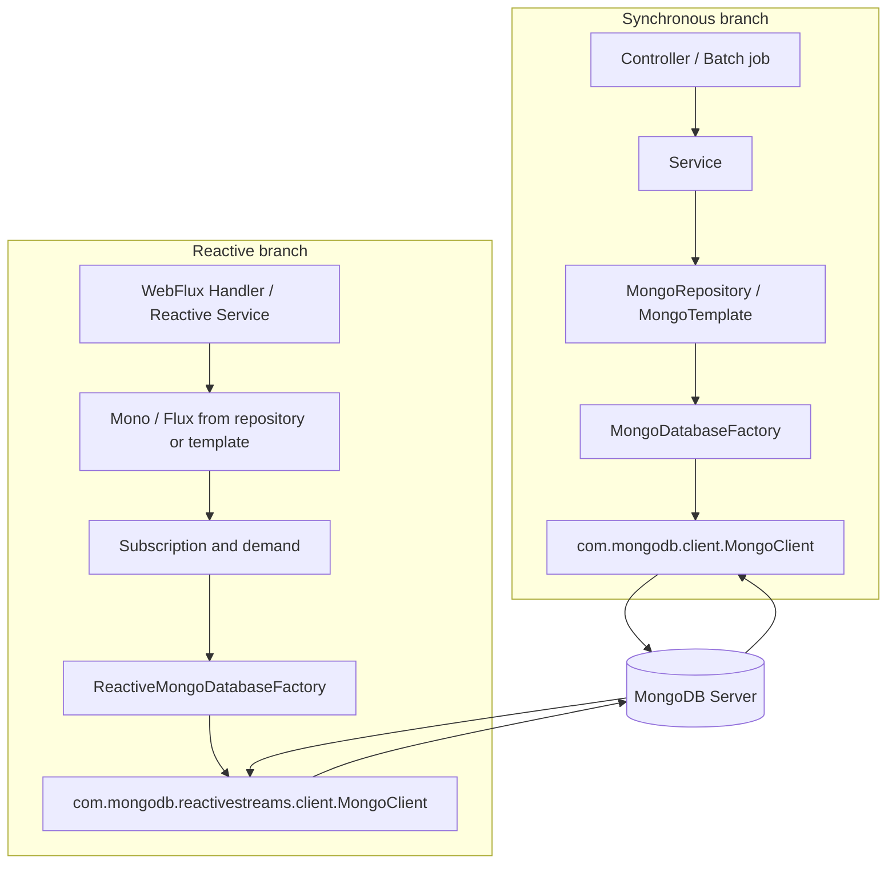
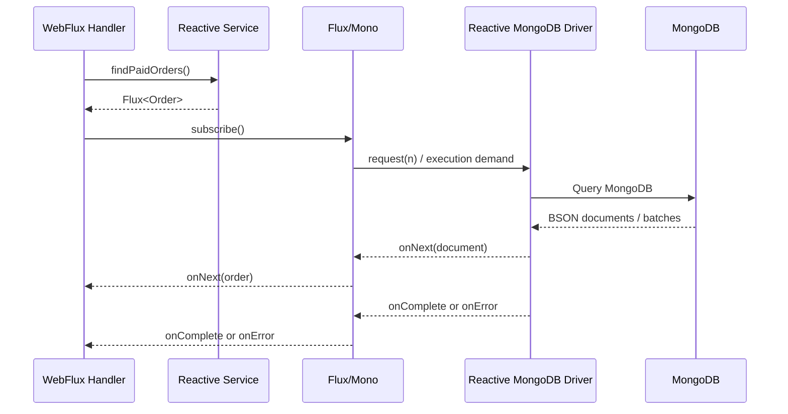

# Distinguishing Synchronous MongoClient from Reactive MongoClient

In Spring Data MongoDB, both **synchronous (blocking)** access and **reactive (non-blocking, Reactive Streams)** access communicate with the same MongoDB Server, working with the same collections, BSON documents, indexes, and aggregations. The differences lie in the **driver API**, **I/O execution model**, **return types**, **query lifecycle**, and **how calls integrate with the Java application's request-processing threads**.

The shared name `MongoClient` often causes confusion because both drivers define a class/interface with that exact name. However, they live in **two different packages**:

- Synchronous: `com.mongodb.client.MongoClient`, created via `com.mongodb.client.MongoClients.create(...)`.
- Reactive Streams: `com.mongodb.reactivestreams.client.MongoClient`, created via `com.mongodb.reactivestreams.client.MongoClients.create(...)`.

**Lesson objectives:** identify the right client type, trace the flow from service to MongoDB and back, configure properly with `MongoTemplate` or `ReactiveMongoTemplate`, choose the right model, and avoid pitfalls like calling `block()` in WebFlux, wrapping the synchronous driver inside a `Flux`, or closing the client before reactive publishers are subscribed.

## 1. Differences in a Single Table

| Aspect | Synchronous MongoClient | Reactive MongoClient |
| --- | --- | --- |
| Java type | `com.mongodb.client.MongoClient` | `com.mongodb.reactivestreams.client.MongoClient` |
| Driver dependency | `mongodb-driver-sync` | `mongodb-driver-reactivestreams` |
| I/O invocation style | Reads/writes can **block the calling thread** until results or errors arrive | Operations return `Publisher<T>`, execute on subscription, and emit signals asynchronously |
| Reading multiple documents at driver level | `FindIterable<T>`, `MongoCursor<T>` | `FindPublisher<T>` (Reactive Streams) |
| Reading a single document via Spring Data | Typically returns object, `Optional<T>`, or `null` depending on API | `Mono<T>` |
| Reading multiple documents via Spring Data | `List<T>`, `Stream<T>`, or equivalent synchronous types | `Flux<T>` |
| Spring Data operations | `MongoTemplate` / `MongoOperations` | `ReactiveMongoTemplate` / `ReactiveMongoOperations` |
| Repository | `MongoRepository<T, ID>` | `ReactiveMongoRepository<T, ID>` |
| Web stack pairing | Spring MVC, batch jobs, synchronous tasks | Spring WebFlux or end-to-end reactive chains |
| Error handling | Exceptions thrown when the operation executes | Publisher `onError` signals |
| Consumption rate control | Iterators, pagination, cursors, synchronous processing | Reactive Streams `request(n)`, Reactor operators |
| Spring Data transaction | `MongoTransactionManager` | `ReactiveMongoTransactionManager` |

Reactive **does not mean MongoDB runs queries faster on its own**. The main benefit is avoiding holding an application thread while waiting on I/O in an appropriate processing chain, especially under high concurrency. Query speed still depends on indexes, data size, pipelines, network, connection pools, server resources, and business design.

## 2. Architecture of the Two Access Paths



The diagram only illustrates the **flow of responsibility**: in practice, `MongoTemplate` uses mapping/conversion components and the factory to obtain databases/collections via the driver; a factory is not a separate intermediate "network gateway." The reactive branch likewise has `ReactiveMongoTemplate` and corresponding mapping classes. Both use the MongoDB Java Driver and MongoDB Server, but select **different APIs and execution models**.

In a Spring Data MongoDB application:

1. **Service** calls a repository or template using Java objects and query criteria.
2. **Spring Data** maps property names and values to document/BSON structures via metadata like `@Document`, `@Id`, `@Field`, converters, and callbacks if present.
3. **The appropriate driver** uses connections, sessions, read preferences, and write concerns to send requests to MongoDB.
4. **Results** return to the application as synchronous values or `Mono`/`Flux` signals. Errors propagate as exceptions or `onError` signals respectively.

There is no rule that every Java call emits a single MongoDB command: paginated repositories may issue count queries, lazy references may trigger extra reads, cursors may fetch multiple batches, and aggregations may have multiple stages.

## 3. Synchronous MongoClient: Call and Wait for Results

### 3.1. MongoDB Java Driver level API

Example reading up to 20 paid orders using the synchronous driver:

```java
import com.mongodb.client.MongoClient;
import com.mongodb.client.MongoCollection;
import com.mongodb.client.MongoClients;
import com.mongodb.client.MongoDatabase;
import com.mongodb.client.model.Filters;
import org.bson.Document;

import java.util.ArrayList;
import java.util.List;

class SyncOrderReader {
    private final MongoClient client;

    SyncOrderReader(MongoClient client) {
        this.client = client;
    }

    List<Document> findPaidOrders() {
        MongoDatabase db = client.getDatabase("shop");
        MongoCollection<Document> collection = db.getCollection("orders");

        return collection.find(Filters.eq("status", "PAID"))
                .limit(20)
                .into(new ArrayList<>());
    }
}
```

`find(...)` builds a `FindIterable<Document>`; when the iterable is **iterated** or materialized via `into(...)`, the driver performs the needed I/O and the call can block the current thread. Queries returning many results can also fetch additional batches via cursors. Therefore, it is more accurate to say "synchronous read calls can block while fetching data" rather than claiming `find()` always sends a network request immediately.

If iterating large result sets and managing the cursor explicitly:

```java
import com.mongodb.client.MongoCursor;

try (MongoCursor<Document> cursor = collection.find().iterator()) {
    while (cursor.hasNext()) {
        Document order = cursor.next();
        processOrder(order);
    }
}
```

The cursor snippet is an excerpt inside a method that already has `collection` and `processOrder`; closing `MongoCursor` releases resources promptly. Avoid always calling `into(new ArrayList<>())` for very large datasets since it buffers all results in memory.

### 3.2. Synchronous Spring Data: `MongoTemplate` and repositories

A simple entity:

```java
import org.springframework.data.annotation.Id;
import org.springframework.data.mongodb.core.mapping.Document;

@Document("orders")
class Order {
    @Id
    private String id;
    private String status;
    private long totalVnd;

    // Constructor, getters, and setters can be added as needed.
}
```

Querying via `MongoTemplate`:

```java
import java.util.List;
import org.springframework.data.mongodb.core.MongoTemplate;
import org.springframework.data.mongodb.core.query.Criteria;
import org.springframework.data.mongodb.core.query.Query;

class SyncOrderService {
    private final MongoTemplate template;

    SyncOrderService(MongoTemplate template) {
        this.template = template;
    }

    List<Order> findPaidOrders() {
        Query query = Query.query(Criteria.where("status").is("PAID"));
        query.limit(20);
        return template.find(query, Order.class);
    }
}
```

`findPaidOrders()` returns only after reading and mapping the requested results completes, or throws an exception on failure. For repositories, declare the synchronous type:

```java
import java.util.List;
import org.springframework.data.mongodb.repository.MongoRepository;

interface OrderRepository extends MongoRepository<Order, String> {
    List<Order> findByStatus(String status);
}
```

Repositories simplify standard queries, while `MongoTemplate` is convenient when you need `Query`, `Update`, aggregation, or fine-grained options. Both still access MongoDB through the **synchronous `MongoClient`** configured for the synchronous stack.

## 4. Reactive MongoClient: Creating a Publisher and Executing on Subscribe

### 4.1. Reactive Streams Driver level API

In the reactive driver, operations like `find()`, `insertOne()`, and `aggregate()` return a `Publisher`. With Reactor, you can adapt publishers into `Flux`/`Mono`:

```java
import com.mongodb.client.model.Filters;
import com.mongodb.reactivestreams.client.MongoClient;
import com.mongodb.reactivestreams.client.MongoCollection;
import org.bson.Document;
import reactor.core.publisher.Flux;

class ReactiveOrderReader {
    private final MongoClient client;

    ReactiveOrderReader(MongoClient client) {
        this.client = client;
    }

    Flux<Document> findPaidOrders() {
        MongoCollection<Document> collection =
                client.getDatabase("shop").getCollection("orders");

        return Flux.from(
                collection.find(Filters.eq("status", "PAID")).limit(20)
        );
    }
}
```

`findPaidOrders()` constructs a pipeline describing the work; **typically, no query is sent to the server when the method merely returns a `Flux`**. When an upstream consumer subscribes, the publisher begins executing according to demand. In WebFlux, the framework subscribes to the publisher returned by the handler/controller, so services do not call `subscribe()` manually.



The diagram describes the logical signal model and does not claim every `request(n)` corresponds to a single MongoDB command or network round trip. The driver may fetch data in batches and apply its own throttling. If a subscriber cancels the subscription, tasks/cursors can be released per driver mechanics; operations already executed on the server are not automatically rolled back.

### 4.2. Reactive Spring Data: `ReactiveMongoTemplate` and repositories

```java
import org.springframework.data.mongodb.core.ReactiveMongoTemplate;
import org.springframework.data.mongodb.core.query.Criteria;
import org.springframework.data.mongodb.core.query.Query;
import reactor.core.publisher.Flux;
import reactor.core.publisher.Mono;

class ReactiveOrderService {
    private final ReactiveMongoTemplate template;

    ReactiveOrderService(ReactiveMongoTemplate template) {
        this.template = template;
    }

    Flux<Order> findPaidOrders() {
        Query query = Query.query(Criteria.where("status").is("PAID"));
        query.limit(20);
        return template.find(query, Order.class);
    }

    Mono<Order> findById(String id) {
        return template.findById(id, Order.class);
    }
}
```

Corresponding repository:

```java
import org.springframework.data.mongodb.repository.ReactiveMongoRepository;
import reactor.core.publisher.Flux;
import reactor.core.publisher.Mono;

interface ReactiveOrderRepository
        extends ReactiveMongoRepository<Order, String> {
    Flux<Order> findByStatus(String status);
    Mono<Order> findFirstByStatus(String status);
}
```

Distinguish the two API levels:

- **Reactive MongoDB Driver** implements Reactive Streams directly and returns `Publisher<T>` or subtypes like `FindPublisher<T>`.
- **Spring Data Reactive MongoDB** offers a convenient API returning `Mono<T>` for 0–1 results and `Flux<T>` for 0–N results; Reactor orchestrates the publishers.

If no matching document exists, `Mono<Order>` normally completes **empty** without emitting `null`; `Flux<Order>` completes without emitting elements. Errors connecting, executing queries, or mapping surface inside the reactive chain—typically via `onError`—rather than being thrown synchronously at the line constructing the publisher.

## 5. Differences in Execution Time, Threads, and Backpressure

### 5.1. Blocking vs. non-blocking I/O

A synchronous call waiting on MongoDB can hold its calling thread until a response arrives. This is easy to read and debug, but requires a matching thread budget when many concurrent requests are waiting.

In reactive programming, the method returns a publisher quickly; the reactive driver schedules I/O and the subscriber receives signals asynchronously. This lets the application handle many concurrent I/O-bound tasks with fewer application threads when **the entire** access chain stays non-blocking. Reactive code still uses threads and connection pools, and can still become overloaded.

Comparison of usage style:

```java
// Synchronous: method returns the fetched result directly.
List<Order> orders = syncOrderService.findPaidOrders();
System.out.println("Read " + orders.size() + " orders");
```

```java
// Reactive: method returns a description of the work.
Flux<Order> orders = reactiveOrderService.findPaidOrders();

// WebFlux/controller layer returns Flux or composes further with operators.
Flux<String> ids = orders.map(order -> order.getId());
```

`getId()` in the example requires `Order` to expose the corresponding getter; the earlier entity definition omitted getters to focus on data access. In particular, creating a `Flux` and assigning it to a variable **does not mean** the server has been queried yet. With multiple subscribers, a cold publisher normally executes once per subscription; do not implicitly assume a query runs only once if the chain is subscribed repeatedly.

### 5.2. What can backpressure do?

Reactive Streams allows subscribers to express processing capacity via `request(n)`. The driver and Reactor can throttle emission rates according to that demand. However, backpressure **does not alter MongoDB's execution plan** and cannot turn an unindexed query into an efficient one.

For large datasets, you still must:

- Filter with selective criteria, project only needed fields, and create proper indexes.
- Paginate or cap results per API design; consider cursor batch sizes.
- Avoid calling `collectList()` on unbounded `Flux` streams: that buffers every document in memory before completing.
- Bound concurrency when fanning out multiple queries via `flatMap` or similar operators.

### 5.3. `block()` and `subscribe()` inside services

The two patterns below are common design mistakes:

```java
// Unsuitable on a non-blocking WebFlux processing path:
Order order = reactiveOrderRepository.findById(id).block();

// Avoid "fire and forget" in a service when business logic depends on the outcome:
reactiveOrderRepository.save(order).subscribe();
```

`block()` occupies the calling thread; on Reactor/WebFlux non-blocking threads, it may be rejected outright and defeats the reactive model. Calling `subscribe()` ad hoc prevents callers from tracking errors, cancellation, transaction context, and completion timing.

Proper composition style:

```java
Mono<Order> loadAndCheck(String id) {
    return reactiveOrderRepository.findById(id)
        .switchIfEmpty(Mono.error(
            new IllegalArgumentException("Order not found")))
        .filter(order -> "PAID".equals(order.getStatus()));
}
```

`loadAndCheck` is an illustrative method inside a service with the repository injected, and the entity needs a `getStatus()` getter. In real applications, raise an appropriate domain exception and decide explicitly how to handle an empty result after `filter`. The core rule is **compose work with operators and return the publisher to the caller**.

During incremental migrations, blocking calls can be offloaded onto a scheduler such as `Schedulers.boundedElastic()` if wrapping a synchronous library is unavoidable, but this **still uses the synchronous driver** and does not turn I/O non-blocking. It is a bounded compatibility measure, not a replacement for the native reactive driver in a reactive architecture.

## 6. Spring Boot Configuration and MongoClient Lifecycle

### 6.1. Choosing the right starter

In Spring Boot applications, typically start with the dependency:

```text
Synchronous:
org.springframework.boot:spring-boot-starter-data-mongodb

Reactive:
org.springframework.boot:spring-boot-starter-data-mongodb-reactive
```

The synchronous starter typically configures the MongoDB synchronous driver, `MongoTemplate`, and synchronous repository infrastructure. The reactive starter provides the reactive driver, `ReactiveMongoTemplate`, and reactive repository infrastructure. MongoDB configuration property names can vary across Spring Boot versions; verify against the documentation for your running version instead of copying property names from another project.

When an application intentionally uses **both** APIs in the same process, check auto-configuration and repository scan rules for your exact framework version to avoid duplicate beans or mismatched factories/clients. The two `MongoClient` types are **distinct Java types**, so you cannot pass a sync client into a constructor expecting a reactive client or vice versa.

### 6.2. Example of explicit client creation

The configuration snippet below only illustrates the difference in client types and lifecycle. When using Spring Boot auto-configuration, you normally **do not need** to declare these beans yourself; when customizing, ensure you do not accidentally create duplicate `MongoClient` instances.

```java
import org.springframework.beans.factory.annotation.Value;
import org.springframework.context.annotation.Bean;
import org.springframework.context.annotation.Configuration;

@Configuration(proxyBeanMethods = false)
class MongoClientsConfiguration {

    @Bean(destroyMethod = "close")
    com.mongodb.client.MongoClient synchronousMongoClient(
            @Value("${app.mongodb.uri}") String uri) {
        return com.mongodb.client.MongoClients.create(uri);
    }

    @Bean(destroyMethod = "close")
    com.mongodb.reactivestreams.client.MongoClient reactiveMongoClient(
            @Value("${app.mongodb.uri}") String uri) {
        return com.mongodb.reactivestreams.client.MongoClients.create(uri);
    }
}
```

The example configuration value can be fed from an environment variable into an application property:

```yaml
app:
  mongodb:
    uri: ${MONGODB_URI}
```

Spring resolves `MONGODB_URI` from the environment with this configuration. Never place MongoDB passwords in source code, query logs, or shared docs. For production, configure TLS, authentication, timeouts, connection pools, and monitoring according to your real infrastructure.

Key resource rules:

1. **Use long-lived `MongoClient` instances shared via dependency injection.** Never call `MongoClients.create(...)` per request; doing so creates repeated connection pools and connection setup overhead.
2. **Close on application shutdown.** `@Bean(destroyMethod = "close")` lets Spring close the client cleanly under lifecycle management.
3. **The two clients hold separate resources.** Even when sharing the same URI/database, synchronous and reactive clients are separate instances with separate pools, connection counts, and metrics to observe; never assume they share one connection pool.
4. **Do not close the client before reactive work executes.** Returning a `Flux` out of a `try-with-resources` block that creates and closes a reactive `MongoClient` can close the client before any subscription occurs.

### 6.3. Pairing clients with the right template and repository

| Access path | Matching factory | Matching template | Repository |
| --- | --- | --- | --- |
| Synchronous | `MongoDatabaseFactory` / `SimpleMongoClientDatabaseFactory` | `MongoTemplate` | `MongoRepository` |
| Reactive | `ReactiveMongoDatabaseFactory` / `SimpleReactiveMongoDatabaseFactory` | `ReactiveMongoTemplate` | `ReactiveMongoRepository` |

Manual configuration example illustrating the pairing (using the client beans declared above):

```java
import org.springframework.context.annotation.Bean;
import org.springframework.context.annotation.Configuration;
import org.springframework.data.mongodb.core.MongoTemplate;
import org.springframework.data.mongodb.core.ReactiveMongoTemplate;
import org.springframework.data.mongodb.core.SimpleMongoClientDatabaseFactory;
import org.springframework.data.mongodb.core.SimpleReactiveMongoDatabaseFactory;

@Configuration(proxyBeanMethods = false)
class MongoTemplatesConfiguration {
    @Bean
    MongoTemplate mongoTemplate(com.mongodb.client.MongoClient client) {
        return new MongoTemplate(
            new SimpleMongoClientDatabaseFactory(client, "shop"));
    }

    @Bean
    ReactiveMongoTemplate reactiveMongoTemplate(
            com.mongodb.reactivestreams.client.MongoClient client) {
        return new ReactiveMongoTemplate(
            new SimpleReactiveMongoDatabaseFactory(client, "shop"));
    }
}
```

This is an example of **explicitly assembling components** to learn the differences. In a normal Spring Boot application, auto-configuration creates the matching template; manual configuration should only be added when you genuinely need custom connection routing, databases, or converters. If an application has multiple `MongoClient`s of the same type, you may need `@Qualifier`, explicit bean names, and corresponding factory/repository configuration.

## 7. Transactions, Sessions, and Consistency

Both drivers can participate in MongoDB transactions when supported by the server and configuration (an appropriate replica set or sharded cluster). However, **how transaction context is propagated differs**.

### Synchronous

With `MongoTransactionManager`, Spring transactions bind `ClientSession` to the synchronous thread/context for the duration of execution:

```java
import org.springframework.transaction.annotation.Transactional;

@Transactional
public void moveOrderToArchive(String orderId) {
    // Sync MongoTemplate/repository operations participate in the transaction
    // when using the matching transaction manager and MongoDatabaseFactory.
}
```

### Reactive

`ReactiveMongoTransactionManager` binds transaction context to the **Reactor Context**; operations must compose along the same publisher chain and use the corresponding reactive factory:

```java
import reactor.core.publisher.Mono;
import org.springframework.transaction.annotation.Transactional;

@Transactional
public Mono<Void> archiveOrder(String orderId) {
    return reactiveTemplate.findById(orderId, Order.class)
        .flatMap(order -> reactiveTemplate.remove(order).then())
        .then();
}
```

This snippet only illustrates a reactive transactional method boundary; you need a reactive transaction manager configured and suitable MongoDB infrastructure for real transactions. Do not call `subscribe()` inside this method and return `Mono.empty()`: separately subscribed work escapes the intended transaction chain.

**You cannot implicitly share the same session/transaction across two `MongoClient`s from different APIs.** If one business flow mixes synchronous and reactive operations, design clear consistency boundaries; merely placing `@Transactional` does not make two drivers commit or roll back together.

## 8. Do Updates, Aggregation, and Indexes Differ?

Core MongoDB concepts are the same on both paths:

| Task | Synchronous Spring Data | Reactive Spring Data |
| --- | --- | --- |
| Save entity | `mongoTemplate.save(order)` returns entity | `reactiveTemplate.save(order)` returns `Mono<Order>` |
| Find multiple documents | `mongoTemplate.find(query, Order.class)` returns `List<Order>` | `reactiveTemplate.find(query, Order.class)` returns `Flux<Order>` |
| Conditional update | `updateFirst(...)` returns `UpdateResult` | `updateFirst(...)` returns `Mono<UpdateResult>` |
| Aggregation | `aggregate(...)` returns `AggregationResults<T>` | `aggregate(...)` returns `Flux<T>` |
| Indexes | Create and manage indexes in MongoDB | Same indexes; reactive index operations API |

Example updating an order's status synchronously:

```java
import org.springframework.data.mongodb.core.query.Criteria;
import org.springframework.data.mongodb.core.query.Query;
import org.springframework.data.mongodb.core.query.Update;
import com.mongodb.client.result.UpdateResult;

Query byId = Query.query(Criteria.where("id").is(orderId));
Update change = new Update().set("status", "PAID");

UpdateResult syncResult =
        mongoTemplate.updateFirst(byId, change, Order.class);
long modified = syncResult.getModifiedCount();
```

On the reactive branch, the same `Query` and `Update` are used, but the result is wrapped in a publisher:

```java
Mono<Long> modifiedCount = reactiveTemplate
        .updateFirst(byId, change, Order.class)
        .map(UpdateResult::getModifiedCount);
```

When `modifiedCount` is created, the command has not necessarily been sent yet; once subscribed, `UpdateResult` emits if the operation succeeds. `matchedCount` and `modifiedCount` can differ because MongoDB does not count re-setting a field to its existing value as a modification. Acknowledged results require an appropriate write concern.

Never choose reactive to dodge index design: `findByStatus("PAID")` still needs proper indexing, selectivity, sorting, `explain`, and payload sizing regardless of access path. Likewise, aggregations with `$match`, `$group`, and `$lookup` incur similar server cost given equivalent pipelines and configurations.

## 9. Which Model Fits Which Application?

| Context | Initial preference | Why |
| --- | --- | --- |
| Spring MVC app with synchronous call flow | MongoClient + MongoTemplate/MongoRepository | Easy integration and debugging; framework already uses a thread-per-request blocking model |
| ETL batch jobs, CLI tools, migrations | Synchronous in most cases | Ordering, cursor control, and error handling are usually simpler |
| End-to-end non-blocking Spring WebFlux | Reactive MongoClient + ReactiveMongoTemplate/ReactiveMongoRepository | Avoids blocking event-loop threads waiting on MongoDB and composes with other publishers |
| High-concurrency I/O gateway/API | Consider reactive after load testing | Can reduce waiting thread demand, provided the entire pipeline stays reactive |
| Small apps, simple DB operations | Match existing stack | Reactive adds lifecycle, subscription, and debugging complexity |
| Sync system with one blocking dependency | Keep sync or isolate bounded blocking steps | Switching every API to `Flux` alone does not create a true non-blocking pipeline |

In modern Java, virtual threads are another option to improve concurrency for blocking tasks depending on your stack and versions. They **do not turn the synchronous driver into a reactive driver**; decisions should be based on load profiles, operational stack, and code complexity.

Metrics to measure before and after switching models: throughput, p50/p95/p99 latency, concurrent requests, waiting threads, CPU/heap usage, connection pool size, pool checkout wait time, server execution time, and documents/index keys examined. Do not measure only "time to create `Flux`," because actual execution happens later.

## 10. Testing, Logging, and Error Handling

### 10.1. Synchronous vs. reactive tests differ in how results are awaited

Synchronous test example (inside a test class with repository, test data, and test MongoDB):

```java
List<Order> result = orderRepository.findByStatus("PAID");
assertThat(result).hasSize(2);
```

For reactive, use Reactor Test:

```java
import reactor.test.StepVerifier;

StepVerifier.create(reactiveOrderRepository.findByStatus("PAID"))
    .expectNextCount(2)
    .verifyComplete();
```

`StepVerifier` **subscribes and awaits signals**, so the test actually runs the query and observes results and completion. Writing `Flux<Order> result = repository.findByStatus(...)` and checking `result != null` does not verify MongoDB was ever called.

To test mapping, `_id`, unique indexes, transactions, or aggregations, use a real MongoDB instance in a controlled test environment (such as Testcontainers). Mocking repositories is fine for pure service logic, but does not prove the driver, mapping, and server work properly. Transaction tests require a MongoDB topology supporting transactions; a plain standalone MongoDB instance may not meet that requirement.

### 10.2. Observing commands and latency

General diagnostic steps:

1. Identify the exact **client type** and **template** injected (check the package of `MongoClient`).
2. For sync, measure method invocation through completion; for reactive, measure **the entire subscription lifecycle through terminal signal**, not just publisher creation.
3. Use selective logging or MongoDB driver command monitoring to inspect actual commands, collections, durations, and errors. Never log URIs containing passwords, tokens, or customer data.
4. Check connection pools, network timeouts, server selection, transactions/sessions, and operation counts triggered by repositories/references.
5. Run `explain("executionStats")` on MongoDB to inspect `winningPlan`, `totalDocsExamined`, `totalKeysExamined`, and `nReturned`; verify indexes are actually used.

Direct example in MongoDB Shell:

```javascript
db.orders.find({status: "PAID"}).limit(20).explain("executionStats");
```

With reactive code, errors can occur **after the service method returns the publisher**, so a `try/catch` around creating a `Flux` will not catch I/O errors thrown during subscription. Instead, handle errors in the reactive chain:

```java
Flux<Order> orders = reactiveOrderRepository.findByStatus("PAID")
    .doOnError(error -> metrics.recordMongoFailure())
    .onErrorMap(error -> new OrderStorageException(
        "Could not read orders", error));
```

Here `metrics` and `OrderStorageException` are illustrative components that must be defined in the application. `onErrorMap` transforms the error for upper layers to handle; it does not recover the query. If using `retry`, specify which errors are retryable and whether the operation is **idempotent**. Blindly retrying writes can produce duplicate records or repeat unintended side effects.

## 11. Common Architectural Mistakes

1. **Confusing the two same-named classes:** importing `com.mongodb.client.MongoClient` where a reactive factory is needed or vice versa. Check packages and dependencies rather than class names alone.
2. **Wrapping the sync driver in `Mono.just(...)`:** the argument inside `Mono.just(blockingCall())` evaluates immediately to obtain the value, so blocking already happened before the publisher was created. Use the proper reactive driver for non-blocking I/O.
3. **Calling `block()` inside a WebFlux handler:** slows or stalls event-loop threads; design services to return `Mono/Flux` end-to-end.
4. **Creating a client per request:** opens many pools, wastes connections, and loses lifecycle control. Share an application-scoped client.
5. **Returning a `Flux` after closing the client:** because publishers are lazy, the client must remain open while the query executes.
6. **Forgetting to subscribe in tests:** tests can "pass" without sending any command to MongoDB. Use `StepVerifier` or appropriate subscriber test tools.
7. **Subscribing manually to run writes:** work can escape transaction context, lose errors, and return the HTTP response before the write finishes.
8. **Assuming reactive automatically speeds up queries:** unindexed queries or queries returning millions of documents remain slow and resource-intensive.
9. **Mixing sync/reactive transactions:** they do not automatically share a session even with the same URI. Keep transaction boundaries consistent with the matching client and manager.
10. **Duplicate `MongoClient` configurations:** can multiply pools and muddy metrics; inspect auto-configurations and manual beans when both starters are present.

## 12. Scenario Exercises and Self-Assessment

**Scenario A — Migrating MVC to WebFlux.** The team changes controllers to return `Mono<Order>`, but services still call `MongoTemplate.findById()` and wrap it in `Mono.just(order)`. Is MongoDB I/O non-blocking now? **No**: the synchronous MongoDB call already executed before `Mono` was created. Migrate services to `ReactiveMongoTemplate` or isolate blocking sections as a controlled transition step.

**Scenario B — A `Flux` subscribed twice.** Two subscribers call `findByStatus` on the same cold publisher. Is it guaranteed that only one query runs? **No**: typically each subscription triggers a separate query. Design explicit sharing/caching behavior if needed, considering memory and emission timing.

**Scenario C — Switching to reactive to speed up an aggregation.** A `$group` query takes 800 ms on the server. Will switching `MongoTemplate` to `ReactiveMongoTemplate` cut it down to 100 ms? **No**: the same pipeline will likely take similar time on the server. Profile and optimize the pipeline, `$match`, indexes, and data volume.

**Scenario D — Reactive save never subscribed.** `Mono<Order> result = reactiveOrderRepository.save(order)` is constructed and ignored. Is the document saved? **No**: publishers are normally lazy and execute only when subscribed by a caller.

**Scenario E — Transaction fails to roll back as expected.** A service starts a synchronous transaction and then triggers a reactive repository via a self-subscribed publisher. Can they be assumed to share one transaction? **No**: the two drivers maintain different session/transaction contexts; redesign the write boundary and transaction manager.

**Scenario F — Application enables both starters.** MongoDB connection counts double even though request traffic did not increase. What do you check? **Check how many `MongoClient` beans of each type exist, pool configurations, auto-configurations, and manually created clients**, and measure metrics per client.

Whenever you need to distinguish two `MongoClient`s, ask three questions in order: **(1) which package is the class in, (2) does the method return data immediately or return a publisher awaiting subscription, and (3) which template/repository/transaction manager is Spring Data using?** Answering those three questions clearly identifies the execution model, configuration points, and testing strategy. Both options fit their own domains well; effectiveness comes from alignment across driver, framework, request flow, and MongoDB query characteristics.
