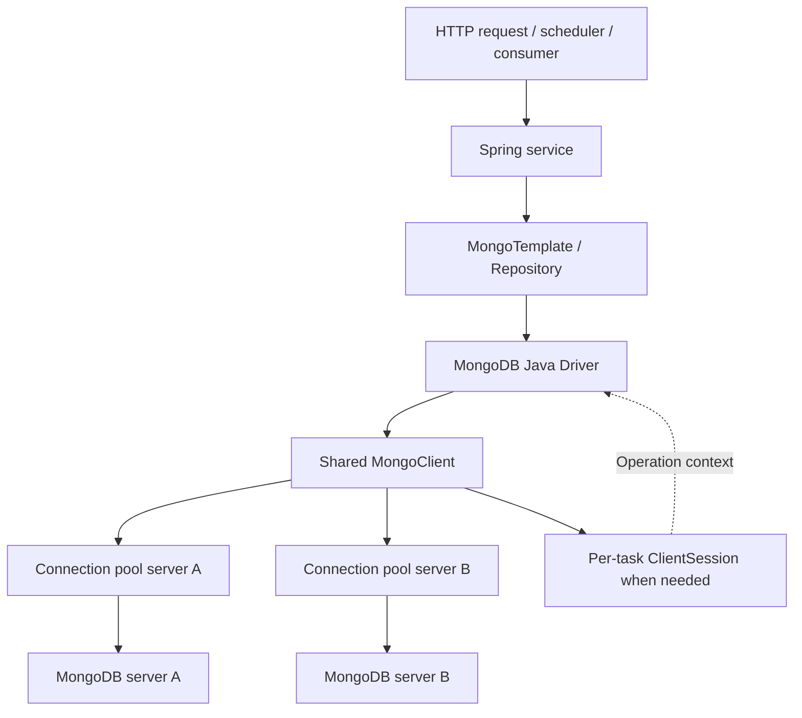
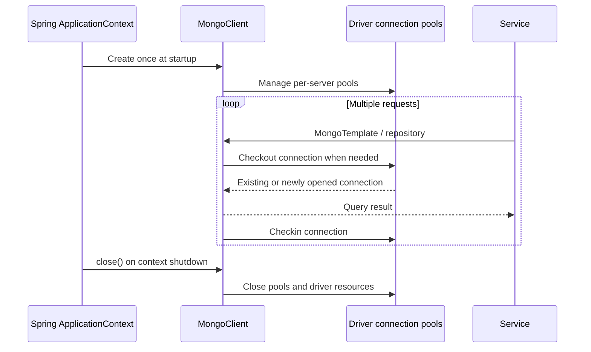
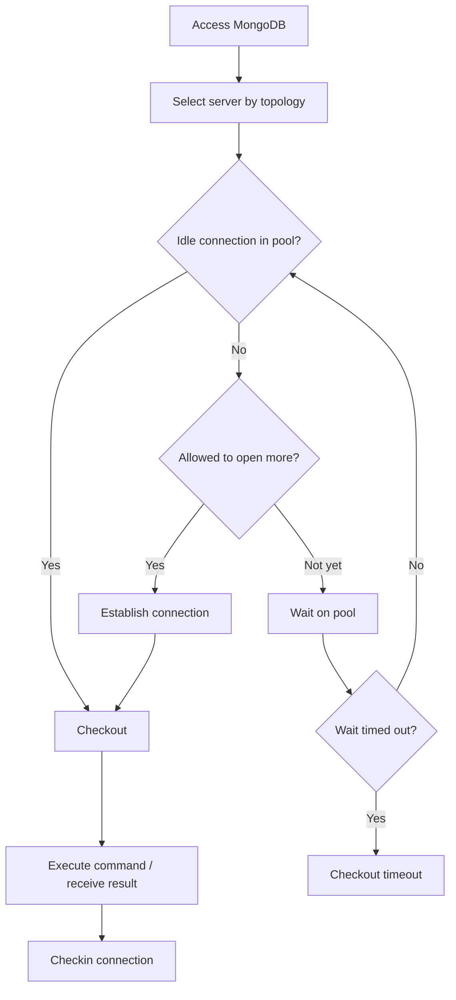

# Managing Client Lifecycle, Connection Pools, and Sessions in Spring Data MongoDB

## 1. Why Must These Three Resource Layers Be Managed?

In a **Spring Data MongoDB** application, `MongoClient` is the entry point of the MongoDB Java Driver: it manages cluster topology, authentication, server selection, and connection pools used to send commands to MongoDB. `MongoTemplate` and repositories build on top of the driver, offering Spring APIs for document mapping, CRUD, aggregation, queries, and transactions. An application serves many concurrent requests, yet typically **should not create a new `MongoClient` per request**.

If every API call creates a new client, pools fragment, sockets and management threads proliferate, and repeated connection handshakes add latency. If a client is closed while another service still uses it, subsequent operations fail. If sessions or transactions stay open too long, both the application and MongoDB incur extra resource pressure and write conflicts.

This lesson in the **Configuration and Architecture** chapter focuses on three areas:

- **Client lifecycle:** who creates and owns `MongoClient`, when it is initialized, shared, closed, and when multiple clients are needed.
- **Connection pool:** how the driver establishes, checks out, reuses, and caps sockets to MongoDB; calculating total connections when scaling out.
- **Session:** the logical context scope for a sequence of operations—especially causal consistency and transactions—how sessions start/close, and how they integrate with Spring.

These principles apply across `MongoTemplate`, `MongoRepository`, and reactive infrastructure. Specific property names, pool defaults, and APIs depend on the MongoDB Driver, Spring Data, and Spring Boot versions; numeric parameters in this lesson are **illustrative values**.

## 2. Architecture and Concepts Diagram



| Component | Meaning | Appropriate lifecycle | Shared across requests? |
|---|---|---|---|
| `com.mongodb.client.MongoClient` | Synchronous Java Driver client managing topology and pools | Typically matches Spring `ApplicationContext` lifecycle | **Yes**; designed for concurrent use |
| `com.mongodb.reactivestreams.client.MongoClient` | Reactive Java Driver client | Typically matches Spring `ApplicationContext` lifecycle | **Yes**; shared across reactive pipelines |
| `MongoTemplate` / `ReactiveMongoTemplate` | Database access API layered on client/factory | Reused Spring bean, typically singleton | **Yes** in standard configurations |
| Connection | Physical socket managed by the driver | Checked out/checked in via pool and reused | Application does not hold sockets across requests |
| `ClientSession` | Logical session context, optionally bound to a transaction | Scoped to a single unit of work | **No** concurrent use across threads |
| Transaction | Multi-operation atomic scope per MongoDB capabilities | Started and finished quickly and explicitly | Do not run parallel commands on the same session/transaction |

**A session is not a dedicated socket.** `ClientSession` holds logical context; the driver decides when to check out a connection. Under certain topologies or transactions, a connection/server may be pinned as required. Do not infer socket count from session count.

**The pool is not a single shared queue for the entire cluster.** The Java Driver normally maintains pools per eligible server in the topology. Replica sets, sharding, read preferences, and application instance count affect total connections; topology-monitoring sockets can also exist outside the application pool limit.

## 3. MongoClient Lifecycle in Spring

### 3.1. Sharing a Spring DI-managed client

With Spring Boot having the MongoDB starter and auto-configuration, Spring typically creates `MongoClient`, `MongoDatabaseFactory`, and `MongoTemplate` beans. Services simply inject what they need without creating clients repeatedly:

```java
import org.bson.Document;
import org.springframework.data.mongodb.core.MongoTemplate;
import org.springframework.stereotype.Service;

@Service
public class MongoHealthProbe {
    private final MongoTemplate template;

    public MongoHealthProbe(MongoTemplate template) {
        this.template = template;
    }

    public boolean isAvailable() {
        Document result = template.executeCommand(new Document("ping", 1));
        return ((Number) result.get("ok")).doubleValue() == 1.0;
    }
}
```

`ping` is useful for testing connectivity in experiments; in production, consider Spring Boot Actuator's built-in health indicator and an appropriate health-check cadence.

Typical lifecycle flow:



Avoid recreating clients inside request handlers:

```java
// Anti-pattern for frequently called web services:
public void saveOne(String uri, Document data) {
    try (com.mongodb.client.MongoClient client =
            com.mongodb.client.MongoClients.create(uri)) {
        client.getDatabase("shop").getCollection("events").insertOne(data);
    }
}
```

`try-with-resources` in this snippet closes the client cleanly when the method returns, yet its **lifecycle is far too short** for a web service. This pattern suits only one-off CLI scripts that genuinely own the client.

### 3.2. Creating a client bean manually when needed

If replacing auto-configuration, declare the client as a Spring-owned bean:

```java
import com.mongodb.client.MongoClient;
import com.mongodb.client.MongoClients;
import org.springframework.beans.factory.annotation.Value;
import org.springframework.context.annotation.Bean;
import org.springframework.context.annotation.Configuration;

@Configuration
public class MongoClientConfig {
    @Bean(destroyMethod = "close")
    MongoClient mongoClient(@Value("${app.mongodb.uri}") String uri) {
        return MongoClients.create(uri);
    }
}
```

```yaml
# application.yml for the manual bean example
app:
  mongodb:
    uri: ${MONGODB_URI}
```

Spring invokes the destroy method when releasing the bean during context shutdown. When declaring `MongoClient` manually, check your Boot version's auto-configuration/back-off rules so you **do not accidentally create a second client** connecting to the same cluster.

For simple needs such as URI, pool size, and timeouts, prefer connection string configuration and auto-configuration. There is no need to declare a manual bean solely to set `maxPoolSize`.

### 3.3. Cases requiring multiple `MongoClient`s

Multiple clients make sense when an application accesses **multiple clusters** or distinct authentication accounts. Each client carries its own pools and resource overhead; give beans clear names, route `MongoTemplate`/`MongoDatabaseFactory` to the intended client, and close each client on context shutdown.

If multiple tenants share the same cluster and credentials, they can share a client and access the appropriate database/collection under application authorization policies. Avoid creating one client per tenant by default without a connectivity isolation requirement; total socket counts multiply by tenants and pods. If tenants have isolated clusters or credentials, separate clients may be required.

### 3.4. Shutting down in the right order

On shutdown, the application should stop accepting new requests, let in-flight tasks finish within the graceful shutdown window, and then close `MongoClient` via its owner. Never call `mongoClient.close()` inside a controller or service when the client is a shared bean. Closing a client while requests are still running causes errors; failing to close a standalone client leaks sockets and topology-monitoring threads.

## 4. Connection Pool Checkout/Checkin and Timeouts

### 4.1. Path of a MongoDB command



These steps describe the synchronous driver broadly. The driver also handles topology monitoring, connection health, retries, load balancing, and transactions. For reactive applications, checkout still exists, though waiting and async processing differ from blocking threads in the synchronous driver.

### 4.2. Key settings

| Parameter | Effect | Risk if misconfigured |
|---|---|---|
| `maxPoolSize` | Maximum connections in one pool (typically per server) | Too small: long wait queues; too large: database faces too many concurrent commands/sockets |
| `minPoolSize` | Minimum connections the pool attempts to keep open | Too large across many pods creates many idle sockets |
| `maxConnecting` | Caps concurrent **new** connection establishments in a pool | Too small can slow warm-up under traffic spikes |
| `waitQueueTimeoutMS` | How long to wait to check out a connection from the pool | Too short causes errors on spikes; too long hangs requests waiting |
| `maxIdleTimeMS` | Maximum time a connection stays idle before removal | Too short increases connection churn |
| `maxLifeTimeMS` | Maximum lifetime of a connection | Too short forces frequent connection recreation |
| `serverSelectionTimeoutMS` | Wait limit to locate an eligible server | Must account for failovers, topology, read/write preferences |
| `connectTimeoutMS` | Wait limit to establish a network connection | Not the pool wait timeout |
| `socketTimeoutMS` | Network I/O wait limit for an operation | Must account for slow queries, large payloads, overall deadlines |

**Distinguish timeouts:** `serverSelectionTimeoutMS` covers finding a node, `waitQueueTimeoutMS` covers borrowing a connection, `connectTimeoutMS` covers opening TCP/TLS, and `socketTimeoutMS` covers data exchange. One request may pass through multiple stages and even retries; do not treat these as a single overall deadline. For systems with strict response SLAs, enforce request-level deadlines and align driver timeouts consistently.

Defaults vary by driver version and deployment. In common Java Driver releases, `maxPoolSize` may default to 100 and `minPoolSize` to 0, but **check your exact driver** rather than relying on fixed assumptions.

### 4.3. Configuring pool options in the URI

Example URI configuration in Spring Boot 3.x:

```yaml
spring:
  data:
    mongodb:
      uri: ${MONGODB_URI}
```

Illustrative environment variable value:

```text
mongodb://app_user:<ENCODED_PASSWORD>@127.0.0.1:27017/shop?authSource=shop&maxPoolSize=60&minPoolSize=5&maxConnecting=3&waitQueueTimeoutMS=2000&maxIdleTimeMS=60000&serverSelectionTimeoutMS=5000&connectTimeoutMS=10000&socketTimeoutMS=30000
```

`maxPoolSize=60` caps the pool to each server; `minPoolSize=5` keeps a small reserve open; `waitQueueTimeoutMS=2000` caps checkout waits at roughly two seconds. This is **not a recommended default production configuration**. Measure real workloads before tuning.

Passwords containing special characters must be URL-encoded per connection string syntax. Never commit credentials or log URIs containing passwords. With Atlas, URIs typically use `mongodb+srv://...` with cluster TLS settings preserved.

### 4.4. Customizing via `MongoClientSettings` for special requirements

Synchronous Java Driver example with a custom bean; choose **only one** of the two bean setups in Section 3.2 and here:

```java
import com.mongodb.ConnectionString;
import com.mongodb.MongoClientSettings;
import com.mongodb.client.MongoClient;
import com.mongodb.client.MongoClients;
import java.util.concurrent.TimeUnit;
import org.springframework.beans.factory.annotation.Value;
import org.springframework.context.annotation.Bean;
import org.springframework.context.annotation.Configuration;

@Configuration
public class TunedMongoClientConfig {
    @Bean(destroyMethod = "close")
    MongoClient mongoClient(@Value("${app.mongodb.uri}") String uri) {
        MongoClientSettings settings = MongoClientSettings.builder()
            .applyConnectionString(new ConnectionString(uri))
            .applyToConnectionPoolSettings(pool -> pool
                .maxSize(60)
                .minSize(5)
                .maxConnecting(3)
                .maxWaitTime(2, TimeUnit.SECONDS)
                .maxConnectionIdleTime(60, TimeUnit.SECONDS))
            .build();

        return MongoClients.create(settings);
    }
}
```

Spring Boot also supports customizing the `MongoClient` builder via customizer beans in supported versions, preserving auto-configuration when only a few settings need adjustment. Verify class names and precedence between URI and builder for your Boot/driver versions.

### 4.5. Calculating connections across multiple pods

Suppose there are 6 application pods, each with 1 client; in a given topology, each client maintains pools to 3 servers; each pool has `maxPoolSize=80`. Application connections could reach a theoretical ceiling of:

```text
6 pods × 1 client/pod × 3 servers × 80 connections/pool
= 1,440 pooled connections
```

**That is an illustrative ceiling, not the guaranteed number of open sockets.** Topology, read preference, active demand, `minPoolSize`, and monitoring sockets make real counts differ. Cluster capacity evaluations must sum connections across all applications, including other services.

By Little's Law under steady load:

```text
Average concurrency ≈ MongoDB operations/sec × connection hold time (sec)
Example: 200 operations/sec × 0.05 sec ≈ 10 concurrent operations
```

Averages do not represent peaks, P95/P99 latencies, or long transactions. Measure checkout time, command duration, and server capacity. Increasing pool size will not make an unindexed query run faster.

## 5. `ClientSession` Is a Logical Context, Not a Connection

### 5.1. When should you open a session explicitly?

The driver can manage logical sessions implicitly for eligible operations when supported by the server. For ordinary CRUD via `MongoTemplate`/repositories, applications **normally do not call `startSession()`**. Explicit sessions are needed when you want to:

- Maintain context across a sequence of operations requiring causal consistency, along with matching read/write concerns and server conditions.
- Execute multi-document transactions on a supported replica set or sharded cluster.
- Pass a specific session across multiple driver operations within one unit of work.

`ClientSession` is stateful and **not designed for concurrent use across multiple threads**. Never store a session in a singleton bean, static field, or keep it open across independent requests. Open a session in a clear scope, finish the work, and close it.

### 5.2. Direct Java Driver example

```java
import com.mongodb.ClientSessionOptions;
import com.mongodb.client.ClientSession;
import com.mongodb.client.MongoClient;
import org.bson.Document;

public class CustomerReader {
    private final MongoClient client;

    public CustomerReader(MongoClient client) {
        this.client = client;
    }

    public Document findCustomer(String customerId) {
        try (ClientSession session = client.startSession(
                ClientSessionOptions.builder()
                    .causallyConsistent(true)
                    .build())) {
            return client.getDatabase("shop")
                .getCollection("customers")
                .find(session, new Document("_id", customerId))
                .first();
        }
    }
}
```

This illustrates **passing a session into a command and closing it in scope**, not that every single read requires causal consistency. Causal consistency requires participating operations to share the proper session and compatible concern/deployment settings.

### 5.3. Sessions vs. transactions

A session can exist **without starting a transaction**. Multi-document transactions require a suitable deployment—**a replica set or sharded cluster**—and will not work as expected on a standalone MongoDB instance. Transactions consume resources, extend snapshot/lock lifetimes, and increase conflict risk if held open too long.

Java Driver example using `withTransaction` to decrement inventory and create an order:

```java
import com.mongodb.client.ClientSession;
import com.mongodb.client.MongoClient;
import com.mongodb.client.MongoCollection;
import com.mongodb.client.MongoDatabase;
import com.mongodb.client.result.UpdateResult;
import org.bson.Document;
import static com.mongodb.client.model.Filters.and;
import static com.mongodb.client.model.Filters.eq;
import static com.mongodb.client.model.Filters.gte;
import static com.mongodb.client.model.Updates.inc;

public class OrderWriter {
    private final MongoClient client;
    public OrderWriter(MongoClient client) { this.client = client; }

    public void placeOrder(String orderId, String productId, int quantity) {
        if (quantity <= 0) throw new IllegalArgumentException("quantity");
        MongoDatabase db = client.getDatabase("shop");
        MongoCollection<Document> orders = db.getCollection("orders");
        MongoCollection<Document> inventory = db.getCollection("inventory");

        try (ClientSession session = client.startSession()) {
            session.withTransaction(() -> {
                UpdateResult result = inventory.updateOne(
                    session,
                    and(eq("_id", productId), gte("available", quantity)),
                    inc("available", -quantity)
                );
                if (result.getModifiedCount() != 1) {
                    throw new IllegalStateException("Insufficient stock");
                }
                orders.insertOne(session, new Document("_id", orderId)
                    .append("productId", productId)
                    .append("quantity", quantity));
                return null;
            });
        }
    }
}
```

If stock is insufficient, the callback throws an exception and the transaction aborts. The example omits duplicate order ID/full request idempotency checks. `withTransaction` can **re-invoke the callback** on certain transient transaction errors; never send emails, charge cards, or trigger external side effects inside the callback unless designed to be retry-safe. Never execute parallel operations on the same session/transaction.

## 6. Spring-Managed Sessions and Transactions

### 6.1. Using `MongoTransactionManager`

In synchronous Spring Data MongoDB applications, `MongoTransactionManager` integrates MongoDB transactions with Spring's `@Transactional` mechanism. When a transaction starts, the manager creates and binds a session to the active execution context so eligible `MongoTemplate`/repository operations join the same transaction.

```java
import org.springframework.context.annotation.Bean;
import org.springframework.context.annotation.Configuration;
import org.springframework.data.mongodb.MongoDatabaseFactory;
import org.springframework.data.mongodb.MongoTransactionManager;

@Configuration
public class MongoTransactionConfig {
    @Bean
    MongoTransactionManager mongoTransactionManager(MongoDatabaseFactory factory) {
        return new MongoTransactionManager(factory);
    }
}
```

Service example checking inventory condition:

```java
import com.mongodb.client.result.UpdateResult;
import org.bson.Document;
import org.springframework.data.mongodb.core.MongoTemplate;
import org.springframework.data.mongodb.core.query.Criteria;
import org.springframework.data.mongodb.core.query.Query;
import org.springframework.data.mongodb.core.query.Update;
import org.springframework.stereotype.Service;
import org.springframework.transaction.annotation.Transactional;

@Service
public class CheckoutService {
    private final MongoTemplate template;

    public CheckoutService(MongoTemplate template) {
        this.template = template;
    }

    @Transactional
    public void checkout(String orderId, String productId, int quantity) {
        if (quantity <= 0) {
            throw new IllegalArgumentException("quantity must be greater than 0");
        }

        Query inStock = Query.query(Criteria.where("_id").is(productId)
            .and("available").gte(quantity));
        UpdateResult changed = template.updateFirst(
            inStock, new Update().inc("available", -quantity), "inventory");

        if (changed.getModifiedCount() != 1) {
            throw new IllegalStateException("Insufficient stock");
        }
        template.insert(new Document("_id", orderId)
                .append("productId", productId)
                .append("quantity", quantity),
            "orders");
    }
}
```

When the method completes normally, Spring's transaction manager commits; if a runtime exception is thrown, Spring rolls back per default `@Transactional` rules. For two operations to succeed or fail together, they must share the **same factory/client** inside the transaction, and MongoDB must support transactions.

Conditions to verify in practice:

- **Proxying:** `@Transactional` usually takes effect only when called through a Spring proxy; calling `this.checkout(...)` within the same object bypasses standard proxy interception.
- **Selecting the right manager:** if the application has both JDBC/JPA and MongoDB transaction managers, specify the intended manager rather than assuming Spring picks the right one for every method.
- **Thread boundaries:** synchronous transactions bind to the current thread's context; do not offload work onto an executor or `CompletableFuture` expecting it to join the same transaction.
- **Do not open a separate session manually:** a `ClientSession` started directly does not automatically participate in the Spring-managed transaction.
- **Transaction scope:** a MongoDB transaction does not cover external HTTP calls, emails, Kafka messages, or another database. Cross-system consistency normally requires outbox/idempotency or coordination patterns.
- **Duration:** avoid slow tasks or unnecessary network I/O inside a transaction; verify indexes, transaction limits, and retry policies.

### 6.2. Working with sessions without transactions

Spring Data provides `withSession(...)` for cases needing an explicit `ClientSession` with `MongoTemplate`. Ensure **every operation relying on session context executes within that session's scope** and that the session closes upon completion, even on errors.

In applications with a transaction manager, prefer `@Transactional` or Spring's transaction APIs for multi-step business flows. Attempting to mix manually managed sessions with Spring-created sessions can cause commands meant to share a transaction to run on two separate sessions.

### 6.3. `ReactiveMongoTransactionManager` and Reactor Context

The Reactive Java Driver provides `com.mongodb.reactivestreams.client.MongoClient`; Spring Data provides `ReactiveMongoTemplate` and reactive repositories. These are dedicated reactive driver clients/pools, not a synchronous client wrapped with `subscribeOn` to simulate a reactive database.

Reactive transaction manager example:

```java
import org.springframework.context.annotation.Bean;
import org.springframework.context.annotation.Configuration;
import org.springframework.data.mongodb.ReactiveMongoDatabaseFactory;
import org.springframework.data.mongodb.ReactiveMongoTransactionManager;

@Configuration
public class ReactiveMongoTransactionConfig {
    @Bean
    ReactiveMongoTransactionManager reactiveMongoTransactionManager(
            ReactiveMongoDatabaseFactory factory) {
        return new ReactiveMongoTransactionManager(factory);
    }
}
```

With `Mono` and `Flux`, transactions bind to the **Reactor Context** at subscription time. Never call `subscribe()` inside a service and escape the pipeline, nor call `block()` in reactive code to force synchronous execution. For complex pipelines, use `TransactionalOperator` to express transaction boundaries explicitly. Never run multiple operations in parallel inside the same reactive session/transaction; sequence steps using operators such as `flatMap` and `then`, and control concurrency and retries.

When configuring both sync and reactive starters in the same application, check whether **two client types with two separate pools** are inadvertently created. Two clients can be valid if both models are genuinely used; account for their resources and manage each lifecycle separately.

## 7. Fault Tolerance, Timeouts, and Shutdown

### 7.1. Isolating where timeouts occur

| Issue | Related indicators | What to check |
|---|---|---|
| Cannot select a server | `serverSelectionTimeoutMS`, primary/secondary selection failure | Topology, replica set, DNS, network, read preference |
| Waiting too long for pool | Checkout timeout; possibly `MongoWaitQueueTimeoutException` | Checked-out connections, pool size, concurrency, long transactions |
| Cannot open TCP/TLS | `connectTimeoutMS`, handshake or connection refused | Host/port, firewall, TLS, server connection limits |
| Slow queries or dropped sockets | `socketTimeoutMS`, command latency, network read | `explain("executionStats")`, indexes, payload size, MongoDB load |

Never try to fix a pool checkout timeout simply by increasing `socketTimeoutMS`: those are two different stages. Increasing `maxPoolSize` helps only when the pool lacks connections and the server still has capacity; if MongoDB commands are slow due to missing indexes, growing the pool can overload the database further.

Retries also affect latency and business correctness. For transactions, account for full callback retries and ambiguous commit outcomes; design idempotency at the API level and avoid non-idempotent external side effects. Never log raw URIs containing credentials during error investigations.

### 7.2. Graceful shutdown

A clean shutdown sequence for a web application:

1. Stop accepting new requests via web server or orchestrator graceful shutdown.
2. Allow in-flight requests, pipelines, and transactions to finish within a bounded timeout.
3. Let Spring close the `MongoClient` bean; any client created outside Spring must be closed by its owner via `close()` or `try-with-resources`.
4. Observe shutdown errors, lingering connections, and resource close times in test environments.

Never call `close()` manually right after a `MongoTemplate` call when the client belongs to the Spring context. Conversely, if an application temporarily creates a client for a CLI task, release it at the end of the CLI run.

## 8. Observing Pools and Sessions with Metrics

### 8.1. Monitoring signals on both application and MongoDB

| Group | Useful metrics | Questions to answer |
|---|---|---|
| Connection pool | Total/available/checked-out connections, created/closed counts, pool clears | Is the pool saturating or churning sockets continuously? |
| Checkout | Checkout wait time, failed checkouts, timeouts | Are requests slow waiting for connections or waiting on the database? |
| Command | P50/P95/P99 latency, error counts, slow queries, request volume | Which commands hold connections the longest? |
| Server | Current/available connections, CPU, memory, I/O, replication lag | Has the cluster hit its limits? |
| Transaction | Duration, aborts/retries, active count, conflicts | Are transactions too long or too frequent? |
| Application | In-flight requests, worker threads/queues, endpoint latency | Does app concurrency match MongoDB load? |

The MongoDB Java Driver supports `ConnectionPoolListener` events, including checkout/checkin, checkout failures, connection creation/closing, and pool clearing. These can integrate with Micrometer/Actuator or your framework version's observability stack. Metric listeners must execute quickly, stay non-blocking, and never attach credentials or PII as metric labels.

MongoDB server/Atlas connection counts are only half the picture: client pools can queue even before the server reaches its connection limit due to concurrency, connection establishment, topology, or connection hold times.

### 8.2. Troubleshooting pool saturation

Suppose an application has `maxPoolSize=40` and some requests hit checkout timeouts:

1. Inspect checkout metrics and active connection counts to confirm whether the pool is hitting its limit.
2. Check queries, aggregations, missing indexes, oversized result sets, and long transactions; fix whatever is keeping connections checked out too long.
3. Verify whether the app creates clients per request, creates multiple clients for the same cluster, or recently scaled out pods.
4. Compare MongoDB connections, CPU, I/O, and resource limits against actual concurrency.
5. Control incoming concurrency and tune `maxPoolSize` and `waitQueueTimeoutMS` under measured load; compare throughput, P95/P99, and error rates.

If the pool is not saturated, investigate server selection, DNS, TLS, new connection establishment (`maxConnecting`), and networking. Do not blame every `MongoTimeoutException` on the pool.

## 9. Common Architectural Mistakes

| Mistake | Consequence | Fix |
|---|---|---|
| Calling `MongoClients.create(...)` per request | Fragmented pools, extra sockets and connection latency | Inject Spring-managed singleton client/template |
| Calling `client.close()` from a service using Spring's client | Other services/requests fail | Only close from the owner, aligned with lifecycle |
| Creating one client per tenant on the same cluster/credentials | Socket counts multiply by tenants and pods | Share client and enforce authorization policies |
| Setting `maxPoolSize` equal to max HTTP requests | HTTP requests do not always hold a MongoDB connection | Measure MongoDB operation concurrency and checkout latency |
| Setting `minPoolSize` too high on every pod | Many idle sockets, startup/scale spikes | Keep min small and calculate total across pods |
| Storing `ClientSession` in a singleton bean | Cross-task state corruption, thread-unsafe | Scope sessions per unit of work and close promptly |
| Using transactions for single-document CRUD | Unnecessary overhead and conflict risk | Rely on MongoDB's single-document write atomicity |
| Running transactions on standalone MongoDB | Fails multi-document transaction requirements | Use a supporting replica set or sharded cluster |
| Calling `this.transactionalMethod()` in the same bean | Bypasses standard `@Transactional` proxy interception | Invoke via Spring-managed bean or use template/operator |
| Calling `block()` in a reactive stream | Blocks processing threads, risks stalls | Use reactive pipelines and matching transaction manager |
| Running parallel MongoDB operations in one session/transaction | Unsafe and prone to errors | Execute steps sequentially within the session |
| Only increasing pool size when the app slows down | Pushes extra load onto an overloaded MongoDB | Analyze queries, indexes, timeouts, transactions, and capacity |

## 10. Testing Resources and Transactions

### 10.1. Verifying lifecycle

In an integration test environment with MongoDB:

- Start the Spring context and verify `MongoTemplate` and repositories read/write successfully.
- Invoke service calls repeatedly and inspect configuration to confirm no new `MongoClient` is created per call; watch connection counts over time if metrics are enabled.
- Close the context and verify Spring-owned clients are released.
- When multiple clients/factories exist, verify each template targets the intended database and credentials.

There is no need to write tests mocking internal driver details; focus on how the application owns resources and wires dependencies.

### 10.2. Verifying pools under load

1. Prepare data and queries matching the expected workload.
2. Ramp concurrency in steps, observing throughput, P95/P99, checkout wait, error rate, query latency, and socket count.
3. Test a deliberately small pool to observe checkout waits, then tune.
4. Compare increasing pool size against optimizing indexes/queries to see their different effects.
5. Re-test after scaling out pods, since total connections depend on more than a single process.

### 10.3. Verifying sessions/transactions

On a **replica set** in the test environment (never rely on standalone to validate transaction logic):

```text
Given: inventory.available = 5
When : checkout quantity = 3
Then : inventory.available = 2 and order is created

Given: inventory.available = 1
When : checkout quantity = 3
Then : transaction aborts; available remains 1; order is not created
```

Test transient transaction errors, callback retries, idempotency during order creation, and exception handling. Never share one session across threads; each test should clearly identify which transaction manager/client/factory it exercises.

## 11. Capstone Exercise

**Scenario:** an order service uses two collections, `orders` and `inventory`, built with Spring Data MongoDB across multiple instances.

1. Initialize a Spring Boot application with `spring.data.mongodb.uri` supplied via an environment variable. Let Spring manage client/template.
2. Choose experimental settings: `maxPoolSize=20`, `minPoolSize=2`, `waitQueueTimeoutMS=1000`; note the driver version and topology.
3. Run CRUD across multiple requests without opening `ClientSession` manually; confirm the same bean/template is reused.
4. Collect checkout latency, command latency, and connection counts during load ramp-up. Tune the pool from measurements.
5. Switch MongoDB to a test replica set, declare `MongoTransactionManager`, and use `@Transactional` when decrementing stock and creating an order.
6. Verify rollback on insufficient stock, then test duplicate-key order creation failures.
7. If using the reactive stack, practice with `ReactiveMongoTransactionManager` and sequential pipelines without mixing client types carelessly.
8. Stop the application via graceful shutdown; confirm no service logic closes the client prematurely.

**Passing criteria:** you can explain which pool each client owns, distinguish server-selection/pool-wait/socket timeouts, scope sessions cleanly, and verify transactions on a supported topology.

## 12. Quick Reference Table

| Question | Answer |
|---|---|
| Does every request need its own `MongoClient`? | No, clients are designed to be shared across operations. |
| Who closes a Spring-managed `MongoClient`? | The bean owner / `ApplicationContext` on shutdown. |
| Does `maxPoolSize=100` mean only 100 sockets for the whole app? | No, the limit is typically per pool/server/client, alongside topology and monitoring sockets. |
| Is a session a network connection? | No, a session is a logical context. |
| Does single-document CRUD need a transaction? | Normally no; single-document writes are atomic at the document level. |
| What do multi-document transactions require? | A supporting replica set/sharded cluster with properly scoped transaction/session handling. |
| Do reactive transactions use ThreadLocal like imperative ones? | No, reactive transactions rely on Reactor Context. |
| Should you increase the pool immediately on checkout timeouts? | Measure query latency, transactions, server resources, and checkout metrics first. |

Proper management of the **`MongoClient` lifecycle**, **connection pools**, and **sessions/transactions** ensures repositories, `MongoTemplate`, aggregations, and reactive access behave predictably and stay stable as traffic and instance counts grow.
