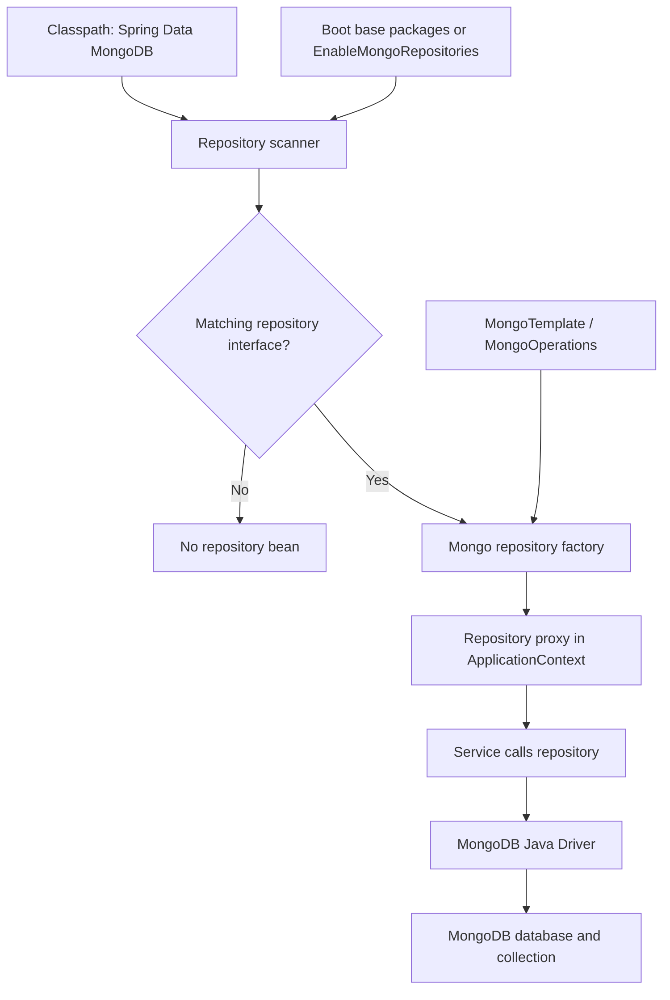
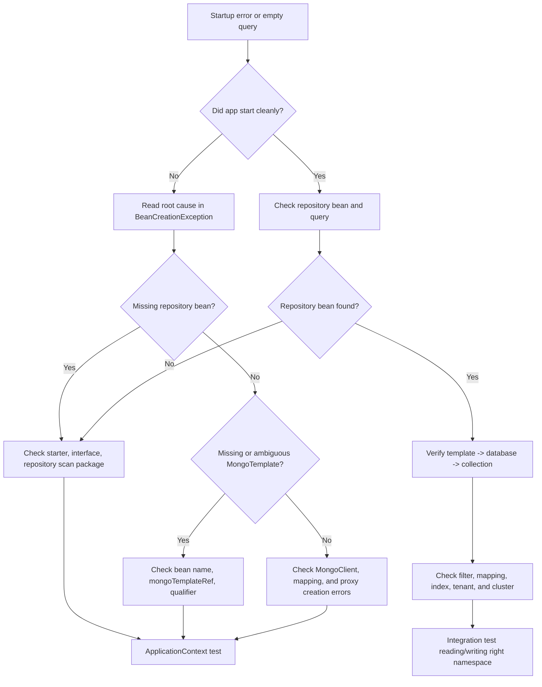

# Repository Not Found, Wrong Template, or Wrong Package Scanned

> **Chapter:** Errors and Diagnostics · **Module:** `SPRING_DATA_MONGODB`. Spring Data MongoDB lets applications access MongoDB via repositories, `MongoTemplate`, and reactive APIs. When an application reports a missing repository bean, when a repository returns an empty result even though data exists, or when multiple MongoDB databases are configured together, the fault often lies in **package scanning scope**, **repository factory registration**, or **which template the repository uses**. This lesson walks through isolating failures by symptom and building verifiable configurations.

## 1. Define the Exact Problem Before Changing Configuration

"Repository not found" can describe several distinct situations:

1. **Spring never created the repository bean.** When a service injects `OrderRepository`, the application fails with `NoSuchBeanDefinitionException` or `UnsatisfiedDependencyException`. Causes may include a package outside scan scope, a missing starter, or misconfigured repository settings.
2. **The repository was detected, but depends on a nonexistent template.** For example, `@EnableMongoRepositories(mongoTemplateRef = "ordersMongoTemplate")` when the context only defines `mongoTemplate`. The repository factory fails to initialize.
3. **The repository runs, but queries the wrong database/collection.** `findAll()` returns an empty list while `mongosh` shows data in another database. This is usually a **template binding** or URI/database issue, not a repository scanning error.
4. **Multiple repositories/templates of the same type exist and Spring cannot pick one.** `NoUniqueBeanDefinitionException` occurs at a `MongoOperations` injection point, or overlapping scans try to register the same repository bean.
5. **Mixing imperative and reactive APIs.** Code injects `ReactiveMongoRepository` while only `MongoTemplate`/sync driver is configured, or `@EnableMongoRepositories` scans a reactive package.

Do not fix everything by blindly adding `@ComponentScan("com")` or slapping `@Primary` everywhere. First determine **which bean is missing**, **which bean was picked by mistake**, and **where the data actually lives**.

### Quick Routing Table

| Symptom | First Place to Check | Distinguishing Signal |
|---|---|---|
| `No qualifying bean of type '...OrderRepository'` | Repository package, `@EnableMongoRepositories` config, dependencies | No repository bean exists in the context |
| Log `Found 0 MongoDB repository interfaces` | Base packages being scanned, repository interfaces | Found 0 interfaces *within the scanned scope* |
| `Cannot resolve reference to bean 'mongoTemplate'` | Bean name, `mongoTemplateRef`, auto-configuration conditions | Repository factory exists but points to wrong template |
| `NoUniqueBeanDefinitionException` for `MongoTemplate`/`MongoOperations` | Multiple template beans and injection points | Multiple candidates of the same type |
| Returns `[]` instead of data visible in shell | Database/collection, field names, URI, tenant filter | Repository works, but queries wrong location or criteria |
| `BeanDefinitionOverrideException` or bean name conflict | Two configs scanning the same repository package | Duplicate repository bean definitions |
| `ReactiveMongoRepository` bean missing | Reactive starter, reactive scan, `ReactiveMongoTemplate` | The two API stacks are not wired properly |

These log lines are **symptom patterns**, not literal verbatim messages across every Spring Boot/Spring Data version.

## 2. Internal Model: From Interface to MongoDB Command

A repository interface does not become an implementation object simply by being loaded by the JVM. Spring Data must **discover the interface**, build a repository factory, create a proxy, attach the proper `MongoOperations`, and register the bean into `ApplicationContext`.



There are three boundaries:

- **Component scan**: finds `@Component`, `@Service`, `@Configuration`, and related stereotypes.
- **Repository scan**: executed by Spring Data's repository configuration mechanism to find interfaces extending `Repository` (e.g., `MongoRepository`) within specified base packages and store type.
- **MongoDB mapping**: `@Document`, `@Field`, `@Id`, and converters define collection names, field names, and BSON conversions.

These three boundaries can cover different package scopes. `@Document` does not turn an entity into a `@Component`. `@ComponentScan` is not a reliable substitute for `@EnableMongoRepositories` when explicit repository configuration is needed.

### 2.1. Recommended Project Structure

Example single-database application:

```text
src/main/java/
└── com/example/shop/
    ├── ShopApplication.java               // @SpringBootApplication
    ├── order/
    │   ├── model/Order.java                // @Document
    │   ├── repository/OrderRepository.java // MongoRepository
    │   └── service/OrderService.java       // @Service
    └── config/
        └── ...                             // @Configuration
```

If `ShopApplication` resides in package `com.example.shop`, Spring Boot's default auto-configuration package naturally covers subpackages such as `com.example.shop.order`.

An error-prone layout:

```text
com/example/bootstrap/ShopApplication.java
com/example/order/repository/OrderRepository.java
com/example/order/model/Order.java
```

Here, `com.example.order` is outside subpackages of `com.example.bootstrap`. You cannot assume Spring Boot automatically scans repositories across every package sharing the `com.example` prefix.

**Simple option:** place the main application class in a shared root package of the modules to be scanned, such as `com.example` or `com.example.shop`. If architecture forces main to stay in another branch, explicitly configure repository scanning using a marker class/interface inside the target package.

## 3. Case A: Repository Is Actually Not Registered

### 3.1. Verify the Interface Follows Spring Data Conventions

A typical MongoDB repository:

```java
package com.example.shop.order.repository;

import java.util.List;
import org.springframework.data.mongodb.repository.MongoRepository;
import com.example.shop.order.model.Order;

public interface OrderRepository extends MongoRepository<Order, String> {

    List<Order> findByTenantId(String tenantId);
}
```

Corresponding entity:

```java
package com.example.shop.order.model;

import org.springframework.data.annotation.Id;
import org.springframework.data.mongodb.core.mapping.Document;

@Document(collection = "orders")
public class Order {

    @Id
    private String id;

    private String tenantId;

    protected Order() { }

    public Order(String id, String tenantId) {
        this.id = id;
        this.tenantId = tenantId;
    }

    public String getId() { return id; }
    public String getTenantId() { return tenantId; }
}
```

Service injecting via constructor:

```java
package com.example.shop.order.service;

import org.springframework.stereotype.Service;
import com.example.shop.order.repository.OrderRepository;

@Service
public class OrderService {

    private final OrderRepository orders;

    public OrderService(OrderRepository orders) {
        this.orders = orders;
    }

    public long countByTenant(String tenantId) {
        return orders.findByTenantId(tenantId).size();
    }
}
```

**Points to verify:**

- `OrderRepository` is an interface extending `MongoRepository<Order, String>` or a valid `Repository` interface. Putting `@Repository` on an arbitrary interface does not auto-generate an implementation.
- `Order` is a properly mapped domain class whose `@Id` type matches the repository ID type.
- The repository package is included in **repository scan**, and `OrderService` is included in **component scan**.
- `spring-boot-starter-data-mongodb` and required dependencies are present on the runtime classpath, not solely in `testImplementation` or another module.

Minimal Gradle dependency for imperative MongoDB:

```groovy
dependencies {
    implementation 'org.springframework.boot:spring-boot-starter-data-mongodb'
}
```

In Spring Boot, dependency versions should be managed by the BOM. Do not add mismatched driver/Spring Data versions manually and then try to patch the fallout with annotations.

### 3.2. Placing the Application Class in a Sensible Root Package

```java
package com.example.shop;

import org.springframework.boot.SpringApplication;
import org.springframework.boot.autoconfigure.SpringBootApplication;

@SpringBootApplication
public class ShopApplication {

    public static void main(String[] args) {
        SpringApplication.run(ShopApplication.class, args);
    }
}
```

Spring Boot uses the application configuration class's package to set auto-configuration packages. MongoDB repositories under the same package tree are generally discovered when repository auto-configuration is enabled and not overridden by explicit configuration.

If you cannot move the main class, configure scanning explicitly:

```java
package com.example.bootstrap;

import org.springframework.boot.autoconfigure.SpringBootApplication;
import org.springframework.boot.SpringApplication;
import org.springframework.data.mongodb.repository.config.EnableMongoRepositories;
import com.example.shop.order.repository.OrderRepository;

@SpringBootApplication(scanBasePackages = "com.example.shop")
@EnableMongoRepositories(basePackageClasses = OrderRepository.class)
public class ShopApplication {

    public static void main(String[] args) {
        SpringApplication.run(ShopApplication.class, args);
    }
}
```

Here:

- `scanBasePackages` enables component scan to find `OrderService`, `@Configuration`, etc., in `com.example.shop`.
- `basePackageClasses = OrderRepository.class` instructs repository scanning to start from the package containing that interface.
- You must ensure all other configurations are still properly imported or scanned by Spring.

**Note:** `@SpringBootApplication(scanBasePackages=...)` adjusts component scanning; do not assume it automatically adjusts every Spring Boot repository/`@EntityScan` scope. When repositories sit outside auto-configuration packages, declaring `@EnableMongoRepositories` explicitly is easier to control.

### 3.3. Prefer Marker Classes Over Package Strings

In multi-module projects, you can define a marker class or reference the repository interface directly:

```java
@EnableMongoRepositories(
    basePackageClasses = OrderRepository.class
)
```

The benefit is that refactoring `OrderRepository`'s package is tracked by the IDE and compiler, avoiding typos in `"com.example.shop.order.repository"`.

With string-based configuration, specify the full repository package:

```java
@EnableMongoRepositories(
    basePackages = "com.example.shop.order.repository"
)
```

Do not configure an overly broad scan across repositories of multiple databases: if one `@EnableMongoRepositories` scans another database's package by mistake, a proxy can be bound to the wrong `MongoTemplate`.

### 3.4. Do Not Put `@NoRepositoryBean` on Leaf Repositories

`@NoRepositoryBean` is meant for **base repository interfaces** where Spring should not create a direct proxy:

```java
import org.springframework.data.repository.NoRepositoryBean;
import org.springframework.data.mongodb.repository.MongoRepository;

@NoRepositoryBean
public interface BaseMongoRepository<T, ID>
        extends MongoRepository<T, ID> {
}
```

Concrete repository:

```java
public interface OrderRepository
        extends BaseMongoRepository<Order, String> {
}
```

If `@NoRepositoryBean` is accidentally placed on `OrderRepository`, Spring Data will not create a bean for that interface. Always inspect annotations and interface hierarchies rather than assuming `extends MongoRepository` guarantees registration.

### 3.5. Multiple Spring Data Stores on the Classpath

When an application combines MongoDB with Spring Data JPA, Redis, or other repository modules, Spring Data may run in **strict repository configuration mode** to decide which store owns each repository. An interface extending only `CrudRepository` with an entity lacking clear store metadata can be skipped or classified unexpectedly.

Recommendations:

- MongoDB interfaces extend `MongoRepository`, and domain classes use `@Document` where appropriate.
- JPA interfaces extend `JpaRepository` with separate JPA entities.
- Point `@EnableMongoRepositories`/`@EnableJpaRepositories` at separate packages when multiple stores coexist.
- Avoid putting annotations for both MongoDB and another store on the same domain class unless the design explicitly handles store disambiguation.

The message "Found 0 MongoDB repository interfaces" does not prove MongoDB lost connectivity; it reports the **interface scanning result**, not a server ping.

## 4. Checking Which Beans the Application Actually Created

### 4.1. Reading Startup Logs Within Scope

You can enable **repository configuration** logging in dev/test environments:

```yaml
logging:
  level:
    org.springframework.data.repository.config: DEBUG
    org.springframework.boot.autoconfigure: INFO
    org.mongodb.driver.protocol.command: WARN
```

Look for lines similar to:

```text
Bootstrapping Spring Data MongoDB repositories ...
Finished Spring Data repository scanning ... Found 0 MongoDB repository interfaces.
```

Compare the log against the **scanned base packages** and actual active conditions. If multiple stores exist, scanning messages from different modules may appear. Do not equate "Found 0" in one package region with the whole application having zero repositories.

Do not turn on driver command `DEBUG/TRACE` just to inspect repository scanning: MongoDB commands can contain filters/updates with sensitive parameters. Since this is a bean configuration issue, start with Spring Data repository configuration logs.

### 4.2. Inspecting `ApplicationContext` in Tests

Example using an integration test with a Spring Boot test context:

```java
import static org.assertj.core.api.Assertions.assertThat;

import org.junit.jupiter.api.Test;
import org.springframework.beans.factory.annotation.Autowired;
import org.springframework.boot.test.context.SpringBootTest;
import org.springframework.context.ApplicationContext;
import com.example.shop.order.repository.OrderRepository;

@SpringBootTest
class RepositoryRegistrationIT {

    @Autowired
    ApplicationContext context;

    @Test
    void mongoRepositoryBeanIsRegistered() {
        assertThat(context.getBeansOfType(OrderRepository.class))
            .hasSize(1);
    }
}
```

If the test fails to load the context, read the **root cause** in the stack trace: a missing repository bean differs from a bean that exists yet fails instantiation due to a missing `MongoTemplate` or connection error. This test only proves the bean is registered—not that it points to the right database.

You can use `ApplicationContext` to list bean names of a repository type in tests, without dumping the full environment or connection URIs containing secrets into logs.

## 5. Case B: Repository Was Discovered, but `MongoTemplate` Is Missing

By default, `@EnableMongoRepositories` uses `mongoTemplate` as the template reference name (in typical configurations). If you defined a custom template named `ordersMongoTemplate` while the repository scan still looks for `mongoTemplate`, proxy creation can fail.

Example of inconsistent configuration:

```java
@Configuration
@EnableMongoRepositories(
    basePackageClasses = OrderRepository.class
)
class OrderRepoConfig {

    @Bean("ordersMongoTemplate")
    MongoTemplate ordersMongoTemplate(MongoClient client) {
        return new MongoTemplate(client, "orders_db");
    }
}
```

In this configuration, the repository scan still references the default `mongoTemplate`, while the custom bean is named `ordersMongoTemplate`. Depending on auto-configuration conditions, a `mongoTemplate` bean may not be created at all, or it may point to a different database.

Explicit declaration:

```java
@Configuration
@EnableMongoRepositories(
    basePackageClasses = OrderRepository.class,
    mongoTemplateRef = "ordersMongoTemplate"
)
class OrderRepoConfig {

    @Bean("ordersMongoTemplate")
    MongoTemplate ordersMongoTemplate(MongoClient client) {
        return new MongoTemplate(client, "orders_db");
    }
}
```

`mongoTemplateRef` is a case-sensitive **bean name**, not a database name. In the setup above:

- `OrderRepository` is discovered from `OrderRepository.class`'s package.
- The repository factory references the `ordersMongoTemplate` bean.
- The template selects the `orders_db` database via its constructor.
- The final collection is determined from `@Document`/metadata or an explicit collection argument.

Whenever using a template bean not named `mongoTemplate`, check which repositories will use it. Renaming only the Java method/variable `ordersMongoTemplate` without updating `@Bean(name=...)`/`mongoTemplateRef` can cause unexpected runtime behavior.

### 5.1. Difference Between Template Bean and MongoDB Database

All three targets must align:

```text
OrderRepository
    │  mongoTemplateRef="ordersMongoTemplate"
    ▼
Bean name: ordersMongoTemplate
    │  MongoTemplate(client, "orders_db")
    ▼
Database: orders_db
    │  @Document(collection="orders")
    ▼
Collection: orders
```

A template configured for database `orders_db` does **not** mean every query automatically goes to collection `orders`. Domain mapping or explicit collection names still determine the namespace.

### 5.2. Do Not Substitute `@Primary` for `mongoTemplateRef`

When there are two `MongoTemplate` beans, `@Primary` resolves **autowiring by type** at certain injection points. However, `@EnableMongoRepositories(mongoTemplateRef = "...")` selects a template **by bean name**. Therefore:

- For repositories: specify the exact `mongoTemplateRef`.
- For services injecting a template: use `@Qualifier`, or use `@Primary` deliberately when a true default exists.
- For migration jobs or admin tools: inject templates by explicit name to avoid writing to the wrong database.

Never put `@Primary` on every template; if two beans are marked primary, ambiguity remains.

## 6. Case C: Multiple Databases on the Same Cluster with Different Templates

Suppose an application stores orders in `orders_db` and invoices in `billing_db`. It uses the **same sync `MongoClient`** to connect to the MongoDB cluster, while creating **two `MongoTemplate`s** pinned to each database.

### 6.1. Separate the Packages

```text
com.example.shop/
├── ShopApplication.java
├── config/
│   ├── MultiMongoTemplateConfig.java
│   ├── OrderRepositoryConfig.java
│   └── BillingRepositoryConfig.java
├── orders/
│   ├── model/Order.java
│   └── repository/OrderRepository.java
└── billing/
    ├── model/Invoice.java
    └── repository/InvoiceRepository.java
```

The two repositories live in **non-overlapping packages**. `@Configuration` classes reside under the application root package so Spring component scan picks them up.

Illustrative `Invoice` entity:

```java
package com.example.shop.billing.model;

import org.springframework.data.annotation.Id;
import org.springframework.data.mongodb.core.mapping.Document;

@Document("invoices")
public class Invoice {

    @Id
    private String id;

    private String invoiceNo;

    // Constructor, getters, and setters per application design.
}
```

Repository:

```java
package com.example.shop.billing.repository;

import org.springframework.data.mongodb.repository.MongoRepository;
import com.example.shop.billing.model.Invoice;

public interface InvoiceRepository extends MongoRepository<Invoice, String> {
}
```

### 6.2. Configure Both Templates with Explicit Names

```java
package com.example.shop.config;

import com.mongodb.client.MongoClient;
import org.springframework.context.annotation.Bean;
import org.springframework.context.annotation.Configuration;
import org.springframework.data.mongodb.core.MongoTemplate;

@Configuration(proxyBeanMethods = false)
public class MultiMongoTemplateConfig {

    @Bean("ordersMongoTemplate")
    MongoTemplate ordersMongoTemplate(MongoClient client) {
        return new MongoTemplate(client, "orders_db");
    }

    @Bean("billingMongoTemplate")
    MongoTemplate billingMongoTemplate(MongoClient client) {
        return new MongoTemplate(client, "billing_db");
    }
}
```

In this example, `MongoClient` is provided by Spring Boot auto-configuration via the MongoDB URI dependency/properties, and both templates share the cluster while targeting different databases. If endpoints, credentials, or converters differ per database, configure separate `MongoClient`, `MongoDatabaseFactory`, and mapping/converter beans within proper scope instead of copying this snippet verbatim.

When defining multiple custom templates, do not assume Boot will still create a default `mongoTemplate` bean. Auto-configuration is conditional and may back off once `MongoOperations` beans exist, depending on version and configuration.

### 6.3. Bind Repositories to the Right Templates

```java
package com.example.shop.config;

import com.example.shop.orders.repository.OrderRepository;
import org.springframework.context.annotation.Configuration;
import org.springframework.data.mongodb.repository.config.EnableMongoRepositories;

@Configuration(proxyBeanMethods = false)
@EnableMongoRepositories(
    basePackageClasses = OrderRepository.class,
    mongoTemplateRef = "ordersMongoTemplate"
)
public class OrderRepositoryConfig {
}
```

```java
package com.example.shop.config;

import com.example.shop.billing.repository.InvoiceRepository;
import org.springframework.context.annotation.Configuration;
import org.springframework.data.mongodb.repository.config.EnableMongoRepositories;

@Configuration(proxyBeanMethods = false)
@EnableMongoRepositories(
    basePackageClasses = InvoiceRepository.class,
    mongoTemplateRef = "billingMongoTemplate"
)
public class BillingRepositoryConfig {
}
```

Expected outcome:

| Repository | Scanned Package | Template Bean | Database | Collection |
|---|---|---|---|---|
| `OrderRepository` | `...orders.repository` | `ordersMongoTemplate` | `orders_db` | `orders` |
| `InvoiceRepository` | `...billing.repository` | `billingMongoTemplate` | `billing_db` | `invoices` |

The two `@EnableMongoRepositories` configurations must not cross-scan the same interface. If both scan `com.example.shop`, bean name conflicts or wrong template bindings can occur. Restrict scanning to each group's dedicated repository package.

### 6.4. Inject Templates in Services or Migration Jobs

```java
package com.example.shop.orders.service;

import org.springframework.beans.factory.annotation.Qualifier;
import org.springframework.data.mongodb.core.MongoTemplate;
import org.springframework.stereotype.Service;

@Service
public final class OrderMaintenanceService {

    private final MongoTemplate ordersTemplate;

    public OrderMaintenanceService(
            @Qualifier("ordersMongoTemplate") MongoTemplate ordersTemplate) {
        this.ordersTemplate = ordersTemplate;
    }

    public String configuredDatabase() {
        return ordersTemplate.getDb().getName();
    }
}
```

`getDb().getName()` helps verify the active database. In production, do not expose a public endpoint solely to report database names; use tests or access-controlled diagnostics.

If the application accesses MongoDB through a repository, injecting `@Qualifier` into another service **does not alter** which template the repository factory uses. That must be set via `mongoTemplateRef`.

## 7. Repository Runs, but Reads the Wrong Database/Collection

A subtler failure than startup failure:

```java
long count = orderRepository.count(); // returns 0
```

While:

```javascript
use orders_db
db.orders.countDocuments({}); // many documents
```

Do not jump to "repository scan failed," because the repository **exists and executes**. Verify step by step:

1. Which template bean is `OrderRepository` bound to in the repository factory configuration?
2. What does `MongoTemplate.getDb().getName()` return for that bean?
3. What does `mongoTemplate.getCollectionName(Order.class)` return?
4. Do query filters/arguments match BSON `@Field` mapping, tenant filters, or soft-delete conditions?
5. Are the application and `mongosh` connected to the **same cluster/environment**?
6. Are there differences in auth/roles, read preference, or replication lag?

Diagnostic example with a properly named injected template:

```java
String database = ordersTemplate.getDb().getName();
String collection = ordersTemplate.getCollectionName(Order.class);

if (!"orders_db".equals(database) || !"orders".equals(collection)) {
    throw new IllegalStateException("Wrong MongoDB namespace");
}
```

Never log full connection strings since they can contain credentials. When verifying clusters, use controlled environment metadata or logical endpoint names without secrets.

### 7.1. Mixing Up `@Document` and Default Collection Names

Omitting `@Document(collection = "orders")` causes Spring Data to derive a default collection name from class `Order`, which may differ from the existing collection name.

Configure explicitly:

```java
@Document(collection = "orders")
public class Order {
    @Id
    private String id;
    // ...
}
```

If code calls `mongoTemplate.find(query, Order.class, "orders_v2")`, the **explicit collection name on the call** is used for that operation. Meanwhile, the `Order` repository may still query the mapped collection. Compare repository and template calls with attention to how collection names are resolved.

### 7.2. Mixing Up Java Field Names and BSON Field Names

```java
@Document("orders")
public class Order {

    @Id
    private String id;

    @Field("tenant_id")
    private String tenantId;
}
```

Repository method:

```java
List<Order> findByTenantId(String tenantId);
```

Spring Data uses the mapping context to translate Java property `tenantId` to BSON field `tenant_id`. Checking in `mongosh` with `{ tenantId: "t-1" }` instead of `{ tenant_id: "t-1" }` returns nothing even though the repository works properly. Conversely, when writing raw `Document`/native driver queries, field names must match the actual stored schema.

### 7.3. Multi-Tenant Issues Are a Separate Category

If the database is selected per tenant at runtime, a repository pinned to a static `MongoTemplate` will not switch databases on each request. Simply adding a `TenantContext` to a service does not make `MongoRepository` switch namespaces.

Design a dedicated tenant-routing solution with an appropriate `MongoDatabaseFactory`/template factory, context propagation, and tenant-isolation tests; do not try to turn multiple static beans or `@Primary` into dynamic routing. In reactive apps, traditional thread-bound context may fail across thread scheduling; design around the reactive context instead.

## 8. Distinguishing Imperative and Reactive MongoDB

Spring Data provides two separate API stacks:

| Imperative | Reactive | Note |
|---|---|---|
| `MongoRepository<T, ID>` | `ReactiveMongoRepository<T, ID>` | Different return types |
| `MongoTemplate` / `MongoOperations` | `ReactiveMongoTemplate` / `ReactiveMongoOperations` | Two distinct template types |
| Sync MongoDB Java Driver | Reactive Streams MongoDB Java Driver | Requires matching dependencies/clients |
| `@EnableMongoRepositories` | `@EnableReactiveMongoRepositories` | Separate scanners/factories |
| `mongoTemplateRef` | `reactiveMongoTemplateRef` | Reference attribute names are not interchangeable |

Example reactive repository:

```java
package com.example.shop.events.repository;

import org.springframework.data.mongodb.repository.ReactiveMongoRepository;
import reactor.core.publisher.Flux;
import com.example.shop.events.model.Event;

public interface EventRepository
        extends ReactiveMongoRepository<Event, String> {

    Flux<Event> findByTenantId(String tenantId);
}
```

Entity `Event` maps to collection `events`. A standalone reactive configuration:

```java
package com.example.shop.config;

import com.mongodb.reactivestreams.client.MongoClient;
import com.example.shop.events.repository.EventRepository;
import org.springframework.context.annotation.Bean;
import org.springframework.context.annotation.Configuration;
import org.springframework.data.mongodb.core.ReactiveMongoTemplate;
import org.springframework.data.mongodb.repository.config.EnableReactiveMongoRepositories;

@Configuration(proxyBeanMethods = false)
@EnableReactiveMongoRepositories(
    basePackageClasses = EventRepository.class,
    reactiveMongoTemplateRef = "eventsReactiveTemplate"
)
public class EventReactiveMongoConfig {

    @Bean("eventsReactiveTemplate")
    ReactiveMongoTemplate eventsReactiveTemplate(MongoClient reactiveClient) {
        return new ReactiveMongoTemplate(reactiveClient, "events_db");
    }
}
```

This example assumes a configured **reactive `MongoClient`** bean and a runtime containing the reactive MongoDB driver plus Spring Data MongoDB reactive starter. If both sync and reactive clients coexist, the two `MongoClient` classes belong to **different Java packages**; do not inject one where the other is expected.

Conceptual dependency:

```groovy
dependencies {
    implementation 'org.springframework.boot:spring-boot-starter-data-mongodb-reactive'
}
```

Adding the reactive starter alone does not fix an `@EnableMongoRepositories` scanning the wrong package. When both repository styles live in the same project, separate their packages and configure each scanner specifically rather than sharing a single base package where a factory might pick up the wrong interfaces.

## 9. Handling Duplicate Configuration and Bean Ambiguity

### 9.1. Overlapping Repository Scans

Problematic configuration:

```java
@Configuration
@EnableMongoRepositories(basePackages = "com.example.shop")
class AllMongoRepositoriesConfig { }

@Configuration
@EnableMongoRepositories(
    basePackages = "com.example.shop.orders.repository"
)
class OrderRepositoriesConfig { }
```

Both scanners can pick up `OrderRepository`. When bean overriding is disabled, startup can fail with a bean definition conflict. When overriding is allowed, silently picking an unintended configuration is even harder to spot.

**Root fix:** each repository group has **one** scan configuration owning its package; avoid accidentally scanning the whole app. In simple single-database apps, prefer Boot's repository auto-configuration and add explicit declarations only when genuinely needed.

### 9.2. Multiple Templates Injected by Type

```java
@Service
class MaintenanceService {

    MaintenanceService(MongoTemplate template) {
        // Two MongoTemplate beans exist: ordersMongoTemplate and billingMongoTemplate.
    }
}
```

Without `@Qualifier` or a clear default bean, Spring fails to choose a single candidate. Inject the bean by name:

```java
MaintenanceService(
    @Qualifier("ordersMongoTemplate") MongoTemplate template
) {
    this.template = template;
}
```

A well-chosen `@Primary` can provide a default for type-based injection, yet in migration tasks or sensitive data handlers, explicit `@Qualifier` prevents modifying the wrong collection or database.

### 9.3. Template Exists, but Client or Factory Is Missing

A `MongoTemplate` needs a valid sync `MongoClient` or `MongoDatabaseFactory`. If you define the bean manually without a client, failure occurs **when creating the template**, before repositories can even use it. Check:

- Starter/driver dependencies are on the runtime classpath.
- `spring.data.mongodb.uri` or version-appropriate connection properties are set.
- `MongoAutoConfiguration`, `MongoDataAutoConfiguration`, or related configs were not accidentally excluded.
- If creating `@Bean MongoClient` manually, it points to the right endpoint and has a proper scope/lifecycle.
- With multiple clients, check which template depends on which client and whether bean names and qualifiers match.

Never log full MongoDB connection URIs for debugging since they can hold passwords. Use a test environment or sanitized metadata when comparing configs.

## 10. Isolating Issues with a Repeatable Inspection Order

A clean runbook **starts from the root exception** and follows whichever dependency is actually missing.



### Step 1. Read the Exception "Caused By" Chain

Example:

```text
UnsatisfiedDependencyException: Error creating bean 'orderService'
  caused by NoSuchBeanDefinitionException:
  No qualifying bean of type '...OrderRepository' available
```

Initial conclusion: the service was instantiated, but `OrderRepository` has no matching bean. Investigate repository scanning; no need to tune indexes or change the URI yet.

Another example:

```text
BeanCreationException: Error creating bean 'orderRepository'
  Cannot resolve reference to bean 'ordersMongoTemplate'
```

Initial conclusion: the repository was configured for creation, yet **the named template is missing**. Check `@Bean("ordersMongoTemplate")`, whether the `@Configuration` class is component-scanned/imported, and `mongoTemplateRef`.

Another error:

```text
NoUniqueBeanDefinitionException:
  expected single matching bean but found 2:
  ordersMongoTemplate,billingMongoTemplate
```

Initial conclusion: an injection point injects by type without specifying an instance. Inspect the failing constructor or factory bean instead of tweaking initialization order randomly.

### Step 2. Verify Active Packages and Modules

- Which package contains the main class actually being launched?
- Is the repository inside a source set/module on the **runtime classpath**?
- Which `@EnableMongoRepositories` annotation is active, and which packages does it scan?
- Is a `@Configuration` class outside the scan tree missing an import?
- Was a module recently split, or were package/repository interface names refactored?
- Does the project contain both `MongoRepository` and `ReactiveMongoRepository`, or multiple data stores?

Do not infer from folder layout on disk; Java at runtime scans according to **package declarations in source** and the classpath.

### Step 3. Verify Bean Names and Types

In an `ApplicationContext` test, check:

- Is a bean of type `OrderRepository` registered?
- How many `MongoOperations` beans exist and what are their names?
- How many `ReactiveMongoOperations` beans exist and what are their names?
- Which template name does the repository factory bean reference in `@EnableMongoRepositories`?
- Which `@Qualifier` does the service use, and does its casing match?

Do not rely solely on `context.containsBean("orderRepository")`: repository bean names can be customized. Prefer `context.getBeansOfType(OrderRepository.class)` in tests; for templates, verify the configured **bean name**.

### Step 4. Verify the Actual Namespace

If the app starts, inspect in order:

```text
MongoDB endpoint / cluster
    → Database (MongoTemplate.getDb().getName())
    → Collection (MongoTemplate.getCollectionName(Entity.class))
    → Field mapping (@Field)
    → Filter / projection / sort
    → Actual BSON result
```

This step separates "repository bean missing" from "repository exists but queries the wrong place." Always verify against the same environment: local, staging, and production may use identical database/collection names while holding completely different data.

## 11. Integration Tests Proving Repositories Bind to the Right Database

Unit tests that merely mock `OrderRepository` cannot prove Spring Data scanned the right package or picked the right template. With multi-database setups, write an integration test booting the Spring context against a real MongoDB instance (e.g., Testcontainers or an isolated test cluster).

### 11.1. Testing Bean Wiring and Database Names

Assuming the configuration from Section 6 and a test connection to a dedicated test MongoDB cluster:

```java
import static org.assertj.core.api.Assertions.assertThat;

import org.junit.jupiter.api.Test;
import org.springframework.beans.factory.annotation.Autowired;
import org.springframework.beans.factory.annotation.Qualifier;
import org.springframework.boot.test.context.SpringBootTest;
import org.springframework.context.ApplicationContext;
import org.springframework.data.mongodb.core.MongoTemplate;

import com.example.shop.orders.repository.OrderRepository;
import com.example.shop.billing.repository.InvoiceRepository;

@SpringBootTest
class MultiMongoWiringIT {

    @Autowired
    ApplicationContext context;

    @Autowired
    OrderRepository orderRepository;

    @Autowired
    InvoiceRepository invoiceRepository;

    @Autowired
    @Qualifier("ordersMongoTemplate")
    MongoTemplate ordersTemplate;

    @Autowired
    @Qualifier("billingMongoTemplate")
    MongoTemplate billingTemplate;

    @Test
    void repositoriesAndTemplatesAreWiredToExpectedNamespaces() {
        assertThat(context.getBeansOfType(OrderRepository.class)).hasSize(1);
        assertThat(context.getBeansOfType(InvoiceRepository.class)).hasSize(1);

        assertThat(ordersTemplate.getDb().getName()).isEqualTo("orders_db");
        assertThat(billingTemplate.getDb().getName()).isEqualTo("billing_db");

        assertThat(ordersTemplate.getCollectionName(Order.class))
            .isEqualTo("orders");
        assertThat(billingTemplate.getCollectionName(Invoice.class))
            .isEqualTo("invoices");
    }
}
```

**Limitation:** this test verifies that the repository and template beans are registered and checks the database/collection names of the injected templates. It **does not yet prove** `OrderRepository` actually uses `ordersMongoTemplate`, because a misconfigured repository config could still produce all those beans. Add a round-trip test through the repository.

### 11.2. Round-Trip Test to the Target Database

Use isolated test data and random identifiers; the snippet below goes inside `MultiMongoWiringIT`. `Order` requires the `(id, tenantId)` constructor from Section 3:

```java
import java.util.UUID;

import org.springframework.data.mongodb.core.query.Criteria;
import org.springframework.data.mongodb.core.query.Query;

@Test
void orderRepositoryWritesToOrdersDatabaseOnly() {
    String id = "test-" + UUID.randomUUID();
    Order order = new Order(id, "tenant-test");

    try {
        orderRepository.save(order);

        assertThat(
            ordersTemplate.findById(id, Order.class)
        ).isNotNull();

        assertThat(
            billingTemplate.findById(id, Order.class)
        ).isNull();
    } finally {
        // Clean up only the document with the test ID created above.
        ordersTemplate.remove(
            Query.query(Criteria.where("_id").is(id)),
            Order.class
        );
    }
}
```

The read through `billingTemplate` intentionally requests `Order.class`, targeting collection `orders` **inside `billing_db`**. Thus, if the repository writes to the wrong database, the test catches it. The test avoids `dropDatabase()`/`dropCollection()` and must run against an isolated test URI, never production.

Generating a UUID makes collisions with existing test documents highly unlikely, yet proper test environment isolation is still mandatory. Add a similar test for `InvoiceRepository` and reactive variants if applicable.

### 11.3. Why `@DataMongoTest` Might Not Reproduce Full-App Wiring Errors

`@DataMongoTest` is a **test slice** focused on the MongoDB layer and typically does not load all application components and configurations. A custom `@EnableMongoRepositories` or multi-template setup defined outside the slice may not load as it does in `@SpringBootTest`.

Therefore:

- Use `@SpringBootTest` to test **actual full-application wiring**.
- Use `@DataMongoTest` to test repository queries and mapping within an explicitly configured scope.
- If a specific configuration class is needed in a slice test, use `@Import` and verify its effect on the test context.
- Use Testcontainers or a dedicated test MongoDB instance to avoid developer-machine drift and keep real data untouched.

When a test fails on startup, analyze the root cause instead of adding `@MockBean` for the repository just to "make the test pass." Mocking the repository hides the exact wiring bug you need to catch.

## 12. Checklist of Common Causes

| Cause | Symptom | Verifiable Fix |
|---|---|---|
| Main class package doesn't cover repository | Missing repository bean | Move main to root or use `@EnableMongoRepositories(basePackageClasses=...)` |
| Missing MongoDB starter at runtime | Repository factory not created | Fix build dependencies/modules; verify runtime classpath |
| Interface doesn't extend a valid Repository type | Scanner ignores interface | Extend `MongoRepository` or `Repository` as supported by Spring Data |
| Concrete repository annotated with `@NoRepositoryBean` | Bean never appears | Use `@NoRepositoryBean` only on abstract base interfaces |
| Multiple Spring Data stores | Strict mode skips or misroutes scan | Separate packages by store; use store-specific repository interfaces |
| Two `@EnableMongoRepositories` scan same package | Bean name conflict or wrong template bound | Assign a single owner config per repository package |
| Wrong `mongoTemplateRef` name | `BeanCreationException`, template not found | Match `@Bean(name=...)` accurately with ref |
| Multiple `MongoTemplate`s injected by type | `NoUniqueBeanDefinitionException` | Use `@Qualifier` at injection points |
| Assuming `@Primary` redirects repositories | Repository still uses old template name | Configure `mongoTemplateRef` on the repository scanner |
| Template points to wrong database | Repository works but returns empty | Assert `getDb().getName()` and round-trip database test |
| Entity maps to wrong collection | Queries hit a different collection | Use `@Document(collection=...)` and assert `getCollectionName()` |
| `@Field` maps differently from BSON | Queries target wrong field or return empty | Compare property vs. field; inspect actual query |
| Mixing reactive and sync configurations | Missing reactive repository/template | Separate scanners, clients, templates, and starters |
| Test slice omits real config | Test differs from runtime app behavior | Use `@SpringBootTest` for wiring, or explicitly import config |
| Testing beans without round-trip writes | Wrong-database bug goes unnoticed | Save via repository and read back via target database template |

## 13. Safe Remediation in a Running System

For **application startup failures**, fix configuration and verify via `ApplicationContext` tests:

1. Capture the root stack trace with secrets redacted.
2. Identify the repository package and active scanner configuration.
3. Cross-check template bean names with `mongoTemplateRef`; avoid changing multiple settings at once.
4. Add bean wiring and namespace tests; run against a test environment before releasing.
5. Deploy via standard release process and monitor startup failures and MongoDB operations.

For cases where data was **already written to the wrong database**:

1. Stop new writes from the misconfigured path (e.g., via feature flag or pausing the affected job) per runbook.
2. Identify the scope of misdirected documents, timestamps, and affected business keys.
3. Reconcile data against upstream systems/backups; avoid blind bulk copies or deletes.
4. Fix wiring and verify target database tests in staging/test.
5. Plan a dedicated migration/rollback for misplaced documents with conflict controls and needed atomicity.

Changing `mongoTemplateRef` only fixes **future code paths**; it does not move documents already written to the wrong database. For transactional data, handle collections/indexes, idempotency, Change Streams, transactions, and background jobs tied to namespaces carefully.

## 14. Hands-on Exercises and Self-Check Questions

### Lab A — Intentionally Scan the Wrong Package

1. Place `ShopApplication` in `com.example.bootstrap` and `OrderRepository` in `com.example.shop.order.repository`.
2. Rely on default repository auto-configuration; observe Spring context/logs to see whether the interface is detected.
3. Add `@EnableMongoRepositories(basePackageClasses = OrderRepository.class)` along with required component scanning.
4. Run a `getBeansOfType(OrderRepository.class)` test and verify exactly one bean is created.

**Goal:** distinguish component scanning from repository scanning.

### Lab B — Two `MongoTemplate`s Sharing One `MongoClient`

1. Create `ordersMongoTemplate` for `orders_db` and `billingMongoTemplate` for `billing_db` on a test MongoDB instance.
2. Create separate repository configs for each package referencing the corresponding template.
3. Verify bean names, database/collection names, and run an `OrderRepository.save()` round-trip test.
4. Intentionally point the order repository's `mongoTemplateRef` to the billing template in a test and observe the assertion failure.
5. Restore the right mapping and verify the test passes.

**Goal:** prove that a "working repository" can still corrupt data placement if bound to the wrong template.

### Lab C — Mixing Sync and Reactive

1. Create a `MongoRepository` and a `ReactiveMongoRepository` in separate packages.
2. Configure `@EnableMongoRepositories` for sync and `@EnableReactiveMongoRepositories` for reactive.
3. Inspect the two distinct template/client types and configure `mongoTemplateRef`/`reactiveMongoTemplateRef` accordingly.
4. Enable only one scanner in a test and inspect the logs/exceptions to see why the other repository bean is missing.

**Goal:** avoid treating a reactive interface like an imperative `MongoRepository`.

### Self-Check Questions

1. Why does `NoSuchBeanDefinitionException: OrderRepository` differ from `Cannot resolve reference to bean 'ordersMongoTemplate'`?
2. What objects do `@ComponentScan` and `@EnableMongoRepositories` scan for?
3. Will a main class in `com.example.bootstrap` automatically scan repositories in `com.example.shop.order`?
4. Why is `basePackageClasses` preferable to package strings in frequently refactored projects?
5. Should `@NoRepositoryBean` be placed on a base interface or a concrete repository?
6. When both JPA and MongoDB are present, why can an interface extending only `CrudRepository` be hard to classify?
7. Does `mongoTemplateRef` reference a database name or a bean name?
8. Why does `@Primary` not fully replace `mongoTemplateRef`?
9. If a repository executes yet `findAll()` returns empty, which namespace elements should you verify?
10. Why does verifying an `OrderRepository` bean exists not prove it targets the right database?
11. How do `MongoTemplate` and `ReactiveMongoTemplate` differ in Spring Data repository configuration?
12. Why shouldn't you fix a repository scanning failure by mocking the repository in `@SpringBootTest`?
13. If data was written to the wrong database, will fixing the code configuration move old documents automatically?
14. How do you resolve two `@EnableMongoRepositories` scanning the same package?
15. When diagnosing with logs, why shouldn't you enable MongoDB driver command `DEBUG` just to troubleshoot bean scanning?

## 15. Takeaways

- **Missing repository bean:** check dependencies, interfaces, packages, and the **repository scanner**; distinguish from missing or ambiguous template errors.
- **Wrong template:** `mongoTemplateRef`/`reactiveMongoTemplateRef` take a **bean name**; the database name is configured in the template/factory, and the collection comes from entity mapping.
- **Multiple databases:** isolate repository packages, template beans, and scanners along clean boundaries; `@Primary` is not a repository routing mechanism.
- **Sync vs. reactive:** scanners, repository interfaces, templates, and `MongoClient` types are not interchangeable.
- **Wiring tests have limits:** context tests confirm bean existence; **repository round-trip tests checking the target database** prove data goes to the right place.
- **Diagnostics:** start from root causes and startup logs, keep credentials sanitized, and verify with integration tests before changing production settings.

### References

- [Spring Data MongoDB — MongoDB Repositories](https://docs.spring.io/spring-data/mongodb/reference/mongodb/repositories/repositories.html)
- [Spring Data MongoDB — Java Configuration for MongoDB](https://docs.spring.io/spring-data/mongodb/reference/mongodb/configuration.html)
- [Spring Data MongoDB — Reactive Repositories](https://docs.spring.io/spring-data/mongodb/reference/mongodb/repositories/repositories.html)
- [Spring Data Commons — Working with Spring Data Repositories](https://docs.spring.io/spring-data/commons/reference/repositories.html)
- [Spring Data Commons — Repository Definition](https://docs.spring.io/spring-data/commons/reference/repositories/definition.html)
- [Spring Data MongoDB API — EnableMongoRepositories](https://docs.spring.io/spring-data/mongodb/docs/current/api/org/springframework/data/mongodb/repository/config/EnableMongoRepositories.html)
- [Spring Data MongoDB API — EnableReactiveMongoRepositories](https://docs.spring.io/spring-data/mongodb/docs/current/api/org/springframework/data/mongodb/repository/config/EnableReactiveMongoRepositories.html)
- [Spring Boot — Using the @SpringBootApplication Annotation](https://docs.spring.io/spring-boot/reference/using/using-the-springbootapplication-annotation.html)
- [Spring Boot — MongoDB](https://docs.spring.io/spring-boot/reference/data/nosql.html#data.nosql.mongodb)
