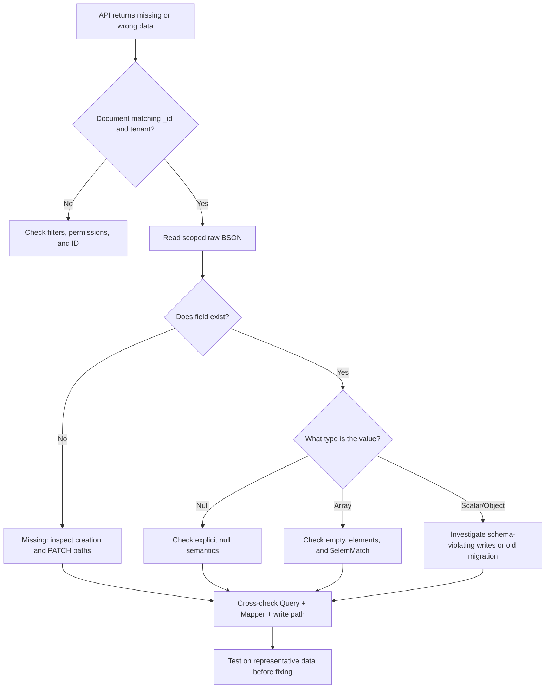

# Null Documents, Missing Fields, or Unexpected Array Shapes

## 1. The Diagnostic Problem in Spring Data MongoDB

When building applications with **Spring Data MongoDB**, we query documents with `MongoTemplate` or `MongoRepository`, map BSON to Java entities, filter via `Criteria`, and run updates. The same business symptom—"no data"—can stem from very different causes:

- No **document** matches the query condition.
- The document exists, yet **a field is missing**.
- The field exists, holding an explicit BSON **`null`**.
- The field is an **empty array `[]`**, which differs from `null` and a missing field.
- The application expects a `List`/array, yet legacy records store a **string, object, or another BSON type**.
- Array queries match elements unintentionally, or Java mapping obscures the underlying BSON shape.

Each case demands a different fix. Lumping them all together as "null" can cause APIs to return wrong payloads, `$push` updates to fail, `$size` aggregations to error out, or migrations to overwrite valid data.

**Objective:** observe and classify data states accurately; fix queries or mapping logic properly; normalize data only after confirming the business meaning of each state.

## 2. Distinguishing Absent Documents from Field States

### Document Does Not Exist

```java
Order order = mongoTemplate.findOne(query, Order.class);

if (order == null) {
    // No document matched the query.
}
```

`MongoTemplate.findOne(...)` returns `null` when no document matches. `MongoTemplate.find(...)` returns an empty list; `MongoRepository.findById(id)` returns `Optional.empty()`. These describe the **search result**, not whether a field inside an existing document is absent.

### A Field Inside a Document Can Have Many Shapes

Suppose the field is named `tags`:

| BSON in Document | State | Possible Business Meaning |
| --- | --- | --- |
| Key `tags` absent | Missing | Never recorded; legacy data; PATCH leaves field untouched |
| `"tags": null` | Explicit null | Explicitly stored null; may mean "unset" or "cleared" |
| `"tags": []` | Empty array | Explicitly confirmed empty list |
| `"tags": ["urgent"]` | Valid nonempty array | Has at least one tag |
| `"tags": "urgent"` | Scalar string | Schema violation if array expected; possibly legacy data |
| `"tags": { "name": "urgent" }` | Object | Wrong type if schema requires an array |
| `"tags": ["urgent", null]` | Array with mixed values | Array container, yet elements may be invalid |

Never assume missing, `null`, and `[]` are equivalent. For a PATCH endpoint, for example, the contract might treat omitting `tags` as keep existing, sending `null` as clear, and sending `[]` as set an empty list.

## 3. Reproducible Sample Dataset

Use a dedicated test collection to observe behavior cleanly without touching production data:

```javascript
db.order_shape_samples.insertMany([
  {
    _id: "missing",
    tenantId: "tenant-a",
    status: "NEW"
    // Both tags and lines are absent.
  },
  {
    _id: "null",
    tenantId: "tenant-a",
    status: "NEW",
    tags: null,
    lines: null
  },
  {
    _id: "empty",
    tenantId: "tenant-a",
    status: "NEW",
    tags: [],
    lines: []
  },
  {
    _id: "array",
    tenantId: "tenant-a",
    status: "PAID",
    tags: ["urgent", "fragile"],
    lines: [
      { sku: "S1", qty: 1 },
      { sku: "S2", qty: 5 }
    ]
  },
  {
    _id: "scalar",
    tenantId: "tenant-a",
    status: "NEW",
    tags: "fragile",
    lines: { sku: "S1", qty: 5 }
  },
  {
    _id: "mixed",
    tenantId: "tenant-a",
    status: "NEW",
    tags: ["urgent", null],
    lines: [
      { sku: "S1", qty: 2 },
      { sku: "S2", qty: 1 }
    ]
  },
  {
    _id: "another-tenant",
    tenantId: "tenant-b",
    tags: ["fragile"],
    lines: []
  }
]);
```

Examples below generally filter on `tenantId: "tenant-a"` to avoid mixing tenant data. String `_id` values make results easy to inspect; `String` is also supported by Spring Data MongoDB. When re-running the fixture script, use a clean test database/collection or delete test documents first, as running `insertMany` twice triggers duplicate `_id` errors.

## 4. Queries to Distinguish Missing, Null, and Arrays

### 4.1. `{ tags: null }` Does Not Match Only Null

```javascript
db.order_shape_samples.find(
  { tenantId: "tenant-a", tags: null },
  { _id: 1, tags: 1 }
);
```

In MongoDB, `{ tags: null }` matches documents **missing `tags`**, documents with `tags: null`, and arrays containing a `null` element under array element matching semantics. With this sample set, never read the result as "only explicit nulls."

| Predicate | Important Semantics |
| --- | --- |
| `{ tags: null }` | Matches null or missing; arrays containing a `null` element also match |
| `{ tags: { $exists: false } }` | Field `tags` is absent |
| `{ tags: { $exists: true } }` | Field exists, **even if its value is null** |
| `{ tags: { $type: "array" } }` | Field has BSON type array |
| `{ tags: { $size: 0 } }` | Field is an empty array |
| `{ tags: "fragile" }` | Matches scalar string or an array containing that element |

### 4.2. Finding Missing Fields

```javascript
db.order_shape_samples.find(
  { tenantId: "tenant-a", tags: { $exists: false } },
  { _id: 1 }
);
// Expected in sample data: _id = "missing".
```

`$exists: false` checks that the **key is absent**, not that its value equals null. With nested dot paths like `profile.contact.email`, `$exists` checks whether the full path exists; if any parent segment is missing, the child path is missing too.

### 4.3. Finding Exact Explicit BSON Null

For **scalar fields**, `{ tags: { $type: "null" } }` matches BSON null. However, the query `$type` operator inspects **element types** inside arrays as well, so an array containing `null` can still match.

To inspect the **BSON type of the whole field value** rather than array elements, use the aggregation expression `$type` inside `$expr`:

```javascript
db.order_shape_samples.find(
  {
    tenantId: "tenant-a",
    $expr: {
      $eq: [{ $type: "$tags" }, "null"]
    }
  },
  { _id: 1, tags: 1 }
);
// Expected: only _id = "null".
```

Inside an aggregation expression, `$type` returns `"missing"` for absent fields, `"null"` for BSON null, and `"array"` for arrays. `$expr` gives accurate diagnostic filtering yet may not use indexes as efficiently as simple predicates; run `explain()` before executing over large datasets.

### 4.4. Distinguishing Empty Arrays from Populated Arrays

```javascript
// Empty arrays only.
db.order_shape_samples.find({
  tenantId: "tenant-a",
  tags: { $size: 0 }
});

// Any array tags value, including [] and non-empty arrays.
db.order_shape_samples.find({
  tenantId: "tenant-a",
  tags: { $type: "array" }
});
```

`$size: 0` does not match null, missing fields, scalar strings, or objects; it requires an array of exactly zero elements. The query `$size` operator cannot use an index directly to satisfy array length conditions, so consider maintaining a dedicated `tagCount` field if workloads frequently filter by array size—keeping that count consistent across all write paths.

### 4.5. Projecting BSON Types to Analyze Distribution

```javascript
db.order_shape_samples.aggregate([
  { $match: { tenantId: "tenant-a" } },
  {
    $project: {
      tagsType: { $type: "$tags" },
      linesType: { $type: "$lines" },
      tagsCount: {
        $cond: [
          { $isArray: "$tags" },
          { $size: "$tags" },
          null
        ]
      }
    }
  }
]);
```

This is a helpful diagnostic step when you do not know when schema drift started. In the sample data, `tagsType` yields `"missing"`, `"null"`, `"array"`, or `"string"`. `tagsCount` computes size only when the field is truly an array; non-arrays yield `null` to prevent `$size` from throwing.

## 5. Querying Arrays: Why Syntax Can Be Valid While Semantics Fail

### 5.1. Scalar Equality Also Matches Arrays

```javascript
db.order_shape_samples.find({
  tenantId: "tenant-a",
  tags: "fragile"
});
```

This query matches both:

- `_id: "array"`, because `tags` is `["urgent", "fragile"]`.
- `_id: "scalar"`, because `tags` is the string `"fragile"`.

This is standard MongoDB array-element matching, not a bug. Yet if the API requires `tags` to be an array, matching `"scalar"` lets schema-invalid documents slip through.

To require **an array containing a matching element**, use `$elemMatch`:

```javascript
db.order_shape_samples.find({
  tenantId: "tenant-a",
  tags: { $elemMatch: { $eq: "fragile" } }
});
// Expected: _id = "array", excludes scalar "fragile".
```

For scalar arrays, `$elemMatch` is usually unnecessary for simple value lookups, yet proves useful when excluding scalar-typed dirty records.

### 5.2. Exact Array Match, Single Value Match, All Values Match

| Query | Intended Match |
| --- | --- |
| `{ tags: ["urgent", "fragile"] }` | Array equal to those exact two elements in that exact order |
| `{ tags: "urgent" }` | Array containing `"urgent"` or scalar field equal to `"urgent"` |
| `{ tags: { $all: ["urgent", "fragile"] } }` | Array containing both values regardless of order |
| `{ tags: { $size: 2 } }` | Array with exactly two elements, regardless of values |
| `{ tags: { $elemMatch: { $eq: "urgent" } } }` | An array containing an element equal to `"urgent"` |

`$all` does not replace `$elemMatch` in all situations. For arrays of objects, `$elemMatch` also enforces that **multiple predicates hold on the same element**.

### 5.3. Dot Notation Can Match Across Different Elements

Suppose `lines` is an array of order line items:

```javascript
db.order_shape_samples.find({
  tenantId: "tenant-a",
  "lines.sku": "S1",
  "lines.qty": { $gte: 5 }
});
```

Document `_id: "array"` still matches: element 1 has `sku = "S1"` with `qty = 1`, while element 2 has `qty = 5` with `sku = "S2"`. Both predicates can be satisfied by **two different array elements**.

Furthermore, `_id: "scalar"`, where `lines` is an **object** rather than an array, also matches `"lines.sku"` and `"lines.qty"`. When business rules require a single line item to satisfy both conditions together, write:

```javascript
db.order_shape_samples.find({
  tenantId: "tenant-a",
  lines: {
    $elemMatch: {
      sku: "S1",
      qty: { $gte: 5 }
    }
  }
});
```

On the sample data, this `$elemMatch` query matches neither `"array"`, `"mixed"`, nor `"scalar"`:

- `"array"` has S1/1 and S2/5, so no single element has S1 and qty ≥ 5.
- `"mixed"` has S1/2 and S2/1, failing the condition.
- `"scalar"` has an object S1/5, whereas `$elemMatch` requires an **array**.

To demonstrate a positive match, insert a valid document in your test collection with `lines: [{ sku: "S1", qty: 5 }]`. The key lesson is that switching from two dot-notation predicates to `$elemMatch` changes query semantics, not just performance.

## 6. Writing Diagnostics in Spring Data MongoDB

### 6.1. `Criteria` for Missing and Null

```java
import org.springframework.data.mongodb.core.query.Criteria;
import org.springframework.data.mongodb.core.query.Query;

Query missingTags = Query.query(
        Criteria.where("tenantId").is(tenantId)
                .and("tags").exists(false)
);

Query nullOrMissingTags = Query.query(
        Criteria.where("tenantId").is(tenantId)
                .and("tags").is(null)
);
```

These two queries are not equivalent. `.exists(false)` finds only absent fields; `.is(null)` uses MongoDB null equality, matching both missing fields and arrays containing null. When you need to isolate **explicit null values**, use `$expr` as shown above or inspect raw BSON.

### 6.2. Queries with `$type` / `$elemMatch`

`BasicQuery` accepts JSON queries, handy for explicit MongoDB expressions:

```java
import java.util.List;
import org.bson.Document;
import org.springframework.data.mongodb.core.MongoTemplate;
import org.springframework.data.mongodb.core.query.BasicQuery;
import org.springframework.data.mongodb.core.query.Criteria;
import org.springframework.data.mongodb.core.query.Query;

// Only documents where tags is a BSON array.
Query arrayOnly = new BasicQuery(
        "{ 'tenantId': 'tenant-a', 'tags': { '$type': 'array' } }"
);

List<Document> rawArrays = mongoTemplate.find(
        arrayOnly, Document.class, "order_shape_samples"
);

// Same lines element must have sku S1 and qty >= 5.
Query sameElement = Query.query(
        Criteria.where("tenantId").is(tenantId)
                .and("lines")
                .elemMatch(
                        Criteria.where("sku").is("S1")
                                .and("qty").gte(5)
                )
);
```

Here, `mongoTemplate` is an injected `MongoTemplate` and `tenantId` is the authenticated tenant. `BasicQuery` uses literals in the first example for test data; in real APIs, bind parameters safely via `Criteria` or repository queries rather than concatenating user input into query strings.

Note that `mongoTemplate.find(query, Document.class, "order_shape_samples")` returns **raw BSON `Document`s**, making actual shapes easy to inspect. Querying into domain entities goes through `MappingMongoConverter`, which can mask the distinction between missing fields and `null`.

### 6.3. Repository Query for Object Arrays

```java
import java.util.List;
import org.springframework.data.mongodb.repository.MongoRepository;
import org.springframework.data.mongodb.repository.Query;

interface OrderRepository extends MongoRepository<Order, String> {

    @Query("{ 'tenantId': ?0, 'lines': { '$elemMatch': " +
           "{ 'sku': ?1, 'qty': { '$gte': ?2 } } } }")
    List<Order> findOrdersWithLine(
            String tenantId, String sku, int minimumQuantity);
}
```

Use this query only on documents conforming to `Order`'s schema; if the collection still contains records where `lines` is an object or string, run raw BSON checks to quantify schema-invalid documents before mapping everything.

## 7. Java Mapping: Why Two BSON States Both Become `null`

Suppose an entity is defined as:

```java
import java.util.List;
import org.springframework.data.annotation.Id;
import org.springframework.data.mongodb.core.mapping.Document;

@Document(collection = "order_shape_samples")
class Order {
    @Id
    String id;

    String tenantId;
    String status;
    List<String> tags;
    List<LineItem> lines;
}

record LineItem(String sku, Integer qty) {}
```

Under default mapping, a Java `List<String> tags` field retains no record of "BSON key absent" vs. "BSON null"; after mapping, the property can be `null` in both cases. Actual behavior depends on constructors, field initializers, custom converters, and entity mapping configuration. **Never conclude from Java object state alone whether MongoDB held the key or not.**

When the application must tell them apart, inspect raw BSON:

```java
import org.bson.Document;

Document bson = mongoTemplate.getCollection("order_shape_samples")
        .find(new Document("_id", orderId))
        .first();

if (bson == null) {
    // Document does not exist.
} else if (!bson.containsKey("tags")) {
    // Document exists, but tags field is missing.
} else if (bson.get("tags") == null) {
    // tags field exists and holds explicit BSON null.
} else if (bson.get("tags") instanceof List<?> values) {
    // Array present: inspect empty/non-empty and element types.
    int elementCount = values.size();
} else {
    // tags exists with an unexpected type: string, object, number...
}
```

This snippet requires **Java 17+** and `org.bson.Document`; `orderId` is an ID resolved from application context. `Document.get("tags") == null` **alone** cannot separate missing from explicit null; combine it with `containsKey(...)`.

### 7.1. Constructors, Records, and Primitive Types

- `record Order(String id, List<String> tags)` can still receive `null` unless validated. If its compact constructor calls `Objects.requireNonNull(tags)`, failures surface during entity materialization.
- Primitive fields like `int qty` cannot represent `null`; use `Integer` when detecting missing/nullable values. Even so, `Integer` still cannot distinguish missing from explicit null.
- Initializing a `List` field to `new ArrayList<>()` or `List.of()` does not guarantee Spring Data turns every missing/null BSON field into an empty list. Mapping, constructors, and setters determine post-read state.
- With `@Field("stored_name")` or custom conversions, the BSON field name can differ from the Java property name. Always check raw BSON using the **actual stored field name**.

If your system expects arrays everywhere, enforce that invariant at write time and with schema validation rather than hoping Java getters clean up old documents.

### 7.2. Wrong-Typed Fields Can Break Conversion

A document like:

```json
{
  "_id": "scalar",
  "tags": "fragile",
  "lines": { "sku": "S1", "qty": 5 }
}
```

does not match `List<String> tags` and `List<LineItem> lines`. Depending on converters and actual types, reading can throw mapping/conversion exceptions or produce unexpected objects. Specific exception types depend on Spring Data version, converters, and constructors; avoid catching only one guessed exception from log text.

Better practice reads raw BSON via `Document.class` or the MongoDB Java Driver to inspect stored values **before** blaming entities, DTOs, or HTTP mappers.

## 8. Aggregations: `$size`, `$unwind`, and Array Expressions

### 8.1. `$size` in Aggregations Requires Array Inputs

The following pipeline is unsafe on mixed-shape data:

```javascript
db.order_shape_samples.aggregate([
  { $project: { tagCount: { $size: "$tags" } } }
]);
```

The aggregation expression `$size` requires its argument to evaluate to an array. If `tags` is missing, null, or a scalar, the pipeline fails with an error rather than returning 0.

Check the type first:

```javascript
db.order_shape_samples.aggregate([
  { $match: { tenantId: "tenant-a" } },
  {
    $project: {
      tagCount: {
        $cond: [
          { $isArray: "$tags" },
          { $size: "$tags" },
          null
        ]
      }
    }
  }
]);
```

This example returns `null` for non-arrays to distinguish them from an empty array whose `tagCount` is `0`. If business rules treat missing/null as an empty list, swap the final branch to `0` and document that decision in the API contract.

### 8.2. `$ifNull` Does Not Preserve Missing vs. Null

`$ifNull` provides a fallback for null or missing values:

```javascript
{ $project: { safeTags: { $ifNull: ["$tags", []] } } }
```

However, it **does not fix wrong-typed scalars** such as `"fragile"`, and it intentionally merges missing and null. If you want to handle any non-array safely, pair `$isArray` with `$cond`:

```javascript
{
  $project: {
    safeTags: {
      $cond: [{ $isArray: "$tags" }, "$tags", []]
    }
  }
}
```

### 8.3. `$unwind` Can Drop Documents

```javascript
db.order_shape_samples.aggregate([
  { $match: { tenantId: "tenant-a" } },
  { $unwind: "$lines" }
]);
```

By default, `$unwind` drops documents where `lines` is missing, null, or an empty array from subsequent stages. Thus, the order count after `$unwind` can shrink, while multi-element documents expand into multiple rows.

To keep documents when the field is missing, null, or empty:

```javascript
db.order_shape_samples.aggregate([
  { $match: { tenantId: "tenant-a" } },
  {
    $unwind: {
      path: "$lines",
      preserveNullAndEmptyArrays: true
    }
  }
]);
```

With `preserveNullAndEmptyArrays: true`, inspect output shapes before `$group`/`$sum`: keeping a document does not mean it has a valid line item. On non-null scalars, `$unwind` can treat the value as a single-element stream, so validate input types explicitly if arrays are required.

## 9. Write Operations That Expose Array Type Errors

### 9.1. `$push` and `$addToSet`

```java
import org.springframework.data.mongodb.core.query.Criteria;
import org.springframework.data.mongodb.core.query.Query;
import org.springframework.data.mongodb.core.query.Update;

Query byIdAndTenant = Query.query(
        Criteria.where("_id").is(orderId)
                .and("tenantId").is(authenticatedTenantId)
);

mongoTemplate.updateFirst(
        byIdAndTenant,
        new Update().push("tags", "urgent"),
        Order.class
);
```

If `tags` is **missing**, MongoDB creates a new array containing the pushed element. If `tags` holds `null` or a scalar string, `$push` fails because the target is not an array. `$addToSet` likewise requires an array-compatible target; it skips adding duplicates per MongoDB equality rules, yet cannot convert scalars into arrays automatically.

Never respond to `$push` failures by blindly running `$set: { tags: [] }` in production: that can **destroy valid business data stored in a wrong shape**. Inventory misshaped documents first and design an intentional migration policy.

### 9.2. `$set` Can Introduce Schema Drift

```javascript
// A write that can break application code expecting List<String>:
db.order_shape_samples.updateOne(
  { _id: "array", tenantId: "tenant-a" },
  { $set: { tags: "fragile" } }
);
```

`$set` writes the supplied value regardless of the entity's expected schema (unless blocked by validation or constraints). Even if every entity in Java uses `List<String>`, an external script, bulk update, or raw MongoDB Driver call can write a scalar string into the field.

For HTTP PATCH, define an explicit contract:

| PATCH Input | Behavior Under "Preserve Distinction" Policy |
| --- | --- |
| Property `tags` omitted | Do not update field |
| `"tags": null` | Clear value or store explicit null as defined |
| `"tags": []` | Write empty array |
| `"tags": ["urgent"]` | Write single-element array |
| `"tags": "urgent"` | Reject invalid type with clear validation error |

When a DTO collapses both "omitted" and "sent null" into the same Java `null` field, controllers accidentally lose PATCH intent. To preserve all three states, use input parsing that checks property presence, such as `JsonNode.has("tags")` paired with `isNull()` and `isArray()`, rather than guessing from a single nullable getter.

## 10. Investigating Data Before Modifying It

### 10.1. Counting Each Shape per Tenant

```javascript
const scope = { tenantId: "tenant-a" };

print("missing:", db.order_shape_samples.countDocuments({
  ...scope, tags: { $exists: false }
}));

print("explicit null:", db.order_shape_samples.countDocuments({
  ...scope,
  $expr: { $eq: [{ $type: "$tags" }, "null"] }
}));

print("arrays:", db.order_shape_samples.countDocuments({
  ...scope, tags: { $type: "array" }
}));

print("empty arrays:", db.order_shape_samples.countDocuments({
  ...scope, tags: { $size: 0 }
}));

print("scalar string:", db.order_shape_samples.countDocuments({
  ...scope,
  $expr: { $eq: [{ $type: "$tags" }, "string"] }
}));
```

This snippet uses `mongosh` JavaScript syntax. With `$expr`, we inspect the type of the **entire field value**, so string arrays are not miscounted as scalar strings. When handling multiple drifted types, run a `$type` aggregation to get the complete picture.

### 10.2. Generating a Type Distribution Report

```javascript
db.order_shape_samples.aggregate([
  { $match: { tenantId: "tenant-a" } },
  {
    $group: {
      _id: { $type: "$tags" },
      count: { $sum: 1 },
      examples: { $push: "$_id" }
    }
  },
  { $sort: { count: -1 } }
]);
```

Collecting `examples` like this is suitable only for small test collections. On production data, never `$push` millions of IDs into a single aggregation document; sample a small limit or run two steps: count by group, then query a handful of representative IDs.

### 10.3. Using `explain()` Appropriately

```javascript
db.order_shape_samples
  .find({
    tenantId: "tenant-a",
    tags: { $exists: false }
  })
  .explain("executionStats");
```

Inspect `totalDocsExamined`, `totalKeysExamined`, chosen index, and returned document count. Operators such as `$expr` or `$size` may not be served efficiently by indexes alone; large scans on production collections consume heavy resources. For frequent query paths, consider adding a normalized field and proper index **after** locking down the schema contract.

## 11. Remediation and Data Migration Strategies

### 11.1. Fix Query Logic When Data Is Valid and Semantics Are Wrong

If MongoDB stores valid object arrays yet dot-notation queries return wrong matches, switch to `$elemMatch`. If you only want arrays, add a type check or `$elemMatch`. If you must separate missing from null, use `$exists` or exact type checks. No migration is needed when the bug is purely in the query.

### 11.2. Intentional Normalization of Legacy Data

Suppose business rules define a **missing `tags` field** as equivalent to an empty list; you can backfill:

```javascript
db.order_shape_samples.updateMany(
  {
    tenantId: "tenant-a",
    tags: { $exists: false }
  },
  { $set: { tags: [] } }
);
```

This targets **missing fields** only; it does not touch explicit nulls or scalar strings. If rules also call for converting `tags: null` to `[]`, filter that group separately using an exact type predicate. Avoid `updateMany({ tags: null }, ...)` unless you intend to hit missing fields and arrays containing null.

For `tags: "fragile"`, you might wrap it as `["fragile"]`, flag corrupt data for manual cleanup, or reject it depending on the field's history. Never reset every wrong-typed field to `[]` indiscriminately.

Before running a large migration:

1. Inventory counts and shapes by tenant and schema version.
2. Define conversion rules for **each category** and a rollback plan.
3. Dry-run on a representative dataset; compare before/after document counts.
4. Execute in controlled batches and log affected counts.
5. Verify afterward via raw BSON, read/write APIs, and business queries.

### 11.3. Blocking Wrong Shapes on Future Writes

MongoDB supports schema validation with `$jsonSchema`. For example, requiring `tags` to be an array of strings whenever present:

```javascript
db.runCommand({
  collMod: "order_shape_samples",
  validator: {
    $jsonSchema: {
      bsonType: "object",
      properties: {
        tags: {
          bsonType: "array",
          items: { bsonType: "string" }
        }
      }
    }
  },
  validationLevel: "strict",
  validationAction: "warn"
});
```

Setting `warn` is useful for auditing traffic or testing policies before enforcing rejections. Once write paths are verified clean, consider `validationAction: "error"` to reject violating writes. Because this modifies database configuration, test it in an isolated environment and deploy through schema management processes.

In this example, `tags` is **not listed under `required`**, so missing fields remain valid. To require `tags`, add `required: ["tags"]` at the document schema level; explicit `null` also fails `bsonType: "array"`. Adding a schema validator does not retroactively repair existing documents; legacy schema violations must be cleaned up separately.

In Java, validate incoming DTOs, normalize consistently across message consumers and migrations, and write tests covering writes via `MongoTemplate`, repositories, bulk operations, and the MongoDB Java Driver.

## 12. Testing Data Shape Edge Cases

### 12.1. Recommended Test Matrix

| Input Data | Read Behavior | Search Behavior | Update Behavior to Verify |
| --- | --- | --- | --- |
| Document absent | `findOne == null` / `Optional.empty` | No match | No ID match; no insert unless upsert |
| Missing field | Raw BSON `containsKey == false` | `$exists: false` matches | `$push` on missing field creates array |
| Null field | Raw BSON has key with null value | Equality null matches | `$push`/`$addToSet` fails with error |
| Empty array | Empty `List` under matching mapping | `$size: 0` matches | Adding elements behaves properly |
| Non-empty array | Reads all elements accurately | Membership/`$elemMatch` | `$push`/`$pull` modifies expected elements |
| Wrong-typed scalar | Risk of mapping error or logic bug | Scalar equality matches | Array updates fail |
| Array containing null | Valid list container holding null item | `{ tags: null }` matches | Enforce policy for null elements |

### 12.2. Raw BSON Integration Tests

The snippet below uses **JUnit 5 + `@DataMongoTest`**. Tests must point to an **isolated test MongoDB** (such as Testcontainers), never a shared application database:

```java
import static org.junit.jupiter.api.Assertions.*;

import java.util.List;

import org.bson.Document;
import org.junit.jupiter.api.AfterEach;
import org.junit.jupiter.api.Test;
import org.springframework.beans.factory.annotation.Autowired;
import org.springframework.boot.test.autoconfigure.data.mongo.DataMongoTest;
import org.springframework.data.mongodb.core.MongoTemplate;
import org.springframework.data.mongodb.core.query.BasicQuery;

@DataMongoTest
class OrderShapeIntegrationTest {

    private static final String COLLECTION = "order_shape_contract_test";

    @Autowired
    MongoTemplate template;

    @AfterEach
    void removeTestData() {
        template.dropCollection(COLLECTION);
    }

    @Test
    void rawBsonDistinguishesMissingNullAndEmptyArray() {
        template.getCollection(COLLECTION).insertMany(List.of(
                new Document("_id", "missing"),
                new Document("_id", "null").append("tags", null),
                new Document("_id", "empty").append("tags", List.of())
        ));

        Document missing = template.getCollection(COLLECTION)
                .find(new Document("_id", "missing")).first();
        Document explicitNull = template.getCollection(COLLECTION)
                .find(new Document("_id", "null")).first();
        Document empty = template.getCollection(COLLECTION)
                .find(new Document("_id", "empty")).first();

        assertNotNull(missing);
        assertNotNull(explicitNull);
        assertNotNull(empty);
        assertFalse(missing.containsKey("tags"));
        assertTrue(explicitNull.containsKey("tags"));
        assertNull(explicitNull.get("tags"));
        assertEquals(List.of(), empty.get("tags"));
    }

    @Test
    void elemMatchRequiresArrayInsteadOfScalar() {
        template.getCollection(COLLECTION).insertMany(List.of(
                new Document("_id", "scalar")
                        .append("tags", "fragile"),
                new Document("_id", "array")
                        .append("tags", List.of("fragile"))
        ));

        long broadMatch = template.getCollection(COLLECTION)
                .countDocuments(new Document("tags", "fragile"));

        long arrayMatch = template.getCollection(COLLECTION)
                .countDocuments(
                        new Document("tags",
                                new Document("$elemMatch",
                                        new Document("$eq", "fragile")))
                );

        assertEquals(2L, broadMatch);
        assertEquals(1L, arrayMatch);
    }
}
```

These tests are **meaningful** because they directly contrast two differently behaving queries and assert raw BSON instead of guessing from entities. On other Spring Boot/Testcontainers versions, imports and test slice setup may differ. Replace `@DataMongoTest` with a full context test when testing HTTP-layer validation as well.

To verify update errors on wrong-typed fields, add a test on your test database that runs `$push` against `tags: "fragile"`, then assert the exception and confirm existing data stayed intact after failure. Never lock tests to exact error message wording across MongoDB versions.

## 13. Step-by-Step Production Incident Workflow



When an incident occurs:

1. Record **document ID, tenant, query path, and error category** per security rules; never log raw documents containing sensitive data.
2. Run read queries in a test database or over an authorized sample, narrowing by `_id` and tenant.
3. Inspect raw BSON and classify explicitly: **missing / null / empty array / populated array / wrong type**.
4. Compare the raw MongoDB query against `Criteria`/repository code—especially `null` predicates, dot notation, and `$elemMatch`.
5. Check domain mapping, constructors, custom conversions, and BSON field names; never assume Java `null` equals BSON `null`.
6. Trace write sources: `save`, `updateFirst`, `$set`, `$push`, bulk writes, migration scripts, other services, or MongoDB Driver calls.
7. Decide whether to fix the query, fix writers, add validation, or run a migration. Write a regression test covering the failing data shape.

If enabling DEBUG logs for `MongoTemplate`, limit environment and duration because queries can include sensitive values. Prefer recording query shapes and aggregate metrics over dumping full user filters or documents.

## 14. Frequently Asked Questions

**Does `findOne(...) == null` mean the `tags` field is null?** No. It means no document matched the query. When a document exists without the field, an entity can still be returned with a Java `null` property.

**Does `Criteria.where("tags").is(null)` match only BSON null?** No. Null equality in MongoDB also matches missing fields; arrays containing null are another edge case. Use `$exists` and type checks to distinguish them.

**Can you always tell missing apart from null after mapping into an entity?** Not always. A nullable Java field does not record whether the key existed in BSON. Use raw BSON or a dedicated data model if business logic relies on the difference.

**Why does `tags: "fragile"` still match a document with `tags: ["fragile"]`?** Because equality on an array field matches elements inside the array. Use `$elemMatch` or an array type check if you need to restrict to arrays only.

**Why does `$size` throw in an aggregation?** Because the aggregation expression `$size` requires an array operand. Wrap with `$isArray` and `$cond` to handle null, missing, or wrong types. By contrast, the query operator `{ tags: { $size: 0 } }` **filters** arrays of that exact length.

**Is an empty array equivalent to a missing field?** Not at the BSON level or in many queries. You can treat them as equivalent in business logic, provided APIs, migrations, and validation enforce that consistently.

**Should I choose `$elemMatch` or dot notation for arrays of objects?** Whenever multiple conditions must hold on **the same single element**, use `$elemMatch`. Dot notation can satisfy conditions across different elements and also matches non-array nested objects.

**Can I fix this by converting every null or scalar to `[]`?** Only with business confirmation that legacy data holds nothing worth preserving. Converting meaningful scalars to empty arrays destroys data; classify first and migrate with explicit rules.

## Hands-on Exercises

**Exercise 1 — Classification:** Using the seven sample documents, write four queries to isolate: (a) missing field; (b) explicit null; (c) empty array; (d) scalar string. Cross-check with a `$type` aggregation to ensure arrays containing null or strings are not misclassified.

**Exercise 2 — Array Queries:** Compare document counts matched by `"lines.sku": "S1"` + `"lines.qty": { $gte: 5 }` versus `lines: { $elemMatch: { sku: "S1", qty: { $gte: 5 } } }`. Explain why results differ.

**Exercise 3 — Update Diagnostics:** Insert a document with `tags: null`, attempt `$push` in a test database, and record the error and post-attempt raw BSON. Fix the field per an explicit policy, re-run the push, and verify the array shape.

**Exercise 4 — Regression Tests:** Use `@DataMongoTest` with an isolated MongoDB instance to prove your reader distinguishes missing, null, empty array, and wrong-typed scalar. Add entity mapping tests if custom converters exist.

## References

- [MongoDB Manual — Query for Null or Missing Fields](https://www.mongodb.com/docs/manual/tutorial/query-for-null-fields/)
- [MongoDB Manual — `$exists`](https://www.mongodb.com/docs/manual/reference/operator/query/exists/)
- [MongoDB Manual — `$type` Query Operator](https://www.mongodb.com/docs/manual/reference/operator/query/type/)
- [MongoDB Manual — `$elemMatch`](https://www.mongodb.com/docs/manual/reference/operator/query/elemMatch/)
- [MongoDB Manual — Query an Array](https://www.mongodb.com/docs/manual/tutorial/query-arrays/)
- [MongoDB Manual — `$size` Aggregation Expression](https://www.mongodb.com/docs/manual/reference/operator/aggregation/size/)
- [MongoDB Manual — `$unwind`](https://www.mongodb.com/docs/manual/reference/operator/aggregation/unwind/)
- [MongoDB Manual — JSON Schema Validation](https://www.mongodb.com/docs/manual/core/schema-validation/specify-json-schema/)
- [Spring Data MongoDB — Querying Documents](https://docs.spring.io/spring-data/mongodb/reference/mongodb/template-query-operations.html)
- [Spring Data MongoDB — Object Mapping](https://docs.spring.io/spring-data/mongodb/reference/mongodb/mapping/mapping.html)
