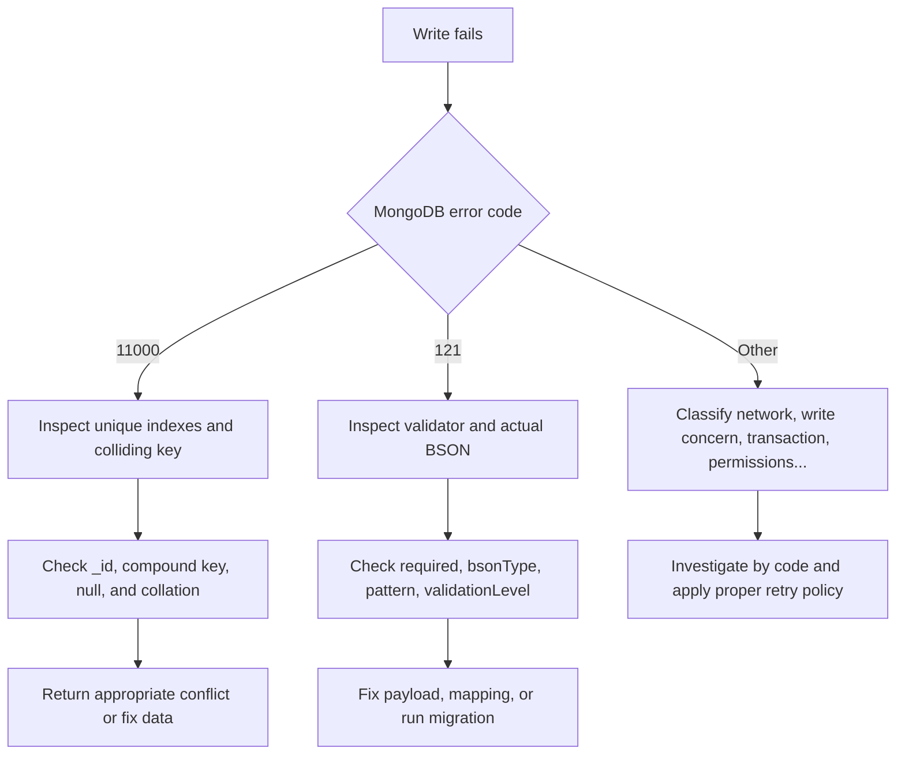

# DuplicateKeyException, Unique Indexes, and Schema Validation Errors

## 1. Two Easily Confused Error Groups in Spring Data MongoDB

Applications built on **Spring Data MongoDB** typically write data using `MongoRepository`, `MongoTemplate`, or `ReactiveMongoTemplate`. When an `insert`, `save`, `update`, `upsert`, or `bulkWrite` fails, the cause may be either a **cross-document uniqueness rule** or **per-document shape constraints**.

Suppose a multi-tenant system stores customers in a `customers` collection:

```javascript
{
  _id: ObjectId("..."),
  tenantId: "tenant-a",
  email: "an@example.test",
  displayName: "An",
  createdAt: ISODate("2026-11-20T00:00:00Z")
}
```

Requirement: within the **same tenant**, each `email` may appear only once; `tenantId` and `email` must be strings, and `displayName` must be non-empty. These are **two distinct constraints**:

- A **unique index** guarantees no two documents share the same `(tenantId, email)` pair within index scope. Collisions typically produce MongoDB **`E11000 duplicate key`**, translated by Spring Data into **`DuplicateKeyException`** on paths with exception translation.
- **Schema validation** via `$jsonSchema` validates data types, required fields, regex patterns, and rules on **each individual document**. Documents failing validation on write typically produce MongoDB **`DocumentValidationFailure`, error code `121`**. The outer Java exception depends on call path, operation type, and exception translation.

| Criterion | Duplicate Key | Schema Validation |
| --- | --- | --- |
| Common MongoDB error code | `11000` (`E11000`) | `121` (`DocumentValidationFailure`) |
| Where does constraint live? | Unique index, including `_id` unique index | Collection validator, typically `$jsonSchema` |
| Compares across documents? | Yes, across indexed keys | Normally validates each document individually |
| Where does it commonly trigger? | Insert, updating indexed key, upsert, bulk write, building unique index over duplicates | Insert, update/replace violating validator, bulk write |
| Handling action | Identify conflicting index/key and business rule; may return HTTP `409` | Inspect violated rule and actual BSON; may return `400` or `422` per API contract |
| Does retrying the same payload help? | No, while constraint and payload remain unchanged | No, while the document remains invalid |

**Never assume every write error is a duplicate key.** Connectivity loss, timeouts, write concerns, authorization errors, or transaction conflicts have different causes and recovery paths. Inspect the exception chain and underlying error code before choosing an HTTP status or retry policy.

## 2. Building a Sample Collection with Both Constraints

In `mongosh`, create a collection with a validator and a unique index. This example uses raw MongoDB commands to see the **server-enforced** rules clearly, independent of Java annotations:

```javascript
db.createCollection("customers", {
  validator: {
    $jsonSchema: {
      bsonType: "object",
      required: ["tenantId", "email", "displayName"],
      properties: {
        tenantId: {
          bsonType: "string",
          minLength: 1
        },
        email: {
          bsonType: "string",
          pattern: "^[^@ ]+@[^@ ]+[.][^@ ]+$"
        },
        displayName: {
          bsonType: "string",
          minLength: 1
        },
        createdAt: {
          bsonType: "date"
        }
      }
    }
  },
  validationLevel: "strict",
  validationAction: "error"
});

db.customers.createIndex(
  { tenantId: 1, email: 1 },
  { unique: true, name: "ux_customers_tenant_email" }
);
```

Here `$jsonSchema` uses `bsonType` to validate **actual BSON types stored in MongoDB**. The email regex is purely illustrative, **not** a full RFC-compliant email validator. In production apps, validate input at the DTO/service layer while keeping MongoDB as the storage-level guard.

Test a valid document:

```javascript
db.customers.insertOne({
  tenantId: "tenant-a",
  email: "an@example.test",
  displayName: "An",
  createdAt: new Date()
});
```

Now trigger both errors **independently**:

```javascript
// Error 11000: same (tenantId, email) pair already exists.
db.customers.insertOne({
  tenantId: "tenant-a",
  email: "an@example.test",
  displayName: "Another An"
});

// Error 121: email is a number, violating $jsonSchema.
db.customers.insertOne({
  tenantId: "tenant-a",
  email: 12345,
  displayName: "Customer with wrong type"
});
```

By contrast, the same email under a **different tenant** is valid per the compound unique index:

```javascript
db.customers.insertOne({
  tenantId: "tenant-b",
  email: "an@example.test",
  displayName: "An in another tenant"
});
```

Do not run these commands against a database holding a live business collection of the same name: collection and index creation here are meant for a **dedicated test database**.

## 3. Understanding `DuplicateKeyException` and Unique Indexes Precisely

### 3.1. Unique Indexes Protect Against Concurrent Races in the Database

Do not rely solely on logic like:

```java
// Demonstrates a race condition, not a uniqueness guarantee.
if (!repository.existsByTenantIdAndEmail(tenantId, email)) {
    repository.save(customer);
}
```

Between `existsBy...` and `save`, a concurrent request can insert the same key. Both requests read "not found," then one succeeds and the other receives a duplicate key error. **A unique index is the ultimate enforcement boundary** under concurrent writes.

Proper handling lets the database enforce uniqueness, catches the conflict on write, and translates it into an appropriate business response. Inside transactions, watch for errors at both the operation and commit boundaries, not just entity construction.

### 3.2. `_id`, Compound Keys, Null, and Missing Fields

- MongoDB creates a unique index on `_id` automatically. `E11000` can originate from `_id_` instead of the email index.
- A standard **single-field unique index** allows at most **one document** with `null` or missing indexed field; MongoDB indexes a null key entry for it.
- A **compound unique index** evaluates the **combined key tuple**. Two documents with the same `tenantId` and `email` collide; when `email` is missing or null, uniqueness depends on the entire tuple, so missing email is not automatically rejected on its own.
- In a **unique multikey index** over arrays, uniqueness applies across **documents**; duplicate values within the same document do not necessarily raise a duplicate-key error. Review schema design carefully before putting arrays in unique index keys.
- Default unique indexes are case-sensitive under the default collation. `An@Example.test` and `an@example.test` are treated as distinct keys unless normalized or paired with an appropriate collation.

Never assume adding `@NotNull` or `@Email` in Java solves any of the above: application-layer validation annotations do not replace database unique indexes.

### 3.3. Partial Unique Indexes and Case-Insensitive Uniqueness

If only **active** accounts must have unique emails, consider a **partial unique index**:

```javascript
// An ALTERNATIVE to the full-collection unique index in Section 2.
db.customers.createIndex(
  { tenantId: 1, email: 1 },
  {
    unique: true,
    name: "ux_active_customer_email",
    partialFilterExpression: { active: true }
  }
);
```

Only documents matching `active: true` participate in the uniqueness constraint. Updating a document from `active: false` to `active: true` when an active duplicate exists will raise `E11000`. **Do not create both** this index and the full-collection unique index from Section 2 expecting inactive accounts to allow duplicates: the full index still applies to all documents.

For case-insensitive uniqueness, either normalize emails per business rules (e.g., store `normalizedEmail`) and create a unique index on the normalized field, or configure an index with **collation**:

```javascript
// Another option on a suitably designed collection.
db.customers.createIndex(
  { tenantId: 1, email: 1 },
  {
    unique: true,
    name: "ux_customer_email_case_insensitive",
    collation: { locale: "en", strength: 2 }
  }
);
```

An index with collation uses its own comparison rules; queries hoping to use it efficiently typically need the matching collation unless the collection specifies it as default. Creating multiple indexes with identical key patterns and differing options follows server index-naming/compatibility rules; treat these as **design alternatives**, not three commands to run back-to-back on the sample collection.

### 3.4. Why Creating a Unique Index Can Also Fail

If existing documents already violate uniqueness, `createIndex({ ... }, { unique: true })` will fail. Before migrating, find existing duplicates:

```javascript
db.customers.aggregate([
  {
    $group: {
      _id: { tenantId: "$tenantId", email: "$email" },
      count: { $sum: 1 }
    }
  },
  { $match: { count: { $gt: 1 } } },
  { $sort: { count: -1 } },
  { $limit: 50 }
]);
```

This pipeline is for **discovery**. On large datasets, `$group` can consume substantial resources; schedule carefully, add appropriate filters, and never delete duplicates automatically without business merge rules.

On **sharded collections**, unique indexes have extra restrictions tied to the shard key. Before rolling out cluster-wide uniqueness requirements, check your MongoDB version, sharding layout, and shard-key index rules; creating an index on a single test node does not prove it is legal in a sharded production cluster.

## 4. How Schema Validation Works

### 4.1. Database Validation vs. API Input Validation

`@Valid`, `@NotBlank`, `@Email`, or service validators provide early user-friendly messages, yet other clients can still write directly to MongoDB and bypass controllers. Collection `$jsonSchema` validation runs inside the database for writes subject to validation.

| Where Rules Live | Examples | Limitations |
| --- | --- | --- |
| DTO / API | `@Email`, `@NotBlank` | Enforced only on code paths configured to validate |
| Spring Data entity/mapping | `@Field`, converters, callbacks | Mapping and app lifecycle; does not prove persisted BSON satisfies schema |
| MongoDB `$jsonSchema` | `required`, `bsonType`, `minLength`, `pattern` | Validates each document on write; cannot enforce cross-document uniqueness |
| MongoDB unique index | `{ tenantId: 1, email: 1 }` | Enforces uniqueness across documents; does not validate email format |

A Java `String` field can still serialize to an unexpected BSON type if a custom converter or external writer is involved. When diagnosing, compare **actual BSON** against `$jsonSchema`'s `bsonType` rather than reading Java field types alone.

### 4.2. `validationLevel` and `validationAction`

MongoDB provides validation policies when creating or altering a collection:

| Option | Meaning |
| --- | --- |
| `validationLevel: "strict"` | Validates all inserts and updates subject to validation. |
| `validationLevel: "moderate"` | Validates inserts and updates to already-valid documents; skips checks when updating documents that were already invalid, helpful during legacy migrations. |
| `validationLevel: "off"` | Disables validator enforcement on writes. |
| `validationAction: "error"` | Rejects writes violating the validator with an error (typically code `121`). |
| `validationAction: "warn"` | Allows the write while logging a validation warning to server logs; does not guarantee data integrity. |

Some newer MongoDB versions add actions like `errorAndLog`; do not assume every server version supports it. Using `bypassDocumentValidation` also depends on privileges and command support; it is a special administrative escape hatch, **not a fix for invalid payloads**.

Updating a validator via `collMod` applies to future writes under the new policy; it **does not automatically repair or re-scan existing documents**. If you start with `moderate`, plan a data cleanup before moving to `strict`.

### 4.3. What Information Does Error `121` Typically Include?

In addition to error code `121` and `Document failed validation`, the server may return `errInfo`/`details` depending on version and operation. Those details can show:

- Which `operatorName` or rule (`required`, `bsonType`, `pattern`, etc.) failed.
- Which BSON field held an invalid value or type.
- Nested failure paths when validators combine multiple rules.

Detailed error payloads can contain **actual field data values**. Never forward raw `errInfo`, `keyValue`, or full documents into API responses or central logs; log only error codes, namespaces, request/correlation IDs, and redacted field info.

Inspecting active rules on the collection:

```javascript
const info = db.getCollectionInfos({ name: "customers" })[0];
printjson(info.options.validator);
printjson({
  validationLevel: info.options.validationLevel,
  validationAction: info.options.validationAction
});

// List indexes to verify active unique constraints.
db.customers.getIndexes();
```

Never treat source code annotations as the "source of truth" for validators and indexes: collections may have been created by separate migrations, altered via `collMod`, or deployed without auto-index creation.

## 5. Exception Path from MongoDB Driver into Spring

### 5.1. Exception Classes Involved

When executing via `MongoTemplate` or repositories, Spring Data applies **exception translation** from driver exceptions into the `org.springframework.dao.DataAccessException` hierarchy.

```text
MongoDB server
  ├── code 11000: duplicate key
  │     └── MongoWriteException / MongoBulkWriteException / command error
  │            └── Spring Data: typically DuplicateKeyException
  └── code 121: document failed validation
        └── MongoWriteException / MongoBulkWriteException / corresponding error
               └── Spring Data: DataAccessException, subtype varies by path and version
```

`DuplicateKeyException` extends `DataIntegrityViolationException`, which extends `NonTransientDataAccessException`. Therefore, when catching duplicate keys separately, place **specific catches before general catches**. Never catch `RuntimeException` and branch on `getMessage()` text.

Paths calling the **MongoDB Java Driver directly** bypass Spring Data's translator and receive `MongoWriteException`/`MongoBulkWriteException`. Index creation failures surface as command exceptions, differing from insert errors. In bulk writes, **multiple write errors** may occur, each tied to an operation index; inspect `getWriteErrors()` and `ordered`/`unordered` semantics.

### 5.2. Classifying by Underlying Error Code Instead of Message Parsing

Java 17 helper to detect an error code anywhere in the cause chain, including bulk writes:

```java
import com.mongodb.MongoException;
import com.mongodb.MongoBulkWriteException;
import com.mongodb.MongoWriteException;

public final class MongoFailureCodes {

    private MongoFailureCodes() {}

    public static boolean contains(Throwable failure, int code) {
        for (Throwable current = failure;
             current != null;
             current = current.getCause()) {

            if (current instanceof MongoWriteException write
                    && write.getError().getCode() == code) {
                return true;
            }

            if (current instanceof MongoBulkWriteException bulk
                    && bulk.getWriteErrors().stream()
                           .anyMatch(error -> error.getCode() == code)) {
                return true;
            }

            if (current instanceof MongoException mongo
                    && mongo.getCode() == code) {
                return true;
            }
        }
        return false;
    }
}
```

This detects `121` even when wrapped by Spring's translator. It is not guaranteed to cover every custom wrapper or protocol edge case in bulk writes; always verify actual exception shapes in your deployment environment.

### 5.3. Business-Layer Handling with `MongoTemplate`

Example customer registration service (assuming `Customer` entity and prior API input validation):

```java
import org.springframework.dao.DataAccessException;
import org.springframework.dao.DuplicateKeyException;
import org.springframework.data.mongodb.core.MongoTemplate;

public class CustomerService {

    private final MongoTemplate mongoTemplate;

    public CustomerService(MongoTemplate mongoTemplate) {
        this.mongoTemplate = mongoTemplate;
    }

    public Customer register(Customer customer) {
        try {
            return mongoTemplate.insert(customer);
        } catch (DuplicateKeyException duplicate) {
            // Map to "email already exists" only when known to stem from
            // the (tenantId, email) unique index for this operation.
            throw new CustomerAlreadyExistsException(
                "Customer already exists within tenant", duplicate);
        } catch (DataAccessException failure) {
            if (MongoFailureCodes.contains(failure, 121)) {
                throw new InvalidCustomerDocumentException(
                    "Document does not satisfy MongoDB schema", failure);
            }
            throw failure;
        }
    }
}
```

`CustomerAlreadyExistsException` and `InvalidCustomerDocumentException` are **custom business exceptions** with `(String message, Throwable cause)` constructors, not built-in Spring classes.

If a collection has **multiple unique indexes**, translating every `DuplicateKeyException` to "email already exists" can mislead callers when the collision actually came from `_id_` or another unique index. Identify the exact constraint using controlled error metadata or split write operations with an accurate general message such as "unique constraint conflict." Avoid relying solely on brittle server error wording.

When calling `repository.save(entity)`, remember Spring Data may **insert or replace/upsert depending on ID state and new-entity detection**. Key collisions happen not only on `insert()`—updating a uniquely indexed field can trigger them too.

### 5.4. HTTP Boundary: Helpful Messages Without Leaking Keys

On Spring Framework 6 / Spring Boot 3, business exceptions can map to `ProblemDetail`:

```java
import org.springframework.http.HttpStatus;
import org.springframework.http.ProblemDetail;
import org.springframework.http.ResponseEntity;
import org.springframework.web.bind.annotation.ExceptionHandler;
import org.springframework.web.bind.annotation.RestControllerAdvice;

@RestControllerAdvice
class CustomerErrorHandler {

    @ExceptionHandler(CustomerAlreadyExistsException.class)
    ResponseEntity<ProblemDetail> duplicate(
            CustomerAlreadyExistsException failure) {
        ProblemDetail body = ProblemDetail.forStatusAndDetail(
            HttpStatus.CONFLICT,
            "Customer already exists within the tenant.");
        body.setTitle("Unique constraint violated");
        return ResponseEntity.status(HttpStatus.CONFLICT).body(body);
    }

    @ExceptionHandler(InvalidCustomerDocumentException.class)
    ResponseEntity<ProblemDetail> invalid(
            InvalidCustomerDocumentException failure) {
        ProblemDetail body = ProblemDetail.forStatusAndDetail(
            HttpStatus.UNPROCESSABLE_ENTITY,
            "Data does not satisfy storage rules.");
        body.setTitle("Invalid data");
        return ResponseEntity.status(HttpStatus.UNPROCESSABLE_ENTITY)
            .body(body);
    }
}
```

Never expose raw driver messages in HTTP bodies: duplicate key messages can reveal index names and `keyValue`, while schema errors can expose field names and sensitive values. On public APIs, `409 Conflict` usually fits unique constraint conflicts, while `400` or `422` fits invalid data per your API contract. Infrastructure or database configuration errors should not automatically become 4xx client errors.

### 5.5. Reactive Access and Bulk Writes

In reactive repositories and templates, errors surface only when the publisher is **subscribed** and the write executes:

```java
Mono<Customer> result = reactiveMongoTemplate.insert(customer)
    .onErrorMap(
        org.springframework.dao.DuplicateKeyException.class,
        duplicate -> new CustomerAlreadyExistsException(
            "Customer already exists within tenant", duplicate)
    );
```

This snippet illustrates exception mapping; import `reactor.core.publisher.Mono` and inject `reactiveMongoTemplate`. Never wrap `Mono` **creation** in `try/catch` expecting to handle errors emitted on subscription.

With `insertMany` or `BulkOperations`, especially in **unordered** mode, some writes may succeed even when one item hits `11000` or `121`. Reconcile bulk results, write errors, and batch idempotency before retrying the batch, so you do not produce unintended duplicate documents.

## 6. Spring Data Annotations, Index Creation, and Schema Migrations

### 6.1. `@CompoundIndex` Declares Intent, Database Must Actually Hold the Index

```java
import org.springframework.data.annotation.Id;
import org.springframework.data.mongodb.core.index.CompoundIndex;
import org.springframework.data.mongodb.core.mapping.Document;

@Document("customers")
@CompoundIndex(
    name = "ux_customers_tenant_email",
    def = "{ 'tenantId': 1, 'email': 1 }",
    unique = true
)
public class Customer {
    @Id
    private String id;
    private String tenantId;
    private String email;
    private String displayName;

    // Constructors, getters, and setters per project conventions.
}
```

Spring Data MongoDB **does not create indexes from annotations automatically by default** in modern versions (auto-index creation has been disabled by default since Spring Data MongoDB 3.0). Enabling auto-index creation in suitable environments or calling `MongoTemplate.indexOps(...)` is an option, yet production deployments should manage indexes via migrations and verify creation succeeds.

Example index creation inside a controlled migration step:

```java
import org.springframework.data.domain.Sort;
import org.springframework.data.mongodb.core.MongoTemplate;
import org.springframework.data.mongodb.core.index.Index;

void ensureCustomerIndex(MongoTemplate template) {
    template.indexOps("customers").ensureIndex(
        new Index()
            .on("tenantId", Sort.Direction.ASC)
            .on("email", Sort.Direction.ASC)
            .unique()
            .named("ux_customers_tenant_email")
    );
}
```

This code **does not clean up pre-existing duplicate data**. If the collection holds duplicate pairs or an index with the same name and a different specification, migration fails; investigate, clean up data, and roll out cleanly. Never catch and ignore index creation errors, because uniqueness will go unenforced.

### 6.2. JSON Schema and Entity Annotations Do Not Sync Automatically

Declaring `@Document`, `@Field`, Java field types, or Bean Validation annotations does not configure a `$jsonSchema` validator in MongoDB. Spring Data provides APIs to derive JSON Schema from metadata and pass it to collection creation options, yet you must explicitly execute creation or migration steps. Once a collection exists, editing an entity **does not alter the existing validator**.

Recommended deployment sequence:

1. Define uniqueness and schema rules, including legacy missing/null fields, historical BSON types, and case sensitivity.
2. Audit data prior to migration; locate invalid documents and duplicate keys.
3. Clean up data per business rules with backups and audit trails.
4. Create or update unique indexes and validators; failures must halt rollout or follow an explicit remediation path.
5. Re-verify `getIndexes()` and `getCollectionInfos()` on the **actual target cluster/database/collection**.
6. Test both accepting valid documents and rejecting violating documents.

## 7. Real-World Write Error Diagnostic Workflow

Suppose production reports "cannot create customer" while the endpoint returns only HTTP 500. Investigate in order:

### Step 1: Collect Context Safely

Record request/correlation ID, operation (`insert`, `update`, `upsert`, bulk), namespace, timestamp, deployment version, server error code, and Spring/driver exception types. Never write plaintext emails, sensitive IDs, connection URIs with passwords, or full documents to logs.

### Step 2: Verify Active Database Constraints

```javascript
db.customers.getIndexes();

const info = db.getCollectionInfos({ name: "customers" })[0];
printjson(info.options.validator);
printjson(info.options.validationLevel);
printjson(info.options.validationAction);
```

Compare index names, key patterns, `unique`, `partialFilterExpression`, `collation`, and validator rules against your expected migrations. If an index is missing, never assume uniqueness is enforced just because Java source has an annotation.

### Step 3: Branch by Error Code



### Step 4: Reproduce with Minimal Data

In a test database with the same index and validator, insert one valid document, then insert a second with the same unique key to verify `11000`; insert a document with an invalid `bsonType` to verify `121`. For update errors, seed a valid document first, then update a uniquely indexed or schema-constrained field.

### Step 5: Verify After Fixing

Do not stop after seeing the API return success. Read the document back with `MongoTemplate`, verify active indexes/validators, and re-run concurrency or bulk write tests if those triggered the bug. If you changed email normalization, also decide how to handle historical records with mixed casing.

## 8. Integration Tests for Unique Indexes and Validation

Tests should run against **real MongoDB** using Testcontainers, because mocking repositories never exercises unique index enforcement or `$jsonSchema` validation. The example below uses `@DataMongoTest` (Spring Boot 3), Testcontainers MongoDB, and a unique collection per test.

```java
import java.util.List;
import java.util.UUID;

import org.bson.Document;
import org.junit.jupiter.api.AfterEach;
import org.junit.jupiter.api.BeforeEach;
import org.junit.jupiter.api.Test;
import org.springframework.beans.factory.annotation.Autowired;
import org.springframework.boot.test.autoconfigure.data.mongo.DataMongoTest;
import org.springframework.data.domain.Sort;
import org.springframework.data.mongodb.core.MongoTemplate;
import org.springframework.data.mongodb.core.index.Index;
import org.springframework.test.context.DynamicPropertyRegistry;
import org.springframework.test.context.DynamicPropertySource;
import org.testcontainers.containers.MongoDBContainer;
import org.testcontainers.junit.jupiter.Container;
import org.testcontainers.junit.jupiter.Testcontainers;
import org.testcontainers.utility.DockerImageName;

import static org.assertj.core.api.Assertions.assertThat;
import static org.assertj.core.api.Assertions.assertThatThrownBy;
import static org.assertj.core.api.Assertions.catchThrowable;

@DataMongoTest
@Testcontainers
class CustomerConstraintsIT {

    @Container
    static final MongoDBContainer mongo =
        new MongoDBContainer(DockerImageName.parse("mongo:7.0"));

    @DynamicPropertySource
    static void mongoProperties(DynamicPropertyRegistry registry) {
        registry.add("spring.data.mongodb.uri", mongo::getReplicaSetUrl);
    }

    @Autowired
    MongoTemplate template;

    // JUnit Jupiter creates a new instance per test by default.
    private final String collection =
        "customers_it_" + UUID.randomUUID().toString().replace("-", "");

    @BeforeEach
    void createConstrainedCollection() {
        Document fields = new Document("tenantId",
            new Document("bsonType", "string"))
            .append("email", new Document("bsonType", "string"));

        Document jsonSchema = new Document("bsonType", "object")
            .append("required", List.of("tenantId", "email"))
            .append("properties", fields);

        template.getDb().runCommand(
            new Document("create", collection)
                .append("validator",
                    new Document("$jsonSchema", jsonSchema))
                .append("validationAction", "error")
                .append("validationLevel", "strict")
        );

        template.indexOps(collection).ensureIndex(
            new Index()
                .on("tenantId", Sort.Direction.ASC)
                .on("email", Sort.Direction.ASC)
                .unique()
        );
    }

    private Document customer(String tenantId, Object email) {
        return new Document("tenantId", tenantId)
            .append("email", email);
    }

    @Test
    void sameEmailInSameTenantFails() {
        template.insert(customer("tenant-a", "a@example.test"), collection);

        assertThatThrownBy(() ->
            template.insert(customer("tenant-a", "a@example.test"), collection)
        ).isInstanceOf(
            org.springframework.dao.DuplicateKeyException.class
        );

        // In another tenant, the tuple differs and is valid.
        template.insert(customer("tenant-b", "a@example.test"), collection);
    }

    @Test
    void wrongBsonTypeFailsSchemaValidation() {
        Throwable failure = catchThrowable(() ->
            template.insert(customer("tenant-a", 12345), collection)
        );

        assertThat(failure).isNotNull();
        assertThat(MongoFailureCodes.contains(failure, 121)).isTrue();
    }

    @AfterEach
    void removeOwnedCollection() {
        template.dropCollection(collection);
    }
}
```

`MongoFailureCodes` is the utility from Section 5.2; include it in test sources or use an equivalent helper. This example requires Docker and Testcontainers MongoDB/JUnit Jupiter dependencies compatible with your Spring Boot version; module coordinates may vary by Testcontainers version. When using Spring test context caching, manage container lifecycles consistently across test classes so cached contexts never point to stopped containers.

Because the collection name uses a test-owned UUID, `dropCollection` in `@AfterEach` drops only the **collection created by that test**. Never do this on shared suite collections or production environments. If a test verifies index/validator deployment via migrations, execute the real migration in the fixture instead of manually creating constraints and assuming production migrations work.

### 8.1. Concurrency and Upsert Tests

Valuable additional scenarios:

- Two concurrent requests inserting the same `(tenantId, email)`: expect **exactly one document** for that unique key, while the loser gets an appropriate error.
- Updating an existing customer's email to an already-taken email must be blocked, not only inserts.
- Concurrent `upsert` races on a new key must be idempotent; a unique index can still raise `E11000` if two operations race.
- For `ordered=false` bulk writes, verify partial successes and avoid blindly retrying the whole batch without idempotency.
- When changing collation or partial filters, test case-sensitive values, documents excluded by the filter, and documents transitioning into the filter.

Assert **guaranteed invariants** (document counts, constraint integrity, error types) rather than assuming a specific thread always wins the race.

## 9. Common Mistakes and Fixes

| Symptom | Possible Cause | How to Diagnose |
| --- | --- | --- |
| `DuplicateKeyException` despite `existsBy...` check | Two requests passed the check before inserting | Keep the unique index as the guard and handle race errors |
| `E11000` even though email isn't duplicated | Duplicate `_id` or another unique index | Inspect `keyPattern`/index name and `getIndexes()` |
| Creating unique index fails on deploy | Existing duplicate data or conflicting index spec | Find duplicates pre-migration; compare existing indexes |
| Two emails differing only by case both insert | Case-sensitive collation | Normalize field or configure case-insensitive unique index/collation |
| Multiple documents missing email collide | Unique index indexes null/missing as a duplicate key | Add validator `required` or a business-appropriate partial unique index |
| `@CompoundIndex(unique=true)` yet duplicates insert | Index was never created in the actual database | Check `getIndexes()`, auto-index setting, and migrations |
| `@Valid` passes yet write fails with code `121` | DTO/entity differs from BSON schema; custom converter or external writer | Compare actual BSON against active `$jsonSchema` validator |
| Updated validator yet invalid legacy records persist | `collMod` does not clean existing documents | Migrate legacy records before switching to `strict` |
| Bulk write throws while some documents exist | Unordered mode or partial batch completion | Read write errors and succeeded IDs before retrying |
| API logs expose email or sensitive payloads | Logging raw `keyValue`/`errInfo` or document | Log only error code, operation name, correlation ID, and sanitized metadata |
| Transaction error misclassified as duplicate | Parsing error message text blindly | Branch on error codes/labels and apply proper retry policy |

## 10. Hands-on Exercise

You are building a tenant account creation API. Each document contains `tenantId`, `email`, `displayName`, `active`, and `createdAt`. Requirements: email must be unique case-insensitively within each tenant; deactivated accounts remain stored for auditing; required fields must carry exact BSON types.

1. Write a `$jsonSchema` requiring `tenantId`, `email`, and `displayName` to be strings, `createdAt` to be `date`, and `active` to be `bool`. Discuss whether every field belongs in `required`.
2. Choose between a **full unique index** and a **partial unique index on `active: true`**. What happens when an `active: false` account is reactivated with a colliding email?
3. Design email normalization or collation so `A@Example.test` and `a@example.test` cannot register two active accounts in the same tenant.
4. Write tests creating two documents with the same tenant/email asserting `11000` or `DuplicateKeyException`, and inserting numeric `email` asserting `121`.
5. Describe the race condition in `existsByTenantIdAndEmail` followed by `save`. If two requests run concurrently, what outcome does the unique index guarantee?
6. Explain why `@Indexed(unique=true)` or `@CompoundIndex(unique=true)` does not guarantee protection in production unless migrations or auto-index creation actually ran.
7. Design HTTP responses for unique conflicts and schema validation failures, noting which details must stay out of client responses.
8. Write a deployment checklist for adding a unique index to a 5-million-document collection that may hold existing duplicates. How do you audit before creating the index?

**Hint:** `$jsonSchema` and unique indexes solve two distinct constraint layers. API validation improves user feedback, whereas the database enforces uniqueness under concurrency. When troubleshooting, rely on server error codes, actual indexes, and actual validators rather than fragile error message strings.

## References

- [MongoDB Manual — Unique Indexes](https://www.mongodb.com/docs/manual/core/index-unique/)
- [MongoDB Manual — Partial Indexes](https://www.mongodb.com/docs/manual/core/index-partial/)
- [MongoDB Manual — Case-Insensitive Indexes](https://www.mongodb.com/docs/manual/core/index-case-insensitive/)
- [MongoDB Manual — Schema Validation](https://www.mongodb.com/docs/manual/core/schema-validation/)
- [MongoDB Manual — Specify Validation Level for Existing Documents](https://www.mongodb.com/docs/manual/core/schema-validation/specify-validation-level/)
- [MongoDB Manual — Specify Validation Action](https://www.mongodb.com/docs/manual/core/schema-validation/specify-validation-action/)
- [MongoDB Manual — Troubleshoot Document Validation](https://www.mongodb.com/docs/manual/core/schema-validation/handle-invalid-documents/)
- [Spring Data MongoDB — Index Creation](https://docs.spring.io/spring-data/mongodb/reference/mongodb/mapping/mapping-index-management.html)
- [Spring Data MongoDB — Exception Translation](https://docs.spring.io/spring-data/mongodb/reference/mongodb/mongo-exception.html)
- [Spring Framework — DataAccessException Hierarchy](https://docs.spring.io/spring-framework/reference/data-access/dao.html)
