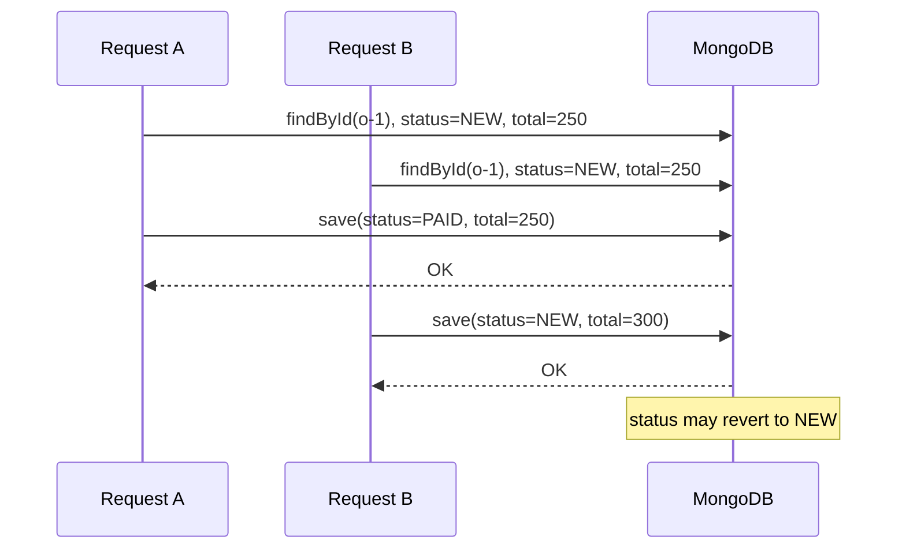
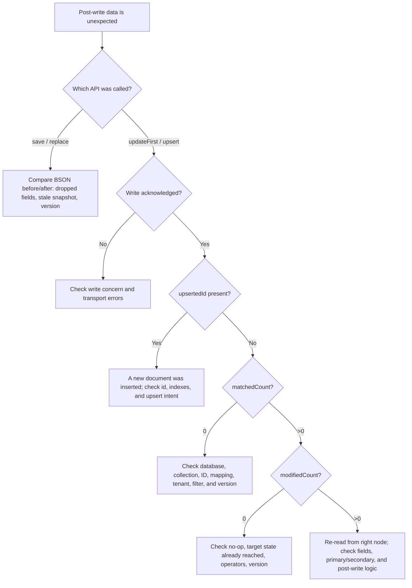

# `save` Overwriting Data, Updates Matching Nothing, or `modifiedCount` Equal to 0

> **Chapter:** Errors and Diagnostics  
> **Scope:** Spring Data MongoDB — analyzing `MongoTemplate`, repositories, document mapping, write results, and concurrency behavior in MongoDB.  
> **Objective:** Distinguish accidental full-document replacement, filters matching no documents, and updates that match without altering data.

## 1. Three Symptoms That Look Similar but Have Different Causes

An order update API can return HTTP 200 without throwing any exception, yet MongoDB holds unexpected data. The cause usually lies in the **write command type**, the **query filter**, or **how the write result is interpreted**.

| Symptom | What May Have Happened | Check First |
| --- | --- | --- |
| Calling `save` wiped old fields | Entity was serialized as a replacement document; fields absent from the new entity were dropped | Document before/after, POJO fields, null mapping, callbacks |
| `updateFirst` returns `matchedCount = 0` | No document satisfied **all** filter predicates at update time | Database, collection, `_id`, BSON type, field names, tenant, status, version |
| `matchedCount = 1`, `modifiedCount = 0` | Document matched, yet the update produced no effective change in stored BSON | Current values, `$set`/`$unset`/`$addToSet` operators, update conditions |
| `matchedCount = 0` with non-null `upsertedId` | Operation had `upsert: true`, found no match, and inserted a new document | Confirm whether upsert was intended |
| `save` throws `OptimisticLockingFailureException` | Entity with `@Version` saw a stale version or missing document | Version when read, current version, write concern |

**Never conclude "MongoDB ignored the write" solely from `modifiedCount == 0`.** Inspect `matchedCount`, `upsertedId`, `acknowledged`, and the actual post-write document together.

## 2. Understanding `save`, `insert`, `updateFirst`, and `upsert` Precisely

Spring Data MongoDB offers several write APIs with distinct semantics:

| API | Document Selection | When Absent | Change Semantics |
| --- | --- | --- | --- |
| `MongoTemplate.insert(entity)` / `repository.insert(entity)` if available | Creates new record | Inserts | Writes new document; duplicate ID triggers duplicate key error |
| `MongoTemplate.save(entity)` | By entity identity/ID and metadata | May insert | Writes/replaces full entity representation, not a per-field patch |
| `MongoRepository.save(entity)` | By ID and repository "new entity" detection | Inserts or saves existing entity | Does not auto-merge unloaded fields |
| `MongoTemplate.updateFirst(query, update, Entity.class)` | First document matching query | Does nothing; does not auto-insert | Applies update operators like `$set`, `$inc`, `$unset` |
| `MongoTemplate.updateMulti(...)` | All matching documents | Does nothing | Updates matching records |
| `MongoTemplate.upsert(...)` | Document matching query | Inserts new document from filter/update | Updates one record or inserts if absent |
| `MongoTemplate.findAndModify(...)` | One document matching query | Does nothing unless upsert enabled | Updates and returns pre- or post-image per options |

`MongoRepository.save` uses new-entity detection (e.g., via ID or `@Version`), so execution may insert or save an existing entity. **What matters for legacy data is that `save` is not a selective `$set` of only the fields present in a request DTO.**

### 2.1. Why Can `save` Drop Fields?

Suppose MongoDB holds:

```javascript
db.orders.insertOne({
  _id: "o-1",
  order_status: "NEW",
  total_amount: 250,
  external_marker: "imported-from-legacy"
})
```

The application constructs an entity with only ID and status:

```java
Order partial = new Order();
partial.id = "o-1";
partial.status = "PAID";
// totalAmount remains null; entity has no externalMarker.
template.save(partial);
```

On the save path for existing records, Spring Data converts the entity into a BSON document and saves/replaces it. Existing fields absent from the new entity representation, such as `external_marker`, **can be removed**. Under default mapping policies, null properties like `totalAmount` are normally omitted on write, so they can disappear too. Infrastructure fields such as `_id` and `_class` follow mapping-specific rules.

This is a consequence of **document replacement**, not a network glitch or "MongoDB deleting fields randomly." When requests originate from a partial DTO, issue a **partial update** with `Update.set` instead of mapping an incomplete DTO to an entity and calling `save`.

### 2.2. Sample Model Used in Examples

```java
package example.orders;

import org.springframework.data.annotation.Id;
import org.springframework.data.mongodb.core.mapping.Document;
import org.springframework.data.mongodb.core.mapping.Field;

@Document("orders")
public class Order {
    @Id
    public String id;

    @Field("order_status")
    public String status;

    @Field("total_amount")
    public Integer totalAmount;

    public Order() {}

    public Order(String id, String status, Integer totalAmount) {
        this.id = id;
        this.status = status;
        this.totalAmount = totalAmount;
    }
}
```

In this entity, Java property `status` maps to BSON `order_status`. The ID `"o-1"` keeps examples readable; keep in mind Spring Data converts 24-hex-character `String` `@Id` values to BSON `ObjectId` by default.

## 3. Updating Specific Fields Without Replacing the Whole Document

Business requirement: change order status from `NEW` to `PAID` while preserving amount and other metadata:

```java
import com.mongodb.client.result.UpdateResult;
import org.springframework.data.mongodb.core.MongoTemplate;
import org.springframework.data.mongodb.core.query.Criteria;
import org.springframework.data.mongodb.core.query.Query;
import org.springframework.data.mongodb.core.query.Update;

public class OrderWriter {
    private final MongoTemplate template;

    public OrderWriter(MongoTemplate template) {
        this.template = template;
    }

    public UpdateResult markPaid(String id) {
        Query query = Query.query(
            Criteria.where("id").is(id).and("status").is("NEW")
        );
        Update change = new Update().set("status", "PAID");
        return template.updateFirst(query, change, Order.class);
    }
}
```

Spring Data maps `id` to `_id` and `status` to `order_status` when using the overload accepting `Order.class`. Semantically, MongoDB runs the equivalent of:

```javascript
db.orders.updateOne(
  { _id: "o-1", order_status: "NEW" },
  { $set: { order_status: "PAID" } }
)
```

Only `order_status` changes; `total_amount` and `external_marker` remain intact. The filter also acts as a **state compare-and-set**: if the order is already `PAID` or `CANCELLED`, zero records match.

### 3.1. When Is `save` Still Appropriate?

`save` fits when the application genuinely owns the **entire document representation** and intends to persist a fully loaded, modified entity. For example, loading a complete `Order`, mutating fields, and saving. Still, if two concurrent requests load and save the same document without concurrency control, the second `save` can **overwrite the first request's changes**.

For PATCH APIs, partial request updates, or documents holding fields owned by other services, prefer explicit `Update.set`/`unset`. When full replacement semantics are truly wanted, use `save` or replace APIs deliberately and test which fields get dropped.

## 4. Reading `UpdateResult` Accurately: Matched, Modified, and Upserted

`MongoTemplate.updateFirst` returns `com.mongodb.client.result.UpdateResult`. For **acknowledged** writes, inspect:

```java
UpdateResult result = template.updateFirst(query, change, Order.class);

if (!result.wasAcknowledged()) {
    throw new IllegalStateException("MongoDB write was not acknowledged");
}

long matched = result.getMatchedCount();
long modified = result.getModifiedCount();
org.bson.BsonValue upsertedId = result.getUpsertedId();
```

`matchedCount` counts **how many documents matched the filter**, while `modifiedCount` counts **how many were actually altered**. For `updateFirst`, both are typically in `{0, 1}`. `getUpsertedId()` is non-null when an upsert inserted a document; regular `updateFirst` does not upsert, so it remains null.

| Acknowledged Write Outcome | Typical Interpretation | Action |
| --- | --- | --- |
| `matched=0, modified=0, upsertedId=null` | No document matched | Check filter, ID, collection, status/version |
| `matched=1, modified=0, upsertedId=null` | Document matched, update made no change | Inspect current values and operators |
| `matched=1, modified=1, upsertedId=null` | One document matched and changed | Verify business state if needed |
| `matched=0, modified=0, upsertedId≠null` | Upsert inserted a new document | Confirm upsert intent and unique index |
| `wasAcknowledged()=false` | Server gave no write acknowledgment | Do not infer write state from counts |

Always check `wasAcknowledged()` before calling count getters; on unacknowledged writes, counts are unavailable and getters can throw. When using an unacknowledged `WriteConcern`, never treat `"modifiedCount = 0"` as reliable feedback.

### 4.1. Example: `matched=1` with `modified=0`

```javascript
db.orders.insertOne({ _id: "o-2", order_status: "PAID" })

db.orders.updateOne(
  { _id: "o-2" },
  { $set: { order_status: "PAID" } }
)
// Expected: matchedCount = 1, modifiedCount = 0
```

The server sees the new value is **identical** to the stored value. This is a successful idempotent no-op for the target state: the order remains `PAID`. Other `modified=0` cases:

- `$unset` on a field that is already absent.
- `$addToSet` with an element already present in the array.
- `$pull` with an element absent from the array.
- `$inc` by 0 or any update leaving BSON values unchanged.
- An update pipeline evaluating to the existing value.

Seeing `modified=0` does not prove the API failed—nor does it automatically prove the business operation succeeded: consider the **filter** and **desired state**. If the requirement is "transition NEW to PAID exactly once," filtering on `NEW` as in Section 3 yields `matched=0` once already `PAID`; business logic then chooses between returning "already processed," conflict, or re-checking state.

### 4.2. When `@Version` Is Enabled

If an entity declares `@Version`, some Spring Data MongoDB update APIs **automatically increment the version** when the `Update` does not specify it. Because the version changes, `modifiedCount` can be 1 even when business fields were `$set` to identical values. Therefore:

- `modifiedCount = 1` may reflect only a **version metadata** increment.
- `modifiedCount = 0` must be read alongside the actual operators and mapping behavior.
- For concurrency control, rely on explicit `@Version`/compare-and-set logic rather than checking modified counts.

## 5. `matchedCount = 0`: Pinpointing the Unmatched Condition

When an update matches nothing, diagnose systematically so no cause is overlooked:

### 5.1. Right Database and Collection?

`MongoTemplate` may be connected to a different database than your `mongosh` session. `@Document("orders")`, explicit collection arguments, and multi-tenant/multi-database setups all affect where writes land.

```javascript
// In mongosh, connected to the target environment:
db.getName()
db.getCollectionNames()
db.orders.findOne({ _id: "o-1" })
```

With multiple `MongoTemplate`s, verify **which bean is injected**, its MongoDB URI/database, and the mapped collection name. Never assume the collection name solely from the Java class name.

### 5.2. Does `_id` Have the Right **BSON Type**?

MongoDB distinguishes:

```javascript
{ _id: "507f1f77bcf86cd799439011" }   // String
{ _id: ObjectId("507f1f77bcf86cd799439011") } // ObjectId
```

Both render alike in logs yet **are not equal**. With `@Id String id`, Spring Data converts valid 24-hex strings to `ObjectId`; `@MongoId(FieldType.STRING)` forces storage as a BSON String.

```java
// Example enforcing String ID storage; plan migration for legacy data:
import org.springframework.data.mongodb.core.mapping.FieldType;
import org.springframework.data.mongodb.core.mapping.MongoId;

@MongoId(FieldType.STRING)
String id;
```

Never swap ID annotations just to "make an update match" before checking existing records. Changing `_id` types affects all queries and foreign references and requires migration.

### 5.3. Do Java Properties Match BSON Field Names?

```java
@Field("order_status")
String status;
```

With `template.updateFirst(query, update, Order.class)`, the predicate:

```java
Criteria.where("status").is("NEW")
```

maps to `order_status`. Yet calling an overload taking only a **collectionName** instead of the entity class omits `Order`'s mapping metadata; the same literal `"status"` is sent as BSON field `status`, causing `matchedCount=0`.

To reduce errors, use overloads taking the entity class when querying by Java property names, and verify raw BSON. Custom converters, `@Field`, `@Id`, and nested paths also alter final field names and types.

### 5.4. Are There Extra Conditions Beyond ID?

A query like:

```java
Query query = Query.query(
    Criteria.where("id").is("o-1")
        .and("status").is("NEW")
        .and("tenantId").is("tenant-a")
);
```

matches only if **every** predicate holds. Check:

- Did another request already move the order from `NEW` to `PAID`?
- Does `tenantId` or a soft-delete filter mismatch?
- Do null/missing properties differ from expectations (e.g., `is(null)` also matches missing fields)?
- Do string casing or whitespace differ, or does collation differ from reads?
- Are BSON types mismatched, such as numeric strings or wrong timezone conversions?
- Do array or nested document predicates follow different matching rules than assumed?
- Did a callback, auditing listener, or converter alter a field prior to persistence?

Never strip `tenantId` or version predicates just to "make the update match"; those guards protect data integrity. Fix the root cause where the filter or input data is produced.

### 5.5. Isolating Which Predicate Broke the Match

In a test environment, narrow down step by step:

```javascript
db.orders.findOne({ _id: "o-1" })
db.orders.findOne({ _id: "o-1", order_status: "NEW" })
db.orders.findOne({
  _id: "o-1",
  order_status: "NEW",
  tenant_id: "tenant-a"
})
```

In production, project only fields needed for diagnostics, avoiding PII or full sensitive documents. In tenant-isolated systems, diagnostic queries must still respect access controls.

## 6. When `save` Overwrites Concurrent Changes

### 6.1. Lost Updates

Two concurrent threads operate on document `o-1`:



Without concurrency control, the last `save` replaces the document with its stale snapshot and erases `PAID`. That is a **lost update**: each request held valid data when read, yet combined writes discard an intermediate update.

### 6.2. Protecting with `@Version`

Spring Data MongoDB supports optimistic locking:

```java
import org.springframework.data.annotation.Id;
import org.springframework.data.annotation.Version;
import org.springframework.data.mongodb.core.mapping.Document;

@Document("versioned_orders")
class VersionedOrder {
    @Id public String id;
    public String status;
    public Integer totalAmount;
    @Version public Long version;

    public VersionedOrder() {}
}
```

When read at version `0`, both requests hold snapshot version `0`. Request A's `save` succeeds and increments version; Request B's attempt with the stale snapshot throws `OptimisticLockingFailureException`. The application can then return a conflict or re-read fresh state and safely re-apply its change.

```java
VersionedOrder first = template.findById("v-1", VersionedOrder.class);
VersionedOrder stale = template.findById("v-1", VersionedOrder.class);

first.status = "PAID";
template.save(first);

stale.totalAmount = 300;
// Expected OptimisticLockingFailureException with acknowledged writes:
template.save(stale);
```

This snippet assumes `VersionedOrder` `"v-1"` was already inserted. Spring Data detects version mismatches only when **writes are acknowledged** (`WriteConcern`). Never resolve conflicts by unconditionally retrying `save` on the same stale snapshot.

### 6.3. Filter-Based Compare-and-Set Without `@Version`

For single-field transitions, embed the expected state in the filter:

```java
UpdateResult result = template.updateFirst(
    Query.query(Criteria.where("id").is(id).and("status").is("NEW")),
    new Update().set("status", "PAID"),
    Order.class
);

if (result.getMatchedCount() == 0) {
    // Missing document or status is no longer NEW.
    // Handle per business rules: 404, 409, or idempotent response.
}
```

MongoDB evaluates the match predicate and applies the update atomically **on a single document**, preventing races between "check status" and "set status." Unlike full-entity `save`, unrelated fields remain untouched. When atomicity must span multiple documents or collections, design transactions on a supported topology.

## 7. Misused Upserts Creating Unwanted Documents

`updateFirst` by default **creates nothing** when zero documents match. By contrast, `upsert` inserts a document if none matches:

```java
UpdateResult result = template.upsert(
    Query.query(Criteria.where("id").is("o-new")),
    new Update()
        .set("status", "NEW")
        .set("totalAmount", 250),
    Order.class
);

if (!result.wasAcknowledged()) {
    throw new IllegalStateException("Write was not acknowledged");
}
// If no document existed previously:
// matchedCount = 0, modifiedCount = 0, upsertedId != null.
```

Equality predicates in the query and fields in the update participate in constructing the inserted document; exact behavior depends on filter/operators. **`upsert` is not "try update, else report missing"**: it actually inserts records.

If concurrent requests upsert by a business key not yet present, create a supporting unique index such as `(tenant_id, external_order_id)` to prevent duplicates. Never treat an unindexed query filter as a uniqueness guard under concurrency. If business logic must distinguish "updated" from "inserted," inspect `getUpsertedId()` after the write.

## 8. Observing the Exact MongoDB Commands Sent

A common mistake is reading Java code and assuming MongoDB receives identical field names and values. In Spring Data, property names, ID types, and update values are transformed by `QueryMapper`, `MappingMongoConverter`, or callbacks.

To observe actual behavior:

1. **Record technical metadata:** database name, collection, operation, request/correlation ID, app build version, tenant (when permitted), counts, and latency. Never log passwords, credentials, tokens, PII, or full documents.
2. **Enable targeted logging in test/staging:** Spring Data and MongoDB Java Driver loggers reveal client queries and updates. Keep verbose logging bounded in production, since commands can hold sensitive values.
3. **Use the Java driver's `CommandListener` for structured telemetry:** captures command started/succeeded/failed events; apply redaction and strict field filtering.
4. **Inspect raw documents:** `template.getCollection("orders").find(...)` or `mongosh` in the same environment verifies exact BSON field names and types.
5. **Check query plans for performance/routing issues:** `explain("executionStats")` on matching filters checks index usage and examined counts. Explaining an update simulates the plan **without executing writes**.

Example in `mongosh`:

```javascript
use sales
db.orders.findOne({ _id: "o-1" })

db.orders.find({
  _id: "o-1",
  order_status: "NEW"
}).explain("executionStats")
```

`explain` is useful when filters match yet updates run slowly or scan too many documents. It does not by itself explain why a request wrote wrong fields: pair it with `UpdateResult`, raw BSON, and request traces.

### 8.1. Ensuring Consistent Read-After-Write

In replica sets, reading immediately from a secondary can return stale data due to replication lag, making an update look lost. Verify the read preference, read concern, write concern, and connection target of the verification read. To confirm a recent write immediately in the same flow, read from primary with matching consistency guarantees.

With `ReactiveMongoTemplate`, updates return `Mono<UpdateResult>`: without subscribing, the operation **has not executed**. Use `StepVerifier` in tests or chain subscriptions properly before checking counts or persisted state.

## 9. Integration Test Reproducing All Three Failure Modes

With Spring Boot 3.x, JUnit Jupiter, AssertJ, and Testcontainers 1.x, `@DataMongoTest` against a real MongoDB instance verifies driver and mapping semantics. These examples reuse `Order` from Section 2 and target test-only containers/databases.

```java
package example.orders;

import static org.assertj.core.api.Assertions.assertThat;
import static com.mongodb.client.model.Filters.eq;

import com.mongodb.client.result.UpdateResult;
import org.bson.Document;
import org.junit.jupiter.api.BeforeEach;
import org.junit.jupiter.api.Test;
import org.springframework.beans.factory.annotation.Autowired;
import org.springframework.boot.test.autoconfigure.data.mongo.DataMongoTest;
import org.springframework.boot.testcontainers.service.connection.ServiceConnection;
import org.springframework.data.mongodb.core.MongoTemplate;
import org.springframework.data.mongodb.core.query.Criteria;
import org.springframework.data.mongodb.core.query.Query;
import org.springframework.data.mongodb.core.query.Update;
import org.testcontainers.containers.MongoDBContainer;
import org.testcontainers.junit.jupiter.Container;
import org.testcontainers.junit.jupiter.Testcontainers;
import org.testcontainers.utility.DockerImageName;

@DataMongoTest
@Testcontainers
class OrderWriteDiagnosticsTest {

    @Container
    @ServiceConnection
    static final MongoDBContainer mongo =
        new MongoDBContainer(DockerImageName.parse("mongo:7.0"));

    @Autowired MongoTemplate template;

    @BeforeEach
    void reset() {
        template.dropCollection(Order.class);
    }

    @Test
    void saveReplacesAndCanRemoveFieldsNotInEntity() {
        template.getCollection("orders").insertOne(
            new Document("_id", "o-1")
                .append("order_status", "NEW")
                .append("total_amount", 250)
                .append("external_marker", "legacy")
        );

        Order partial = new Order("o-1", "PAID", null);
        template.save(partial);

        Document raw = template.getCollection("orders")
            .find(eq("_id", "o-1")).first();
        assertThat(raw).isNotNull();
        assertThat(raw.getString("order_status")).isEqualTo("PAID");
        assertThat(raw.containsKey("external_marker")).isFalse();
        assertThat(raw.containsKey("total_amount")).isFalse();
    }

    @Test
    void updateFirstWithWrongStateMatchesNothing() {
        template.insert(new Order("o-2", "PAID", 250));

        UpdateResult result = template.updateFirst(
            Query.query(
                Criteria.where("id").is("o-2")
                    .and("status").is("NEW")
            ),
            new Update().set("status", "CANCELLED"),
            Order.class
        );

        assertThat(result.wasAcknowledged()).isTrue();
        assertThat(result.getMatchedCount()).isZero();
        assertThat(result.getModifiedCount()).isZero();
        assertThat(template.findById("o-2", Order.class).status)
            .isEqualTo("PAID");
    }

    @Test
    void updateFirstCanMatchWithoutChangingValues() {
        template.insert(new Order("o-3", "PAID", 250));

        UpdateResult result = template.updateFirst(
            Query.query(Criteria.where("id").is("o-3")),
            new Update().set("status", "PAID"),
            Order.class
        );

        assertThat(result.wasAcknowledged()).isTrue();
        assertThat(result.getMatchedCount()).isEqualTo(1);
        assertThat(result.getModifiedCount()).isZero();
    }

    @Test
    void updateSetPreservesUnrelatedFields() {
        template.getCollection("orders").insertOne(
            new Document("_id", "o-4")
                .append("order_status", "NEW")
                .append("total_amount", 250)
                .append("external_marker", "legacy")
        );

        UpdateResult result = template.updateFirst(
            Query.query(Criteria.where("id").is("o-4")),
            new Update().set("status", "PAID"),
            Order.class
        );

        assertThat(result.getMatchedCount()).isEqualTo(1);
        assertThat(result.getModifiedCount()).isEqualTo(1);

        Document raw = template.getCollection("orders")
            .find(eq("_id", "o-4")).first();
        assertThat(raw.getString("order_status")).isEqualTo("PAID");
        assertThat(raw.getInteger("total_amount")).isEqualTo(250);
        assertThat(raw.getString("external_marker")).isEqualTo("legacy");
    }
}
```

`@ServiceConnection` requires Spring Boot 3.1+ and `spring-boot-testcontainers`; newer releases may alter Testcontainers package coordinates. Never run this fixture against a shared database. Beyond these four tests, add `@Version` optimistic locking tests with two snapshots, upsert tests, and concurrent update tests wherever your application relies on those guarantees.

## 10. Diagnostic Decision Tree



Depending on the API, exceptions form a separate branch: duplicate key, validation errors, write concern timeouts, mapping exceptions, and optimistic locking failures must each be caught and handled cleanly. Never swallow exceptions and return a dummy count of 0.

## 11. Quick Reference Table for Real-World Scenarios

| Symptom | Likely Cause | How to Verify or Fix |
| --- | --- | --- |
| PATCH drops existing document metadata | Mapping an incomplete DTO to an entity and calling `save` | Switch to per-field `Update.set` or load full document with version control |
| `save` on an old ID creates a second record | Wrong `_id` type, wrong collection, ID missing | Check raw `_id`, database, ID mapping, and insert/upsert behavior |
| `updateFirst` throws no error despite zero updates | API allows zero matches | Inspect `UpdateResult` and define business behavior |
| `matched=0` though Java query looks right | `@Field`, `@Id`, converter, or `collectionName`-only overload | Inspect actual BSON filter; prefer overloads accepting entity class |
| `matched=0` on retried request | State already transitioned; compare-and-set no longer matches | Separate idempotent replays from conflicts |
| `matched=1, modified=0` | `$set` to identical value, `$unset` absent field, `$addToSet` duplicate | Read current state; decide whether no-op is valid |
| `modified=1` while business fields look unchanged | `@Version` or auditing bumped metadata | Diff entire BSON and update path |
| Upsert creates duplicate records per external ID | Missing unique index and race condition | Create unique index on business key; handle duplicate-key retries carefully |
| `save` clobbers changes from concurrent request | Lost update from stale snapshot | Use `@Version`, compare-and-set, or atomic operator updates |
| Read API misses just-updated data | Lagging secondary read or application cache | Check read preference, caches, primary reads, and consistency |
| Reactive update never executes | Publisher not subscribed | Test with `StepVerifier` or subscribe at framework boundary |
| Upsert shows `matched=0`, looking like failure | Operation inserted a new document | Check `upsertedId` and created record |

## 12. Safe API Design Rules

1. **Match the operation to intent:** create new → `insert`; deliberate full replacement → `save`/replace; update specific fields → `$set`/`unset`; create-if-absent → `upsert`.
2. **Guard predicates intentionally:** design ID, tenant, and expected state/version filters alongside business rules. Do not loosen filters casually just to eliminate `matched=0`.
3. **Separate not-found from no-op:** `matched=0` may map to 404 or 409; `matched=1, modified=0` may be a valid idempotent outcome. Pick HTTP statuses from context rather than blindly turning counts into pass/fail.
4. **Protect against concurrency:** use `@Version` or compare-and-set whenever concurrent requests can modify the same document. Never fix lost updates with blind retries.
5. **Enforce uniqueness in the database:** unique indexes prevent duplicate inserts during upsert races; verify indexes actually exist.
6. **Log sufficient diagnostic telemetry:** operation, namespace, matched/modified/upserted counts, correlation ID, latency, and error type. Never log secrets or full customer documents.
7. **Test with real MongoDB:** repository mocks do not simulate replacement semantics, BSON ID mapping, concurrency, or `UpdateResult`.

### Self-Check Exercises

1. Insert `external_marker` in raw BSON, call `save` with an entity holding only ID/status, and observe the dropped field. Replace with `updateFirst` and verify the field survives.
2. Run the exact same `$set` twice with an ID-only filter. Record `matchedCount` and `modifiedCount` on the first and second runs.
3. Add an expected prior-status predicate to the filter; repeat the update and explain why the second run returns `matchedCount=0`.
4. Have two requests read the same version, update, and `save` interleaved. Enable `@Version` and verify the stale snapshot save is rejected.
5. Create a unique index on `(tenant_id, external_order_id)`, simulate two concurrent upserts for the same key, and verify outcomes match your design.

## 13. Takeaways

- `save` can write/replace the **entire document** and wipe fields absent from the new entity; never treat it as a default PATCH.
- `matchedCount = 0` means **the filter matched nothing**; check namespace, BSON ID type, field mapping, tenant, and state/version predicates first.
- `matchedCount = 1` with `modifiedCount = 0` is typically a **no-op**, not automatically an error. With `@Version`, modified counts may reflect the version bump.
- `upsertedId` indicates an upsert inserted a document; distinguish upsert insertions from matching updates.
- `@Version` and state-guarded updates prevent lost updates; integration tests against real MongoDB confirm exact write semantics.

## References

- [Spring Data MongoDB — Saving, Updating, and Removing Documents](https://docs.spring.io/spring-data/mongodb/reference/mongodb/template-crud-operations.html): `save`, `updateFirst`, `upsert`, `findAndModify`, and optimistic locking.
- [Spring Data MongoDB — MongoTemplate API](https://docs.spring.io/spring-data/mongodb/docs/current/api/org/springframework/data/mongodb/core/MongoTemplate.html): method signatures, `UpdateResult`, and mapping-aware overloads.
- [Spring Data MongoDB — Object Mapping](https://docs.spring.io/spring-data/mongodb/reference/mongodb/mapping/mapping.html): `@Id`, `@Field`, BSON type conversion, and lifecycle mapping.
- [MongoDB — Update a Document (updateOne)](https://www.mongodb.com/docs/manual/reference/method/db.collection.updateone/): matched/modified counts, acknowledgments, and upserts.
- [MongoDB — Replace Documents (Java Driver)](https://www.mongodb.com/docs/drivers/java/sync/current/crud/replace-documents/): replacement drops fields absent from the replacement document.
- [MongoDB — Replace One](https://www.mongodb.com/docs/manual/reference/method/db.collection.replaceone/): replace, `_id`, and upserts.
- [MongoDB — Java Driver Monitoring](https://www.mongodb.com/docs/drivers/java/sync/current/logging-monitoring/monitoring/): command events and `CommandListener`.
- [MongoDB — Explain Command](https://www.mongodb.com/docs/manual/reference/command/explain/): query plans, executionStats, and explain for updates.
