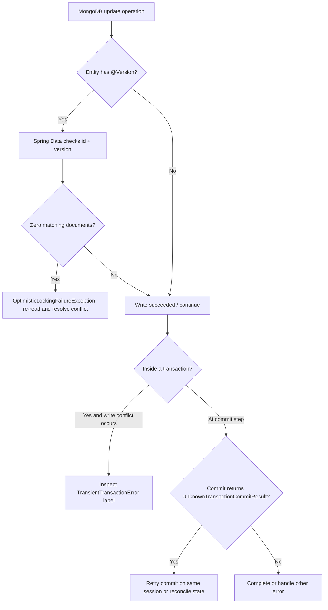
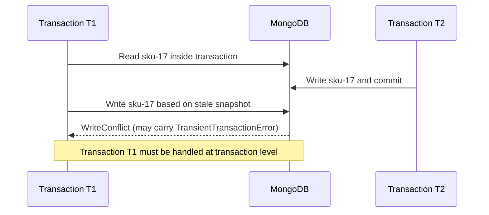
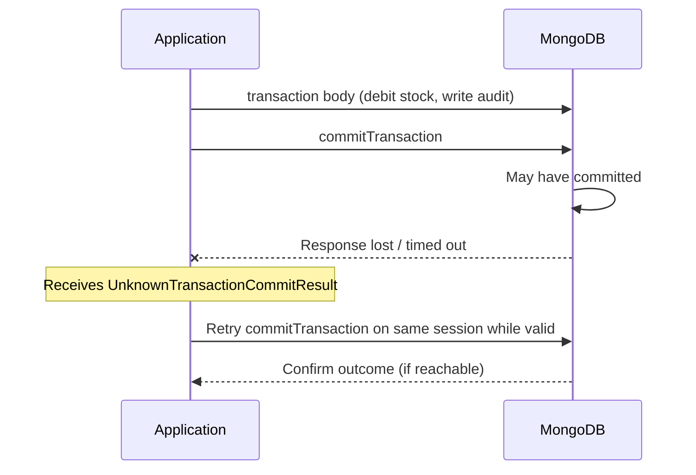

# Optimistic Locking, Write Conflicts, and Unknown Transaction Commit Results

## Objectives

In the **Errors and Diagnostics** chapter of **SPRING_DATA_MONGODB**, we use Spring Data MongoDB to connect, map documents, and manipulate data through `MongoTemplate` or repositories. When multiple requests concurrently update the same document, or when running multi-document transactions, failures can surface even though MongoDB commands and document mappings are valid.

After completing this lesson, you will be able to:

- Explain **optimistic locking** with `@Version`, recognize `OptimisticLockingFailureException`, and design clean conflict handling.
- Distinguish a `save()` rejected for a stale version from a **write conflict** inside an active transaction.
- Interpret `TransientTransactionError` and `UnknownTransactionCommitResult` error labels accurately.
- Choose the proper retry scope: re-reading and re-applying a document update, re-running an **entire transaction**, or retrying **only the commit command within the same session**.
- Prevent duplicate writes via idempotency keys, reconcile state after uncertain commits, and set up diagnostic tests, logs, and metrics.

> **Core rule:** An error must be retried only at its **exact safe boundary**. `OptimisticLockingFailureException`, `WriteConflict`, and `UnknownTransactionCommitResult` represent three distinct failure modes; never wrap all write operations in a single generic `retry()` loop.

## 1. Three Phenomena and How to Tell Them Apart

Suppose two concurrent flows attempt to decrement inventory in an `inventory` collection:

| Phenomenon | Detection Point | Typical Signals | Meaning |
| --- | --- | --- | --- |
| **Optimistic locking** | Spring Data layer checks `@Version` on entity save/delete | `OptimisticLockingFailureException`, zero documents matched expected version | In-memory entity snapshot is stale compared to the stored record |
| **Write conflict** | MongoDB detects concurrent write/transaction contention on a resource or document | Server error `WriteConflict` (typically code `112`), sometimes carrying `TransientTransactionError` | Current transaction/operation cannot proceed against the state it read/wrote |
| **Unknown transaction commit result** | `commitTransaction` was sent, yet the client cannot confirm the commit outcome | Error label `UnknownTransactionCommitResult` on a commit-phase error | The transaction **may or may not have committed**; an error response does not prove rollback |

The first two concern **conflicts while applying changes**, whereas the third concerns **uncertainty about whether a commit succeeded**.



This flowchart depicts **application decision paths**, not every internal MongoDB branch. In real deployments, network faults, timeouts, write concern failures, validation errors, and duplicate keys also arise; classify by error code, labels, and failure stage rather than guessing from message text.

## 2. Optimistic Locking with `@Version`

### Version Matching Mechanics

Optimistic locking assumes most updates experience **low contention**. Instead of holding a long-lived lock between read and save, Spring Data includes the document's version in the write condition.

Example stored document:

```json
{
  "_id": "sku-17",
  "available": 10,
  "version": 0
}
```

Two requests A and B both read version `0`:

| Time | Request A | Request B | Stored Data |
| --- | --- | --- | --- |
| T1 | Reads `available=10, version=0` | Reads `available=10, version=0` | `10 / 0` |
| T2 | Changes available to `8` and calls `save()` | Waiting | `8 / 1` |
| T3 | — | Changes available to `7` on stale copy and calls `save()` | Still `8 / 1`; B receives optimistic locking error |

Conceptually, the update is guarded by an equivalent condition:

```javascript
db.inventory.updateOne(
  { _id: "sku-17", version: 0 },
  { $set: { available: 8 }, $inc: { version: 1 } }
);
```

This **illustrates the matching logic**. `MongoTemplate.save()` may issue different write/mapping commands depending on API and version; the essential rule is that **id + version** are checked together and version increments on successful write.

### Spring Data MongoDB Entity Declaration

```java
import org.springframework.data.annotation.Id;
import org.springframework.data.annotation.Version;
import org.springframework.data.mongodb.core.mapping.Document;

@Document("inventory")
public class InventoryItem {

    @Id
    private String id;

    private long available;

    @Version
    private Long version;

    protected InventoryItem() {}

    public InventoryItem(String id, long available) {
        this.id = id;
        this.available = available;
    }

    public String getId() { return id; }
    public long getAvailable() { return available; }
    public Long getVersion() { return version; }

    public void setAvailable(long available) {
        this.available = available;
    }
}
```

With wrapper type `Long`, newly inserted documents typically start at version `0`, incrementing to `1`, `2`, ... on properly routed saves. The version field must be mapped by Spring Data and written via version-aware APIs; external raw MongoDB commands will not automatically bump version unless coded to do so.

Example using `MongoTemplate` to reproduce a conflict **without spinning up two threads**:

```java
import java.util.Objects;
import org.springframework.dao.OptimisticLockingFailureException;
import org.springframework.data.mongodb.core.MongoTemplate;

InventoryItem saved = template.insert(new InventoryItem("sku-17", 10));

InventoryItem snapshotA = Objects.requireNonNull(
    template.findById(saved.getId(), InventoryItem.class));
InventoryItem snapshotB = Objects.requireNonNull(
    template.findById(saved.getId(), InventoryItem.class));

snapshotA.setAvailable(8);
template.save(snapshotA); // version 0 -> 1

snapshotB.setAvailable(7);
try {
    template.save(snapshotB); // snapshot B still holds version 0
    throw new AssertionError("Expected stale version error");
} catch (OptimisticLockingFailureException expected) {
    // Request A's result was not overwritten.
}
```

**Mandatory requirement:** Writes must be acknowledged by the server (`WriteConcern.ACKNOWLEDGED` or stronger). Under `UNACKNOWLEDGED`, the client cannot observe a zero-match update and will miss the exception.

### Repositories and Deletes

A `MongoRepository<InventoryItem, String>` likewise enforces version checks on supported operations:

```java
import org.springframework.data.mongodb.repository.MongoRepository;

public interface InventoryRepository
        extends MongoRepository<InventoryItem, String> {
}
```

- `repository.save(entity)` can throw `OptimisticLockingFailureException` when `entity` holds a stale version.
- `repository.delete(entity)` on a `@Version` entity checks the version and can throw if the stored version changed.
- `repository.deleteById(id)` does not check a previously read entity version against concurrent modifications.
- `template.remove(entity)` checks version, whereas `template.remove(query, InventoryItem.class)` executes the supplied query directly. For a CAS delete, write `_id + version` explicitly and check `deletedCount`.

Never assume `updateFirst`, `updateMulti`, bulk updates, or raw MongoDB commands share the **exact same semantics** as `save(entity)`. Check API contracts: for query-based updates needing version guards, write the version predicate **explicitly**, check matched counts, and ensure version increments once. Spring Data may auto-increment version on some updates when `Update` omits the version field; avoid double-incrementing.

## 3. Atomic Compare-and-Set (CAS) and Verifying Write Results

For stock deduction, a **direct** update guarding `available >= quantity` avoids wide read–modify–write windows. To combine it with version control:

```java
import com.mongodb.client.result.UpdateResult;
import org.springframework.data.mongodb.core.MongoTemplate;
import org.springframework.data.mongodb.core.query.Criteria;
import org.springframework.data.mongodb.core.query.Query;
import org.springframework.data.mongodb.core.query.Update;

public boolean reserveIfVersionMatches(
        MongoTemplate template,
        String id,
        long expectedVersion,
        long quantity) {

    if (quantity <= 0) {
        throw new IllegalArgumentException("quantity must be positive");
    }

    Query query = Query.query(
        Criteria.where("_id").is(id)
            .and("version").is(expectedVersion)
            .and("available").gte(quantity));

    Update update = new Update()
        .inc("available", -quantity)
        .inc("version", 1);

    UpdateResult result = template.updateFirst(
        query, update, InventoryItem.class);

    return result.getMatchedCount() == 1;
}
```

Here `inc("version", 1)` is declared **once** in `Update`; once the update touches the version field explicitly, Spring Data does not add another version increment. `available >= quantity` prevents negative stock, and `version == expectedVersion` guards against concurrent version bumps.

Returning `false` means only that **no document matched all predicates**. That could be a bad ID, stale version, or insufficient stock. Never map every `false` blindly to HTTP 409 without checking; re-read to classify:

```java
InventoryItem current = template.findById(id, InventoryItem.class);

if (current == null) {
    // SKU not found.
} else if (current.getAvailable() < quantity) {
    // Insufficient stock.
} else {
    // Version mismatch or concurrent change: evaluate retry.
}
```

Re-reading captures a fresh snapshot, though data can change again right afterward. The atomic update predicate remains the true enforcement boundary.

**Choosing the Right Pattern**

| Write Approach | Advantages | Risks / Limits |
| --- | --- | --- |
| `findById → mutate entity → save()` with `@Version` | Clean domain logic on entities; catches stale snapshots | Vulnerable to contention between read and save |
| `updateFirst` with `$inc` and tight predicates | Single atomic document update; checks stock bounds | Must interpret matched counts and manage version carefully |
| Multi-document transaction | Atomic across multiple documents on commit | Introduces write conflicts, transaction retries, and session overhead |
| Neither `@Version` nor CAS predicates | Minimal code | Prone to **lost updates** from concurrent stale writes |

## 4. How to Retry Optimistic Locking Properly

Never repeatedly retry `save(staleSnapshot)`: the snapshot's version remains stale. You must **re-read the latest document and recompute the business decision**.

Example safe only when deducting stock is **eligible for retry** and the request has not already succeeded:

```java
import java.util.Objects;
import org.springframework.dao.OptimisticLockingFailureException;
import org.springframework.data.mongodb.core.MongoTemplate;

public InventoryItem reserveWithBoundedRetry(
        MongoTemplate template, String id, long quantity) {

    if (quantity <= 0) {
        throw new IllegalArgumentException("quantity must be positive");
    }

    final int maxAttempts = 3;

    for (int attempt = 1; attempt <= maxAttempts; attempt++) {
        InventoryItem current = Objects.requireNonNull(
            template.findById(id, InventoryItem.class),
            "No inventory item: " + id);

        if (current.getAvailable() < quantity) {
            throw new IllegalStateException("Not enough stock");
        }

        current.setAvailable(current.getAvailable() - quantity);

        try {
            return template.save(current);
        } catch (OptimisticLockingFailureException stale) {
            if (attempt == maxAttempts) {
                throw stale;
            }
            // Add bounded backoff + jitter at an appropriate retry layer.
            // Next iteration re-reads data and recomputes remaining quantity.
        }
    }

    throw new IllegalStateException("Unreachable");
}
```

**Idempotency warning:** if a client retries the **entire request** after a timeout, this retry loop can deduct stock a second time if the first request actually succeeded before its response was lost. For single-execution operations (placing orders, transfers, stock deductions), persist an `operationId`/idempotency key with a unique constraint rather than relying on `@Version` alone.

A REST service can return **HTTP 409 Conflict** when unable to reconcile a stale version, or return the current version to the client; that is an API contract choice, not a MongoDB requirement.

With `ReactiveMongoTemplate`, optimistic locking errors flow through `Mono` on subscription:

```java
import reactor.core.publisher.Mono;
import org.springframework.dao.OptimisticLockingFailureException;

Mono<InventoryItem> saveWithOptimisticGuard =
    reactiveTemplate.findById("sku-17", InventoryItem.class)
        .switchIfEmpty(Mono.error(new IllegalStateException("SKU not found")))
        .flatMap(item -> {
            item.setAvailable(item.getAvailable() - 1);
            return reactiveTemplate.save(item);
        })
        .onErrorMap(
            OptimisticLockingFailureException.class,
            ex -> new IllegalStateException("Stale inventory version", ex));
```

This snippet **maps the error** rather than retrying. When retries are valid, wrap with `Mono.defer(() -> ...)` so every retry **re-reads fresh data**, paired with a bounded `Retry.backoff(maxRetries, duration)` filtering only eligible errors. Never attach `retryWhen` to a non-idempotent publisher without designing side-effect boundaries.

## 5. Write Conflicts in Multi-Document Transactions

### When Do They Happen?

A MongoDB transaction operates over a data snapshot and enforces isolation guarantees. If transaction T1 reads `sku-17` and operation T2 modifies `sku-17` before T1 writes to it, T1 can hit a **`WriteConflict`**. Conflicts also arise when two concurrent transactions contend for the same resource.



This explains why a transaction can fail **even when entities have no `@Version`**. Conversely, `@Version` protects a single document from lost updates **without needing** multi-document transactions.

The typical error code is `112` (`WriteConflict`), yet **the error code alone is not enough** to decide retry behavior. Check whether the operation ran inside a transaction, accompanying error labels, failure timing, and session state. `NoSuchTransaction` can be a downstream consequence of an aborted transaction; never blindly "open a new transaction and retry" on arbitrary codes or labels.

### Configuring Spring Data MongoDB Transactions

MongoDB transactions require a replica set or transaction-capable sharded cluster. In Spring, `MongoTransactionManager` integrates `@Transactional` with `MongoTemplate` sessions:

```java
import org.springframework.context.annotation.Bean;
import org.springframework.context.annotation.Configuration;
import org.springframework.data.mongodb.MongoDatabaseFactory;
import org.springframework.data.mongodb.MongoTransactionManager;

@Configuration
class MongoTxConfig {

    @Bean
    MongoTransactionManager mongoTransactionManager(
            MongoDatabaseFactory factory) {
        return new MongoTransactionManager(factory);
    }
}
```

Example transferring inventory between two locations—atomically decrementing one document, incrementing another, and inserting an audit record. Using `InventoryItem` (`id`, `available`) from Section 2, the example uses `operationId` as `TransferRecord`'s `_id` to guard against duplicate replays:

```java
import com.mongodb.client.result.UpdateResult;
import org.springframework.data.annotation.Id;
import org.springframework.data.mongodb.core.mapping.Document;
import org.springframework.data.mongodb.core.MongoTemplate;
import org.springframework.data.mongodb.core.query.Criteria;
import org.springframework.data.mongodb.core.query.Query;
import org.springframework.data.mongodb.core.query.Update;
import org.springframework.stereotype.Service;
import org.springframework.transaction.annotation.Transactional;

@Document("inventory_transfers")
record TransferRecord(
    @Id String id, String source, String target, long quantity) {}

@Service
class TransferService {
    private final MongoTemplate template;

    TransferService(MongoTemplate template) {
        this.template = template;
    }

    @Transactional
    public void transfer(
            String source, String target, long quantity, String operationId) {

        if (quantity <= 0 || source.equals(target)) {
            throw new IllegalArgumentException("Invalid transfer");
        }

        // After rollback/timeout, operationId lets us check prior persistence.
        if (template.exists(
                Query.query(Criteria.where("_id").is(operationId)),
                TransferRecord.class)) {
            return;
        }

        UpdateResult debit = template.updateFirst(
            Query.query(Criteria.where("_id").is(source)
                .and("available").gte(quantity)),
            new Update().inc("available", -quantity),
            InventoryItem.class);

        if (debit.getMatchedCount() != 1) {
            throw new IllegalStateException("Source missing or insufficient");
        }

        UpdateResult credit = template.updateFirst(
            Query.query(Criteria.where("_id").is(target)),
            new Update().inc("available", quantity),
            InventoryItem.class);

        if (credit.getMatchedCount() != 1) {
            throw new IllegalStateException("Target not found");
        }

        // Persist operationId in the same transaction to guard API retries.
        template.insert(
            new TransferRecord(operationId, source, target, quantity));
    }
}
```

This business example carries **prerequisites**: both inventory documents and both collections already exist, source/target IDs are valid, the transaction manager is properly wired, and the DB account holds read/write permissions. `@Transactional` must be invoked through the Spring proxy (called from another bean, not self-invocation).

Both `updateFirst` calls do not automatically add a previously read entity's `@Version` to the filter because no entity snapshot was passed; on query-based updates, Spring Data may auto-increment mapped version fields when `Update` omits version. The `available` guard and `matchedCount` checks enforce business invariants. If the transaction hits a write conflict, **the entire transaction must follow failure handling**—never retry just the debit or credit statement inside the aborted transaction.

**Transaction boundaries and side effects:** Never send emails, charge payment gateways, or publish external broker messages inside a callback that may retry. To emit events safely, persist an **outbox record** in MongoDB inside the same transaction and let an independent idempotent worker dispatch it afterward. A committed MongoDB transaction does not guarantee an external system received an event exactly once.

## 6. Two Error Labels You Must Understand Accurately

Alongside exception classes and numeric `code`s, the MongoDB driver attaches **error labels**, accessible via `MongoException.hasErrorLabel(String)` whenever the driver cause is preserved.

| Label / Case | When It Commonly Appears | Safe Retry Scope | What to Avoid |
| --- | --- | --- | --- |
| `TransientTransactionError` | Transient error during transaction execution, e.g., write conflict or primary stepdown | **Entire transaction** from the beginning on an appropriate fresh session/transaction | Retrying a single statement inside an aborted transaction |
| `UnknownTransactionCommitResult` | `commitTransaction` failed or response was lost, leaving commit status uncertain | **Only the commit command of that transaction** on the same session while still valid | Re-running the entire transaction body immediately, risking duplicate effects |
| `OptimisticLockingFailureException` | Entity version mismatch on write | Re-read latest state and recompute action if business rules allow | Retrying `save` indefinitely on the same stale snapshot |
| `DuplicateKeyException` | Duplicate unique key or `_id` | Usually handle conflict or reconcile via idempotency key | Assuming it is transient |
| `WriteConcernError` or timeout | Write concern unconfirmed or response timed out | Depends on whether the operation ran and retryable-write semantics | Assuming "definitely not written" |

**Distinguishing error labels from retryable writes:** `retryWrites=true` does not retry individual write statements **inside** a transaction independently. Commit commands have dedicated driver retry support. When using the Java driver's **convenient transaction API** (`ClientSession.withTransaction`), the callback helper handles retries for both labels automatically; the **core API** leaves retry loops to the caller. With Spring's `MongoTransactionManager`, never assume it embeds the exact same callback retry behavior as the Java driver; Spring documentation notes configuring Spring Retry and commit retry behavior carefully.

### Detecting Error Labels Across the Exception Chain

Spring can wrap `MongoException` inside `DataAccessException` or wrap commit failures in `TransactionSystemException`. When diagnosing, traverse `getCause()` instead of checking only the outer exception class:

```java
import com.mongodb.MongoException;

static boolean containsMongoErrorLabel(
        Throwable error, String wantedLabel) {

    for (Throwable current = error;
         current != null;
         current = current.getCause()) {

        if (current instanceof MongoException mongo
                && mongo.hasErrorLabel(wantedLabel)) {
            return true;
        }
    }
    return false;
}
```

This is a **diagnostic helper**, not a full retry engine. If an exception wrapper or driver version omits labels during translation, returning `false` does not prove the transaction rolled back. With unknown commits, the outcome can remain **unresolved** even when no label is visible.

## 7. `UnknownTransactionCommitResult`: Why You Must Not Re-Run the Body Immediately

Suppose a transaction wrote two documents (deducted stock and created an audit record) and the client called `commitTransaction`. MongoDB may have durably committed the transaction just before a network drop **prevented the response from reaching the app**:



If the application **starts a brand-new transaction and repeats the updates** when the first commit actually succeeded, it **applies the business effect twice**—a severe bug for money transfers, invoicing, or inventory deductions.

Rules:

1. With the **core API** holding the original `ClientSession` and transaction, when `commitTransaction` throws `UnknownTransactionCommitResult`, retry **only the commit** per driver guidance within a bounded timeout/time budget. Drivers already implement command-level commit retries; application retries must account for what the driver already retried.
2. When using **Java driver `withTransaction`**, let the driver's callback handle `TransientTransactionError` and `UnknownTransactionCommitResult` retries automatically. Because callbacks **can re-execute**, keep them free of external side effects and idempotent.
3. When using **Spring `@Transactional`**, transaction completion is managed by `MongoTransactionManager`. Retrying the outer service method creates a **new transaction**, which is not equivalent to retrying `commitTransaction` on the original one. Place commit-retry configuration at the transaction manager layer or use driver/Spring abstractions with explicit retry contracts.
4. If the session is lost or the outcome remains undetermined, return a **`PENDING` / `UNKNOWN`** state, keep `operationId`, and trigger reconciliation; never report "failed with no changes persisted" without evidence.

### Java Driver Callback API Managing Retries Automatically

When direct session control is required, the Java driver offers `withTransaction`. Example operating on pre-created `inventory_transfers` and `inventory` collections without mixing `MongoTemplate` inside the callback:

```java
import com.mongodb.TransactionOptions;
import com.mongodb.WriteConcern;
import com.mongodb.client.ClientSession;
import com.mongodb.client.MongoClient;
import com.mongodb.client.MongoCollection;
import org.bson.Document;

import static com.mongodb.client.model.Filters.eq;
import static com.mongodb.client.model.Updates.inc;

// mongoClient is the application's shared MongoClient.
MongoCollection<Document> inventory = mongoClient
    .getDatabase("warehouse").getCollection("inventory");
MongoCollection<Document> transfers = mongoClient
    .getDatabase("warehouse").getCollection("inventory_transfers");

TransactionOptions options = TransactionOptions.builder()
    .writeConcern(WriteConcern.MAJORITY)
    .build();

try (ClientSession session = mongoClient.startSession()) {
    session.withTransaction(() -> {
        // Commands inside the callback MUST pass this session.
        inventory.updateOne(
            session, eq("_id", "warehouse-a"), inc("available", -2));

        inventory.updateOne(
            session, eq("_id", "warehouse-b"), inc("available", 2));

        transfers.insertOne(session,
            new Document("_id", "transfer-001")
                .append("quantity", 2));

        // Callback performs only MongoDB I/O; no emails/payments.
        return null;
    }, options);
}
```

**This example demonstrates retry mechanics**, not a complete transfer workflow: production code must verify `matchedCount`, `available >= quantity`, target document existence, and `operationId` uniqueness—never letting inventory go negative or ignoring missing targets. `withTransaction` can execute the callback more than once and retry commits where appropriate; every driver operation must receive the same session. The Java driver does not support running parallel operations inside **the same transaction**.

### If You Must Retry Commit Manually

Pseudocode illustrating the **exact retry boundary** for an active core-API transaction:

```text
session.startTransaction()
try:
    execute writes WITH session passed

    loop within time budget:
        try:
            session.commitTransaction()
            return COMMITTED
        catch error:
            if error has label UnknownTransactionCommitResult:
                continue retrying ONLY commit on current session
            else:
                handle other failure based on actual state
                do not assume data rolled back

    return UNKNOWN; log operationId and hand off to reconciliation
catch error during body execution:
    if transaction is still active, abort appropriately
    if TransientTransactionError and business-safe:
        rerun ENTIRE transaction in a new attempt
    else return error
finally:
    close session per driver lifecycle
```

Do not copy this pseudocode verbatim as production code: once time budgets expire, sessions may become invalid, the driver/manager may have already retried, and unresolved commits/aborts require explicit business status handling.

## 8. Idempotency and Reconciling Uncertain Commits

**Idempotency** means re-processing the same request produces no additional business effect. `@Version` alone does not guarantee this: a client can submit a brand-new retry request after the first request already committed.

In the transfer example, `TransferRecord` has `@Id String id` populated from `operationId`. When every mutation and `TransferRecord` share **the same transaction**, that single unique document proves whether the business operation committed.

Example checking operation status after an uncertain commit:

```java
import org.springframework.data.mongodb.core.query.Criteria;
import org.springframework.data.mongodb.core.query.Query;

TransferRecord committed = template.findOne(
    Query.query(Criteria.where("_id").is(operationId)),
    TransferRecord.class);

if (committed != null) {
    // Durable record found for operationId.
    // Verify source, target, and quantity match the original request.
} else {
    // Not seeing the record does NOT always prove the transaction aborted.
    // Replication lag, failover, or read path might hide it temporarily.
    // Keep PENDING and reconcile/re-check per runbook.
}
```

To rely on this record safely, ensure **every writer follows the same convention**, the transaction includes both the record and all business mutations, and verification reads use suitable topology/read concerns. If the operation also touched external payment gateways or message brokers, reconcile those external systems too.

| State After Commit Error | Evidence | Action |
| --- | --- | --- |
| **COMMITTED** | Commit retry confirmed or unique business record exists with matching payload | Return idempotent result to caller |
| **ABORTED / not written** | Confirmed evidence transaction did not commit | Safe to re-initiate operation per policy |
| **UNKNOWN** | Commit result ambiguous, no conclusive evidence yet | Hold request in reconciliation state; never blind-retry body |
| **CONFLICT** | Record exists for `operationId` with different payload | Return key-reuse conflict error; investigate |

**Avoid unguarded "check then insert" without a unique key:** two concurrent requests can both see no `operationId`. Unique `_id` or unique indexes combined with duplicate-key handling provide the final safeguard; if a duplicate key occurs after an ambiguous failure, read back the stored record to tell whether the prior attempt succeeded or the key was reused for a different payload.

## 9. Retry Policies and API Responses

No single retry count fits every service. Set limits from latency budgets, contention levels, SLAs, replica set recovery speed, and business semantics. Common guidelines:

- Optimistic locking: **finite attempts**, re-read snapshot and recompute business logic; use short jittered backoff under high contention.
- `TransientTransactionError`: retry the **entire transaction** at the outer boundary once the prior attempt ended/aborted, with backoff and deadline.
- `UnknownTransactionCommitResult`: prefer driver or manager **same-transaction commit retry**. When still unresolved, maintain `UNKNOWN` state and reconcile via idempotency key.
- `DuplicateKeyException`: inspect persisted state and unique constraints; never auto-retry identical failing payloads blindly.
- Validation/schema errors: fix input data, DTOs, mappings, or validators; retrying the same payload accomplishes nothing.
- Timeouts/network errors **outside transactions**: check retryable writes and whether execution occurred; rely on `operationId`, keyed upserts, or idempotent operations.

Illustrative HTTP outcomes:

| Scenario | Possible Response | What to Guarantee |
| --- | --- | --- |
| Stale version updating profile | `409 Conflict` with current version | Client knows to reload and retry intentionally |
| Out of stock (`available >= quantity` failed) | `409 Conflict` or domain status | Stock never goes negative |
| Transient transaction error succeeded on retry | `200/201` per API contract | No duplicate external side effects occurred |
| Ambiguous commit pending reconciliation | `202 Accepted` with `operationId`/`PENDING` if API supports it | Never claim `500` means nothing was written; provide status lookup |
| Same idempotency key with different payload | `409 Conflict` | Never execute a different action under the same key |

These HTTP codes are **API design examples**, not universal rules; align retries, states, and `operationId` status lookups across clients, APIs, and background workers.

## 10. Diagnostics from Logs and Operational Metrics

When a write fails, log fields useful for isolation without leaking sensitive data:

| Log / Metric Field | Purpose |
| --- | --- |
| `operationId`, correlation/request ID | Correlate HTTP requests, transactions, and audit trails |
| Collection, operation type, app version | Spot mapping or schema rollout regressions |
| Anonymized/hashed business `_id` per policy | Identify hot documents experiencing contention |
| `expectedVersion` / `actualVersion` after readback | Debug optimistic locking collisions |
| Driver error class, error code, `codeName`, **error labels** | Determine proper retry scope |
| Transaction stage: `body` vs. `commit` | Separate transient transaction errors from unknown commits |
| Attempt count, backoff, total latency, deadline | Detect retry storms |
| Write concern, read concern, replica set topology/failover | Correlate durability guarantees and failover windows |
| `matchedCount`, `modifiedCount`, `deletedCount` | Catch mismatched CAS predicates or zero-row updates |

Suggested metrics: `optimistic_lock_conflict`, `write_conflict`, `transaction_retry`, `unknown_commit`, `reconciliation_pending`, retry success ratio, p95/p99 transaction latency, and pending `operationId` backlog.

**When write conflicts spike:** look for many writers hitting a single "hot" document (such as a warehouse-wide counter), overly long transactions, unnecessary multi-collection reads/writes, or backfill jobs colliding with live traffic. Split hot counters, shorten transactions, convert single-document adjustments to atomic `$inc`, and refine schemas to lower contention.

**When unknown commits spike:** check primary elections, network timeouts, write concerns, cluster load, client timeout settings, and recent deploys. Never log full URIs containing passwords or sensitive documents.

### Quick Investigation Matrix

| Signal | Check First | Avoid |
| --- | --- | --- |
| `OptimisticLockingFailureException` right on save | Entity version, concurrent writers on same document, write concern | Removing `@Version` to make errors vanish |
| `WriteConflict` inside transaction | Error labels, hot documents, transaction age, writer concurrency | Retrying a single statement inside the failed transaction |
| `UnknownTransactionCommitResult` at commit | Original session, commit-retry feasibility, `operationId`, audit record | Re-running transaction body before verifying state |
| `DuplicateKeyException` after timeout | Same `operationId`? Same payload? | Treating duplicate as an automatic internal error while ignoring committed state |
| `matchedCount = 0` in CAS | ID, version, stock/balance predicate, concurrent race | Raising retry limits unboundedly |
| Errors appear only across multiple instances | Cross-instance concurrency, entity caching, transaction duration, retry amplification | Dismissing because "it works locally" |

## 11. Testing Conflict Scenarios

### Deterministic Optimistic Locking Test with Two Snapshots

Using JUnit 5 and an isolated test MongoDB, reading the same document twice reproduces conflicts deterministically without relying on thread timing:

```java
import java.util.UUID;
import org.junit.jupiter.api.Test;
import org.springframework.dao.OptimisticLockingFailureException;

import static org.junit.jupiter.api.Assertions.*;

@Test
void staleSaveMustFail() {
    String id = "sku-" + UUID.randomUUID();
    template.insert(new InventoryItem(id, 10));

    InventoryItem first = template.findById(id, InventoryItem.class);
    InventoryItem second = template.findById(id, InventoryItem.class);
    assertNotNull(first);
    assertNotNull(second);
    assertEquals(first.getVersion(), second.getVersion());

    first.setAvailable(8);
    template.save(first);

    second.setAvailable(7);
    assertThrows(OptimisticLockingFailureException.class,
        () -> template.save(second));

    InventoryItem persisted = template.findById(id, InventoryItem.class);
    assertNotNull(persisted);
    assertEquals(8, persisted.getAvailable());
    assertEquals(1L, persisted.getVersion());
}
```

This verifies **lost-update protection**. Also test saving a brand-new entity, updating successfully, and `delete(entity)` with a stale version. Run only against a test database because it inserts documents.

### Testing Write Conflicts and Transaction Labels

To reproduce genuine contention, use a MongoDB **replica set** (e.g., via Testcontainers) with two sessions and two transactions updating the **same document**. Instead of `Thread.sleep`, coordinate ordering with `CountDownLatch` or barriers:

1. Pre-create collections and documents and verify transaction support.
2. Start T1, read `sku-17`, wait at barrier.
3. Have T2 write `sku-17` and commit.
4. Release T1 to perform its update; record exception, error labels, and transaction state.
5. Verify final data was not corrupted. If `TransientTransactionError` occurs, retry **all** of T1 in a new transaction.
6. Close every `ClientSession` cleanly; apply hard timeouts on concurrency tests so CI never hangs.

Some schedules may block or fail differently before producing `WriteConflict`. Control interleaving via synchronization primitives, verify returned error codes/labels dynamically, and avoid asserting "code 112 must occur every single run" across varying infrastructure.

### Testing Unknown Transaction Commit Results

Reliably testing `UnknownTransactionCommitResult` requires an **isolated test environment** with **fault injection** such as simulated network failures or supported server failpoints:

1. Assign a unique `operationId`; keep all mutations and the confirmation record inside the same transaction.
2. Inject the fault specifically during `commitTransaction`, not prior to writes.
3. Observe driver/manager commit retries, attempt counts, and error labels.
4. When commit confirmation fails, query the status endpoint by `operationId` and prove inventory is never deducted twice.
5. Test both "commit succeeded before response dropped" and "commit never completed" to verify `UNKNOWN` handling.

Never run failpoints or inject network faults in production. Never mock a fake `MongoException` matching only message text and claim full driver retry behavior is tested; separate **unit tests for classification policy** from **real session/transaction integration tests**.

## 12. Comprehensive Lab Exercise

Build a Spring Boot application with `spring-boot-starter-data-mongodb`, a test MongoDB replica set, `MongoTemplate`, and optionally repositories/reactive templates:

1. Create collection `inventory` with `InventoryItem` carrying `@Version Long version`. Insert `sku-17` with `available=10`.
2. Load two snapshots, save the first, and attempt to save the second. Record the exception, before/after versions, and confirm no overwrite occurs.
3. Implement a CAS stock reservation method via `updateFirst` checking `_id`, `version`, and `available >= quantity`. Compare `matchedCount` behavior against `@Version`.
4. Implement a bounded optimistic locking retry loop that **re-reads data** on every attempt; test under two competing requests.
5. Configure `MongoTransactionManager` and implement an inventory transfer from warehouse A to B inside one transaction, inserting an audit document keyed by unique `operationId`.
6. Coordinate two transactions contending on one SKU and capture error codes/labels. Explain why you must not retry an individual statement inside the aborted transaction.
7. Handle `UnknownTransactionCommitResult`: prefer same-session commit retry; once exhausted, return `PENDING` and reconcile audit state via `operationId`.
8. Use integration tests / fault injection to prove one `operationId` never deducts stock twice even when responses drop and the client retries.
9. Build a simple dashboard tracking error categories and retry latencies; observe how metrics shift as concurrent writers on a single hot document increase.

**Completion Criteria:** You can explain how `@Version` catches stale snapshots, why write conflicts belong at transaction boundaries, why unknown commits must not be assumed aborted, and demonstrate idempotent retry protection.

## Official References

- [Spring Data MongoDB — Optimistic Locking](https://docs.spring.io/spring-data/mongodb/reference/mongodb/template-crud-operations.html#mongo-template.optimistic-locking)
- [Spring Data MongoDB — Sessions & Transactions](https://docs.spring.io/spring-data/mongodb/reference/mongodb/client-session-transactions.html)
- [Spring Data MongoDB — `MongoTransactionManager` API](https://docs.spring.io/spring-data/mongodb/docs/current/api/org/springframework/data/mongodb/MongoTransactionManager.html)
- [MongoDB — Handle Transactions with Drivers API](https://www.mongodb.com/docs/manual/core/transactions-in-applications/)
- [MongoDB — Transactions](https://www.mongodb.com/docs/manual/core/transactions/)
- [MongoDB — Transaction Error Codes](https://www.mongodb.com/docs/manual/reference/error-codes/)
- [MongoDB Java Sync Driver — Transactions](https://www.mongodb.com/docs/drivers/java/sync/current/crud/transactions/)
- [MongoDB — Retryable Writes](https://www.mongodb.com/docs/manual/core/retryable-writes/)
