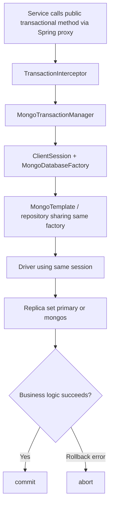
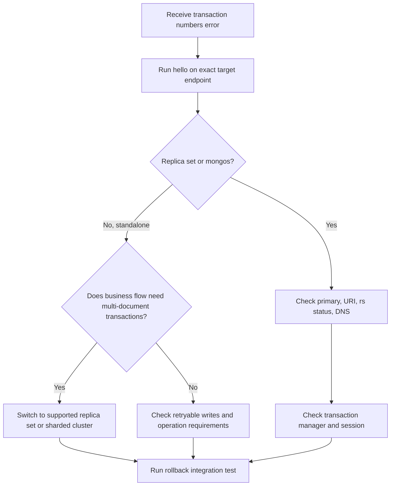

# Transactions Not Working on the Current Topology or Configuration

> **Chapter:** Errors and Diagnostics · **Module:** `SPRING_DATA_MONGODB`. Spring Data MongoDB supports data operations through `MongoTemplate`, repositories, and reactive APIs, where **single-document** updates are atomic on the MongoDB server. When multiple reads and writes must commit or roll back together, the application must use **multi-document transactions** on a supported MongoDB topology with the right transaction manager and session. This lesson helps separate **MongoDB server/topology** errors, **driver/connectivity** errors, **Spring Data wiring** errors, and **code transaction-boundary** errors.

## 1. The Problem and Common Symptoms

An order placement workflow needs two mutations:

1. Decrement `available` in the item's `stock` document.
2. Insert a new document into the `orders` collection.

If step 1 succeeds and step 2 fails, stock is deducted without an order. Issuing two consecutive statements does not automatically group them into a transaction.

```text
Without a multi-document transaction:

stock.available = 5
     │
     ├── update stock: available = 4  (committed)
     │
     ├── insert order: duplicate key error
     │
     └── result: stock = 4, order was not created
```

With a transaction, the goal is:

```text
start transaction
    ├── update stock
    ├── insert order
    ├── if any step fails → abort all changes in the transaction
    └── if valid → commit all changes
```

However, running `@Transactional` code against a standalone MongoDB or a miswired transaction manager surfaces symptoms such as:

- `Transaction numbers are only allowed on a replica set member or mongos`.
- `No qualifying bean of type 'PlatformTransactionManager'` or declared manager bean not found.
- First-step mutations persist even after the `@Transactional` method throws an exception.
- `NoSuchTransaction`, `WriteConflict`, or `TransientTransactionError` while a transaction runs.
- A repository uses a different database or client than the `MongoTemplate` participating in the transaction.
- Reactive code returns a `Mono`, yet operations never subscribe or execute on a subscription detached from the transaction.

**Not every symptom proves MongoDB transactions are broken.** Before changing URIs or setting `retryWrites=false`, verify which topology commands hit and whether all operations share the same session/transaction.

## 2. Understanding Atomicity Scopes Accurately

| Scope | MongoDB Guarantee / Condition | Example |
| --- | --- | --- |
| Single operation on **one document** | Atomic at document level, even when updating multiple fields in that document | `$inc` guarded by `available: {$gte:1}` |
| Multiple operations across **multiple documents** | Requires a proper transaction to commit/abort together | Deduct stock and create order |
| `updateMany` across multiple documents | Each individual document updates atomically; the whole `updateMany` is **not** automatically a multi-document transaction | Mark multiple orders |
| Multiple databases/collections in one MongoDB deployment | Supported inside a transaction if topology, session, and command rules are satisfied | Write `orders` and `payments` |
| MongoDB + external HTTP API / message broker | No automatic distributed transaction via MongoDB transactions alone | Write MongoDB then call payment gateway |

A MongoDB transaction does not replace idempotency, concurrency guards, or compensating workflows when business logic spans systems outside MongoDB.

### 2.1. When Is a Transaction Actually Needed?

If the invariant lives inside a single document, prefer a simpler atomic update:

```javascript
db.stock.updateOne(
  { _id: "SKU-1", available: { $gte: 1 } },
  { $inc: { available: -1 } }
);
```

This prevents two requests from both claiming the last unit via a server-side update predicate. Reach for transactions only when synchronizing mutations across multiple documents, because transactions introduce coordination overhead, contention/locks, and retry requirements.

## 3. Which Topologies Support Multi-Document Transactions?

| MongoDB Deployment Type | Multi-Document Transactions Supported? | Conditions / Notes |
| --- | --- | --- |
| **Standalone `mongod`** | **No** | Lacks replica set protocol; Spring annotations cannot enable transactions here |
| **Replica set** | **Yes** since MongoDB 4.0 | Replica set initialized, primary available, connection recognizes topology |
| **Sharded cluster** via `mongos` | **Yes** since MongoDB 4.2 | Cluster/shards meet version and feature requirements; cross-shard transactions add cost |
| Single-node replica set for local/CI | **Yes** | Still must launch with `--replSet` and complete `rs.initiate()`; distinct from standalone |
| Uninitialized replica set | **Not ready** | `mongod --replSet` alone only declares mode; insufficient for transactions |
| Managed MongoDB service | **Depends on tier/topology/capabilities** | Verify actual deployment and endpoint rather than assuming from product branding |

On older deployments, also check **feature compatibility version (FCV)** and driver/Spring Data versions. Even on transaction-capable topologies, a cluster mid-upgrade or partially configured may reject transactions.

**A replica set does not require multiple machines:** a single-node replica set works for transaction labs. Production still needs dedicated high availability, security, and fault-tolerance architecture; never treat a single-node replica set test as proof of real failover resilience.

### 3.1. Checking Topology with `mongosh`

Connect to the exact endpoint your application uses with an appropriately privileged account:

```javascript
const hello = db.adminCommand({ hello: 1 });

printjson({
  setName: hello.setName,
  isWritablePrimary: hello.isWritablePrimary,
  msg: hello.msg,
  logicalSessionTimeoutMinutes: hello.logicalSessionTimeoutMinutes
});
```

Common interpretation:

- `hello.setName` is populated: talking to a **replica set** member.
- `hello.msg === "isdbgrid"`: endpoint is **`mongos`** in a sharded cluster.
- Neither `setName` nor `msg: "isdbgrid"`: suspect **standalone** (confirm with deployment config).
- `isWritablePrimary` indicates whether that member is primary; when apps connect to a replica set, the driver discovers and routes writes to the primary.
- `logicalSessionTimeoutMinutes` aids session diagnostics, yet **its presence alone does not prove transactions are supported**.

On a replica set with sufficient privileges:

```javascript
rs.status();
rs.conf();
```

Do not run `rs.status()` on `mongos` and treat its error as proof the cluster lacks transactions: that command is for replica sets. On managed services, check provider cluster status dashboards if your account lacks admin command privileges.

### 3.2. Wrong Endpoints in the Connection String

Example replica set URI:

```text
mongodb://db1.example.internal:27017,db2.example.internal:27017,db3.example.internal:27017/shop?replicaSet=rs0
```

Hostnames here are illustrative. The server must advertise member hostnames that **the application can actually connect to**; never use `localhost` inside replica set configuration if the app runs in a container or remote host where loopback points elsewhere.

Common mistakes:

1. Pointing to a local standalone MongoDB instead of the test replica set.
2. Launching `mongod --replSet rs0` without running `rs.initiate()`.
3. In Docker, `rs.conf()` advertises internal hostnames that a JVM outside the container cannot resolve or reach.
4. URI targets a secondary without reaching a primary or forces conflicting driver options.
5. App reads staging MongoDB cleanly while transactions accidentally hit a different endpoint.

Against a **sharded cluster**, connect through `mongos` or the appropriate SRV/cluster endpoint—never connect directly to a single shard member expecting cross-shard transactions to behave like a cluster router.

### 3.3. Why `retryWrites=false` Does Not Enable Transactions on Standalone

The error:

```text
Transaction numbers are only allowed on a replica set member or mongos
```

can appear even when the app **never opened a multi-document transaction**, because the driver's retryable writes also attach session/transaction numbers on the wire protocol in certain contexts.

Setting `retryWrites=false` lets **regular single-document writes** work against standalone servers in test setups. It **never makes standalone support multi-document transactions**. If the business flow requires multi-document rollback, switch to a replica set or sharded cluster instead of disabling retryable writes and sacrificing atomicity.

## 4. Setting Up a Single-Node Replica Set for Lab Environments

Illustrative lab example (Docker or test host), not a secure production guide:

```bash
mongod --dbpath /data/db --replSet rs0 --bind_ip_all
```

Once `mongod` is running and reachable, initialize via `mongosh` in the lab:

```javascript
rs.initiate({
  _id: "rs0",
  members: [
    { _id: 0, host: "mongo:27017" }
  ]
});
```

`mongo:27017` is a hostname resolvable **inside the Docker network**; if the app runs outside that network, advertise a hostname/port reachable from the app host. Wait until the member reaches primary state before running transactions:

```javascript
db.adminCommand({ hello: 1 });
rs.status();
```

Connect from an application on the same network:

```text
mongodb://mongo:27017/shop?replicaSet=rs0
```

When production authentication is enabled on a replica set, you also need inter-member authentication (`keyFile`/cluster auth), TLS, user privileges, and secret management. Never copy lab `--bind_ip_all` commands into unprotected production setups.

**Testcontainers:** with Testcontainers 1.x, `MongoDBContainer` spins up a single-node replica set and provides the connection URI via `getReplicaSetUrl()`. That avoids manual DNS/port wiring in CI.

## 5. What Components Does Spring Data MongoDB Require?

Three independent prerequisites:

1. A **MongoDB deployment** supporting transactions and a driver connected to that cluster.
2. An active **`MongoTransactionManager`** or **`ReactiveMongoTransactionManager`** matching the API stack in use.
3. Operations executing inside **the exact transaction boundary**, sharing the session bound by the transaction manager to the template/client.



Having `@Transactional` in source code **creates no active session** if the right transaction manager is missing, the Spring proxy was bypassed, or operations route through a different client/factory.

### 5.1. Configuring Imperative `MongoTransactionManager`

For repositories extending `MongoRepository` and `MongoTemplate`:

```java
import org.springframework.context.annotation.Bean;
import org.springframework.context.annotation.Configuration;
import org.springframework.data.mongodb.MongoDatabaseFactory;
import org.springframework.data.mongodb.MongoTransactionManager;

@Configuration(proxyBeanMethods = false)
public class MongoTransactionConfig {

    @Bean("mongoTransactionManager")
    MongoTransactionManager mongoTransactionManager(
            MongoDatabaseFactory databaseFactory) {
        return new MongoTransactionManager(databaseFactory);
    }
}
```

With Spring transaction infrastructure (Spring Boot/Spring Framework) and annotation-driven transactions enabled, `@Transactional` is intercepted by the transaction interceptor. In plain Java config without auto-enabled transaction management, add `@EnableTransactionManagement`. Never assume Spring Data MongoDB registers a transaction manager automatically across every project setup and version.

**Important:** the manager must wrap the **same `MongoDatabaseFactory`** used by the `MongoTemplate`/repositories expected to participate. With multiple templates/databases/clients, configure managers explicitly and define clear transaction scopes; one manager does not magically cover every `MongoTemplate` in `ApplicationContext`.

### 5.2. Placing Transactions at the Service Layer

```java
import com.mongodb.client.result.UpdateResult;
import org.bson.Document;
import org.springframework.stereotype.Service;
import org.springframework.transaction.annotation.Transactional;
import org.springframework.data.mongodb.core.MongoTemplate;
import org.springframework.data.mongodb.core.query.Criteria;
import org.springframework.data.mongodb.core.query.Query;
import org.springframework.data.mongodb.core.query.Update;

@Service
public class OrderPlacementService {

    private final MongoTemplate mongoTemplate;

    public OrderPlacementService(MongoTemplate mongoTemplate) {
        this.mongoTemplate = mongoTemplate;
    }

    @Transactional(transactionManager = "mongoTransactionManager")
    public void placeOrder(
            String orderId, String sku, int quantity,
            boolean simulateFailureAfterReserve) {

        if (quantity <= 0) {
            throw new IllegalArgumentException("quantity must be positive");
        }

        Query stockGuard = Query.query(
            Criteria.where("_id").is(sku)
                .and("available").gte(quantity)
        );

        UpdateResult reserved = mongoTemplate.updateFirst(
            stockGuard,
            new Update().inc("available", -quantity),
            "stock"
        );

        if (reserved.getModifiedCount() != 1L) {
            throw new IllegalStateException("Insufficient stock");
        }

        mongoTemplate.insert(
            new Document("_id", orderId)
                .append("sku", sku)
                .append("quantity", quantity)
                .append("state", "NEW"),
            "orders"
        );

        if (simulateFailureAfterReserve) {
            throw new IllegalStateException("Simulated failure");
        }
    }
}
```

Here:

- The stock update guards `available >= quantity`, preventing concurrent over-deduction.
- The `orders` insert executes **inside the same public method** invoked through the Spring proxy.
- Throwing a `RuntimeException` after both writes instructs Spring to roll back (assuming the transaction actually started).
- If misconfigured **without an active transaction**, stock stays decremented and the inserted order remains after the exception.

Always create required collections and indexes **before** running transaction tests on a supported topology. Never rely on MongoDB/Spring Data auto-creating collections on first write *inside* a transaction, as namespace/index DDL inside transactions carries version- and topology-specific restrictions.

### 5.3. Common `@Transactional` Pitfalls

| Situation | Why Transaction May Not Cover Code | Fix |
| --- | --- | --- |
| Calling `this.placeOrder(...)` inside same bean | Self-invocation bypasses Spring's default proxy mechanism | Move method to an injected service or define an explicit boundary |
| Instantiating service with `new OrderPlacementService(...)` | Object is not managed by Spring | Inject the bean from context |
| Method bypassed appropriate proxy | Annotation-driven interceptor never ran | Call a public method on another bean; check proxy mode/config |
| Exception caught and swallowed | Interceptor sees normal completion | Re-throw or mark rollback explicitly per design |
| Checked exception without `rollbackFor` | Default rollback applies only to `RuntimeException` and `Error` | Add `rollbackFor = ...` where business rules require |
| Using a `MongoTemplate` with a different factory | Not bound to the transaction manager's session | Align template/manager/factory or split workflows |
| Delegating to `@Async` or another thread | Thread-bound transaction context does not propagate to worker threads | Do not treat async tasks as part of the same transaction |
| Making external HTTP calls mid-transaction | MongoDB transactions do not manage external systems | Use outbox, idempotency, sagas, or compensation |

Do not treat `@Transactional(readOnly = true)` as a way to "disable" transactions on reads: in MongoDB, read-only transactions still carry session/coordination overhead and manager-specific read-concern behavior; apply `@Transactional` deliberately rather than annotating every read method.

## 6. Distinguishing Transaction Manager, MongoTemplate, and Session

### 6.1. Imperative Spring Transaction Context

`MongoTransactionManager` obtains a `ClientSession` from `MongoDatabaseFactory`, starts the transaction, and binds the session to Spring's thread-local synchronization so participating `MongoTemplate` calls join it. When the method boundary finishes, Spring commits or aborts.

Thus, the following operations **do not share a transaction**, even inside one `@Transactional` method:

```java
// templateA uses MongoDatabaseFactory A, same as the transaction manager
templateA.updateFirst(...);

// templateB uses MongoDatabaseFactory B or a different client
templateB.insert(...);
```

A MongoDB session belongs to one specific `MongoClient`/deployment; it cannot coordinate transactions across separate connections or external services.

When an app defines `ordersMongoTemplate` and `billingMongoTemplate`, verify `@Qualifier`, `mongoTemplateRef`, and transaction manager bindings. Never rely on `@Primary` expecting it to route sessions onto a template targeting another database.

### 6.2. Managing Sessions Directly with the MongoDB Java Driver

Sync driver example, assuming `MongoClient` connects to a replica set:

```java
import com.mongodb.ReadConcern;
import com.mongodb.ReadPreference;
import com.mongodb.TransactionOptions;
import com.mongodb.WriteConcern;
import com.mongodb.client.ClientSession;
import com.mongodb.client.MongoClient;
import com.mongodb.client.MongoCollection;
import com.mongodb.client.MongoDatabase;
import com.mongodb.client.result.UpdateResult;
import com.mongodb.client.model.Filters;
import com.mongodb.client.model.Updates;
import org.bson.Document;

public final class DriverTransactionExample {

    public static void placeOrder(
            MongoClient client, String orderId, String sku, int quantity) {

        MongoDatabase database = client.getDatabase("shop");
        MongoCollection<Document> stock = database.getCollection("stock");
        MongoCollection<Document> orders = database.getCollection("orders");

        TransactionOptions options = TransactionOptions.builder()
            .readPreference(ReadPreference.primary())
            .readConcern(ReadConcern.SNAPSHOT)
            .writeConcern(WriteConcern.MAJORITY)
            .build();

        try (ClientSession session = client.startSession()) {
            session.withTransaction(() -> {
                UpdateResult result = stock.updateOne(
                    session,
                    Filters.and(
                        Filters.eq("_id", sku),
                        Filters.gte("available", quantity)
                    ),
                    Updates.inc("available", -quantity)
                );

                if (result.getModifiedCount() != 1L) {
                    throw new IllegalStateException("Insufficient stock");
                }

                orders.insertOne(
                    session,
                    new Document("_id", orderId)
                        .append("sku", sku)
                        .append("quantity", quantity)
                );

                return null;
            }, options);
        }
    }
}
```

Both `updateOne(session, ...)` and `insertOne(session, ...)` pass **the exact same `ClientSession`**. Accidentally calling an overload without `session` runs that command outside the transaction. The driver's `withTransaction` supports conditional retries based on error labels, so callbacks must tolerate re-execution; never send emails, charge cards, or trigger external side effects inside the callback without idempotency.

In Spring apps, prefer `MongoTransactionManager` instead of mixing two transaction coordination mechanisms. This driver example demonstrates session mechanics, not advice to nest `withTransaction` inside `@Transactional`.

### 6.3. Read Concern, Write Concern, and Read Preference

Transaction options govern operational guarantees:

- **Read preference:** transactions require settings compatible with selecting primary and topology; do not try to route transactional writes to secondaries.
- **Read concern:** `snapshot` provides a consistent snapshot view under MongoDB's supported conditions; do not assume every transaction uses snapshot without inspecting settings.
- **Write concern:** committing with `majority` is typically chosen for stronger durability across failovers; cost and guarantees depend on topology.
- **Timeout/lifetime:** long-running transactions risk server-side abort and contention. Defaults and limits depend on server version and configuration.

Never tweak read/write concerns arbitrarily just to turn a failing test green. Define your consistency and durability goals first, configure transaction options accordingly, and test on production-equivalent topology.

## 7. Reactive Transactions: Keep the Same Subscription and Reactor Context

Reactive MongoDB requires:

- `ReactiveMongoRepository` or `ReactiveMongoTemplate`;
- `ReactiveMongoTransactionManager`;
- `@Transactional` on methods **returning a reactive publisher**, or `TransactionalOperator`;
- Reactive Streams MongoDB driver and proper Reactor context propagation.

### 7.1. Configuring the Manager

```java
import org.springframework.context.annotation.Bean;
import org.springframework.context.annotation.Configuration;
import org.springframework.data.mongodb.ReactiveMongoDatabaseFactory;
import org.springframework.data.mongodb.ReactiveMongoTransactionManager;

@Configuration(proxyBeanMethods = false)
public class ReactiveMongoTransactionConfig {

    @Bean("reactiveMongoTransactionManager")
    ReactiveMongoTransactionManager reactiveMongoTransactionManager(
            ReactiveMongoDatabaseFactory databaseFactory) {
        return new ReactiveMongoTransactionManager(databaseFactory);
    }
}
```

An imperative `MongoTransactionManager` cannot manage reactive publishers in place of `ReactiveMongoTransactionManager`. In dual-stack apps, specify the manager name or qualifier explicitly; never rely on an unqualified `@Transactional` guessing right.

### 7.2. Keeping Both Operations in the Same Reactive Chain

```java
import com.mongodb.client.result.UpdateResult;
import org.bson.Document;
import org.springframework.stereotype.Service;
import org.springframework.transaction.annotation.Transactional;
import org.springframework.data.mongodb.core.ReactiveMongoTemplate;
import org.springframework.data.mongodb.core.query.Criteria;
import org.springframework.data.mongodb.core.query.Query;
import org.springframework.data.mongodb.core.query.Update;
import reactor.core.publisher.Mono;

@Service
public class ReactiveOrderPlacementService {

    private final ReactiveMongoTemplate template;

    public ReactiveOrderPlacementService(ReactiveMongoTemplate template) {
        this.template = template;
    }

    @Transactional(transactionManager = "reactiveMongoTransactionManager")
    public Mono<Void> placeOrder(
            String orderId, String sku, int quantity) {

        if (quantity <= 0) {
            return Mono.error(
                new IllegalArgumentException("quantity must be positive")
            );
        }

        Query guard = Query.query(
            Criteria.where("_id").is(sku)
                .and("available").gte(quantity)
        );

        return template.updateFirst(
                guard,
                new Update().inc("available", -quantity),
                "stock"
            )
            .flatMap(result -> {
                if (result.getModifiedCount() != 1L) {
                    return Mono.error(
                        new IllegalStateException("Insufficient stock")
                    );
                }
                return template.insert(
                    new Document("_id", orderId)
                        .append("sku", sku)
                        .append("quantity", quantity),
                    "orders"
                );
            })
            .then();
    }
}
```

When called through the Spring transactional proxy and subscribed, the pipeline shares the session/context managed by the reactive transaction manager. If `insert` errors, the transaction aborts per error rules and settings.

**Common pitfalls:**

- Calling `template.insert(...).subscribe()` inside `flatMap` and returning `Mono.empty()`: spawns a **detached subscription**, escaping the transaction context and awaiting nothing.
- Calling `block()` inside a reactive chain: blocks threads and breaks non-blocking execution; never use it to "force" a transaction to work.
- Relying solely on `ThreadLocal` or classic MDC to carry sessions: reactive transactions propagate through **Reactor Context**, not fixed threads.
- Running parallel MongoDB operations via `Flux.merge` or concurrent `flatMap` within the same transaction/session: driver transactions are not built for arbitrary parallel execution on one session; sequence operations (e.g., `concatMap` when ordering matters) and test thoroughly.
- Returning a `Mono` that nobody subscribes to: zero database operations execute.

### 7.3. `TransactionalOperator` for Explicit Boundaries

For programmatic reactive transactions:

```java
import org.springframework.transaction.reactive.TransactionalOperator;
import reactor.core.publisher.Mono;

Mono<Void> work = /* a MongoDB reactive chain without internal subscribe */;

Mono<Void> transactionalWork = work.as(transactionalOperator::transactional);
```

`transactionalOperator` must wrap the right `ReactiveTransactionManager`, e.g., from Spring config. The transaction boundary takes effect only when a subscriber subscribes to `transactionalWork`. Never wrap a publisher that already triggered an inner `subscribe()` and expect out-of-band operations to roll back.

## 8. Diagnosing Common Topology and Session Errors

| Symptom / Log | Likely Root Layer | Isolation Action |
| --- | --- | --- |
| `Transaction numbers are only allowed on a replica set member or mongos` | Standalone or retryable write on unsupported topology | Run `hello`; distinguish retryable writes from multi-doc transactions |
| `This MongoDB deployment does not support retryable writes` | Deployment/driver mismatch on retryable writes | Check topology/driver; disabling `retryWrites` does not enable transactions |
| `not primary`, `node is recovering`, server selection timeout | Missing primary or unhealthy/electing replica set | Inspect `hello`, `rs.status()`, URI, DNS, network, driver discovery |
| `NoSuchTransaction` | Transaction already aborted/expired, wrong session/txn number, or prior failure | Locate the first error, elapsed time, and session lifecycle |
| `TransientTransactionError` | Transient fault eligible for **full transaction** retry | Read driver error labels; bound retries and protect side effects |
| `UnknownTransactionCommitResult` | Ambiguous commit outcome | Use proper commit-retry workflow; avoid blind side-effect replay |
| `WriteConflict` | Concurrent write contention on same data | Valid transaction retry, guards/idempotency, lower contention |
| `TransactionExceededLifetimeLimitSeconds` or killed txn | Long-running transaction or resource pressure | Shorten transactions, reduce operations, check server metrics |
| `Operation not supported in a transaction` | DDL, unsupported command, or version/topology restriction | Pre-create collections/indexes; verify command transaction support |
| `Cannot use a session that has ended` | Session closed or used out of scope | Keep session within transaction lifecycle |
| `No qualifying bean of type 'TransactionManager'` | Missing or misconfigured Spring manager | Verify manager bean, qualifier name, and transaction AOP |

**The first error matters most.** A `NoSuchTransaction` exception is often just fallout after a `WriteConflict` already aborted the transaction on the server. Looking only at the last exception in logs leads to misdiagnosing server config.

### 8.1. `Transaction numbers are only allowed...` Runbook



Practical steps:

1. Record server, driver, Spring Data, and Spring Boot versions—**never log URIs with credentials**.
2. Run `hello` on the exact application endpoint to confirm topology; inspect server config and replica set status if needed.
3. Check whether `retryWrites`, `@Transactional`, driver `ClientSession`, or `withTransaction` are active.
4. If standalone, solve the **actual requirement**: multi-document transactions require a replica set or sharded cluster; retryable writes are a separate setting.
5. If replica set, check `replicaSet` in URI, advertised member hostnames/DNS, primary health, and app network access.
6. Run a two-document rollback integration test against a test MongoDB with matching topology.

### 8.2. When Code Keeps Running After a Transaction Aborts

MongoDB marks a transaction aborted upon certain write failures. If application code catches the exception and issues more commands on the same session, subsequent errors obscure the original cause.

In a Spring service:

```java
@Transactional(transactionManager = "mongoTransactionManager")
public void unsafeWorkflow() {
    try {
        orderRepository.save(order);
    } catch (RuntimeException ex) {
        // Wrong: swallowing failure and continuing as if transaction were healthy.
    }
    stockRepository.save(stock);
}
```

**Proper handling:** separate recoverable business outcomes handled up front from failures requiring **abort/retry of the entire transaction**. Rethrowing alone is not enough if external side effects occurred or the request cannot retry safely.

## 9. Subtle Spring Configuration Mistakes

### 9.1. `@Transactional` Without a Matching Manager

Adding the annotation without defining `MongoTransactionManager` produces outcomes depending on transaction AOP/config:

- Calling the method may fail looking up a transaction manager.
- Transactional proxying may silently fail to cover operations, executing statements independently.
- If a **JPA transaction manager** exists in the app, an unqualified `@Transactional` can pick the wrong store's manager while `MongoTemplate` does not participate.

**Fix:** register the MongoDB manager and specify `@Transactional(transactionManager="mongoTransactionManager")` on MongoDB transaction boundaries; verify the manager wraps the same database factory.

### 9.2. Self-Invocation Inside the Same Bean

```java
@Service
class OrderService {

    public void outer() {
        inner(); // self-invocation: bypasses transactional proxy
    }

    @Transactional(transactionManager = "mongoTransactionManager")
    public void inner() {
        // MongoDB operations
    }
}
```

This stems from Spring's default proxy AOP behavior. Place transaction boundaries on public methods called **from another bean through the proxy**, or extract a dedicated transactional service. Do not put `@Transactional` on private helpers expecting the interceptor to run.

### 9.3. Converting Exceptions into Normal Return Values

```java
@Transactional(transactionManager = "mongoTransactionManager")
public Result place() {
    try {
        doWrites();
        return Result.ok();
    } catch (Exception ex) {
        return Result.failed(); // Spring sees normal method return.
    }
}
```

Without marking rollback-only, the transaction can commit partial writes made before the error. For failures requiring abort, throw an appropriate exception or explicitly mark rollback-only per policy. A unit test checking only "method returned failed" **is insufficient**: query the database afterward to prove rollback happened.

### 9.4. Missing Transaction Config Across Multiple MongoDB Databases

When an app defines multiple `MongoTemplate`/`MongoDatabaseFactory` beans, each transaction manager covers its own factory scope. Never assume one annotation coordinates transactions across distinct `MongoClient`s. If databases share a deployment yet use separate client/factory beans, verify session propagation or unify around a shared client/factory when cross-database transactions are needed.

### 9.5. DDL and Index Creation Inside Transactions

`MongoTemplate.insert` can trigger implicit collection creation if missing, depending on mapping and version. While certain MongoDB versions support limited DDL inside transactions, strict topology, sharding, and command constraints apply.

In standard business flows, **create collections and indexes during setup/migrations beforehand**, keeping only transactional DML inside the boundary. Do not embed `createIndex` into an order-placement flow "just in case."

## 10. Integration Testing: Proving Real Commit and Rollback

A Mockito unit test asserting `mongoTemplate.updateFirst` and `insert` were invoked **does not** prove MongoDB rolls back on failure. Test against a real MongoDB replica set, such as a Testcontainers MongoDB container.

### 10.1. Illustrative Dependencies

Snippet targets Spring Boot 3.x, JUnit 5, and **Testcontainers 1.x**. Artifact/package names in Testcontainers 2.x may differ; align with your project's BOM and versions.

```groovy
dependencies {
    implementation 'org.springframework.boot:spring-boot-starter-data-mongodb'

    testImplementation 'org.springframework.boot:spring-boot-starter-test'
    testImplementation 'org.testcontainers:junit-jupiter'
    testImplementation 'org.testcontainers:mongodb'
}
```

The test assumes `OrderPlacementService` and `MongoTransactionConfig` from Section 5 are scanned or imported, and collections/databases are initialized before transactional calls.

### 10.2. Booting a MongoDB Replica Set in Testcontainers

```java
import static org.assertj.core.api.Assertions.*;

import org.bson.Document;
import org.junit.jupiter.api.BeforeEach;
import org.junit.jupiter.api.Test;
import org.springframework.beans.factory.annotation.Autowired;
import org.springframework.boot.test.context.SpringBootTest;
import org.springframework.data.mongodb.core.MongoTemplate;
import org.springframework.test.context.DynamicPropertyRegistry;
import org.springframework.test.context.DynamicPropertySource;
import org.testcontainers.containers.MongoDBContainer;
import org.testcontainers.junit.jupiter.Container;
import org.testcontainers.junit.jupiter.Testcontainers;
import org.testcontainers.utility.DockerImageName;

@SpringBootTest
@Testcontainers
class OrderPlacementTransactionIT {

    @Container
    static final MongoDBContainer MONGO = new MongoDBContainer(
        DockerImageName.parse("mongo:7.0")
    );

    @DynamicPropertySource
    static void mongodbProperties(DynamicPropertyRegistry registry) {
        registry.add("spring.data.mongodb.uri", MONGO::getReplicaSetUrl);
    }

    @Autowired
    MongoTemplate template;

    @Autowired
    OrderPlacementService orderPlacement;

    @BeforeEach
    void prepareCollections() {
        template.dropCollection("orders");
        template.dropCollection("stock");

        // Create collections before running transactions.
        template.createCollection("orders");
        template.createCollection("stock");

        template.insert(
            new Document("_id", "SKU-1").append("available", 5),
            "stock"
        );
    }

    @Test
    void shouldCommitBothWrites() {
        orderPlacement.placeOrder(
            "O-100", "SKU-1", 2, false
        );

        Document stock = template.findById(
            "SKU-1", Document.class, "stock"
        );
        Document order = template.findById(
            "O-100", Document.class, "orders"
        );

        assertThat(stock).isNotNull();
        assertThat(stock.getInteger("available")).isEqualTo(3);
        assertThat(order).isNotNull();
        assertThat(order.getString("sku")).isEqualTo("SKU-1");
    }

    @Test
    void shouldRollbackBothWritesWhenBusinessFails() {
        assertThatThrownBy(
            () -> orderPlacement.placeOrder(
                "O-FAIL", "SKU-1", 2, true
            )
        ).isInstanceOf(IllegalStateException.class);

        Document stock = template.findById(
            "SKU-1", Document.class, "stock"
        );
        Document order = template.findById(
            "O-FAIL", Document.class, "orders"
        );

        assertThat(stock).isNotNull();
        assertThat(stock.getInteger("available")).isEqualTo(5);
        assertThat(order).isNull();
    }
}
```

**Prerequisites:** Docker is available, the MongoDB container initializes its replica set, and the URI returned by `getReplicaSetUrl` is reachable from the test runner network. If running against standalone, the desired outcome is catching the unsupported topology—never "skipping" rollback verification.

**Do not put `@Transactional` on the test method itself** when testing service commit/rollback behavior: the test framework's transaction alters observed boundaries. Isolate collections per test or reset sequentially; avoid parallel tests dropping the same collection.

### 10.3. Interpreting a Failed Rollback Test

| Observation After Exception | What to Investigate |
| --- | --- |
| Stock is 5, no order exists | Rollback worked as expected for the test case |
| Stock is 3, order still exists | Transaction boundary inactive or operations ran outside session |
| Stock is 3, no order exists | At least the stock update ran outside transaction, or used wrong manager/factory |
| Exception thrown before update | Likely topology, `startTransaction`, or manager config error; check root cause |
| Commit test passes, rollback fails | Never trust "happy path" alone for transactions; check proxy and manager |
| Testcontainers passes, production fails | Differences in topology, URI, FCV, roles, collections/indexes, or versions |

Add a test case triggering a **duplicate `_id` insert** inside the transaction to confirm the prior stock update rolls back cleanly. That tests rollback on a genuine MongoDB server error rather than a simulated Java exception alone.

## 11. Counter-Example Test: Manager Exists, Wrong Template

In multi-database apps, write one deliberate negative test:

1. Create `ordersMongoTemplate` and `stockMongoTemplate` backed by separate factories/clients.
2. Configure a transaction manager for only one factory and annotate the service `@Transactional`.
3. Update through one template, insert through the other, then throw an exception.
4. Read both databases afterward to prove operations outside the manager's session do not roll back.

Run this only on **dedicated test databases**. Exact outcomes depend on topology and factory/client wiring; the goal is proving **all business operations share one transaction boundary** before releasing multi-database configs to production.

Useful context sanity check:

```java
@Autowired
ApplicationContext context;

@Test
void mongoTransactionManagerExists() {
    assertThat(
        context.getBeansOfType(
            org.springframework.data.mongodb.MongoTransactionManager.class
        )
    ).hasSize(1);
}
```

This verifies only that the bean exists. It **never replaces** a two-document rollback test, because a manager bean may exist yet wrap the wrong `MongoDatabaseFactory` or fail interception.

## 12. Handling Retries and Uncertain Transaction Commits

### 12.1. Separating Transient Errors from Business Errors

Driver error labels indicate:

- `TransientTransactionError`: transient error eligible for **re-running the entire transaction**.
- `UnknownTransactionCommitResult`: `commitTransaction` outcome uncertain; typically requires **commit retry** per driver rules rather than immediately re-running the entire business flow.

Never slap an unbounded `retry()` loop on arbitrary exceptions. Error codes and labels vary by scenario; follow the **MongoDB transaction retry specification** or helper APIs like `ClientSession.withTransaction` where suitable.

A service might execute both writes and lose the connection right at commit time. Without knowing whether the commit succeeded, blindly re-sending "deduct stock and create order" risks duplicate orders or unintended side effects. Use **idempotency keys**, unique constraints on request/order IDs, and reconciliation queries before retrying.

### 12.2. Keep Transactions Short

Long-lived transactions strain the WiredTiger cache, raise contention, and risk lifetime timeouts/aborts. Avoid:

- Running multi-minute analytical queries inside order-write transactions.
- Calling external APIs, waiting for user input, or calling `Thread.sleep` inside transactions.
- Creating indexes or collections inside transactional order flows.
- Processing thousands of unbounded records in one transaction "for safety."
- Holding a session open across multiple requests or threads.

Scope transactions strictly to MongoDB steps requiring atomicity; prepare inputs beforehand and emit events/outbox records after commit per design to coordinate external systems.

### 12.3. Useful Logging Without Leaking Data

When diagnosing, log:

- Exception class, MongoDB error code, and **error labels** if present;
- Execution duration, retry attempt count, and commit/abort outcome;
- Normalized business operation name and active transaction manager;
- Topology type (replica set/sharded/standalone) and version metadata.

Never log connection URIs with passwords, raw `Query`/`Update`/BSON commands, session secrets, personal data, or full payloads just for debugging. When a transaction aborts, **preserve the first error** with minimal sanitized context.

## 13. Diagnostic Workflow from Symptom to Conclusion

### 13.1. Case 1: Local Runs Standalone, CI Uses Replica Set

**Symptom:** transaction tests pass in CI while local runs throw `Transaction numbers are only allowed...`.

**Verify:** run `hello` on each environment's URI and inspect `setName`/`msg`. If local is standalone, switch local MongoDB to a single-node replica set or Testcontainers, then re-run rollback tests.

**Avoid:** disabling `retryWrites` and claiming transactions now work.

### 13.2. Case 2: Replica Set Active, Yet `@Transactional` Does Not Roll Back

**Symptom:** both collections work on normal queries, yet stock stays decremented after an exception.

**Verify:** check manager bean, transaction AOP/proxy, cross-bean invocation, whether `MongoTemplate` shares the factory, and whether any async threads or nested subscriptions escape the transaction. Re-run two-document rollback integration tests.

**Avoid:** tweaking `writeConcern` blindly or adding `@Transactional` to every repository method without verifying boundaries.

### 13.3. Case 3: Reactive Pipeline Writes Nothing

**Symptom:** method returns `Mono<Void>`, tests invoke it, yet MongoDB shows no changes.

**Verify:** was the publisher subscribed in the test (`StepVerifier`) or at the HTTP boundary? Are there nested `subscribe()`, `block()`, or uncoordinated scheduler switches? Is `ReactiveMongoTransactionManager` bound to the right factory?

**Avoid:** calling `subscribe()` directly inside the service and returning `Mono.empty()`, which drops error propagation and transaction context.

### 13.4. Case 4: Failovers Spike Transaction Failures

**Symptom:** during primary elections, `not primary`, `WriteConflict`, or `TransientTransactionError` spike, though steady-state traffic runs clean.

**Verify:** correlate election timestamps, driver server selection, error labels, commit outcomes, transaction durations, and retry policies. Test transient fault handling in a staging replica set environment.

**Avoid:** setting infinite timeouts or replaying non-idempotent external side effects.

## 14. Quick Verification Checklist

- [ ] Confirm whether business rules truly need a multi-document transaction vs. a single-document atomic update.
- [ ] Run `hello` against the app's target endpoint: initialized replica set or `mongos`, not standalone.
- [ ] Verify MongoDB version, FCV, primary availability, DNS/advertised hosts, and cluster health.
- [ ] Confirm Spring Data starter/driver matches the stack: imperative or reactive.
- [ ] Register the right transaction manager and confirm `@Transactional` selects it.
- [ ] Ensure methods are invoked through the Spring proxy—no self-invocation or manual `new`.
- [ ] Ensure every MongoDB operation in the transaction shares compatible template/factory/client and session.
- [ ] In reactive flows, keep operations inside one subscribed publisher without nested subscribes or parallel calls on one session.
- [ ] Pre-create collections and indexes before transactions; verify commands are allowed in transactions on your version/topology.
- [ ] Handle `RuntimeException`/`rollbackFor` cleanly—never swallow errors and commit half-written data.
- [ ] Apply retry policies matching error labels and idempotency keys for operations eligible for replay.
- [ ] Run **commit and rollback** integration tests on a MongoDB replica set, checking all involved collections afterward.
- [ ] Monitor transaction duration, abort rates, commit ambiguity, connection pools, and cluster health.
- [ ] Keep URIs, transaction payloads, sessions, and raw queries with sensitive data out of shared logs.

## 15. Self-Check Questions

1. Why is `updateOne` on a single document atomic while two `updateOne` calls on two separate documents do not form a transaction?
2. How do standalone MongoDB and a single-node replica set differ for multi-document transactions?
3. Why can `Transaction numbers are only allowed on a replica set member or mongos` appear even without `@Transactional`?
4. When `hello` lacks `setName`, what else must you check before concluding the topology lacks transactions?
5. Which beans and mechanisms does Spring `@Transactional` need to actually open a MongoDB transaction?
6. Why can calling `this.placeOrder()` inside the same bean bypass the transaction interceptor?
7. Does marking one `MongoTemplate` `@Primary` guarantee every repository in a transaction shares the same session?
8. When must you use `ReactiveMongoTransactionManager` instead of `MongoTransactionManager`?
9. Why can calling `subscribe()` inside `flatMap` detach an operation from a reactive transaction?
10. If an exception is caught and the method returns normally, what can happen to the transaction?
11. Why must rollback tests read both `stock` and `orders` rather than only asserting an exception was thrown?
12. Distinguish `TransientTransactionError` from `UnknownTransactionCommitResult` in retry handling.
13. Why can't `retryWrites=false` enable transactions on standalone?
14. If deducting stock and calling an HTTP payment gateway, can a MongoDB transaction roll back the external payment?
15. Why should indexes and collections be created before business transactions execute?

## 16. Takeaways

- **Topology:** MongoDB multi-document transactions require a supported **replica set** or **sharded cluster**; standalone is unsupported.
- **Spring Data:** use `MongoTransactionManager` for `MongoTemplate`/`MongoRepository` and `ReactiveMongoTransactionManager` for reactive stacks, each bound to the right factory/client.
- **Boundaries:** `@Transactional` must pass through the Spring proxy; all operations must share the same session/context and manager.
- **Rollback:** asserting a service throws is insufficient; write integration tests checking persisted state across **all affected documents**.
- **Retries:** error labels separate full-transaction retries from commit retries; any replayable operation requires idempotency.
- **Operations:** keep transactions short, pre-create collections/indexes, monitor topology, and keep sensitive data out of logs.

### References

- [MongoDB Manual — Transactions](https://www.mongodb.com/docs/manual/core/transactions/)
- [MongoDB Manual — Production Considerations for Transactions](https://www.mongodb.com/docs/manual/core/transactions-production-consideration/)
- [MongoDB Manual — Transactions and Retryable Writes](https://www.mongodb.com/docs/manual/core/retryable-writes/)
- [MongoDB Manual — Atomicity and Transactions](https://www.mongodb.com/docs/manual/core/write-operations-atomicity/)
- [MongoDB Manual — Replica Set Configuration](https://www.mongodb.com/docs/manual/tutorial/deploy-replica-set/)
- [MongoDB Manual — hello command](https://www.mongodb.com/docs/manual/reference/command/hello/)
- [MongoDB Java Driver — Transactions](https://www.mongodb.com/docs/drivers/java/sync/current/crud/transactions/)
- [Spring Data MongoDB Reference — Transactions](https://docs.spring.io/spring-data/mongodb/reference/mongodb/client-session-transactions.html)
- [Spring Data MongoDB API — MongoTransactionManager](https://docs.spring.io/spring-data/mongodb/docs/current/api/org/springframework/data/mongodb/MongoTransactionManager.html)
- [Spring Data MongoDB API — ReactiveMongoTransactionManager](https://docs.spring.io/spring-data/mongodb/docs/current/api/org/springframework/data/mongodb/ReactiveMongoTransactionManager.html)
- [Spring Framework — Declarative Transaction Management](https://docs.spring.io/spring-framework/reference/data-access/transaction/declarative.html)
- [Testcontainers — MongoDB](https://java.testcontainers.org/modules/databases/mongodb/)
