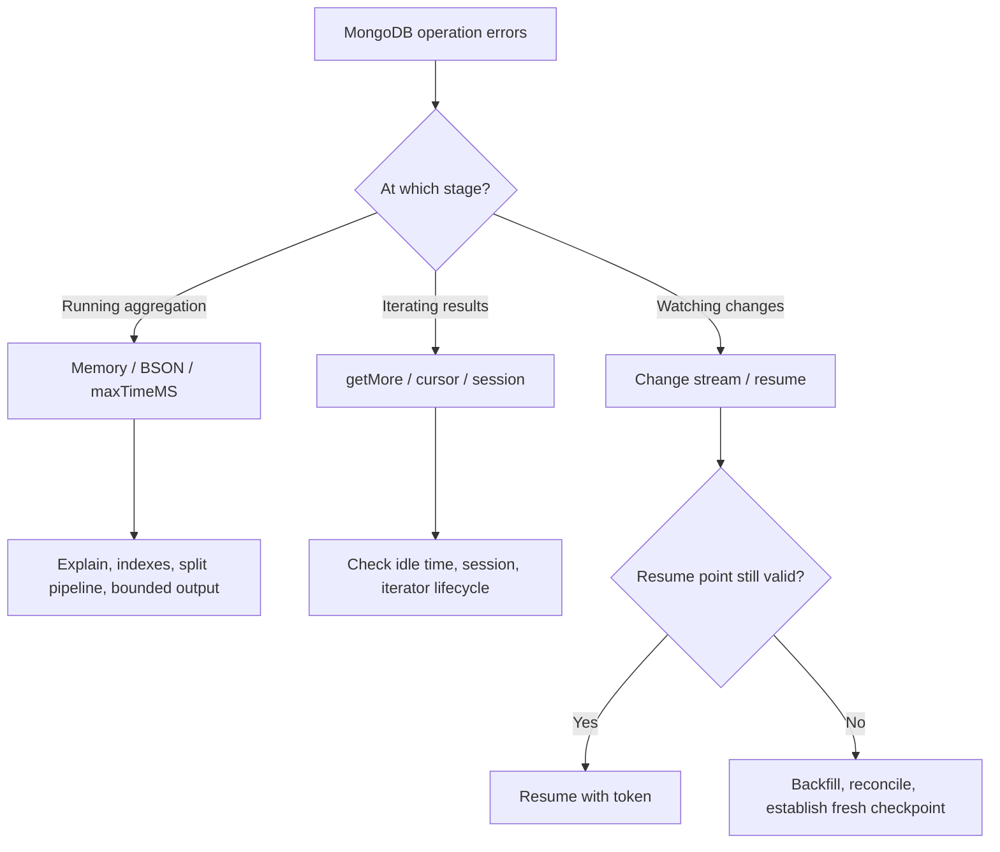

# Aggregation Exceeding Limits, Expired Cursors, or Unresumable Change Streams

## Learning Objectives

In **Spring Data MongoDB**, three error categories often get lumped together as "an active query broke mid-run," even though they occur at completely different stages:

- **Aggregation exceeding limits:** a stage consumes too much memory, builds an oversized BSON document, exceeds its execution time budget, or processes more data than resources allow.
- **Expired or invalid cursors:** the server closed the cursor, the session expired, or the application touched a cursor after closing it—even though the initial query succeeded.
- **Unresumable change streams:** a change stream loses its valid resume point, commonly because oplog history rotated past it, the resume token is invalid, or an invalidate event occurred.

This lesson aims to diagnose the exact failure accurately, pick evidence-based fixes, and verify operations across **`MongoTemplate`, repositories, aggregations, the Java Driver, and reactive change streams**.

After completing this lesson, you will be able to:

1. Distinguish aggregation memory limits, the **16 MiB BSON document** limit, timeouts, and cursor failures.
2. Use `explain("executionStats")`, `allowDiskUse`, indexes, `$match`, and `$project` to optimize pipelines while preserving exact results.
3. Manage `MongoCursor`/`CloseableIterator` lifecycles, sessions, batch sizes, and item processing times.
4. Persist and apply change stream **resume tokens**; determine when to retry versus when to run **backfill/reconciliation**.
5. Design tests reproducing limits under realistic data volumes and load without dropping events during recovery.

> Version note: limits, the `allowDiskUseByDefault` flag, disk spilling mechanics, automatic driver resume behavior, and exception names vary across MongoDB, Java Driver, and Spring Data MongoDB versions. Always verify errors against your deployment version; examples below illustrate general behavior and key caveats.

## 1. Identifying the Right Error Category

Read the **root exception, error code, command, namespace, timestamp, and application processing state** before changing configuration.

| Symptom | Common Failure Point | Priority Check |
| --- | --- | --- |
| `Sort exceeded memory limit` or `$group` needs too much RAM | Blocking aggregation stage buffering large state | Pipeline stage order, indexes, `allowDiskUse`, group cardinality |
| `BSONObjectTooLarge` or BSON document > 16 MiB | Input or output document violates size cap | `$group`, `$push`, `$lookup`, `$facet`, array growth model |
| `ExceededTimeLimit`, usually code 50 | `maxTimeMS` or related execution limit | Query cost, indexes, deadline, server load |
| `CursorNotFound`, usually code 43 | Server no longer tracks cursor ID on `getMore` | Idle timeout, session, close, restart/failover |
| `MongoCursor` closed on client | Application reads after `close()` | `try-with-resources` scope, async handoff |
| Change stream reports `ChangeStreamHistoryLost`, usually code 286 | Resume point fell out of oplog/change stream history | Consumer lag, oplog window, latest checkpoint |
| Invalid resume token or pipeline stripped event `_id` | Resume invalid for that stream | Token BSON shape, watch scope, pipeline, versions |
| Change stream invalidated | Collection/database dropped/renamed or invalidating event | Eligibility for `startAfter`, source re-initialization |

**A `MongoTimeoutException` alone does not prove a cursor expired.** Server selection timeouts, command execution timeouts, and server-closed cursors are distinct failures. Read the entire `cause` chain and driver details.



## 2. Aggregations: Separating RAM, BSON Size, and Time Limits

An aggregation pipeline comprises multiple stages with distinct resource profiles. Streaming stages like `$match` process documents one by one, whereas blocking stages like `$sort` or `$group` must buffer substantial state before emitting results.

### 2.1. Stage Memory Limits

Certain stages enforce a RAM ceiling around **100 MB** before spilling to disk or erroring, depending on stage and version. Check stages such as `$sort`, `$group`, `$setWindowFields`, and related accumulators.

Setting `allowDiskUse: true` permits **supported stages** to spill temporary files to disk when exceeding memory limits. From MongoDB 6.0 onward, server parameter `allowDiskUseByDefault` can influence default behavior, and command options can override it. **Not every stage supports disk spilling.**

Specifically:

- `$facet` enforces an intermediate result limit near **100 MB** that `allowDiskUse` cannot bypass if exceeded.
- Each **final output document** must still obey the **16 MiB** BSON limit, even when intermediate stages spill to disk.
- `$graphLookup` has distinct memory caps and behaviors; verify against your server version rather than assuming `allowDiskUse` covers it.
- Temporary spill files consume disk I/O and space; heavy spilling slows queries and adds load to the same server.

**Technical takeaway:** `allowDiskUse` handles specific per-stage RAM overflows; it is not an "unlimited execution" switch.

### 2.2. Example Pipeline Creating Large Groups

Suppose `orders` stores millions of orders with `customerId` and `total`. Aggregating revenue per customer:

```javascript
db.orders.aggregate([
  { $match: { status: "PAID" } },
  {
    $group: {
      _id: "$customerId",
      orderCount: { $sum: 1 },
      revenue: { $sum: "$total" }
    }
  },
  { $sort: { revenue: -1 } },
  { $limit: 50 }
], {
  allowDiskUse: true,
  maxTimeMS: 30000
})
```

`$group` maintains accumulators across groups, and `$sort` on the aggregated revenue may process every group before picking the top 50. A trailing `$limit` does not mean the server reads only 50 source documents.

With very large customer counts, indexes, time-range bounds, and data modeling matter heavily. Adding `allowDiskUse` lets the pipeline finish when RAM runs short, yet you must still **measure latency and disk I/O**.

### 2.3. Meaningful Stage Ordering Optimizations

Changes to evaluate while verifying output equivalence:

1. Place an index-backed `$match` first to shrink documents entering RAM-heavy stages.
2. Project only needed fields early where helpful; MongoDB's optimizer pushes projections automatically in many cases, though verifying the plan remains important.
3. Leverage indexes for `$sort` when sorting can happen before transforming documents and a matching index exists.
4. Narrow the domain by date range, tenant, or status **when business rules permit**.
5. For frequent queries over massive datasets, consider pre-aggregated read models (*materialized read models*) or reconcilable batch jobs.

**Never move `$limit` ahead of `$group` just to lower load**, because that alters aggregation semantics: you would summarize only the first 50 orders rather than all qualifying orders.

### 2.4. Using `explain` to Locate Bottlenecks

```javascript
db.orders.explain("executionStats").aggregate([
  { $match: { status: "PAID" } },
  {
    $group: {
      _id: "$customerId",
      revenue: { $sum: "$total" }
    }
  },
  { $sort: { revenue: -1 } },
  { $limit: 50 }
], { allowDiskUse: true })
```

When inspecting the plan:

- `totalDocsExamined`, `totalKeysExamined`, and `nReturned` reveal scan vs. match efficiency.
- Stages like `COLLSCAN`, `IXSCAN`, `SORT`, and related metrics show how MongoDB reads data.
- Depending on version, `explain` or the profiler may report `usedDisk`, spill counts, or RAM usage; never assume identical metric fields exist across all MongoDB versions.
- `executionTimeMillis` reflects server time under that test run; measure network, Java mapping, and API serialization latency separately.

Before adding an index, evaluate index size, write overhead, tenant cardinality, and whether the actual pipeline can use it. Excess indexes slow writes and consume WiredTiger cache.

## 3. Output Documents Exceeding 16 MiB and Unbounded Array Growth

A single BSON document has a hard limit of **16 MiB**. Accumulators like `$push` inside `$group` or unbounded `$lookup` joins can assemble **one massive result document** from many tiny inputs.

Dangerous pattern:

```javascript
db.orders.aggregate([
  {
    $group: {
      _id: "$customerId",
      allOrders: { $push: "$$ROOT" }
    }
  }
])
```

If one customer has tens of thousands of orders, `{ _id, allOrders: [...] }` exceeds 16 MiB. Raising `allowDiskUse` or `batchSize` **cannot make an oversized document legal**.

Better alternatives:

- **Emit one document per order** and paginate by `customerId` instead of stuffing all orders into an array.
- Aggregate only counts/totals instead of pushing `$$ROOT`.
- If you only need recent samples, query a history collection with a bounded cursor or use version-appropriate top/bottom-N accumulators when strictly bounded.
- For multi-group reports, stream small per-group results instead of building one mega-document.
- Audit `$facet` pipelines and branches capable of accumulating giant arrays.

Summary-only example:

```javascript
db.orders.aggregate([
  { $match: { status: "PAID" } },
  {
    $group: {
      _id: "$customerId",
      orderCount: { $sum: 1 },
      revenue: { $sum: "$total" }
    }
  }
], { allowDiskUse: true })
```

**Stage memory** and **output document size** are separate caps. Separating them is the critical step whenever a pipeline still fails after enabling disk spilling.

### 3.1. `$facet` Carries Extra Constraints

`$facet` runs multiple subpipelines to produce a single output document holding arrays for each branch. A report stuffing full `details` into one `$facet` branch can hit the stage memory limit or the 16 MiB document cap even with outer `allowDiskUse`.

For UI views needing both total counts and a paginated list, consider separate queries for count and page items when `$facet` risks oversized intermediates. The trade-off is an extra database round-trip and defining consistency expectations between reads.

## 4. Aggregations in `MongoTemplate`

Spring Data MongoDB provides `Aggregation`, `AggregationOptions`, and stage builders to avoid hand-written BSON. Equivalent pipeline:

```java
AggregationOptions options = AggregationOptions.builder()
        .allowDiskUse(true)
        .build();

Aggregation aggregation = Aggregation.newAggregation(
        Aggregation.match(Criteria.where("status").is("PAID")),
        Aggregation.group("customerId")
                .count().as("orderCount")
                .sum("total").as("revenue"),
        Aggregation.sort(Sort.Direction.DESC, "revenue"),
        Aggregation.limit(50)
).withOptions(options);

AggregationResults<CustomerRevenue> results =
        mongoTemplate.aggregate(
                aggregation, "orders", CustomerRevenue.class);
```

`CustomerRevenue` is a DTO/read model mapping the grouped `_id`, `orderCount`, and `revenue` fields; configure mapping/annotations cleanly for `_id`.

Points to remember:

- `AggregationResults` materializes results; for huge result sets, avoid loading everything into application heap at once.
- In multi-tenant apps, verify which `MongoTemplate` bean and database namespace each aggregation hits.
- `allowDiskUse` does not replace indexes, date/tenant filters, or output size bounds.
- Public APIs still need bounded DTO serialization and explicit timeouts.

### 4.1. Streaming Large Results via Cursor

You can use the MongoDB Java Driver directly for explicit `MongoCursor` lifecycle control:

```java
MongoCollection<Document> orders =
        mongoClient.getDatabase("app").getCollection("orders");

List<Bson> pipeline = List.of(
        Aggregates.match(Filters.eq("status", "PAID")),
        Aggregates.group("$customerId",
                Accumulators.sum("orderCount", 1),
                Accumulators.sum("revenue", "$total"))
);

AggregateIterable<Document> iterable = orders.aggregate(pipeline)
        .allowDiskUse(true)
        .batchSize(200);

try (MongoCursor<Document> cursor = iterable.iterator()) {
    while (cursor.hasNext()) {
        Document row = cursor.next();
        processRevenueRow(row);
    }
}
```

This requires Java Driver imports (`com.mongodb.client.model.Aggregates`, `Accumulators`, `Filters`, and `org.bson.conversions.Bson`). `processRevenueRow` handles each emitted row.

**`batchSize(200)` bounds how many results arrive per cursor batch**, curbing client memory and network bursts; it **does not reduce server-side RAM needed by `$group` or `$sort`**. Each batch also respects MongoDB's message/response size cap.

If processing each row takes several minutes, cursor/session expirations can still occur even with small batches. That is a separate failure class, covered next.

## 5. Expired Cursors: Server and Client Lifecycles

When `find` or `aggregate` produces many results, the driver fetches an initial batch plus a **cursor ID** to request subsequent batches via `getMore`. Cursors do not stay alive indefinitely.

### 5.1. Why Do Cursors Disappear?

Common causes:

1. **Idle timeout:** the server closes idle cursors after roughly **10 minutes** by default (governed by `cursorTimeoutMillis` and server policy).
2. **Session timeout:** inactive sessions expire after `logicalSessionTimeoutMinutes`, commonly **30 minutes**; session expiration kills its cursors even when `noCursorTimeout` is set.
3. **Client closed cursor:** code invoked `close()` or exited a `try-with-resources` block.
4. **Cursor exhausted:** the server closed the cursor cleanly after delivering the final batch; this is normal completion, not an error.
5. **Server restart, failover, or network drop:** cursors vanish when nodes or connections reset.
6. **Killed command or topology shift:** operational interventions can invalidate active cursors.

In logs, `CursorNotFound` (usually code `43`) indicates the server no longer holds that cursor ID, yet **does not name the sole reason**. Inspect idle durations, session lifetime, server events, and iterator handling.

### 5.2. Bug Pattern: Holding a Cursor Open During Slow Work

```java
MongoCursor<Document> cursor = collection.find().iterator();

while (cursor.hasNext()) {
    Document item = cursor.next();
    callSlowExternalService(item); // May take minutes per item.
}
// Never closed if an exception occurs; cursor idles for too long.
```

If the driver pre-fetches a batch while the app spends minutes processing before the next `getMore`, the server can reap the idle cursor in the meantime. The snippet also leaks the cursor on exceptions.

Using `try-with-resources` is the minimum baseline:

```java
try (MongoCursor<Document> cursor =
         collection.find(Filters.eq("status", "PENDING"))
                   .batchSize(100)
                   .iterator()) {

    while (cursor.hasNext()) {
        Document item = cursor.next();
        processQuickly(item);
    }
}
```

However, `try-with-resources` **only guarantees cleanup**. If `processQuickly` actually takes too long, it does not keep the server cursor or session alive.

### 5.3. Robust Design: Paged Reads and Checkpoints

When every record triggers emails, external HTTP calls, or heavy work, **decouple reading from processing**:

- Fetch a bounded page, close the cursor immediately, enqueue work or process a small batch.
- Persist a deterministic checkpoint/cursor for the next page.
- Use **keyset pagination** instead of holding a server cursor open for hours.
- Design idempotency so re-running an interrupted batch is safe.

Example paging orders by ascending `_id`:

```java
Query query = Query.query(
        Criteria.where("status").is("PENDING")
                .and("_id").gt(lastProcessedId));

query.with(Sort.by(Sort.Direction.ASC, "_id"))
     .limit(200);

List<Order> page =
        mongoTemplate.find(query, Order.class);

// Process each record with proper checkpointing and idempotency.
// Persist lastProcessedId from the final item only after batch completion.
```

Here `lastProcessedId` must share the exact **BSON type** of `_id` (e.g., `ObjectId` rather than `String`). The query needs an index supporting both filter and sort. If `PENDING` status mutates concurrently during pagination, keyset paging **does not provide a static snapshot**; high-accuracy jobs must define exact consistency and checkpoint rules.

### 5.4. `noCursorTimeout` Is Not a Cure-All

Java Driver's `noCursorTimeout()` disables the **normal idle cursor timeout**, yet:

- Sessions can still expire when inactive.
- Server restarts or failovers still drop cursors.
- Long-lived cursors tie up server resources and must still be closed on completion or cancellation.
- Long-running workers should use bounded pages and checkpoints rather than keeping cursors open indefinitely.

MongoDB supports explicit session-refresh patterns for specialized long cursor jobs, which is an advanced operational pattern requiring version and policy verification. Never use `noCursorTimeout` to paper over a consumer that processes batches far too slowly.

## 6. Streaming via `MongoTemplate` and Reactive MongoDB

Spring Data MongoDB supports streaming results instead of materializing all documents at once. With the sync API, stream with `MongoTemplate.stream` and close the iterator:

```java
Query q = Query.query(
        Criteria.where("status").is("PENDING"));

try (CloseableIterator<Order> iterator =
             mongoTemplate.stream(q, Order.class)) {
    while (iterator.hasNext()) {
        Order order = iterator.next();
        processQuickly(order);
    }
}
```

`CloseableIterator` must be closed so the driver frees server resources. Never return an open iterator outside a clear ownership scope or pass it to another executor that closes it prematurely.

With **`ReactiveMongoTemplate`**, a `Flux` supports backpressure and cancellation, yet:

- Only subscribing actually runs the MongoDB query.
- Slow per-event consumers must bound concurrency and queue depth.
- `cancel()` or stream completion must release underlying driver resources.
- Reactive streams do not eliminate server cursor timeouts, missing indexes, or memory-heavy aggregation stages.
- Never call `block()` on a WebFlux event loop while waiting on a cursor.

Long-running stream consumers still need pagination, checkpoints, or change streams depending on requirements; switching from sync to reactive does not make cursors immortal.

## 7. Change Streams: Mechanics, Resume Tokens, and the Oplog

**Change streams** tail data changes on supported replica sets or sharded clusters. Each event includes operation type, namespace, timestamp, and a **resume token** for restarting from a known position.

Abbreviated event example:

```json
{
  "_id": { "_data": "TOKEN_BSON_EXTJSON_ILLUSTRATION" },
  "operationType": "insert",
  "ns": { "db": "app", "coll": "orders" },
  "documentKey": { "_id": "ORD-1042" }
}
```

The change event's `_id` is the resume token—distinct from the business document's `documentKey._id`. The token is a **server-issued BSON object**, not a hand-built timestamp, and must not be compared manually as a sequence number.

Streams can break due to network drops, primary elections, or app restarts. Modern drivers automatically attempt to resume certain transient failures; **never assume infinite retries** or that every error is resumable.

### 7.1. Prerequisites for Resuming Successfully

Resumability depends on:

- **History still in the oplog:** the resume token must still exist in MongoDB's retained history; prolonged consumer downtime loses the resume point.
- **Intact token:** checkpoints must persist the exact BSON token returned by MongoDB without truncating or altering `_data`.
- **Compatible scope and pipeline:** collection/database/deployment watch scope and aggregation pipeline must remain compatible; pipelines must not strip or mutate the event's `_id`.
- **Collection/deployment state:** drops, renames, invalidates, and topology changes can block `resumeAfter` per MongoDB semantics.
- **Permissions:** the consumer still needs privileges to watch changes; permission errors cannot be fixed by resume tokens.

An error like **`ChangeStreamHistoryLost`** (usually code `286`) means the server no longer retains history back to that token. Retrying the stale token repeatedly can never recover events already overwritten in the oplog.

### 7.2. `resumeAfter`, `startAfter`, and `startAtOperationTime`

| Mechanism | When Used | Key Limitations |
| --- | --- | --- |
| `resumeAfter(token)` | Resume stream right after a checkpointed event | Cannot resume **past an invalidate event** |
| `startAfter(token)` | Start a new stream after a token, including supported invalidate cases | Token must still sit within retained history; cannot fix history lost |
| `startAtOperationTime(timestamp)` | Start watching from a supported operation timestamp when no token exists | Reads only retained history; not a substitute for exact checkpoints |

After collection drop/rename or scope changes, check whether the source collection still exists or was recreated. **`startAfter` does not recover lost events**; it only changes where the stream begins within server history limits.

## 8. Checkpointing Change Streams with the Java Driver

Example worker watching `app.orders`. This shows the core loop of a long-lived worker; `loadCheckpoint`, `handleIdempotently`, and `saveCheckpoint` represent application persistence methods:

```java
MongoCollection<Document> orders =
        mongoClient.getDatabase("app").getCollection("orders");

BsonDocument lastToken = loadCheckpoint();

ChangeStreamIterable<Document> changes = orders.watch()
        .fullDocument(FullDocument.UPDATE_LOOKUP);

if (lastToken != null) {
    changes = changes.resumeAfter(lastToken);
}

try (MongoCursor<ChangeStreamDocument<Document>> cursor =
         changes.iterator()) {

    while (cursor.hasNext()) {
        ChangeStreamDocument<Document> event = cursor.next();

        // Handle idempotently by event/document key and business policy.
        handleIdempotently(event);

        BsonDocument token = event.getResumeToken();
        if (token != null) {
            // Persist checkpoint only after event handling succeeds.
            saveCheckpoint(token);
        }
    }
}
```

APIs come from the Java Driver (`ChangeStreamIterable`, `ChangeStreamDocument`, `FullDocument`, `MongoCursor`, `BsonDocument`), requiring a change-stream-capable deployment and privileges.

**Critical checkpoint rules:**

1. Saving the token **before** completing business side effects risks **dropping events** if the process crashes midway.
2. Completing processing and crashing **before** saving the checkpoint causes the event to be **redelivered** on restart. Handlers must be idempotent or deduplicated.
3. If both side effects and checkpoints reside in the same transactional database under compatible guarantees, atomic updates can be designed; never assume that across external APIs or separate databases.
4. Persist tokens **intact in a supported BSON format**, alongside namespace and recovery metadata. Never decode `_data` or synthesize tokens from `clusterTime`.
5. When watching multiple tenants, partition checkpoints by **tenant + watch scope + pipeline/version** so streams never resume against mismatched data.

While the driver handles certain mid-stream network drops automatically, **process restarts** require durable application checkpoints. Multi-step handlers should also persist step progress to prevent duplicate side effects upon recovery.

### 8.1. Do Not Strip `_id` from Change Events in the Pipeline

Wrong pipeline:

```javascript
db.orders.watch([
  { $project: { operationType: 1, documentKey: 1, _id: 0 } }
])
```

Change streams require the resume token in `_id`; projecting `_id: 0` or mutating it breaks resuming or fails stream execution. Filter with `$match` on `operationType` or supported fields while leaving `_id` untouched. Supported change stream pipeline stages also vary by MongoDB version.

## 9. Why Change Streams Fail to Resume

### 9.1. Oplog Window Smaller Than Consumer Downtime

When a consumer stays stopped longer than the oplog retains events under current write throughput, the old token ages out of history.


To diagnose, compare the last checkpoint timestamp, consumer lag, write rate, and deployment oplog retention. `rs.printReplicationInfo()` in `mongosh` helps inspect oplog sizing with proper privileges. **Never assume a fixed oplog time window from disk size alone**, because write volume determines actual retention duration.

### 9.2. Incompatible or Corrupted Tokens

Common failures:

- Storing tokens as truncated strings or losing BSON types through ad-hoc JSON serialization.
- Passing one tenant's or collection's token into another collection's change stream.
- Changing the watch pipeline, watch scope, or deployment so the resume point is invalid.
- Using an old token with `resumeAfter` across an invalidate event.
- Upgrading driver/server versions, changing permissions, or altering topology without testing resume compatibility.

First check the saved checkpoint metadata and exact error—never immediately delete the checkpoint and restart "from now," which silently drops every change that happened while stopped.

### 9.3. Permission, Network, and Invalidate Errors vs. History Lost

| Incident Type | Appropriate Response |
| --- | --- |
| Network blip, brief primary election | Let driver handle supported resumable errors; bound retries and track lag |
| Permission or auth failure | Fix roles/credentials; avoid unbounded retries |
| Pipeline alters `_id` token or syntax error | Fix pipeline config and re-test from a valid checkpoint |
| `ChangeStreamHistoryLost` | Rebuild state from authoritative source and reconcile gaps |
| Invalidate from drop/rename | Inspect new collection state; consider `startAfter` if valid and verify business impact |
| Consumer falling behind write rate | Optimize processing, shard load safely, monitor lag and retention |

## 10. When History Is Lost: Controlled Backfill and Reconciliation

When the server cannot resume from a token, an unsafe shortcut is discarding the token, opening a stream at the current time, and pretending nothing happened. Any writes during the downtime gap will be **permanently missed**.

A sound recovery workflow depends on the system:

1. **Mark the consumer out-of-sync** and log the last checkpoint alongside the exact failure.
2. **Identify the source of truth:** source MongoDB collection, read-model tables, an independent event log, or a durable outbox.
3. **Take a snapshot / backfill** required state, planning how concurrent mutations during backfill merge cleanly.
4. **Establish a valid new resume point** supported by your MongoDB version while guarding against races between snapshot and stream.
5. **Reconcile** document counts, statuses, and business keys to ensure zero missed or duplicated effects.
6. Mark the consumer in-sync only after reconciliation checks pass.

For example, rebuilding an `orders_summary` read model from `orders` may require rescanning existing orders. Note, however, that a snapshot of current state **cannot reconstruct intermediate state transitions** if the source keeps only latest values. If every historical transition must be processed, design a **durable event log or outbox with sufficient retention** from the start.

### 10.1. Why Snapshot and New Stream Must Be Coordinated

Running a snapshot scan concurrently with a fresh change stream means a document can mutate mid-scan. Without a clean cutover and deduplication:

- Backfill and change stream updates can double-apply to the read model.
- Documents created or deleted mid-scan can end up missing or stale.
- A checkpoint can advance past events that were never applied.

Exact coordination depends on your consistency model: snapshot read concerns/transactions, outbox tables, document version numbers, or idempotent reconciliation. A bare `startAtOperationTime` call alone does not automatically give every use case exactly-once semantics.

## 11. Reactive Change Streams in Spring Data MongoDB

`ReactiveMongoTemplate` and reactive repositories enable non-blocking streams. Reactive change streams emit through `Flux`; tenant isolation, collections, auth, and resume tokens still follow the same rules as the sync Java Driver.

Conceptual flow:

```text
watch collection (reactive)
  -> receive ChangeStreamEvent
  -> execute idempotent business handler
  -> persist checkpoint token after handler succeeds
  -> monitor lag / bounded retry on resumable errors
  -> non-resumable error: alert and trigger backfill workflow
```

Rules to enforce:

- **Only subscribing executes** the MongoDB watch command.
- Never scatter ad-hoc `subscribe()` calls inside controllers creating unmanaged background streams; run dedicated workers with explicit lifecycles.
- Never treat `retryWhen(...)` as a universal fix: re-subscribing repeatedly with an expired token **still fails on lost history**.
- Be careful with parallel `flatMap` processing: if a **later** event persists its checkpoint before an **earlier** event finishes, crashes drop the earlier event.
- If concurrency is needed, partition/sequence checkpoints by key or keep strict ordering where correctness outweighs throughput.
- Configure backpressure and alert on processing lag. Backpressure does not pause the MongoDB oplog, so slow consumers still risk `ChangeStreamHistoryLost`.

## 12. Meaningful Monitoring and Logging

These three error groups need **separate metrics** rather than one generic "MongoDB request failed" counter.

| Group | Metrics / Logs to Track |
| --- | --- |
| Aggregation | Query shape, runtime, docs examined/returned, `usedDisk`/spills if exposed, output BSON size, timeouts |
| Cursor | Interval between `getMore` calls, batch size, batch processing time, open cursors, `CursorNotFound` count |
| Change stream | Latest event timestamp, latest successful checkpoint timestamp, lag, resume counts, non-resumable errors, backfill duration |
| Shared | Trace ID, normalized database/collection, authenticated tenant where valid, server/driver versions, error codes |

Never log raw pipelines carrying PII, sensitive filters, or full document bodies. Never print full resume tokens into public logs, as they expose internal operational metadata; log checkpoint hashes/IDs or lengths/versions if needed.

Compute event lag from the **event origin time** to consumer completion wherever possible. Monitoring only "stream connection open" fails to catch stalled or falling-behind consumers racing toward oplog rollover.

## 13. Unified Diagnostic Workflow

When a Spring Data MongoDB app fails inside `aggregate`, `stream`, or `watch`, proceed in order:

1. Identify **which phase failed**: initial `aggregate`, `getMore` mid-iteration, or `watch/resumeAfter` on reconnect.
2. Record root exception, error code, command, namespace, timestamp, driver/server versions, and last checkpoint state.
3. **If aggregation:** inspect pipeline order, `explain`, `$sort`/`$group`/`$facet`, 100 MB RAM/spill limits, 16 MiB BSON cap, and `maxTimeMS`. Check indexes before scaling hardware.
4. **If cursor:** inspect gaps between `getMore` calls, session timeouts, iterator closing, restarts/failovers, and per-batch processing cost.
5. **If change stream:** verify intact resume token, watch scope/pipeline, invalidate events, oplog window, and consumer lag.
6. Fix the root cause: shrink inputs, optimize indexes, reshape output models, batch safely, tighten iterator scopes, bound retries, or run backfill.
7. Test against production-like data sizes, write rates, and downtime windows; re-verify business correctness.
8. Monitor error rates, latencies, and lag post-deploy to catch extreme load conditions.

### Scenario A — `allowDiskUse` Enabled, Yet 16 MiB Error Persists

```text
Command: aggregate orders
Pipeline: $group by customerId, allOrders: { $push: "$$ROOT" }
Option: allowDiskUse = true
Error: BSON document too large
```

This is an **output document size** violation, not stage RAM exhaustion. Eliminate unbounded array accumulation by paging or returning bounded summaries.

### Scenario B — Cursor Fails After Long Batch Processing

```text
Cursor batch fetched: 100 documents
Business processing: 15 minutes
Next getMore: CursorNotFound
```

The cursor or session likely timed out while idle; check timestamps and server logs. Better architecture closes the cursor right after a short read, enqueues work, and checkpoints via deterministic keyset pagination.

### Scenario C — Consumer Restarts After Hours of Downtime

```text
Last resume token: T0
Consumer stopped: long downtime
Restart: ChangeStreamHistoryLost
```

There is a **data gap**. Never delete the token and pretend the stream caught up. Reconcile/backfill from the source of truth and initialize a consistent new resume point.

### Scenario D — Event Processed, Checkpoint Not Yet Saved

```text
Consumer processes event E successfully
Process crashes before persisting checkpoint E
Restarts from token before E
```

Event E will likely be delivered again. Make handlers idempotent or deduplicated; this illustrates why **at-least-once + idempotent handling** is usually more realistic than assuming cross-system exactly-once delivery.

## 14. Hands-on Exercises

### Exercise 1: Finding Aggregation Limits

Seed `orders` across both low- and high-cardinality `customerId` values. Run a customer revenue aggregation, inspect `executionStats`, and tune filters. Next, deliberately test `$group + $push: "$$ROOT"` in a test environment on enough data to contrast stage RAM limits against the 16 MiB document cap.

Deliverable: a remediation plan explaining **why `allowDiskUse` cannot solve the 16 MiB limit** and why moving `$limit` carelessly corrupts totals.

### Exercise 2: Expiring Cursors

Build a worker iterating records via `MongoCursor`, simulate slow per-item processing in a test environment, and log timestamps around `getMore`. Compare holding a cursor open versus keyset pagination by `_id` with checkpoints, ensuring iterators close even on exceptions.

Deliverable: compare trade-offs across consistency, throughput, and restartability, distinguishing session timeouts from idle cursor timeouts.

### Exercise 3: Interrupted Change Streams

On a test replica set, open a change stream and persist resume tokens. Stop the consumer, insert/update documents, restart, and verify clean resume while the token remains in history. Reproduce history loss **strictly in a test environment** with tuned oplog sizing and load.

Deliverable: design post-side-effect checkpointing, an idempotent handler, and a backfill workflow for lost history, ensuring the system never reports "synced" across unreconciled gaps.

### Self-Check Questions

1. Why can't raising `batchSize` or setting `allowDiskUse` allow a BSON document over 16 MiB?
2. Why doesn't a trailing `$limit` guarantee `$group` scans fewer documents?
3. Does `CursorNotFound` code 43 prove a driver bug, or can idle/session expiration cause it?
4. Does `noCursorTimeout` keep cursors alive across session timeouts and failovers?
5. How do `resumeAfter` and `startAfter` differ when an invalidate event occurs?
6. If an old resume token fell out of the oplog, will retrying that token recover missed changes?
7. Why must checkpoints be saved **after** processing, and why is idempotency still needed on restarts?
8. Do reactive change streams eliminate the risk of a consumer falling behind the oplog window?

## Takeaways

- **Aggregation RAM exhaustion**, **BSON >16 MiB output documents**, **expired cursors**, and **unresumable change streams** are distinct failure modes with separate fixes.
- `allowDiskUse` enables spilling in supported stages; it does not raise BSON caps or all `$facet` limits.
- Optimize **`$match`, `$group`, `$sort`, indexes, `explain`, and data shapes** before throwing more hardware at the problem.
- Close cursors promptly; for slow processing, use **bounded batches + checkpoints** instead of holding server cursors open.
- `noCursorTimeout` does not disable session expiration or prevent server failover losses.
- Change streams resume when **tokens are intact, history remains, and watch scopes align**; `ChangeStreamHistoryLost` demands **backfill/reconciliation**, not blind retries.
- Persist checkpoints durably after successful processing and design **idempotency/deduplication** for redelivered events.
- Monitor **latency, batch processing times, cursor lifetimes, and consumer lag** to catch problems before outages happen.

In **Spring Data MongoDB**, diagnosing aggregation limits, cursor lifecycles, and change stream resumability keeps queries fast, avoids data loss, and stabilizes sync and reactive pipelines.
