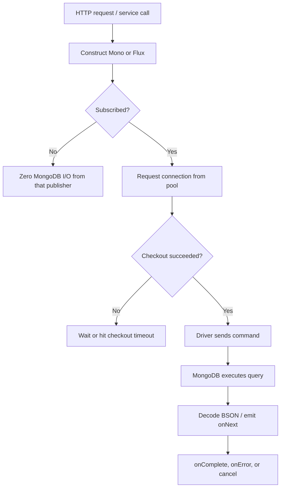
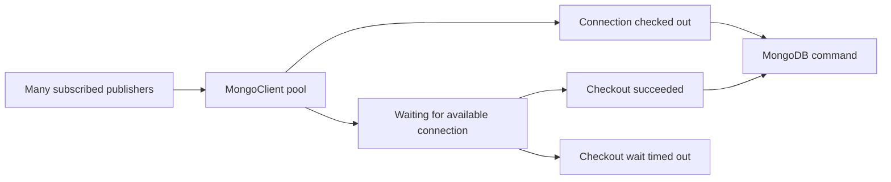

# Reactive Chains Not Executing, Pool Exhaustion, or Query Timeouts

In a **Spring Data MongoDB** application, an endpoint using `ReactiveMongoTemplate` or `ReactiveMongoRepository` might persist nothing even though the service method ran, slow to a crawl under concurrency, or time out on a seemingly trivial find query. These three symptoms can stem from **unrelated causes**: no subscription, exhausted connections in the connection pool, or queries taking too long to execute or acquire resources.

This lesson belongs to the **Errors and Diagnostics** chapter of `SPRING_DATA_MONGODB`. It focuses on pinpointing bottlenecks across Reactor publishers, separating application/driver faults from MongoDB server slowness, measuring instead of guessing, layering timeouts accurately, and writing reproducible tests.

> **Example scope:** Java 17+, Spring Boot 3.x, Spring Data MongoDB Reactive, Project Reactor, MongoDB Java Reactive Streams Driver, and Micrometer. Package/API names and auto-configuration properties may vary across major versions. Configurations below target Spring Boot 3.x; verify against your project dependencies before applying.

## 1. Identify Symptoms Before Changing Code

| Symptom | First Suspect | Signals to Inspect |
| --- | --- | --- |
| Called `save(...)`, yet no document appears | No subscriber; publisher not returned or chained | `doOnSubscribe`, `StepVerifier`, command logs |
| Test publisher produces nothing | Never subscribed, `Mono.empty()`, or stream canceled | `doOnNext`, `doOnComplete`, `doFinally` |
| Fast at low traffic, times out under load | Connection pool exhausted; requests queued waiting checkout | Pool checked-out count, checkout started/failed, wait times |
| Server selection errors | No eligible server found: DNS/TLS/network/replica set | Driver topology logs, server selection timeout |
| Commands reach MongoDB yet run slowly | Expensive filter/sort/aggregation or missing indexes | Command duration, `explain("executionStats")` |
| Reactor `timeout(Duration)` trips | Publisher emitted no signal before deadline | `TimeoutException` stack trace, elapsed time, cancellation |
| MongoDB returns `maxTimeMS` exceeded | Server-side operation exceeded execution limit | MongoDB error code/name, slow queries, `explain` |
| Requests hang even though MongoDB is fast | Blocked event loop, locks, downstream calls, slow encoding | Thread dumps, event-loop metrics, end-to-end traces |

Do not assume every "Mongo timeout" means a missing index—and do not assume slapping `.subscribe()` everywhere fixes a reactive pipeline. Reconstruct the **full path from HTTP request to subscriber, pool, command, and response**.

## 2. From Publisher to MongoDB: When Does a Command Actually Execute?

In Reactor, `Mono` and `Flux` are typically **cold publishers**: building a publisher only declares the workflow. Reactive MongoDB I/O normally begins only upon **subscription**.

Snippets below use a minimal entity and repository (additional imports are shown per snippet):

```java
package example.orders;

import java.time.Instant;
import org.springframework.data.annotation.Id;
import org.springframework.data.mongodb.core.mapping.Document;
import org.springframework.data.mongodb.repository.ReactiveMongoRepository;
import reactor.core.publisher.Flux;

@Document(collection = "orders")
public record Order(
        @Id String id,
        String tenantId,
        String customerId,
        Instant createdAt,
        String status
) {}

interface OrderRepository extends ReactiveMongoRepository<Order, String> {
    Flux<Order> findByCustomerId(String customerId);
}
```

IDs like `o-101` are non-ObjectId strings; for 24-hex-character IDs, verify BSON types and Spring Data ID conversion rules before querying. In abbreviated snippets, `repository` is an injected `OrderRepository` bean.



### 2.1. Anti-Pattern: Calling `save` and Discarding the Publisher

```java
// WRONG: creates a publisher and throws it away; save never executes.
public Mono<Order> createWrong(Order order) {
    repository.save(order);
    return Mono.just(order);
}
```

Proper code **returns the save publisher** or composes it into the returned chain so downstream subscribers trigger it:

```java
public Mono<Order> create(Order order) {
    return repository.save(order);
}

// When only completion matters:
public Mono<Void> createAndComplete(Order order) {
    return repository.save(order).then();
}
```

In Spring WebFlux, returning `Mono` or `Flux` from a controller/handler lets the framework subscribe and render the HTTP response. In tests, `StepVerifier` or an explicit subscriber drives execution; merely calling a service method and ignoring its return value tests zero MongoDB I/O.

### 2.2. Anti-Pattern: Calling `subscribe()` Manually Inside Services

```java
// WRONG for normal request paths: detaches work from caller lifecycle.
public Mono<String> createWrong(Order order) {
    repository.save(order).subscribe();
    return Mono.just("accepted");
}
```

This risks returning "success" before MongoDB finishes writing. Downstream errors never reach the caller, and cancellation, tracing, Reactor Context, and transaction boundaries break. On request flows, prefer **composition** rather than calling `subscribe()`:

```java
public Mono<String> createAndAcknowledge(Order order) {
    return repository.save(order)
            .map(saved -> "created:" + saved.id());
}
```

Call `subscribe()` only at **explicit top-level boundaries** (such as managed message consumers or background workers) with defined error handling, lifecycle management, and graceful shutdown. Never treat `subscribe()` as a band-aid for "my reactive code didn't run."

### 2.3. Distinguishing `map` vs. `flatMap`

When a callback returns another publisher, use `flatMap` to flatten and subscribe to it:

```java
// WRONG: produces Mono<Mono<Order>> instead of Mono<Order>.
Mono<Mono<Order>> nested = findSourceOrder(id)
        .map(order -> repository.save(order));

// RIGHT: chains save publisher into the outer pipeline.
Mono<Order> flattened = findSourceOrder(id)
        .flatMap(repository::save);
```

There is nothing inherently wrong with `Mono<Mono<T>>` in every context, yet if the inner publisher must run, you must flatten it or subscribe to it. Likewise, `doOnNext` is for **synchronous side-effect observation**—never call a repository returning a publisher inside `doOnNext` and drop it.

### 2.4. Do Not Confuse `Mono.empty()` with an Error

`repository.findById(id)` returns `Mono.empty()` when no document matches. The publisher subscribes and completes cleanly without any `onNext` signal. When a missing record should yield HTTP 404, turn empty into an explicit business error:

```java
public Mono<Order> requireOrder(String id) {
    return repository.findById(id)
            .switchIfEmpty(Mono.error(
                    new java.util.NoSuchElementException(
                            "Order not found")));
}
```

Never claim "the query never ran" just because `doOnNext` printed nothing; check `doOnSubscribe`, `doOnSuccess`/`doOnComplete`, and command monitoring to see what actually happened.

## 3. Diagnosing Subscription, Backpressure, and Cancellation

Reactor hooks reveal whether a publisher subscribed, emitted items, errored, completed, or canceled:

```java
import reactor.core.publisher.Flux;
import reactor.core.publisher.SignalType;

Flux<Order> observed = repository.findByCustomerId(customerId)
        .doOnSubscribe(s -> log.debug("orders subscribed"))
        .doOnNext(order -> log.debug("order emitted"))
        .doOnError(error -> log.warn(
                "orders failed: {}", error.getClass().getSimpleName()))
        .doFinally(signal -> log.debug("orders terminal: {}", signal));
```

This snippet assumes `log`, `repository`, and `customerId` are in scope. Never log full documents, access tokens, URIs with passwords, or personal data. In production, attach trace IDs and classified error metrics instead of logging every streamed item on large Fluxes.

Subtle causes to inspect:

- **No subscription:** `doOnSubscribe` never fires; verify who consumes the publisher and whether a return value was dropped before WebFlux.
- **Subscribed, zero items:** `Mono.empty()` or overly strict filters; verify `doOnComplete` and the actual query.
- **Stream canceled:** HTTP client disconnected, `take(n)`, `timeout(...)`, or downstream cancellation; `doFinally(SignalType.CANCEL)` catches this.
- **Missing demand:** a custom subscriber never called `request(n)`; WebFlux, Reactor operators, and `StepVerifier` manage demand automatically.
- **Repeated execution:** cold publishers re-execute MongoDB operations per subscription; `retryWhen` and multi-subscription patterns multiply calls.
- **Broken composition:** `zip` with an empty publisher completes without emitting; watch out for `Mono<Void>` in `zipWith`, using `then(...)` instead when sequencing completion.

### 3.1. Never Block the Event Loop

In WebFlux, calling `block()`, `Thread.sleep(...)`, or blocking I/O on event-loop threads stalls unrelated requests even when the MongoDB driver itself is reactive.

```java
// NEVER execute inside a WebFlux handler:
Order order = repository.findById(id).block();
```

If an unavoidable blocking library exists, isolate that blocking call onto a suitable scheduler (e.g., `Schedulers.boundedElastic()`) and monitor scheduler saturation; prefer non-blocking APIs whenever possible. Never sprinkle `publishOn(boundedElastic())` everywhere to hide structural bugs or imagine it increases MongoDB connections.

## 4. Reactive Driver Connection Pools: Why Can They Exhaust?

Reactive does **not** mean **unlimited connections**. The MongoDB Reactive Streams Java Driver uses a bounded connection pool. When concurrent operations exceed available connections, callers queue waiting for a connection to return. Waiting beyond the configured threshold fails with checkout timeout—even before MongoDB sees any query.



**Terms to distinguish:**

| Term | Meaning |
| --- | --- |
| Pool max size | Maximum connections maintained by the pool **per managed server** |
| Checked-out connections | Connections currently busy running operations |
| Wait queue / checkout wait | Operations queued waiting for a connection |
| Connection checkout timeout | Exceeded wait limit for an available connection |
| Server selection timeout | Driver could not locate an eligible server in the topology on time |
| Connect timeout | Establishing TCP connection to server exceeded time limit |
| Socket/read timeout | Network I/O exceeded wait limit (depends on driver/method usage) |

Never read `maxPoolSize=20` as "the whole cluster handles at most 20 connections": pools are per server per `MongoClient`, and multiple app instances each keep their own pools. Total cluster connections also include heartbeats, monitoring, routing, and driver settings.

### 4.1. Common Causes of Pool Exhaustion

1. One request fans out many parallel queries through `flatMap` without a concurrency cap.
2. High request concurrency combined with slow server-side commands holding connections busy.
3. Long-lived cursors with many `getMore` round-trips, slow item handlers, or leaked cancellations.
4. Pool sized too small for workload, or horizontal scaling amplifying aggregate MongoDB connections.
5. Unstable network/topology slowing new connection creation or causing failures.
6. Manually instantiating multiple `MongoClient` instances instead of sharing managed beans, multiplying pools.

**Do not blindly raise max pool size.** Larger pools shift the bottleneck from client wait queues onto the MongoDB server—raising server concurrency, CPU, I/O, and cluster connection counts. First locate slow operations holding connections, missing indexes, N+1 queries, unbounded fan-outs, and excessive retries.

## 5. Measuring Pools and Setting Intentional Limits

The MongoDB Java Driver exposes **Connection Pool Monitoring (CMAP)** events: checkout started, checkout succeeded, checkout failed, connections created/closed, and pool sizing events. Emit low-cardinality metrics—never use user IDs or URIs as metric tags.

In Spring Boot 3.x, `MongoClientSettingsBuilderCustomizer` tunes the pool on the **auto-configured** client:

```java
package example.diagnostics;

import java.util.concurrent.TimeUnit;
import org.springframework.boot.autoconfigure.mongo.MongoClientSettingsBuilderCustomizer;
import org.springframework.context.annotation.Bean;
import org.springframework.context.annotation.Configuration;

@Configuration
public class MongoPoolConfiguration {
    @Bean
    MongoClientSettingsBuilderCustomizer poolLimits() {
        return settings -> settings.applyToConnectionPoolSettings(pool ->
                pool.maxSize(20)
                    .maxWaitTime(500, TimeUnit.MILLISECONDS));
    }
}
```

**Values `20` and `500 ms` are illustrative**, not universal recommendations. `maxWaitTime` bounds waiting for a pool checkout, distinct from server query execution time. If you construct a reactive `MongoClient` bean manually, apply settings directly to **that client**—Boot customizers may not touch custom beans.

### 5.1. Collecting Pool Events to Locate Bottlenecks

Attach a `ConnectionPoolListener` to `ConnectionPoolSettings`. Example counting checkout failures:

```java
import com.mongodb.event.ConnectionCheckOutFailedEvent;
import com.mongodb.event.ConnectionPoolListener;
import io.micrometer.core.instrument.MeterRegistry;

// Inside @Configuration, with MeterRegistry injected:
MongoClientSettingsBuilderCustomizer poolMetrics(MeterRegistry registry) {
    return settings -> settings.applyToConnectionPoolSettings(pool ->
            pool.addConnectionPoolListener(new ConnectionPoolListener() {
                @Override
                public void connectionCheckOutFailed(
                        ConnectionCheckOutFailedEvent event) {
                    registry.counter(
                            "app.mongo.pool.checkout.failed",
                            "reason", event.getReason().name())
                            .increment();
                }
            }));
}
```

This shows only the listener fragment, not a full config or metric suite. In production, pair checkout started/succeeded events to **measure checkout wait times**, connection created/closed events for pool sizing, and command monitoring to separate slow queries from checkout congestion. Use built-in driver/APM telemetry when available instead of duplicating metrics. Note that `reason` has a small bounded cardinality, unlike request IDs.

When the driver throws a timeout, inspect the **cause chain** and exception details. `MongoTimeoutException` can reflect server selection or pool checkout depending on context, version, and stack location; the class name alone is ambiguous.

### 5.2. Bound Fan-Out Instead of Ballooning the Pool

Example loading multiple orders by ID:

```java
import reactor.core.publisher.Flux;

Flux<Order> orders = Flux.fromIterable(orderIds)
        .flatMap(repository::findById, 8);
```

Concurrency parameter `8` bounds simultaneous inner subscriptions within this operator. It does **not** cap global MongoDB connections across concurrent HTTP requests; high request volume still multiplies load. Where possible, replace N point lookups with a single indexed `$in` query over bounded ID lists, measuring payload size and server cost before and after.

## 6. Four Distinct Deadlines: Never Use One Timeout for Everything

Time limits apply at different layers:

| Layer | Mechanism | When Expired | Limitation |
| --- | --- | --- | --- |
| Reactor publisher | `timeout(Duration)` | Emits `TimeoutException` and cancels upstream subscription | Does not guarantee immediate server-side cancellation |
| MongoDB server command | `maxTimeMS` / `Query.maxTime(...)` | Server aborts operation past limit | Depends on command/stage; excludes HTTP and pool wait time |
| Driver server selection | Server selection timeout | Failed to locate eligible server | Does not speed up slow queries post-selection |
| Connection pool | Checkout wait timeout | Waited too long for a connection | Does not accelerate server commands |
| Network connection | Connect/socket/read timeouts | Network failure connecting or reading/writing | Does not replace server-side query limits |
| HTTP gateway/client | Request deadline | Caller stops waiting or cancels request | Does not automatically undo completed backend work |

Specifically, `Mono.timeout(...)` bounds **waiting for publisher completion/emission**. On `Flux`, a single-argument timeout can measure gaps **between signals** rather than total stream duration. Design deadlines intentionally around start time, publisher type, and desired signal.

### 6.1. Example: Server and Application Limits Together

```java
package example.orders;

import java.time.Duration;
import java.util.List;
import java.util.concurrent.TimeoutException;
import org.springframework.data.domain.Sort;
import org.springframework.data.mongodb.core.ReactiveMongoTemplate;
import org.springframework.data.mongodb.core.query.Criteria;
import org.springframework.data.mongodb.core.query.Query;
import reactor.core.publisher.Mono;

public class ReactiveOrderSearch {
    private final ReactiveMongoTemplate template;

    public ReactiveOrderSearch(ReactiveMongoTemplate template) {
        this.template = template;
    }

    public Mono<List<Order>> findRecent(String customerId) {
        Query query = Query.query(Criteria.where("customerId").is(customerId))
                .with(Sort.by(Sort.Direction.DESC, "createdAt"))
                .limit(50);
        query.maxTime(Duration.ofMillis(800));

        return template.find(query, Order.class)
                .collectList()
                .timeout(Duration.ofSeconds(2))
                .onErrorMap(TimeoutException.class, ex ->
                        new IllegalStateException(
                                "Order search exceeded application timeout",
                                ex));
    }
}
```

In this example:

- `query.maxTime(...)` instructs MongoDB to cap command execution; it **excludes** pool wait, connection setup, and object mapping. The server enforces `maxTimeMS` at interruptible checkpoints, so cutoffs are approximate around 800 ms.
- `collectList().timeout(...)` bounds total collection at the Reactor layer. It can fire even when server execution is fast—for instance, due to pool checkout waits or network delays.
- `onErrorMap(TimeoutException.class, ...)` translates only Reactor's `TimeoutException`; driver/server timeouts surface as different exception types and require separate handling.
- `Mono<List<Order>>` keeps completion timing easy to demonstrate. For large streams, avoid `collectList()` in heap; stream bounded pages with proper backpressure.

When budgeting end-to-end request deadlines, include downstream calls, gateway overhead, retries, and serialization. **Never set razor-thin timeouts across all queries**, turning legitimate work into cascading errors.

### 6.2. Retries Can Make Saturation Worse

`retry(3)` or `retryWhen(...)` **resubscribes** and re-sends MongoDB commands. When errors originate from pool exhaustion, aggressive retries multiply queued requests, extend wait times, and worsen outages.

Retry only **transient, retry-eligible** failures with bounded counts, jittered backoff, and overall request deadlines. Never blindly retry **non-idempotent** writes; account for driver retryable writes, idempotency keys, and uncertain commit states when responses drop.

## 7. When MongoDB Queries Are Actually Slow

When telemetry confirms commands reached the server and took a long time, analyze query plans; if commands never left the client, continue checking subscriptions, pool waits, or server selection.

Inspecting a recent-orders query:

```javascript
db.orders.find(
  { customerId: "c-001", status: "PAID" },
  { _id: 1, customerId: 1, status: 1, createdAt: 1 }
).sort({ createdAt: -1 }).limit(50)
 .explain("executionStats")
```

Fields to inspect:

| Metric | Interpretation |
| --- | --- |
| `nReturned` | Documents returned by the explained query |
| `totalDocsExamined` | Documents inspected on the server |
| `totalKeysExamined` | Index entries scanned |
| `winningPlan` | Presence of `COLLSCAN`, `IXSCAN`, `FETCH`, `SORT` |
| `executionTimeMillis` | Server-reported execution time in `explain`; not HTTP latency |

A candidate index **to evaluate on realistic workloads** for filtering customer/status and sorting by `createdAt`:

```javascript
db.orders.createIndex({ customerId: 1, status: 1, createdAt: -1 })
```

Indexes do not fix every timeout. Queries returning huge payloads, missing projections, unselective regexes, memory-heavy `$lookup`/`$group` aggregations, or write-heavy contention need separate analysis. Indexes also consume disk/RAM and add write overhead. Always evaluate representative data, collation, selectivity, and query plans before adding indexes.

### 7.1. Do Not Confuse Server Time with Client Time

`explain("executionStats")` runs on the server with its own measurement overhead; it shows work done and plan selection. If HTTP p95 is 3 seconds while command latency is 30 ms and the rest is pool checkout wait, adding an index will not fix the bottleneck. Conversely, when checkout is instant yet `docsExamined` balloons on slow commands, focus on filters, indexes, and projections.

## 8. Connectivity, Topology, and Non-Pool Errors

Seeing "Timed out while waiting for a server that matches..." does **not** mean "maxPoolSize is exhausted." That error is usually **server selection**. Causes include:

- Wrong host/port, unresolved DNS, or blocked firewall rules.
- Misconfigured TLS/certificates or invalid credentials (auth usually surfaces distinct security errors).
- Replica set lacking an elected primary or driver unable to see eligible members.
- Read preference requiring an unavailable server role.
- Container/service URI advertising internal hostnames unreachable from the application.
- Changing available server counts during network partitions or cluster instability.

Split timeout layers cleanly in dashboards:

```text
HTTP latency (end-to-end)
  ├─ App / Reactor subscription and scheduling
  ├─ Server selection / DNS / connect
  ├─ Pool checkout wait
  ├─ Driver command time, including network round-trip
  │    └─ Server query execution
  └─ BSON mapping / business logic / response
```

Correlate **cause chains**, driver messages, topology telemetry, and pool metrics within the same trace and time window. Avoid guessing from an isolated "timeout" string.

## 9. Controlled Reactive Service Pattern

Example search service with input validation, projection, result limits, non-blocking execution, and explicit error propagation:

```java
package example.orders;

import java.time.Duration;
import java.util.List;
import org.springframework.data.domain.Sort;
import org.springframework.data.mongodb.core.ReactiveMongoTemplate;
import org.springframework.data.mongodb.core.query.Criteria;
import org.springframework.data.mongodb.core.query.Query;
import reactor.core.publisher.Mono;

public class OrderQueryService {
    private final ReactiveMongoTemplate template;

    public OrderQueryService(ReactiveMongoTemplate template) {
        this.template = template;
    }

    public Mono<List<Order>> recentOrders(
            String authenticatedTenantId, String customerId) {
        if (authenticatedTenantId == null
                || authenticatedTenantId.isBlank()
                || customerId == null
                || customerId.isBlank()) {
            return Mono.error(new IllegalArgumentException(
                    "Missing search criteria"));
        }

        Query query = Query.query(new Criteria().andOperator(
                        Criteria.where("tenantId").is(authenticatedTenantId),
                        Criteria.where("customerId").is(customerId)))
                .with(Sort.by(Sort.Direction.DESC, "createdAt"))
                .limit(50);
        query.maxTime(Duration.ofMillis(800));
        query.fields().include("_id")
                .include("tenantId")
                .include("customerId")
                .include("createdAt")
                .include("status");

        return template.find(query, Order.class)
                .collectList()
                .timeout(Duration.ofSeconds(2));
    }
}
```

Here, `Order` matches the declared fields with proper Spring Data MongoDB mapping. To avoid accidental field deletion on writes, never pass a partially projected entity into `save(...)` if unprojected fields would be overwritten.

Depending on business needs, return `Flux<Order>` directly to avoid buffering pages in heap—paired with stream timeouts, bounded read rates, backpressure awareness, and client disconnect handling.

In multi-tenant systems, obtain the tenant ID from the authenticated trust boundary, never raw user query parameters. Build `Criteria` using allowlisted field names and operators to prevent NoSQL injection.

## 10. Testing Each Hypothesis Independently

### 10.1. Verifying Subscription Behavior

In unit tests, demonstrate cold publisher behavior with `Mono.defer(...)`:

```java
import java.util.concurrent.atomic.AtomicInteger;
import reactor.core.publisher.Mono;
import reactor.test.StepVerifier;

AtomicInteger invoked = new AtomicInteger();
Mono<String> pipeline = Mono.defer(() -> {
    invoked.incrementAndGet();
    return Mono.just("saved");
});

// Creating the publisher does not increment invoked.
assertThat(invoked.get()).isZero();

StepVerifier.create(pipeline)
        .expectNext("saved")
        .verifyComplete();

assertThat(invoked.get()).isEqualTo(1);
```

This snippet uses AssertJ and touches no MongoDB server. To verify repository and BSON behavior, use a test MongoDB service or Testcontainers with `@DataMongoTest`/reactive configuration, seed test records, and verify via `StepVerifier.create(repository.save(...)).expectNextMatches(...).verifyComplete()`.

### 10.2. Testing Reactor Timeouts Without a Real Database

```java
import java.time.Duration;
import java.util.concurrent.TimeoutException;
import reactor.core.publisher.Mono;
import reactor.test.StepVerifier;

StepVerifier.create(
        Mono.<String>never().timeout(Duration.ofMillis(50)))
        .expectError(TimeoutException.class)
        .verify(Duration.ofSeconds(1));
```

This proves **Reactor-layer** timeout mechanics—not that MongoDB canceled a server command or that a connection pool saturated. Against real test MongoDB instances, test reasonable deadlines and observe exception types and cancellations without overloading production systems.

### 10.3. Testing Pool Contention and Query Plans Separately

To reproduce checkout waits in a **test environment**:

1. Use an isolated test MongoDB instance with a small pool configured solely for the test.
2. Run bounded concurrent workloads, tracking active subscriptions and commands.
3. Collect pool checkout events, checked-out connection counts, wait times, and checkout failures.
4. Lower concurrency or optimize queries and repeat the same workload rather than simply bumping `maxPoolSize`.

To reproduce slow queries:

1. Seed representative data into a test collection.
2. Measure the filtered/sorted query before adding an index and capture `explain("executionStats")`.
3. Add the candidate index and re-run under matching load.
4. Compare command duration, `docsExamined`, `keysExamined`, pool waits, and HTTP p95/p99.

Avoid brittle millisecond assertions in unit tests where CI host load fluctuates. In integration tests, assert **causal signals** (pool checkout failures, scanned document counts, timeout layers) and reserve strict throughput metrics for dedicated benchmarks.

## 11. System Troubleshooting Checklist

| Step | Question | Evidence Needed |
| --- | --- | --- |
| 1 | Was the publisher subscribed? | `doOnSubscribe`, `StepVerifier`/traces |
| 2 | Did `onNext`, `onComplete`, `onError`, or `cancel` fire? | `doFinally` and sanitized logs |
| 3 | Was a MongoDB command sent? | `CommandListener`/APM, command counts |
| 4 | Did the command wait in the pool beforehand? | CMAP checkout metrics, wait time, checked-out count |
| 5 | Did the driver select an eligible server? | Topology events, server selection cause |
| 6 | Was the server command expensive? | `explain`, slow queries, indexes, aggregation stats |
| 7 | Which layer triggered the timeout? | Reactor vs. driver/pool vs. MongoDB `maxTimeMS` |
| 8 | Did retries or concurrency amplify the outage? | Retry counts, fan-out factor, request rates |
| 9 | Is the event loop blocked? | Thread dumps, blocking calls, event-loop metrics |
| 10 | Did the fix actually improve behavior? | Same dataset/load: p95/p99, pool wait, command duration |

Keep logs keyed by trace ID, command type, and business operation name; avoid logging raw BSON payloads, usernames/passwords, or connection URIs in production. When incidents follow a config change, inspect the **active `MongoClient`** runtime pool/timeout settings rather than trusting YAML files blindly.

### Misconceptions to Avoid

| Misconception | Reality |
| --- | --- |
| Reactive calls run without subscribing | Cold publishers perform zero MongoDB I/O until subscribed |
| Adding `subscribe()` inside services always fixes it | Detaches lifecycle, error propagation, and transaction context |
| `Mono.empty()` proves the query didn't run | The query may have executed and matched zero documents |
| `Mono.timeout` kills MongoDB instantly | Reactor cancels upstream; server work may still finish or check `maxTimeMS` |
| Timeouts are always caused by missing indexes | Pool wait, server selection, connect, network, and blocked event loops also cause them |
| Raising `maxPoolSize` always boosts throughput | Often shifts saturation to the server; fix queries and concurrency first |
| Setting `maxTimeMS` bounds total request latency | Excludes client queuing, checkout waits, network, and mapping |
| `Flux` always uses minimal memory | `collectList()` or missing backpressure still buffers large heaps |
| Retrying every error is safe | Can duplicate writes and amplify pool congestion |
| Fast `explain` guarantees fast HTTP calls | Excludes pool checkout, network, BSON mapping, and app logic |

## 12. Hands-on Exercises

**Exercise 1 — Unsubscribed Publisher.** Write a service method calling `repository.save(order)` and discarding the returned publisher. Use `StepVerifier` or a spy repository to prove no write happened. Fix it via `return repository.save(order)` or proper composition without manual `subscribe()`.

**Exercise 2 — Empty, Error, and Cancel.** On `findById(...)`, test three outcomes: found, not found (`empty`), and canceled via `take`/timeout. Document differences across `doOnNext`, `doOnError`, and `doFinally`.

**Exercise 3 — Pool Checkout Pressure.** Use Testcontainers or a test MongoDB service with a small pool. Drive bounded concurrent load and collect checkout-failed metrics plus command durations. Propose at least two ways to cut pool pressure without increasing `maxPoolSize`.

**Exercise 4 — Separating Timeout Layers.** Run `Mono.never().timeout(...)` to observe Reactor timeouts. Against a real test query, set `Query.maxTime(...)` and publisher timeouts; compare exception types, trigger timings, and what each covers.

**Exercise 5 — Query Plans and Retries.** Seed a sizable collection, run a filtered/sorted query before and after adding a matching index, and record `nReturned`, `totalDocsExamined`, `totalKeysExamined`, and p95. Enable bounded retries on transient faults in a test environment to observe command amplification, then analyze write-retry hazards.

**Completion Criteria:** You can distinguish unsubscribed publishers from empty or canceled streams; explain pool checkout and layered timeouts; isolate bottlenecks using CMAP telemetry, command events, and `explain("executionStats")`; write non-blocking reactive pipelines without manual `subscribe()`; and validate fixes with repeatable tests.
