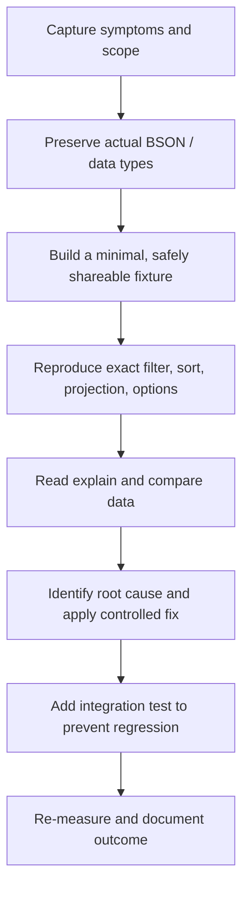

# Reproducing Issues Using Real BSON, `explain`, and Integration Tests

## 1. Why Looking Only at JSON or Stack Traces Is Rarely Enough

In a **Spring Data MongoDB** application, a query issue can originate at any layer: the actual stored BSON document, Java–BSON mapping inside `MappingMongoConverter`, `Criteria` or repository queries, index definitions, server selection rules, transactions, or even MongoDB Driver behavior. Two documents that look identical when printed as JSON can carry **different BSON types**, causing the same query to behave differently.

For example, an order system receives a report: *"An order was paid on March 3, yet the API searching paid orders since March 1 does not return it."* Someone opens the document in a viewer and sees:

```json
{
  "_id": "65b0f00d0000000000000002",
  "status": "PAID",
  "placedAt": "2025-03-03T10:20:30Z"
}
```

That JSON display does not reveal whether `_id` is a BSON `ObjectId` or `String`, nor whether `placedAt` is a BSON `Date` or a `String`. That distinction is decisive when `Criteria.where("placedAt").gte(...)` passes a Java `Date`.

This lesson outlines a repeatable investigation loop:



This workflow applies equally to **correctness bugs** (missing records, wrong sort order, broken mapping), **performance issues** (large scans, unused indexes, timeouts), and environment-specific bugs (read preferences, collation, transactions, externally imported data).

## 2. Start with a Testable Problem Statement

A solid investigation ticket should capture at least:

| Element | Example to Record |
| --- | --- |
| Entry point | API `GET /orders?status=PAID&from=2025-03-01`, exact service/repository |
| Symptom | Returns 1 order instead of the 2 orders expected from business data |
| Expected | Both orders with `status=PAID` placed after the UTC cutoff are returned |
| Actual | Order ID `...0002` is omitted |
| Timeline | Request timestamp and when records were last modified or imported |
| Environment | MongoDB, Spring Data MongoDB, MongoDB Java Driver, and Java versions; topology |
| Query | Filter, sort, projection, collation, limit, skip, hint, read preference, read concern |
| Data | Fixture preserving exact BSON types and the fields driving the failure |
| Evidence | Correlation ID, exception type, query shape, record counts, `explain` output |

Separate three questions immediately:

1. **Wrong results:** does the document match the predicate under **actual BSON types**? Did the mapper alter field names or types before sending the command?
2. **Slowness:** how many index keys/documents is MongoDB scanning, and are there `COLLSCAN`, `SORT`, deep pagination, or overloaded secondaries?
3. **Unexpected errors:** did the operation run inside a transaction, hit version conflicts, time out, fail server selection, encounter schema changes, or fail conversion?

Before touching indexes or application code, define a **clear pass/fail reproduction criteria**. For example: "Given two PAID documents after March 1, the date-range query must return both; historical string-typed dates must be detected and normalized."

## 3. Capturing Exact BSON Types with Extended JSON

### 3.1. BSON Differs from Plain JSON

MongoDB stores **BSON**, supporting `ObjectId`, `Date`, `Decimal128`, `Int32`, `Int64`, binary, arrays, nested objects, `null`, and missing fields. Plain JSON blurs boundaries between these types.

| Field | Possible Actual BSON | Consequence of Faulty Reproduction |
| --- | --- | --- |
| `_id` | `ObjectId("...")` or string `"..."` | String query misses ObjectId if sent over an unconverted raw path |
| `placedAt` | BSON Date or ISO-8601 String | Date range query skips string values |
| `amount` | Decimal128, Double, Int32, or Int64 | Precision/conversion drift, comparison, and mapping mismatches |
| `tags` | Array, String, or missing field | `$in`, `$elemMatch`, and mapping behave differently |
| `deletedAt` | Missing field or `null` | `$exists` and certain match predicates diverge |
| `status` | String differing in case or whitespace | Collation and equality matching behave differently |

MongoDB provides **Extended JSON (EJSON)**. *Canonical Extended JSON* (e.g., `{"$numberDecimal":"19.90"}`, `{"$oid":"..."}`) preserves explicit types, whereas *Relaxed Extended JSON* is easier to read yet drops explicit integer type wrappers.

Example of two orders **deliberately** stored with different `placedAt` types:

```json
{
  "_id": {"$oid": "65b0f00d0000000000000001"},
  "status": "PAID",
  "placedAt": {"$date": {"$numberLong": "1740910830000"}},
  "grossAmount": {"$numberDecimal": "19.90"}
}
```

```json
{
  "_id": {"$oid": "65b0f00d0000000000000002"},
  "status": "PAID",
  "placedAt": "2025-03-03T10:20:30Z",
  "grossAmount": {"$numberDecimal": "24.50"}
}
```

The first document stores `placedAt` as a BSON Date (2025-03-02 10:20:30 UTC); the second stores a BSON String even though it looks like a timestamp. Both are `PAID` and logically after March 1, yet a range query passing a BSON Date **does not coerce** the second document's string into a Date.

### 3.2. Inspecting Actual BSON in `mongosh`

First inspect the document and its BSON types:

```javascript
const orderId = ObjectId("65b0f00d0000000000000002");
const order = db.orders.findOne({_id: orderId});

print(EJSON.stringify(order, null, 2, {relaxed: false}));

printjson(db.orders.aggregate([
  {$match: {_id: orderId}},
  {$project: {
    status: 1,
    placedAt: 1,
    placedAtType: {$type: "$placedAt"},
    amountType: {$type: "$grossAmount"}
  }}
]).toArray());
```

In `mongosh`, `EJSON.stringify(..., {relaxed:false})` reveals explicit type wrappers, and aggregation `$type` reports each value's BSON type. When a field is absent, aggregation `$type` returns `"missing"`. This gives ground truth rather than guessing from UI formatting.

To inventory the collection (in an authorized environment under controlled load):

```javascript
db.orders.aggregate([
  {$group: {
    _id: {$type: "$placedAt"},
    documents: {$sum: 1}
  }},
  {$sort: {documents: -1}}
]);
```

Seeing both `date` and `string` proves heterogeneous data exists. Still, **that alone does not prove it caused a specific request bug**: cross-check against the exact filter, timestamps, collation, and execution path.

### 3.3. Building Safe Fixtures Instead of Copying Sensitive Data

A good fixture preserves the *failure-inducing traits* while replacing private data with synthetic values:

- Preserve exact **BSON types**, nested field paths, missing/`null` fields, array structures, timezones, and cross-document relationships.
- Keep fixture counts minimal to reproduce correctness bugs; for scale-dependent bugs, synthesize data matching production distributions instead of copying customer records.
- Replace IDs, emails, names, addresses, tokens, and secrets with synthetic placeholders while keeping types intact (e.g., an `ObjectId` stays an `ObjectId`).
- Never paste connection strings with credentials, sensitive plaintext, encryption keys, or raw PII queries into tickets or logs.
- Document how the fixture was built so teammates can reproduce it and see it is anonymized.

When failures span multiple related documents, preserve application-level foreign keys, version numbers, and state transitions. A single overly tidy document can hide the real bug.

## 4. Reproducing Filters with Direct BSON Queries

First run a deterministic read directly against MongoDB using a **BSON Date**, not a String:

```javascript
const threshold = ISODate("2025-03-01T00:00:00Z");

db.orders.find({
  status: "PAID",
  placedAt: {$gte: threshold}
}).sort({placedAt: -1}).limit(20);
```

With the two fixtures above, the Date query returns only `...0001`. Document `...0002` holds a String `placedAt`, which fails the BSON Date range comparison under MongoDB's query type bracketing rules.

Rule out the status predicate separately:

```javascript
db.orders.find(
  {status: "PAID"},
  {_id: 1, status: 1, placedAt: 1}
);

db.orders.find({
  placedAt: {$type: "string"}
}, {_id: 1, placedAt: 1});
```

These checks separate **document existence** from **filter matching**. They mutate nothing: any type remediation still needs parsing rules, timezones, invalid-value handling, and a dedicated migration plan.

## 5. Comparing Spring Data Paths Against Sent MongoDB Commands

### 5.1. Querying via `MongoTemplate`

In the order example, the read path might look like:

```java
import java.time.Instant;
import java.util.Date;
import java.util.List;

import org.bson.Document;
import org.springframework.data.mongodb.core.MongoTemplate;
import org.springframework.data.mongodb.core.query.Criteria;
import org.springframework.data.mongodb.core.query.Query;

public final class OrderDiagnostics {
    private final MongoTemplate template;

    public OrderDiagnostics(MongoTemplate template) {
        this.template = template;
    }

    public List<Document> findPaidSince(Instant from) {
        Query query = Query.query(
            Criteria.where("status").is("PAID")
                .and("placedAt").gte(Date.from(from))
        );
        query.limit(20);
        query.with(org.springframework.data.domain.Sort.by(
            org.springframework.data.domain.Sort.Direction.DESC, "placedAt"));

        return template.find(query, Document.class, "orders");
    }
}
```

This intentionally reads raw `Document` instances to focus on BSON types in the fixture. With mapped Spring Data entities, `@Field("placed_at")`, `@Id`, custom converters, enum conversions, and `_class` discriminators can make wire field names and values differ from Java property names.

`Query.getQueryObject()` displays a partial representation of `Query`'s filter before execution, yet is **not complete proof** of the final BSON command: mapping translation, sort, projection, limit, skip, collation, hint, and read preference also apply. For exact verification, use controlled command monitoring/profiling or test with the same BSON filter via the native driver.

### 5.2. Checking Mapping When Using Entities or Repositories

Example entity:

```java
import java.time.Instant;
import org.bson.types.ObjectId;
import org.springframework.data.annotation.Id;
import org.springframework.data.mongodb.core.mapping.Document;
import org.springframework.data.mongodb.core.mapping.Field;

@Document("orders")
public class OrderDocument {
    @Id
    private ObjectId id;

    private String status;

    @Field("placed_at")
    private Instant placedAt;

    // Constructor, getters, and setters per project conventions.
}
```

Here, Java property `placedAt` maps to BSON field `placed_at`. If stored documents use `placedAt` while code queries `placed_at`, queries return nothing even when timestamp types match perfectly. **Do not apply this `@Field` example directly to the earlier fixture**; the two examples illustrate two independent failure modes—type mismatch vs. field-name mismatch.

Cross-check checklist:

1. Does `@Document`'s collection name match the actual collection?
2. Is `@Id` a `String`, `ObjectId`, or something else? Does ID conversion apply to the path being inspected?
3. Do `@Field` or naming strategies rename sent query fields?
4. How are Java `Date`/`Instant`, `LocalDateTime`, and timezones converted?
5. Does a `@Query` or derived repository method add filters, sorts, collations, pagination, or projections?
6. Do documents contain missing fields, `null`, legacy types, or mixed schema versions?
7. Does the reader use `ReadPreference.secondaryPreferred()`, potentially reading from a lagging secondary?

When native queries and repository queries diverge, write two separate integration tests: one for **BSON/query matching** and one for **Java–BSON mapping**. That cleanly isolates whether the fault lies in data, query construction, or converters.

## 6. Using `explain("executionStats")` to Understand Query Plans

MongoDB provides `explain` for inspecting execution plans. For the filter under investigation:

```javascript
db.orders.find({
  status: "PAID",
  placedAt: {$gte: ISODate("2025-03-01T00:00:00Z")}
}).sort({placedAt: -1}).limit(20).explain("executionStats");
```

Fields to read vary by query shape and engine version:

| Field / Signal | Interpretation |
| --- | --- |
| `queryPlanner.winningPlan` | Plan chosen by the optimizer; nested structures vary across engine versions |
| `COLLSCAN` | Collection scan instead of an index scan |
| `IXSCAN` | Index scan occurred; does not automatically guarantee efficiency |
| `FETCH` | Fetching documents for residual checks or projected fields |
| `SORT` | In-memory/blocking sort stage; check whether index order can eliminate it |
| `executionStats.nReturned` | Documents emitted by execution |
| `executionStats.totalDocsExamined` | Documents inspected during execution; compare against `nReturned` |
| `executionStats.totalKeysExamined` | Index keys scanned |
| `executionStats.executionTimeMillis` | Server execution time for the explained run; not an app SLA |

For example, `nReturned = 20` with `totalDocsExamined = 250000` signals heavy over-scanning. Conversely, `totalDocsExamined = 0` with `IXSCAN` does not prove business correctness: a filter with the **wrong BSON type** can run super efficiently and still miss valid documents.

Across MongoDB versions (including *classic* and *slot-based execution* engines), `winningPlan`, `executionStages`, and stage names can change. Avoid brittle tests asserting a hardcoded JSON path like `queryPlanner.winningPlan.stage == "IXSCAN"` across all versions.

### 6.1. Comparing Before and After Indexing

If the query filters equality on `status`, ranges on `placedAt`, and sorts descending by `placedAt`, a candidate index is:

```javascript
db.orders.createIndex(
  {status: 1, placedAt: -1},
  {name: "status_placedAt_desc"}
);
```

Re-run `explain("executionStats")` and compare keys/docs examined, stages, and query latency on a **representative dataset**. A two-document fixture is usually too tiny for the optimizer to prefer an index; MongoDB may legitimately pick `COLLSCAN` there.

Never assume this exact field order is universally optimal. Index choice depends on selectivity, competing indexes, collation, projections, sorts, multikey arrays, data skew, and optimizer versions. Before changing indexes in production, evaluate write impact, storage footprint, and rollout plans.

### 6.2. Running `explain` from `MongoTemplate`

To run `explain` against an **exact raw BSON filter** (bypassing entity mapping), execute the command directly:

```java
import java.time.Instant;
import java.util.Date;

import org.bson.Document;
import org.springframework.data.mongodb.core.MongoTemplate;

public final class ExplainExamples {
    public static Document explainPaidOrders(MongoTemplate template) {
        Document filter = new Document("status", "PAID")
            .append("placedAt", new Document(
                "$gte",
                Date.from(Instant.parse("2025-03-01T00:00:00Z"))
            ));

        Document findCommand = new Document("find", "orders")
            .append("filter", filter)
            .append("sort", new Document("placedAt", -1))
            .append("limit", 20);

        return template.getDb().runCommand(
            new Document("explain", findCommand)
                .append("verbosity", "executionStats")
        );
    }
}
```

Run only with authorized privileges and load safeguards. `executionStats` actually executes the query to collect stats, so avoid running it ad-hoc on heavy queries during production peaks. Note that this does not verify `@Field`/converter mapping because the filter is built manually.

## 7. Building Integration Tests with Production-Like BSON Data

The goal is a repeatable test running locally and in CI **with zero dependency on live databases**. Spring Boot Test + Testcontainers is a common choice; a test MongoDB instance suffices for simple query/mapping bugs, while transactions or Change Streams require a supporting topology, usually a replica set.

The example below uses Java 17+, JUnit 5, Spring Boot Test, Testcontainers, and the MongoDB Java Driver. `MongoDBContainer` uses Testcontainers 1.x APIs; adjust imports/modules for Testcontainers 2.x. Ensure test dependencies, Docker, and Spring Boot application configuration exist in your project.

### 7.1. Fixtures Preserving Original BSON Types

Both text blocks below are **Canonical Extended JSON**. `Document.parse` decodes Extended JSON into `Document` with exact BSON types:

```java
import static org.junit.jupiter.api.Assertions.*;

import java.time.Instant;
import java.util.Date;
import java.util.List;

import com.mongodb.client.model.Filters;
import com.mongodb.client.model.Updates;
import com.mongodb.client.result.UpdateResult;
import org.bson.Document;
import org.bson.types.ObjectId;
import org.junit.jupiter.api.BeforeEach;
import org.junit.jupiter.api.Test;
import org.springframework.beans.factory.annotation.Autowired;
import org.springframework.boot.test.context.SpringBootTest;
import org.springframework.data.mongodb.core.MongoTemplate;
import org.springframework.data.mongodb.core.query.Criteria;
import org.springframework.data.mongodb.core.query.Query;
import org.springframework.test.context.DynamicPropertyRegistry;
import org.springframework.test.context.DynamicPropertySource;
import org.testcontainers.containers.MongoDBContainer;
import org.testcontainers.junit.jupiter.Container;
import org.testcontainers.junit.jupiter.Testcontainers;
import org.testcontainers.utility.DockerImageName;

@Testcontainers
@SpringBootTest
class OrderBsonRegressionTest {
    private static final String DATE_ORDER = """
        {
          "_id": {"$oid": "65b0f00d0000000000000001"},
          "status": "PAID",
          "placedAt": {"$date": {"$numberLong": "1740910830000"}},
          "grossAmount": {"$numberDecimal": "19.90"}
        }
        """;

    private static final String LEGACY_STRING_ORDER = """
        {
          "_id": {"$oid": "65b0f00d0000000000000002"},
          "status": "PAID",
          "placedAt": "2025-03-03T10:20:30Z",
          "grossAmount": {"$numberDecimal": "24.50"}
        }
        """;

    @Container
    static MongoDBContainer mongo =
        new MongoDBContainer(DockerImageName.parse("mongo:7.0"));

    @DynamicPropertySource
    static void properties(DynamicPropertyRegistry registry) {
        registry.add("spring.data.mongodb.uri", mongo::getReplicaSetUrl);
    }

    @Autowired
    MongoTemplate template;

    @BeforeEach
    void resetAndSeed() {
        template.getCollection("orders").deleteMany(new Document());
        template.getCollection("orders").insertMany(List.of(
            Document.parse(DATE_ORDER),
            Document.parse(LEGACY_STRING_ORDER)
        ));
    }

    private List<Document> paidSinceMarch() {
        Query query = Query.query(
            Criteria.where("status").is("PAID")
                .and("placedAt").gte(
                    Date.from(Instant.parse("2025-03-01T00:00:00Z"))
                )
        );
        return template.find(query, Document.class, "orders");
    }

    @Test
    void legacyStringIsNotMatchedByDateRange() {
        Document raw = template.getCollection("orders")
            .find(Filters.eq("_id",
                new ObjectId("65b0f00d0000000000000002")))
            .first();

        assertNotNull(raw);
        assertInstanceOf(String.class, raw.get("placedAt"));
        assertEquals(1, paidSinceMarch().size());
    }

    @Test
    void normalizationAllowsBothOrdersToMatch() {
        ObjectId id = new ObjectId("65b0f00d0000000000000002");
        UpdateResult updated = template.getCollection("orders").updateOne(
            Filters.and(
                Filters.eq("_id", id),
                Filters.eq("placedAt", "2025-03-03T10:20:30Z")
            ),
            Updates.set("placedAt",
                Date.from(Instant.parse("2025-03-03T10:20:30Z")))
        );

        assertEquals(1L, updated.getModifiedCount());
        assertEquals(2, paidSinceMarch().size());

        Document migrated = template.getCollection("orders")
            .find(Filters.eq("_id", id)).first();
        assertNotNull(migrated);
        assertInstanceOf(Date.class, migrated.get("placedAt"));
    }
}
```

The first test reproduces the **exact bug symptom**: an ISO timestamp string is excluded by a BSON Date range query. The second test simulates a conditional normalization based on the legacy value and confirms both documents now match.

In real systems, migrations must handle invalid date strings, timezones, alternative historical formats, concurrent writes, and idempotency. The `updateOne` in this test mutates one known fixture; it is **not** a production migration script.

To verify idempotency on the illustrative update, you can run the same `updateOne` again and assert `modifiedCount == 0`, because `placedAt` is no longer a String. For bulk migrations, add counters for remaining legacy documents, skipped records, and invalid shapes afterward.

### 7.2. Why Tests Must Preserve Real BSON

A unit test mocking `MongoTemplate` to return a stubbed list **cannot test** MongoDB type bracketing, collations, indexes, aggregations, or BSON mapping. It tests only how the service processes the mocked list.

A trustworthy integration test must:

1. Seed fixtures into real MongoDB using the exact BSON types under test.
2. Invoke the actual failing query path (`MongoTemplate`, repository, or both).
3. Assert **IDs, BSON/Java types, and actual values**—not merely "no exception thrown."
4. Reproduce the broken baseline and verify the fix changes behavior as intended.
5. Re-run whenever upgrading drivers, converters, Spring Data versions, or indexes.

## 8. Writing Tests for Performance Regressions Using `explain`

Performance issues rarely show up on a two-document fixture. Build a **synthetic dataset** whose size and distribution approximate real workloads:

- Enough documents for index scans to diverge cleanly from collection scans.
- Realistic `status=PAID` selectivity, varied `placedAt` timestamps, and some missing/wrong-typed values.
- Fields needed for sorting, filtering, projections, and index structures matching production.
- Distributions across tenants, categories, or shard keys when those affect plans.

Measurement workflow:

1. Seed the large synthetic dataset and verify counts and key distributions.
2. Run `explain("executionStats")` for the pre-fix query shape.
3. Record `nReturned`, `totalKeysExamined`, `totalDocsExamined`, main stages, and environment details.
4. Add/adjust indexes or fix the query based on findings.
5. Re-run on the same dataset, query options, and comparable conditions.
6. Verify business output equivalence alongside stats, setting reasonable regression thresholds.

Conceptual assertion snippet:

```java
Document explain = ExplainExamples.explainPaidOrders(template);
Document stats = explain.get("executionStats", Document.class);

assertNotNull(stats);
assertTrue(((Number) stats.get("nReturned")).longValue() >= 0);

long scanned = ((Number) stats.get("totalDocsExamined")).longValue();
long returned = ((Number) stats.get("nReturned")).longValue();
System.out.println("Examined=" + scanned + ", returned=" + returned);
```

This only shows how to extract numbers, **not a sufficient performance gate on its own**. In regression tests, assert bounded `scanned/returned` ratios on a representative dataset, maximum examined document bounds, or index usage—avoid hardcoding fragile millisecond limits that flake under CI CPU contention.

Never assert that every run selects one rigid `winningPlan` stage string across versions; optimizers can pick valid alternative plans when data or MongoDB versions change. If asserting plan shapes, normalize by engine version and document assumptions explicitly.

## 9. Environment Differences That Make Local Bugs Disappear

Bugs seen only in staging or production usually trace back to data or execution-environment drift:

| Factor | Typical Divergence | How to Capture in Repro |
| --- | --- | --- |
| MongoDB version / FCV | Different optimizer rules and syntax support | Match server version and `featureCompatibilityVersion` |
| Spring Data / Driver | Conversion and API behavior shifts | Lock and match dependency versions |
| Topology | Standalone vs. replica set vs. sharded cluster | Use test topology supporting the tested feature |
| Read preference | Local hits primary; prod hits lagging secondary | Log selected server and read concern |
| Indexes | Missing/extra local indexes or differing collations | Recreate exact index names, key patterns, partial filters, collations |
| Data | Mixed BSON types, missing fields, legacy schemas, large arrays | Keep exact BSON types and shapes in fixtures |
| Timezone | `LocalDateTime` shifts, offset-less string parsing | Use absolute instants and test relevant UTC/local zones |
| Collation | Language rules, case/accent sensitivity | Apply identical collation to both queries and indexes |
| Data scale | Handful of local rows vs. millions in prod | Generate synthetic datasets with realistic distributions |
| Sessions / transactions | Retries, snapshots, write concerns differ | Test on transaction-capable topology when applicable |

In particular, **replication lag** can return stale reads even when BSON types and filters are spotless. Under `secondaryPreferred`, verify which node served the request. Reproducing on standalone MongoDB cannot catch secondary read bugs.

When bugs involve transactions or Change Streams, test on a replica set with fixtures reproducing operation interleaving, transient faults, and commit states; single-query tests are insufficient.

## 10. Observing Systems Without Exposing Data

Useful diagnostic signals:

- **Spring application logs:** correlation ID, operation type, duration, retry count, exception class, and error codes.
- **MongoDB Driver command monitoring:** command name, server address, duration, request ID, and sanitized query shapes.
- **MongoDB profiler / slow query logs:** query shape, docs examined, keys examined, plan, and timing.
- **`explain`:** comparing plans on a controlled reproduction query.
- **Metrics:** timeout rates, server selection failures, pool saturation, p95/p99 query latency.

Never turn on full-query profiling in production without evaluating storage cost and data sensitivity. Commands and profiler records can capture customer details, tokens, or query parameters. Apply data minimization: retain only debugging essentials under strict access and retention controls.

When timeouts occur, separate symptoms cleanly:

```text
Missing documents on read     → check BSON types, mapping, filters, node.
Accurate but slow query       → check explain, indexes, dataset, contention.
Server selection timeout      → check topology, DNS, TLS, read preference.
Command timeout               → check execution cost and timeout limits.
Mapping/conversion exception  → inspect raw document, converters, legacy schemas.
Error inside transaction      → check write conflicts, session, rollback/retry.
```

Never "fix" everything by bumping timeouts. Timeouts are often symptoms of full collection scans, overloaded secondaries, or exhausted connection pools.

## 11. Additional Scenarios Worth Reproducing

Beyond BSON Date vs. String, keep a small regression suite for common Spring Data MongoDB pitfalls:

| Scenario | Fixture Needed | Expectation |
| --- | --- | --- |
| String vs. ObjectId `_id` | Two documents with identical hex display, different BSON types | Raw and mapped query paths behave as contracted |
| `Decimal128` vs. `Double` | Monetary/fractional values | No precision loss across mapping or arithmetic |
| Missing field vs. `null` | One document missing field, one holding `null` | `$exists`, projections, and converters behave accurately |
| Arrays and nested objects | Two array elements matching separate predicates | `$elemMatch` does not cross-match elements |
| Collation | Accented names, mixed case | Query and index collations align with policy |
| Unstable pagination sort | Multiple documents sharing `createdAt` | Add `_id` tie-breaker to prevent skipped/duplicate pages |
| Concurrent modifications | Two writers reading the same revision | `@Version` or CAS guards against lost updates |
| Aggregation with wrong-typed field | Numeric field stored as string | `$group`/`$sum` or conversion handles safely |
| Querying lagging secondary | Primary ahead of secondary | Read preference matches causal/consistency needs |
| Multikey indexes | Arrays, filters, and sorts | `explain` reflects exact stages and scan costs |

For every scenario, define a **business assertion** first, then construct the fixture. Tests asserting only implementation details (e.g., "must use `IXSCAN`") without checking returned IDs or values can miss severe correctness bugs.

## 12. Investigation Summary and Regression Protection

A post-incident write-up should cover:

1. **Symptom:** which endpoint/request failed, expected vs. actual behavior.
2. **Evidence:** actual BSON types, sent filters and options, `explain` output, and fixture.
3. **Root cause:** e.g., an importer wrote `placedAt` as String while queries compared against BSON Date.
4. **Changes:** normalized legacy data, fixed ingestion writers, added validation and inventory metrics.
5. **Regression tests:** pre-migration legacy BSON fixture test, post-migration test, and writer test asserting BSON Date output.
6. **Known gaps:** uncovered edge cases (other dirty fields, timezones, sharding, large scale, production indexes).
7. **Post-deploy verification:** remaining wrong-typed document counts, request error rate, latency, and query match counts.

For our sample bug, clear before/after acceptance criteria read:

```text
Before fix:
  One PAID document holds BSON Date.
  One PAID document holds String timestamp.
  BSON Date range query returns 1 document.

After normalization:
  Both PAID documents hold BSON Date.
  BSON Date range query returns 2 documents.
  New writers cannot emit String timestamps.
  Integration test with legacy BSON fixture continues running in CI.
```

For large historical collections, migrations need conditional filters, batching, exception logs, and idempotent re-runnability. Never trust "processed count" alone after migrating; re-run `$type` inventory queries and business queries to verify.

## 13. Hands-on Exercise

Create a test module for the `orders` collection using the exact two Extended JSON fixtures from Section 3, then:

1. Insert the BSON into MongoDB Testcontainers and verify `placedAt` has different BSON types across the two documents.
2. Run `status=PAID` and `placedAt >= 2025-03-01T00:00:00Z` in both `mongosh` and `MongoTemplate`; record returned IDs.
3. Run `explain("executionStats")`, capture `nReturned`, `totalDocsExamined`, `totalKeysExamined`, and main stages; explain why a query with a clean plan still misses one order.
4. Add index `{status:1, placedAt:-1}`, re-measure `explain` on the two-document set and a larger synthetic dataset, noting measurement limits.
5. Write a conditional String → BSON Date normalization step for the fixture, re-run the query, and verify both orders return without corrupting `grossAmount` `Decimal128`.
6. Add a test proving the app's writer/importer path can no longer create new documents with a String `placedAt`.
7. Alter `@Field` mapping in an isolated test to demonstrate "right data, wrong field name," keeping it separate from the String/Date migration test.
8. Write a concise report covering symptom, anonymized fixture, root cause, fix, and test evidence.

**Completion Criteria:** another engineer can take your fixture and tests, reproduce the exact pre-fix symptom, observe actual BSON types, separate matching bugs from query-plan bugs, and verify the fix with integration tests against real MongoDB. That completes a verifiable diagnostic cycle with enough evidence to evaluate any Spring Data MongoDB change.
