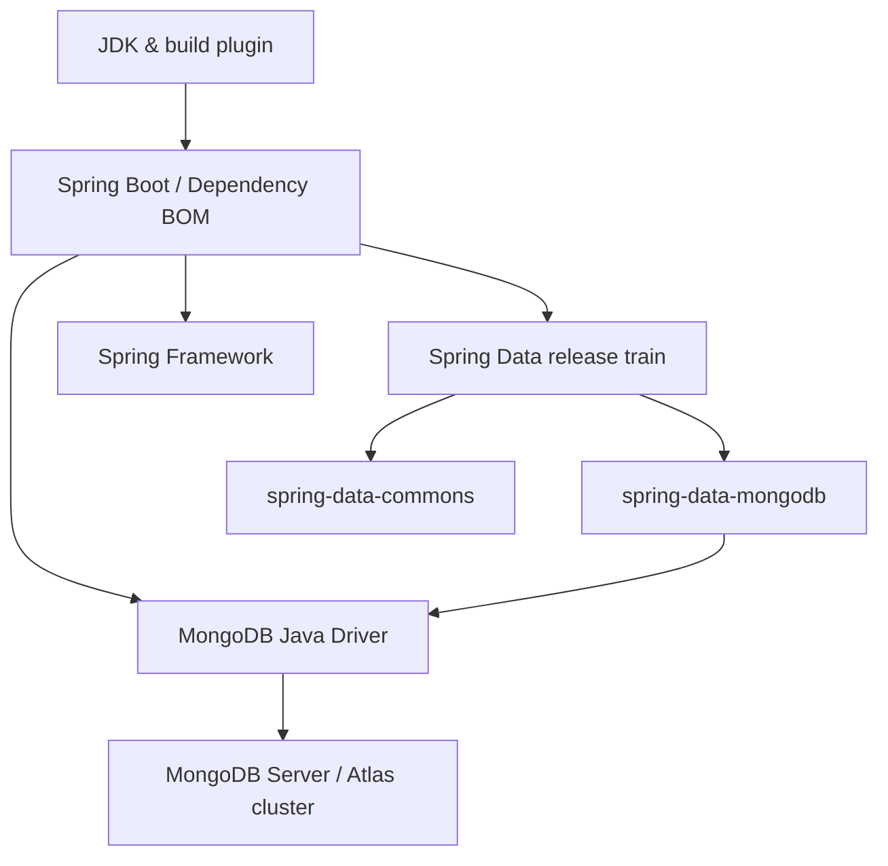
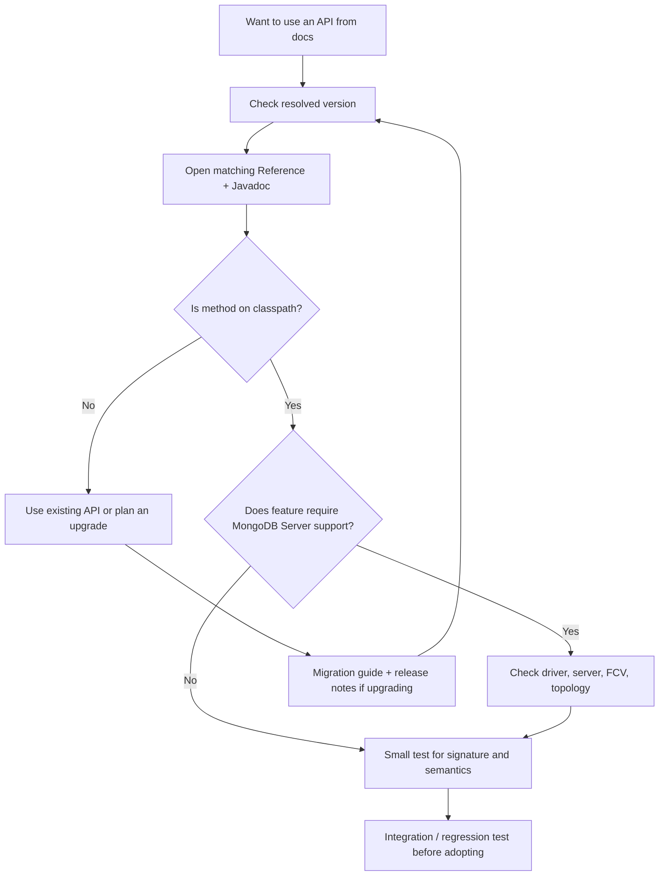

# Cross-referencing APIs with documentation for your exact version

> **Chapter:** Versions and Upgrades  
> **Scope:** Spring Data MongoDB — verifying APIs for `MongoTemplate`, repositories, document mapping, aggregations, indexes, transactions, reactive access, testing, and performance diagnostics.

## 1. The problem: same API name, different versions

When looking up Spring Data MongoDB, a code snippet in documentation may look right while your project reports `Cannot resolve method`, `ClassNotFoundException`, `NoSuchMethodError`, or compiles and runs with unexpected behavior. One major reason is that the reader is viewing **documentation for a different version than the library actually loaded**.

The ecosystem consists of multiple components with separate lifecycles and versioning schemes:



This diagram shows **relationships that must be verified**, not an assertion that every project uses Spring Boot. A plain Spring Framework application can manage dependencies with a BOM or explicit versions. MongoDB Server/Atlas is also a component deployed independently of the application JARs.

Things to remember:

- **Spring Boot version** differs from **Spring Data MongoDB version**. For example, do not conclude the MongoDB library is "3.x" just because the app runs Spring Boot 3.x.
- **Spring Data release train** (e.g., `2025.0`) differs from the `spring-data-mongodb` module version (e.g., `4.5.x`). A release train coordinates a group of Spring Data modules.
- **MongoDB Java Driver** (e.g., `mongodb-driver-sync`) is a separate layer below Spring Data; driver docs do not describe how `MongoTemplate` maps domain objects.
- **MongoDB Server** has its own version. A Java API may exist in the JAR while the corresponding server feature is not yet supported on the running cluster.

Goal of this lesson: obtain the **actual versions**, pick **matching documentation**, verify **exact signatures and semantics**, and validate with tests before applying code or upgrading.

## 2. Four questions to answer before looking up an API

| Question | Reliable evidence | Why is it needed? |
| --- | --- | --- |
| Which Spring Data MongoDB version is the app using? | Resolved dependency graph for the exact module and configuration | Determines which classes, methods, and annotations exist |
| Which Boot, Framework, Commons, and Driver versions are actually present? | Resolved dependency graph, BOM/lockfile, and deployed artifact | Detects dependency overrides and mismatched library groups |
| Which version is the MongoDB cluster running? | `db.version()` or verified cluster/Atlas metadata | Shows whether server commands and features are available |
| Which release docs are you reading? | Version banner, versioned docs/Javadoc URLs | Avoids using `latest`/`SNAPSHOT` APIs when running an older version |

Only once you have these four pieces of information should you copy examples into your codebase.

### 2.1. Distinguishing declared vs. resolved versions

`build.gradle` or `pom.xml` may omit the `spring-data-mongodb` version because the Spring Boot BOM manages it. Moreover, transitive dependencies, dependency constraints, lockfiles, forced versions, and multi-module setups can make **the resolved version differ from expectations**.

In packaged JAR applications, dependencies on a developer machine can also differ from the artifact running in staging/production. When troubleshooting an error that only happens on the server, verify the **deployed build**, not just local source files.

## 3. Determining actual dependencies with Gradle

For Gradle projects, run on the **application module** and the proper configuration:

```powershell
# Windows PowerShell, from the module directory containing gradlew.bat:
.\gradlew.bat dependencies --configuration runtimeClasspath

.\gradlew.bat dependencyInsight --dependency spring-data-mongodb --configuration runtimeClasspath
.\gradlew.bat dependencyInsight --dependency spring-data-commons --configuration runtimeClasspath
.\gradlew.bat dependencyInsight --dependency mongodb-driver-sync --configuration runtimeClasspath
.\gradlew.bat dependencyInsight --dependency mongodb-driver-reactivestreams --configuration runtimeClasspath
.\gradlew.bat dependencyInsight --dependency spring-core --configuration runtimeClasspath
```

These commands are guidance for learners; depending on project structure, you may need an explicit task path, for example:

```powershell
.\gradlew.bat :shop-app:dependencyInsight --dependency spring-data-mongodb --configuration runtimeClasspath
```

In a project without the reactive driver, querying `mongodb-driver-reactivestreams` may return no dependency; that is not an error. When checking compile-time visibility, compare `compileClasspath` as well. When code only fails in tests, check `testRuntimeClasspath` and `testCompileClasspath` respectively.

What `dependencyInsight` tells you:

- Shows the selected version and the dependency path leading to the JAR.
- Helps identify whether the version came from a constraint/BOM or a direct dependency.
- Helps spot partial overrides, such as a driver/BSON module forced onto an incompatible line.

The Spring Boot Gradle Plugin together with `io.spring.dependency-management` can import the `spring-boot-dependencies` BOM; Gradle's native `platform(...)` also supports BOMs. **Do not manually add versions to individual MongoDB JARs based on an online blog post** when the application relies on Boot's managed dependency set.

### 3.1. Example of BOM-managed dependencies

```groovy
plugins {
    id 'java'
    id 'org.springframework.boot' version '3.5.0' // Build example only, not a recommendation to pick this version.
    id 'io.spring.dependency-management' version '1.1.7'
}

dependencies {
    implementation 'org.springframework.boot:spring-boot-starter-data-mongodb'
    // If reactive is needed, use the corresponding starter instead/intentionally alongside:
    // implementation 'org.springframework.boot:spring-boot-starter-data-mongodb-reactive'
}
```

The two plugin versions above only illustrate the configuration mechanism; **do not deduce** the Spring Data MongoDB version from any single line number. Check the actual `dependencyInsight` output and BOM. If the project uses a different Spring Boot version, keep that version's dependency management mechanism intact.

## 4. Determining actual dependencies with Maven

In Maven, `spring-boot-starter-parent` or the `spring-boot-dependencies` BOM can manage transitive versions. Inspect the dependency tree:

```powershell
# Run from the module containing pom.xml, or specify -pl for the target module in a reactor:
mvn dependency:tree

# Filter to the relevant group (PowerShell preserves -D flags when quoted):
mvn dependency:tree "-Dincludes=org.springframework.data:spring-data-mongodb,org.springframework.data:spring-data-commons,org.mongodb:mongodb-driver-sync,org.mongodb:mongodb-driver-reactivestreams,org.mongodb:mongodb-driver-core,org.mongodb:bson"

# Inspect effective properties/BOM from parent and dependencyManagement:
mvn help:effective-pom "-Doutput=effective-pom.xml"
```

If using the Maven Wrapper, replace `mvn` with `.\mvnw.cmd` on Windows or `./mvnw` on macOS/Linux. `effective-pom.xml` is a temporary build inspection output and should not be committed unnecessarily.

`dependencyManagement` only **suggests/locks versions when a dependency enters the graph**; it does not mean every managed artifact is present at runtime. Cross-check both `dependency:tree` and `effective-pom`.

### 4.1. Maven example using Spring Boot parent

```xml
<parent>
  <groupId>org.springframework.boot</groupId>
  <artifactId>spring-boot-starter-parent</artifactId>
  <version>3.5.0</version> <!-- Illustrative value, not a prescribed project version -->
</parent>

<dependencies>
  <dependency>
    <groupId>org.springframework.boot</groupId>
    <artifactId>spring-boot-starter-data-mongodb</artifactId>
  </dependency>
</dependencies>
```

Do not declare a starter version here because the parent manages it. If there is a direct `spring-data-mongodb` dependency with a different version, check why the override exists and whether the rest of the Spring Data, Java Driver, and Framework versions remain compatible.

## 5. Finding the right Reference, Javadoc, and release notes

Official documentation comes in **multiple forms and URLs**; each answers a different question:

| Source | What to look for | When to use |
| --- | --- | --- |
| **Reference Guide** (matching version) | Setup workflow, domain examples, behavioral limits | Understanding how to use template/repository/aggregation |
| **Javadoc** (matching module/version) | Package, class, overloads, generics, return type, `@Since`, `@Deprecated` | Confirming whether a method exists and its exact signature |
| **Migration Guide** (between two lines) | Breaking changes, JDK/driver requirements, mapping and startup changes | Preparing to move from an older line to a newer one |
| **Release notes** (patch/minor) | Bug fixes and changes across intermediate releases | Bugs appearing right after an upgrade |
| **Spring Boot dependency versions/BOM** | Which Spring Data/Framework/Driver versions Boot selects | Checking dependency consistency |
| **MongoDB Driver docs and compatibility table** | Driver APIs, Java and server compatibility | Codec, connection, and driver method issues |
| **MongoDB Server Manual** (matching version) | Commands, query/aggregation operators, server features | "Unknown operator" errors or unsupported features |

### 5.1. Examples of verified documentation URLs

The URLs below are concrete examples for comparison:

```text
# Spring Data MongoDB Reference — 4.5 line:
https://docs.spring.io/spring-data/mongodb/reference/4.5/mongodb/template-api.html

# Spring Data MongoDB Reference — 5.0 line:
https://docs.spring.io/spring-data/mongodb/reference/5.0/

# Default Spring Data MongoDB Reference (may shift with new releases):
https://docs.spring.io/spring-data/mongodb/reference/

# Criteria Javadoc for 4.5 line (line alias, may advance patches):
https://docs.spring.io/spring-data/mongodb/docs/4.5.x/api/org/springframework/data/mongodb/core/query/Criteria.html

# Javadoc for a specific patch release:
https://docs.spring.io/spring-data/data-mongodb/docs/4.5.11/api/

# Default Javadoc (depends on whichever version the site currently points to):
https://docs.spring.io/spring-data/mongodb/docs/current/api/

# Migration Guide 4.x -> 5.x:
https://docs.spring.io/spring-data/mongodb/reference/migration-guide/migration-guide-4.x-to-5.x.html
```

`/reference/4.5/...` pins the **4.5 docs branch**, though content may track the latest patch of that branch. `/docs/4.5.x/api/...` is similarly a branch alias; `/docs/4.5.11/api/...` points to a specific patch's Javadoc. When diagnosing a bug tied to an exact patch, prefer the patch-pinned docs and matching release notes.

**Do not rely solely on the URL:** a `/reference/5.1/...` page might redirect to current docs; always check the **version banner displayed on the page**. If the banner says `SNAPSHOT`, `RC`, or `Milestone`, that is development/pre-release documentation and may not match production dependencies.

### 5.2. Reading Javadoc to verify method availability

On a class's Javadoc page, check in order:

1. **Full package:** e.g., `org.springframework.data.mongodb.core.query.Criteria`, avoiding similarly named classes from other libraries.
2. **Method Summary/Detail:** name, parameter types, generics, return type, static vs. instance, and all overloads.
3. **`Since`:** the first version introducing the API; compare against the **Spring Data MongoDB module version** you use.
4. **`Deprecated` and `forRemoval`:** if present, read the suggested replacement and target removal version.
5. **Throws/Nullability/Notes:** null handling, exceptions, and semantics can change even under similar signatures.
6. **Source and migration notes:** for subtle behavioral shifts, cross-check release notes and run real tests.

`Since 5.0.4` **does not mean Spring Boot 5.0.4**. It is the module/API milestone recorded by the documentation. A method introduced in 5.0.4 will not necessarily exist in 5.0.0, even within the same major/minor line.

## 6. Practical example: why doesn't `Criteria.eq(...)` compile on 4.5?

Verified Javadoc shows:

- In **Spring Data MongoDB 4.5.x**, `Criteria` provides `is(Object)` for equality conditions.
- In **Spring Data MongoDB 5.0.4 and later**, Javadoc adds `Criteria.eq(Object)`, marked **`Since: 5.0.4`**.

Suppose someone copies an example from the current Javadoc:

```java
import org.springframework.data.mongodb.core.query.Criteria;
import org.springframework.data.mongodb.core.query.Query;

// Compiles only if the dependency includes Criteria.eq(...):
Query query = Query.query(Criteria.where("status").eq("PAID"));
```

A project running Spring Data MongoDB 4.5.x may report `Cannot resolve method 'eq'` because the class on its classpath lacks this method. Fix it using the API present on the 4.5 line:

```java
Query query = Query.query(Criteria.where("status").is("PAID"));
```

**Why is this fix right?** It uses the equality API already available in the running library line. The developer does not need to upgrade the whole stack just to call `eq` when `is` fulfills the exact same requirement. If another version has both, still read Javadoc to check semantics, nullability, and query generation details.

### 6.1. Test with a small snippet before refactoring broadly

```java
import static org.assertj.core.api.Assertions.assertThat;

import org.junit.jupiter.api.Test;
import org.springframework.data.mongodb.core.query.Criteria;
import org.springframework.data.mongodb.core.query.Query;

class CriteriaCompatibilityTest {
    @Test
    void equalityQueryUsesApiAvailableInCurrentDependency() {
        Query query = Query.query(Criteria.where("status").is("PAID"));

        assertThat(query.getQueryObject())
            .containsEntry("status", "PAID");
    }
}
```

This test only verifies that the DSL generates the expected BSON query object; it does not replace integration tests for `@Field`/`@Id` mapping and a real MongoDB server. If a Java field is named `status` while the BSON field is `order_status`, add a test through `MongoTemplate` or `QueryMapper` to verify field name translation.

## 7. Check the entire version stack, not just one JAR

Spring Data MongoDB's **Requirements/Compatibility Matrix** page publishes relationships among release trains, modules, and minimum drivers. Example lines present in the official documentation at the time of writing:

| Spring Data release train | Spring Data MongoDB | Minimum Java Driver per docs | MongoDB Server tested by Spring Data suite |
| --- | --- | --- | --- |
| `2025.0` | `4.5.x` | `5.5.x` | `6.x–8.x` |
| `2025.1` | `5.0.x` | `5.6.x` | `6.x–8.x` |
| `2026.0` | `5.1.x` | `5.6.x` | `6.x–8.x` |

**This is an illustrative table from the docs at the time of writing, not your project's version list.** Before upgrading, review the latest matrix on the Requirements page and cross-check **Java Driver ↔ MongoDB Server**, JDK, and Spring Framework. The "Tested server" column does not mean unlisted versions definitely fail or that every feature is compatible.

Spring Data MongoDB 4.5 requires JDK 17+ and belongs to the Spring Framework 6.2 line; Spring Data MongoDB 5.x requires JDK 17+ and belongs to the Spring Framework 7.0 line. Do not mix major lines of Spring Data, Commons, and Spring Framework without verified compatibility.

### 7.1. Mandatory checks when using the Spring Boot BOM

Spring Boot manages a **tested set of compatible dependencies**. Usually the safest approach is keeping starters and BOM-managed libraries aligned with the chosen Boot version. Overriding `spring-data-mongodb` or `mongodb-driver-core` alone can break alignment with `spring-data-commons`, `bson`, sync/reactive drivers, or Framework.

When an override is truly necessary, record:

- Previous/new version, reason for override, and the API or bug being addressed.
- Resolved dependency graphs across `compileClasspath`, `runtimeClasspath`, and `testRuntimeClasspath`.
- Compatibility matrix, migration guide, and regression test plan.
- Deployed build/release coordinates for reproducibility and rollback.

Never treat "the build compiles" as proof that all MongoDB features work; binary linkage errors like `NoSuchMethodError` often surface only when a specific code path executes.

### 7.2. The server also determines feature availability

For example, having a Spring Data API to construct an aggregation expression or transaction does not guarantee every MongoDB cluster supports the corresponding command. Consider:

- MongoDB Server version and **Feature Compatibility Version (FCV)** during server upgrades.
- Topology (standalone, replica set, sharded cluster), roles/privileges, and driver capabilities.
- Specific constraints of transactions, change streams, time-series collections, aggregation stages, index types, or Queryable Encryption.
- Driver compatibility and MongoDB Server Stable API when enabled.

Consult the **manual matching your exact server version** rather than trusting autocomplete in Java. Stable API keeps a committed subset of server commands stable, but does not make new APIs outside its scope universally available.

## 8. A high-impact migration example: Spring Data MongoDB 4.x → 5.x

The official 4.x → 5.x Migration Guide highlights notable changes:

| Item | Point to cross-check | Risk if reading wrong docs |
| --- | --- | --- |
| MongoDB Java Driver | Spring Data 5.x requires driver **5.6+** and drops support for the 4.x driver line | Runtime linkage/API mismatch |
| `UUID` | Spring Data 5.x no longer sets a default `UuidRepresentation` in support config classes; must be specified explicitly if storing UUIDs | Existing data may fail to read/write as expected |
| `BigDecimal`/`BigInteger` | Default conversion in support config classes changed; configure `BigDecimalRepresentation` explicitly | BSON type/representation shifts; queries or indexes fail to match old data |
| `DefaultMessageListenerContainer` | `SmartLifecycle` auto-start default changed to `true` | Listeners/change streams may start earlier than expected |
| JMX | Legacy JMX support removed | Monitoring must move to alternatives such as Actuator |

UUID configuration example shown in the Migration Guide for 5.x:

```java
// Override inside a class extending AbstractMongoClientConfiguration
@Override
protected void configureClientSettings(MongoClientSettings.Builder builder) {
    builder.uuidRepresentation(UuidRepresentation.STANDARD);
}
```

BigDecimal representation configuration example:

```java
// Override inside a class extending AbstractMongoClientConfiguration
@Override
protected void configureConverters(
        MongoConverterConfigurationAdapter adapter) {
    adapter.bigDecimal(BigDecimalRepresentation.DECIMAL128);
}
```

These are **illustrative snippets**; import the types and integrate them into an actual config class rather than pasting them arbitrarily. If existing data stores decimals as strings, consider `BigDecimalRepresentation.STRING` for compatibility before planning a migration to Decimal128. Do not change representations in production merely because newer docs use another default; test legacy BSON data, raw queries, aggregations, and indexes.

When preparing an upgrade:

1. Read the guide for the **exact pair of versions** you are transitioning between. If jumping across multiple minor/major lines, read the guides and release notes of **every intermediate line**.
2. Inventory the APIs in use: template/repositories, custom converters, annotations, aggregations, indexes, transactions, reactive subscriptions, change streams, auditing, and test slices.
3. Verify APIs and signatures in the **target** version's Javadoc; replace deprecated/removed usages.
4. Write round-trip tests on real stored data or representative fixtures, especially for `UUID`, `BigDecimal`, date/time, IDs, custom conversions, and default index creation.
5. Run integration tests against a compatible MongoDB Server and monitor performance and logs/metrics after deployment.

## 9. Checklist for diagnosing API/doc mismatches

| Symptom | Verification question | Appropriate action |
| --- | --- | --- |
| IDE shows `Cannot resolve method` | Is the method in Javadoc for the **exact module version**? What is `Since`? | Use an overload/API from the current version or plan an upgrade |
| Compiles, fails at runtime with `NoSuchMethodError` | Does the runtime dependency match the compile dependency version? | Inspect runtime classpath and deployed artifact; eliminate JAR conflicts |
| `ClassNotFoundException` after upgrade | Was the class moved, removed, or missing a starter/driver? | Check migration notes, dependency tree, and imports |
| Repository works, `MongoTemplate` query mismatches | Do `@Field` mapping, custom conversions, query overloads, and server BSON differ? | Inspect raw query/BSON and mapping docs for the exact version |
| Aggregation stage rejected by server | Does the server/FCV support that stage? | Check the matching MongoDB Server Manual and run integration tests |
| UUID/Decimal results changed | Did `UuidRepresentation`/`BigDecimalRepresentation` change? | Read legacy BSON and configure the matching representation |
| Index annotation exists, index missing on server | Did auto-index creation or migration actually run? | Check version-specific index docs and `getIndexes()` on the server |
| Reactive publisher "doesn't run" | Is anything subscribing / using `StepVerifier`? Is the reactive driver version right? | Verify subscription, driver, and run real tests |
| Transaction does not work | Are the manager/session, replica set/cluster, and write concern valid? | Cross-check Spring Data docs and server topology |
| `@DataMongoTest` missing beans | Which beans does this Boot slice load? Is extra config imported? | Check version-specific Boot test-slice docs and add needed beans intentionally |
| Blog post uses unfamiliar API | Was the blog using a snapshot or a different library? | Open Javadoc for the exact package/version and matching release notes |

### 9.1. Distinguishing source errors from binary errors

`Cannot resolve method` / compile errors usually prove the **API is absent from the compile classpath** or the wrong package was imported. `NoSuchMethodError` typically indicates code was compiled against one signature while a different JAR was loaded at runtime. `NoClassDefFoundError` can come from an unpackaged class or a class initialization failure, so read the full cause instead of immediately blaming "wrong version."

Inspect dependency resolution across compile, test, and runtime classpaths, then read the stack trace from the root cause. When verifying which JAR is loaded in a live environment, inspect class-loading metadata and build manifests/Actuator if configured; `Package.getImplementationVersion()` may return null depending on packaging.

## 10. A 10-step workflow to verify a new API

Suppose you intend to adopt a new method on `MongoTemplate` or `Criteria`:

1. State the **business requirement** and exact API to call (package, method name, parameters).
2. Identify the project/module and **build artifact** running in the target environment.
3. Get the **resolved version** of `spring-data-mongodb`, not just the Spring Boot version in the build file.
4. Record the versions of `spring-data-commons`, Spring Framework, MongoDB Driver, and JDK.
5. Open the **Reference Guide** for that Spring Data MongoDB line to understand behavior.
6. Open **Javadoc** for the exact version to check signature, `Since`, `Deprecated`, and nullability.
7. If the API maps to a server command/feature, verify **MongoDB Server version, FCV, and driver compatibility**.
8. If upgrading, read the **migration guides, changelogs, and release notes** for every line crossed.
9. Write **a small test** verifying compilation + BSON/query behavior; expand to an integration test if a real database is needed.
10. Only after verification should you modify production code, adjust dependencies, or deploy.



## 11. Practice exercises

### Exercise A: copying a "new" method

1. Assume a project uses Spring Data MongoDB **4.5.x**. Open `Criteria` Javadoc for 4.5.x and look up `is(Object)`, `isNull()`, `isNullValue()`, and `eq(Object)`.
2. Compare with **5.0.4+** Javadoc: record which method was added and its `Since` line.
3. Write an equality query using a method available in 4.5.x and inspect `Query.getQueryObject()`.
4. Explain why a `Cannot resolve method eq` compile error does not mean MongoDB Server lacks the `$eq` operator.

### Exercise B: cross-referencing the build with documentation

1. Use `dependencyInsight` or `dependency:tree` to list the versions of Spring Data MongoDB, Commons, MongoDB Java Driver, and BSON.
2. Inspect the Boot BOM/parent to see if any overrides exist.
3. Open the Requirements page for the resolved line; record the minimum driver and tested server versions.
4. Compare with the actual MongoDB version from `db.version()` and the MongoDB Java Driver compatibility table.
5. Save the cross-check results in an upgrade ticket (modules, versions, doc links, and verification timestamp).

### Exercise C: preparing for a 4.x → 5.x transition

1. Read the 4.x → 5.x Migration Guide and summarize changes for UUIDs, decimal representation, driver, and listeners.
2. Write a write/read test for `UUID` and `BigDecimal` on a current fixture; observe the BSON types.
3. Configure the representation explicitly in an appropriate test environment and rerun.
4. Verify there are no unintended data differences before upgrading in production.

## 12. Key takeaways

- **The real version is the resolved and deployed version**, not a guess from Spring Boot's name or a blog post.
- Pick **Reference + Javadoc matching the module line**, then check `Since`, **patch**, and release notes; `current`, `SNAPSHOT`, or redirected URLs can show different APIs.
- Cross-check all of **Spring Data release train, Commons, Framework, MongoDB Java Driver, BSON, JDK, and MongoDB Server/FCV**. A Java API existing does not guarantee the server supports the feature.
- When upgrading, read the migration guide and test BSON mapping, repository/template, indexes, transactions, reactive access, and active features.
- For a simple snippet, prefer an API already on the classpath that satisfies the requirement; only upgrade dependencies with a clear reason and verified compatibility.

## Official references

- [Spring Boot — Build Systems and Dependency Management](https://docs.spring.io/spring-boot/reference/using/build-systems.html): Boot BOM, management principles, and version alignment.
- [Spring Boot — Managing Dependencies with Gradle](https://docs.spring.io/spring-boot/gradle-plugin/managing-dependencies.html): ways to import the BOM and why overrides should be limited.
- [Spring Data MongoDB — Requirements & Compatibility Matrix (current page)](https://docs.spring.io/spring-data/mongodb/reference/preface.html): compatibility across Spring Data, drivers, and MongoDB Server.
- [Spring Data MongoDB 4.5 — Requirements](https://docs.spring.io/spring-data/mongodb/reference/4.5/preface.html): comparing version requirements for the 4.5 branch.
- [Spring Data MongoDB 4.5 — Template API](https://docs.spring.io/spring-data/mongodb/reference/4.5/mongodb/template-api.html): branch-specific Reference Guide example.
- [Spring Data MongoDB 4.5.x — Criteria Javadoc](https://docs.spring.io/spring-data/mongodb/docs/4.5.x/api/org/springframework/data/mongodb/core/query/Criteria.html): methods available on the 4.5 branch.
- [Spring Data MongoDB current — Criteria Javadoc](https://docs.spring.io/spring-data/mongodb/docs/current/api/org/springframework/data/mongodb/core/query/Criteria.html): `eq(Object)` signature and `Since: 5.0.4` entry at the time of writing.
- [Spring Data MongoDB — Migration Guide 4.x → 5.x](https://docs.spring.io/spring-data/mongodb/reference/migration-guide/migration-guide-4.x-to-5.x.html): driver, UUID, BigDecimal, listener, and JMX changes.
- [MongoDB Java Driver — Compatibility Tables](https://www.mongodb.com/docs/drivers/compatibility/?driver-language=java&java-driver-framework=java-sync): cross-referencing Java, driver, and server.
- [MongoDB Java Driver — Upgrade Driver Versions](https://www.mongodb.com/docs/drivers/java/sync/current/reference/upgrade/): driver breaking changes.
- [MongoDB Java Driver — Stable API](https://www.mongodb.com/docs/drivers/java/sync/current/connection/specify-connection-options/stable-api/): server Stable API scope and limits.
