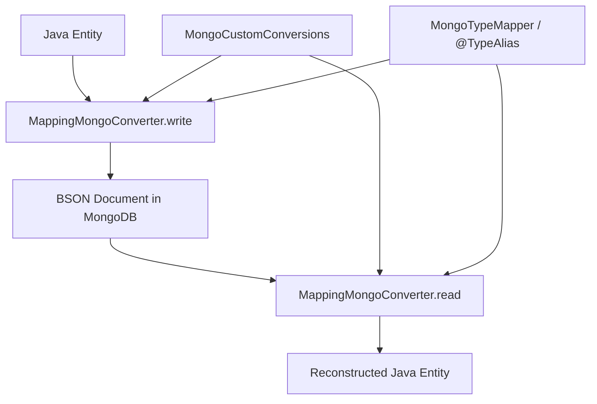
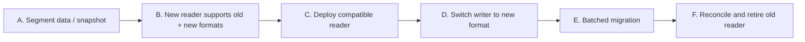

# Upgrading mapping converters, type aliases, and temporal conversion conventions

## 1. Why can upgrading Spring Data MongoDB skew data?

When upgrading **Spring Data MongoDB**, bumping the dependency and restarting the application is not enough. `MongoTemplate` and `MongoRepository` rely on the mapping infrastructure to turn Java entities into BSON and reconstruct objects from MongoDB. Changing how mapping works can make **the same document** deserialize into a different object than before, or cause **the same entity** to be persisted in a new format.

Three key risk groups in the **Versions and Upgrades** chapter:

1. **Mapping converters:** adding, removing, or reversing a `Converter<A, B>` can alter a field's BSON type; mismatched write and read converters can break round-trip fidelity.
2. **Type aliases:** `MappingMongoConverter` typically writes `_class` metadata to identify Java types, especially for polymorphic properties. Renaming packages/classes, changing `@TypeAlias`, or disabling type hints can break historical documents.
3. **Temporal conventions:** switching between Java Time converters based on the **system time zone** and MongoDB Driver codecs based on **UTC** can shift saved/read `LocalDateTime` values even when business code is unchanged.

This lesson walks through compatibility assessment, intentional configuration, testing against real BSON, phased upgrades, and recovery when discrepancies appear. Examples use Java, Spring Data MongoDB, `MappingMongoConverter`, `MongoCustomConversions`, and `MongoTemplate`; reactive APIs follow similar principles with their own configuration/testing paths.

### Learning objectives

- Distinguish changes in **BSON wire format**, type metadata, domain rules, and temporal display.
- Understand `_class`, `@TypeAlias`, `DefaultMongoTypeMapper`, and metadata initialization requirements before reading.
- Register `@ReadingConverter`/`@WritingConverter` pairs via `MongoCustomConversions` without misdirected converters.
- Identify the source of hour shifts when changing `LocalDateTime`, `Instant`, `LocalDate`, or `LocalTime` conventions.
- Write regression tests comparing before/after BSON, validating legacy data and rolling upgrade behavior.
- Distinguish Java/Spring Data mapping changes from actual data migrations in MongoDB.

## 2. Establish a data contract before changing versions

Before upgrading, record the following details for both the **running version** and the **target version**. Never assume every Spring Data MongoDB release shares the same defaults:

| Component | Question to answer | Evidence |
| --- | --- | --- |
| Spring Data MongoDB and Spring Boot | Which release lines are used? Which driver does the BOM manage? | Dependency tree, release/migration notes for current and target lines |
| `MongoCustomConversions` | Are there custom beans or setup via `AbstractMongoClientConfiguration`? | Bean list and converter registration code |
| `MappingMongoConverter` | Is there a custom `MongoTypeMapper` or `MongoMappingContext`? | Runtime configuration of the application |
| `_class` / aliases | Does BSON contain full class names, aliases, or no type hints? | Sample raw BSON from affected collections |
| Temporal fields | Are they stored as BSON Date, string, or epoch numbers? What is the original time zone? | Sample data and approved convention |
| High-precision / large numbers | Is `BigDecimal` stored as string or Decimal128? | Raw BSON and actual schemas/indexes/queries |
| Write paths | Do scripts, bulk updates, direct driver calls, or other services write to the same collection? | List of coexisting writers and their versions |

**Rule:** every significant mapping change must be described as a **Java value → BSON value → Java value** pair, including data created by older app versions. Tests that only boot the Spring context or only call repository `save` do not prove backward readability of historical documents.

Example of two historical documents with the same business meaning but different storage shapes:

```javascript
// Document written by the old version: FQCN type hint and time stored under old convention.
{
  _id: "ord-1001",
  _class: "com.legacy.orders.OrderSnapshot",
  email: { value: "a@example.test" },
  scheduledAt: ISODate("2026-11-20T02:00:00Z")
}

// Document from a hypothetical new version: stable alias and string email.
{
  _id: "ord-1002",
  _class: "order.snapshot.v1",
  email: "a@example.test",
  scheduledAt: ISODate("2026-11-20T09:00:00Z")
}
```

The two different BSON timestamps in this example only illustrate the issue **if** `scheduledAt` represents the same `LocalDateTime.of(2026, 11, 20, 9, 0)` written once with `Asia/Ho_Chi_Minh` and once with UTC. There is no universal rule that upgrades always shift by 7 hours; the actual offset depends on the time zone and converter setup.

## 3. Role of `MappingMongoConverter`

`MappingMongoConverter` is the central mapping implementation in Spring Data MongoDB. It uses domain class metadata and registered converters to:

- Map `@Id` to `_id`; read/write `@Field` properties with custom BSON names or types.
- Build BSON `Document`s when `MongoTemplate.save/insert` or repositories persist entities.
- Reconstruct Java objects from BSON, including nested objects, collections, and polymorphic types.
- Apply `MongoCustomConversions` for configured type pairs.
- Read and write type hints when `MongoTypeMapper` is configured to do so.



This flow helps isolate bugs: if the stored BSON is right but the domain object is wrong, inspect **reading/constructors/converters**; if the BSON itself is wrong right after `save`, inspect **writing/converters/time codecs**. Do not run a data migration to mask a bug in a newly introduced converter.

**Paths bypassing the mapper:** `mongosh` scripts and direct MongoDB Java Driver calls can write BSON without going through `MappingMongoConverter`. Spring Data `updateFirst` and bulk updates also skip parts of the full `save(entity)` lifecycle. Therefore, schema and temporal conventions must be enforced consistently across all writers.

## 4. Type hints `_class` and `@TypeAlias`

### 4.1. What does `_class` do?

By default, `DefaultMongoTypeMapper` typically stores the **fully qualified class name** in the `_class` field for root documents and for complex values requiring type info, such as a property declared as an interface/abstract class that holds a concrete subtype.

```java
import org.springframework.data.annotation.Id;
import org.springframework.data.mongodb.core.mapping.Document;

@Document("shipping_events")
class ShippingEvent {
    @Id
    String id;
    ShippingAction action; // interface or base class
}

interface ShippingAction {}

class Deliver implements ShippingAction {
    String addressCode;
}
```

A BSON document may carry type hints on both the root and nested subtype:

```javascript
{
  _id: "evt-01",
  action: {
    addressCode: "WH-1",
    _class: "com.acme.shipping.Deliver"
  },
  _class: "com.acme.shipping.ShippingEvent"
}
```

If the code moves from package `com.acme.shipping` to `com.newco.shipping`, MongoDB **does not automatically rewrite** existing `_class` values. An unrecognized alias or a class name removed from the classpath can cause polymorphic deserialization to fail.

### 4.2. Using stable identifier aliases

```java
import org.springframework.data.annotation.TypeAlias;
import org.springframework.data.mongodb.core.mapping.Document;

@Document(collection = "shipping_events")
@TypeAlias("shipping.event.v1")
class ShippingEvent {
    // fields, constructors...
}

@TypeAlias("shipping.action.deliver.v1")
class Deliver implements ShippingAction {
    // fields, constructors...
}
```

Once metadata is registered, new documents are written with `_class: "shipping.event.v1"` and nested subtypes with their respective aliases. Aliases should reflect a **stable data contract**, avoiding package names, module names, or volatile code paths. For major schema shifts, version aliases intentionally under a compatibility plan rather than renaming them casually.

**Often overlooked:** `@TypeAlias` is not a migration. Adding the annotation today does not rewrite documents written yesterday with old Java class names in `_class`. Nor does it guarantee Spring Data recognizes the alias before the class metadata is registered.

### 4.3. Mapping context must know types before reading aliases

Spring Data can only resolve `@TypeAlias` once `MongoMappingContext` knows about the corresponding class. Metadata may be discovered on first save or pre-initialized via entity scanning / initial entity sets. Never design a system that requires "saving a dummy document first before existing data can be read."

When configuring via `AbstractMongoClientConfiguration`, you can supply the known entity set:

```java
import java.util.Set;
import org.springframework.data.mongodb.config.AbstractMongoClientConfiguration;

class KnownEntitiesConfig extends AbstractMongoClientConfiguration {

    @Override
    protected String getDatabaseName() {
        return "application_db";
    }

    @Override
    protected Set<Class<?>> getInitialEntitySet() {
        return Set.of(ShippingEvent.class, Deliver.class);
    }
}
```

This is a **configuration sample for apps explicitly extending `AbstractMongoClientConfiguration`**, not an instruction to add a second config class to a Spring Boot app that already has MongoDB auto-configuration. With Boot auto-configuration, verify package scanning, `@Document`, and existing mapping context beans; only add extra configuration when needed.

The most important test is **reading a document containing only the alias before any `save` occurs**. If reading fails after an upgrade yet suddenly succeeds after an insert, check mapping metadata initialization.

### 4.4. Renaming classes and legacy aliases

Three common strategies exist:

| Strategy | How it works | Trade-offs |
| --- | --- | --- |
| Keep legacy type hints readable | Maintain compatibility mappings for old `_class` values | Adds compatibility code that must eventually be retired |
| Conditional migration from old values to new aliases | Rewrite historical documents in controlled batches | Must coordinate with coexisting readers/writers |
| Custom `TypeInformationMapper`/`DefaultMongoTypeMapper` | Handles multiple legacy types/aliases or custom policies | Increases mapping complexity; requires thorough tests |

Disabling `_class` globally via `DefaultMongoTypeMapper(null)` is **not** a safe default fix for alias errors. Doing so strips subtype metadata needed to deserialize interfaces, abstract classes, `Object` fields, or heterogeneous documents. Only omit type hints when schemas, read APIs, and every polymorphic property have an explicit replacement design.

## 5. Inspecting and migrating `_class` via raw BSON

Before changing anything, aggregate existing `_class` values:

```javascript
db.shipping_events.aggregate([
  {
    $group: {
      _id: "$_class",
      count: { $sum: 1 }
    }
  },
  { $sort: { count: -1 } }
]);
```

Also inspect **nested type hints** if the collection stores subtypes:

```javascript
db.shipping_events.aggregate([
  { $match: { action: { $exists: true } } },
  {
    $group: {
      _id: "$action._class",
      count: { $sum: 1 }
    }
  }
]);
```

An illustrative migration, applied only after verifying every participating app version can read the new alias:

```javascript
db.shipping_events.updateMany(
  {
    _class: "com.acme.shipping.ShippingEvent"
  },
  {
    $set: { _class: "shipping.event.v1" }
  }
);
```

For nested subtypes, update `action._class` selectively and only on matching documents:

```javascript
db.shipping_events.updateMany(
  { "action._class": "com.acme.shipping.Deliver" },
  {
    $set: {
      "action._class": "shipping.action.deliver.v1"
    }
  }
);
```

These two commands are **syntax examples only**. On a real system:

1. Inventory all legacy values and all paths carrying type hints; never check root `_class` alone.
2. Verify whether old app instances **can read the new alias** before a rolling deployment; if not, prepare dual-read mode or adjust deployment order.
3. Limit batch size, track `matchedCount/modifiedCount`, and record migration audit logs.
4. Filter strictly on the old value for safe idempotent reruns; never overwrite every `_class` blindly.
5. Test reading both old and new documents with the new binary, then verify via repositories and `MongoTemplate`.

If data involves many subtypes, write an **old type → new alias → current domain class** mapping table reviewed alongside the code. Never guess aliases dynamically from arbitrary class names.

## 6. Upgrading `MongoCustomConversions`

### 6.1. Why must custom converters be audited?

`MappingMongoConverter` checks for a matching converter before applying default mapping. A converter can decide whether a value object is stored as a string, subdocument, or another BSON type.

For instance, an app previously stored emails as subdocuments:

```javascript
{ email: { value: "a@example.test" } }
```

After registering a converter that writes to `String`, the new shape becomes:

```javascript
{ email: "a@example.test" }
```

If the new reader only accepts strings, it can fail on legacy data. Changing a converter to simplify BSON is a **schema change** and requires the same compatibility strategy as a normal field migration.

### 6.2. Read/write converter pairs for value objects

Suppose `EmailAddress` is a domain-validated value object:

```java
import java.util.Objects;

record EmailAddress(String value) {
    EmailAddress {
        Objects.requireNonNull(value, "email must not be null");
        if (value.isBlank()) {
            throw new IllegalArgumentException("email must not be blank");
        }
    }
}
```

Register converters with explicit direction annotations:

```java
import org.springframework.core.convert.converter.Converter;
import org.springframework.data.convert.ReadingConverter;
import org.springframework.data.convert.WritingConverter;

@WritingConverter
class EmailAddressWriteConverter
        implements Converter<EmailAddress, String> {

    @Override
    public String convert(EmailAddress source) {
        return source.value();
    }
}

@ReadingConverter
class EmailAddressReadConverter
        implements Converter<String, EmailAddress> {

    @Override
    public EmailAddress convert(String source) {
        return new EmailAddress(source);
    }
}
```

`@WritingConverter`/`@ReadingConverter` let Spring Data distinguish conversion direction. This is especially important when both types are native store types, such as `String → Long`; without the annotations, a converter could be applied in an unintended direction.

Converters are **not registered automatically merely by having annotations or being on the classpath**. Register them explicitly in `MongoCustomConversions` (or the appropriate Spring Data config hook), and verify which bean `MongoTemplate` actually uses.

### 6.3. Configuring converters and Java Time intentionally

In a Spring Boot app using auto-configuration, you can declare a `MongoCustomConversions` bean:

```java
import org.springframework.context.annotation.Bean;
import org.springframework.context.annotation.Configuration;
import org.springframework.data.mongodb.core.convert.MongoCustomConversions;

@Configuration(proxyBeanMethods = false)
class UpgradeMongoConfig {

    @Bean
    MongoCustomConversions mongoCustomConversions() {
        return MongoCustomConversions.create(adapter -> {
            adapter.registerConverter(new EmailAddressWriteConverter());
            adapter.registerConverter(new EmailAddressReadConverter());
            adapter.useNativeDriverJavaTimeCodecs();
        });
    }
}
```

`useNativeDriverJavaTimeCodecs()` is **an intentional choice**, not something to enable unconditionally during a migration if historical `LocalDateTime` data uses another time-zone convention. To preserve legacy Spring Data behavior during transition, the corresponding method is `useSpringDataJavaTimeCodecs()`. Always check the exact API of your Spring Data version.

If the application builds `MappingMongoConverter` manually or extends `AbstractMongoClientConfiguration`, register converters via `configureConverters(...)`; avoid creating **two** competing converter config mechanisms. When upgrading, audit every existing converter and decide whether to keep, update, or remove each one before replacing the bean.

### 6.4. Backward-compatible reader converter for legacy BSON

During transition from legacy subdocuments, you can register an additional reading converter:

```java
import org.bson.Document;
import org.springframework.core.convert.converter.Converter;
import org.springframework.data.convert.ReadingConverter;

@ReadingConverter
class LegacyEmailDocumentReadConverter
        implements Converter<Document, EmailAddress> {

    @Override
    public EmailAddress convert(Document source) {
        Object value = source.get("value");
        if (!(value instanceof String email)) {
            throw new IllegalArgumentException(
                    "Unsupported legacy email BSON shape");
        }
        return new EmailAddress(email);
    }
}
```

After adding `adapter.registerConverter(new LegacyEmailDocumentReadConverter())`, the app can handle **both** new strings and legacy subdocuments provided the conversion infrastructure resolves both paths to `EmailAddress`. Verify with tests on representative BSON before deploying. This converter does not rewrite documents in the collection; it provides **read compatibility** during migration.

If legacy BSON has multiple shapes, avoid broad `Document → Object` converters that can interfere with other documents. Prefer converters scoped to specific value objects or property-level conversions on a single field.

### 6.5. Watch numeric mapping changes as well

`BigDecimal` is a major example of default changes across lines. According to **Spring Data MongoDB 5.0+** documentation, there is no longer a single implicit default representation for `BigDecimal`/`BigInteger` as before; configure it explicitly if your domain stores those types. You can retain strings for compatibility or use BSON `Decimal128` for numeric queries.

Example specifying BSON type directly on a field:

```java
import java.math.BigDecimal;
import org.springframework.data.mongodb.core.mapping.Field;
import org.springframework.data.mongodb.core.mapping.FieldType;

class PaymentSnapshot {
    @Field(targetType = FieldType.DECIMAL128)
    BigDecimal amount;
}
```

For monetary values, check precision, `Decimal128` bounds, existing string records, indexes, and sort/aggregation expressions. Never treat `"12.5"` and `NumberDecimal("12.5")` as interchangeable in raw BSON queries. If you need to keep string conventions across all fields lacking explicit target types, configure the appropriate representation in `MongoCustomConversions` per your 5.x version's docs.

## 7. Temporal conventions: `Instant`, `LocalDateTime`, and BSON Date

### 7.1. What does BSON Date store?

MongoDB BSON Date represents **an instant on the timeline**, typically stored as milliseconds since the Unix epoch in UTC. BSON Date **does not store a time-zone name** such as `Asia/Ho_Chi_Minh` or an offset like `+07:00`.

```javascript
{
  createdAt: ISODate("2026-11-20T02:00:00.000Z")
}
```

That represents the same instant as `2026-11-20 09:00:00` in UTC+07, yet BSON only knows the instant `02:00Z`. The application decides which time zone to display. Seeing `Z` in `mongosh` output does not imply users are in UTC.

| Java Type | What does it represent? | Recommended usage |
| --- | --- | --- |
| `Instant` | An absolute point in time | `createdAt`, `updatedAt`, audit logs, event timestamps |
| `OffsetDateTime` | Instant paired with a chosen offset | API contracts needing offsets; define how offset is stored/restored |
| `ZonedDateTime` | Wall-clock time + time-zone ID | Schedules needing DST rules and local time-zone identity |
| `LocalDateTime` | Date/time **without time zone** | Local appointments; store `ZoneId` separately if conversion to instant is needed |
| `LocalDate` | Calendar date without time of day | Birthdays, business dates, billing periods |
| `LocalTime` | Time of day without date/zone | Opening hours or recurring schedules |

Avoid using `LocalDateTime` for absolute events unless an explicit time-zone rule exists. For audit timestamps, `Instant` is usually simpler and safer.

### 7.2. Critical difference between the two Java Time mechanisms

Spring Data MongoDB documentation notes:

- Spring Data Commons' Java Time converters for local types (`LocalDate`, `LocalTime`, `LocalDateTime`) rely on `ZoneId.systemDefault()`.
- MongoDB Driver's Java Time codecs, when enabled via `useNativeDriverJavaTimeCodecs()`, use `ZoneOffset.UTC` for those types.
- Spring Data recommends native UTC codecs for new designs, whereas system-default behavior primarily serves legacy data compatibility. Switching between the two requires testing persisted data.

For example, given `LocalDateTime` at 09:00 on November 20, 2026:

```java
import java.time.Instant;
import java.time.LocalDateTime;
import java.time.ZoneId;
import java.time.ZoneOffset;

LocalDateTime local = LocalDateTime.of(2026, 11, 20, 9, 0);

Instant withVietnamZone = local
        .atZone(ZoneId.of("Asia/Ho_Chi_Minh"))
        .toInstant(); // 2026-11-20T02:00:00Z

Instant withUtc = local
        .toInstant(ZoneOffset.UTC); // 2026-11-20T09:00:00Z
```

The two instants are **7 hours apart**, even though `local` did not change. If the old version wrote `LocalDateTime` in server zone `Asia/Ho_Chi_Minh` and the new version writes in UTC, BSON Dates for **new data** shift by 7 hours relative to before. Conversely, **old data** read under UTC becomes `02:00` instead of `09:00`. This is a wire-format compatibility bug, not merely a UI formatting glitch.

### 7.3. Separating instant vs. local wall-clock conventions

For "when an event occurred," convert explicitly to `Instant` before saving:

```java
import java.time.Instant;
import java.time.LocalDateTime;
import java.time.ZoneId;

ZoneId businessZone = ZoneId.of("Asia/Ho_Chi_Minh");
LocalDateTime localAppointment =
        LocalDateTime.of(2026, 11, 20, 9, 0);

Instant appointmentAt =
        localAppointment.atZone(businessZone).toInstant();
// Store appointmentAt as BSON Date.
```

For appointments where preserving **local wall-clock time and time zone** matters more than a bare instant, store structured fields:

```javascript
{
  appointmentLocal: "2026-11-20T09:00:00",
  timeZoneId: "Asia/Ho_Chi_Minh",
  appointmentInstant: ISODate("2026-11-20T02:00:00Z")
}
```

When storing both representations, define a clear source of truth and enforce consistency when rescheduling. In DST regions, a local wall-clock time may **not exist** or may **occur twice**; define gap/overlap rules rather than silently relying on JVM defaults.

**For `LocalDate`:** mapping "November 20" to BSON Date in one time zone and reading it back in another can shift the date to November 19 or 21 under certain conditions. If the domain only needs a calendar date, decide on a date-preserving representation (such as ISO `yyyy-MM-dd` string or year/month/day fields) and implement mapping to match that contract.

### 7.4. Precision and offsets

- BSON Date has **millisecond** precision; `Instant` can hold nanoseconds. Round-trips can truncate sub-millisecond precision.
- Converting `OffsetDateTime`/`ZonedDateTime` to an instant and storing only BSON Date drops the original offset/zone. If you need to restore the exact chosen time zone, store `ZoneId`/offset separately per business requirements.
- `Date.toString()` or JVM logs often display the host's time zone and cause confusion when compared with `ISODate(...Z)`. Normalize to `Instant` and compare epoch values when verifying.
- For historical dates in DST regions, records missing the original time zone can sometimes be **impossible** to convert unambiguously; apply business policy or supplementary data.

## 8. Strategy for migrating temporal conventions

Never run a blind hour-offset update across an entire collection before verifying which time zone produced each record. Historical data may originate from multiple servers, multiple app versions, or include DST transitions.

Workflow:

1. **Segment the data:** group by app version, write timestamp range, tenant, origin, and actual BSON format.
2. **Document the legacy convention:** was `LocalDateTime` converted with `ZoneId.systemDefault()`, UTC, a client offset, or a custom converter?
3. **Define the target convention:** `Instant` for absolute events; `LocalDateTime + ZoneId` for local wall-clock times; strings for calendar dates where suitable.
4. **Build deterministic converters:** for every data segment, know exactly how to interpret old and new times; flag records lacking sufficient metadata for special handling.
5. **Test on a data snapshot:** compare legacy BSON Dates, true business instants, and target BSON; check edge cases across time zones/DST.
6. **Deploy a compatible reader first:** let the new app read both legacy and target formats during coexistence.
7. **Migrate in audited, checkpointed batches**, then remove the legacy read path only once all writers have moved and reconciliation passes.

### Example of deterministic normalization

Suppose you have **verified** every document in a group was written from `LocalDateTime` in `Asia/Ho_Chi_Minh`, and the goal is to switch to `Instant` while preserving **the exact appointment instant**. Instead of adding hours by eye, decode the old BSON value using the legacy rule and construct the corresponding Java instant:

```java
import java.time.Instant;
import java.time.LocalDateTime;
import java.time.ZoneId;
import java.time.ZoneOffset;
import java.util.Date;

ZoneId legacyZone = ZoneId.of("Asia/Ho_Chi_Minh");

// Legacy BSON value stored a LocalDateTime using legacyZone.
Date legacyBsonDate = rawDocument.getDate("scheduledAt");

// Recover the LocalDateTime based on how it was originally written.
LocalDateTime historicalLocal = LocalDateTime.ofInstant(
        legacyBsonDate.toInstant(), legacyZone);

// Interpret the appointment time in that business zone.
Instant actualAppointmentInstant = historicalLocal
        .atZone(legacyZone)
        .toInstant();

// Often equals the stored instant: the goal is clarifying semantics.
// Do not blindly add 7 hours to Date if existing data already holds the right instant.
Date normalizedDate = Date.from(actualAppointmentInstant);
```

This snippet highlights a key point: **changing the codec reading `LocalDateTime`** alters the observed Java object, which does not automatically mean the stored BSON Date was wrong. If BSON already stores the true instant, do not shift epochs; change the model/reader to interpret it accurately. Only rewrite BSON when there is evidence the stored semantics or format must change.

If the business instead wants to **keep wall-clock 09:00 under a new UTC convention**, that is a different contract: you must intentionally transform those timestamps from the old wall-clock convention to the new format, distinct from preserving the original instant.

## 9. Upgrading with multiple versions running concurrently

During a rolling deployment, old and new instances can read and write the same collection simultaneously. Ensure a **compatibility window**:



This sequence is a **mental model** and must be adapted if old instances cannot read new data:

- If a new writer emits a `_class` alias while old apps only recognize FQCNs, old apps can fail mid-rollout. Ensure bidirectional compatibility or gate writer changes behind a feature flag.
- If a new writer saves `email` as a string while old apps expect a subdocument, keep writing the old shape until remaining readers are upgraded or traffic is isolated.
- If switching Java Time codecs while multiple services write `LocalDateTime`, new data can end up with **two interpretations in one field**; freeze conventions or add a version marker/schema field.
- If a migration has already rewritten BSON while old app instances exist, rolling back code alone may not restore readability. Prepare data rollback or dual-read safeguards first.

One technique is adding `schemaVersion` to new documents so readers choose mapping rules by version. However, global converters in `MongoCustomConversions` are usually selected by **source/target type pair**; they do not branch on `schemaVersion` automatically. When the same BSON type requires two distinct interpretations, design a context-aware adapter, a raw DTO reader, or a controlled one-time migration.

## 10. Testing mappings before and after upgrading

### 10.1. Test case matrix

| Test group | Input data | Required assertions |
| --- | --- | --- |
| Write new with alias | Entity with `@TypeAlias` | Raw BSON has expected `_class` alias |
| Read alias before any save | BSON inserted directly via driver | Reader reconstructs right subtype prior to any `save` |
| Read historical class name | BSON with legacy FQCN `_class` | Readable via compatibility path or flagged for migration |
| Write converter | Value object → BSON | Expected string/document/Decimal128 type |
| Read converter old/new | BSON in both shapes | Identical domain value, no data loss |
| New Java Time | `Instant`, `LocalDateTime`, `LocalDate` | Expected BSON Date/type and round-trip values |
| Different time zones | Test multiple `ZoneId`s | No unintended instant or calendar-date shift |
| Precision | Instant with nanoseconds | Documented rounding behavior (BSON Date is milliseconds) |
| Queries/updates | `Criteria`, repositories, aggregations | Query predicates match both new and old BSON |
| Rolling compatibility | Old and new writers on sample data | Every permitted version reads coexisting data |

### 10.2. Entity and converter test for new BSON

Combining alias, value object, and Java Time:

```java
import java.time.Instant;
import java.time.LocalDateTime;
import org.springframework.data.annotation.Id;
import org.springframework.data.annotation.TypeAlias;
import org.springframework.data.mongodb.core.mapping.Document;

@Document(collection = "upgrade_probe")
@TypeAlias("upgrade.probe.v1")
record UpgradeProbe(
        @Id String id,
        EmailAddress email,
        Instant occurredAt,
        LocalDateTime localAt
) {}
```

Once `UpgradeMongoConfig` from earlier is loaded, a test can inspect raw BSON:

```java
import static org.junit.jupiter.api.Assertions.*;

import java.time.Instant;
import java.time.LocalDateTime;
import java.time.ZoneOffset;
import java.util.Date;

import org.bson.Document;
import org.junit.jupiter.api.Test;
import org.springframework.beans.factory.annotation.Autowired;
import org.springframework.boot.test.autoconfigure.data.mongo.DataMongoTest;
import org.springframework.context.annotation.Import;
import org.springframework.data.mongodb.core.MongoTemplate;

@DataMongoTest
@Import(UpgradeMongoConfig.class)
class MappingUpgradeIntegrationTest {

    @Autowired
    MongoTemplate template;

    @Test
    void writesAliasAndUtcTimeThenReadsBack() {
        UpgradeProbe source = new UpgradeProbe(
                "probe-001",
                new EmailAddress("a@example.test"),
                Instant.parse("2026-11-20T02:00:00Z"),
                LocalDateTime.of(2026, 11, 20, 9, 0)
        );

        template.insert(source);

        Document raw = template.getCollection("upgrade_probe")
                .find(new Document("_id", "probe-001"))
                .first();

        assertNotNull(raw);
        assertEquals("upgrade.probe.v1", raw.getString("_class"));
        assertEquals("a@example.test", raw.getString("email"));
        assertEquals(
                Instant.parse("2026-11-20T02:00:00Z"),
                raw.getDate("occurredAt").toInstant());
        assertEquals(
                LocalDateTime.of(2026, 11, 20, 9, 0)
                        .toInstant(ZoneOffset.UTC),
                raw.getDate("localAt").toInstant());

        UpgradeProbe reread =
                template.findById("probe-001", UpgradeProbe.class);
        assertNotNull(reread);
        assertEquals(source.email(), reread.email());
        assertEquals(source.occurredAt(), reread.occurredAt());
        assertEquals(source.localAt(), reread.localAt());
    }
}
```

This snippet illustrates `@DataMongoTest` usage familiar from **Spring Boot 3.x**. For newer Boot versions where test slice packages/configs moved, adjust imports according to your target BOM. Run tests against an isolated test MongoDB instance (e.g., Testcontainers); the test does not provision a database on its own, so never point it at a shared environment. The sample uses a fixed `_id`, so ensure isolation/cleanup to prevent duplicate key failures on reruns.

The test relies on UTC native codecs configured in `UpgradeMongoConfig` and asserts the **chosen contract**, not that every Spring Data MongoDB app defaults to this behavior.

### 10.3. Testing historical reads before any write

An independent integration test should:

1. Use the MongoDB Java Driver directly to insert a historical BSON document with old `_class`, object-shaped email, and legacy date/time values.
2. Boot the **new application** with the chosen converters/type mapper; do not insert a new entity with `save` before reading.
3. Call `MongoTemplate.findById(...)` or a repository and verify domain values, subtypes, and time zones/instants.
4. Run the same fixture against the old binary in a test environment to check bidirectional compatibility if rolling deployment is required.

Example of seeding raw BSON:

```java
Document legacy = new Document("_id", "legacy-001")
        .append("_class", "com.legacy.orders.OrderSnapshot")
        .append("email", new Document("value", "a@example.test"))
        .append("scheduledAt", Date.from(
                Instant.parse("2026-11-20T02:00:00Z")));

template.getCollection("upgrade_probe").insertOne(legacy);
```

This is a **compatibility test fixture**: the `scheduledAt` field and `com.legacy.orders.OrderSnapshot` type represent a hypothetical historical shape. Do not expect `template.findById(..., UpgradeProbe.class)` to decode this fixture merely via the new `@TypeAlias`; it requires explicit conversion/type mapping or a designed migration. The test should fail meaningfully if legacy read support is missing.

### 10.4. Deterministic time-zone testing

Avoid calling `TimeZone.setDefault(...)` casually inside a parallel test suite: the default time zone is **JVM-wide global state** and can contaminate other tests. To test changes in `ZoneId.systemDefault()`, run tests in separate JVMs with `-Duser.timezone=UTC` and `-Duser.timezone=Asia/Ho_Chi_Minh`, or inject `ZoneId` explicitly as a dependency in testable logic.

For DST boundaries, include zones such as `Europe/Berlin` and transition timestamps. Inspect **raw BSON Date / epoch milliseconds** rather than comparing strings formatted in the test machine's local time zone.

## 11. Diagnosing issues after an upgrade

### Polymorphic deserialization errors or unrecognized aliases

**Symptom:** an existing document has `_class`, and reading into an interface/subclass fails or returns an unexpected type.

**Checks:** inspect raw BSON `_class` at root and nested levels; verify registered aliases and classes known to the mapping context; check whether historical FQCNs still exist. Test reading **before saving any new entity** to uncover missing metadata initialization.

**Resolution:** add compatibility mapping/readers or run a conditional migration after verifying rolling compatibility. Never delete `_class` wholesale just to silence exceptions.

### Converter running in the wrong direction or on the wrong type

**Symptom:** a `String` field turns into a number, a value object becomes a subdocument or vice versa; equality queries stop finding existing documents.

**Checks:** actually registered converters, `@ReadingConverter`/`@WritingConverter` annotations, source/target conversion types, overridden config beans, and before/after BSON reads/writes.

**Resolution:** separate directional converters, narrow conversion scope to the exact type/property, and add tests for both old and new shapes.

### Times shifted by several hours or dates off by one day

**Symptom:** after upgrading, `LocalDateTime` or `LocalDate` reads back differently even though the BSON Date in the database did not change.

**Checks:** old vs. new Java Time mechanism, `ZoneId.systemDefault()` across hosts, whether the field represents an instant or local wall-clock time, precision, and where formatting applies time zones.

**Resolution:** standardize conventions, restore legacy semantics on read for old data, use `Instant` for event timestamps, or store `LocalDateTime + ZoneId` as required by the business. Only migrate BSON after confirming historical semantics.

### Monetary / Decimal128 errors across branches

**Symptom:** monetary fields change between string and Decimal128, sorting/aggregation outputs shift, or converters reject the new format.

**Checks:** configured representation for `BigDecimal`/`BigInteger`, actual BSON types, and historical record compatibility. Pay special attention to default changes in **Spring Data MongoDB 5.x**.

**Resolution:** configure explicit BSON target types, run batched migrations if needed, and compare numeric outputs with matching scale/precision.

## 12. Upgrade completion checklist

- Recorded source and target versions of Spring Boot, Spring Data MongoDB, MongoDB Driver, and MongoDB Server.
- Collected sample documents for every `_class` value, nested alias, converted BSON shape, and temporal type.
- Inventoried active `MongoCustomConversions`; custom readers/writers have clear domain scope.
- Verified aliases resolve when **reading before the first save**.
- Proved critical historical documents can be read by the new binary.
- Documented temporal contracts covering **instant vs. local wall-clock**, time zones, precision, and display.
- Tested multiple time zones and DST transitions if relevant to the domain.
- Identified all writers active during rolling upgrade and the order for enabling new formats.
- Prepared idempotent conditional migrations, audits, batching, and rollback plans.
- Verified queries, indexes, aggregations, and API responses against both old and new BSON.
- Monitored conversion errors, time skew, and migrated document counts post-deploy.

## 13. Practice exercises

### Exercise 1 — Upgrade aliases while still reading legacy data

Create an entity with `@TypeAlias("customer.profile.v1")` and a subtype inside an interface-typed field. Seed a document first with a legacy Java FQCN in `_class`, then save a new document using `MongoTemplate.save`. Write a test reading both. Explain whether you chose a compatibility reader or `_class` migration and why that choice is safe during rolling deployment.

**Pass criteria:** both old and new records resolve to the right subtype, with no prior "save a new record first" step accidentally warming up mapping metadata.

### Exercise 2 — Upgrade a converter for a value object

Create an `EmailAddress` readable from both BSON `String` and legacy subdocument `{ value: ... }`, writing new records strictly as string. Write tests verifying raw BSON `email` after save and testing both readers. If using a `@ReadingConverter` for `Document → EmailAddress`, verify other document fields are not converted unintentionally.

**Pass criteria:** new data round-trips losslessly; old data remains readable without requiring an immediate rewrite.

### Exercise 3 — Detect `LocalDateTime` drift

Given `LocalDateTime.of(2026, 11, 20, 9, 0)`, compute the corresponding instants in UTC and Asia/Ho_Chi_Minh. Use a test MongoDB instance to write and read the value under both converter conventions, comparing raw BSON Date and the deserialized Java object.

**Pass criteria:** accurately state which instant should be preserved, why the two mechanisms differ by 7 hours in the example, and when to migrate data vs. fix the reader.

### Exercise 4 — Evaluate a `BigDecimal` change

Seed two documents with `amount` as `"12.50"` (BSON string) and `NumberDecimal("12.50")`. Write read/write tests under your target representation config and compare query/sort results accordingly.

**Pass criteria:** make an explicit storage format decision, migrating legacy data only after testing correctness and precision limits.

## References

- [Spring Data MongoDB — Object Mapping](https://docs.spring.io/spring-data/mongodb/reference/mongodb/mapping/mapping.html)
- [Spring Data MongoDB — Type Mapping and `@TypeAlias`](https://docs.spring.io/spring-data/mongodb/reference/mongodb/converters-type-mapping.html)
- [Spring Data MongoDB — Custom Conversions](https://docs.spring.io/spring-data/mongodb/reference/mongodb/mapping/custom-conversions.html)
- [Spring Data MongoDB — Property Converters](https://docs.spring.io/spring-data/mongodb/reference/mongodb/mapping/property-converters.html)
- [Spring Data MongoDB — `MongoCustomConversions.MongoConverterConfigurationAdapter`](https://docs.spring.io/spring-data/mongodb/docs/current/api/org/springframework/data/mongodb/core/convert/MongoCustomConversions.MongoConverterConfigurationAdapter.html)
- [Spring Data MongoDB — `DefaultMongoTypeMapper` API](https://docs.spring.io/spring-data/mongodb/docs/current/api/org/springframework/data/mongodb/core/convert/DefaultMongoTypeMapper.html)
- [Spring Data MongoDB — Release Notes](https://docs.spring.io/spring-data/mongodb/reference/migration-guide.html)
- [MongoDB Manual — BSON Date](https://www.mongodb.com/docs/manual/reference/bson-types/#date)
- [MongoDB Manual — Decimal128](https://www.mongodb.com/docs/manual/reference/bson-types/#decimal128-bson-data-type)
