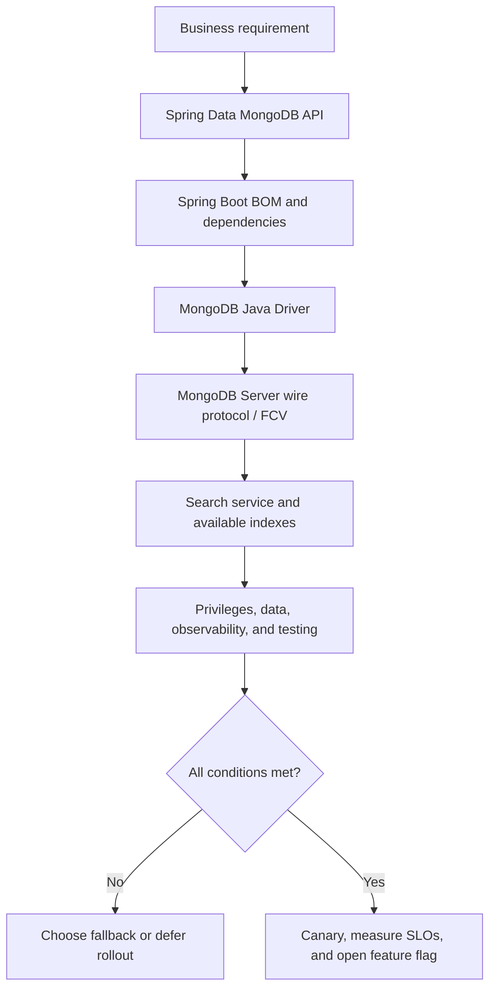
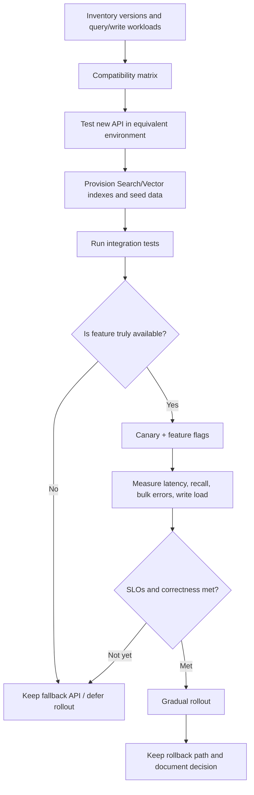

# Cross-referencing Search, vector, multi-collection bulk, and new feature APIs

> **Chapter:** Versions and Upgrades · **Module:** `SPRING_DATA_MONGODB`. Spring Data MongoDB provides `MongoTemplate`, repositories, an aggregation DSL, index management, transactions, and reactive access. During an upgrade, a newly available Java method **does not mean** your current MongoDB deployment can execute the corresponding command. This lesson shows how to cross-check **MongoDB Server/Atlas or Search deployments**, **MongoDB Java Driver**, **Spring Data MongoDB**, and **Spring Boot dependency management** before adopting MongoDB Search, Vector Search, or multi-collection bulk writes.

## 1. Why build a compatibility matrix before changing APIs?

An engineering team operating a catalog system on Spring Data MongoDB wants to add three capabilities:

1. Search products by keywords, fuzzy matching, or relevance score instead of relying solely on `$text`.
2. Find products semantically close to a description using embedding vectors, filtered by `tenantId` and ranked by similarity.
3. Submit a single batch that updates `products` and inserts `inventoryEvents` via a client-level bulk write to cut database round-trips.

These choices depend on distinct layers:



Common pitfalls that are easy to confuse:

- **Having `VectorSearchOperation` on the classpath** while the cluster lacks a Search service or a ready vector index.
- **Running MongoDB 8.0** while Spring Data is on an older version prior to multi-collection `Bulk`.
- **Having `MongoClient.bulkWrite()`** in the Java Driver yet mistakenly calling `MongoCollection.bulkWrite()` or Spring Data `bulkOps()`: the latter two remain scoped to a single collection per call.
- **Using `@VectorSearch` in a repository** on a Spring Data MongoDB version that does not support the annotation yet.
- **Creating a Search index successfully** and querying immediately while the index is still `BUILDING`, then blaming the query or data.

Therefore, checking versions and feature gates is part of **design and testing**, not just bumping a version number in `build.gradle`.

## 2. Separate the four version layers

| Layer | What to identify | What NOT to infer |
|---|---|---|
| MongoDB Server and FCV | Server version, topology, FCV, and supported commands | That `$search` exists just because the server is MongoDB 8.x |
| Atlas or self-managed Search service | Search indexes, Search service, deployment architecture, Search features/tier | That every standalone `mongod` includes Search out of the box |
| MongoDB Java Driver | Sync/reactive driver version, `MongoClient.bulkWrite` APIs, and corresponding models | That updating the driver automatically adds Spring Data DSL methods |
| Spring Boot + Spring Data MongoDB | Release train, BOM, `MongoTemplate`/repository/aggregation APIs | That changing Spring Data's version arbitrarily stays compatible with Boot |

**FCV** (feature compatibility version) must not be equated with the binary version number. While a cluster is undergoing a rolling upgrade or downgrade, verify FCV and active capabilities rather than relying on one member running a newer binary.

### 2.1. Key feature compatibility milestones

The milestones below are **minimum thresholds for specific APIs**, not a guarantee that every combination was released together by Spring Boot:

| Capability | API layer | Key requirement |
|---|---|---|
| Classic MongoDB `$text` + text index | Server + Spring Data `TextQuery`/`TextCriteria` | Does not require a dedicated MongoDB Search index |
| MongoDB Search `$search`/`$searchMeta` | Search-capable deployment + aggregation | Requires a Search index and supporting Search service |
| `VectorIndex`, `VectorSearchOperation` | Spring Data MongoDB **4.5+** | Requires a vector index and `$vectorSearch` on the deployment |
| Repository `@VectorSearch`, `Vector`, `SearchResults<T>` | Spring Data MongoDB **5.0+** | Requires a Search index and appropriate pre-filters |
| `MongoCollection.bulkWrite()` | MongoDB Java Driver, collection-scoped | Single collection; not a multi-collection API |
| `MongoClient.bulkWrite()` | Java Driver supporting client-level bulk | **MongoDB Server 8.0+** within the same cluster |
| Spring Data `Bulk.create(...)` + `MongoOperations.bulkWrite(Bulk, BulkWriteOptions)` | Spring Data MongoDB **5.1+** | Multi-collection requires **MongoDB 8.0+** |
| Reactive `ReactiveMongoOperations.bulkWrite(...)` | Spring Data MongoDB **5.1+** | Returns `Mono`; requires subscription and suitable server |
| Typed property paths in `Criteria`/`Update` | **5.1** enhancement | Use only when resolved Spring Data dependency provides the API |
| `IsEmpty`/`IsNotEmpty` and expanded change stream events | **5.1** enhancement | Verify behavior, mapping, and server/driver versions before adopting |

**Note on MongoDB Search deployments:** MongoDB Search and Vector Search are widely used on Atlas. Current MongoDB documentation also notes configurations for **MongoDB Community 8.2+** and **Enterprise 8.2+ with Kubernetes Operator** supporting these aggregation stages. That does **not** mean starting a plain `mongod` 8.2 process automatically includes Search components; you must deploy the Search service, configure indexes, and verify compatibility per the docs for your deployment type.

### 2.2. Verification commands before planning

On the actual MongoDB deployment used for testing, using an account with appropriate privileges:

```javascript
// Check version and topology details:
db.version();
db.adminCommand({ hello: 1 });

// Check FCV with sufficient privileges:
db.adminCommand({
  getParameter: 1,
  featureCompatibilityVersion: 1
});

// On a collection where Search is supported, inspect index status:
db.products.getSearchIndexes();
```

If `getSearchIndexes` is unavailable, check your `mongosh` version, cluster Search capability, user privileges, and deployment type before blaming Spring Data. On Atlas or managed services, capability details may also live in the provider's console or management API.

In the Java application, inspect the dependency tree via your build tool to determine the **resolved versions**, not only the versions written in declarations. Check especially whether the Spring Boot BOM, Spring Data MongoDB, and MongoDB Java Driver are unexpectedly overridden.

## 3. Comparing text search options

MongoDB has several distinct concepts of "search" with different implementations and goals:

| Approach | Goal | Index | Query form |
|---|---|---|---|
| `find` + `Criteria` | Equality/range/regex/sort lookups | Standard B-tree | `db.products.find(...)` |
| `$text` | Basic full-text via text index | Classic MongoDB text index | `find({$text:{$search:"..."}})` |
| MongoDB Search `$search` | Lexical relevance, fuzzy, analyzers, compound search | Dedicated Search index | Aggregation with `$search` |
| `$searchMeta` | Search metadata/counts/facets | Search index | Aggregation with `$searchMeta` |
| `$vectorSearch` | Semantic nearest-neighbor search via embeddings | Vector Search index | Aggregation with `$vectorSearch` |
| Hybrid search/reranking | Combining lexical, semantic, and ranking | Multiple queries/indexes, compatible features | Pipeline/algorithm per deployment |

A text index created with `db.products.createIndex({description:"text"})` is **not** a Search index created with `createSearchIndex(...)`. Likewise, a vector index cannot be replaced by a B-tree index on the `embedding` field.

### 3.1. Classic `$text` in Spring Data

`TextCriteria`/`TextQuery` fits when traditional MongoDB text search is enough without a Search service:

```javascript
db.products.createIndex({
  title: "text",
  description: "text"
});
```

```java
import org.springframework.data.mongodb.core.query.TextCriteria;
import org.springframework.data.mongodb.core.query.TextQuery;

// Assumes MongoTemplate and Product are configured.
TextCriteria criteria =
    new TextCriteria().matchingAny("coffee", "grinder");

TextQuery query = TextQuery.queryText(criteria);
List<Product> products = mongoTemplate.find(query, Product.class);
```

This is **not `$search`**. If moving to MongoDB Search for fuzzy matching, analyzers, and customizable relevance scoring, confirm a **dedicated Search index is ready** and re-benchmark scores, latency, and pagination.

## 4. MongoDB Search: `$search` and `$searchMeta`

### 4.1. Creating a Search index for a catalog collection

Example in the `catalog_lab` database for BSON fields `title`, `description`, and `tenantId`. This command only runs on deployments that support Search:

```javascript
use catalog_lab

db.products.createSearchIndex(
  "idx_products_text_v1",
  "search",
  {
    mappings: {
      dynamic: false,
      fields: {
        title: { type: "string" },
        description: { type: "string" },
        tenantId: { type: "token" }
      }
    }
  }
);
```

Using `token` for `tenantId` supports exact-value filtering in Search. For production indexes, inspect field mappings and analyzers—especially for Vietnamese text, diacritics, or keyword normalization. Never assume from a Java data class that a Search index picked the right analyzer.

`createSearchIndex` returning means **the index build request was accepted**, not that the index is `READY`. Check status:

```javascript
db.products.getSearchIndexes("idx_products_text_v1");
```

Status fields depend on version; wait until the index is ready/queryable before routing search traffic to it.

### 4.2. Lexical search query with tenant filtering

```javascript
db.products.aggregate([
  {
    $search: {
      index: "idx_products_text_v1",
      compound: {
        must: [
          {
            text: {
              query: "coffee grinder",
              path: ["title", "description"]
            }
          }
        ],
        filter: [
          { equals: { path: "tenantId", value: "tenant-a" } }
        ]
      }
    }
  },
  {
    $project: {
      _id: 0,
      sku: 1,
      title: 1,
      description: 1,
      score: { $meta: "searchScore" }
    }
  },
  { $limit: 10 }
]);
```

`$search` generally must be the **first stage** of the pipeline where it appears, aside from specific sub-pipeline patterns allowed by MongoDB; do not place `$match` before `$search` and assume it is valid. Tenant filters should live **inside the Search query** when isolation is required, and filter fields must be mapped in the index.

Note: a Search score reflects Search's ranking formula, not a probability or accuracy percentage. Do not compare raw score thresholds across different index definitions or query types without calibration.

### 4.3. `$searchMeta` does not return documents like `$search`

Example requesting a Search count:

```javascript
db.products.aggregate([
  {
    $searchMeta: {
      index: "idx_products_text_v1",
      text: {
        query: "coffee",
        path: ["title", "description"]
      },
      count: { type: "total" }
    }
  }
]);
```

The output returns **query metadata**, not a list of `Product` documents like `findAll()`. When feeding metadata into UI pagination, verify whether the count is exact or approximate under your options and version; never assume every Search count is strictly exact across all configurations.

### 4.4. Using `MongoTemplate` when no dedicated DSL exists for an operator

In Spring Data, the aggregation API accepts a raw `AggregationOperation` stage:

```java
import java.util.List;
import org.bson.Document;
import org.springframework.data.mongodb.core.aggregation.Aggregation;
import org.springframework.data.mongodb.core.aggregation.AggregationOperation;

AggregationOperation search = ctx -> new Document(
    "$search",
    new Document("index", "idx_products_text_v1")
        .append("text", new Document(
            "query", "coffee grinder"
        ).append("path", List.of("title", "description")))
);

AggregationOperation score = ctx -> new Document(
    "$addFields",
    new Document("score", new Document("$meta", "searchScore"))
);

Aggregation pipeline = Aggregation.newAggregation(
    search, score, Aggregation.limit(10)
);

List<Document> matches = mongoTemplate.aggregate(
    pipeline, "products", Document.class
).getMappedResults();
```

This raw example intentionally focuses on the API call and omits a tenant filter. In multi-tenant systems, **you must include a proper Search filter** before production use. When writing raw `Document`s, remember **field names are not mapped from Java properties** as they are in typed Spring Data APIs. If `@Field("product_title")` is used, the Search path must be the BSON field name `product_title`.

If a query needs a new operator that your current Spring Data aggregation DSL lacks, a controlled, integration-tested raw stage is often smarter than upgrading the entire framework solely for a convenience method.

## 5. MongoDB Vector Search: data and indexes determine results

### 5.1. How does vector search differ from full-text search?

Embeddings are numeric vectors capturing the semantic proximity of text or images. Two sentences sharing no words can still sit close together in vector space. Vector Search uses distance/similarity to retrieve nearest neighbors; it does not replace structured business predicates.

Example stored product:

```javascript
{
  _id: "product-01",
  tenantId: "tenant-a",
  sku: "COF-001",
  title: "Manual coffee grinder",
  embedding: [0.12, 0.25, -0.31, 0.40]
}
```

A 4-dimensional vector here is **for illustration only**. Production systems use the dimensionality of their chosen embedding model. Never mix vectors from different models or embedding versions in the same similarity comparison without a migration plan.

**Pre-query prerequisites:**

- Fixed embedding model, pinned version, and consistent normalization across ingested data and queries.
- Vector `dimensions` and element type matching the index definition.
- Filter fields (`tenantId`, `status`, etc.) declared in the vector index if pre-filtering is required.
- Vector index finished building and queryable.
- Defined budgets for `numCandidates`, `limit`, latency, and quality evaluation (recall@k).

### 5.2. Creating the index with `mongosh`

```javascript
db.products.createSearchIndex(
  "idx_products_vector_v1",
  "vectorSearch",
  {
    fields: [
      {
        type: "vector",
        path: "embedding",
        numDimensions: 4,
        similarity: "cosine"
      },
      {
        type: "filter",
        path: "tenantId"
      }
    ]
  }
);
```

This is a dedicated vector index, **different** from `createIndex({embedding:1})`. Across MongoDB versions, additional options exist for ANN/ENN, quantization, and advanced tuning; read the docs for your actual deployment instead of copying an index definition from an incompatible environment.

Index status:

```javascript
db.products.getSearchIndexes("idx_products_vector_v1");
```

Search indexes build asynchronously. If the index exists but is not yet `READY`, do not blame the data or Spring Data simply because queries return no results.

### 5.3. Vector query via aggregation

```javascript
db.products.aggregate([
  {
    $vectorSearch: {
      index: "idx_products_vector_v1",
      path: "embedding",
      queryVector: [0.11, 0.24, -0.29, 0.41],
      numCandidates: 100,
      limit: 5,
      filter: { tenantId: "tenant-a" }
    }
  },
  {
    $project: {
      _id: 0,
      sku: 1,
      title: 1,
      tenantId: 1,
      score: { $meta: "vectorSearchScore" }
    }
  }
]);
```

With ANN, `numCandidates` is typically larger than `limit` to improve nearest-neighbor recall; the exact ratio should be tuned against your dataset and latency budget. Where **exact nearest neighbor (ENN)** is supported, its output can benchmark ANN quality. Never assume `score` is a calibrated probability independent of the similarity metric.

**Important:** `$vectorSearch` cannot be nested arbitrarily inside `$lookup` or `$facet`. Stage placement rules and combinations like `$unionWith` evolve across server versions; check current limits for any new pipeline design.

### 5.4. Spring Data `VectorIndex` and `VectorSearchOperation`

Spring Data MongoDB **4.5+** provides APIs for vector index management and vector pipeline stages:

```java
import org.springframework.data.mongodb.core.index.VectorIndex;
import org.springframework.data.mongodb.core.index.VectorIndex.SimilarityFunction;

VectorIndex vectorIndex =
    new VectorIndex("idx_products_vector_v1")
        .addVector(
            "embedding",
            field -> field.dimensions(4)
                .similarity(SimilarityFunction.COSINE)
        )
        .addFilter("tenantId");

// Run in a migration job, not on every incoming request:
mongoTemplate.searchIndexOps(Product.class)
    .createIndex(vectorIndex);
```

`Product` is a domain class mapped with `@Document("products")`. With `@Field`, Spring Data can translate property names in index definitions when using `searchIndexOps(Product.class)`; do not confuse Java property names with BSON field names when working in `mongosh`.

Do not treat `searchIndexOps(...).exists("...")` as proof the build is finished. `SearchIndexOperations` exposes status inspection; wait for the appropriate ready state (e.g., `READY`) per your API/version. Use a rollout job with timeouts, auditing, and alerts if building stalls.

Typed query:

```java
import java.util.List;
import org.bson.Document;
import org.springframework.data.domain.Vector;
import org.springframework.data.mongodb.core.aggregation.Aggregation;
import org.springframework.data.mongodb.core.aggregation.VectorSearchOperation;

VectorSearchOperation search = VectorSearchOperation
    .search("idx_products_vector_v1")
    .path("embedding")
    .vector(Vector.of(0.11f, 0.24f, -0.29f, 0.41f))
    .numCandidates(100)
    .limit(5)
    .withSearchScore("score");

List<Document> found = mongoTemplate.aggregate(
    Aggregation.newAggregation(search),
    Product.class,
    Document.class
).getMappedResults();
```

This API snippet demonstrates vector search **without a tenant constraint**: in multi-tenant applications, use `VectorSearchOperation`'s `filter(...)` or an equivalent scope safeguard and test against cross-tenant leakage. Never expose an unfiltered snippet directly on a public endpoint.

### 5.5. Repository `@VectorSearch` in Spring Data MongoDB 5.0+

Spring Data MongoDB **5.0+** supports declaring vector search directly on repository methods. Interface example, assuming `embedding` and filter `tenantId` are indexed:

```java
import org.springframework.data.domain.Vector;
import org.springframework.data.domain.Score;
import org.springframework.data.repository.Repository;
import org.springframework.data.domain.SearchResults;
import org.springframework.data.mongodb.repository.VectorSearch;

public interface ProductSearchRepository extends Repository<Product, String> {

    @VectorSearch(
        indexName = "idx_products_vector_v1",
        path = "embedding",
        numCandidates = "100"
    )
    SearchResults<Product> searchTop5ByTenantIdAndEmbeddingNear(
        String tenantId,
        Vector queryVector,
        Score threshold
    );
}
```

Verify exact API names (`Vector`, `Score`, `SearchResults`, `@VectorSearch`) and derived search method syntax against your **actual Spring Data version** before compiling. In particular, `Score` and `Similarity` determine threshold semantics; do not treat a threshold casually as a percentage.

If the project is on Spring Data 4.5 (which has `VectorSearchOperation` but not the repository annotation), **do not try to import `@VectorSearch`**. Keep using the compatible aggregation DSL or upgrade to the appropriate release train.

## 6. Bulk write: similar names, three distinct scopes

### 6.1. Comparing collection-level and client-level bulk

| API | Scope | Key milestone | Things to note |
|---|---|---|---|
| `MongoTemplate.bulkOps(BulkMode, Product.class)` | Single collection mapped to entity | Long-standing Spring Data API | Cannot span multiple collections in one bulk |
| `MongoCollection.bulkWrite(List<WriteModel>)` | Single collection | Traditional Java Driver | Does not span multiple namespaces |
| `MongoClient.bulkWrite(List<ClientNamespacedWriteModel>)` | Multiple collections/databases in the same cluster | MongoDB **8.0+**, supporting driver | Namespace attached per operation |
| `MongoTemplate.bulkWrite(Bulk, BulkWriteOptions)` | One or more collections | Spring Data **5.1+**; multi-collection requires server **8.0+** | Uses `Bulk.create` and Spring Data mapping |
| `ReactiveMongoTemplate.bulkWrite(...)` | Same, reactive | Spring Data **5.1+** | Returns a publisher; does not execute until subscribed |

On MongoDB Servers older than 8.0, use collection-level bulk or separate commands as needed. A newer Spring Data dependency **does not** grant an older server multi-collection client-level bulk support.

### 6.2. Spring Data collection-level bulk

```java
import org.springframework.data.mongodb.core.BulkOperations;
import org.springframework.data.mongodb.core.query.Criteria;
import org.springframework.data.mongodb.core.query.Query;
import org.springframework.data.mongodb.core.query.Update;

var result = mongoTemplate
    .bulkOps(BulkOperations.BulkMode.ORDERED, Product.class)
    .updateOne(
        Query.query(Criteria.where("sku").is("SKU-A")),
        new Update().set("priceCents", 59000)
    )
    .updateOne(
        Query.query(Criteria.where("sku").is("SKU-B")),
        new Update().set("priceCents", 79000)
    )
    .execute();
```

Spring Data's `BulkOperations` batches writes within **a single collection**. For optimistic locking via `@Version`, Spring Data docs note that bulk operations do not provide full per-entity version checks/increments. If business rules need CAS or strict lost-update detection, build explicit guards/checks rather than replacing `save()` with bulk blindly.

### 6.3. MongoDB 8.0: multi-namespace bulk

In `mongosh` supporting MongoDB 8.0+ syntax:

```javascript
db.getMongo().bulkWrite(
  [
    {
      namespace: "catalog_lab.products",
      name: "updateOne",
      filter: { sku: "SKU-A" },
      update: { $set: { priceCents: 59000 } }
    },
    {
      namespace: "catalog_lab.inventoryEvents",
      name: "insertOne",
      document: {
        _id: "event-test-001",
        sku: "SKU-A",
        eventType: "PRICE_CHANGE"
      }
    }
  ],
  { ordered: true, verboseResults: true }
);
```

`Mongo.bulkWrite` differs from `db.collection.bulkWrite`. At the server layer it uses the `bulkWrite` command carrying a namespace per operation instead of binding the whole batch to one collection.

**Do not equate "one request" with "one transaction":** if the first operation succeeds and a later one fails, earlier writes **can remain persisted** without a transaction. `ordered: true` only enforces execution order and stops on error; `ordered: false` allows out-of-order execution and continues on remaining operations as supported by the server.

### 6.4. Spring Data MongoDB 5.1: multi-collection `Bulk.create`

Example preparing two mapped domain entities:

```java
import org.springframework.data.annotation.Id;
import org.springframework.data.mongodb.core.mapping.Document;

@Document("products")
public class Product {
    @Id
    private String id;
    private String sku;
    private String tenantId;
    private String title;
    private long priceCents;
    // Constructors, getters, setters.
}

@Document("inventoryEvents")
public class InventoryEvent {
    @Id
    private String id;
    private String sku;
    private String eventType;
    // Constructors, getters, setters.
}
```

Starting in Spring Data MongoDB **5.1**, you can define a batch via `Bulk`:

```java
import org.springframework.data.mongodb.core.bulk.Bulk;
import org.springframework.data.mongodb.core.bulk.BulkWriteOptions;
import org.springframework.data.mongodb.core.bulk.BulkWriteResult;
import org.springframework.data.mongodb.core.query.Update;

InventoryEvent event = /* event with unique id/sku/type */;

Bulk bulk = Bulk.create(builder -> builder
    .inCollection(Product.class, operations -> operations
        .upsert(
            org.springframework.data.mongodb.core.query.Criteria
                .where("sku").is("SKU-A"),
            new Update().set("priceCents", 59000)
        )
    )
    .inCollection(InventoryEvent.class, operations -> operations
        .insert(event)
    )
);

BulkWriteResult writeResult = mongoTemplate.bulkWrite(
    bulk,
    BulkWriteOptions.ordered()
);

// After writing, read back products/inventoryEvents and reconcile business invariants.
```

`inCollection(Product.class, ...)` lets Spring Data use domain metadata to resolve collection names. Verify `@Field`, `@Document`, and converter behavior against real BSON on the server. Do not confuse the `Bulk.create(...)` API (Spring Data 5.1+) with the older `BulkOperations` API.

If an application needs to update and insert across **two different databases**, check the API version, client scope, and session boundaries; the example above targets two collections in **the same database** to demonstrate the core mechanism.

### 6.5. Reactive multi-collection bulk

`ReactiveMongoOperations.bulkWrite(Bulk, BulkWriteOptions)` is also available starting in Spring Data 5.1 and returns `Mono<BulkWriteResult>`:

```java
import reactor.core.publisher.Mono;

Mono<BulkWriteResult> write = reactiveMongoTemplate.bulkWrite(
    bulk,
    BulkWriteOptions.ordered()
);

// Return the publisher to the caller and let the framework subscribe at the boundary.
// Never call nested subscribe() inside a service and drop errors.
return write;
```

This snippet represents the body of a service method returning `Mono<BulkWriteResult>`, assuming `bulk` was built with `Bulk.create`. In tests, use `StepVerifier` and verify database state after the publisher completes.

Multi-collection bulk is **not automatically atomic across the batch**, including in reactive mode. When all-or-nothing commit/rollback is required, wrap operations in a transaction on a supporting MongoDB topology and test the transaction boundary directly; never assume a new bulk API replaces a transaction manager.

### 6.6. When should you use the Java Driver directly?

If a project cannot upgrade to Spring Data 5.1 yet while both the Java Driver and MongoDB Server support client-level bulk, you can consider calling `MongoClient.bulkWrite` directly with `ClientNamespacedWriteModel`. That requires:

- Choosing a Java Driver version that includes the client-level bulk API.
- Passing a `MongoNamespace` for each operation.
- Handling BSON/mapping yourself instead of relying fully on Spring Data converters.
- Inspecting results and `ClientBulkWriteException` per driver semantics.
- Avoiding blocking calls on the sync driver inside a reactive pipeline.

Generally prefer the Spring Data API once available so mapping, configuration, and transaction integration stay consistent; drop down to the driver only with a clear technical need.

## 7. Bulk write does not replace transactions, idempotency, or constraints

This is the single most important distinction during an upgrade:

| Concern | Solved by bulk write? | What else is needed |
|---|---|---|
| Reducing round-trip overhead for many writes | Yes, within batch/protocol limits | Benchmark in practice, respect batch limits |
| One batch updating multiple collections | Yes, with client-level bulk on MongoDB 8.0+ | Proper API and namespaces |
| All operations commit or all roll back | **Not automatically** | Multi-document transaction when required |
| Preventing duplicates on business keys | **Not automatically** | Unique indexes, idempotency keys |
| Guaranteeing every operation succeeds | No | Error handling, conditional retries |
| Enforcing `@Version` optimistic locking per entity | Not by default | Explicit version guards/results, mapping tests |
| Preventing data loss on network retries | No | Idempotency, state reconciliation |
| Guaranteeing strict order when `unordered` | No | Use ordered mode or design independent writes |

### 7.1. Ordered vs. unordered

- **Ordered**: follows the declared sequence per contract and normally halts subsequent operations upon error.
- **Unordered**: may reorder operations, continue after errors, and raise throughput, so business logic must not depend on one step preceding another.
- **Both**: can still experience **partial success** without a transaction. Always inspect the bulk result/exception and reconcile final state on errors.

For instance, "deduct stock first, record event second" where both must succeed together is **still unsafe with ordered bulk alone**. If transactions cannot be used, consider an outbox pattern or a durable stateful workflow with idempotency.

### 7.2. Inspect results and exceptions per the exact API

Collection-level bulk and client-level bulk have different result and exception classes; Spring Data provides `org.springframework.data.mongodb.core.bulk.BulkWriteResult` for the new API. Never copy code reading `com.mongodb.bulk.BulkWriteResult` from `MongoCollection.bulkWrite` assuming both APIs return the same class.

Across multiple collections, verify **each namespace, succeeded/failed counts, and business invariants**. With retries, favor unique IDs and business-key upserts; never blindly replay a batch containing `$inc` after an ambiguous timeout.

## 8. Other new features: evaluate by workload instead of chasing checklists

In Spring Data MongoDB 5.1, the changelog also introduces typed property paths in `Criteria`/`Update`, repository keywords `IsEmpty`/`IsNotEmpty`, and expanded change stream events. A team should evaluate **which features actually serve their query shapes and use cases** before upgrading.

### 8.1. Typed property paths for Criteria/Update

Typed property paths aim to reduce scattered string field names when constructing queries and updates:

```java
// Legacy style, still valid:
Criteria.where("tenantId").is("tenant-a");
new Update().set("priceCents", 59000);
```

In 5.1, new overloads accept `TypedPropertyPath` in certain `Criteria`/`Update` places. Check exact factory/method names and mapping behavior in Javadoc for your exact version before refactoring string paths wholesale. Never rewrite an entire DSL without tests comparing before/after BSON queries and updates.

### 8.2. Derived queries `IsEmpty` and `IsNotEmpty`

Before adopting the new keywords, test **BSON semantics** across arrays, missing fields, nulls, and other types. In MongoDB specifically, "empty array," "missing field," and "null value" are three distinct states. Never switch repository methods purely because a method name sounds intuitive without checking the returned documents.

### 8.3. Expanded change stream events

MongoDB can emit expanded change stream events under supported server versions and options. Newer Spring Data APIs may expose options for expanded event representations, but verify:

- MongoDB Server and driver support levels.
- Stability of the event schema and new fields.
- Resume tokens/checkpoints, idempotency, and whether older consumers can tolerate new events.
- `invalidate` cases and pipeline filtering behavioral differences.

Enable the feature only for a real need; do not change the event payload shape delivered to downstream consumers untested.

### 8.4. Never confuse "API exists" with "enabled by default"

In Search features, creating a Search index is a separate, asynchronous step that typically requires elevated privileges. A repository bearing a search annotation does not guarantee the index exists. In bulk writes, a new API neither starts a transaction nor generates unique indexes automatically. Feature availability depends on **server + Spring + driver + deployment + data**, never on an annotation alone.

## 9. Safe phased upgrade workflow



### Phase 1. Lock the baseline and versions

Record:

- MongoDB version, FCV, topology, Search deployment type, and index states.
- Resolved Spring Boot version, Spring Data MongoDB version, release train, and MongoDB Driver version.
- Active APIs: `bulkOps`, `MongoTemplate.aggregate`, repository derived queries, custom converters.
- p50/p95/p99 latency, write throughput, index size, Search latency, and recall@k on a labeled evaluation set.
- Security scope: tenant filters, field-level authorization, sensitive data inside embeddings and logs.

### Phase 2. Build feature gates and fallbacks

Example service contract:

```java
public interface ProductDiscovery {
    List<ProductSummary> lexicalSearch(String tenantId, String text);
    List<ProductSummary> semanticSearch(String tenantId, float[] embedding);
}
```

You can provide an implementation using traditional queries for clusters without Search, and an implementation using `$search`/`$vectorSearch` for qualified environments. **Fallbacks must preserve clear semantics**: never silently return all products or drop tenant filters when vector search is unavailable.

For bulk writes, never simulate multi-collection atomicity by running two collection-level bulks and returning success after only one completes. Fallbacks must reflect true consistency guarantees or use transactions when business rules demand them.

### Phase 3. Test real queries and writes before canary

- **Search:** compare top-k lexical results before/after on a representative query set, including Vietnamese text with and without diacritics, synonyms, fuzziness, and tenant scoping.
- **Vector:** compare ANN against ENN or a ground-truth benchmark on recall@k, latency, embedding model version, resource usage, and relevance quality.
- **Bulk:** test ordered/unordered modes, duplicate keys, timeouts, partial success, retries, optimistic locking, and transaction boundaries.
- **Reactive:** use `StepVerifier` or a subscriber at the application boundary; never assume creating a publisher executes the operation.

### Phase 4. Reversible rollout

Keep old Search/Vector indexes around during mapping or embedding model transitions. Use **versioned index names**, such as `idx_products_vector_v1` and `idx_products_vector_v2`, to compare queries. When changing embedding models, store the model version on documents or separate fields/indexes and backfill gradually—never compare raw scores across two different models directly.

Do not drop legacy indexes or delete fallback code immediately after a single successful canary. Traffic cycles, large tenants, edge-case queries, and Search index rebuild times can expose issues later.

## 10. Feature-by-feature testing plan

### 10.1. Testing Search setup and indexes

On an environment **with a real Search service**, verify:

1. Search index name, field type mappings, and `READY`/queryable status.
2. Lexical queries return expected matches with relevant scores and never leak another tenant's documents.
3. `$searchMeta` returns metadata per configuration and is not confused with a domain object list.
4. When the index is unready or missing, the app fails or falls back safely without bypassing authorization.
5. Vietnamese phrases, accented terms, empty datasets, and large result cases are covered.

**Never use a standard standalone MongoDB Testcontainers container to claim `$search` or `$vectorSearch` works.** Tests must run against Atlas, local Atlas-compatible Search, or a properly configured self-managed Search deployment. Unit tests verifying JSON pipeline shapes cannot prove the Search service operates.

### 10.2. Testing vectors and tenant isolation

Sample synthetic dataset:

| Product | Tenant | Embedding | Purpose |
|---|---|---|---|
| P-1 | tenant-a | `[0.1,0.2,0.3,0.4]` | Close to query vector |
| P-2 | tenant-a | `[-0.2,0.1,0.5,-0.3]` | Farther away |
| P-3 | tenant-b | `[0.1,0.2,0.3,0.4]` | Identical embedding to P-1, different tenant |

A critical test ensures a query for `tenant-a` **never returns P-3** even though P-3's embedding is an exact match. This catches forgotten Search pre-filters or broken filter mappings. For ANN, exact element-by-element ordering can fluctuate; test via recall@k, invariants, and curated datasets.

### 10.3. Testing multi-collection bulk

Assuming MongoDB 8.0+ and Spring Data 5.1+:

1. Clear test data in both collections and create required unique indexes.
2. Build a `Bulk` containing inserts/upserts across `products` and `inventoryEvents`.
3. Invoke `mongoTemplate.bulkWrite(bulk, BulkWriteOptions.ordered())`.
4. Read back both collections and verify persisted state, not just the result object.
5. Add an operation that intentionally violates a unique constraint mid-batch; verify ordered stopping and earlier committed writes.
6. Test unordered mode separately without assuming completion order.
7. If business logic needs all-or-nothing semantics, wrap in a supported transaction and test rollback on real errors.

Server 7.x environments must be tested for **fail-fast or explicit fallback** when multi-collection bulk is attempted, rather than silently swallowing errors in production.

### 10.4. Testing API versions

In multi-module codebases, run compile/import checks on the target release train. Errors like "cannot find symbol `@VectorSearch`" or "method `bulkWrite(Bulk, BulkWriteOptions)` not found" indicate an **insufficient Spring Data MongoDB version**, not a MongoDB Server bug.

Conversely, if compilation succeeds yet the server rejects the `bulkWrite` command, check server version/FCV/endpoint and cluster privileges. These are two separate layers requiring two different fixes.

## 11. Operations and security when enabling new features

### 11.1. Search affects indexing cost and data freshness

Search/Vector Search indexes maintain separate resources, exhibit indexing lag (eventual consistency depending on deployment), and can produce shifting scores/rankings as data or index definitions change. Do not treat Search as a transactional snapshot query by default.

Writing a document and searching immediately may **not surface the new document yet** until the Search index catches up. Features demanding read-your-writes need direct ID/document lookups or explicit consistency contracts.

### 11.2. Embeddings can leak sensitive information

Vectors are not guaranteed encryption or anonymization. Embeddings can reveal characteristics of source text through inversion or similarity probing. Enforce tenant access controls, encryption in transit and at rest per policy, retention/consent rules, and avoid logging raw embeddings or query strings.

Search indexes expand which fields are indexed; review field mappings before turning on `dynamic:true` on collections containing PII.

### 11.3. Track the right metrics per feature

| Feature | Metrics to watch |
|---|---|
| Lexical Search | Query latency, zero-result rate, relevance, index lag, search errors |
| Vector Search | Recall@k, p95/p99 latency, candidate count, score distribution, index ready/build status |
| Client-level bulk | Batch size, succeeded/failed/partial results, throughput, duplicate keys, retry rate |
| Spring Data mapping | Exception translation, field mapping regressions, BSON changes, serialization latency |
| Upgrade | Error rate by app version, serverSelectionTimeout, latency, pool pressure, rollback count |

Never attach emails, raw queries, embeddings, or tenant IDs as high-cardinality metric tags. Use query-shape IDs and approved low-cardinality labels for diagnostics.

## 12. Quick post-upgrade troubleshooting table

| Symptom | Possible cause | What to check |
|---|---|---|
| `VectorSearchOperation` fails to compile | Spring Data below 4.5 | Dependency tree and BOM |
| Cannot import `@VectorSearch` | Spring Data below 5.0 | Release train, repository module |
| Missing `Bulk.create` or `bulkWrite(Bulk, ...)` | Spring Data below 5.1 | Resolved version, build cache |
| `$search` rejected | Deployment lacks Search support/service | Cluster type, Search index, version, privileges |
| `$search` returns few/no results | Index not READY, mapping/token/analyzer mismatch, wrong name | `getSearchIndexes`, BSON paths, query/filter |
| `$vectorSearch` returns no results | Missing index, wrong dimensions, filter, embedding type | Vector index spec, status, sample data |
| Scores shift sharply after upgrade | Changed index/analyzer/model or algorithm | Check model/index versions, evaluate relevance |
| Query returns another tenant's documents | Missing pre-filter or misconfigured Search filter | Isolation tests, index filter path, disable feature if risky |
| Multi-collection bulk reports unknown command | Server below 8.0 or unsupported endpoint | Server version and deployment capabilities |
| Bulk fails on middle operation | Ordered/partial success, duplicate key | Inspect result/exception, reconcile state |
| Bulk changed data without writing event | No transaction, partial success | Clarify consistency contract and transaction usage |
| Reactive bulk never executes | Nothing subscribed to publisher | Check reactive chain, `StepVerifier`/HTTP boundary |
| `bulkOps` does not update `@Version` as expected | Bulk operation limitation | Version guards, alternative API, lost-update tests |
| Text Search works, MongoDB Search fails | Confusing text index with Search index | Check `getIndexes` and `getSearchIndexes` separately |
| Testcontainers MongoDB runs yet Search tests fail | Container lacks Search service/index | Use a Search-enabled integration environment |

## 13. Upgrade decision checklist

- [ ] Documented the Search/vector/multi-collection bulk use case and expected improvement.
- [ ] Verified MongoDB binary version, FCV, topology, and Atlas/self-managed Search support.
- [ ] Verified **actually resolved** MongoDB Java Driver and Spring Data MongoDB API versions.
- [ ] Cross-checked Spring Boot BOM; avoided ad-hoc single-dependency bumps.
- [ ] For `$search`/`$vectorSearch`, created Search indexes with right types, field paths, and tenant filters; waited for READY.
- [ ] Evaluated embedding model, dimensions, version, score semantics, and recall@k.
- [ ] For multi-collection bulk, confirmed MongoDB 8.0+ and Spring Data 5.1+ or suitable Java Driver client-level API.
- [ ] Distinguished `Bulk` from `BulkOperations` and `MongoClient.bulkWrite` from `MongoCollection.bulkWrite`.
- [ ] Defined ordered/unordered policies, partial success handling, unique constraints, and idempotency.
- [ ] Configured explicit transactions and tested real rollback when all-or-nothing is required.
- [ ] Added integration tests against a real Search backend, not just mocks or standalone `mongod`.
- [ ] Added integration tests for rollback/failures, tenant isolation, and edge-case data.
- [ ] Prepared fallbacks/feature flags, canary rollout, and per-version SLO dashboards.
- [ ] Preserved rollback ability for indexes/models/code; avoided dropping old data or indexes prematurely.
- [ ] Audited privileges, secrets, and sensitive data in queries, embeddings, and logs.

## 14. Self-check questions

1. Why does upgrading Spring Data alone not enable an older MongoDB Server to support new commands?
2. How do Spring Data MongoDB 4.5 and 5.0 differ in Vector Search APIs?
3. Starting in which Spring Data MongoDB version is the multi-collection `Bulk.create` API available?
4. What minimum MongoDB Server version is needed for multi-collection `bulkWrite`?
5. How do `MongoCollection.bulkWrite` and `MongoClient.bulkWrite` differ in namespace scope?
6. Why is an ordered bulk write not equivalent to a multi-document transaction?
7. Once a Search index shows up in `getSearchIndexes`, can you assume it is immediately queryable?
8. Why are a MongoDB text index and a MongoDB Search index not direct substitutes?
9. Why does `$search`/`$searchMeta` require specific placement in an aggregation pipeline?
10. Which prerequisites are needed to pre-filter vector search by `tenantId`?
11. How do `numCandidates` and `limit` affect ANN quality and latency?
12. Why should vectors from two different embedding models not be compared directly?
13. Why is a unit test checking JSON pipeline output insufficient to prove Search works on a cluster?
14. How do you distinguish a compile-time missing API error from a server-rejected command after an upgrade?
15. If a bulk write fails after an earlier update operation already succeeded, what must happen before retrying?
16. Why must a raw `AggregationOperation` check BSON field names when entities use `@Field`?
17. Which feature gates and metrics should be in place before canarying Search, vector search, or bulk?
18. Why must embeddings not be treated as safely anonymized data?

## 15. Key takeaways

- **Cross-check by layer**: Spring Data APIs, Java Driver, Server/FCV, Search deployment, and indexes must all support the chosen feature.
- **MongoDB Search**: `$search` and `$searchMeta` use Search indexes, distinct from `$text` on classic text indexes.
- **Vector Search**: `VectorIndex`/`VectorSearchOperation` arrived in Spring Data MongoDB 4.5; repository `@VectorSearch` in 5.0. Never overlook filters, dimensions, readiness, and recall evaluation.
- **Multi-collection bulk**: MongoDB 8.0+ supports client-level bulk; Spring Data MongoDB 5.1+ adds `Bulk` + `bulkWrite(Bulk, BulkWriteOptions)`.
- **Bulk is not a transaction**: ordered/unordered execution, partial success, retries, and idempotency still require explicit design.
- **Safe upgrades**: rely on compatibility matrices, real-server testing, version pinning, feature flags, canaries, and rollback readiness.

### References

- [Spring Data MongoDB — MongoDB Search and Vector Indexes](https://docs.spring.io/spring-data/mongodb/reference/mongodb/mongo-search-indexes.html)
- [Spring Data MongoDB — Repository Vector Search](https://docs.spring.io/spring-data/mongodb/reference/mongodb/repositories/vector-search.html)
- [Spring Data MongoDB — CRUD and Bulk Writes](https://docs.spring.io/spring-data/mongodb/reference/mongodb/template-crud-operations.html)
- [Spring Data MongoDB API — VectorSearchOperation](https://docs.spring.io/spring-data/mongodb/docs/current/api/org/springframework/data/mongodb/core/aggregation/VectorSearchOperation.html)
- [Spring Data MongoDB API — VectorSearch](https://docs.spring.io/spring-data/mongodb/docs/current/api/org/springframework/data/mongodb/repository/VectorSearch.html)
- [Spring Data MongoDB API — MongoOperations](https://docs.spring.io/spring-data/mongodb/reference/api/java/org/springframework/data/mongodb/core/MongoOperations.html)
- [Spring Data MongoDB — Releases](https://github.com/spring-projects/spring-data-mongodb/releases)
- [MongoDB Manual — MongoDB Search `$search`](https://www.mongodb.com/docs/search/query/aggregation-stages/search/)
- [MongoDB Manual — MongoDB Search `$searchMeta`](https://www.mongodb.com/docs/search/query/aggregation-stages/searchmeta/)
- [MongoDB Manual — `$vectorSearch`](https://www.mongodb.com/docs/manual/reference/operator/aggregation/vectorsearch/)
- [MongoDB Manual — `createSearchIndex()`](https://www.mongodb.com/docs/manual/reference/method/db.collection.createsearchindex/)
- [MongoDB Manual — Bulk Write Operations](https://www.mongodb.com/docs/manual/core/bulk-write-operations/)
- [MongoDB Manual — `Mongo.bulkWrite()`](https://www.mongodb.com/docs/manual/reference/method/mongo.bulkwrite/)
- [MongoDB Java Driver — Bulk Write Operations](https://www.mongodb.com/docs/drivers/java/sync/current/crud/bulk/)
- [Spring Data Blog — Repository Vector Search Methods](https://spring.io/blog/2025/05/23/vector-search-methods/)
