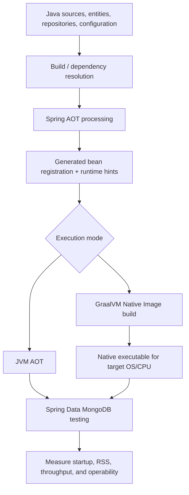

# AOT, native image, and limits to verify before adopting

## 1. Purpose and context

In **Spring Data MongoDB** projects, Java applications are normally packaged as JARs and run on the JVM. When aiming to reduce startup time and baseline memory footprint, teams may consider **Spring AOT (Ahead-of-Time)** and **GraalVM Native Image**. However, an application that runs properly on the JVM is not guaranteed to behave identically when compiled into a native executable.

That is because **Spring Data MongoDB** relies on several dynamic mechanisms: discovering entities and repositories, mapping BSON ↔ Java objects, invoking constructors, applying converters, proxies, classpath resources, and MongoDB Java Driver internals. Native Image applies *closed-world reachability analysis* at build time; parts only discovered via reflection or loaded dynamically at runtime may require additional metadata.

This lesson in the **Versions and Upgrades** chapter focuses on limits that must be **verified against your project's exact version combination** before moving from JVM to native. After this lesson, you will be able to:

- Distinguish Spring AOT, GraalVM Native Image, and standard JVM execution.
- Identify compatibility points across Spring Boot, Spring Framework, Spring Data MongoDB, MongoDB Java Driver, JDK, and GraalVM.
- Recognize cases needing `RuntimeHints` for reflection, proxies, resources, or JNI.
- Test mapping, repositories, `MongoTemplate`, aggregations, indexes, transactions, reactive access, and change streams inside a native executable.
- Diagnose build failures, startup failures, connection issues, and bugs that only appear on specific data execution paths.
- Plan performance benchmarks and reversible version transitions.

> **Principle:** AOT/native compatibility is a property of your **specific version combination, dependencies, configuration, and active code paths**. Never infer that all Spring Data MongoDB features are verified just because a native application starts up.

## 2. How does Spring AOT differ from Native Image?

### 2.1. Three execution modes

| Mode | Characteristics | What must be tested |
| --- | --- | --- |
| Standard JVM | Spring builds the context at runtime; Java bytecode runs on JVM/JIT | Mapping, beans, driver, and application features |
| JVM with Spring AOT | Parts of Spring/bean metadata are processed ahead of time | Bean behavior, conditional config, repositories, and hints |
| GraalVM Native Image | Application is compiled into a binary for a specific OS/architecture using reachability analysis | All business flows plus reflection, proxies, resources, TLS/JNI, and native performance |

**Spring AOT** is the process where Spring Framework/Boot analyzes statically known configuration at build time, generates bootstrap code, and emits runtime hints. **GraalVM Native Image** is the compiler toolchain producing a native executable. The two work together but are distinct: an app can run AOT-generated output on the JVM to catch certain configuration issues before building a native binary.



### 2.2. Closed-world and reachability

On the JVM, code can call `Class.forName(...)` or `getDeclaredConstructor(...)` with a class name decided at runtime. Native Image cannot predict every class loaded this way unless it appears in the reachable code graph or analyzable metadata.

Example:

```java
String typeName = configuration.getExportType();
Class<?> type = Class.forName(typeName);
Object instance = type.getDeclaredConstructor().newInstance();
```

This snippet works on the JVM when the class is on the classpath. In Native Image, that class and constructor may need **reflection hints**, or dynamic plugin loading may not fit a statically linked executable model at all.

A native error like "constructor/method not found via reflection" may be a reachability issue. That differs from MongoDB errors such as `AuthenticationFailed` or `MongoTimeoutException`, which stem from connectivity and credentials.

## 3. Lock down the version matrix before building

Never choose GraalVM, Spring Boot, Spring Data MongoDB, and MongoDB Driver versions independently. Start from the version set managed by **Spring Boot dependency management**, then inspect release notes and compatibility matrices for every component.

| Component | What to record | Why it matters for AOT/native |
| --- | --- | --- |
| **JDK** | Major version and build setup | Source/bytecode target, Java APIs, and GraalVM compatibility |
| **GraalVM / native-image toolchain** | Version, vendor, OS, architecture | Compiler/linker, TLS, filesystem, native libs, runtime environment |
| **Spring Boot** | Version and build plugins | AOT pipeline, auto-configuration, and native build integration |
| **Spring Framework** | Version managed by Boot | Bean AOT, reflection/resource hints, and proxies |
| **Spring Data MongoDB** | Version managed by Boot | Mapping, queries/repositories, converters, and AOT support |
| **MongoDB Java Driver** | Actual sync/reactive version | TLS, auth, BSON codecs, client settings, and native deps if used |
| **MongoDB Server** | Version/topology (standalone/replica set/sharded) | Transactions, change streams, aggregations, indexes, wire protocol |
| **App and extra libraries** | Converters, security, tracing, encryption, codecs, custom starters | Reflection, dynamic loading, JNI, or external resources |

**Verify per version:** AOT capabilities of repositories, conditions on query derivation, `@Query`/SpEL, custom converters, entity constructors, BSON codecs, and driver configuration. Capabilities evolve across releases; never publish a blanket "fully supported" claim without running the actual application.

### 3.1. Inspect actual dependencies

A common mistake is upgrading Spring Boot while manually pinning `spring-data-mongodb` or `mongodb-driver-sync` to an incompatible version. When debugging, inspect the **final dependency graph** rather than only reading declared versions in build files.

With Gradle:

```bash
./gradlew dependencies --configuration runtimeClasspath
```

With Maven:

```bash
./mvnw dependency:tree
```

Cross-check versions of Spring Data, MongoDB Driver, BSON, and related modules on the **runtime classpath**. When multiple starters or custom driver dependencies exist, look for version conflicts. Do not edit other modules' dependencies until the root cause is confirmed.

## 4. Workflow to build a native executable for testing

A Gradle-based Spring Boot project typically integrates **GraalVM Native Build Tools** and the Spring Boot plugin. The build step can produce a native executable directly or a container image depending on configured tooling.

Example commands when the project **already declares the right plugins and toolchain**:

```bash
# Linux/macOS: run JVM tests first.
./gradlew test

# If GraalVM Native Build Tools are configured:
./gradlew nativeCompile

# If the project configures nativeTest:
./gradlew nativeTest
```

Windows PowerShell:

```powershell
.\gradlew.bat test
.\gradlew.bat nativeCompile
```

These commands illustrate the workflow and **do not imply every project already defines** `nativeCompile` or `nativeTest` tasks. With Maven, the equivalent uses a native profile and the GraalVM plugin; match the plugin setup for your project's version.

Typical milestones:

1. **JVM baseline:** build, test, connect to MongoDB, and record metrics.
2. **Run AOT on JVM if supported by the pipeline:** catch bean, repository, and config discrepancies early.
3. **Native build:** watch for analysis, reflection, resource, static initialization, or native library errors.
4. **Run native executable against a test MongoDB:** verify CRUD, mapping, auth/TLS, queries, and advanced features.
5. **Test the actual target container/image:** verify certificates, architecture, secrets, and filesystem behavior.
6. **Measure performance/stability:** compare the same workload against the JVM baseline.

A native binary targets a specific OS and architecture. Never assume a Windows executable runs inside a Linux container or an x86_64 binary runs on ARM64 without a matching build. When building in CI/containers, check the OS base image, libc, linker, and availability of required native libraries.

## 5. Spring Data MongoDB mapping: what must remain reachable?

Spring Data MongoDB converts between Java objects and BSON using mapping metadata, converters, and sometimes reflection. Key elements include:

- `@Document`, `@Id`, `@Field`, `@Indexed`, `@Version`, and other mapping annotations.
- Constructors/creators used to instantiate entities from BSON.
- Property accessors, field access, getters/setters, and Java record components.
- `MappingMongoConverter`, custom `@ReadingConverter` / `@WritingConverter`.
- Nested types, collections, enums, `Instant`, `BigDecimal`, `ObjectId`, polymorphic subtypes, and type aliases.
- Application code specifying mapped classes **at runtime** by name, registry, or plugin.

### 5.1. Entities with explicit constructors

Example of an entity with a constructor so Spring Data can instantiate it on read:

```java
import java.time.Instant;
import org.springframework.data.annotation.Id;
import org.springframework.data.annotation.PersistenceCreator;
import org.springframework.data.mongodb.core.mapping.Document;

@Document("orders")
public class Order {

    @Id
    private final String id;
    private final String tenantId;
    private final String status;
    private final Instant createdAt;

    @PersistenceCreator
    public Order(String id, String tenantId,
                 String status, Instant createdAt) {
        this.id = id;
        this.tenantId = tenantId;
        this.status = status;
        this.createdAt = createdAt;
    }

    public String getId() { return id; }
    public String getTenantId() { return tenantId; }
    public String getStatus() { return status; }
    public Instant getCreatedAt() { return createdAt; }
}
```

Entity constructors and mapping metadata must be available in the target execution mode. Spring Data and Spring AOT support many models known at build time. However, **never assume dynamically chosen or generated classes are discovered automatically**.

A test that only saves a document (`save`) is insufficient. The read path (`findById`) may be the first place invoking constructors or field access differently and exposing a reachability gap.

### 5.2. Tests must exercise both conversion directions

```java
@Test
void orderRoundTripThroughMongoTemplate() {
    Order input = new Order(
            "ORD-NATIVE-01",
            "tenant-test",
            "PAID",
            Instant.parse("2026-11-20T00:00:00Z"));

    mongoTemplate.save(input);

    Order restored = mongoTemplate.findById(
            input.getId(), Order.class);

    assertThat(restored).isNotNull();
    assertThat(restored.getTenantId()).isEqualTo("tenant-test");
    assertThat(restored.getStatus()).isEqualTo("PAID");
    assertThat(restored.getCreatedAt()).isEqualTo(
            input.getCreatedAt());
}
```

This test requires a real test MongoDB (such as Testcontainers or an authorized test database). Run it **both on JVM and inside the native executable** to catch differences in reflection, constructor binding, or converters.

If the application defines custom converters, also test null values, nested objects, enums, and BSON documents written by previous app versions. Do not only write and read with the same new model version.

## 6. Repositories, queries, and proxies in AOT

Spring Data repositories generate implementations/proxies from repository interfaces and metadata. With AOT enabled, bean definitions and repository support can be processed differently than during fully dynamic JVM startup.

Example:

```java
public interface OrderRepository
        extends MongoRepository<Order, String> {

    List<Order> findByTenantIdAndStatus(
            String tenantId, String status);
}
```

For this repository, verify:

1. The repository bean is created inside the native executable.
2. Derived queries target the right fields after `@Field` and converters apply.
3. Queries enforcing tenant or access conditions work properly.
4. Paging, sorting, DTO/projection mapping, and custom repository fragments behave correctly.
5. Interface projections, nested proxies, or reflective method invocations have required metadata.

**Easy to miss:** repositories registered via runtime configuration outside the inputs visible to Spring AOT at build time. AOT cannot indefinitely discover classes or beans introduced after the binary is built. If the app selects packages/models/repositories via runtime plugins, redesign or generate controlled metadata/registrations.

### 6.1. `@Query`, SpEL, and repository fragments

Query styles that warrant dedicated testing:

- Query derivation: `findByStatusAndTenantId(...)`.
- `@Query` with static JSON queries or expressions supported by Spring Data.
- Queries using SpEL, parameter binding, or custom converters.
- `@Aggregation` on repositories and DTO/projection return types.
- Custom repository fragments implemented in separate classes with properly discovered beans/proxies.

A query parsing cleanly on the JVM does not guarantee every expression or class used on a rare branch is reachable in native. Test **real queries** and verify results rather than stopping once `ApplicationContext` starts.

## 7. MongoTemplate and dynamic mapping paths

`MongoTemplate` is flexible because it accepts `Class<?>`, collection names, or pipelines built at runtime. That flexibility demands extra scrutiny in Native Image.

Example:

```java
Class<?> domainType = registeredTypes.get(typeKey);
Object value = mongoTemplate.findById(id, domainType);
```

If `registeredTypes` holds classes picked solely from runtime metadata that never appear in build-time mapping/bean graphs, the native compiler may omit object-instantiation metadata for them.

Consider solutions in this order:

1. Prefer entity types **declared and discoverable** at build time.
2. Maintain an explicit allowlist registry of valid classes rather than accepting arbitrary class names from requests.
3. Run actual read/write paths to pinpoint which **class/constructor/property** lacks hints.
4. Register **specific `RuntimeHints`** for verified dynamic components.
5. For plugins loading external JARs after binary compilation, revisit the architecture; reflection metadata does not turn Native Image into an open-ended dynamic classpath JVM.

## 8. RuntimeHints: filling in exactly what Spring AOT cannot see

`RuntimeHints` is the Spring Framework API for registering metadata needed when building a native image, such as **reflection**, **JDK proxies**, **resources**, **serialization**, or **JNI**, depending on the use case. Not every entity needs manual hints: Spring Data and the framework already contribute hints for discovered classes and beans.

Suppose `LegacyAuditPayload` is only mapped via a dynamic registry and native build/testing shows missing reflection metadata. You can register it explicitly:

```java
import org.springframework.aot.hint.MemberCategory;
import org.springframework.aot.hint.RuntimeHints;
import org.springframework.aot.hint.RuntimeHintsRegistrar;

public final class MongoRuntimeHints implements RuntimeHintsRegistrar {

    @Override
    public void registerHints(RuntimeHints hints,
                              ClassLoader classLoader) {

        hints.reflection().registerType(
                LegacyAuditPayload.class,
                MemberCategory.INVOKE_DECLARED_CONSTRUCTORS,
                MemberCategory.INVOKE_PUBLIC_METHODS,
                MemberCategory.DECLARED_FIELDS);
    }
}
```

Enable the registrar in Spring configuration:

```java
import org.springframework.context.annotation.Configuration;
import org.springframework.context.annotation.ImportRuntimeHints;

@Configuration(proxyBeanMethods = false)
@ImportRuntimeHints(MongoRuntimeHints.class)
class MongoNativeConfiguration {
}
```

In this example, `LegacyAuditPayload` is a project-defined business class that must exist at build time. Chosen `MemberCategory` flags should match how the library accesses the class; there is no reason to expose every field and method of every MongoDB-mapped class indiscriminately.

### 8.1. Unit-test hints before building the executable

You can test declared metadata with `RuntimeHintsPredicates`:

```java
@Test
void legacyPayloadConstructorIsRegistered() {
    RuntimeHints hints = new RuntimeHints();
    new MongoRuntimeHints().registerHints(
            hints, getClass().getClassLoader());

    assertThat(RuntimeHintsPredicates.reflection()
            .onType(LegacyAuditPayload.class)
            .withMemberCategory(MemberCategory.INVOKE_DECLARED_CONSTRUCTORS)
            .test(hints))
            .isTrue();
}
```

This only verifies part of the metadata; it **does not prove the native executable works**. You must still build the native binary and test actual class access paths.

### 8.2. Resources, proxies, and serialization

Other cases that may need hints:

| Category | Example | How to verify |
| --- | --- | --- |
| **Reflection** | Dynamically selected entity/converter classes, unreachable constructors | Test BSON → Java reading |
| **JDK proxy** | Custom interface proxies outside Spring AOT auto-detection | Instantiate proxy and invoke methods in native |
| **Resources** | JSON Schemas, pipeline templates, config files on classpath | Read the resource via its real code path in native |
| **Serialization** | Data using Java serialization in third-party libraries | Test serialize/deserialize of target types |
| **JNI** | Third-party libraries calling native code | Verify toolchain, metadata, and native libraries on target OS |

A resource sitting on the classpath is not automatically included in a Native Image in every scenario. When loading files dynamically via `ClassLoader.getResourceAsStream(...)`, check **resource patterns** or file provisioning.

Meanwhile, external config files outside the image (such as a mounted truststore in a container) must be tested as **runtime files**; never bake secrets into the binary "just to make it run."

### 8.3. Never open reflection across entire packages

Overly broad metadata increases binary size, build times, attack surface, and hides dynamic loading flaws. Only add hints backed by evidence of missing reachability and matching tests. Spring AOT and libraries likely already generate hints for common paths.

## 9. Custom converters, BSON codecs, and dynamic schemas

MongoDB mapping can use converters configured via `MongoCustomConversions`:

```java
@ReadingConverter
public class MoneyReadConverter
        implements Converter<Document, Money> {

    @Override
    public Money convert(Document source) {
        return new Money(
                source.getString("currency"),
                source.get("amount", Decimal128.class).bigDecimalValue());
    }
}
```

This example shows a converter reading a BSON document into a value object, assuming `amount` is stored as BSON Decimal128 and importing `org.bson.types.Decimal128`. When converters are registered explicitly as Spring beans/config, the framework has better visibility for AOT processing. If converters are discovered via class names in properties or reflective registries at runtime, test reachability explicitly.

Scenarios to verify:

- Constructors and field access on nested/polymorphic types.
- `@TypeAlias` and `_class` values on legacy documents.
- Custom `CodecRegistry` or reflectively instantiated BSON codecs.
- `BigDecimal`, temporal types, enums, Java records, generic collections, and null fields.
- Converters only triggered by rare collections or legacy event types.
- Schema validation or aggregations mapping results into dynamic DTOs.
- Round-trip compatibility between data written by an **older JVM version** and read by a **new native version**.

Especially with `_class` or subtype discriminators: historical documents may reference types unseen by AOT at startup. If those types must remain readable, verify aliases/mappings and supply exact hints or a migration strategy.

## 10. Aggregations, indexes, transactions, and repositories in native

Native Image does not directly alter MongoDB Server limits: BSON size limits, aggregation memory limits, indexes, locking, or transaction support are still governed by the server and topology. However, query construction, result mapping, and metadata loading on the Java side can behave differently.

### 10.1. Aggregations

Verify a real pipeline:

```java
Aggregation pipeline = Aggregation.newAggregation(
        Aggregation.match(
                Criteria.where("tenantId").is(tenantId)),
        Aggregation.group("status")
                .count().as("count"),
        Aggregation.sort(Sort.Direction.DESC, "count")
);

AggregationResults<StatusCount> result =
        mongoTemplate.aggregate(
                pipeline, "orders", StatusCount.class);
```

`StatusCount` is a project-defined read model that must map `_id` and `count` properly. If it only executes on a rarely used branch, native tests must cover that branch. For `@Aggregation` or dynamically constructed projections, also check how Spring Data instantiates result types.

### 10.2. Indexes

Verify `@Indexed`, `@CompoundIndex`, or manual index creation strategies in both modes. **Annotations do not guarantee indexes exist in the database**; automatic index creation depends on configuration and Spring Data version. Compiling an app to native must never silently alter index migration workflows managed by operations.

Example conditional inspection:

```java
IndexOperations indexes =
        mongoTemplate.indexOps(Order.class);

List<IndexInfo> indexInfo = indexes.getIndexInfo();
// Verify index names/keys required by business queries.
```

Tests should inspect both index metadata and `explain` plans for critical queries. A query that runs yet drops its index can degrade production performance.

### 10.3. Transactions

When using `MongoTransactionManager` or `ReactiveMongoTransactionManager`, verify:

- The MongoDB deployment supports transactions.
- `ClientSession` and the transaction manager bean are instantiated properly.
- `@Transactional` or `TransactionalOperator` actually binds operations into the transaction.
- Rollback behavior when the second operation fails.
- Transaction beans/proxies and custom settings work inside the native executable.

Valuable test case: run two operations inside one transaction, intentionally fail the second, and assert the database reflects a full rollback. Testing only a single successful write **does not test transactions**.

## 11. Reactive access and change streams

When using `spring-boot-starter-data-mongodb-reactive`, verify the **reactive driver** and `ReactiveMongoTemplate`/reactive repositories independently of blocking paths:

- Creating a `Mono`/`Flux` issues no network request until subscribed.
- Nested entity mapping and converters work once the publisher is subscribed.
- Reactive transactions require the right manager and reactive context configuration.
- Change streams require a supporting replica set/sharded deployment and working token/timeout logic.
- `retryWhen(...)` neither fixes non-resumable errors nor replaces checkpoints.
- If an app runs both blocking and reactive clients, verify TLS, auth, and database config on **both clients**.

Example reactive smoke test with a real subscription:

```java
StepVerifier.create(
        reactiveMongoTemplate.findById(
                "ORD-NATIVE-01", Order.class))
    .assertNext(order ->
            assertThat(order.getStatus()).isEqualTo("PAID"))
    .verifyComplete();
```

In end-to-end tests, seed the test document first and verify the flow does not block the event loop. Merely constructing a `Mono` without subscribing proves neither MongoDB connectivity nor reflection hints.

For change streams, a smoke test that just opens the stream may not trigger event deserialization branches. Emit a real test event, consume it, persist its resume token, restart the consumer, and verify resumption under idempotency rules.

## 12. MongoDB Driver, TLS, DNS, authentication, and runtime resources

Connectivity failures are often **not AOT bugs**. A native executable still requires a valid URI, working DNS, TLS trust chain, valid credentials, proper `authSource`, and namespace privileges. However, native packaging can change how files/certificates are loaded and how libraries initialize.

### 12.1. Connection and configuration

Example configuration via environment variable:

```properties
spring.data.mongodb.uri=${MONGODB_URI}
```

MongoDB property names in Spring Boot can vary across versions. Check the configuration reference matching the **version you are upgrading to**; do not copy a property from an older version assuming it binds identically.

If declaring a manual `MongoClient` bean, Spring Boot auto-configuration may no longer control the client settings. In native runs, verify the **actual bean** and resulting settings, not just environment variables.

### 12.2. TLS truststore and resources

In Java containers, custom CAs may be supplied via truststore files and JVM properties. In native executables, truststore/SSL mechanics depend on the toolchain, platform, and build setup. Verify directly:

1. TLS connects to the right host with a valid certificate.
2. Configured CA files are accessible inside the target OS/container.
3. Hostnames in the URI match certificate SANs.
4. If mTLS client certificates or key files are needed, check paths and file permissions.
5. When building container images, verify CA bundles and runtime config are properly copied/mounted.

**Never embed private keys, passwords, or KMS tokens inside a native binary**. Keep secrets external at runtime and restrict read permissions.

### 12.3. DNS SRV and networking

`mongodb+srv://` relies on DNS SRV/TXT lookups and connecting to the resolved hosts. When running native in a different runtime image than JVM, verify DNS resolvers, DNS policies, network policies, security groups, replica set advertised hostnames, and ports. A binary that boots in milliseconds yet cannot resolve SRV records still cannot reach MongoDB.

### 12.4. CSFLE, crypt_shared, libmongocrypt, and JNI

If using **Client-Side Field Level Encryption (CSFLE)** or Queryable Encryption, some setups require native encryption components or query-analysis libraries matching your MongoDB Driver version. Verify these specifically when packaging as a GraalVM Native Image:

- Does the native library matching the binary's **OS/architecture/ABI** exist at runtime?
- Can the driver load the library from supported paths and mechanisms?
- Do `AutoEncryptionSettings`, key vault, DEKs, and KMS work in native execution?
- Does the library/driver/version support Native Image in your chosen stack?
- Are encryption-related resources, JNI metadata, SSL/KMS settings, and files packaged correctly?

**Never assume "having `@Encrypted`" means a native build supports encryption automatically.** Encryption components depend on external native libraries and multiple versions; run end-to-end tests proving values are stored in MongoDB as ciphertext and decrypted only by authorized clients.

If the vendor/toolchain does not support this combination yet, consider keeping encryption-heavy services on the JVM or adjusting architecture after evaluation. Never disable encryption to bypass a build failure.

## 13. Common native issues and root-cause triage

| Symptom | Possible cause | Triage direction |
| --- | --- | --- |
| Native build fails to produce executable | Unsupported API, class initialization, JNI, native library, or missing toolchain | Inspect build log, dependency graph, and toolchain compatibility |
| Native startup fails on bean/repository | Bean registration, conditional config, or proxy mishandled | Compare JVM AOT vs. native; inspect bean declarations |
| Only reading a new entity throws reflection error | Dynamically chosen class/constructor/converter lacks hints | Test that exact mapping and add narrow `RuntimeHints` |
| Reading classpath resource fails | Resource excluded from image | Register resource hints or supply a runtime file properly |
| TLS fails only in production | Missing truststore/CA/SAN or runtime file | Test with exact trust chain and hostname on target image |
| SRV URI fails inside container | DNS/network policy differs from dev | Query SRV/TXT records and TCP connectivity from the target container |
| `AuthenticationFailed` or `Unauthorized` | Wrong `authSource`, secret, database, or role | Fix credentials/roles; do not tweak hints blindly |
| CSFLE fails to load library | Missing native dependency, ABI mismatch, or library path | Verify driver/vendor support and packaging |
| JVM tests pass yet native maps data wrongly | Rare conversion path, unreachable class, or different profile | Reproduce case in native; inspect converters/type aliases |
| Native works yet is slower at steady state | Runtime optimization, I/O, queries, pooling, or memory config differences | Benchmark identical workloads before drawing conclusions |

### 13.1. Separating build-time from runtime failures

- **Build-time**: compiler errors, class initialization, static build hooks, native library linking. Read native-image logs and relevant dependencies; do not alter MongoDB URIs unless the build erroneously tries to contact an external service.
- **Startup-time**: missing beans, mismatched conditional profiles, missing resources, bad properties. Compare context/auto-configuration and hints.
- **Operation-time**: mapper deserializing subtypes, rare repository methods, custom converters, MongoDB connections, or aggregations. Tie errors to **specific operations and entity types** to tell missing hints from server/driver bugs.
- **Load-time**: GC/memory, heap, connection pool, concurrency, and response latency. Benchmark instead of assuming "native is always faster."

### 13.2. Do not debug by adding random hints

If you see `MongoTimeoutException`, do not add reflection hints. If `LegacyAuditPayload`'s constructor is missing, do not raise server selection timeouts. Classify the exception, pinpoint the phase, and reproduce with a minimal test before changing config.

## 14. Minimum native verification matrix

A Spring Data MongoDB app typically contains code paths never exercised during startup. Run **the same test dataset and equivalent MongoDB environment** across both JVM and native.

| Test area | Cases to run | What to verify |
| --- | --- | --- |
| Bootstrap / configuration | Create context with target profile, MongoClient bean | AOT omits no beans; config binds properly |
| URI / DNS / TLS / auth | Connect to test DB with production-like URI | Network, secrets, CA, and `authSource` work |
| CRUD | Insert, findById, updateFirst, delete under test roles | Driver + bidirectional mapping |
| Entity mapping | Nested objects, enums, Java Time, records/constructors, `@Field` | Converters/reflection work |
| Repositories | Derived queries, `@Query`, custom fragments, paging | Proxies/query infrastructure operate |
| Projections | Interface projections and dynamic DTOs | No missing proxy/metadata |
| Aggregations | `$match`, `$group`, `$lookup`/`$project`, DTO output | Stage mapping and exact results |
| Indexes | Verify required indexes, `explain` critical queries | Index strategy unchanged |
| Transactions | Commit, rollback, failure mid-operation | Transaction manager/sessions work |
| Reactive | Subscribe to `Mono`/`Flux`, backpressure paths | Reactive driver and mapping actually execute |
| Change streams | Receive events, restart with token, safe reprocessing | Stream lifecycle and checkpoints hold |
| CSFLE if used | Write encrypted fields, verify ciphertext, decrypt | Native libs, KMS, key vault functional |
| Resources | Read templates, JSON schemas, supported certificates | Classpath/runtime files accessible |
| Observability | Health checks, metrics, logs/traces | No secret/PII leaks; errors observable |
| Load and restarts | Cold start, steady state, shutdown, and reconnect | Startup, RSS, latency, connection pool |

**Never mark PASS solely because JVM tests or MongoDB-less unit tests passed.** Native tests must execute the **actual compiled binary** or native-compiled test suites against a real driver and database.

### 14.1. Most valuable tests for hidden gaps

Suppose an entity is only read when `status=ARCHIVED`. Seed archived data and exercise that repository method, custom converter, or report inside native. A binary tested only on `/health` will never touch that class and will miss absent reflection hints.

Similarly, if an aggregation maps into a DTO with a special constructor, test a **non-empty** result so the mapper must instantiate the DTO. A pipeline returning 0 documents passes without exercising the failing instantiation path.

## 15. Comparing JVM vs. native performance on the same workload

Native Image can improve cold start and memory footprint on certain workloads, but there is no universal guarantee that throughput or p99 latency will beat a warmed-up JVM.

For a fair comparison:

1. Use the same app version, dataset, indexes, tenant count, URI, pool settings, and MongoDB Server.
2. Measure **time to useful readiness**, i.e., until an authenticated MongoDB query succeeds; do not stop at process creation.
3. Measure **RSS/working set**, heap, and container limits across concurrency levels.
4. Measure p50/p95/p99 for CRUD, aggregation, and reactive endpoints with representative payloads.
5. Measure throughput, connection counts, retries/errors, and CPU on both app and MongoDB.
6. Separate **cold start** from **steady state**; repeat runs so cache/index/network variance is not misattributed to the compiler.
7. Account for build cost, CI duration, executable/image size, and operational complexity.
8. Compare against an appropriately tuned JVM baseline (memory settings, CDS/AOT, or container sizing) if used.

Example benchmark table to populate with real numbers:

| Metric | JVM baseline | AOT JVM | Native |
| --- | --- | --- | --- |
| Startup to readiness with successful MongoDB query | Measure | Measure | Measure |
| Idle RSS | Measure | Measure | Measure |
| P95 `GET /orders/{id}` | Measure | Measure | Measure |
| P95 report aggregation | Measure | Measure | Measure |
| Throughput at equal error rate | Measure | Measure | Measure |
| Build time + image size | Measure | Measure | Measure |

For MongoDB-backed services, most latency often comes from network, indexes, or queries; compiling Java to native does not replace query, index, and schema tuning.

## 16. Upgrade, canary, and rollback workflow

To transition a Spring Data MongoDB service from JVM to native safely:

1. **Lock supported versions** and record the dependency graph and toolchain; capture the current JVM baseline.
2. **Inventory active features**: repositories, converters, MongoTemplate, reactive, transactions, change streams, CSFLE, indexes, security/metrics.
3. **Run functional tests on JVM** and identify legacy data formats needing compatibility.
4. **Enable AOT and build native**; resolve each reachability, resource, proxy, or native library error explicitly.
5. **Run the integration/native matrix** against MongoDB matching production topology and roles.
6. **Benchmark** with identical workloads against startup, RSS, latency, and error-rate criteria.
7. **Canary a small instance slice**; watch fail counts, connection pools, query latency, GC/memory, event lag, and error rates.
8. **Prepare rollback** to the matching JVM artifact in case native hits an edge-case failure; ensure no irreversible schema/data changes occur.
9. **Scale rollout** once evidence meets criteria; document accepted constraints and required tests for future upgrades.

**Data migration note:** switching JVM → native runtime does not inherently require changing document structure. If you simultaneously upgrade Spring Data/Driver and alter mappings, converters, `_class`, transaction semantics, or default UUID representations, treat that as a **separate data compatibility change**. Separating the two makes root-cause analysis and rollback much simpler.

### 16.1. Signals that must halt rollout

- Native binary writes or reads different values than JVM for identical BSON.
- Transaction rollbacks fail to preserve business invariants.
- Existing legacy/polymorphic documents fail to deserialize.
- Change streams miss events or mishandle checkpoints on restart.
- Missing certificates, KMS access, or native encryption libraries in target environments.
- Error rates or p95/p99 latency exceed thresholds under identical workload.
- Rare business paths remain unverified in native.

## 17. Practice exercise

**Scenario:** an order-management service using Spring Data MongoDB contains:

- `OrderRepository` with derived queries by `tenantId` and status.
- `MongoTemplate` building reporting aggregations; DTO `StatusCount` is only used on the reporting endpoint.
- A `MappingMongoConverter` with a custom converter for `Money`.
- A reactive worker tailing a change stream to update a read model.
- MongoDB connected over TLS using an internal CA and an SRV URI.
- A `LegacyAuditPayload` type selected from runtime config for historical records.

Tasks:

1. List the classes/beans and paths Spring AOT can likely discover statically, alongside dynamic paths needing reachability verification.
2. Write a minimal `RuntimeHintsRegistrar` for `LegacyAuditPayload` after proving metadata is missing; explain why you do not register the entire package.
3. Write native tests for `save + findById` and an aggregation returning at least one `StatusCount`, including legacy BSON data.
4. Run `ReactiveMongoTemplate`/change stream with a real subscription, save a token, restart, and verify checkpointing.
5. Verify SRV DNS resolution from inside the container, CA certificates, database privileges, and connection counts before blaming native compilation.
6. Measure startup-to-readiness, RSS, API p95, and event processing rate on the same dataset for JVM vs. native.
7. Describe the rollback plan if mapping or encryption libraries fail in native.

### Self-check questions

1. How do Spring AOT and GraalVM Native Image relate and differ?
2. Why can an `ApplicationContext` boot cleanly in native yet still throw a reflection error when reading a rare entity?
3. When should you add `RuntimeHints` for MongoDB mapping, and when are manual hints unnecessary?
4. Why does testing only `save` fail to verify BSON → Java reading?
5. What needs checking in native for `@Query`, custom repository fragments, and interface projections?
6. Is a `MongoTimeoutException` in a native binary necessarily an AOT bug?
7. Why should you never embed passwords or private keys in an executable to fix TLS/KMS errors?
8. What must you measure before concluding a native image improves performance?
9. What is the rollback risk if both a Spring Data upgrade and a native switch alter mappings together?
10. Does an unsubscribed reactive pipeline prove it works in native?

## 18. Key takeaways

- **Spring AOT** generates bootstrap code and metadata at build time; **GraalVM Native Image** compiles a native executable using reachability analysis.
- **Spring Data MongoDB** has dynamic mapping/repository/proxy/converter paths that must be verified on real data, especially classes used only in rare branches.
- **RuntimeHints** fill gaps for reflection, proxies, or resources unseen by AOT; register only needed classes/members and keep matching tests.
- **CRUD, aggregations, indexes, transactions, reactive flows, and change streams** require native integration tests, not just JVM unit tests.
- **MongoDB Java Driver** still requires valid URIs, DNS SRV/TXT, TLS, `authSource`, privileges, and topology; those errors are not automatically native bugs.
- **CSFLE/Queryable Encryption** requires verifying native/JNI libraries, key vault, and KMS in the exact target environment.
- **Performance must be measured** on identical workloads: startup-to-readiness, RSS, throughput, p95/p99, build cost, and error rates.
- **Safe upgrades** require a version/dependency matrix, legacy data tests, canarying, monitoring, and an actionable rollback path.

Native Image can be a strong choice for certain Spring Data MongoDB services, especially when cold start and footprint are top priorities. Deployment decisions should rest on **verified compatibility and real operational metrics**, while upholding data correctness, security, and MongoDB query reliability.
