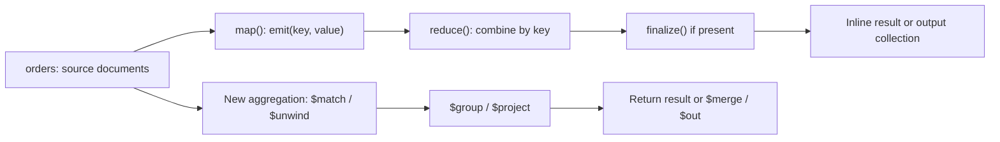
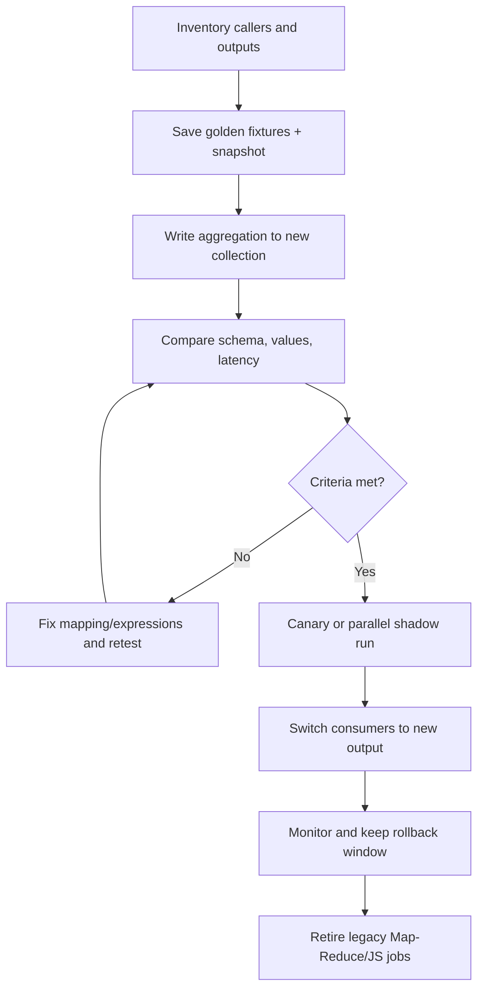

# Taking over legacy systems using Map-Reduce or server-side JavaScript

## Objectives

This lesson belongs to the **Versions and Upgrades** chapter of **SPRING_DATA_MONGODB**. When taking over a Java application using Spring Data MongoDB to connect, map documents, and operate on MongoDB via `MongoTemplate` or repositories, you may encounter data-aggregation logic written years ago with **Map-Reduce**, `$where`, `$function`, `$accumulator`, or JavaScript code stored in the database.

The goal is not merely getting old code to survive a server upgrade. You must understand **the inputs, calculation semantics, output shape, schedule, and write target**, then migrate to an aggregation pipeline or appropriate application code.

After this lesson, you will be able to:

- Identify usages of Map-Reduce and server-side JavaScript in applications, background jobs, operational scripts, and the database.
- Cross-check feature support status across MongoDB and Spring Data MongoDB versions, especially changes from MongoDB 5.0 through 9.0.
- Convert `emit(key, value) + reduce()` logic into `$match`, `$unwind`, `$group`, `$project`, and `$merge`/`$out` when persisting output.
- Replace `$where` with native query operators or `$expr` where possible; evaluate JavaScript logic that cannot be translated directly.
- Write the equivalent aggregation with `MongoTemplate`, compare legacy vs. new outputs, verify performance, roll out under control, and prepare a rollback.

> **Takeover principle:** Do not mechanically swap each Map-Reduce step for a stage with a similar-sounding name. Preserve the **semantics** of the computation—especially item counts, filter conditions, grouping rules, `finalize`, and output write mode.

## 1. Why do these legacy features matter during an upgrade?

### How does Map-Reduce work?

MongoDB Map-Reduce executes JavaScript functions inside the server process:

1. The **map** function reads each document and calls `emit(key, value)` zero, one, or many times.
2. The **reduce** function combines `value`s sharing the same `key`; how and how often reduce is invoked must not depend on processing order.
3. The **finalize** function (optional) computes final fields.
4. Output can be returned **inline** or written to a collection with modes like replace, merge, or reduce.



Some systems layer on more logic: `query` filters input, `sort` and `limit` alter the processed subset, `scope` injects JavaScript variables, `finalize` adds fields, and `out` controls behavior against existing data. Overlooking any piece during migration can skew reports silently without throwing errors.

### Key compatibility matrix

| Version / API | What changed | Action on takeover |
| --- | --- | --- |
| MongoDB 4.2 | Legacy `eval` command / `db.eval()` helper removed; `db.collection.group()` is also no longer an appropriate path | Move logic to native queries, aggregations, or app code; do not rely on `db.eval()` |
| MongoDB 5.0+ | **Map-Reduce deprecated**; MongoDB recommends aggregation pipelines | Prefer `$group`, `$project`, `$merge`; do not build new features on Map-Reduce |
| MongoDB 6.0 | JavaScript engine switched from MozJS-60 to MozJS-91; several non-standard legacy string/array APIs removed | Re-test every JS function still in use, not just ordinary queries |
| MongoDB 8.0 | `$where`, `$function`, `$accumulator` marked **deprecated**; server logs warnings | Plan reducing reliance; monitor logs and upgrade plans |
| MongoDB 9.0 | Those three JavaScript operators are **no longer deprecated** and run on a WebAssembly (WASM)-based JS engine; Map-Reduce **remains deprecated since 5.0** | Do not repeat outdated claims that 9.0 still deprecates those three operators; continue preferring native pipelines where expressible |
| MongoDB 9.0, temporal change | *Local-time* Date operations in server-side JS use **UTC** instead of the host's time zone as in earlier versions | Check daily/monthly grouping, `getHours()`, `getDate()`, `toString()`; prefer `$dateTrunc` with explicit time zones |
| Spring Data MongoDB 3.4+ | Certain `MongoTemplate.mapReduce(...)` overloads marked deprecated with guidance to move to `aggregate(...)` | Check Javadoc of your exact dependency version; design new aggregations |

**Common confusion:** "Deprecated" does not mean "removed in the same release." Version 9.0 changed the status of `$function`, `$accumulator`, and `$where`, yet Map-Reduce remains recommended for replacement as a separate matter. Always check **actual server version, driver/Spring Data version, FCV, and configuration** before making upgrade decisions.

## 2. Inventory the legacy system before editing

A solid takeover begins with an **inventory table**, not by rewriting calls wholesale.

| Source to inspect | Indicators | Details to record |
| --- | --- | --- |
| Java/Spring Data | `MongoTemplate.mapReduce(...)`, `MapReduceOptions`, JS resources, repository annotations, or raw command callbacks | Active APIs, script origin, input/output collections, runtime mapping |
| Ops jobs/scripts | `db.collection.mapReduce(...)`, `db.runCommand({mapReduce:...})`, `$where` | Schedule, executing user, parameters, privileges, timeouts, `out` mode |
| Aggregations | `$function`, `$accumulator`, `$where` in query predicates | JavaScript body, data sources, null/type handling, key scope |
| Legacy database | `system.js` collection, materialized output collections, index metadata | Whether functions are still invoked or leftover artifacts; who reads outputs |
| MongoDB config | `security.javascriptEnabled`, `--noscripting`, role privileges, server version | Which commands will fail if scripting is disabled; environment constraints |
| Report consumers | APIs, dashboards, batch jobs, exports, downstream jobs | Expected schema: `_id`, `value`, numeric types, TTL, data freshness |

**Read-only** source code search pattern for operators to run in their repository when authorized:

```bash
rg -n -i 'mapReduce|MapReduceOptions|\$where|\$function|\$accumulator|system\.js|db\.eval|ExecutableMongoScript' .
```

`rg` hits are only leads: code might assemble pipelines dynamically, store JavaScript in resource files, load it from config, or run from another application. Finding zero calls in one repository **does not prove** the server no longer relies on the feature.

Example inventory table:

| ID | Legacy task | Input | Output | Frequency | Consumer | Risk level |
| --- | --- | --- | --- | --- | --- | --- |
| MR-01 | Total quantity per SKU | `orders`, `PAID` only | `sku_totals` | Nightly | Reporting UI | High: overwrites collection |
| JS-02 | Filter orders exceeding threshold calculated in JS | `orders` | Query result | Per request | API | Medium: slow, hard to optimize |
| JS-03 | Scoring function stored in `system.js` | `customers` | Computed field | Hourly | Segmentation job | High: depends on JS engine |

Do not guess risk from a feature's name: check business impact, rollback needs, run frequency, and whether anything else **writes into** the output collection.

### Distinguishing `mongosh` JavaScript from server-side JavaScript

A `.js` file executed via `mongosh` is primarily **client/shell-side code** sending commands to MongoDB. Server-side JavaScript only executes on the database server when a script uses `mapReduce`, `$where`, `$function`, `$accumulator`, or related server-side mechanisms.

For example, `db.orders.aggregate([{ $group: ... }])` written inside a `.js` file **does not turn** the aggregation into server-side JavaScript; standard `$group` runs inside MongoDB's native query engine. This distinction is vital when preparing to disable scripting to shrink server surface area.

## 3. Model Map-Reduce semantics with a minimal example

Suppose the legacy system aggregates **total product quantities** across `PAID` orders, grouped by SKU. Test collection `legacy_orders`:

```javascript
db.legacy_orders.insertMany([
  {
    _id: "o-1", status: "PAID",
    items: [{ sku: "P1", qty: 2 }, { sku: "P2", qty: 1 }]
  },
  {
    _id: "o-2", status: "PAID",
    items: [{ sku: "P1", qty: 3 }, { sku: "P2", qty: 2 }]
  },
  {
    _id: "o-3", status: "CANCELLED",
    items: [{ sku: "P1", qty: 9 }]
  },
  {
    _id: "o-4", status: "PAID",
    items: [{ sku: "P3", qty: 4 }]
  }
]);
```

The true business result is **P1 = 5, P2 = 3, P3 = 4**. This represents *total unit quantity*, not the count of distinct orders containing each SKU. This example uses small integers to focus on logic; systems handling money or large counts should choose `Decimal128` or `Long` appropriately.

### Legacy Map-Reduce: inspect only in a test database

```javascript
// Legacy example for comprehension and baseline comparison; do not deploy new uses.
const mapFn = function () {
  for (const item of (this.items || [])) {
    emit(item.sku, item.qty);
  }
};

const reduceFn = function (key, values) {
  return values.reduce((total, qty) => total + qty, 0);
};

db.legacy_orders.mapReduce(
  mapFn,
  reduceFn,
  {
    query: { status: "PAID" },
    out: { inline: 1 }
  }
);
```

The map function emits one `key/value` pair **per order line item**; a single order can emit multiple SKUs. The reduce function sums values per key; the `query` filter excludes `CANCELLED` orders upfront.

Map-Reduce output shape:

```javascript
[
  { _id: "P1", value: 5 },
  { _id: "P2", value: 3 },
  { _id: "P3", value: 4 }
]
```

`mapReduce` is deprecated; this example is strictly for studying legacy behavior in an environment where the command still runs with `security.javascriptEnabled` on. When auditing old code, check whether the reducer uses `finalize`, references `scope` variables, or relies on other `out` modes. A valid reducer must not depend on grouping order or how many times the server calls reduce; multi-level reduction can pass **already-reduced values** back into the reducer.

### Converting to a native MongoDB aggregation

```javascript
const skuTotalsPipeline = [
  { $match: { status: "PAID" } },
  { $unwind: "$items" },
  {
    $group: {
      _id: "$items.sku",
      value: { $sum: "$items.qty" }
    }
  },
  { $sort: { _id: 1 } }
];

db.legacy_orders.aggregate(skuTotalsPipeline);
```

The new pipeline produces the exact same `_id` and `value` structure as Map-Reduce. Stage mapping:

| Legacy Map-Reduce | New pipeline | What must be preserved |
| --- | --- | --- |
| `query: {status:"PAID"}` | `$match` before `$unwind` | Identical input document set |
| Loop over `items` and `emit(item.sku, item.qty)` | `$unwind: "$items"` | One element feeds one group entry |
| `reduce(key, values)` summing `qty` | `$group` with `$sum` | Same grouping key, sum operation, and numeric type rules |
| `finalize` (if present) | `$set`/`$project` after `$group` | Compute final fields in the right order |
| `out: {inline:1}` | `aggregate(...)` returning cursor | Consumers can iterate results in batches |

**Subtle bug warning:** A Map-Reduce calling `emit(sku, 1)` **counts line items**, not `qty`. If the old map emitted **once per order** even when items repeated, switching to `$unwind` could inflate counts. Write tests for orders with duplicate SKUs, empty arrays, `null` arrays, and missing `qty` fields before locking in the equivalent pipeline.

If the goal is **distinct order count per SKU**, consider `$addToSet: "$_id"` followed by `$size`, or two-stage grouping by `(sku, orderId)`; never blindly use `$sum: 1` right after `$unwind`.

## 4. Writing the pipeline with `MongoTemplate` instead of `mapReduce()`

In modern Spring Data MongoDB, prefer `Aggregation` or `TypedAggregation` for Java → BSON field mapping and explicit stage control.

Sample entities matching the test dataset:

```java
import java.util.List;
import org.springframework.data.annotation.Id;
import org.springframework.data.mongodb.core.mapping.Document;

@Document("legacy_orders")
public record OrderDocument(
    @Id String id,
    String status,
    List<OrderLine> items
) {
    public record OrderLine(String sku, long qty) {}
}

public record SkuTotal(String sku, long quantity) {}
```

These are two Java types placed in **two separate files** `OrderDocument.java` and `SkuTotal.java` for a Java 17+ example. In real entities, persisted fields may use `@Field` or custom converters; verify mappings before converting.

Equivalent aggregation:

```java
import java.util.List;
import org.springframework.data.mongodb.core.MongoTemplate;
import org.springframework.data.mongodb.core.aggregation.Aggregation;
import org.springframework.data.mongodb.core.aggregation.AggregationResults;
import org.springframework.data.mongodb.core.aggregation.TypedAggregation;
import org.springframework.data.mongodb.core.query.Criteria;

TypedAggregation<OrderDocument> pipeline =
    Aggregation.newAggregation(
        OrderDocument.class,
        Aggregation.match(Criteria.where("status").is("PAID")),
        Aggregation.unwind("items"),
        Aggregation.group("items.sku")
            .sum("items.qty").as("quantity"),
        Aggregation.project("quantity")
            .and("_id").as("sku")
            .andExclude("_id")
    );

// template is a Spring-managed MongoTemplate bean.
AggregationResults<SkuTotal> output =
    template.aggregate(pipeline, SkuTotal.class);

List<SkuTotal> totals = output.getMappedResults();
```

Here `$group` emits `_id` as the SKU, and `$project` renames it to `sku` to map onto the `SkuTotal` DTO. Because the new DTO uses `sku` and `quantity`, it changes the old `{_id, value}` shape. If consumers still depend on the old schema, keep `_id` and `value` in the output and map them with a matching DTO; that is a **data contract decision**, not a minor syntax choice.

`MongoTemplate.mapReduce(...)` may still appear in source code and Javadoc across Spring Data versions; certain overloads were deprecated in Spring Data MongoDB 3.4. Do not assume all overloads behave identically or that every Spring Data release removed the API completely; check Javadoc for your exact version. For upgraded code, add tests comparing both calculations and migrate business logic to `MongoTemplate.aggregate(...)`.

### If the application uses repositories

`@Aggregation` on repositories works for multi-stage pipelines when appropriate, but for long-running jobs needing materialization control, `explain`, batching, and write-error handling, `MongoTemplate` is usually clearer. Whether called via repository or template, **MongoDB Server** governs execution plans and `$group`/`$merge` rules.

## 5. New output write mode is the easiest place to lose data

Legacy Map-Reduce jobs often write to an output collection instead of returning inline results. When moving to aggregation, identify **the nature of the output**:

- Is it a **full recomputed table** derived from all current source data?
- Is it an **incremental update** from a new batch, accumulating onto existing totals?
- Do consumers rely on keeping **document shapes, indexes, TTLs, privileges**, and collection aliases unchanged?

### Read-only / comparison: write no output

```javascript
db.legacy_orders.aggregate(skuTotalsPipeline);
```

This should be your first step: keep the pipeline read-only and compare results before touching any materialized collection.

### Full recomputation and collection replacement with `$out`

```javascript
// Test-database illustration ONLY; target belongs strictly to tests.
db.legacy_orders.aggregate([
  { $match: { status: "PAID" } },
  { $unwind: "$items" },
  { $group: { _id: "$items.sku", value: { $sum: "$items.qty" } } },
  { $out: "sku_totals_candidate" }
]);
```

`$out` must be the final stage. If the target collection already exists, `$out` builds the new result and **atomically replaces the target collection upon completion**. Therefore:

- Write to a **new** collection such as `sku_totals_candidate` to compare first.
- Never point `$out` at a collection that consumers also write to or that holds non-reconstructible data.
- Verify indexes, collations, validators, privileges, and cutover timing; if the pipeline fails, check the actual state of the target.
- When full replacement is required, `$out` can be preferable to `$merge` because it removes **stale keys that vanished from the source**.

### Per-key overwrite with `$merge`

```javascript
db.legacy_orders.aggregate([
  { $match: { status: "PAID" } },
  { $unwind: "$items" },
  { $group: { _id: "$items.sku", value: { $sum: "$items.qty" } } },
  {
    $merge: {
      into: "sku_totals_candidate",
      on: "_id",
      whenMatched: "replace",
      whenNotMatched: "insert"
    }
  }
]);
```

`whenMatched: "replace"` recomputes each `_id` from current source records; rerunning the same pipeline will not double-count. However, if a SKU disappears from the source, `$merge` **does not delete** the old document from the target collection—a major difference from full replacement. Furthermore, writes committed before `$merge` hits an error **do not automatically roll back as a whole**.

`$merge` requires a matching unique index on the `on` fields and matching collation. With `on: "_id"` on a normal unsharded collection, the `_id` unique index exists automatically; if changing `on` to other fields or targeting a sharded collection, check index and shard key rules for your server version.

### Why `out: { reduce: ... }` does NOT map to `whenMatched: "merge"`

In legacy Map-Reduce, `out: { reduce: "..." }` could invoke the reducer to **accumulate** new totals onto existing output documents. By contrast, `$merge`'s `whenMatched: "merge"` **merges top-level fields** of two documents—it does not compute `existing.value + new.value`.

A `$merge` with an update pipeline can define addition explicitly:

```javascript
// Use ONLY when input batches are checkpointed and guaranteed not to be reprocessed twice.
{
  $merge: {
    into: "sku_totals_incremental",
    on: "_id",
    whenMatched: [
      { $set: { value: { $add: ["$value", "$$new.value"] } } }
    ],
    whenNotMatched: "insert"
  }
}
```

This shows **stage configuration** to append to a pipeline emitting `_id` and `value`. It is **not idempotent if the same batch reruns**: identical records will be added twice. Only use it with checkpoints/watermarks, retry guards, uniqueness, and reconciliation. For dashboards that can be recomputed, **full recomputation into a fresh collection** is generally easier to verify and roll back.

## 6. Translating `$where` and JavaScript expressions to native operators

### `$where` vs. `$expr`

Legacy example finding documents where `total` exceeds `budget`:

```javascript
// Legacy: server-side JavaScript executes against candidate documents.
db.orders.find({
  $where: function () {
    return this.total > this.budget;
  }
});
```

If both fields are consistently numeric, express it natively:

```javascript
db.orders.find({
  $expr: { $gt: ["$total", "$budget"] }
});
```

`$where` requires JavaScript and cannot use an index for **evaluating the `$where` predicate itself**; standard predicates alongside it can still narrow candidates via indexes. `$expr` uses native MongoDB query language operators and is generally easier to optimize, yet **does not guarantee every field-to-field comparison uses an index**. Verify with `explain()` instead of guessing.

If data includes `null`, missing fields, or numeric strings, specify explicit type-handling policies. Legacy JavaScript coercion can behave differently from BSON comparisons in MongoDB.

### Replacing `$function` with native expressions where possible

Example legacy `$function` labeling temperature:

```javascript
{
  $addFields: {
    level: {
      $function: {
        body: function (t) {
          return t >= 80 ? "HOT" : "NORMAL";
        },
        args: ["$temperature"],
        lang: "js"
      }
    }
  }
}
```

Replaceable with `$cond`:

```javascript
{
  $addFields: {
    level: {
      $cond: [
        { $gte: ["$temperature", 80] },
        "HOT",
        "NORMAL"
      ]
    }
  }
}
```

Both examples assume `temperature` is a non-null number. If documents may contain strings, `null`, or timestamps, add `$type`, `$convert`, `$ifNull`, or business validation; swapping syntax without checking types can produce wrong results.

Common translations:

| Legacy JS logic | Suggested native operators | What to verify |
| --- | --- | --- |
| Simple `if / else` | `$cond`, `$switch` | Branch order and fallback default |
| Sums/totals/counts | `$sum`, `$count`, `$group` | Numeric types, nulls, group boundaries |
| Per-element array transforms | `$map`, `$filter`, `$reduce`, `$unwind` | Empty arrays, nested arrays, element emission counts |
| String concat/slice/match | `$concat`, `$substrCP`, `$regexMatch` | Unicode handling, collation, case sensitivity |
| Date/month calculations | `$dateTrunc`, `$dateDiff`, `$dateToString` | Time zones, DST calendars, UTC |
| Computed fields from other fields | `$set`/`$addFields`, `$project` | Avoid dropping fields needed by later stages |
| Complex logic hard to express | Compute in Java service or controlled batch | Network payload, memory limits, consistency |

### `$accumulator`: not a default drop-in for Map-Reduce

`$accumulator` runs custom JavaScript inside a group stage; `$function` runs a JavaScript expression. They can help for niche calculations that native operators cannot express, yet they **remain server-side JavaScript**, subject to scripting settings, engine versions, and execution overhead.

Also keep in mind: Map-Reduce-style grouping relies on **associativity and order independence**; when using `$accumulator`, state merging and document processing order must not be assumed fixed. If results depend on order, redesign the pipeline/algorithm explicitly instead of wrapping an old reducer in a new JS function.

### Handling scripts stored in `system.js`

Some legacy systems store functions inside the `system.js` collection. On takeover:

1. Record which functions are actually invoked and from where; distinguish **present in DB** from **actively called**.
2. Read and test input/output logic in isolation, especially if functions use non-standard JavaScript APIs.
3. Move application logic into version-controlled source code or native aggregations whenever possible.
4. Only delete legacy functions after confirming zero remaining callers, with backups and a rollback plan.

Do not store new business logic in `system.js`, as it complicates version control and carries operational/performance trade-offs. For legacy `db.eval()`, **redesign the operation** rather than hunting for a "new eval" command.

## 7. JavaScript engine and time-zone upgrade risks

This is a subtle class of bugs because queries continue executing without errors while **returned values change**.

### MongoDB 6.0: MozJS-91

MongoDB 6.0 upgraded the server-side JS engine from MozJS-60 to MozJS-91. Removed non-standard JS functions can break legacy `mapReduce`/`$where`/`$function` calls even when schemas and permissions did not change.

Audit:

- Deprecated/removed non-standard array or string methods; replace with standard JavaScript or native MongoDB expressions.
- Uses of globals, `this`, BSON wrappers, and implicit coercion; never assume parity with `mongosh` or the JVM.
- Functions manipulating `Date`, `NumberLong`, `Decimal128`, and large numbers; compare outputs on boundary inputs.

### MongoDB 8.0 → 9.0: support status and local-time shift

MongoDB 8.0 deprecated `$where`, `$function`, and `$accumulator`. MongoDB 9.0 restored support via a WASM engine, but starting in 9.0, **server-side JS local date operations use UTC** regardless of the host server's time zone.

Legacy function example:

```javascript
function() {
  emit(this.eventAt.getHours(), 1);
}
```

If the server host previously used local time, `getHours()` grouped by host local hours. After upgrading to 9.0, the exact same timestamp falls into different buckets because local time now evaluates in UTC. If the business wants reports in Vietnam time, express the time zone explicitly using native operators:

```javascript
db.events.aggregate([
  {
    $group: {
      _id: {
        $dateToString: {
          format: "%Y-%m-%d %H",
          date: "$eventAt",
          timezone: "Asia/Ho_Chi_Minh"
        }
      },
      count: { $sum: 1 }
    }
  },
  { $sort: { _id: 1 } }
]);
```

This illustrates **local-hour grouping**. For date ranges spanning DST, apply real IANA time-zone rules instead of adding fixed hour offsets to timestamps. UTC-based JS methods like `getTime()`, `toISOString()`, and `getUTCHours()` do not suffer that local-time shift, yet still require data and BSON type checks.

**Version takeaway:** MongoDB 9.0 restoring support for those JS operators does not invalidate migrating Map-Reduce to native aggregations. Whenever native operators express the same logic, clarity, testability, and performance remain stronger reasons to migrate.

## 8. Equivalence verification plan

Never sign off on a migration merely because the new code runs without exceptions. Build a **golden fixtures** suite pairing inputs with verified legacy outputs, then reconcile pipeline results against them.

### Edge-case matrix

| Case | Skew risk |
| --- | --- |
| Empty or missing `items` array | Map emits nothing; `$unwind` also drops the document by default; enabling `preserveNullAndEmptyArrays` changes semantics |
| Same SKU appears twice in one order | `$sum: 1` counts line items rather than distinct orders |
| `qty: null`, missing `qty`, numeric strings | JavaScript coerces differently than `$sum`; require validation and default policies |
| Negative `qty`, huge numbers, Decimal128 | Overflow, type promotion, arithmetic precision |
| Case or whitespace differences in `status` | Query/collation matching and data normalization |
| Null or missing `SKU` | Grouping into a `null` bucket and consumer tolerance |
| Multiple time zones or midnight boundaries | Day/hour bucketing drift, especially when JS local Date changes |
| Legacy output used `finalize` | Missing derived fields or wrong computation order |
| Old output contains keys no longer in source | Per-key `$merge` replace leaves stale keys behind |
| Batch retried after failure | Incremental `$merge` addition can double-count |

### Comparing old and new outputs

In a test environment, capture both results *read-only*:

```javascript
// Do not write to materialized collections.
const legacyResult = db.legacy_orders.mapReduce(
  mapFn, reduceFn, {
    query: { status: "PAID" },
    out: { inline: 1 }
  }
);

const aggregationResult = db.legacy_orders.aggregate(
  skuTotalsPipeline
).toArray();

function normalize(rows) {
  return rows
    .map(({ _id, value }) => ({ key: String(_id), value: Number(value) }))
    .sort((a, b) => a.key.localeCompare(b.key));
}

printjson({
  legacy: normalize(legacyResult),
  newPipeline: normalize(aggregationResult)
});
```

`Number(...)` in the helper only works for small illustrative integers; **never use this coercion** for `NumberLong`, `Decimal128`, or numbers exceeding `Number.MAX_SAFE_INTEGER`. For monetary or high-precision values, compare exact numeric types and normalize losslessly.

If the target environment already **disables server-side JavaScript**, do not re-enable it just to compare live; instead use **pre-captured golden outputs** from a supporting environment and verify the same inputs on the target. Never enable scripting in production solely for comparison.

### Evidence-based performance measurement

```javascript
db.legacy_orders
  .explain("executionStats")
  .aggregate(skuTotalsPipeline);
```

Metrics to capture: `totalDocsExamined`, `totalKeysExamined`, `IXSCAN`/`COLLSCAN`, documents flowing out of `$unwind`, `$group` memory, disk spills, execution time, CPU load, bytes returned, and output write time. Explain output structure varies across MongoDB versions and SBE.

- Place `$match` on root fields before `$unwind` and `$group`; evaluate indexes on `status` or more selective predicates.
- Never assume a pipeline is faster simply for using `$group`: test representative data, confirm identical output, and repeat measurements.
- Map-Reduce writing to an output collection and a cursor-only aggregation are **different workloads**; benchmark the same end-to-end job including the same materialization strategy.
- For long jobs, check `allowDiskUse`, resource caps, collection create/write privileges, execution windows, and impact on production writes.

## 9. Safe cutover while legacy consumers still exist



### Phase 1 — Lock down the data contract

- Record exact input query, source collection, `scope` variables, `map`, `reduce`, `finalize`, `out`, indexes, collations, and schedule.
- Document the output schema consumed by dashboards/APIs: `{_id, value}`, nested fields inside `value`, BSON types, and any expected ordering.
- Define **RPO/RTO** and acceptable reporting lag. Snapshots and recovery runbooks must be tested in an isolated environment before touching active output collections.

### Phase 2 — Validate against a new output target

- Build the read-only pipeline first, then materialize into `sku_totals_candidate` or a newly versioned collection.
- Reconcile key by key: key set, values, schema, total record counts, discrepancies, and disappeared keys.
- Benchmark on representative data, checking indexes, privileges, timeouts, and source impact.
- If consumers require incremental updates, design checkpoints and processing windows; never assume a full-recompute job and an incremental job share the same semantics.

### Phase 3 — Canary and cutover

- Run the new pipeline in **shadow** mode (separate output) and compare against legacy output across multiple cycles.
- Switch **readers/consumers** to the new collection only after data accuracy and performance are verified.
- Keep the legacy output around for a bounded rollback window; if both jobs continue running temporarily, ensure they never write to the same target.
- Once the rollback window closes, retire legacy Map-Reduce/JS jobs on schedule, clean up unused resources/functions, and consider disabling scripting if zero dependencies remain.

### Rollback

If only the report reader switched, reverting to the **old output** is straightforward while the legacy job or a valid snapshot remains intact. If the new pipeline used `$out` to overwrite the old collection directly, rollback may require **restoring from backup**—which is why writing to a separate output collection from the start is vital.

If source schemas changed or another system appended to the output collection, **never** rerun `$out` blindly to "recover," as it can wipe non-reconstructible writes. Check backups, checkpoints, concurrent writes, and sync procedures before acting.

## 10. Operations and security constraints

Server-side JavaScript depends on `security.javascriptEnabled` or `--noscripting` on `mongod`/`mongos` (depending on version). Once an organization confirms no consumer still needs JavaScript, it may disable scripting to reduce server execution surface.

However, doing so causes any remaining `mapReduce`, `$where`, `$function`, or `$accumulator` calls to **fail**. Before changing this setting:

1. Audit your inventory and runtime permissions across all apps and jobs.
2. Run the full test suite in staging matching production versions and configuration.
3. Monitor warning/error logs, downstream report dashboards, and workload impact.
4. Roll out under configuration change control with a rollback path if an overlooked consumer surfaces.

Never interpolate user-supplied strings into server-side JavaScript code. Use parameterized queries, `Criteria`, and Spring Data aggregation operators; enforce least-privilege roles for jobs writing materialized outputs. Treat scripts inside `system.js` as **executable code** subject to review and access controls, not benign data.

## 11. Common pitfalls during takeover

| Symptom | Likely cause | Remediation |
| --- | --- | --- |
| `mapReduce` logs deprecation warning | Server is MongoDB 5.0+ | Plan migration to aggregation; verify version and outputs |
| `$where`/`$function` warn as deprecated in 8.0 | 8.0 deprecation warnings | Reduce reliance toward native operators; note MongoDB 9.0 changed support status |
| JS throws `... is not a function` after upgrading to 6.0 | Non-standard helper removed in MozJS-91 | Audit legacy JS; switch to standard JS or native operators |
| JS execution rejected | `security.javascriptEnabled=false` / `--noscripting`, permissions, or host limits | Check config; never re-enable in production without review |
| Aggregation output exceeds Map-Reduce | Wrong `$unwind`/counting granularity | Match `emit` counts, grouping keys, and distinct-order logic |
| Wrong monetary totals or quantities | JS coercion, numeric type/overflow/null mismatch | Standardize BSON types and reconcile exact numeric types |
| Report still shows SKUs deleted from source | Per-key `$merge` replace retains stale keys | Use full replacement via `$out` or controlled cleanup |
| Retrying a batch doubles totals | Non-idempotent incremental `$merge` addition | Add checkpoints/batch IDs and deduplication |
| Daily buckets shift after upgrading to 9.0 | Server-side JS local Date uses UTC | Switch to native date operators with explicit time zones and boundary tests |
| `$merge` fails with index/unique error | `on` field lacks matching unique index or collation differs | Verify target unique index, shard key, and collation |
| Java output differs from `mongosh` | `@Field`, DTO mapping, or `_id`→alias mismatch | Compare BSON pipelines and output schemas; test with `MongoTemplate` |
| `$where` stays slow despite indexes | JS predicate cannot directly leverage indexes | Replace with native `$expr`/predicates and verify with `explain` |

## 12. Hands-on practice

On a **test** MongoDB instance and a Spring Boot app with Spring Data MongoDB:

1. Seed `legacy_orders` from the sample dataset; run Map-Reduce **only on a version permitting JavaScript** and capture golden outputs P1=5, P2=3, P3=4.
2. Build the `$match → $unwind → $group` pipeline preserving `{_id, value}`; explain the difference between line-item count and distinct order count.
3. Add an order containing the same SKU twice; compare Map-Reduce vs. pipeline accuracy; test `items: []`, `items: null`, and missing `qty`.
4. Implement `OrderDocument`, `SkuTotal`, and `TypedAggregation<OrderDocument>`; run `MongoTemplate.aggregate` and compare with `mongosh`.
5. Materialize output into `sku_totals_candidate`; compare `$merge: whenMatched:"replace"` vs. `$out` when a SKU is removed from source data.
6. Analyze a legacy incremental case using `out.reduce`: explain why `whenMatched:"merge"` is not equivalent to addition and why retries need checkpoints.
7. Convert a `$where` query checking `total > budget` to `$expr`; compare `explain("executionStats")` on a larger dataset.
8. Build a MongoDB 5.0/6.0/8.0/9.0 version table capturing Map-Reduce deprecation and server-side JS operator status changes.
9. Write a date/time test on `eventAt`, comparing legacy JS `getHours()` with `$dateToString` using `timezone: "Asia/Ho_Chi_Minh"`.
10. Draft a runbook migrating consumers from the legacy collection to the candidate collection, defining acceptance criteria, backups, monitoring, and rollback.

**Pass criteria:** you prove equivalence across edge cases, know where Map-Reduce differs from `$group`, distinguish `$merge` from `$out`, accurately explain 8.0/9.0 changes, and cut over without risking the active output collection.

## References

- [MongoDB — Map-Reduce](https://www.mongodb.com/docs/manual/core/map-reduce/)
- [MongoDB — Map-Reduce to Aggregation Pipeline](https://www.mongodb.com/docs/manual/reference/map-reduce-to-aggregation-pipeline/)
- [MongoDB — Server-Side JavaScript](https://www.mongodb.com/docs/manual/core/server-side-javascript/)
- [MongoDB — Release Notes 9.0](https://www.mongodb.com/docs/manual/release-notes/9.0/)
- [MongoDB — Compatibility Changes 9.0 (JavaScript UTC)](https://www.mongodb.com/docs/manual/release-notes/9.0-compatibility/)
- [MongoDB — `$where`](https://www.mongodb.com/docs/manual/reference/operator/query/where/)
- [MongoDB — `$function`](https://www.mongodb.com/docs/manual/reference/operator/aggregation/function/)
- [MongoDB — `$accumulator`](https://www.mongodb.com/docs/manual/reference/operator/aggregation/accumulator/)
- [MongoDB — `$merge`](https://www.mongodb.com/docs/manual/reference/operator/aggregation/merge/)
- [MongoDB — `$out`](https://www.mongodb.com/docs/manual/reference/operator/aggregation/out/)
- [Spring Data MongoDB — Aggregation Framework](https://docs.spring.io/spring-data/mongodb/reference/mongodb/aggregation-framework.html)
- [Spring Data MongoDB — MongoTemplate API](https://docs.spring.io/spring-data/mongodb/docs/current/api/org/springframework/data/mongodb/core/MongoTemplate.html)
