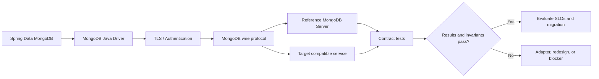
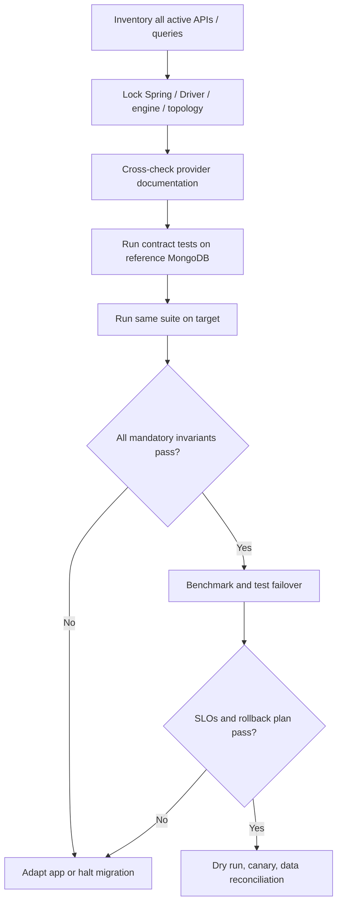

# Testing MongoDB protocol compatibility against alternative database services

## 1. Why does connecting successfully not prove application compatibility?

In a **Spring Data MongoDB** application, `MongoRepository`, `MongoTemplate`, and `ReactiveMongoTemplate` operations execute through the MongoDB Java Driver. Several other database services implement the **MongoDB wire protocol**, allowing the Java Driver to connect and issue commands much as it does against MongoDB Server.

However, **wire protocol compatibility** only describes client–server communication framing. It does not mean the target service implements every MongoDB API, operator, index type, transaction behavior, change stream option, timeout, or consistency model. An application may `ping` and `insertOne` cleanly yet fail on pipeline `$lookup`, two-collection transactions, or change stream resumption.

Example: an ordering system uses Spring Data MongoDB to store `orders`, `order_items`, and `outbox_events`. A reporting API computes revenue with `$lookup`/`$group`, while checkout requires persisting the order and outbox event **atomically in one commit**. Moving to a MongoDB-compatible service demands testing both invariants—not merely verifying login works.

After this lesson, you will know how to:

1. Separate **protocol**, **commands/features**, **data semantics**, and **operations**.
2. Build a test matrix across **driver, Spring Data, engine, and provider API compatibility versions**.
3. Run the same contract/integration suite against reference MongoDB and the target service.
4. Verify BSON mapping, aggregations, indexes, transactions, retries, change streams, and error codes.
5. Make upgrade/migration decisions backed by verifiable evidence.

## 2. Four compatibility layers to evaluate separately

| Layer | Test question | Pass indicator |
| --- | --- | --- |
| **Connection & handshake** | Does the driver discover nodes, negotiate wire version, authenticate, and complete TLS properly? | Connects, pings, and runs basic read/write with a valid CA |
| **API / commands** | Does the server understand the commands, aggregation stages, query operators, and driver options actually sent? | Operations succeed or errors are classified accurately |
| **Semantics & guarantees** | Do results, constraints, atomicity, and consistency match business requirements? | Identical fixtures produce identical results; transactions/unique constraints preserve invariants |
| **Performance & operations** | Do throttling, failover, timeouts, indexes, and observability meet SLOs? | p95/p99 latency, throughput, and error/retry rates remain within budget |



**Never infer complete feature support solely from `db.version()`, `hello`, or `buildInfo`**. Those diagnostic commands are useful, but a compatible service may advertise a protocol version without implementing every feature of the MongoDB Server sharing that number.

## 3. Distinguish services and versions accurately

| Service | What to verify | Example differences |
| --- | --- | --- |
| **MongoDB Server / Atlas** | Server version, FCV, topology, tier, edition, driver version | Not every topology supports every operation identically |
| **Amazon DocumentDB (with MongoDB compatibility)** | **Full** engine version, supported MongoDB APIs, and functional differences | Retryable write support changed starting in engine 8.0.2 |
| **Azure Cosmos DB for MongoDB (RU)** | API version (3.6/4.0/5.0/7.0...), RU/s throughput, sharding/partition key | RU API 7.0 docs limit multi-document transactions to a single unsharded collection |
| **Azure DocumentDB (with MongoDB compatibility)** | Azure DocumentDB service version and its separate MongoDB compatibility table | This is the new name for **vCore-based Azure Cosmos DB for MongoDB**, distinct from the RU offering |
| **FerretDB** | FerretDB version, backend engine, supported command list | Certain commands remain unimplemented or emit different error messages than MongoDB |

Specifically, **Azure DocumentDB**, **Amazon DocumentDB**, and **Azure Cosmos DB for MongoDB (RU)** are **three distinct services**. Never copy one service's feature matrix onto another simply because all three speak to the MongoDB Java Driver.

Version-sensitive example: AWS announced **Amazon DocumentDB 8.0.2** support for retryable writes on **September 28, 2026**; engines prior to 8.0.2 require disabling `retryWrites`. Therefore, claiming either "DocumentDB never supports retryable writes" or "every DocumentDB supports retries" is wrong. Likewise, providers may add aggregation stages in a **minor release**; never test 5.0 and extrapolate to 8.0.2.

**Metadata block to attach to every test suite run:**

```yaml
target:
  provider: "aws-documentdb"       # mongodb / cosmos-mongodb-ru / azure-documentdb / ferretdb
  engine: "8.0.2"                   # actual version of the test environment
  apiCompatibility: "8.0"          # only if defined by the provider
  topology: "replicated"
application:
  springDataMongoDB: "<version>"
  mongoJavaDriver: "<version>"
  jdk: "<version>"
options:
  tls: true
  retryWrites: true
  readPreference: "primary"
  readConcern: "<configured-value>"
  writeConcern: "<configured-value>"
fixtureRevision: "<git-revision>"
```

During upgrades, record **minor versions**, options, and feature flags. Check the [Spring Data MongoDB compatibility matrix](https://docs.spring.io/spring-data/mongodb/reference/preface.html) for minimum driver versions and MongoDB Server versions tested by Spring Data; that matrix **does not certify** third-party wire-protocol services.

## 4. Feature matrix driven by business requirements

Before writing tests, list the commands and features actually used by application code, migrations, and operational tooling:

| Contract / feature | Priority | How to prove |
| --- | --- | --- |
| TLS, auth, read/write CRUD | **Must** | Connect with valid CA; insert → find → update → delete |
| Mapping `ObjectId`, dates, numbers, null/missing | **Must** if used by model | Round-trip via entity and driver; inspect raw BSON |
| Compound unique index on `tenantId, orderNo` | **Must** | Create index; duplicate writes rejected even under concurrency |
| Sort, projection, pagination | **Must** if used by API | Pages remain stable with sort key + tie-breaker |
| `$lookup`, `$unwind`, `$group` | **Must** if used by reports | Totals and group counts match reference MongoDB |
| Transaction across `orders` + `outbox_events` | **Must** if atomic outbox is required | Both commit together; both roll back together |
| Change streams and resume tokens | **Must** if event consumers use them | Receive inserts/updates and resume after disconnect |
| Retryable writes | Per deployment | Network blip / primary failover causes no duplicate side effects |
| TTL, collation, partial/unique indexes, `$jsonSchema` | Per schema | DDL succeeds and data enforcement behaves as expected |
| Time series, GridFS, geospatial, text/vector | Per app | Dedicated contract test per feature |
| `explain`, backup/restore, monitoring | Per ops | Adequate telemetry and verified recovery |

Each test must report one of four explicit statuses:

| Status | Meaning |
| --- | --- |
| `PASS` | Executed on target environment; every required assertion succeeded |
| `FAIL` | Command returned wrong result, wrong semantics, or unexpected error |
| `UNSUPPORTED` | Provider docs or test proof confirms the feature is unsupported |
| `NOT_TESTED` | Not executed or no result obtained; **never treated as PASS** |

If an optional feature has a fallback (e.g., replacing correlated lookup with another query), verify **the fallback preserves exact results**. If a mandatory business invariant fails, `UNSUPPORTED` is a **blocker** unless an architectural change is evaluated and approved.

## 5. Structuring environments to run the same test suite

### 5.1. Configure Spring Boot by endpoint without changing assertions

Test **reference MongoDB Server** and the **target service** using the exact same test code and fixtures, varying only the URI, provider options, and credentials:

```yaml
# application-compat.yml
spring:
  data:
    mongodb:
      uri: ${MONGODB_COMPAT_URI}
compat:
  expected-database: ${MONGODB_COMPAT_DB}
```

In CI, inject credentials via environment variables from a secret manager—never commit passwords to the repository. Provider URIs often require distinct parameters:

- `tls=true`, CA/truststore, strict hostname verification.
- `authSource`, default database, seed list, `replicaSet`, or load-balancer flags.
- `readPreference`, `retryWrites`, and read/write concerns per provider docs.
- `mongodb+srv://` vs. `mongodb://` depending on endpoint support and driver version.

**Never disable TLS certificate/hostname verification to make tests pass**. If `ping` fails, diagnose connectivity first rather than assuming a MongoDB API feature is missing.

Testcontainers can spin up **reference MongoDB** in CI; it **cannot emulate** Amazon DocumentDB or Azure DocumentDB. For cloud services, provision an isolated test environment with cost quotas and least-privilege roles.

### 5.2. Isolating test data

Never call `dropDatabase()`, `deleteAll()`, or clear business collections in shared environments. Give each test UUID-suffixed collection names or a dedicated test database and clean up only owned namespaces.

When tests verify index/schema creation, grant collection/index DDL rights **only on the test database**; run controlled migrations when the target requires specific provisioning. Functional tests must never depend on leftover records from prior runs.

## 6. JUnit contract test example with MongoTemplate and Java Driver

The sample below uses Java 17+, Spring Boot 3.x, JUnit Jupiter, and Spring Data MongoDB. It verifies `ping`, unique indexes, and a `$lookup` + `$unwind` + `$group` pipeline. **The exact same class** must execute against reference and target; discrepancies feed directly into the compatibility report.

```java
import java.util.ArrayList;
import java.util.List;
import java.util.UUID;

import com.mongodb.MongoException;
import com.mongodb.client.MongoCollection;
import com.mongodb.client.model.IndexOptions;
import com.mongodb.client.model.Indexes;
import org.bson.Document;
import org.junit.jupiter.api.AfterEach;
import org.junit.jupiter.api.BeforeEach;
import org.junit.jupiter.api.Test;
import org.springframework.beans.factory.annotation.Autowired;
import org.springframework.beans.factory.annotation.Value;
import org.springframework.boot.test.context.SpringBootTest;
import org.springframework.data.mongodb.core.MongoTemplate;

import static org.junit.jupiter.api.Assertions.*;

@SpringBootTest
class MongoProtocolContractIT {

    @Autowired MongoTemplate template;
    @Value("${compat.expected-database:}") String expectedDatabase;

    private String ordersName;
    private String itemsName;

    @BeforeEach
    void createOwnedCollections() {
        // Guard against accidentally pointing tests at an unauthorized database.
        String actual = template.getDb().getName();
        if (expectedDatabase.isBlank() || !expectedDatabase.equals(actual)) {
            throw new IllegalStateException(
                "Run only against the designated test database");
        }
        String suffix = UUID.randomUUID().toString().replace("-", "");
        ordersName = "compat_orders_" + suffix;
        itemsName = "compat_items_" + suffix;
        template.createCollection(ordersName);
        template.createCollection(itemsName);
    }

    private MongoCollection<Document> orders() {
        return template.getCollection(ordersName);
    }

    @Test
    void pingWorks() {
        Document result = template.getDb().runCommand(
            new Document("ping", 1));
        assertEquals(1.0,
            ((Number) result.get("ok")).doubleValue());
    }

    @Test
    void uniqueIndexPreventsDuplicateOrderNumberPerTenant() {
        orders().createIndex(
            Indexes.compoundIndex(
                Indexes.ascending("tenantId"),
                Indexes.ascending("orderNo")),
            new IndexOptions().unique(true));

        orders().insertOne(new Document("_id", "o-1")
            .append("tenantId", "tenant-a")
            .append("orderNo", "ORD-001"));

        MongoException error = assertThrows(MongoException.class,
            () -> orders().insertOne(new Document("_id", "o-2")
                .append("tenantId", "tenant-a")
                .append("orderNo", "ORD-001")));

        assertEquals(11000, error.getCode());
        assertEquals(1L, orders().countDocuments());

        // Duplicate orderNo in a different tenant is permitted by the compound index.
        orders().insertOne(new Document("_id", "o-3")
            .append("tenantId", "tenant-b")
            .append("orderNo", "ORD-001"));
        assertEquals(2L, orders().countDocuments());
    }

    @Test
    void lookupAndGroupProduceCorrectTotals() {
        orders().insertOne(new Document("_id", "o-1")
            .append("tenantId", "tenant-a"));

        template.getCollection(itemsName).insertMany(List.of(
            new Document("_id", "i-1")
                .append("orderId", "o-1")
                .append("sku", "A")
                .append("quantity", 2),
            new Document("_id", "i-2")
                .append("orderId", "o-1")
                .append("sku", "B")
                .append("quantity", 3),
            new Document("_id", "i-3")
                .append("orderId", "o-1")
                .append("sku", "A")
                .append("quantity", 4)
        ));

        List<Document> pipeline = List.of(
            new Document("$match", new Document("tenantId", "tenant-a")),
            new Document("$lookup",
                new Document("from", itemsName)
                    .append("localField", "_id")
                    .append("foreignField", "orderId")
                    .append("as", "items")),
            new Document("$unwind", "$items"),
            new Document("$group",
                new Document("_id", "$items.sku")
                    .append("totalQuantity",
                        new Document("$sum", "$items.quantity"))),
            new Document("$sort", new Document("_id", 1))
        );

        List<Document> results = orders()
            .aggregate(pipeline).into(new ArrayList<>());

        assertEquals(2, results.size());
        assertEquals("A", results.get(0).getString("_id"));
        assertEquals(6L,
            ((Number) results.get(0).get("totalQuantity")).longValue());
        assertEquals("B", results.get(1).getString("_id"));
        assertEquals(3L,
            ((Number) results.get(1).get("totalQuantity")).longValue());
    }

    @AfterEach
    void cleanupOwnedCollections() {
        if (itemsName != null && template.collectionExists(itemsName)) {
            template.dropCollection(itemsName);
        }
        if (ordersName != null && template.collectionExists(ordersName)) {
            template.dropCollection(ordersName);
        }
    }
}
```

Keep **duplicate key error code 11000** as part of the contract when the app relies on Spring's `DuplicateKeyException`. If a provider blocks duplicates using another error code, record a **difference affecting error mapping** and evaluate adapter changes; never relax the assertion to "any exception" just to turn tests green.

This example uses the Driver directly for several steps. Also test **actual Spring Data paths**: `@Document`, `@Id`, `@Field`, custom converters, derived queries, and repository mapping, because conversion and exception translation can expose differences raw driver tests miss.

### 6.1. BSON and Spring mapping round-trip tests

Include fixtures covering every data type your domain uses:

| Value | What to verify |
| --- | --- |
| `ObjectId` and String IDs | `@Id` converts and queries back accurately |
| `Instant` and BSON Date | UTC instant, millisecond precision |
| `Decimal128` / `BigDecimal` | Exact BSON type and lossless summation |
| `null` and **missing** fields | `{field: null}`, `$exists`, partial/unique indexes |
| Arrays / nested objects | `$elemMatch`, dot notation, `arrayFilters` |
| Unicode and collation | Comparisons, sorting, and uniqueness match expectations |

Never compare results by converting everything to Strings and masking BSON type differences. When a contract does not require ordering, compare result sets by key; for pagination/top-N, enforce `$sort` with a deterministic tie-breaker (commonly `_id`).

## 7. Testing advanced capabilities per engine

### 7.1. Aggregations, indexes, and schemas

Test every operator used in production, such as equality `$lookup`, correlated lookup with `let`/`pipeline`, `$group`, `$facet`, `$setWindowFields`, geospatial, text search, or vector search. Never assume that because simple `$lookup` works, **every variant** of `$lookup` is supported.

For indexes, verify both **creation success and enforcement semantics**:

- Compound/unique indexes: duplicate `(tenantId, orderNo)` writes are rejected even concurrently.
- Partial unique indexes: only documents matching `partialFilterExpression` are constrained.
- TTL: documents expire within acceptable latency bounds; TTL runs asynchronously, not to the exact second.
- Collation: case-insensitive uniqueness and locale-aware sorting behave properly.
- `$jsonSchema`: invalid types on insert/update are rejected; Java annotations do not guarantee server validators are installed.

On services using partition/shard keys, uniqueness or transactions can have **scoped guarantees**. Test across different partitions rather than keeping all fixtures inside one partition.

### 7.2. Cross-collection transactions

If business logic requires `orders` and `outbox_events` to commit **together**, write two distinct tests: successful **commit** (both present) and **rollback** (both absent). With blocking Spring Data, use `MongoTransactionManager` and `TransactionTemplate`:

```java
// Logic pattern inside an integration test with a configured transaction manager.
TransactionTemplate tx = new TransactionTemplate(mongoTransactionManager);

tx.executeWithoutResult(status -> {
    template.insert(
        new Document("_id", orderId).append("tenantId", "tenant-a"),
        ordersCollection);
    template.insert(
        new Document("_id", eventId).append("orderId", orderId),
        outboxCollection);
    status.setRollbackOnly();
});

// Read outside the transaction and assert neither order nor outbox exists.
```

MongoDB Server requires a transaction-capable topology (such as a replica set or sharded cluster). **Azure Cosmos DB for MongoDB RU API 7.0** restricts multi-document transactions to **within a single unsharded collection** per Microsoft's documentation. A two-collection transaction test must report `UNSUPPORTED`/`FAIL` there; never silently remove `@Transactional` and accept partial writes.

Some Amazon DocumentDB versions support transactions with different limits than MongoDB Server—such as transaction duration and log size; read the exact engine docs. On the reactive stack, swap `MongoTransactionManager` for `ReactiveMongoTransactionManager` and `TransactionalOperator`, verifying commit/rollback after publisher completion.

### 7.3. Change streams and resume

If the app consumes change streams for event processing, verify:

1. Opening the stream and receiving insert/update/delete events with expected payloads.
2. Saving the **resume token**, disconnecting the consumer, generating more events, resuming with the token, and confirming zero lost events.
3. Testing resume after failover and behavior when a token expires per the provider's retention window.
4. Measuring event latency and enforcing duplicate-delivery idempotency.

Run with explicit timeouts and isolated test namespaces; never rely on arbitrary `Thread.sleep` calls or assume instant event delivery. Do not assume every provider supports all `fullDocument` options, `startAtOperationTime`, or change stream pipeline stages identically to MongoDB Server.

### 7.4. Retryable writes, transient failures, and idempotency

**Retryable writes** depend on **driver + engine + operation type**. For instance:

- Amazon DocumentDB **before 8.0.2**: AWS docs require `retryWrites=false`.
- Amazon DocumentDB **8.0.2+**: supports retryable writes for documented operations; `updateMany` and `deleteMany` are outside that supported set.
- For Azure and FerretDB: consult the exact version's docs and test directly rather than copying AWS retry settings.

Failure-injection tests must check the final outcome: after a network drop or failover, **how many documents/side effects** were persisted? When commit status is unknown, manually retrying `$inc`, payment creation, or message dispatch can duplicate business actions; use idempotency keys and check state before retrying.

### 7.5. Read/write concerns and result ordering

Different providers implement replication, secondary reads, consistency, and failover differently. Test read-after-write both within the same session and across separate connections when required; document `readPreference`, `readConcern`, `writeConcern`, and read-visibility windows. Stale reads are not always "protocol errors," yet they can **violate business contracts**.

Never assert ordering on queries lacking a `sort`. For example, AWS docs note differences in default ordering and aggregation sort behavior; define explicit sort keys for pagination and top-N queries.

## 8. Classify errors by layer instead of parsing messages

```javascript
// Diagnostic probe commands run in a test environment:
db.runCommand({ ping: 1 });
db.runCommand({ hello: 1 });
db.runCommand({ buildInfo: 1 });
```

`ping` only proves the server responds. `hello` describes handshake/topology; `buildInfo` may be unsupported or restricted by permissions on the target service. Failure on one diagnostic command **does not automatically prove** all CRUD/aggregation features are unsupported.

| Error group | Symptoms | Investigation path |
| --- | --- | --- |
| DNS/TLS/CA | `MongoSocketException`, `SSLHandshakeException`, hostname mismatch | SRV/TXT, endpoint, truststore, cert chain, hostname |
| Auth/permissions | `MongoSecurityException` or unauthorized | Credentials, `authSource`, auth mechanism, roles |
| Topology | `MongoTimeoutException` / server selection | Replica set options, seed list, load balancer, read preference |
| Command/operator | `MongoCommandException`, unsupported feature | Exact BSON command and provider supported-APIs table by engine |
| Data constraints | Duplicate key, validator/index failure | Actual indexes, partition key, collation, BSON schema |
| Transaction/retry | Aborted, unsupported, unknown commit result | Engine limits, retryable writes, error labels, idempotency |
| Throttling/quota | Latency/errors rise under load | RU/s, quotas, CPU/IO, provider telemetry |

Spring's `DataAccessException` wraps Java Driver exceptions. Capture root error codes, operations, and correlation IDs; **never log connection URIs containing passwords or sensitive documents**. Some services reuse MongoDB error names/codes with different detail messages; never drive business logic by parsing free-form error strings without an explicit contract.

## 9. Comparing results and benchmarking

Run identical fixtures against reference MongoDB Server and the target service. When comparing:

1. Preserve **BSON types**; never stringify numbers, dates, and IDs and treat them as equivalent.
2. For unordered result sets, normalize order before diffing; for pagination/top-N, test explicit `sort`.
3. Strip non-deterministic fields like random IDs or generated timestamps **only when** they are outside the business contract.
4. Include **negative tests**: duplicate keys, invalid schemas, unsupported operators, write timeouts, rollbacks, and retries.
5. Under eventual consistency, use bounded polling with timeouts rather than unbounded waits or ignoring visibility lag.

Benchmark after warm-up with identical data volumes, partition counts, and load levels. Record p50/p95/p99 latency, throughput, errors, CPU/IO, RU consumption/throttling if applicable, retries, and storage/index overhead. `explain` output structures **may differ across providers**, so combine them with provider-native telemetry.

**Never declare "compatible" just because queries pass on 20 sample documents**; test large arrays, skewed/hot partitions, long transactions, concurrency, and failover transitions.

## 10. Decision workflow when upgrading or switching services



Sample report:

| Contract | Reference MongoDB | Target | Conclusion |
| --- | --- | --- | --- |
| TLS and CRUD | PASS | PASS | Connectivity works |
| Compound unique index | PASS | PASS | Constraint enforced |
| `$lookup` and `$group` | PASS | PASS | Computation matches |
| Transaction `orders` + `outbox_events` | PASS | UNSUPPORTED | **Blocker** if atomicity is required |
| Change stream resume | PASS | FAIL | Does not yet satisfy sync worker |
| Retryable writes | PASS | NOT_TESTED | Cannot conclude yet |

**Statuses in the table above illustrate reporting format only**, not actual test results for any specific provider.

Before approving migration, gather: tested config versions, test logs, unsupported/semantic differences, verified workarounds, load numbers and SLOs, data migration plan, rollback plan, and sign-off owner. After any minor/major engine upgrade on the target, rerun the suite because feature sets and semantics can change.

## 11. Common mistakes

| Mistake | Consequence | Fix |
| --- | --- | --- |
| Treating successful ping as full MongoDB support | Failures hit later in transactions, aggregations, or indexes | Test actual APIs and real data shapes |
| Equating "MongoDB API version" with full server parity | Misjudged feature support | Verify exact provider/engine/minor/FCV |
| Confusing Azure DocumentDB with Cosmos DB for MongoDB RU | Wrong operator/transaction matrix | Read documentation for the exact product |
| Always disabling retryable writes on all Amazon DocumentDB | Missing capability added in 8.0.2 | Configure per engine version and operation type |
| Asserting ordering on unsorted queries | Flaky failures or broken pagination | Use explicit sort keys and tie-breakers |
| Dropping transactions to make suites pass | Lost business atomicity | Treat as a blocker or redesign with verification |
| Skipping all unsupported tests | Misleading green reports | Mark `UNSUPPORTED` alongside criticality |
| Using Testcontainers MongoDB as a proxy for cloud targets | Misses engine differences | Run the suite against the real target endpoint |
| Benchmarking tiny datasets | Misses throttling and hot partitions | Use representative workloads and p95/p99 |
| Dropping a shared test database | Breaks other test suites | Use owned namespaces and scoped cleanup |

## 12. Practice exercise

A Spring Data MongoDB application plans to move from MongoDB Server to **Amazon DocumentDB 5.0** or **Azure Cosmos DB for MongoDB (RU) API 7.0**. The app manages `orders`, `order_items`, and `outbox_events`, requiring per-tenant unique order numbers, `$lookup`/`$group` reporting, atomic order + outbox transactions, and a change stream consumer.

1. Build a feature matrix covering CRUD/TLS, BSON mapping, unique indexes, correlated `$lookup`, multi-collection transactions, change-stream resume, retryable writes, and schema validation. Identify which are **Must**.
2. Explain why `MongoTemplate.insert()` succeeding does not prove compatibility for `ReactiveMongoTemplate.changeStream()`.
3. On Amazon DocumentDB 5.0, how should `retryWrites` be configured? When upgrading to **8.0.2**, what conditions must be re-verified?
4. Based on Cosmos DB for MongoDB (RU) API 7.0 docs, are two-collection transactions guaranteed? If not, how must the atomic outbox requirement be handled?
5. Create fixtures containing `Decimal128`, `Instant`, null/missing fields, arrays, and Unicode; compare outputs of the same aggregation across both endpoints.
6. Write a concurrent test attempting to insert two duplicate `(tenantId, orderNo)` orders and prove only one persists.
7. Design a change-stream resume test where the worker disconnects for 10 seconds; define timeouts and event counting to reject data loss or duplication.
8. Propose **go/no-go** criteria if one mandatory feature is `UNSUPPORTED` while CRUD and benchmarks pass.

**Hint:** Separate optional unsupported features from unsupported features breaking business invariants. A MongoDB-compatible service may suit **a specific workload** without reaching 100% command parity with MongoDB Server. Conclusions must rest on **exact versions, real tests, and SLOs**.

## References

- [Spring Data MongoDB — Requirements and Compatibility Matrix](https://docs.spring.io/spring-data/mongodb/reference/preface.html)
- [MongoDB — Java Driver Connection Guide](https://www.mongodb.com/docs/drivers/java/sync/current/connection/)
- [MongoDB — Wire Protocol](https://www.mongodb.com/docs/manual/reference/mongodb-wire-protocol/)
- [Amazon DocumentDB — MongoDB Compatibility](https://docs.aws.amazon.com/documentdb/latest/devguide/compatibility.html)
- [Amazon DocumentDB — Supported MongoDB APIs](https://docs.aws.amazon.com/documentdb/latest/devguide/mongo-apis.html)
- [Amazon DocumentDB — Functional Differences](https://docs.aws.amazon.com/documentdb/latest/devguide/functional-differences.html)
- [Amazon DocumentDB — Transactions](https://docs.aws.amazon.com/documentdb/latest/devguide/transactions.html)
- [AWS — DocumentDB Retryable Writes from 8.0.2, September 28, 2026](https://aws.amazon.com/about-aws/whats-new/2026/09/amazon-documentdb-retryable-writes/)
- [Microsoft — Azure Cosmos DB for MongoDB (RU) API 7.0](https://learn.microsoft.com/en-us/azure/cosmos-db/mongodb/feature-support-70)
- [Microsoft — Azure DocumentDB Overview](https://learn.microsoft.com/en-us/azure/documentdb/overview)
- [FerretDB — Compatibility](https://docs.ferretdb.io/migration/compatibility/)
