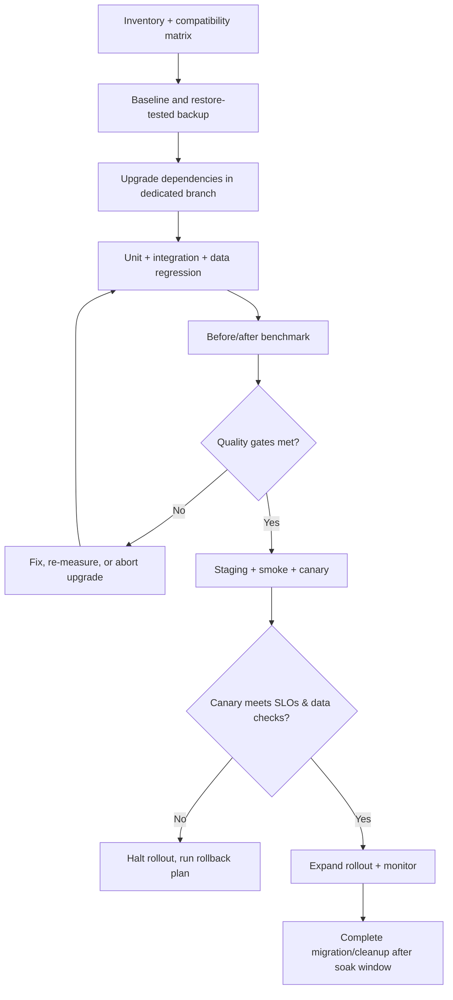
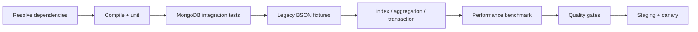

# Planning upgrades with data and performance regression testing

Upgrading a **Spring Data MongoDB** application is never just bumping a library version. Changing Spring Boot, Spring Data MongoDB, the MongoDB Java Driver, or MongoDB Server can alter BSON mapping, `ObjectId`/`String` conversion, how repositories build queries, aggregation behavior, transactions, reactive publishers, connectivity, and performance. An application booting cleanly after an upgrade **does not guarantee** data reads/writes match prior behavior or queries still satisfy SLOs.

This lesson in the **Versions and Upgrades** chapter of the `SPRING_DATA_MONGODB` module focuses on designing an evidence-backed upgrade process: mapping version dependencies, capturing data and performance **baselines**, running before/after regression tests, rolling out in stages, monitoring anomalies, and maintaining a safe recovery plan.

Examples use Java, Spring Boot, `MongoTemplate`, repositories, aggregations, and Testcontainers. Version numbers and thresholds are presented as **principles**, not an evergreen compatibility chart: during a real upgrade, always consult the release notes, compatibility matrix, and migration guide for your **exact source and target versions**.

## 1. Define what must stay invariant after the upgrade

Distinguish three types of contracts:

1. **Data contract:** old documents remain readable; newly written records have the right BSON types; field names, `_id`, Decimal128, Date, enums, indexes, schema versions, and references do not shift unexpectedly.
2. **Behavioral contract:** repositories, `MongoTemplate`, aggregations, pagination, transactions, retries, change streams, and reactive pipelines produce the expected results, errors, and consistency guarantees.
3. **Operational contract:** latency, throughput, command counts, documents scanned, memory/CPU, pool checkout times, network bytes, and error rates remain within accepted bounds.

| Change | Typical risk | Required evidence |
| --- | --- | --- |
| Spring Boot / Spring Framework | Auto-configuration or bean lifecycle shifts | Context tests, integration tests, configuration audits |
| Spring Data MongoDB | Mapping/converters, repository queries, or transactions change | Raw BSON comparisons and query result checks |
| MongoDB Java Driver | Connection handling, codecs, timeouts, retries, pooling, or topology shifts | Driver metrics, network-error tests, load tests |
| MongoDB Server | Query planner, indexes, operators, wire protocol, or transaction shifts | Server compatibility tests, `explain`, benchmarks |
| Java runtime | TLS, memory, GC, or runtime behavior shifts | Build/test runs, TLS smoke tests, load tests |
| Data schema | New writers break old readers | Multi-version fixtures, migration tests |

**A successful upgrade** means pre-defined acceptance criteria are proven with tests and measurements—not merely a green build or an HTTP 200 health endpoint.

## 2. Inventory the system and build the compatibility matrix

Before editing any dependency, record the **current state** of the system:

- Versions of Java runtime, Spring Boot, Spring Framework, Spring Data release train, and MongoDB Java Driver.
- MongoDB Server version, deployment topology (standalone, replica set, sharded cluster), Feature Compatibility Version (FCV) where applicable, and TLS/auth config.
- Blocking driver, reactive driver, or both; `MongoTemplate`, `ReactiveMongoTemplate`, repositories, custom `MongoClient`, `MongoConverter`, `MongoCustomConversions`.
- ID rules (`@Id`, `@MongoId`), critical BSON types, collections/indexes, aggregation pipelines, and migration scripts.
- Transactions, read/write concerns, retryable writes, change streams, connection pools, and timeouts.
- Test stack: JUnit, Testcontainers, test database services, CI, datasets, and observability.

A planning table should look like:

| Component | Current | Target | Compatibility source | Risks / required tests |
| --- | --- | --- | --- | --- |
| Java | Record actual version | Record target version | Spring Boot/driver requirements | Build, TLS, throughput |
| Spring Boot | Record actual version | Record target version | Release notes, migration guide | Auto-config and dependencies |
| Spring Data MongoDB | Current BOM version | Target BOM version | Release train, mapping changes | Converters/repositories/aggregations |
| MongoDB Java Driver | Resolved version | Supported version | Driver compatibility docs | Pooling, retries, connectivity |
| MongoDB Server | Cluster version | Target version | Server upgrade/FCV docs | Query planner, transactions |
| Testcontainers | Test version | Compatible version | Branch-specific docs | Startup and replica set tests |

Never fill in the table by guessing. In projects using the Spring Boot BOM, let the BOM manage compatible Spring Data and driver versions; if any **dependency override** exists for the driver or Spring Data, justify and test it separately. Inspect **actually resolved dependencies**, not just directly declared versions.

### 2.1. Separate library upgrades from MongoDB Server upgrades

These two changes can follow separate schedules:

- **Upgrading Spring Boot/Spring Data/driver:** update dependencies and application first, then verify compatibility against the existing server; confirm the new driver supports both the current server and the target server during transition.
- **Upgrading MongoDB Server:** prepare infrastructure, backups, topology, rolling upgrade order, and FCV changes per official docs for the exact version pair. Advancing FCV can unlock new features/behaviors and limit downgrade options.
- **Changing schemas:** distinct from runtime upgrades. Never bundle code edits, driver bumps, server upgrades, and multi-million-document rewrites into one indivisible change.

MongoDB Server upgrades may require stepping through intermediate versions and specific procedures for replica sets or sharded clusters. Never assume you can jump across arbitrary major versions or downgrade a server after enabling new FCV features.

## 3. Capture baselines before making changes

Without a baseline, claiming an app feels "slower after upgrading" is guesswork. Before altering anything, capture **behavior** and **performance** on the exact same workload.

### 3.1. Data baseline

Assemble representative BSON fixtures:

| Data group | Cases to include | Anomalies to catch |
| --- | --- | --- |
| IDs | `ObjectId`, 24-char hex Strings, external system IDs | Implicit ID conversion shifts |
| Numbers | Integer, Long, Double, Decimal128, large numbers, `null` | Precision loss, overflow, wrong converter |
| Dates | UTC, day-boundary timestamps, legacy Date/String if present | Time-zone drift, serialization changes |
| Fields | Missing, null, renamed fields, deprecated fields | Broken mapping/reading on old records |
| Arrays/nested | Empty arrays, elements missing fields, deeply nested docs | Projection, aggregation, mapping bugs |
| Enums | Current values and retired legacy values | Deserialization failures on historical records |
| Schema versions | V1/V2/V3 coexisting | New reader incompatibility |
| Indexes | Unique/compound/TTL/text/collation per system | Missing indexes, altered query conditions |

Do not inspect only Java objects after deserialization: inspect **raw BSON** inside MongoDB because converters can mask underlying types. Specifically, `ObjectId("...")` and String `"..."` share similar text formats yet are distinct key types.

### 3.2. Behavioral baseline

Capture key use cases:

1. Repository CRUD, derived queries, and `@Query` with bound parameters.
2. `MongoTemplate` filters, sorts, pagination, projections, and bulk operations.
3. Aggregations using `$match`, `$group`, `$lookup`, `$unwind`, `$project`, and type conversions.
4. Unique constraints, index initialization, `@Version` optimistic locking, and upserts.
5. Transactions: commit, rollback, write conflicts, retries, and read/write concerns.
6. Reactive flows: subscribe, cancellation, backpressure, errors, timeouts, and change streams if used.
7. Tenant isolation, validation, and ID/mapping error handling at the API boundary.

Record **inputs**, **BSON types**, **expected outputs**, and **expected error types**. If current behavior is buggy, track it separately as tech debt rather than accidentally cementing a bug as a permanent requirement.

### 3.3. Performance baseline

Measure representative workloads holding filters, datasets, connections, and concurrency steady:

| Signal | Where to measure | Why needed |
| --- | --- | --- |
| HTTP `p50/p95/p99` | Application/APM | End-user latency |
| DB operation duration | Timers/traces | Isolates database time from app processing |
| Command counts and durations | Driver command monitoring | Catches N+1 queries, `getMore`, retries |
| Pool checkout wait/failures | Driver CMAP | Separates pool exhaustion from slow queries |
| `totalDocsExamined`, `totalKeysExamined`, `nReturned` | `explain("executionStats")` | Compares scan volume and execution plans |
| BSON payload/network bytes | BSON size checks, network metrics | Catches altered projections or batching |
| Throughput, CPU, heap, GC, disk I/O | Infrastructure | Prevents "latency wins" achieved by shifting bottlenecks |
| Error/timeout/retry rates | Logs, metrics, tracing | Surfaces regressions under load |

Distinguish **driver command time**, **server `executionTimeMillis` in explain**, and **end-to-end HTTP latency**. Never use a single `executionTimeMillis` number to promise users will see identical end-to-end latency.

## 4. Choose a phased upgrade strategy

A safe strategy generally follows:



### Phase A — Preparation

- Lock officially supported source/target versions across Java, Spring Data, and the driver.
- List breaking changes, deprecated/removed APIs, auto-configuration shifts, and mapping changes.
- Capture baselines, freeze test fixtures, back up data, **run a restore drill** in isolation, and record recovery time.
- Set acceptance thresholds *before* viewing new-version metrics; assign go/no-go and rollback owners.

### Phase B — Upgrade the app and validate

- Prefer changing one layer at a time (runtime/dependencies, app, MongoDB Server, schema) rather than everything at once.
- Run builds, static checks, unit tests, and integration tests against real MongoDB instances.
- Run identical fixtures and benchmarks on both old and upgraded builds; log actual driver/server versions in test reports.
- On critical paths, verify error/timeout semantics, not merely "no exception thrown."

### Phase C — Staging / canary

- Deploy to staging matching production topology, indexes, TLS/auth, and realistic data volume.
- Ramp canary traffic in checkpoints; at each checkpoint check errors, latency, pools, commands, query costs, and data invariants.
- Keep an instant switch to halt rollout or revert to the previous application image if failure triggers fire.

### Phase D — Stabilization and cleanup

- Keep monitoring after full rollout, since caches, TTLs, batch jobs, and rare business dates/flows may not trigger during initial smoke tests.
- Remove legacy fields/readers, transition adapters, and old indexes only after confirming zero remaining callers.
- Close the upgrade report with actual versions, test results, resolved regressions, met thresholds, and any follow-up actions.

## 5. Data regression testing with Spring Data MongoDB

### 5.1. Example BSON contract prone to regressions

Suppose `invoices` uses external-system IDs (always BSON String) and stores amounts as `Decimal128`. Entities:

**`Invoice.java`**

```java
package example.billing;

import java.math.BigDecimal;
import java.time.Instant;
import org.springframework.data.mongodb.core.mapping.Document;
import org.springframework.data.mongodb.core.mapping.Field;
import org.springframework.data.mongodb.core.mapping.FieldType;
import org.springframework.data.mongodb.core.mapping.MongoId;

@Document(collection = "invoices")
public record Invoice(
        @MongoId(FieldType.STRING) String id,
        @Field(value = "amount", targetType = FieldType.DECIMAL128)
        BigDecimal amount,
        Instant createdAt
) {}
```

**`InvoiceRepository.java`**

```java
package example.billing;

import org.springframework.data.mongodb.repository.MongoRepository;

public interface InvoiceRepository
        extends MongoRepository<Invoice, String> {}
```

`@MongoId(FieldType.STRING)` explicitly forbids converting 24-character hex strings into BSON ObjectIds. `@Field(targetType = FieldType.DECIMAL128)` locks the monetary storage contract. During upgrades, inspect raw BSON rather than merely asserting `repository.findById(...)` returns a record.

### 5.2. Repository integration test with Testcontainers

Example using **Spring Boot 3.x with Testcontainers Java 1.x**. The app uses `spring-boot-starter-data-mongodb`; tests use `spring-boot-starter-test`, `org.testcontainers:junit-jupiter`, and `org.testcontainers:mongodb` at compatible versions. Newer Testcontainers releases may adjust artifacts or packages; verify when upgrading Testcontainers itself.

**`InvoiceRegressionTest.java`**

```java
package example.billing;

import com.mongodb.client.model.Filters;
import java.math.BigDecimal;
import java.time.Instant;
import org.bson.Document;
import org.bson.types.Decimal128;
import org.junit.jupiter.api.BeforeEach;
import org.junit.jupiter.api.Test;
import org.springframework.beans.factory.annotation.Autowired;
import org.springframework.boot.test.autoconfigure.data.mongo.DataMongoTest;
import org.springframework.data.mongodb.core.MongoTemplate;
import org.springframework.test.context.DynamicPropertyRegistry;
import org.springframework.test.context.DynamicPropertySource;
import org.testcontainers.containers.MongoDBContainer;
import org.testcontainers.junit.jupiter.Container;
import org.testcontainers.junit.jupiter.Testcontainers;
import org.testcontainers.utility.DockerImageName;

import static org.assertj.core.api.Assertions.assertThat;

@DataMongoTest
@Testcontainers
class InvoiceRegressionTest {

    @Container
    static final MongoDBContainer MONGO =
            new MongoDBContainer(DockerImageName.parse("mongo:7.0"));

    @DynamicPropertySource
    static void mongodb(DynamicPropertyRegistry registry) {
        registry.add("spring.data.mongodb.uri", MONGO::getReplicaSetUrl);
    }

    @Autowired InvoiceRepository repository;
    @Autowired MongoTemplate mongoTemplate;

    @BeforeEach
    void cleanOwnedCollection() {
        repository.deleteAll();
    }

    @Test
    void writesExpectedBsonTypes() {
        String id = "64b7f37a4e92b315c21d0abc";
        repository.insert(new Invoice(
                id,
                new BigDecimal("125.50"),
                Instant.parse("2026-01-01T10:00:00Z")));

        Document raw = mongoTemplate.getCollection("invoices")
                .find(Filters.eq("_id", id)).first();

        assertThat(raw).isNotNull();
        assertThat(raw.get("_id")).isInstanceOf(String.class);
        assertThat(raw.get("amount")).isInstanceOf(Decimal128.class);
        assertThat(raw.get("amount", Decimal128.class)
                .bigDecimalValue()).isEqualByComparingTo("125.50");
        assertThat(repository.findById(id)).isPresent();
    }

    @Test
    void readsFixtureFromBeforeUpgrade() {
        Document legacy = new Document("_id", "inv-old")
                .append("amount", new Decimal128(
                        new BigDecimal("19.95")))
                .append("createdAt", java.util.Date.from(
                        Instant.parse("2020-05-01T00:00:00Z")));
        mongoTemplate.getCollection("invoices").insertOne(legacy);

        Invoice loaded = repository.findById("inv-old").orElseThrow();
        assertThat(loaded.amount()).isEqualByComparingTo("19.95");
        assertThat(loaded.createdAt())
                .isEqualTo(Instant.parse("2020-05-01T00:00:00Z"));
    }
}
```

Run this test **before and after upgrading**, against matching MongoDB test versions or each server version in your compatibility matrix. In real projects, derive fixtures from **actual existing shapes**, not solely current entity definitions. Tests locking String/Decimal128 BSON detect unintended shifts in converters or ID storage.

In Spring Boot 3.1+ with supporting dependencies, `@DynamicPropertySource` can be replaced by `@ServiceConnection` alongside `spring-boot-testcontainers`. Never configure both connection mechanisms for the same container; if defining a custom `MongoClient`, verify it actually consumes those connection details.

### 5.3. Testing historical documents with non-target types

If the legacy database previously stored `amount` as String `"19.95"`, add a **separate** fixture and decide expected behavior:

```javascript
// Legacy fixture differing in BSON type from Decimal128.
db.invoices.insertOne({
  _id: "inv-legacy",
  amount: "19.95",
  createdAt: ISODate("2020-05-01T00:00:00Z")
})
```

If the current reader supports String → BigDecimal, write a regression test proving it still reads properly post-upgrade. If not, the test should clearly expose the failure or verify a new converter/migration. **Never assume** Spring Data handles all historical document conversions automatically across versions.

Especially for `_id`, String and ObjectId are different BSON types. Never "fix" not-found errors by changing annotations across entities without inventorying stored data; mutating `_id` in place with `$set` is invalid because `_id` is immutable.

### 5.4. Golden data and assertion stability

Regression tests should use:

- Fixed timestamps (`Instant.parse(...)`), never wall-clock `now()`.
- Fixed IDs inside dedicated test databases, cleaned before each test when not running concurrently.
- Numeric `BigDecimal` comparisons where appropriate, plus explicit **BSON type** checks when storage format is part of the contract.
- Separate assertions for legacy reads, new writes, round-trips, queries, mapping errors, and unique constraints.
- Schema-versioned snapshots/fixtures so adding V3 still checks V1 and V2.

Never commit or send real production backups containing sensitive data into CI; use anonymized or synthetic datasets mirroring production distributions.

## 6. Query, index, and aggregation regression testing

### 6.1. Repositories and `MongoTemplate`

After upgrading, rerun critical queries:

| Behavior | Inputs to hold constant | Assertions |
| --- | --- | --- |
| `findById` | BSON ObjectId/String and missing IDs | Right document, no type mismatch |
| `@Query` binding | Special characters, null arguments | Query structure unchanged |
| Filter/sort | Matching Criteria, collation, limit | ID list and ordering match contract |
| Pagination | Multiple records sharing timestamps | No duplicate/skipped pages; stable sort |
| Projections | Requested fields, nested paths | Only expected fields returned |
| Upserts | Matching and non-matching filters | No unintended documents created |
| Versioning | `@Version` with two competing writers | Optimistic locking behaves properly |
| Deletes/updates | Tenant scoping and soft-delete | Never affects other tenants' documents |

Example query using a compound index:

```javascript
db.orders.find(
  { tenantId: "tenant-A", status: "PAID" },
  { _id: 1, status: 1, createdAt: 1 }
).sort({ createdAt: -1 }).limit(50)
 .explain("executionStats")
```

Compare `winningPlan`, `totalDocsExamined`, `totalKeysExamined`, and `nReturned` before and after. A changed query plan is not automatically a regression: if results match and performance improves, it may be acceptable. Set thresholds around workload metrics and key query shapes rather than demanding byte-identical `explain` JSON.

### 6.2. Aggregations

For pipelines using `$match`, `$lookup`, `$group`, `$unwind`, `$project`, or date/numeric operators:

1. Check output documents, field names, BSON types, and row counts.
2. Add fixtures with missing/null fields, empty arrays, and mixed String/ObjectId keys if ever present historically.
3. Verify join keys and `_id` inside `$lookup` do not diverge in BSON type.
4. Watch memory usage / disk spills or expensive stages on larger datasets.
5. Test aggregations with deterministic sort, collation, and time zone.

Do not merely snapshot JSON strings of entire outputs, since field order or Extended JSON formatting can vary without breaking business semantics. Normalize non-contract details before diffing while asserting exact BSON types on contract fields.

### 6.3. Indexes and constraints

In a test database, inspect active indexes:

```javascript
db.orders.getIndexes()
```

Check index names, key patterns, unique/TTL/partial/collation flags, and options. If changing Spring Data's auto-index behavior, confirm whether production indexes are managed by separate migration scripts or auto-indexing. Having `@Indexed(unique = true)` on an entity does not prove the index exists on the server if auto-index creation is disabled or has not run.

The TTL monitor does not delete documents to the exact millisecond. For TTL, regression tests should verify index definitions; only test actual deletion with generous timeouts in a stable environment when genuinely needed.

## 7. Transactions, reactive flows, change streams, and error behavior

### 7.1. Transactions and retries

If the app uses multi-document transactions, test both commit and rollback on a supporting MongoDB topology (typically a replica set or sharded cluster) with `MongoTransactionManager` or the reactive equivalent.

A rollback test must assert **the persisted state of all involved collections after the failure**, not just that an exception was thrown. Also test write conflicts, retryable writes, and idempotent operations: driver upgrades can uncover faulty assumptions about network retries.

Never retry non-idempotent writes blindly. A timeout after sending a write does not prove the write failed on the server; understand driver retry semantics and business rules before retrying.

### 7.2. Reactive MongoDB

With `ReactiveMongoTemplate` and reactive repositories, every regression test must **subscribe**. Example:

```java
import reactor.test.StepVerifier;

StepVerifier.create(reactiveInvoiceRepository.findById("inv-001"))
        .assertNext(invoice ->
                org.assertj.core.api.Assertions.assertThat(invoice.id())
                        .isEqualTo("inv-001"))
        .verifyComplete();
```

This snippet assumes the reactive repository is wired and the fixture is seeded, requiring the `reactor-test` dependency. Calling a method that returns `Mono`/`Flux` without subscribing proves nothing ran.

Other critical checks: `Mono.empty()` when absent, cancellation of large streams, Reactor timeouts vs. server `maxTimeMS`, backpressure, and pool checkout failures. For change streams, require a supporting topology, controlled timeouts/cancellations, and resume token tests if used.

### 7.3. Connectivity, TLS, and pooling

When changing the MongoDB driver, monitor metrics covering:

- Server selection, DNS resolution, TLS handshakes, and authentication.
- Pool size, checked-out connections, checkout wait times, and failures.
- `find`/`aggregate`/`getMore` command counts and latencies.
- Retry counts, connection churn, and behavior during primary elections.

Never blindly raise `maxPoolSize` simply because latency rose after an upgrade; if command counts jumped due to N+1 queries or unindexed scans, a larger pool can overwhelm MongoDB Server. Identify the layer introducing latency before tuning pool settings.

## 8. Designing performance regression benchmarks

### 8.1. Benchmarks must mirror real workloads

A benchmark is valid only when holding these variables steady:

| Factor | Must control |
| --- | --- |
| Dataset | Identical document count, size distribution, selectivity, and indexes |
| Workload | Identical endpoints/query shapes, concurrency, and read/write mix |
| Parameters | Filters, projections, sorts, collations, limits, and batch sizes |
| Infrastructure | Equivalent CPU/RAM/disk, topology, TLS, connection pools, and network |
| State | Warm-up, caches, background jobs, concurrent writers |
| Duration | Sufficient samples, repeated runs, recording p50/p95/p99 and variance |
| Versions | Java, Boot, Spring Data, driver, MongoDB Server, index/schema versions |

**Minimum scenarios:** lookup by ID; sorted/paginated listing; heavy aggregation; bulk write; a transaction; mixed read/write load at normal and peak concurrency; reactive streams if used. During server upgrades, test realistic data distributions and planner-sensitive queries.

Never benchmark the baseline on an idle workstation and the upgraded build on a busy CI runner. When limited to one environment, alternate old/new runs with warm-ups and repetitions to average out timing noise.

### 8.2. Correlating metrics across layers

```text
HTTP latency / throughput
  |
  +-- Service logic + BSON mapping + response serialization
  |
  +-- Driver:
       +-- Server selection / connect / pool checkout
       +-- find, aggregate, getMore, write commands
             |
             +-- MongoDB server:
                  +-- docsExamined / keysExamined / nReturned
                  +-- sorts, indexes, aggregations, I/O
                  +-- bytes sent, lock/resource pressure
```

**Hypothetical** example for 50 orders (not actual benchmark output):

| Metric | Old version | New version | How to read |
| --- | ---: | ---: | --- |
| HTTP p95 | 120 ms | 175 ms | Signals latency regression |
| Commands / request | 2 | 3 | Check for extra `getMore`, count, or retries |
| `totalDocsExamined` | 50 | 15,000 | Query plan or index usage may have shifted |
| `nReturned` | 50 | 50 | Result count stayed the same |
| BSON bytes / request | 24 KB | 24 KB | Payload size unchanged |
| Pool checkout p95 | 2 ms | 18 ms | Pool contention also increased |

Never draw conclusions from an illustrative table alone. Causes could be a query plan shift, or mismatched workloads, indexes, pools, or caches. Drill down via distributed traces and `explain` per query shape.

### 8.3. Set quality gates before running benchmarks

Example of **hypothetical thresholds chosen by a project team**:

```yaml
qualityGates:
  correctness:
    lostDocuments: 0
    incompatibleLegacyFixtures: 0
    unauthorizedCrossTenantReads: 0
  performance:
    p95RegressionPercentMax: 15
    p99RegressionPercentMax: 20
    throughputRetentionPercentMin: 95
    timeoutRatePercentMax: 0.5
  operational:
    checkoutFailureIncreaseAllowed: false
    newCriticalErrorsAllowed: 0
```

These thresholds are **not universal standards**. Your product's SLOs, baseline noise, workload profile, and hardware capacity dictate real limits. When measurements have high variance, never pass/fail on a single run; repeat measurements, analyze percentiles, and compare against agreed budgets.

For data integrity, zero mismatches usually beats percentage allowances. For performance, never "optimize" by dropping needed fields from projections or truncating returned results.

## 9. Structuring CI to catch regressions early

An upgrade pipeline should layer its test stages:



### 9.1. Layering to keep CI fast and reliable

1. **Unit tests:** pure converter or migration logic, validation, DTO mapping—no MongoDB required.
2. **Data slice/integration:** Testcontainers or a MongoDB service testing repositories, `MongoTemplate`, raw BSON, aggregations, and indexes.
3. **Compatibility matrix:** run the same suite across supported MongoDB Server versions inside your upgrade window rather than testing ancient unsupported servers arbitrarily.
4. **Dedicated transaction/reactive tests:** require a replica set, matching transaction manager, real subscriptions, and cleanup.
5. **Benchmarks:** separate job on stable hardware storing historical reports for comparison.
6. **Deployment smoke/canary:** verify essential workflows and operational metrics right after release.

Testcontainers provides isolated MongoDB instances, yet cannot substitute for staging with production-like topology, data scale, and networking. A local container with a few hundred documents cannot prove throughput on a sharded cluster.

### 9.2. Traceability matrix between risks and tests

| Risk | Test | Pass criterion |
| --- | --- | --- |
| ObjectId/String ID shift | Raw BSON + repository lookup | Stored type and lookup match contract |
| Decimal128 precision loss | Write/read round-trip | Numeric value and BSON type preserved |
| Legacy documents unreadable | Seeded V1/V2 fixtures | Old/new readers obey contract |
| Aggregation output shift | Golden outputs + edge cases | Values and output types accurate |
| Missing unique index | Index metadata + duplicate insert | Duplicates rejected as expected |
| Broken transaction rollback | Two-write failure test | Zero partial commits |
| Reactive pipeline never runs | `StepVerifier` | Subscribes, emits expected events/termination |
| Query plan regression | `explain` and load test | Scan counts, latency, throughput within budget |
| Pool bottleneck | Concurrency test + CMAP | Checkout wait/failures within budget |
| Topology connection bug | TLS/replica failover smoke | Routes to primary/secondary per read preference |

## 10. Bidirectional data compatibility and schema migration strategies

During rolling deployments, old and new versions coexist. Thus the question is not only "can the new app read old data?" but also **"can the old app read data written by the new app?"**

### 10.1. Expand → migrate → contract pattern

**Expand:**

- New readers support both old and new fields; avoid dropping old fields immediately.
- New writers preserve old compatibility formats under policy, or perform controlled dual-writes temporarily.
- Monitor old vs. new schema version ratios and conversion errors.

**Migrate:**

- Backfill in small, checkpointed/idempotent batches with throttling and pause/stop controls.
- Reconcile document counts, monetary sums, references, and unique/index constraints.
- Only change BSON/ID types after planning for immutable `_id`s and foreign-key-style references in other collections.

**Contract:**

- Confirm every service and batch job uses the new reader and zero old writers remain.
- Retire legacy field/schema support per schedule; remove legacy adapters/indexes after a soak window.
- Archive reconciliation evidence and exception handling for unmigrated records.

In multi-tenant systems, all migration scripts must enforce tenant scoping, access controls, and auditing. Never run an unbounded `updateMany` in production just because it succeeded on 10 fixtures.

### 10.2. Backups and rollbacks are not symmetric

Reverting an **application image** does not revert **schema changes** or **MongoDB Server upgrades**. If the new app already wrote fields or types unreadable by the old app, rolling back the app can trigger errors or broken features. If FCV/server upgrades or destructive migrations already ran, recovery may require snapshot restoration, a maintenance window, or a dedicated rollback plan.

Before starting, answer:

| Question | Prepared answer needed |
| --- | --- |
| Can the old version read data just written by the new version? | Verified compatibility or kept old write format during canary |
| Is there a reliable backup? | Snapshots/backups and a completed **restore drill** |
| How are canary writes handled if rolling back? | Replay/reconciliation rules—never blind deletion |
| Can MongoDB Server/FCV be downgraded? | Per version docs and upgrade state—never guess |
| Who authorizes halt/rollback? | Named owners, trigger thresholds, escalation channels |
| When is rollback considered complete? | Passing smoke/regression tests and verified data invariants |

## 11. Post-deploy monitoring and regression response

During canarying, monitor the exact same dashboard before and after deploy:

- HTTP error rates, timeouts, exception mappings, duplicate key errors, optimistic locks, write concern errors.
- Endpoint/query-shape p50/p95/p99 latency and overall throughput.
- Driver command counts/durations, `getMore`, retries, server selection, pool wait/failures.
- Server resources, slow queries, `docsExamined`/`keysExamined`, and index plan shifts.
- Schema version ratios, migrated document counts, conversion errors, and tenant-scope errors.

Decision guide when spotting regressions:

| Observation | Investigation path | Interim decision |
| --- | --- | --- |
| Mapping/converter fails on old fixtures | BSON types and custom conversions | Halt rollout; keep compatible reader |
| p95 rises alongside command count | N+1 queries, retries, extra count/`getMore` | Isolate call path; compare traces |
| `docsExamined` spikes sharply | Planner/indexes/collation/filters | Run `explain`; compare before/after indexes |
| Pool wait rises while server is idle | Checkout/concurrency/connection lifecycle | Inspect fan-out and pool settings |
| Server selection timeouts | DNS/TLS/replica topology/read preference | Prioritize availability and connectivity |
| Only canary writes new fields | Old readers may fail to parse them | Stop canary per trigger; assess data rollback |

When data corruption or mismatch occurs, prioritize preserving data and stopping affected writers. Never "quick-fix" by forcing mappers to swallow bad types silently, dropping errors, or substituting defaults that erase business facts.

## 12. Reusable project upgrade plan template

An upgrade plan should be concrete enough for another engineer to review and execute:

```text
Upgrade: Spring Data MongoDB / MongoDB Server
Owner: [team/person]
Source versions: [Java, Spring Boot, Spring Data, Driver, MongoDB, FCV]
Target versions: [verified compatibility matrix]
Scope: [libraries only / server / schema migration]
High-risk paths: [IDs, Decimal128, aggregation, transactions, reactive]

Preflight:
  [ ] Release notes and migration guides reviewed
  [ ] Dependency tree and effective runtime versions verified
  [ ] Golden BSON fixtures + backup + restore drill completed
  [ ] Baseline correctness and performance saved

Quality gates:
  [ ] Unit, integration, and legacy data tests PASS
  [ ] Query, aggregation, index, and transaction tests PASS
  [ ] Reactive/cancellation/retry tests PASS where applicable
  [ ] p95/p99, throughput, pool, docsExamined within budget
  [ ] Canaries and rollback tested

Rollout:
  [ ] Staging
  [ ] Small canary
  [ ] Checkpoint-based traffic ramp
  [ ] Post-deploy monitoring / migration reconciliation

Rollback:
  Trigger: [error or SLO threshold]
  Action: [application rollback or tested recovery procedure]
  Data compatibility: [how mixed-version writes are handled]
  Responsible people: [owners]
```

Bracketed fields are placeholders **that must be populated with real system details**; do not treat them as pre-verified defaults. Without a completed restore drill or a verified rollback path for schema changes, the upgrade is not production-ready.

## 13. Common mistakes

| Mistake | Why it is dangerous | Remedy |
| --- | --- | --- |
| Upgrading all layers in a single deploy | Hard to isolate root cause and roll back | Stage dependencies, server, and schema separately |
| Relying only on unit tests with mocked repositories | Misses BSON/converter and real query bugs | Testcontainers / real MongoDB service integration |
| Comparing only serialized JSON DTOs | Hides ObjectId/String and Decimal128 shifts | Inspect raw BSON |
| Overriding dependency versions manually | Can violate Boot's compatibility matrix | Check BOM and effective resolved versions |
| Changing schema and dropping old readers at once | Breaks rolling deployments | Use expand–migrate–contract |
| Comparing latencies across differently loaded hosts | Produces misleading benchmark conclusions | Hold workloads constant, repeat, and warm up |
| Demanding `explain` plans stay byte-identical | Planner changes can still be faster/valid | Gate on workload scans and outcomes |
| Increasing pool size immediately on timeouts | Shifts load onto MongoDB and masks slow queries | Measure checkout wait, commands, and query plans |
| Equating app rollback with data rollback | New writers may emit data old versions misread | Test bidirectional compatibility and restore plans |
| Taking backups without testing restores | Recovery capability and RTO remain unknown | Run periodic restore drills |
| Using tiny Testcontainers tests as production benchmarks | Fails to mirror topology, scale, and concurrency | Load-test in a representative environment |
| Treating a green test run as safe completion | Issues may surface in canary or batch jobs | Monitor post-rollout and enforce stop conditions |

## 14. Practice exercises

**Exercise 1 — Upgrade matrix.** Given an app with Java, Spring Boot, Spring Data MongoDB, MongoDB Driver, and MongoDB Server, build a source/target version table. Specify which compatibility docs/release notes to check, where dependency overrides could sneak in, and when to bump FCV per official guidelines.

**Exercise 2 — BSON regression.** Create an `invoices` collection with 24-character hex String IDs and Decimal128 amounts. Run the tests from Section 5 before and after changing the Spring Data version. Add a legacy fixture with String amounts; define the preserved contract, expected tests, or needed conversions.

**Exercise 3 — Aggregations and indexes.** Pick a pipeline combining `$match`, `$lookup`, and `$group`. Seed fixtures including missing/null values and mixed-type IDs. Compare outputs, BSON types, `nReturned`, `totalDocsExamined`, and query plans across two verified compatible server/driver versions.

**Exercise 4 — Benchmark.** Build four scenarios: ID lookup, sorted/limited list, bulk write, and an aggregation. Run old vs. new under fixed datasets and concurrency with sufficient repetitions; report p95/p99, throughput, command counts, pool wait, and documents scanned. Make a decision against pre-agreed quality gates.

**Exercise 5 — Canary and rollback.** Simulate a new writer adding a V3 field while V2 readers remain active. Design expand–migrate–contract, verify old readers can handle new documents, define canary halt thresholds, and outline recovery steps that preserve data written during the mixed-version window.

**Completion criteria:** You can build a compatibility matrix and scope a Spring Data MongoDB upgrade; establish data/performance baselines; write regression tests covering BSON, repositories, aggregations, indexes, transactions, and reactive flows; design fair comparative benchmarks; enforce quality gates; run canary rollouts; and prepare data-aware rollback plans.
