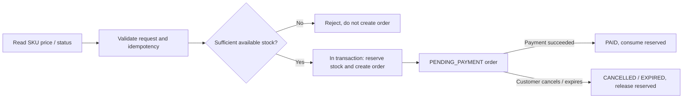
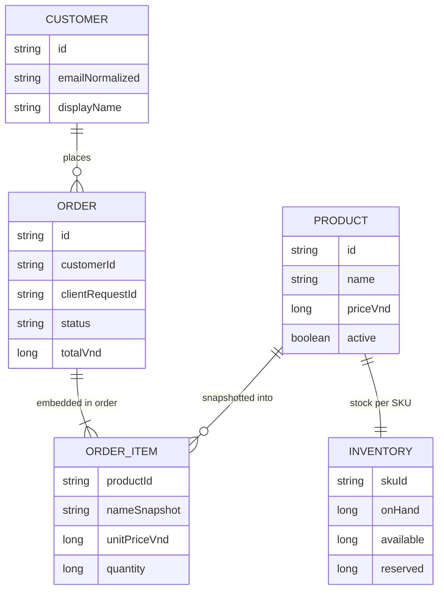

# Analyzing the Product, Customer, Inventory, and Order Problem with Spring Data MongoDB

## 1. Context and Objectives of the Capstone Practice

Suppose an online store needs to build a service to manage **products**, **customers**, **inventory**, and **orders**. Customers can browse the catalog, choose quantities, place orders, pay, or cancel orders. Operations staff can update prices, adjust stock, inspect pending orders, and view sales reports.

This is a **pre-implementation problem analysis** lesson in the **Spring Data MongoDB** module. The goal is to translate business requirements into verifiable decisions about document modeling, data relationships, queries, indexes, concurrency control, transactions, entity mapping, and testing strategies. The examples use `MongoTemplate`, MongoDB repositories, aggregation, and related mechanisms; there is no need to build a complete e-commerce system right at the first step.

Expected deliverables:

1. Clearly identify roles, features, business flows, scope, and assumptions that still need confirmation.
2. Design collections and documents to support real read/write paths.
3. State **business invariants** for inventory, pricing, order status, and idempotency.
4. Identify boundaries requiring document-level atomic updates and cases requiring multi-document transactions.
5. Choose queries, indexes, and testing methods based on functional requirements and performance goals.
6. Define acceptance criteria so others can evaluate the design and implementation.

### Assumptions Used Throughout

To keep the example consistent, this lesson scopes to **one store, one warehouse, one currency (VND)**, physical goods, and asynchronous payment. Each `products` document represents **one sellable SKU**; the same product model in different sizes/colors can be separate SKUs. There is no promotion logic, multiple warehouses, returns, multiple currencies, or delivery allocation in the initial version. These are exercise assumptions, not limitations of MongoDB or Spring Data MongoDB.

VND is represented as `long` in whole-dong units for integer amount examples, avoiding `double` for monetary values. If products allow fractional amounts or multiple currencies, a clearer monetary model is needed, such as `Decimal128` and currency codes, along with rounding rules.

## 2. Turning Business Needs into Testable Use Cases

| Actor | Use case | Input | Output and rules |
| --- | --- | --- | --- |
| Guest user | Browse active products | Category, keyword, page, sort | Only see `active=true` products per public policy |
| Logged-in customer | Update shipping info | Customer, address, phone number | Valid info, only edit permitted data |
| Logged-in customer | Create order | List of SKUs and quantities, request key | Create exactly one order; reserve stock or reject clearly |
| Payment system | Confirm result | Transaction ID, status, event signature | Transition state exactly once and handle inventory accordingly |
| Logged-in customer | View order history | Customer, pagination | Only view orders belonging to themselves |
| Customer or staff | Cancel eligible order | Order ID, reason | Do not release inventory twice |
| Warehouse staff | Restock or adjust stock | SKU, delta quantity, reason | Controlled quantity update with audit trail |
| Product admin | Edit price, hide product | SKU, changes | Affects new selling prices; old orders keep locked-in prices |
| Operations staff | Find orders to process | Status, date, store | Stable ordering and supporting index |

A requirement stating "do not oversell stock" is not specific enough. You need to ask whether *stock* means physical goods in the warehouse, goods still available for sale, or goods minus pending reservations. Similarly, "payment succeeded" requires reliable proof from the payment provider, not just an HTTP request sent directly by the customer.

### Out of Scope for the Initial Version

Do not design auctions, concurrent dynamic-price bidding, multi-warehouse fulfillment, shipment splitting/merging, returns/exchanges, complex promotions, or real-time analytics. When scaling up, you must revisit decisions on identifier keys, inventory partitioning, transactions, indexes, events, and write throughput.

## 3. Domain Vocabulary and Invariants

Using a unified vocabulary helps reduce confusion between API fields, Java field names, and BSON field names:

| Concept | Meaning in this lesson |
| --- | --- |
| `Product / SKU` | A sellable unit with ID, name, price, and active status |
| `Customer` | Purchasing account owner and contact info |
| `Inventory` | Quantities per SKU at a single warehouse |
| `Order` | Purchase agreement consisting of line items, locked-in prices, and status |
| `OrderItem` | Snapshot of SKU, name, unit price, and quantity at order creation time |
| `Reservation` | Quantity held for a pending order |
| `clientRequestId` | Idempotency key for an order creation request from a client |
| `paymentEventId` | Unique identifier of a payment event sent by the provider |
| `revision` | Version for detecting write conflicts on the corresponding entity save path |

**Mandatory invariants in the design:**

- `quantity > 0` and the SKU belongs to the catalog permitted for sale at the time the order is received.
- Prices and amounts in an order are **locked in from trusted server data**, never taking client-submitted `unitPrice` as the source of authority.
- `totalVnd = sum(unitPriceVnd * quantity)` following agreed currency rules; must check for overflow or use an appropriate numeric type.
- Never allow `available < 0` or `reserved < 0` due to ordering, cancellation, or payment confirmation.
- In this simplified model, `onHand = available + reserved`. `onHand` is the quantity still managed for sale or reservation, `reserved` is stock currently held, and `available` is stock still open for new orders. This exercise records stock consumption upon payment confirmation; physical quantity awaiting warehouse pick/delivery is not tracked separately in this version.
- For a given `(customerId, clientRequestId)`, the system creates only **one** valid order. Resending the same key with the same payload returns the previous result; the same key with a different payload must be rejected.
- An order only transitions along allowed state edges. Duplicate processing of the same payment or cancellation event must not alter inventory a second time.
- Historical orders retain their name/price/address snapshots per retention policy, even when products or customer profiles change.
- Users may only read or modify data according to their permissions; a customer ID in the request does not replace authorization checks.

These are **rules of the exercise** and must be encoded as tests. MongoDB does not automatically enforce business invariants just because a document saves successfully.

## 4. Order Lifecycle and State Transitions

In the initial version, placing an order simultaneously **reserves stock**, then waits for the payment result:



Sample states:

| Order status | Entry condition | Inventory effect |
| --- | --- | --- |
| `PENDING_PAYMENT` | Order created and stock reserved successfully | `available -= q`; `reserved += q` |
| `PAID` | Payment result verified and eligible for transition | `reserved -= q`; `onHand -= q` |
| `CANCELLED` | Cancelled while still `PENDING_PAYMENT` | `reserved -= q`; `available += q` |
| `EXPIRED` | Reservation expired while still `PENDING_PAYMENT` | Release stock similar to cancellation |

Example warehouse with 12 keyboards:

```text
Before ordering:     onHand = 12, available = 12, reserved = 0
Reserve q = 2:       onHand = 12, available = 10, reserved = 2
If payment succeeds: onHand = 10, available = 10, reserved = 0
If cancelled first:  onHand = 12, available = 12, reserved = 0
```

The two branches "payment" and "cancel/expire" **race to transition from the same `PENDING_PAYMENT` state**. They must be controlled with a status-conditional update combined with a transaction for order and inventory changes so you never both deduct real stock and return items to `available`.

If the business only deducts physical stock upon **shipment**, you need to add `allocated`/`shipped` concepts or an inventory movement ledger along with corresponding fulfillment states. In that case, you cannot reuse the `PAID` transition from the table above verbatim and call `onHand` the physical count. Choosing the consumption milestone must be confirmed before implementation.

A late payment notification arriving after an order expires is a **business scenario requiring its own policy**: do not automatically transition `EXPIRED` to `PAID` and deduct stock if the current state forbids it. It can be routed into a refund/reconciliation workflow; it cannot be solved by blind retries alone.

## 5. Defining Aggregates and Collection Relationships

MongoDB supports embedding documents (*embed*) and referencing (*reference*). Decisions should be based on **how data is read and updated**, document size/growth, and atomicity boundaries.



| Data | Storage decision | Rationale |
| --- | --- | --- |
| `products` | Independent collection | Read-heavy catalog, prices/status edited separately |
| `customers` | Independent collection | Account/PII data with separate protection policies |
| `inventory` | Independent collection, one document per SKU in this example | Frequent quantity writes; avoids contention on product documents |
| `orders` | Independent collection; `items[]` embedded | Reading an order needs the full line-item list and total amount |
| Order → customer | Store `customerId`, optionally add shipping info snapshot | Avoids duplicating the entire customer profile |
| Order → product | Store `productId` **and** name/unit-price snapshot | Future product price/name changes do not alter old orders |

Embedding `items[]` makes sense when line items per order are bounded and usually read together. If an order can contain an unbounded number of lines, you must evaluate the BSON document size limit and a separate storage model. Do not embed **all orders** inside a customer document because the list grows unboundedly, history/pagination queries become harder, and profile updates contend with order writes.

This is **intentional denormalization**: `nameSnapshot` and `unitPriceVnd` duplicate product data but carry independent historical meaning. Do not build a job that automatically updates prices on old orders whenever `products.priceVnd` changes.

## 6. Proposed BSON Schema for the Four Collections

The examples use `mongosh` syntax with `ISODate(...)` to represent BSON Date. String IDs are chosen for the exercise; if a system uses `ObjectId`, it must be consistent from DTOs to repositories and scripts. All data is simulated.

### 6.1. `products`

```javascript
{
  _id: "sku-keyboard-01",
  skuCode: "KEYBOARD-01",
  name: "Mechanical Keyboard",
  categoryId: "accessories",
  description: "Sample product",
  priceVnd: NumberLong("1250000"),
  active: true,
  createdAt: ISODate("2026-01-10T10:00:00Z"),
  updatedAt: ISODate("2026-01-10T10:00:00Z"),
  revision: NumberLong("0")
}
```

`skuCode` is for display/integration, while `_id` is the immutable identifier for relationships. Prices must be non-negative per business convention, and products are only displayed when `active=true`. `revision` can be managed by Spring Data MongoDB via `@Version` on supported entity write paths; do not use it in place of the order's idempotency key.

### 6.2. `customers`

```javascript
{
  _id: "customer-101",
  displayName: "Sample Customer",
  emailNormalized: "khach@example.test",
  phoneMasked: "***1234",
  active: true,
  createdAt: ISODate("2026-01-11T08:00:00Z")
}
```

`phoneMasked` here is a **masked display** value. If the application needs to contact or deliver to the customer in reality, there must be valid contact fields protected by an appropriate policy; do not use a masked number as the contact source. Emails are normalized according to the chosen account policy, though email normalization should not assume `toLowerCase()` alone suffices in all international scenarios.

### 6.3. `inventory`

```javascript
{
  _id: "sku-keyboard-01",
  onHand: NumberLong("12"),
  available: NumberLong("10"),
  reserved: NumberLong("2"),
  updatedAt: ISODate("2026-01-12T09:05:00Z")
}
```

At this moment one order is holding 2 units, so `12 = 10 + 2`. `inventory._id` matches the SKU ID because this exercise has only one warehouse; when scaling to multiple warehouses, you can use a dedicated key representing `(warehouseId, skuId)` with a unique compound index and updated stock allocation logic. Shrinkage/cycle-count adjustments must preserve the invariant or record discrepancies under the new domain model.

### 6.4. `orders`

```javascript
{
  _id: "order-1001",
  customerId: "customer-101",
  clientRequestId: "checkout-abc-001",
  status: "PENDING_PAYMENT",
  currency: "VND",
  items: [
    {
      productId: "sku-keyboard-01",
      skuCodeSnapshot: "KEYBOARD-01",
      nameSnapshot: "Mechanical Keyboard",
      unitPriceVnd: NumberLong("1250000"),
      quantity: NumberLong("2"),
      lineTotalVnd: NumberLong("2500000")
    }
  ],
  totalVnd: NumberLong("2500000"),
  shippingSnapshot: {
    recipient: "Sample Recipient",
    city: "Ho Chi Minh City",
    addressLine: "Test address"
  },
  placedAt: ISODate("2026-01-12T09:05:00Z"),
  reservedUntil: ISODate("2026-01-12T09:20:00Z"),
  revision: NumberLong("0")
}
```

`shippingSnapshot` preserves order details at checkout time, but it is also personal data: read access must be restricted, retention limits applied, and appropriate safeguards enforced. If an address needs to be changed before delivery, record a controlled change on the order instead of automatically syncing every customer profile edit.

**Important principle:** order data submitted by the client should only contain `productId`, `quantity`, `clientRequestId`, and permitted editable fields. The server checks `products` and computes `unitPriceVnd`, `lineTotalVnd`, and `totalVnd` itself. Never trust client-supplied prices or `status`.

## 7. API and Error Contracts to Begin Implementation

| Sample endpoint | Purpose | Cases to handle |
| --- | --- | --- |
| `GET /api/products` | Search active products, paginate, and sort | Bounded page/size; do not expose hidden products |
| `GET /api/products/{id}` | Read SKU details | Not found / not visible |
| `GET /api/me` | Read profile from authenticated identity | Prevent reading another customer |
| `POST /api/orders` | Create order and reserve stock | Invalid SKU, insufficient stock, duplicate request |
| `GET /api/orders/{id}` | Read customer's order | Authorization, order not found |
| `GET /api/me/orders` | Customer's order history | Stable sort, pagination |
| `POST /api/orders/{id}/cancel` | Cancel eligible order | Order already PAID/CANCELLED/EXPIRED |
| `POST /api/payment-events` | Receive verified payment webhook | Duplicate event, late arrival, conflicting state |
| `PATCH /api/admin/products/{id}` | Edit product info/price | Version control and admin authorization |
| `POST /api/admin/stock-adjustments` | Restock/adjust stock | Disallow negative quantities, require audit trail |

Building all APIs is not required during the analysis step, but you must have **input/output contracts** for testing. Sample order request:

```json
{
  "clientRequestId": "checkout-abc-001",
  "items": [
    { "productId": "sku-keyboard-01", "quantity": 2 }
  ]
}
```

The client does not pass `customerId` to claim ownership; the service derives the customer from the authenticated principal. A successful response contains `orderId`, `status`, `totalVnd`, and `reservedUntil`. Error types must be clearly distinguished, such as `PRODUCT_NOT_ACTIVE`, `INSUFFICIENT_STOCK`, `DUPLICATE_REQUEST_CONFLICT`, `ORDER_STATE_CONFLICT`, and `RETRYABLE_FAILURE`. Specific HTTP status codes must align with the system's API conventions rather than being guessed from error names.

For duplicate requests, return the same committed result when the payload is valid and matches. If it is unclear whether the previous transaction committed, the system must reconcile by `clientRequestId` rather than arbitrarily generating a new request key.

## 8. From Query Requirements to Indexes

MongoDB data and indexes are typically designed around **query patterns**. Before creating an index, you need to know filter fields, sort order, projection, result count, call frequency, and update rate.

| Read path | Filter / sort | Candidate index |
| --- | --- | --- |
| Product list by category, price ascending | `active=true, categoryId=?, sort priceVnd ASC, _id ASC` | `{active:1, categoryId:1, priceVnd:1, _id:1}` |
| Read SKU by ID | `_id=?` | Default `_id` index |
| Find customer by normalized email | `emailNormalized=?` | Unique `{emailNormalized:1}` per policy |
| Check stock by SKU | `_id=?` | Default `_id` index |
| Customer order history | `customerId=?, sort placedAt DESC, _id DESC` | `{customerId:1, placedAt:-1, _id:-1}` |
| Check processed request | `customerId=?, clientRequestId=?` | Unique `{customerId:1, clientRequestId:1}` |
| Process pending-payment orders | `status=PENDING_PAYMENT, reservedUntil <= now` | `{status:1, reservedUntil:1}` |

Sample creation of main indexes in `mongosh`:

```javascript
db.products.createIndex(
  {active: 1, categoryId: 1, priceVnd: 1, _id: 1},
  {name: "active_category_price"}
);

db.products.createIndex(
  {skuCode: 1},
  {unique: true, name: "unique_sku_code"}
);

db.customers.createIndex(
  {emailNormalized: 1},
  {unique: true, name: "unique_email_normalized"}
);

db.orders.createIndex(
  {customerId: 1, placedAt: -1, _id: -1},
  {name: "customer_order_history"}
);

db.orders.createIndex(
  {customerId: 1, clientRequestId: 1},
  {unique: true, name: "unique_checkout_request"}
);

db.orders.createIndex(
  {status: 1, reservedUntil: 1},
  {name: "pending_order_expiration"}
);
```

These indexes are **candidates to test against a realistic dataset**, not a mandatory list to apply blindly to production. Unique indexes must be created after cleaning up historical duplicates; adding many indexes increases write overhead and storage size. In multi-tenant systems, `tenantId` must be included in query models and unique constraints with the proper scope. Do not assume `customerId` is a tenant identifier.

For order history pagination, sorting by `placedAt` alone can be unstable when multiple orders share the same timestamp. Add `_id` as a tie-breaker; for very deep pages, consider keyset/cursor pagination instead of large `skip`.

Sample query and measurement:

```javascript
db.orders.find(
  {customerId: "customer-101"},
  {status: 1, totalVnd: 1, placedAt: 1}
).sort({placedAt: -1, _id: -1}).limit(20)
 .explain("executionStats");
```

When analyzing `explain`, inspect `nReturned`, `totalKeysExamined`, `totalDocsExamined`, and the actual stages instead of only checking for `IXSCAN`. Do not use a dataset of a few documents to claim an index is optimal; also measure latency and contention as order volume grows.

## 9. Protecting Inventory with Atomic Updates

If two requests both read `available=1` and then each deduct one unit from their read copy, the application can sell 2 items when only 1 remains in stock. A sound approach for a single SKU is performing a **conditional update directly in MongoDB**, rather than checking and calling `save` on an entity without version control.

With `MongoTemplate`, the reservation method can be expressed as:

```java
import com.mongodb.client.result.UpdateResult;
import org.springframework.data.mongodb.core.MongoTemplate;
import org.springframework.data.mongodb.core.query.Criteria;
import org.springframework.data.mongodb.core.query.Query;
import org.springframework.data.mongodb.core.query.Update;
import org.springframework.stereotype.Service;

@Service
public class InventoryReservationService {
    private final MongoTemplate template;

    public InventoryReservationService(MongoTemplate template) {
        this.template = template;
    }

    public boolean reserve(String productId, long quantity) {
        if (productId == null || productId.isBlank() || quantity <= 0) {
            throw new IllegalArgumentException("Invalid SKU and quantity");
        }

        Query query = Query.query(
            Criteria.where("_id").is(productId)
                .and("available").gte(quantity)
        );
        Update update = new Update()
            .inc("available", -quantity)
            .inc("reserved", quantity);

        UpdateResult result = template.updateFirst(query, update, "inventory");
        return result.getModifiedCount() == 1;
    }
}
```

The condition `available >= quantity` and the pair of changes `available -= quantity`, `reserved += quantity` reside in **a single update on a single document**; that is the atomicity level needed to avoid over-deducting the same SKU. Data types must always be valid integers and `quantity` must be positive, with bounds per requirements to prevent excessive values or overflow.

If `modifiedCount=0`, either the SKU does not exist or `available` is insufficient; re-read appropriate data to distinguish errors. With this direct update style, do not assume `@Version` on another entity will automatically protect every write path. Never mix `repository.save(inventory)` calls based on stale snapshots with `updateFirst` if they could overwrite counters without version control.

In a **multi-SKU** order, individual `reserve` commands do not form an atomic group when called outside a transaction. If SKU A succeeds and SKU B is out of stock, the system must roll back the entire checkout transaction or have a reliable compensation mechanism. This lesson chooses a MongoDB transaction for order creation because the number of SKUs per order is bounded and the service runs on a supporting topology.

## 10. Order Creation Transactions and Payment Boundaries

Designing a transaction for order creation:

```text
Receive request with customerId from principal, clientRequestId, and items.
Validate payload, merge duplicate SKU lines, check line count limit.
Look up committed order by (customerId, clientRequestId):
  - Already exists, same payload → return existing order.
  - Already exists, different payload → report conflict.
Read products from server; block inactive SKUs, lock in prices, and calculate total.
Inside a MongoDB transaction:
  1. Reserve each SKU in turn via conditional update available >= quantity.
  2. If any SKU lacks stock, abort transaction.
  3. Insert PENDING_PAYMENT order with items/total/snapshot and clientRequestId.
Commit.
Return orderId, totalVnd, reservedUntil.
```

Operations inside the transaction must use the **same Spring-managed session/transaction**. In Spring Data MongoDB, you can register a `MongoTransactionManager`:

You must agree on **when prices are locked in**. If the requirement is "SKU price and status must be accurate at order creation time", the product read step needs to fall within an appropriate consistency boundary and include a mechanism to detect concurrent price/status changes (such as a version condition or time-bounded pricing policy). Reading prices before the transaction and reserving stock afterward could create an order at an already changed price; this can be valid behavior if the checkout contract explicitly defines quote validity windows.

```java
import org.springframework.context.annotation.Bean;
import org.springframework.context.annotation.Configuration;
import org.springframework.data.mongodb.MongoDatabaseFactory;
import org.springframework.data.mongodb.MongoTransactionManager;

@Configuration
public class MongoTransactionConfiguration {
    @Bean
    MongoTransactionManager mongoTransactionManager(MongoDatabaseFactory factory) {
        return new MongoTransactionManager(factory);
    }
}
```

Then place the orchestration in a Spring bean with a `@Transactional` method invoked **through a Spring proxy**, not via self-invocation. MongoDB must run on a replica set or appropriate sharded cluster with the required read/write concern. `@Transactional` does not turn a standalone MongoDB instance into a transaction-capable system.

### Concurrent Duplicate Requests

A `findByCustomerIdAndClientRequestId` check before creating an order is **not enough** to protect two concurrent requests: neither may see the order yet. The unique index `{customerId:1,clientRequestId:1}` is the backstop preventing two orders with the same key from committing. When a transaction fails with a duplicate key or write conflict, handle the rollback and then reconcile the committed order in a new transaction scope; do not catch an exception mid-transaction and continue as if prior reservations were guaranteed to commit.

If a request loses its connection right during commit, the system may **not know whether the transaction succeeded**. Do not generate a new `clientRequestId` and re-run. Reconcile by idempotency key and commit outcome using an appropriate retry/timeout policy.

### Calling the Payment Provider

Do not place an HTTP call to a payment gateway inside a MongoDB transaction and expect the external transaction to roll back. Typically:

1. Commit the `PENDING_PAYMENT` order and stock reservation in MongoDB.
2. Create an external payment request with a stable idempotency key bound to the order.
3. Receive the result from a **verified** callback/webhook.
4. In a new transaction, verify `status=PENDING_PAYMENT` before transitioning to `PAID`, decrement `reserved`/`onHand`, and record the processed event.
5. If cancellation/expiration wins the race, do not force `PAID` from a late webhook; handle it via a reconciliation/refund policy.

The state transition and inventory change in step 4 must be coordinated as a consistent unit. To deliver outbound events reliably after commit, you can use a **transactional outbox** and an idempotent consumer. Webhook idempotency relies on `paymentEventId` or an equivalent provider key, while still verifying payload, status, amount, and signature.

## 11. Calculating Monetary Amounts and Preserving Historical State

A product costs `1,250,000 VND` when a customer orders 2 units. The next day an admin changes the price to `1,100,000 VND`. The old order must still show:

```text
items[0].unitPriceVnd = 1250000
items[0].quantity     = 2
items[0].lineTotalVnd = 2500000
order.totalVnd        = 2500000
```

Do not recalculate `order.totalVnd` by reading `products.priceVnd` every time history is displayed. Similarly, if the product name changes, the order screen still shows the `nameSnapshot` agreed upon at purchase time.

A calculation helper at the Java layer:

```java
import java.util.List;

public final class OrderTotals {
    private OrderTotals() {}

    public record PriceLine(long unitPriceVnd, long quantity) {}

    public static long totalVnd(List<PriceLine> lines) {
        if (lines == null || lines.isEmpty()) {
            throw new IllegalArgumentException("Order has no line items");
        }

        long total = 0;
        for (PriceLine line : lines) {
            if (line.unitPriceVnd() < 0 || line.quantity() <= 0) {
                throw new IllegalArgumentException("Invalid price or quantity");
            }
            total = Math.addExact(
                total,
                Math.multiplyExact(line.unitPriceVnd(), line.quantity())
            );
        }
        return total;
    }
}
```

`Math.multiplyExact`/`addExact` detect integer overflow instead of silently returning a wrong total. With discounts, taxes, shipping fees, and multiple currencies, you must separately define each component, the ordered pricing policy, and snapshots of the calculation inputs.

## 12. Document Mapping and Queries with Spring Data MongoDB

During analysis, you can sketch the entity for the product document:

```java
import java.time.Instant;
import org.springframework.data.annotation.Id;
import org.springframework.data.annotation.Version;
import org.springframework.data.mongodb.core.mapping.Document;

@Document("products")
public class ProductDocument {
    @Id private String id;
    private String skuCode;
    private String name;
    private String categoryId;
    private long priceVnd;
    private boolean active;
    private Instant createdAt;
    private Instant updatedAt;

    @Version
    private Long revision;

    // Constructors and getters/setters per application conventions.
}
```

A repository is used for standard read paths:

```java
import java.util.Optional;
import org.springframework.data.mongodb.repository.MongoRepository;

public interface ProductRepository
        extends MongoRepository<ProductDocument, String> {
    Optional<ProductDocument> findBySkuCode(String skuCode);
}
```

Catalog queries with explicit filtering, sorting, and limits can use `MongoTemplate`:

```java
import java.util.List;
import org.springframework.data.domain.Sort;
import org.springframework.data.mongodb.core.MongoTemplate;
import org.springframework.data.mongodb.core.query.Criteria;
import org.springframework.data.mongodb.core.query.Query;

public class CatalogQueryService {
    private final MongoTemplate template;

    public CatalogQueryService(MongoTemplate template) {
        this.template = template;
    }

    public List<ProductDocument> listActiveByCategory(
            String categoryId, int pageSize) {
        if (pageSize < 1 || pageSize > 100) {
            throw new IllegalArgumentException("pageSize out of bounds");
        }

        Query query = Query.query(
            Criteria.where("active").is(true)
                .and("categoryId").is(categoryId)
        );
        query.with(Sort.by(
            Sort.Order.asc("priceVnd"), Sort.Order.asc("_id")
        ));
        query.limit(pageSize);

        return template.find(query, ProductDocument.class);
    }
}
```

This code is **illustrative for analysis and prototyping**; you must add DTOs, validation, authorization, pagination tokens, exception mapping, and application conventions before going to production. With `@Version`, optimistic locking applies on suitable entity write paths; `updateFirst`/native updates must be evaluated separately regarding version conditions.

### Aggregation for Reporting

A total sales report from `PAID` orders can start with a pipeline:

```javascript
db.orders.aggregate([
  {$match: {status: "PAID"}},
  {$group: {
    _id: "$currency",
    paidOrders: {$sum: 1},
    grossTotal: {$sum: "$totalVnd"}
  }},
  {$sort: {_id: 1}}
]);
```

Only sum totals within the same currency, and clarify whether refunded/returned orders are included when extending. On very large collections, reports need date-range filters, indexes, pre-aggregation, or suitable read models; do not assume a pipeline scanning all orders is good enough for every real-time requirement.

## 13. Security, Operations, and Legacy Data Handling

- **Authorization:** obtain `customerId` from the authenticated identity; every query reading personal orders must enforce ownership or admin privileges. Block changing IDs in URLs to read someone else's orders.
- **Personal data:** email, phone number, and shipping address must have masking policies, encryption where required, retention periods, and logging restrictions. Do not expose the full `CustomerDocument` in public responses.
- **Validation:** limit name length, line items per order, maximum quantity, valid statuses, and BSON types. Consider MongoDB JSON Schema validation to prevent wrong-type data from writers outside Spring.
- **Inventory auditing:** every stock receipt/adjustment should record its origin and actor. If strict reconciliation is needed, add a `stockMovements` collection as an immutable ledger or equivalent design.
- **Caching:** rarely changing catalog data can be cached; after changing prices or hiding products, invalidate the appropriate cached copies. Never trust a cache as the inventory source at reservation time.
- **Replication:** secondary reads can lag; write/order-placement decision paths must use a verified source and consistency level. Do not default every query to `secondaryPreferred` just to offload the primary.
- **Migration:** when adding `schemaVersion` or renaming/retyping fields, provide compatible readers and idempotent migrations. Historical orders with snapshots and statuses must not be distorted by schema changes.
- **Recovery:** test backup/restore of product, customer, inventory, and order data along with required indexes/validators; reconcile invariants after restore.

## 14. Non-Functional Requirements: Defining How to Measure Upfront

The following targets are **hypothetical benchmarks for learning how to set SLOs**, not built-in performance guarantees of Spring Data MongoDB:

| Goal | Measurement question | Verification method |
| --- | --- | --- |
| Fast catalog reads | What is p95 latency when 90% of requests are reads? | Load test with representative data, measure cache hit/miss and MongoDB explain |
| No overselling | If 100 requests reserve 1 item with `available=1`, how many orders are created? | Concurrency test, assert exactly one reservation |
| One order per request | Does sending the same `clientRequestId` 10 times create extra orders/reservations? | Idempotency test with identical and differing payloads |
| No half-reserved orders | SKU A in stock, SKU B out of stock in the same order | Transaction rollback test, inspect inventory and orders |
| Safe duplicate webhooks | Same `paymentEventId` delivered multiple times | Test state/inventory transition occurs only once |
| Efficient history queries | How do `docsExamined` and `keysExamined` scale with order count? | `explain("executionStats")` and load test |
| Data accuracy after errors | What states remain ambiguous upon timeout near commit? | Fault injection + reconciliation by request ID |
| Data protection | Can User A view Order B by direct ID? | Authorization integration test |

Recommended metrics: request success/failure rates, `INSUFFICIENT_STOCK`, optimistic locking conflicts, transaction retries, expired pending orders, webhook latency, inventory invariant drift, p95/p99 latency, documents/index keys examined, and reconciliation progress. Log with correlation IDs and operation IDs; avoid logging raw addresses, emails, or payment credentials.

## 15. Core Integration Test Suite

A capstone is valuable when tests actually run against MongoDB instead of merely mocking repositories. With Spring Boot Test and Testcontainers, you must configure a MongoDB replica set if testing transactions or Change Streams. Tests can be grouped by domain:

| Group | Prepared data | What must be proven |
| --- | --- | --- |
| Catalog | Active/inactive products, multiple categories, varied prices | Filtering, sorting, and result limits are accurate |
| Customer | Two different accounts | Cannot read personal data or orders of the other account |
| Price snapshot | Create order then change product price | `order.items.unitPriceVnd` and `totalVnd` remain unchanged |
| Successful reserve | Stock 12, request 2 | `available=10`, `reserved=2`, `onHand=12` |
| Out of stock | Stock available 1, request 2 | No partial reservation or committed order |
| Concurrent oversell | Stock available 1, 2 distinct request IDs ordering 1 | At most one order succeeds, stock is non-negative |
| Idempotency | Same customer + request ID sent repeatedly | One order, stock reserved once; differing payload rejected |
| Multi-SKU rollback | A in stock, B out of stock | Quantities of both A and B remain unchanged after failed transaction |
| Payment success | PENDING order holding 2 | Transitions to PAID, `reserved-=2`, `onHand-=2` once |
| Duplicate webhook | Resend already processed event | No extra stock deduction or domain events emitted |
| Cancel/expire | PENDING order holding 2 | Returns `available+=2`, `reserved-=2` exactly once |
| Paid/cancel race | Send both flows concurrently | Only one transition wins; inventory remains valid |
| Ambiguous commit error | Lost response near commit | Reconcile by request ID without placing a second order |
| Performance | Many products/orders with representative distribution | Query plan, index, and p95 match test goals |

Example order race test:

```text
Setup: inventory[sku-01].available = 1; reserved = 0; onHand = 1.
Two concurrent requests with two different clientRequestIds, both qty = 1.

Expectations:
  - Exactly one request creates a PENDING_PAYMENT order and reserves stock.
  - The other request receives INSUFFICIENT_STOCK or a safely handled conflict.
  - inventory.available = 0, reserved = 1, onHand = 1.
  - No second order exists in a reserved state.
```

Checking HTTP status alone is insufficient. You must re-read **documents in MongoDB** to verify invariants. With two threads, use barriers/latches to create controlled contention; do not rely on fixed `Thread.sleep` durations.

To test transactions, do not wrap the entire test in an outer transaction and confuse the test's rollback with the service's rollback. Each business write path should be called through its appropriate Spring proxy and state verified after the transaction genuinely completes.

## 16. Deliverables of the Analysis Phase

Before full implementation, the team should deliver:

1. **Use case table** and agreed business assumptions; mark open questions.
2. **Domain diagram** including `Product`, `Customer`, `Inventory`, `Order`, and `OrderItem`.
3. **Sample JSON/BSON** and definitions of fields, types, IDs, required fields, and statuses.
4. **Invariant table** covering inventory, pricing, orders, access control, and idempotency.
5. **State transition diagram** with transaction boundaries and webhook/cancellation handling.
6. **API/query pattern list** with candidate indexes and `explain` plan.
7. **Test matrix** for happy paths, errors, races, and recovery.
8. **Measurement plan** with latency bounds, scalability considerations, and data protection.

Any unresolved decision must be recorded as a concrete question, e.g., "When a late payment arrives after `reservedUntil` expires, is a refund workflow or reservation extension preferred?" or "Do products support multiple warehouses in the initial version?". Do not turn unverified assumptions into client-approved requirements.

## 17. Self-Implementation Practice and Evaluation Criteria

Apply the model above to build a small prototype using Java, Spring Boot, Spring Data MongoDB, and a test MongoDB replica set:

**Part A — Analysis and Data Seeding**

1. Create at least 6 SKUs across 2 categories, 3 customers, and corresponding inventory.
2. Define contracts for products, customers, inventory, and orders; create properly typed BSON data.
3. Prepare price lists, order lists, duplicate checkout requests, and discontinued products.

**Part B — Read and Update Paths**

1. Build `GET` paths for catalog, product details, and owner-scoped order history.
2. Build a concurrency-controlled price update path and prove old orders keep their prices.
3. Use `MongoTemplate` for conditional reservation and repositories for entity reads.
4. Implement a multi-SKU order reservation transaction and persist order snapshots.
5. Simulate payment confirmation and state-controlled cancellation, safe under duplicate events.

**Part C — Testing and Observability**

1. Run tests for concurrent ordering, idempotency, rollback, and inventory invariants.
2. Run `explain("executionStats")` on catalog and order history queries with an expanded dataset.
3. Test webhook redelivery, timeout/retry, and reconciliation by operation ID.
4. Record measurement results, remaining defects, and proposed indexes or design adjustments.

Can be evaluated against a reference rubric:

| Criterion | Weight | Evidence |
| --- | ---: | --- |
| Requirements & assumptions analysis | 20% | Use cases, open questions, and scope boundaries |
| BSON model & data relationships | 20% | Sample documents, embed/reference rationale |
| Inventory & order correctness | 25% | Invariants, transactions, idempotency, concurrency tests |
| Queries, indexes & performance | 15% | Query patterns, `explain`, index rationale |
| Security & operations | 10% | Authorization, sensitive data, retry/recovery |
| Testability & handoff | 10% | Fixtures, integration tests, and results report |

**Definition of done:** a reviewer can read the documentation to understand purchasing rules, accurately identify data consistency boundaries, know why the four collections are designed as they are, run a sample place/cancel/pay flow on MongoDB, and verify no overselling, no duplicate orders, and no price changes on historical orders. Subsequent implementation and specialized QA phases can extend these decisions without guessing the meaning of the data.
