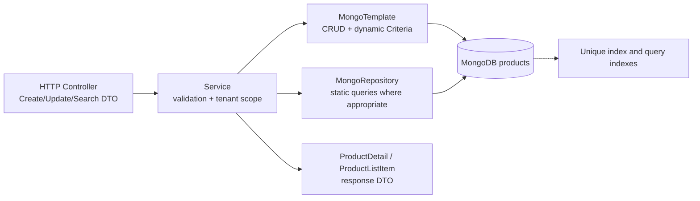

# Implementing CRUD, Dynamic Filters, Projections, and Pagination

In individual **Spring Data MongoDB** lessons, we often write a single `insert`, `find`, or short `Criteria`. When building a real API, these pieces must work together: input data is validated, CRUD operations stay within proper access boundaries, dynamic filters do not allow arbitrary operator injection, projections fetch only needed fields, and pagination maintains deterministic ordering.

This **capstone practice** builds a product management API with **Spring Boot + Spring Data MongoDB**, combining `MongoTemplate` and repositories. After this lesson, you will have an implementable design, an end-to-end Java example set, and test scenarios to evaluate correctness, security, and performance.

## 1. Problem Statement and Completion Criteria

Suppose a multi-store (*tenant*) platform needs to manage products. A product has an SKU, name, category, price in minor units, active status, and creation/update timestamps. One tenant must never read or modify another tenant's data.

The API must support:

| Feature | Endpoint | Behavior |
| --- | --- | --- |
| Create | `POST /api/products` | Insert product, enforce unique SKU within tenant |
| Read detail | `GET /api/products/{id}` | Return only products in the current tenant |
| Update | `PUT /api/products/{id}` | Edit allowed fields, preserve ID/SKU/tenant |
| Delete | `DELETE /api/products/{id}` | Delete by ID **and** tenant |
| Search | `GET /api/products` | Dynamic filtering, sorting, list projection, and pagination |

Search contract:

- `sku`: exact match against a normalized SKU, if provided.
- `category`: exact match against an allowed category code, if provided.
- `active`: Boolean `true`/`false`, if provided.
- `minPrice`, `maxPrice`: integer bound comparisons, usable independently or together.
- `sort`: one of `created`, `price`, `name`; `direction`: `asc` or `desc`.
- `page`: starting from 0; `size`: between 1 and 100.
- List results return a **summary DTO** along with `totalElements` and `hasNext`.

**Security requirement:** `tenantId` comes from the authenticated principal/token; never trust a `tenantId` parameter sent by the client. All read/write paths must enforce tenant scope; filtering by ID alone is insufficient.

Desired document example:

```javascript
{
  _id: "0b5968b3-ced8-4af6-8d36-fcafbbd37221",
  tenantId: "shop-a",
  sku: "KB-001",
  name: "Mechanical Keyboard",
  category: "peripherals",
  priceInCents: NumberLong("129900"),
  active: true,
  createdAt: ISODate("2026-11-10T08:00:00Z"),
  updatedAt: ISODate("2026-11-10T08:00:00Z")
}
```

Prices are stored as **BSON Int64** to avoid floating-point rounding errors. For other monetary requirements, you can choose `BigDecimal` mapped to BSON `Decimal128` with explicit rounding rules. This exercise standardizes on `Long`, including for min/max filters sent over HTTP.

## 2. Practice Architecture



Choosing the right tool for the job:

| Need | Tool | Rationale |
| --- | --- | --- |
| Lookup by ID/simple key | `MongoRepository` or `MongoTemplate` | Concise syntax, supports entity mapping |
| Queries combining multiple optional conditions | `MongoTemplate` with `Criteria` | Easy to build conditional filters while keeping tenant scope |
| Selective field updates | `Update` + `updateFirst` | Avoids accidentally replacing the whole document or system fields |
| Pagination and counting | `PageRequest`, `Sort`, `count` | Explicit limit, skip, and total record count |
| Summary list data | `Query.fields().include(...)` + DTO | Reduces data read and restricts exposed fields |
| Unique and performance indexes | `IndexOperations` / migration | Constraints enforced by MongoDB |

Examples use Java 17+ for `record` and `switch` expressions. The package is assumed to be `example.catalog`. Classes/records are presented by task; when creating a project, place each public type in its corresponding Java file.

## 3. Data and Entity Mapping

We choose `record Product` because write paths in this lesson use `insert` or atomic `Update`; there is no need to mutate a mutable entity directly:

```java
package example.catalog;

import java.time.Instant;
import org.springframework.data.mongodb.core.mapping.Document;
import org.springframework.data.mongodb.core.mapping.FieldType;
import org.springframework.data.mongodb.core.mapping.MongoId;

@Document("products")
public record Product(
    @MongoId(FieldType.STRING) String id,
    String tenantId,
    String sku,
    String name,
    String category,
    Long priceInCents,
    Boolean active,
    Instant createdAt,
    Instant updatedAt
) {}
```

Entity decisions:

- `@Document("products")` binds the entity to the collection.
- `@MongoId(FieldType.STRING)` stores `_id` as a BSON String, fitting the example's hyphenated UUID IDs. If using `@Id String` with values resembling ObjectIds, understand Spring Data's conversion rules; never mix `_id` types unintentionally.
- `Long priceInCents` maps prices to BSON Int64 under standard converter settings. Using wrapper `Long`/`Boolean` also represents missing fields cleanly when reading **partial** documents via projection.
- `createdAt` and `updatedAt` are `Instant`. Examples set them via an application-provided `Clock` rather than relying on automatic auditing.

The collection will have a **unique compound index** on `tenantId` + `sku`, because SKUs only need to be unique **within each tenant**. A global unique index on `sku` alone would accidentally forbid two stores from using the same code.

### 3.1. Creating Indexes Explicitly

In learning environments or schema bootstrap, you can use:

```java
import org.springframework.data.domain.Sort;
import org.springframework.data.mongodb.core.MongoTemplate;
import org.springframework.data.mongodb.core.index.Index;

void createIndexes(MongoTemplate template) {
    template.indexOps(Product.class).ensureIndex(
        new Index()
            .on("tenantId", Sort.Direction.ASC)
            .on("sku", Sort.Direction.ASC)
            .unique()
            .named("ux_products_tenant_sku")
    );

    template.indexOps(Product.class).ensureIndex(
        new Index()
            .on("tenantId", Sort.Direction.ASC)
            .on("createdAt", Sort.Direction.DESC)
            .on("id", Sort.Direction.ASC)
            .named("ix_products_tenant_created_id")
    );
}
```

When `indexOps(Product.class)` knows the entity, the `id` property maps to `_id` per mapping configuration. If creating indexes directly via `mongoTemplate.getCollection("products")`, use the actual BSON field name, such as `_id`.

**Never** place index creation or deletion inside request handlers. In production, manage indexes through a controlled bootstrap/migration process and verify they exist before serving traffic. Indexes must be evaluated against real filters and sorts using `explain`; the sample indexes above do not optimize every combination of `category`, `active`, and `price`.

## 4. Input DTOs, Output DTOs, and Validation

Never let HTTP clients write a `Product` directly because it contains `tenantId`, `id`, and system timestamps. Define explicit request types:

```java
package example.catalog;

import jakarta.validation.constraints.Min;
import jakarta.validation.constraints.NotBlank;
import jakarta.validation.constraints.NotNull;
import jakarta.validation.constraints.Size;

public record CreateProductRequest(
    @NotBlank @Size(max = 40) String sku,
    @NotBlank @Size(max = 120) String name,
    @NotBlank @Size(max = 40) String category,
    @NotNull @Min(0) Long priceInCents,
    @NotNull Boolean active
) {}

public record ReplaceProductRequest(
    @NotBlank @Size(max = 120) String name,
    @NotBlank @Size(max = 40) String category,
    @NotNull @Min(0) Long priceInCents,
    @NotNull Boolean active
) {}
```

`CreateProductRequest` includes SKU; `ReplaceProductRequest` does not allow changing SKU, tenant, or ID. If the business wants to permit SKU changes, add a dedicated operation and handle unique index errors.

DTOs for filtering and responses:

```java
package example.catalog;

import java.time.Instant;
import java.util.List;

public record ProductSearchRequest(
    String sku,
    String category,
    Boolean active,
    Long minPrice,
    Long maxPrice,
    String sort,
    String direction,
    int page,
    int size
) {}

public record ProductListItem(
    String id,
    String sku,
    String name,
    String category,
    Long priceInCents,
    Boolean active,
    Instant createdAt
) {
    static ProductListItem from(Product product) {
        return new ProductListItem(
            product.id(), product.sku(), product.name(),
            product.category(), product.priceInCents(),
            product.active(), product.createdAt()
        );
    }
}

public record ProductDetail(
    String id,
    String sku,
    String name,
    String category,
    Long priceInCents,
    Boolean active,
    Instant createdAt,
    Instant updatedAt
) {
    static ProductDetail from(Product p) {
        return new ProductDetail(
            p.id(), p.sku(), p.name(), p.category(), p.priceInCents(),
            p.active(), p.createdAt(), p.updatedAt()
        );
    }
}

public record PageResult<T>(
    List<T> items,
    int page,
    int size,
    long totalElements,
    boolean hasNext
) {}
```

`ProductListItem` and `ProductDetail` exclude `tenantId` and internal fields. This defines the **response contract**; database-side projection will be added to reduce fetched data. Never return entities directly from HTTP controllers when entities contain fields that must not be exposed.

With Spring Boot, include a compatible validation starter if you want `@Valid` to work. Domain and filter constraints still need validation in the service because services may be invoked outside HTTP controllers.

## 5. Safe CRUD with `MongoTemplate`

Define the service using `Clock` for repeatable timestamp tests and `MongoTemplate` for data access:

```java
package example.catalog;

import java.time.Clock;
import java.time.Instant;
import java.util.Locale;
import java.util.NoSuchElementException;
import java.util.UUID;
import org.springframework.data.mongodb.core.MongoTemplate;
import org.springframework.data.mongodb.core.query.Criteria;
import org.springframework.data.mongodb.core.query.Query;
import org.springframework.data.mongodb.core.query.Update;
import org.springframework.stereotype.Service;

@Service
public class ProductService {
    private final MongoTemplate mongoTemplate;
    private final Clock clock;

    public ProductService(MongoTemplate mongoTemplate, Clock clock) {
        this.mongoTemplate = mongoTemplate;
        this.clock = clock;
    }

    private Query scopedId(String tenantId, String id) {
        requireTenant(tenantId);
        if (id == null || id.isBlank()) {
            throw new IllegalArgumentException("Invalid product ID");
        }
        return Query.query(
            Criteria.where("tenantId").is(tenantId).and("id").is(id)
        );
    }

    private static void requireTenant(String tenantId) {
        if (tenantId == null || tenantId.isBlank()) {
            throw new IllegalArgumentException("Authenticated tenant is missing");
        }
    }

    private static String normalizeSku(String raw) {
        if (raw == null) {
            throw new IllegalArgumentException("SKU is required");
        }
        String sku = raw.trim().toUpperCase(Locale.ROOT);
        if (!sku.matches("[A-Z0-9-]{1,40}")) {
            throw new IllegalArgumentException("Invalid SKU");
        }
        return sku;
    }

    private static String requiredText(String value, int max) {
        if (value == null || value.isBlank() ||
                value.trim().length() > max) {
            throw new IllegalArgumentException("Invalid text value");
        }
        return value.trim();
    }

    private static Long requiredPrice(Long value) {
        if (value == null || value < 0 || value > 1_000_000_000_000L) {
            throw new IllegalArgumentException("Price out of valid range");
        }
        return value;
    }

    private static Boolean requiredActive(Boolean value) {
        if (value == null) {
            throw new IllegalArgumentException("Active status is required");
        }
        return value;
    }

    public ProductDetail create(
            String tenantId, CreateProductRequest request) {
        requireTenant(tenantId);
        if (request == null) {
            throw new IllegalArgumentException("Create request body is missing");
        }
        Instant now = clock.instant();
        Product product = new Product(
            UUID.randomUUID().toString(),
            tenantId,
            normalizeSku(request.sku()),
            requiredText(request.name(), 120),
            requiredText(request.category(), 40),
            requiredPrice(request.priceInCents()),
            requiredActive(request.active()),
            now,
            now
        );
        return ProductDetail.from(mongoTemplate.insert(product));
    }

    public ProductDetail get(String tenantId, String id) {
        Product result = mongoTemplate.findOne(
            scopedId(tenantId, id), Product.class
        );
        if (result == null) {
            throw new NoSuchElementException("Product not found");
        }
        return ProductDetail.from(result);
    }

    public ProductDetail replace(
            String tenantId, String id, ReplaceProductRequest request) {
        if (request == null) {
            throw new IllegalArgumentException("Update request body is missing");
        }

        Update update = new Update()
            .set("name", requiredText(request.name(), 120))
            .set("category", requiredText(request.category(), 40))
            .set("priceInCents", requiredPrice(request.priceInCents()))
            .set("active", requiredActive(request.active()))
            .set("updatedAt", clock.instant());

        var result = mongoTemplate.updateFirst(
            scopedId(tenantId, id), update, Product.class
        );
        if (result.getMatchedCount() == 0) {
            throw new NoSuchElementException("Product not found");
        }
        return get(tenantId, id);
    }

    public void delete(String tenantId, String id) {
        var result = mongoTemplate.remove(
            scopedId(tenantId, id), Product.class
        );
        if (result.getDeletedCount() == 0) {
            throw new NoSuchElementException("Product not found");
        }
    }
}
```

To provide `Clock` to Spring, define a bean:

```java
import java.time.Clock;
import org.springframework.context.annotation.Bean;
import org.springframework.context.annotation.Configuration;

@Configuration(proxyBeanMethods = false)
public class TimeConfiguration {
    @Bean
    Clock clock() {
        return Clock.systemUTC();
    }
}
```

CRUD design explanation:

1. **Create uses `insert`:** creates a new document and lets MongoDB's unique index guarantee uniqueness of tenant + SKU. Never treat `existsBySku` followed by `save` as sufficient protection against concurrent writes.
2. **Read enforces tenant + ID:** never query by ID alone, preventing cross-tenant data leakage.
3. **Replace uses `Update.set`:** modifies only permitted fields. `tenantId`, `sku`, `id`, and `createdAt` stay untouched; this is a full update of **API-allowed fields**, not whole-document replacement.
4. **Delete uses the same scope:** if not found within the current tenant, return the same "not found" error without disclosing whether that ID belongs to another tenant.
5. **Timestamps come from `Clock`:** tests can inject `Clock.fixed(...)` instead of depending on the system clock.

**Concurrency limitation:** in this simple implementation, two updates to the same product can overwrite each other in server-arrival order. If the system must prevent *lost updates*, add `@Version`/optimistic locking or a version predicate in `Query` alongside a controlled `Update`; test two concurrent requests before adopting. Note that `replace` also performs a read after update; if the document is deleted immediately in between, that read could report not found. That concurrency edge case needs its own policy in a real system.

## 6. Dynamic Filters with `Criteria`

**Dynamic filtering** means certain conditions are only added when the user supplies values. The server still decides **fields, operators, and query structure**. Never accept raw JSON like `{"$or":[...]}` or a `Map<String,Object>` and convert unvalidated input into a `Document`.

Filter contract:

| Parameter | Generated condition | When parameter is absent |
| --- | --- | --- |
| `sku` | `sku = value` | Do not filter by SKU |
| `category` | `category = value` | Do not filter by category |
| `active` | `active = true/false` | Do not filter by status |
| `minPrice` | `priceInCents >= value` | No lower bound |
| `maxPrice` | `priceInCents <= value` | No upper bound |
| `tenantId` from principal | `tenantId = authenticatedTenant` | **Always required** |

The following methods are **additions to `ProductService` from Section 5**:

```java
// Additional imports in ProductService:
import java.util.ArrayList;
import java.util.List;
import org.springframework.data.domain.PageRequest;
import org.springframework.data.domain.Sort;

private static void validateSearch(ProductSearchRequest request) {
    if (request == null) {
        throw new IllegalArgumentException("Search request is missing");
    }
    if (request.page() < 0 || request.page() > 1000 ||
        request.size() < 1 || request.size() > 100) {
        throw new IllegalArgumentException("Pagination out of bounds");
    }
    if (request.sku() != null) {
        normalizeSku(request.sku()); // Validate format only; do not alter filter silently.
    }
    if (request.category() != null &&
            !request.category().matches("[a-z0-9-]{1,40}")) {
        throw new IllegalArgumentException("Invalid category");
    }
    if (request.minPrice() != null) {
        requiredPrice(request.minPrice());
    }
    if (request.maxPrice() != null) {
        requiredPrice(request.maxPrice());
    }
    if (request.minPrice() != null && request.maxPrice() != null &&
            request.minPrice() > request.maxPrice()) {
        throw new IllegalArgumentException("Invalid price range");
    }
}

private static Criteria productFilters(
        String tenantId, ProductSearchRequest request) {
    List<Criteria> conditions = new ArrayList<>();
    conditions.add(Criteria.where("tenantId").is(tenantId));

    if (request.sku() != null) {
        conditions.add(Criteria.where("sku")
            .is(normalizeSku(request.sku())));
    }
    if (request.category() != null) {
        conditions.add(Criteria.where("category")
            .is(request.category()));
    }
    if (request.active() != null) {
        conditions.add(Criteria.where("active")
            .is(request.active()));
    }
    if (request.minPrice() != null || request.maxPrice() != null) {
        Criteria price = Criteria.where("priceInCents");
        if (request.minPrice() != null) {
            price.gte(request.minPrice());
        }
        if (request.maxPrice() != null) {
            price.lte(request.maxPrice());
        }
        conditions.add(price);
    }
    return new Criteria().andOperator(
        conditions.toArray(new Criteria[0])
    );
}
```

Pay attention to the price condition: use **a single `Criteria`** for `priceInCents` to combine `$gte` and `$lte`. Do not add two separate `Criteria` for the same key via `Query.addCriteria(...)` arbitrarily, as some combinations produce duplicate keys at the document level.

Because `active` uses the wrapper `Boolean`, `false` is a valid filter; check only for `null` (absent condition), never write `if (request.active())`. The same applies to `minPrice = 0`, which differs from an omitted parameter.

### 6.1. Controlling Sort

The client chooses an **API key name**, and the server maps it to the real property:

```java
private static Sort allowedSort(ProductSearchRequest request) {
    String key = request.sort() == null
        ? "created" : request.sort();
    String direction = request.direction() == null
        ? "desc" : request.direction();

    String property = switch (key) {
        case "created" -> "createdAt";
        case "price" -> "priceInCents";
        case "name" -> "name";
        default -> throw new IllegalArgumentException(
            "Unsupported sort field");
    };
    Sort.Direction dir = switch (direction) {
        case "asc" -> Sort.Direction.ASC;
        case "desc" -> Sort.Direction.DESC;
        default -> throw new IllegalArgumentException(
            "Invalid sort direction");
    };
    return Sort.by(
        new Sort.Order(dir, property),
        new Sort.Order(Sort.Direction.ASC, "id")
    );
}
```

The secondary key `id` gives a deterministic order when multiple products share the same price, name, or creation timestamp. Spring Data maps the entity `id` property in queries/sorts to BSON `_id` as needed. In production, observe filter/sort combinations and build suitable indexes instead of letting clients send arbitrary field names.

## 7. Projection and Pagination

A list API does not need to return full documents. Fetch only the fields needed for `ProductListItem`, keeping detailed fields for `GET /{id}`.

Two common projection approaches:

- **Query field projection:** `query.fields().include(...)` limits the fields returned by MongoDB, then maps to DTOs. Fits the current example.
- **Typed projection:** Spring Data MongoDB supports projection interfaces/DTOs, including via repositories or the fluent query API in compatible versions. Useful when mapping directly to DTOs and avoiding partially populated entities.

Continue by adding the `search` method to `ProductService`:

```java
public PageResult<ProductListItem> search(
        String tenantId, ProductSearchRequest request) {
    requireTenant(tenantId);
    validateSearch(request);

    Criteria filters = productFilters(tenantId, request);

    // Count uses only filters, with no skip/limit/projection.
    long total = mongoTemplate.count(
        Query.query(filters), Product.class
    );

    Query pageQuery = Query.query(filters).with(
        PageRequest.of(
            request.page(), request.size(), allowedSort(request)
        )
    );

    // These properties are sufficient for ProductListItem.
    pageQuery.fields()
        .include("id")
        .include("sku")
        .include("name")
        .include("category")
        .include("priceInCents")
        .include("active")
        .include("createdAt");

    List<ProductListItem> items = mongoTemplate
        .find(pageQuery, Product.class)
        .stream()
        .map(ProductListItem::from)
        .toList();

    long nextOffset = ((long) request.page() + 1)
        * request.size();
    return new PageResult<>(
        items,
        request.page(),
        request.size(),
        total,
        nextOffset < total
    );
}
```

**Why separate the count query?** A `Query` with `skip`, `limit`, and field projection retrieves a single page; the total record count must reflect all matching results. Therefore, the method creates a separate `count` query with only `Criteria` before constructing the page query.

**Known limitations:**

1. `count` and `find` are two separate operations and do not share a snapshot by default. Under concurrent inserts/deletes, `totalElements` and `items` may differ slightly. This is a trade-off to accept or address with a dedicated consistency strategy.
2. Projection here produces a **partially mapped `Product`**, omitting `tenantId`/`updatedAt`. Convert it straight to a DTO and discard it; **never pass that partial object back to `save`**, as doing so can lose data.
3. With very deep pages, `skip` increases the work the server must do. Capping `page` in this example is one safeguard; for continuous traversal over large datasets, consider **cursor/keyset pagination**.
4. MongoDB execution time depends on documents scanned, sorting, indexes, and payload size. Projection reduces bytes transferred but does not automatically make a query covered by an index.
5. When an endpoint does not need an exact total count, using `Slice` or fetching one extra record (`size + 1`) to determine `hasNext` avoids the count overhead.

### 7.1. Sample Request and Response

```http
GET /api/products?category=peripherals&active=true&minPrice=100000&maxPrice=500000&sort=price&direction=asc&page=0&size=2
```

An illustrative response:

```json
{
  "items": [
    {
      "id": "p-001",
      "sku": "KB-001",
      "name": "Mechanical Keyboard",
      "category": "peripherals",
      "priceInCents": 129900,
      "active": true,
      "createdAt": "2026-11-10T08:00:00Z"
    },
    {
      "id": "p-002",
      "sku": "MOUSE-002",
      "name": "Wireless Mouse",
      "category": "peripherals",
      "priceInCents": 299000,
      "active": true,
      "createdAt": "2026-11-11T08:00:00Z"
    }
  ],
  "page": 0,
  "size": 2,
  "totalElements": 7,
  "hasNext": true
}
```

The `id` values in the sample response are illustrative; when created via the service, actual IDs are UUID Strings. `priceInCents` appears as a JSON number and is serialized to BSON Int64 in MongoDB.

## 8. Exposing the Service as a REST API

With Spring MVC, the controller only accepts structured requests and delegates to the service. It **does not build MongoDB Queries itself**. To make access scope explicit, we assume a `TenantScope` interface implemented by the application from the authenticated principal:

```java
package example.catalog;

public interface TenantScope {
    String currentTenantId();
}
```

A real application must provide a bean implementing `TenantScope` and verify that the value comes from a trusted authentication/authorization system. Never implement it by reading a `tenantId` query parameter, an unverified custom header, or the request body.

Sample controller:

```java
package example.catalog;

import java.net.URI;
import jakarta.validation.Valid;
import org.springframework.http.ResponseEntity;
import org.springframework.web.bind.annotation.*;

@RestController
@RequestMapping("/api/products")
public class ProductController {
    private final ProductService service;
    private final TenantScope tenants;

    public ProductController(
            ProductService service, TenantScope tenants) {
        this.service = service;
        this.tenants = tenants;
    }

    @PostMapping
    public ResponseEntity<ProductDetail> create(
            @Valid @RequestBody CreateProductRequest body) {
        ProductDetail created = service.create(
            tenants.currentTenantId(), body
        );
        return ResponseEntity
            .created(URI.create("/api/products/" + created.id()))
            .body(created);
    }

    @GetMapping("/{id}")
    public ProductDetail get(@PathVariable String id) {
        return service.get(tenants.currentTenantId(), id);
    }

    @PutMapping("/{id}")
    public ProductDetail replace(
            @PathVariable String id,
            @Valid @RequestBody ReplaceProductRequest body) {
        return service.replace(
            tenants.currentTenantId(), id, body
        );
    }

    @DeleteMapping("/{id}")
    public ResponseEntity<Void> delete(@PathVariable String id) {
        service.delete(tenants.currentTenantId(), id);
        return ResponseEntity.noContent().build();
    }

    @GetMapping
    public PageResult<ProductListItem> search(
            @RequestParam(required = false) String sku,
            @RequestParam(required = false) String category,
            @RequestParam(required = false) Boolean active,
            @RequestParam(required = false) Long minPrice,
            @RequestParam(required = false) Long maxPrice,
            @RequestParam(defaultValue = "created") String sort,
            @RequestParam(defaultValue = "desc") String direction,
            @RequestParam(defaultValue = "0") int page,
            @RequestParam(defaultValue = "20") int size) {

        ProductSearchRequest request = new ProductSearchRequest(
            sku, category, active, minPrice, maxPrice,
            sort, direction, page, size
        );
        return service.search(tenants.currentTenantId(), request);
    }
}
```

With Spring Boot, minimal configuration requires Spring Web, Spring Data MongoDB, and Validation starters compatible with the chosen Boot version. Example:

```properties
spring.data.mongodb.uri=mongodb://localhost:27017/catalog
```

This sample URI is for a local development database. In real environments, supply URIs and credentials from a secret manager or environment config, enable TLS, and grant least-privilege database permissions; never commit passwords to Git.

### 8.1. HTTP Error Mapping

Define a consistent mapping between service exceptions and responses:

| Scenario | Suggested HTTP status | How detected |
| --- | --- | --- |
| Created successfully | `201 Created` | `insert` succeeds |
| Read/updated successfully | `200 OK` | Product found in tenant |
| Deleted successfully | `204 No Content` | `deletedCount > 0` |
| Invalid filter, sort, page, or body | `400 Bad Request` | Validation or `IllegalArgumentException` |
| Not found / belongs to another tenant | `404 Not Found` | `NoSuchElementException` |
| Duplicate SKU within tenant | `409 Conflict` | `DuplicateKeyException` from unique index |
| Connection or server error | Appropriate `5xx` | Driver/service exception, logged with correlation ID |

You can use `@RestControllerAdvice` with `@ExceptionHandler` for centralized handling. Never expose raw stack traces, connection strings, full MongoDB queries, or other tenants' data in HTTP responses. Duplicate SKU creation requests must be caught by an **actually existing unique index**, not solely by pre-insert checks.

## 9. Sample Data and End-to-End Verification Flow

To verify behavior yourself, create a fixture with at least two tenants and varied price/status combinations. The following example is for `mongosh` on a **disposable test database**:

```javascript
db.products.insertMany([
  {
    _id: "p-001", tenantId: "shop-a", sku: "KB-001",
    name: "Mechanical Keyboard", category: "peripherals",
    priceInCents: NumberLong("129900"), active: true,
    createdAt: ISODate("2026-11-10T08:00:00Z"),
    updatedAt: ISODate("2026-11-10T08:00:00Z")
  },
  {
    _id: "p-002", tenantId: "shop-a", sku: "MOUSE-002",
    name: "Wireless Mouse", category: "peripherals",
    priceInCents: NumberLong("299000"), active: true,
    createdAt: ISODate("2026-11-11T08:00:00Z"),
    updatedAt: ISODate("2026-11-11T08:00:00Z")
  },
  {
    _id: "p-003", tenantId: "shop-a", sku: "KB-003",
    name: "Budget Keyboard", category: "peripherals",
    priceInCents: NumberLong("99000"), active: false,
    createdAt: ISODate("2026-11-12T08:00:00Z"),
    updatedAt: ISODate("2026-11-12T08:00:00Z")
  },
  {
    _id: "p-004", tenantId: "shop-b", sku: "KB-001",
    name: "Shop B Keyboard", category: "peripherals",
    priceInCents: NumberLong("150000"), active: true,
    createdAt: ISODate("2026-11-12T08:00:00Z"),
    updatedAt: ISODate("2026-11-12T08:00:00Z")
  }
]);
```

If using this fixture, do not expect `totalElements = 7` from the earlier illustrative response; with filter `shop-a + peripherals + active=true + price 100000–500000`, the result is **2 documents**. Each test dataset must have expected counts matching its own data.

Acceptance flow:

1. Authenticate as tenant `shop-a`, call `GET /api/products` with the filter above; receive `p-001`, `p-002` in ascending price order.
2. Authenticate as tenant `shop-b`, run the same filter/SKU and receive only `shop-b` data; cannot read or update `p-001` by ID.
3. Create `KB-NEW` for `shop-a`; receive 201 and see the new document in the database.
4. Create the same SKU again for `shop-a`; receive 409. Creating the same SKU in `shop-b` remains valid when the unique index is scoped by tenant.
5. Update price and active status of a product in `shop-a`; confirm `tenantId`, `sku`, and `createdAt` remain unchanged.
6. Delete the created product; receive 204, and subsequent reads return 404.
7. Try `page = -1`, `size = 10000`, `minPrice > maxPrice`, `sort = internalField`, and negative prices; all must be rejected.

## 10. Integration Testing with Real MongoDB

Mock repositories cannot verify unique indexes, BSON types, projection mapping, or server behavior. Use Testcontainers or a dedicated test MongoDB matching the deployment version.

Testing example using Spring Boot 3.x, JUnit 5, and Testcontainers:

```java
package example.catalog;

import java.time.Clock;
import java.time.Instant;
import java.time.ZoneOffset;
import org.junit.jupiter.api.BeforeEach;
import org.junit.jupiter.api.Test;
import org.springframework.beans.factory.annotation.Autowired;
import org.springframework.boot.test.autoconfigure.data.mongo.DataMongoTest;
import org.springframework.boot.test.context.TestConfiguration;
import org.springframework.context.annotation.Bean;
import org.springframework.context.annotation.Import;
import org.springframework.data.domain.Sort;
import org.springframework.data.mongodb.core.MongoTemplate;
import org.springframework.data.mongodb.core.index.Index;
import org.springframework.test.context.DynamicPropertyRegistry;
import org.springframework.test.context.DynamicPropertySource;
import org.testcontainers.containers.MongoDBContainer;
import org.testcontainers.junit.jupiter.Container;
import org.testcontainers.junit.jupiter.Testcontainers;

import static org.assertj.core.api.Assertions.*;

@DataMongoTest
@Testcontainers
@Import({ProductService.class, ProductServiceTest.TestClock.class})
class ProductServiceTest {
    @Container
    static final MongoDBContainer mongo =
        new MongoDBContainer("mongo:7.0");

    @DynamicPropertySource
    static void mongoUri(DynamicPropertyRegistry props) {
        props.add("spring.data.mongodb.uri", mongo::getReplicaSetUrl);
    }

    @TestConfiguration
    static class TestClock {
        @Bean
        Clock fixedClock() {
            return Clock.fixed(
                Instant.parse("2026-11-10T08:00:00Z"), ZoneOffset.UTC);
        }
    }

    @Autowired MongoTemplate mongoTemplate;
    @Autowired ProductService service;

    @BeforeEach
    void resetDatabase() {
        if (mongoTemplate.collectionExists(Product.class)) {
            mongoTemplate.dropCollection(Product.class);
        }
        mongoTemplate.createCollection(Product.class);
        mongoTemplate.indexOps(Product.class).ensureIndex(
            new Index()
                .on("tenantId", Sort.Direction.ASC)
                .on("sku", Sort.Direction.ASC)
                .unique()
                .named("ux_products_tenant_sku")
        );
    }

    @Test
    void createAndReadWithinTenant() {
        var created = service.create(
            "shop-a",
            new CreateProductRequest(
                "KB-001", "Keyboard", "peripherals", 129900L, true)
        );
        assertThat(service.get("shop-a", created.id()).sku())
            .isEqualTo("KB-001");
        assertThatThrownBy(() -> service.get("shop-b", created.id()))
            .isInstanceOf(java.util.NoSuchElementException.class);
    }

    @Test
    void uniqueSkuIsScopedByTenant() {
        var input = new CreateProductRequest(
            "KB-001", "Keyboard", "peripherals", 129900L, true);
        service.create("shop-a", input);
        assertThatThrownBy(() -> service.create("shop-a", input))
            .isInstanceOf(
                org.springframework.dao.DuplicateKeyException.class);
        service.create("shop-b", input); // Valid: different tenant.
    }
}
```

This is a sample test covering several key behaviors; you must add Spring Boot Test, Data MongoDB, Validation, Testcontainers MongoDB/JUnit Jupiter dependencies, and a container runtime. With Spring Boot 4.x, test slice packages and some auto-configurations may differ; check your project version before copying imports. Never run this test against a production database since `@BeforeEach` intentionally drops the test collection.

### 10.1. Testing Filters, Projection, and Pagination

After creating test fixtures:

```java
@Test
void dynamicFiltersAndPagingRespectTenant() {
    service.create("shop-a", new CreateProductRequest(
        "KB-001", "Keyboard", "peripherals", 129900L, true));
    service.create("shop-a", new CreateProductRequest(
        "MS-002", "Mouse", "peripherals", 299000L, true));
    service.create("shop-a", new CreateProductRequest(
        "KB-003", "Old Keyboard", "peripherals", 99000L, false));
    service.create("shop-b", new CreateProductRequest(
        "KB-001", "Shop B Item", "peripherals", 150000L, true));

    var request = new ProductSearchRequest(
        null, "peripherals", true,
        100000L, 500000L, "price", "asc", 0, 1
    );
    PageResult<ProductListItem> page =
        service.search("shop-a", request);

    assertThat(page.totalElements()).isEqualTo(2L);
    assertThat(page.items()).hasSize(1);
    assertThat(page.items().get(0).sku()).isEqualTo("KB-001");
    assertThat(page.hasNext()).isTrue();
}
```

Additional test cases to include:

| Case | Key assertion |
| --- | --- |
| `active=false` | Returns only inactive documents, does not ignore the false filter |
| `minPrice=0` | Lower bound 0 is still applied |
| Only `maxPrice` or only `minPrice` | Single-bound range condition is built properly |
| `minPrice > maxPrice` | Returns validation error |
| `sort=unknown` or `direction=sideways` | Does not execute query |
| `size=0` / `size=1000` | Rejected as out of bounds |
| Cross-tenant SKU | Cannot read, update, or delete across tenants |
| List projection | JSON output omits `tenantId` and `updatedAt` |
| Last page | `hasNext=false` with matching `totalElements` |
| Duplicate SKU creation | Duplicate key error from unique index |
| Update/delete non-existent ID | Returns 404 per API contract |

To verify HTTP status codes and JSON serialization, add controller tests using `@SpringBootTest`/`MockMvc` or an E2E environment with an authenticated principal. Unit/integration tests calling `ProductService` directly do not verify that exceptions map to 400/404/409 via controller advice.

## 11. Inspecting BSON, Indexes, and Query Plans

After loading fixtures, inspect in `mongosh`:

```javascript
db.products.getIndexes();

db.products.find(
  {
    tenantId: "shop-a",
    category: "peripherals",
    active: true,
    priceInCents: { $gte: NumberLong("100000"), $lte: NumberLong("500000") }
  },
  {
    sku: 1,
    name: 1,
    category: 1,
    priceInCents: 1,
    active: 1,
    createdAt: 1
  }
).sort({ priceInCents: 1, _id: 1 })
 .limit(20)
 .explain("executionStats");
```

Metrics to inspect:

- `nReturned`: number of documents returned during explain.
- `totalDocsExamined` and `totalKeysExamined`: volume of documents and index keys inspected.
- `winningPlan`: presence of `COLLSCAN`, `IXSCAN`, `FETCH`, or `SORT`.
- Actual index count and the tenant + SKU unique index definition.

A unique index does not automatically optimize searching by `category`/`active` and sorting by `priceInCents`. Under real workloads, you may need to evaluate other compound indexes such as:

```javascript
// Candidate to evaluate against actual workload and query plans.
db.products.createIndex({
  tenantId: 1,
  category: 1,
  active: 1,
  priceInCents: 1,
  _id: 1
});
```

Do not build an index for every possible filter/sort combination: every index consumes storage and write overhead. Measure query frequency, selectivity, latency, and insert/update cost before deciding.

## 12. Upgrading the Capstone

Once the core flow works, extend it for specific goals:

| Extension requirement | Implementation direction | What to verify |
| --- | --- | --- |
| Prevent overwrites on concurrent updates | `@Version` or version-conditional query | Only one update against an old version succeeds |
| Deep pagination | Keyset pagination using sort key + `_id` | Cursor preserves order and tenant constraint |
| Multi-document changes in one operation | MongoDB transaction when truly needed | Supporting replica set/topology and proper rollback |
| Keyword filtering | Dedicated search or escaped bounded prefix | Prevent arbitrary regex causing broad scans |
| Large data exports | Streaming/cursor with batch processing | Close cursors, bound memory, and control load |
| Category statistics | Aggregation `match` by tenant, `group`, and `project` | Pipeline structure and performance on large data |
| Auditing | Modifier field, timestamp, controlled history | Prevent clients from forging audit values |
| Reactive API | `ReactiveMongoTemplate` and contextual publishers | Never call `block()` on reactive pipelines |

### 12.1. Why Think About Optimistic Locking?

Suppose two users both read price `129900`. User A changes it to `139900`, while User B updates another attribute and sends the old price `129900`. With an unversioned "replace allowed fields" update, the second request can overwrite the price back to the old value.

One fix is adding a `version` field managed via optimistic locking, requiring clients to send the version they read and updating only when the version still matches. If using custom `MongoTemplate.updateFirst`, check and increment the version properly rather than just adding an annotation and assuming every custom update prevents lost updates. In multi-editor apps, define the conflict response (typically 409) and test concurrent requests.

### 12.2. When Are Transactions Needed?

`insert`, `updateFirst`, and `remove` on **a single document** are atomic at the document level in MongoDB. This capstone primarily uses single-document operations and does not need every CRUD operation wrapped in a transaction by default.

If a business operation updates **inventory**, **orders**, and **payment history** across multiple documents/collections simultaneously, evaluate transactions, rollback ordering, retries, and topology support. Long-running transactions are no substitute for indexes, business validation, or idempotency handling.

## 13. Common Mistakes When Combining Features

| Mistake | Consequence | How to avoid |
| --- | --- | --- |
| `findById(id)` without tenant | Leaks or updates another tenant's data | Scope every operation by `tenantId` + `id` |
| Calling `save` on a partially projected entity | Unloaded fields may be overwritten/erased | Use list projections solely to populate read DTOs |
| Accepting raw filters/fields/sorts from clients | Operator injection or expensive queries | Server-defined DTOs and allowlists |
| Writing `if (active)` instead of `active != null` | Ignores `false` filter | Use wrapper Boolean and check null |
| Splitting `$gte` and `$lte` into invalid duplicate-key criteria | Query error or only one bound kept | Use one `Criteria` for the whole range |
| Reusing query with skip/limit for `count` | Incorrect total record count | Create a count query with filters only |
| No stable sort | Unpredictable pages when sort keys tie | Add an ID tie-breaker |
| Unique index declared but never created | Two requests create duplicate SKUs | Verify `getIndexes()` and test duplicates |
| Letting `DuplicateKeyException` surface as 500 | Client does not know SKU already exists | Map to 409 Conflict |
| Unbounded `size`/`page` | Excessive memory/skip/sort cost | Cap page/size and consider keyset |
| Assuming one green CRUD test proves API safety | Missing authorization, validation, and projection tests | Test both valid flows and unauthorized/invalid inputs |

## 14. Self-Assessment Practice

Complete a Spring Boot project with the `products` collection modeled above. Your submission should include:

1. Entity and unique index on `tenantId` + `sku`.
2. CRUD endpoints operating strictly within the current tenant.
3. At least five optional filters, including both price range bounds.
4. Sort allowlist, a deterministic tie-breaker key, and page/size limits.
5. List projection and detail DTOs, never returning the raw entity directly.
6. Error mapping from validation, not-found, and duplicate key exceptions to proper HTTP statuses.
7. Integration tests with two-tenant fixtures covering filters, pagination, unique index, projection, and access control.
8. A short `explain("executionStats")` report for common filters/sorts, with a conclusion on whether additional indexes are needed.

**Completion bar:** CRUD operations handle data accurately, dynamic filters emit only permitted operators, pagination provides deterministic ordering and totals, responses expose only contracted fields, tenants cannot access each other's data, and real-MongoDB tests prove critical indexes and constraints.

Once core requirements pass, try adding optimistic locking or keyset pagination as extensions. The capstone goal is to view a Spring Data MongoDB API as **a complete system** where query logic, data modeling, security boundaries, performance, and testing reinforce each other.
