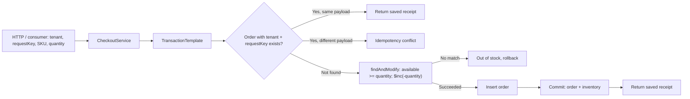
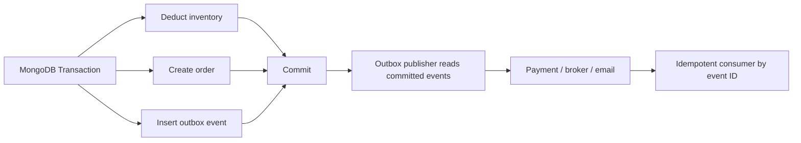

# Atomic Inventory Updates and Idempotent Order Writes

> **Chapter:** Capstone Practice  
> **Technologies:** Spring Data MongoDB, `MongoTemplate`, MongoDB transactions, unique indexes, JUnit 5, and Testcontainers.  
> **Target outcome:** never oversell available stock, never deduct inventory twice for the same request, and diagnose duplicate sends/writes cleanly.

## 1. The Real-World Problem

An ordering API receives a purchase request for one product (SKU) for a tenant. Inventory is stored in MongoDB. Clients may retry requests when they miss a response; a message broker may redeliver the same event. Multiple customers may order the same SKU simultaneously.

Initial inventory example:

```javascript
// inventory collection
{
  _id: "tenant-a:SKU-01",
  tenantId: "tenant-a",
  sku: "SKU-01",
  available: NumberLong(5)
}
```

The API receives a request like:

```json
{
  "tenantId": "tenant-a",
  "requestKey": "checkout-2026-001",
  "sku": "SKU-01",
  "quantity": 3
}
```

`requestKey` is the **business request identifier** kept identical by the caller across retries. In an authenticated app, `tenantId` must come from/be verified against the principal or trusted context rather than trusting a raw body field blindly.

Acceptance requirements:

1. First request ordering 3 items when 5 are available: create **one** order, remaining stock is **2**.
2. Resending the same `tenantId + requestKey` with the same SKU/quantity: return the **saved result**, stock stays **2**, no second order created.
3. Reusing an existing key with a different SKU or quantity: return an **idempotency key conflict** error (e.g., mapped to HTTP 409), do not deduct stock.
4. Ordering 4 items when only 2 remain: reject with **insufficient stock**, do not create an order.
5. Two different requests ordering the same product concurrently: never let `available` go negative; total reserved never exceeds initial stock.
6. If inventory deduction succeeds but inserting the order fails, **both changes must roll back together** when using a transaction.

Practice scope: **one SKU per order, writing to a single MongoDB database**. Multi-SKU orders, payments, and shipping are discussed in the extension section.

## 2. Invariants to Protect

| Invariant | Rule | Enforcement mechanism |
| --- | --- | --- |
| No overselling | `available >= 0` after every valid reservation | Conditional update with `available >= quantity` and `$inc` |
| At most one order per request | Unique per `(tenantId, requestKey)` | Unique compound index in MongoDB |
| One stock record per SKU/tenant | Unique per `(tenantId, sku)` | Unique compound index in MongoDB |
| Order creation & stock deduction succeed or fail together | Never leave "stock deducted without order created" after failed transaction | MongoDB multi-document transaction |
| Retries return prior result | Same key, same payload => no second write | Look up saved order before deducting stock |
| Old key cannot be reused for different payload | Same key, different content => conflict | Compare immutable fields/payload fingerprint |

In this scenario, MongoDB must enforce invariants at **write time**, even when two requests both read stock as 5.



## 3. The Wrong Approach: Read Stock, Compute, and `save`

An error-prone implementation looks like:

```java
// ANTI-PATTERN example, do not use in real checkout:
Inventory stock = template.findOne(stockQuery, Inventory.class);
if (stock.available >= requestedQuantity) {
    stock.available -= requestedQuantity;
    template.save(stock);
}
```

Two parallel requests can both read `available = 5`, both see enough stock to buy 4, and both call `save(available = 1)`. The database ends with 1 left, yet the app confirmed **two orders totaling 8 units**. Another flawed fix—calling `updateFirst` with `$inc(-4)` **without a quantity filter**—can drive stock negative.

To prevent overselling, the "sufficient stock" check and the deduction must execute in **the same atomic write command**.

## 4. Reserving Stock in a Single Atomic Command

MongoDB guarantees atomicity for writes **on a single document**. When two updates race on the same document, the filter predicate is evaluated at write execution time; the later request cannot act on a stale check to deduct past zero.

```java
import org.springframework.data.mongodb.core.FindAndModifyOptions;
import org.springframework.data.mongodb.core.MongoTemplate;
import org.springframework.data.mongodb.core.query.Criteria;
import org.springframework.data.mongodb.core.query.Query;
import org.springframework.data.mongodb.core.query.Update;

long quantity = 3;
Query filter = Query.query(
    Criteria.where("tenantId").is("tenant-a")
        .and("sku").is("SKU-01")
        .and("available").gte(quantity)
);
Update decrement = new Update().inc("available", -quantity);

Inventory after = template.findAndModify(
    filter,
    decrement,
    FindAndModifyOptions.options().returnNew(true),
    Inventory.class
);

if (after == null) {
    // SKU does not exist, or available < quantity.
    throw new OutOfStockException();
}
// after.available is the stock remaining after successful deduction.
```

Equivalent MongoDB command:

```javascript
db.inventory.findOneAndUpdate(
  { tenantId: "tenant-a", sku: "SKU-01", available: { $gte: NumberLong(3) } },
  { $inc: { available: NumberLong(-3) } },
  { returnDocument: "after" }
)
```

**Why is this safe?** Only a document with enough stock at write time matches the filter and gets decremented. Without a match, `findAndModify` returns `null` (because upsert is off); no write can make stock negative. `returnNew(true)` fetches the post-update document to capture the remaining count for the receipt.

Do not pass `upsert(true)` here: a reservation command **must never auto-create** an inventory record for a missing SKU. Never deduct stock via `save` on a partially loaded entity; `save` can replace the document and wipe unloaded fields.

**Limitation:** this command only guarantees deduction of a single inventory document. If inserting the order in another collection fails afterward, two separate writes **do not roll back each other**. That is why this capstone adds transactions.

## 5. Collection Design, Unique Keys, and Status

Use two collections in the same database:

| Collection | Core fields | Purpose |
| --- | --- | --- |
| `inventory` | `_id, tenantId, sku, available` | Remaining sellable quantity for an SKU |
| `orders` | `_id, tenantId, requestKey, sku, quantity, status, remainingAtPlacement` | Records a single order outcome per idempotency key |

`remainingAtPlacement` captures a **snapshot of remaining stock right after deduction**. It lets a retried request receive the exact same receipt even after other customers place orders and live stock changes.

Create unique indexes via migration/`mongosh` **before accepting requests**:

```javascript
use sales

db.inventory.createIndex(
  { tenantId: 1, sku: 1 },
  { unique: true, name: "uq_inventory_tenant_sku" }
)

db.orders.createIndex(
  { tenantId: 1, requestKey: 1 },
  { unique: true, name: "uq_orders_tenant_request" }
)
```

The index on `inventory` prevents two documents for the same tenant/SKU. The index on `orders` is the **final backstop** against creating two orders with the same key when multiple application instances process requests concurrently.

Do not rely on `findOne` followed by `insert` for uniqueness, since two processes can simultaneously observe "no order yet." Verify indexes actually exist via `db.orders.getIndexes()` and `db.inventory.getIndexes()`. `@Indexed`/`@CompoundIndex` in Java does not necessarily create indexes on the server when auto-index creation is disabled.

In this example, `requestKey` cannot be null/blank; the API must validate it before starting a transaction. In real systems, define a **key retention window** matching how long clients may retry. Never delete keys while requests can still be replayed.

## 6. Declaring Spring Data MongoDB Models

### 6.1. `Inventory.java`

```java
package example.checkout;

import org.springframework.data.annotation.Id;
import org.springframework.data.mongodb.core.mapping.Document;

@Document("inventory")
public class Inventory {
    @Id
    public String id;

    public String tenantId;
    public String sku;
    public long available;

    public Inventory() {}

    public Inventory(String id, String tenantId, String sku, long available) {
        this.id = id;
        this.tenantId = tenantId;
        this.sku = sku;
        this.available = available;
    }
}
```

### 6.2. `OrderRecord.java`

```java
package example.checkout;

import org.springframework.data.annotation.Id;
import org.springframework.data.mongodb.core.mapping.Document;

@Document("orders")
public class OrderRecord {
    @Id
    public String id;

    public String tenantId;
    public String requestKey;
    public String sku;
    public long quantity;
    public String status;
    public long remainingAtPlacement;

    public OrderRecord() {}

    public OrderRecord(
            String id, String tenantId, String requestKey,
            String sku, long quantity, String status, long remainingAtPlacement) {
        this.id = id;
        this.tenantId = tenantId;
        this.requestKey = requestKey;
        this.sku = sku;
        this.quantity = quantity;
        this.status = status;
        this.remainingAtPlacement = remainingAtPlacement;
    }
}
```

### 6.3. `PlaceOrderCommand.java` and `OrderReceipt.java`

```java
package example.checkout;

// For Java 17+:
public record PlaceOrderCommand(
    String tenantId, String requestKey, String sku, long quantity
) {}
```

```java
package example.checkout;

// Immutable receipt, safe to return verbatim when a request is replayed.
public record OrderReceipt(
    String orderId, String sku, long acceptedQuantity, long remainingAtPlacement
) {}
```

The sample models match Java property names to BSON field names to keep focus on transactions. When using `@Field("tenant_id")`, `MongoTemplate` translates property names when given the entity class overload, whereas `mongosh` commands must use **the physical BSON field names**.

## 7. Configuring MongoDB Transactions

Deducting stock and creating an order are two writes across two documents/collections, requiring a **multi-document transaction** if strong consistency across both is desired.

MongoDB transactions require a supporting topology, such as a **replica set** or properly configured **sharded cluster**. In Spring Data, register `MongoTransactionManager`; `MongoTemplate` must share the same `MongoDatabaseFactory` managed by that manager so operations join the same `ClientSession`.

```java
package example.checkout;

import org.springframework.context.annotation.Bean;
import org.springframework.context.annotation.Configuration;
import org.springframework.data.mongodb.MongoDatabaseFactory;
import org.springframework.data.mongodb.MongoTransactionManager;
import org.springframework.transaction.support.TransactionTemplate;

@Configuration(proxyBeanMethods = false)
public class MongoTxConfig {
    @Bean
    MongoTransactionManager mongoTransactionManager(MongoDatabaseFactory factory) {
        return new MongoTransactionManager(factory);
    }

    @Bean
    TransactionTemplate transactionTemplate(MongoTransactionManager manager) {
        return new TransactionTemplate(manager);
    }
}
```

`TransactionTemplate` makes the **transaction boundary** explicit in this example. You can also use `@Transactional` on a public method invoked via a Spring proxy once the manager is configured, avoiding self-invocation bugs that bypass the transaction.

**Pre-run preparation:** create required databases/collections and indexes outside transactions, and configure credentials, replica set/URI, and proper write concern. Never rely on implicitly creating collections or indexes for the first time **inside** a transaction. For critical environments, consider `majority` write concern and verify durability settings.

## 8. Checkout Service: Atomic Condition + Idempotency + Transaction

The following pattern is complete for the single-SKU case. The service validates the request, looks up any order by key, conditionally deducts stock, persists the order, and returns the receipt. All business reads/writes execute within one transaction callback.

```java
package example.checkout;

import java.util.Objects;
import java.util.UUID;

import org.springframework.dao.DuplicateKeyException;
import org.springframework.data.mongodb.core.FindAndModifyOptions;
import org.springframework.data.mongodb.core.MongoTemplate;
import org.springframework.data.mongodb.core.query.Criteria;
import org.springframework.data.mongodb.core.query.Query;
import org.springframework.data.mongodb.core.query.Update;
import org.springframework.stereotype.Service;
import org.springframework.transaction.support.TransactionTemplate;

@Service
public class CheckoutService {
    private final MongoTemplate template;
    private final TransactionTemplate transactions;

    public CheckoutService(MongoTemplate template, TransactionTemplate transactions) {
        this.template = template;
        this.transactions = transactions;
    }

    public OrderReceipt place(PlaceOrderCommand request) {
        validate(request);

        try {
            return Objects.requireNonNull(
                transactions.execute(status -> placeInTransaction(request))
            );
        } catch (DuplicateKeyException duplicate) {
            // Another instance may have just written the same requestKey.
            // The transaction failed and rolled back; look up outside that transaction.
            OrderRecord committed = findByRequestKey(request);
            if (committed != null) {
                return samePayloadOrConflict(request, committed);
            }
            // If the winning write is not visible yet or the error was on a different key,
            // the caller/retry policy must resolve it using the SAME requestKey.
            throw duplicate;
        }
    }

    private OrderReceipt placeInTransaction(PlaceOrderCommand request) {
        // (1) Check whether the request was already processed before touching stock.
        OrderRecord existing = findByRequestKey(request);
        if (existing != null) {
            return samePayloadOrConflict(request, existing);
        }

        // (2) Deduct stock with gte condition and $inc in ONE atomic command.
        Query stockQuery = Query.query(
            Criteria.where("tenantId").is(request.tenantId())
                .and("sku").is(request.sku())
                .and("available").gte(request.quantity())
        );

        Inventory after = template.findAndModify(
            stockQuery,
            new Update().inc("available", -request.quantity()),
            FindAndModifyOptions.options().returnNew(true),
            Inventory.class
        );

        if (after == null) {
            throw new OutOfStockException();
        }

        // (3) Insert order in the same transaction. Unique index guards requestKey races.
        OrderRecord order = new OrderRecord(
            UUID.randomUUID().toString(),
            request.tenantId(),
            request.requestKey(),
            request.sku(),
            request.quantity(),
            "PLACED",
            after.available
        );
        template.insert(order);
        return receipt(order);
    }

    private OrderRecord findByRequestKey(PlaceOrderCommand request) {
        Query query = Query.query(
            Criteria.where("tenantId").is(request.tenantId())
                .and("requestKey").is(request.requestKey())
        );
        return template.findOne(query, OrderRecord.class);
    }

    private OrderReceipt samePayloadOrConflict(
            PlaceOrderCommand request, OrderRecord existing) {
        if (!Objects.equals(existing.sku, request.sku())
                || existing.quantity != request.quantity()) {
            throw new IdempotencyConflictException();
        }
        return receipt(existing);
    }

    private static OrderReceipt receipt(OrderRecord order) {
        return new OrderReceipt(
            order.id, order.sku, order.quantity, order.remainingAtPlacement
        );
    }

    private static void validate(PlaceOrderCommand request) {
        if (request == null
                || request.tenantId() == null || request.tenantId().isBlank()
                || request.requestKey() == null || request.requestKey().isBlank()
                || request.sku() == null || request.sku().isBlank()
                || request.quantity() <= 0) {
            throw new IllegalArgumentException("Invalid checkout request");
        }
    }

    public static class OutOfStockException extends RuntimeException {
        public OutOfStockException() {
            super("SKU does not exist or has insufficient inventory");
        }
    }

    public static class IdempotencyConflictException extends RuntimeException {
        public IdempotencyConflictException() {
            super("Request key was already used for a different order");
        }
    }
}
```

### 8.1. Why Does Step Ordering Matter?

- Checking the request key **before** deducting stock keeps normal replays read-only.
- Comparing SKU/quantity against the existing order rejects reusing a key for different content. If real requests carry price, shipping address, or delivery options, store and compare the **complete semantically meaningful payload** or a canonical fingerprint—not just SKU/quantity.
- `findAndModify` guarantees an inventory document is only deducted when sufficient stock exists. The unique index `inventory(tenantId, sku)` ensures each SKU has only one record to update.
- `template.insert(order)` enforces the unique key on new orders; if inserting fails and aborts the transaction, the inventory deduction inside the same transaction rolls back.
- The receipt is built from the **persisted order**, never from current live stock during retries. That ensures a stable response even after subsequent orders modify stock.

**Concurrency note:** `findOne` before `insert` cannot prevent all races. Two transactions can both see no existing order; MongoDB may return a duplicate key error or a `TransientTransactionError`/write conflict. The unique index prevents creating two orders; the application still needs retry and result recovery policies as described next.

## 9. Handling Retries, Duplicate Keys, and Unknown Commit Results

There are **three distinct types of retries**:

| Retry type | Why it happens | Safe action |
| --- | --- | --- |
| Client resends HTTP POST or broker redelivers | Timeout, lost ACK, or at-least-once message delivery | Reuse **the same requestKey**; look up saved order before touching inventory |
| Transaction hits write conflict/`TransientTransactionError` | Two transactions contend on stock or transient error | Retry **the entire transaction** with bounded attempts and backoff; each attempt starts a fresh transaction |
| Commit reports `UnknownTransactionCommitResult` | Unclear whether commit completed on the server | Prefer retrying **the current transaction's commit** per driver/transaction manager, or reconcile by key before retrying business logic |

**Do not automatically retry every exception.** Out-of-stock, payload mismatch, validation errors, and authorization failures must be returned or resolved, not retried against stock.

In MongoDB, writes inside a multi-document transaction are not automatically retried like standalone writes under `retryWrites=true`. Systems must inspect error labels and retry at **the right level**. Spring Data advises using mechanisms like Spring Retry and handling uncertain commit outcomes when integrating `MongoTransactionManager`.

Recovery procedure after an unknown-result failure:

1. Keep `tenantId + requestKey` and the payload unchanged; **never generate a new requestKey**.
2. Query the committed order by the unique key. If present, verify the payload and return the saved receipt.
3. If not found, determine whether the error is retryable, inspect transaction/commit state, and perform bounded retries on a new transaction when appropriate.
4. If still uncertain, return a queryable status (such as a request ID for polling) instead of assuming failure and deducting stock a second time.

The `catch (DuplicateKeyException)` block in the service covers **one** common case; for production resilience, add retry policies for appropriately labeled MongoDB errors, bounded backoff/time budgets, and unknown-commit handling. Never start a nested transaction inside a failing transaction callback.

For message consumers, use the message ID or business command ID as `requestKey`. ACK only after the transaction commits. On redelivery, the service reads the order by key and avoids deducting stock again. If idempotency record retention can expire, define clear bounds on how long messages can be replayed.

## 10. Integration Testing with Testcontainers

Mocking repositories cannot simulate atomic updates, unique indexes, write conflicts, or MongoDB transactions. You need a real MongoDB running in a transaction-capable topology, such as `MongoDBContainer` (Testcontainers 1.x) configured as a replica set with Spring Boot 3.1+.

`@DataMongoTest` does not load custom `@Service` beans by default, so this example uses `@Import({CheckoutService.class, MongoTxConfig.class})`.

### 10.1. Test Fixture and Configuration

```java
package example.checkout;

import static org.assertj.core.api.Assertions.assertThat;
import static org.assertj.core.api.Assertions.assertThatThrownBy;

import org.junit.jupiter.api.BeforeEach;
import org.junit.jupiter.api.Test;
import org.springframework.beans.factory.annotation.Autowired;
import org.springframework.boot.test.autoconfigure.data.mongo.DataMongoTest;
import org.springframework.boot.testcontainers.service.connection.ServiceConnection;
import org.springframework.context.annotation.Import;
import org.springframework.data.domain.Sort;
import org.springframework.data.mongodb.core.MongoTemplate;
import org.springframework.data.mongodb.core.index.Index;
import org.springframework.data.mongodb.core.query.Criteria;
import org.springframework.data.mongodb.core.query.Query;
import org.testcontainers.containers.MongoDBContainer;
import org.testcontainers.junit.jupiter.Container;
import org.testcontainers.junit.jupiter.Testcontainers;
import org.testcontainers.utility.DockerImageName;

@DataMongoTest
@Testcontainers
@Import({CheckoutService.class, MongoTxConfig.class})
class CheckoutServiceTest {

    @Container
    @ServiceConnection
    static final MongoDBContainer mongo =
        new MongoDBContainer(DockerImageName.parse("mongo:7.0"));

    @Autowired MongoTemplate template;
    @Autowired CheckoutService checkout;

    @BeforeEach
    void prepare() {
        // Create collections/indexes OUTSIDE transactions; test DB only.
        template.dropCollection(Inventory.class);
        template.dropCollection(OrderRecord.class);
        template.createCollection(Inventory.class);
        template.createCollection(OrderRecord.class);

        template.indexOps(Inventory.class).ensureIndex(
            new Index()
                .on("tenantId", Sort.Direction.ASC)
                .on("sku", Sort.Direction.ASC)
                .unique()
        );
        template.indexOps(OrderRecord.class).ensureIndex(
            new Index()
                .on("tenantId", Sort.Direction.ASC)
                .on("requestKey", Sort.Direction.ASC)
                .unique()
        );

        template.insert(new Inventory("tenant-a:SKU-01", "tenant-a", "SKU-01", 5));
    }

    long remaining() {
        Inventory stock = template.findOne(
            Query.query(Criteria.where("tenantId").is("tenant-a")
                .and("sku").is("SKU-01")),
            Inventory.class
        );
        assertThat(stock).isNotNull();
        return stock.available;
    }

    // @Test methods from the next section go inside this class.
}
```

`@ServiceConnection` requires `spring-boot-testcontainers` and an available Docker runtime. On older Spring Boot versions, use `@DynamicPropertySource` with `mongo.getReplicaSetUrl()`. These imports target Spring Boot 3.x/Testcontainers 1.x; check package names if using Testcontainers 2.x.

### 10.2. Core Test Cases

Place the following methods **inside** `CheckoutServiceTest` from Section 10.1:

```java
@Test
void firstPlacementDecrementsAndCreatesOneOrder() {
    OrderReceipt receipt = checkout.place(
        new PlaceOrderCommand("tenant-a", "req-1", "SKU-01", 3)
    );

    assertThat(receipt.acceptedQuantity()).isEqualTo(3);
    assertThat(receipt.remainingAtPlacement()).isEqualTo(2);
    assertThat(remaining()).isEqualTo(2);
    assertThat(template.count(new Query(), OrderRecord.class)).isEqualTo(1);
}

@Test
void repeatedRequestReturnsSameReceiptWithoutDoubleReservation() {
    PlaceOrderCommand same =
        new PlaceOrderCommand("tenant-a", "req-1", "SKU-01", 3);

    OrderReceipt first = checkout.place(same);
    OrderReceipt replay = checkout.place(same);

    assertThat(replay).isEqualTo(first);
    assertThat(remaining()).isEqualTo(2);
    assertThat(template.count(new Query(), OrderRecord.class)).isEqualTo(1);
}

@Test
void keyCannotBeReusedForDifferentQuantity() {
    checkout.place(new PlaceOrderCommand("tenant-a", "req-1", "SKU-01", 2));

    assertThatThrownBy(() ->
        checkout.place(new PlaceOrderCommand("tenant-a", "req-1", "SKU-01", 1))
    ).isInstanceOf(CheckoutService.IdempotencyConflictException.class);

    assertThat(remaining()).isEqualTo(3);
    assertThat(template.count(new Query(), OrderRecord.class)).isEqualTo(1);
}

@Test
void insufficientStockDoesNotCreateAnOrder() {
    assertThatThrownBy(() ->
        checkout.place(new PlaceOrderCommand("tenant-a", "req-2", "SKU-01", 6))
    ).isInstanceOf(CheckoutService.OutOfStockException.class);

    assertThat(remaining()).isEqualTo(5);
    assertThat(template.count(new Query(), OrderRecord.class)).isZero();
}

@Test
void distinctRequestsCannotReserveMoreThanAvailable() {
    checkout.place(new PlaceOrderCommand("tenant-a", "req-1", "SKU-01", 4));

    assertThatThrownBy(() ->
        checkout.place(new PlaceOrderCommand("tenant-a", "req-2", "SKU-01", 2))
    ).isInstanceOf(CheckoutService.OutOfStockException.class);

    assertThat(remaining()).isEqualTo(1);
    assertThat(template.count(new Query(), OrderRecord.class)).isEqualTo(1);
}
```

These are **integration tests**: they verify actual `MongoTemplate`, index, and database behavior. Dropping collections in `@BeforeEach` is only safe because tests run in an isolated container/database; never apply this cleanup pattern to shared databases.

### 10.3. Concurrency Scenarios to Add

Run two requests across two threads, synchronized to start together via `CountDownLatch` or `CyclicBarrier`:

| Concurrent scenario | Assertions to verify |
| --- | --- |
| Two different keys each ordering 4 when stock is 5 | At most **one** transaction commits; stock stays non-negative |
| Two threads with the same `requestKey` and same payload | At most **one** order; stock deducted at most once; the second thread may need to retry or read the saved receipt |
| Two threads with the same key but different payloads | At most one payload accepted; the other gets conflict; never two orders |
| One request fails after stock deduction but before order insert | Transaction aborts; stock returns to original value |
| Client disconnects after server may have committed | Resend same key, receive old order if committed; no extra deduction |

In multi-threaded tests, configure **bounded retries** for transient transaction errors; an attempt failing with a write conflict can be expected contention rather than evidence of overselling. Once all attempts finish, verify via **raw BSON** and summation: `finalStock + SUM(quantity of PLACED orders) = initialStock` (assuming no restocks or cancellations). Also verify zero duplicate `tenantId + requestKey` orders exist.

A unit test mocking `findAndModify` to return 2 remaining only proves the service invokes the method properly; it does not prove MongoDB preserves atomicity under concurrency.

## 11. Order Cancellation or Restocking: Idempotency in Reverse

If an order is cancelled, inventory must be restored **once**, not every time a `CANCELLED` event arrives. Use a conditional status transition `PLACED → CANCELLED` and stock increment in **the same transaction**.

Method to add to `CheckoutService`:

```java
// Requires import com.mongodb.client.result.UpdateResult.
public void cancel(String tenantId, String orderId) {
    transactions.execute(status -> {
        OrderRecord old = template.findOne(
            Query.query(Criteria.where("id").is(orderId)
                .and("tenantId").is(tenantId)),
            OrderRecord.class
        );
        if (old == null) {
            throw new IllegalArgumentException("Order not found");
        }
        if ("CANCELLED".equals(old.status)) {
            return null; // Replayed cancel event: do not restock again.
        }
        if (!"PLACED".equals(old.status)) {
            throw new IllegalStateException("Order cannot be cancelled");
        }

        UpdateResult transition = template.updateFirst(
            Query.query(Criteria.where("id").is(orderId)
                .and("tenantId").is(tenantId)
                .and("status").is("PLACED")),
            new Update().set("status", "CANCELLED"),
            OrderRecord.class
        );
        if (transition.getMatchedCount() != 1) {
            throw new IllegalStateException("Concurrent status transition");
        }

        UpdateResult restock = template.updateFirst(
            Query.query(Criteria.where("tenantId").is(tenantId)
                .and("sku").is(old.sku)),
            new Update().inc("available", old.quantity),
            Inventory.class
        );
        if (restock.getMatchedCount() != 1) {
            throw new IllegalStateException("Inventory record missing");
        }
        return null;
    });
}
```

If incrementing stock fails, the transaction rolls back the cancellation status too. If a cancel event arrives when the order is already `CANCELLED`, the method exits cleanly without incrementing stock again. When orders have statuses such as `SHIPPED`/`REFUNDED`, model exact domain state transitions rather than treating every non-`CANCELLED` state as restockable.

For more complex flows, such as cancelling two SKUs, perform conditional updates on each document inside the transaction and verify all succeed. Consider a dedicated reservation mechanism if hold lifecycles span many minutes or hours.

## 12. Why Not Send Emails or Call Payment Gateways Inside a Transaction?

A MongoDB transaction **only covers data operations participating in the same session**. It cannot roll back an HTTP call already sent to a payment gateway, an email already dispatched, or a message already published to Kafka.

Failure example:

1. Transaction deducts stock and inserts the order.
2. Code calls the payment API successfully.
3. MongoDB transaction aborts on commit.

Result: money was charged, yet no order was committed.

A better design is the **transactional outbox**:



The outbox event is inserted in the same transaction as the order. A separate worker publishes after commit; an event can still be published **more than once** if the worker crashes after sending but before marking it processed, so consumers still require idempotency. Payments typically need a dedicated **payment idempotency key** and reconciliation/state workflows rather than expecting MongoDB transactions to span external systems.

## 13. Indexes, Performance, Monitoring, and Operations

A consistency-correct solution still needs load measurement:

| Aspect | What to measure/check | How to handle |
| --- | --- | --- |
| High contention on one SKU | Write conflict rate, retry count, p95/p99 latency | Bounded retries, backoff, hotspot analysis |
| Missing inventory record | `OutOfStock` count, affected SKU and tenant | Check real stock, distinguish missing SKU vs low stock if domain requires |
| High duplicate request rate | Order lookup rate by `requestKey` | Maintain unique index, monitor abnormal client retry loops |
| Long-running transactions | Duration and commit/abort rate | Minimize operations inside transactions; never call external APIs |
| Missing index | Large query scans, rising latency | Verify `getIndexes()` and `explain("executionStats")` as needed |
| Inventory drift | Actual stock vs net placements/cancellations/restocks | Reconciliation jobs, audits, and investigating bypassed writes |
| Message redelivery | Delivery count per event ID | Idempotent consumers, ACK after commit |

**Never log sensitive customer data or full request bodies.** Structured logs can record correlation IDs, log-safe tenant identifiers, SKUs, operation types, properly protected request keys, transaction outcomes, and error categories. On dashboards, separate legitimate "out of stock" errors from system failures.

Manual stock adjustments and restock imports must also update the same authoritative data via safe paths. If a job uses `save` on a stale inventory copy and ignores concurrent updates, it can break the invariant that `findAndModify` protects.

## 14. Capstone Acceptance Test Scenario

Before considering the practice complete, verify these outcomes step by step:

| Step | Request/action | Expected orders | Expected stock |
| --- | --- | --- | --- |
| 0 | Seed `SKU-01` with 5 units | 0 | 5 |
| 1 | `req-1` orders 3 | 1 `PLACED` order | 2 |
| 2 | Replay `req-1` ordering 3 | Still 1 order, same ID/receipt | 2 |
| 3 | `req-1` orders 1 | Conflict, no new order | 2 |
| 4 | `req-2` orders 4 | Out of stock, no new order | 2 |
| 5 | `req-2` orders 2 | 1 more `PLACED` order | 0 |
| 6 | Replay `req-2` ordering 2 | No new order | 0 |
| 7 | Cancel `req-1` order | First order `CANCELLED` | 3 |
| 8 | Replay cancel `req-1` order | Status unchanged | 3 |

**Note on steps 4 → 5:** `req-2` never created an order in step 4, so under this sample design, the same key can be resent with a different valid quantity in step 5. If your API requires *every* request (including business rejections) to return an immutable idempotent response, persist rejection results by key under a dedicated status/record and define explicit retry rules; that is an extension decision to settle before implementation.

A passing capstone implementation should include: the data model, both unique indexes, conditional atomic decrement, order-creation transaction, replay and payload-conflict handling, out-of-stock tests, and idempotent cancellation/restock tests. Concurrency tests, commit-timeout recovery, and inventory reconciliation are additional checks required before production.

## 15. Common Pitfalls

| Pitfall | Consequence | Fix |
| --- | --- | --- |
| Read stock then `save` decremented value | Lost update, overselling | Use conditional `$inc` in a single atomic command |
| `$inc` without checking `available >= qty` | Negative stock | Put sufficiency check in the same write filter |
| Check `requestKey` with `findOne` without unique index | Two instances create two orders | Enforce unique index in MongoDB |
| Retry with a new `requestKey` | Two orders and double deduction | Preserve original business request ID |
| Insert order after stock deduction without transaction | Missing order with deducted stock | Use transaction or dedicated reservation/saga mechanism |
| Swallow transaction error and return success | Broken business consistency | Distinguish business, retryable, and unknown-commit errors |
| Create collections/indexes first time inside transaction | Unsupported operation errors | Run migrations/index setup before serving orders |
| Always `$inc(+qty)` on cancel | Replayed cancellation restocks repeatedly | Guard status transition inside transaction |
| Call payment gateway mid-transaction | Unrollbackable side effects | Use outbox and idempotent external APIs |
| Rely on mocked repositories for concurrency safety | Misses real atomicity/index/commit semantics | Use Testcontainers + concurrency tests |

## 16. Self-Check Questions

1. Why must `available >= quantity` appear in the **update filter itself** instead of only in an `if` statement after `findById`?
2. Why is the `(tenantId, requestKey)` unique index still needed even when the code calls `findOne` before inserting the order?
3. After decrementing stock succeeds, if inserting the order hits a duplicate key inside a transaction, what state must inventory be in?
4. When MongoDB returns `UnknownTransactionCommitResult`, why must you never generate a new `requestKey` and resend?
5. Why should retry receipts be built from the saved order rather than current live inventory?
6. Why is `retryWrites=true` insufficient to protect an ordering API from client request retries?
7. How do you ensure two `cancel order` invocations never restock inventory twice?
8. For a three-SKU order, how should the transaction and conflict handling be extended?
9. Why can a correct unique index without a transaction still leave "stock deducted, order not written"?
10. If out-of-stock outcomes must be strictly idempotent, what additional data must be persisted to record rejections?

## 17. Key Takeaways

- **Document-level atomicity:** `findAndModify` with `available >= quantity` and `$inc(-quantity)` prevents deducting stock below zero.
- **Business-level idempotency:** a `(tenantId, requestKey)` key backed by a unique index, payload verification, and returning the committed result prevents double orders and double stock deductions.
- **Multi-document transactions:** inventory deduction and order insertion must commit or roll back together; requires `MongoTransactionManager` and a supporting MongoDB deployment.
- **Retry at the right layer:** retry whole transactions for transient errors, handle unknown commits specially, and preserve the same key across request replays.
- **Verify against real MongoDB:** test placement, replay, insufficient stock, concurrency, cancellation, and commit failures; never rely solely on mocked unit tests.

## References

- [Spring Data MongoDB — Saving, Updating and Removing Documents](https://docs.spring.io/spring-data/mongodb/reference/mongodb/template-crud-operations.html): `findAndModify`, `Update.inc`, `upsert`, and options to return post-update documents.
- [Spring Data MongoDB — Sessions & Transactions](https://docs.spring.io/spring-data/mongodb/reference/mongodb/client-session-transactions.html): `MongoTransactionManager`, `TransactionTemplate`, session binding, and transaction error handling.
- [MongoDB — Atomicity and Transactions](https://www.mongodb.com/docs/manual/core/write-operations-atomicity/): document-level atomicity and concurrent filters.
- [MongoDB — Transactions in Applications](https://www.mongodb.com/docs/manual/core/transactions-in-applications/): retrying `TransientTransactionError` and `UnknownTransactionCommitResult`.
- [MongoDB — Unique Indexes](https://www.mongodb.com/docs/manual/core/index-unique/): enforcing uniqueness across concurrent writers.
- [MongoDB — Transactions Production Considerations](https://www.mongodb.com/docs/manual/core/transactions-production-consideration/): topology requirements, collection/index setup, and transaction overhead.
- [Spring Boot — Testcontainers](https://docs.spring.io/spring-boot/reference/testing/testcontainers.html): `@ServiceConnection` and running MongoDB integration tests.
