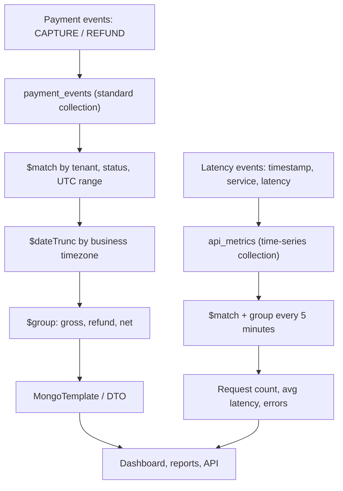

# Writing Revenue Reporting and Time-Series Aggregations

## 1. Context of the Capstone Practice

In a **Spring Data MongoDB** system, a development team needs to build a revenue dashboard for an e-commerce platform while also analyzing operational metrics over time. One service stores payment transactions in MongoDB; another collects API latency metrics. Both include timestamps, yet their data semantics and calculations differ.

**Problem statement:** write verifiable aggregations to:

1. Compute **gross** receipts, **refund** amounts, and **net** cash flow by **business day** for a tenant and each currency.
2. Count only successful payment events; accurately handle events near midnight and day boundaries.
3. Integrate the aggregation into Spring Data MongoDB's **`MongoTemplate`**, map results to DTOs, and guard queries with tenant scope, time bounds, and timeouts.
4. Analyze operational **time-series** data in five-minute windows.
5. Verify outputs on controlled data, justify index choices, and explain how to handle days with no data.

The purpose is to practice query design, aggregation, document mapping, and performance diagnostics in the **SPRING_DATA_MONGODB** module. The content uses a standard collection for financial events and a time-series collection for operational metrics; choosing the collection type is itself a design decision to justify.

### Business Rules Locked In Before Writing Queries

The financial report in this lesson **measures cash flow from payment events**; this is a practice example and **does not automatically equal recognized revenue under accounting standards**.

- Successful `CAPTURE` increases gross receipts.
- Successful `REFUND` decreases net receipts and is recorded on the **business day the refund occurred**, not attributed back to the original payment day.
- `FAILED` or `PENDING` events do not contribute to the report.
- `amount` is a **positive** BSON Decimal128 value; cash-flow sign is derived from `type`.
- Each event has a unique `eventId` within the tenant to handle ingestion retries.
- **Never sum different currencies directly.** Every result always includes `currency`.
- Business days are evaluated in the `Asia/Ho_Chi_Minh` timezone; date ranges are queried using half-open intervals **`[from, to)`**.

If a product requires revenue recognized at service delivery time, taxes, transaction fees, chargebacks, or FX conversion rates, redefine the rules and data sources before production use.

## 2. Data Architecture and Processing Flow



### `payment_events` Collection

Each document is a single financial event written once; one order/transaction may have one capture event and multiple refund events. Example:

```javascript
{
  _id: "lab-evt-02",
  tenantId: "lab-revenue-2026",
  eventId: "evt-02",
  orderId: "order-02",
  type: "CAPTURE",
  status: "SUCCEEDED",
  currency: "VND",
  amount: NumberDecimal("240000"),
  occurredAt: ISODate("2026-11-18T17:05:00Z")
}
```

Choose **Decimal128** because these are monetary amounts; never pass through Java `double` or BSON Double if decimal precision is required. VND values in the example are whole VND amounts; for fractional currencies like USD, use values such as `NumberDecimal("12.50")`. Establish explicit policies for scale, rounding, and currency units at ingestion time.

### Why Store `occurredAt` in UTC?

`occurredAt` represents an **exact instant** on the timeline. BSON Date stores epoch milliseconds without a timezone name. The instant `2026-11-18T17:05:00Z` corresponds in Vietnam to **00:05 on 2026-11-19**. Extracting UTC dates via `$dateToString` without a timezone will group events onto the wrong business day.

In Java, convert local date boundaries into two UTC instants:

```java
import java.time.Instant;
import java.time.LocalDate;
import java.time.ZoneId;

ZoneId businessZone = ZoneId.of("Asia/Ho_Chi_Minh");
LocalDate firstDay = LocalDate.of(2026, 11, 18);
LocalDate endDayExclusive = LocalDate.of(2026, 11, 21);

Instant from = firstDay.atStartOfDay(businessZone).toInstant();
Instant to = endDayExclusive.atStartOfDay(businessZone).toInstant();

// from = 2026-11-17T17:00:00Z
// to   = 2026-11-20T17:00:00Z
```

Use `day.plusDays(1).atStartOfDay(zone)` to compute the exclusive end bound. In timezones with daylight saving time, a local day can be 23 or 25 hours long; never assume every day is 24 UTC hours.

## 3. Preparing Sample Data with Predictable Results

The example below targets the test database `capstone_lab`. Run once on an empty collection; fixed `_id` and `eventId` values keep records distinguishable. Never wipe collections on a shared database.

```javascript
var lab = db.getSiblingDB("capstone_lab");

lab.payment_events.insertMany([
  {
    _id: "lab-evt-01",
    tenantId: "lab-revenue-2026",
    eventId: "evt-01",
    orderId: "order-01",
    type: "CAPTURE",
    status: "SUCCEEDED",
    currency: "VND",
    amount: NumberDecimal("150000"),
    occurredAt: ISODate("2026-11-18T16:55:00Z")
  },
  {
    _id: "lab-evt-02",
    tenantId: "lab-revenue-2026",
    eventId: "evt-02",
    orderId: "order-02",
    type: "CAPTURE",
    status: "SUCCEEDED",
    currency: "VND",
    amount: NumberDecimal("240000"),
    occurredAt: ISODate("2026-11-18T17:05:00Z")
  },
  {
    _id: "lab-evt-03",
    tenantId: "lab-revenue-2026",
    eventId: "evt-03",
    orderId: "order-02",
    type: "REFUND",
    status: "SUCCEEDED",
    currency: "VND",
    amount: NumberDecimal("25000"),
    occurredAt: ISODate("2026-11-19T02:00:00Z")
  },
  {
    _id: "lab-evt-04",
    tenantId: "lab-revenue-2026",
    eventId: "evt-04",
    orderId: "order-03",
    type: "CAPTURE",
    status: "FAILED",
    currency: "VND",
    amount: NumberDecimal("900000"),
    occurredAt: ISODate("2026-11-19T05:00:00Z")
  },
  {
    _id: "lab-evt-05",
    tenantId: "lab-revenue-2026",
    eventId: "evt-05",
    orderId: "order-04",
    type: "CAPTURE",
    status: "SUCCEEDED",
    currency: "USD",
    amount: NumberDecimal("12.50"),
    occurredAt: ISODate("2026-11-19T05:35:00Z")
  },
  {
    _id: "lab-evt-06",
    tenantId: "lab-revenue-2026",
    eventId: "evt-06",
    orderId: "order-05",
    type: "CAPTURE",
    status: "SUCCEEDED",
    currency: "VND",
    amount: NumberDecimal("100000"),
    occurredAt: ISODate("2026-11-20T08:10:00Z")
  },
  {
    _id: "lab-evt-07",
    tenantId: "lab-revenue-2026",
    eventId: "evt-07",
    orderId: "order-06",
    type: "CAPTURE",
    status: "SUCCEEDED",
    currency: "VND",
    amount: NumberDecimal("99999"),
    occurredAt: ISODate("2026-11-20T17:00:00Z")
  }
]);

// Prevent duplicate ingestion of the same eventId within a tenant.
lab.payment_events.createIndex(
  { tenantId: 1, eventId: 1 },
  { unique: true, name: "uq_tenant_event" }
);
```

`lab-evt-07` occurs **at exactly 00:00 on Nov 21 in Vietnam** and must be excluded from the Nov 18–20 range. `lab-evt-04` has `FAILED` and must also be excluded. Do not count unique `orderId` values as successful event counts: a single order can have subsequent refunds.

## 4. Writing the Daily Business Revenue Pipeline

Build the pipeline in order:

1. `$match` early to narrow documents.
2. `$project` to compute business day, gross, and refund per event type.
3. `$group` to sum values by `(day, currency)`.
4. `$set` to compute net = gross − refunds.
5. `$sort` and `$project` to shape the output structure.

```javascript
var lab = db.getSiblingDB("capstone_lab");
const from = ISODate("2026-11-17T17:00:00Z");
const to = ISODate("2026-11-20T17:00:00Z");

const dailyRevenuePipeline = [
  {
    $match: {
      tenantId: "lab-revenue-2026",
      status: "SUCCEEDED",
      type: { $in: ["CAPTURE", "REFUND"] },
      occurredAt: { $gte: from, $lt: to }
    }
  },
  {
    $project: {
      currency: 1,
      businessDay: {
        $dateTrunc: {
          date: "$occurredAt",
          unit: "day",
          timezone: "Asia/Ho_Chi_Minh"
        }
      },
      gross: {
        $cond: [
          { $eq: ["$type", "CAPTURE"] },
          "$amount",
          NumberDecimal("0")
        ]
      },
      refunds: {
        $cond: [
          { $eq: ["$type", "REFUND"] },
          "$amount",
          NumberDecimal("0")
        ]
      },
      captureCount: {
        $cond: [{ $eq: ["$type", "CAPTURE"] }, 1, 0]
      },
      refundCount: {
        $cond: [{ $eq: ["$type", "REFUND"] }, 1, 0]
      }
    }
  },
  {
    $group: {
      _id: {
        day: "$businessDay",
        currency: "$currency"
      },
      gross: { $sum: "$gross" },
      refunds: { $sum: "$refunds" },
      captures: { $sum: "$captureCount" },
      refundEvents: { $sum: "$refundCount" }
    }
  },
  {
    $set: {
      net: { $subtract: ["$gross", "$refunds"] }
    }
  },
  { $sort: { "_id.day": 1, "_id.currency": 1 } },
  {
    $project: {
      _id: 0,
      dayStartUtc: "$_id.day",
      businessDay: {
        $dateToString: {
          format: "%Y-%m-%d",
          date: "$_id.day",
          timezone: "Asia/Ho_Chi_Minh"
        }
      },
      currency: "$_id.currency",
      gross: 1,
      refunds: 1,
      net: 1,
      captures: 1,
      refundEvents: 1
    }
  }
];

lab.payment_events.aggregate(dailyRevenuePipeline, {
  maxTimeMS: 5000,
  allowDiskUse: false
});
```

### Why Is the Pipeline Ordered This Way?

**`$match` before `$project`** lets MongoDB filter by tenant, status, and time range before running expressions. With a suitable index, the server avoids reading unnecessary documents.

**`$dateTrunc`** snaps `occurredAt` to the start of the business-timezone day. The BSON Date `dayStartUtc` remains a UTC timestamp: for instance, the start of Nov 19 in Vietnam is `2026-11-18T17:00:00Z`. Use `$dateToString` with the same timezone when formatting the calendar date so it never shifts.

**`$group` by currency** prevents adding VND and USD into a meaningless sum. If a product supports multiple payment channels, you can add `channel` to the group key, accepting more output rows and finer granularity.

**`$sum` on Decimal128** keeps monetary arithmetic in decimal when inputs have the right type. Never convert `amount` to `double` before grouping; define rounding policies on final output rather than rounding each event prior to summing.

**`net` is computed after grouping**: `gross - refunds`. If the system handles chargebacks, commissions, or taxes, give them dedicated rules and fields; do not overload `refund` for all adjustments.

### Expected Results on the Fixture

| Vietnam Day | Currency | Gross | Refunds | Net | Captures | Refund events |
|---|---|---:|---:|---:|---:|---:|
| 2026-11-18 | VND | 150000 | 0 | 150000 | 1 | 0 |
| 2026-11-19 | USD | 12.50 | 0 | 12.50 | 1 | 0 |
| 2026-11-19 | VND | 240000 | 25000 | 215000 | 1 | 1 |
| 2026-11-20 | VND | 100000 | 0 | 100000 | 1 | 0 |

On Nov 19, USD appears before VND because the pipeline sorts by currency code ascending. The three-day VND total is **490000 gross, 25000 refunds, and 465000 net**. The USD row stays separate without conversion when exchange rates and FX policies are absent.

## 5. Variations: Hourly, Weekly, and Monthly Reports

You do not need a separate reporting system just to change time granularity. On MongoDB versions supporting `$dateTrunc`, swap the bucket configuration:

```javascript
// Group by local hour:
{
  $dateTrunc: {
    date: "$occurredAt",
    unit: "hour",
    timezone: "Asia/Ho_Chi_Minh"
  }
}

// Group by week, starting Monday:
{
  $dateTrunc: {
    date: "$occurredAt",
    unit: "week",
    startOfWeek: "monday",
    timezone: "Asia/Ho_Chi_Minh"
  }
}

// Group by month:
{
  $dateTrunc: {
    date: "$occurredAt",
    unit: "month",
    timezone: "Asia/Ho_Chi_Minh"
  }
}
```

For 15-minute buckets, use `unit: "minute", binSize: 15`. Keep these distinctions in mind:

- **Day/week/month buckets** follow business calendar boundaries in the target timezone.
- **Hour buckets** may encounter repeated local hours during daylight saving time transitions in DST zones; preserve the actual bucket timestamp rather than only formatting a local hour label.
- **Reporting by payment date** differs from reporting by order creation date; pick the timestamp field that matches the business question.
- **Late-arriving data:** events ingested today with an earlier `occurredAt` can alter historical reports. Define cache/rollup refresh policies.

`$dateTrunc` and window operators require supporting MongoDB server versions (introduced in MongoDB 5.0). On older clusters, use a tested alternative rather than blindly adding fixed 24-hour offsets.

## 6. Missing Days: Filling Zeros with Proper Semantics

A `$group` pipeline only returns days **that had events**. If transactions occurred on only 3 days out of 7, the output will not automatically include four `net = 0` rows. For continuous chart timelines, decide:

- **No valid events:** safe to display 0 if the pipeline confirmed collection completeness.
- **Data not yet ingested / import failed:** never equate with 0; surface a missing-data status instead.
- **Currencies with zero activity:** generate 0 rows only for currencies the product expects to display.

You can generate the calendar in Java with `LocalDate` and fill missing days after aggregation per selected currency. Single-currency example:

```java
import java.math.BigDecimal;
import java.time.LocalDate;
import java.util.Map;

LocalDate first = LocalDate.of(2026, 11, 18);
LocalDate endExclusive = LocalDate.of(2026, 11, 21);

// netByDay contains days read from aggregation for the single currency "VND".
Map<LocalDate, BigDecimal> netByDay = Map.of(
    LocalDate.of(2026, 11, 18), new BigDecimal("150000"),
    LocalDate.of(2026, 11, 19), new BigDecimal("215000"),
    LocalDate.of(2026, 11, 20), new BigDecimal("100000")
);

for (LocalDate day = first; day.isBefore(endExclusive); day = day.plusDays(1)) {
    BigDecimal net = netByDay.getOrDefault(day, BigDecimal.ZERO);
    System.out.println(day + " VND: " + net);
}
```

To gap-fill server-side, explore `$densify` and `$fill` on supporting MongoDB versions. With multiple currencies, partition properly and validate timezone, range bounds, and generated row counts. For short reporting APIs, filling dates in Java is often easier to control.

## 7. Integrating Aggregations into Spring Data MongoDB

Spring Data provides `Aggregation`, `AggregationOperation`, and `MongoTemplate.aggregate`. For complex BSON expressions like `$dateTrunc`, `$cond`, and Decimal128, you can combine **`Aggregation.match` using `Criteria`** with explicit BSON stages.

The following example targets **Java 17+** and Spring Data MongoDB APIs with `AggregationOptions.maxTime`; JSON stage strings are **developer-defined constants**, never raw JSON queries accepted from clients.

```java
import java.math.BigDecimal;
import java.time.Duration;
import java.time.Instant;
import java.time.LocalDate;
import java.time.ZoneId;
import java.util.Date;
import java.util.List;

import org.bson.Document;
import org.bson.types.Decimal128;
import org.springframework.data.mongodb.core.MongoTemplate;
import org.springframework.data.mongodb.core.aggregation.Aggregation;
import org.springframework.data.mongodb.core.aggregation.AggregationOperation;
import org.springframework.data.mongodb.core.aggregation.AggregationOptions;
import org.springframework.data.mongodb.core.query.Criteria;

public final class RevenueReportService {
    private static final ZoneId ZONE = ZoneId.of("Asia/Ho_Chi_Minh");
    private final MongoTemplate mongoTemplate;

    public RevenueReportService(MongoTemplate mongoTemplate) {
        this.mongoTemplate = mongoTemplate;
    }

    public record DailyRevenue(
        LocalDate day,
        String currency,
        BigDecimal gross,
        BigDecimal refunds,
        BigDecimal net,
        long captures,
        long refundEvents
    ) {}

    private static AggregationOperation raw(String json) {
        return context -> Document.parse(json);
    }

    public List<DailyRevenue> daily(
            String authorizedTenantId,
            LocalDate first,
            LocalDate endExclusive) {

        if (authorizedTenantId == null || authorizedTenantId.isBlank()
                || first == null || endExclusive == null
                || !first.isBefore(endExclusive)
                || first.plusDays(31).isBefore(endExclusive)) {
            throw new IllegalArgumentException("Invalid report range");
        }

        Instant from = first.atStartOfDay(ZONE).toInstant();
        Instant to = endExclusive.atStartOfDay(ZONE).toInstant();

        Criteria filter = Criteria.where("tenantId").is(authorizedTenantId)
            .and("status").is("SUCCEEDED")
            .and("type").in("CAPTURE", "REFUND")
            .and("occurredAt").gte(Date.from(from)).lt(Date.from(to));

        String projection = """
            { "$project": {
              "currency": 1,
              "businessDay": { "$dateTrunc": {
                "date": "$occurredAt", "unit": "day",
                "timezone": "Asia/Ho_Chi_Minh"
              }},
              "gross": { "$cond": [
                { "$eq": ["$type", "CAPTURE"] }, "$amount", 0
              ]},
              "refunds": { "$cond": [
                { "$eq": ["$type", "REFUND"] }, "$amount", 0
              ]},
              "captures": { "$cond": [
                { "$eq": ["$type", "CAPTURE"] }, 1, 0
              ]},
              "refundEvents": { "$cond": [
                { "$eq": ["$type", "REFUND"] }, 1, 0
              ]}
            }}
            """;

        String group = """
            { "$group": {
              "_id": { "day": "$businessDay", "currency": "$currency" },
              "gross": { "$sum": "$gross" },
              "refunds": { "$sum": "$refunds" },
              "captures": { "$sum": "$captures" },
              "refundEvents": { "$sum": "$refundEvents" }
            }}
            """;

        Aggregation aggregation = Aggregation.newAggregation(
            Aggregation.match(filter),
            raw(projection),
            raw(group),
            raw("""
                { "$set": {
                  "net": { "$subtract": ["$gross", "$refunds"] }
                }}
                """),
            raw("""
                { "$sort": { "_id.day": 1, "_id.currency": 1 } }
                """)
        ).withOptions(AggregationOptions.builder()
            .maxTime(Duration.ofSeconds(5))
            .allowDiskUse(false)
            .build());

        List<Document> rows = mongoTemplate.aggregate(
            aggregation, "payment_events", Document.class
        ).getMappedResults();

        return rows.stream().map(row -> {
            Document id = row.get("_id", Document.class);
            LocalDate day = id.getDate("day").toInstant()
                .atZone(ZONE).toLocalDate();

            return new DailyRevenue(
                day,
                id.getString("currency"),
                decimal(row.get("gross")),
                decimal(row.get("refunds")),
                decimal(row.get("net")),
                ((Number) row.get("captures")).longValue(),
                ((Number) row.get("refundEvents")).longValue()
            );
        }).toList();
    }

    private static BigDecimal decimal(Object value) {
        if (value instanceof Decimal128 decimal) {
            return decimal.bigDecimalValue();
        }
        throw new IllegalStateException(
            "Expected Decimal128 aggregation amount, got " + value
        );
    }
}
```

**Integration notes:**

- `authorizedTenantId` must come from application authentication/authorization. Never read an unverified tenant directly from the URL into the query.
- With Java 17, `record` and text blocks work cleanly. Field names inside raw JSON must match **actual BSON field names**. If `@Field` renames fields or custom converters apply, verify the aggregation at the MongoDB layer; raw `Document` stages do not auto-translate entity property renames.
- `getMappedResults()` materializes results in memory; here row count is bounded by the 31-day maximum range and system currency count. If currency cardinality is unbounded or grouping adds high-cardinality dimensions, add result/memory policies.
- The `decimal` helper enforces the Decimal128 contract. Legacy records with BSON Double/String must be migrated or converted intentionally; never silently coerce to `doubleValue()`.
- `$cond` with integer `0` and Decimal128 inputs still yields a Decimal128 `$sum` when at least one Decimal128 event exists in each group; integration tests must assert BSON types to avoid wrong assumptions as schemas evolve.
- `allowDiskUse(false)` and `maxTime` act as resource guards for interactive reports. Under heavy data volume, offload to scheduled reporting jobs or rollups rather than raising timeouts indefinitely.

If using repositories elsewhere, invoke this service from controllers; derived repository method names cannot express full multi-stage pipelines with `$dateTrunc` and currency grouping. `MongoTemplate` is the clear choice for complex transformations.

## 8. Time-Series Practice: API Latency in Five-Minute Windows

The revenue report above processes financial events. Now extend to operational metrics containing timestamp, service, and per-request latency. Data with **continuous appends, rare updates, and time-based queries** fits MongoDB **time-series collections**.

### Creating the Time-Series Collection

```javascript
var lab = db.getSiblingDB("capstone_lab");

lab.createCollection("api_metrics", {
  timeseries: {
    timeField: "observedAt",
    metaField: "metadata",
    granularity: "seconds"
  }
});

lab.api_metrics.insertMany([
  {
    observedAt: ISODate("2026-11-20T08:00:10Z"),
    metadata: { service: "checkout", region: "ap-southeast-1" },
    latencyMs: 120,
    ok: true
  },
  {
    observedAt: ISODate("2026-11-20T08:01:20Z"),
    metadata: { service: "checkout", region: "ap-southeast-1" },
    latencyMs: 180,
    ok: true
  },
  {
    observedAt: ISODate("2026-11-20T08:04:30Z"),
    metadata: { service: "checkout", region: "ap-southeast-1" },
    latencyMs: 300,
    ok: false
  },
  {
    observedAt: ISODate("2026-11-20T08:05:05Z"),
    metadata: { service: "checkout", region: "ap-southeast-1" },
    latencyMs: 90,
    ok: true
  }
]);
```

Time-series collections use **internal buckets managed by MongoDB**; applications still insert and aggregate logical measurements. Check index, update, delete, and option support for your exact MongoDB version; never assume all regular collection operations work identically.

### Building the Five-Minute Aggregation

```javascript
const metricsPipeline = [
  {
    $match: {
      "metadata.service": "checkout",
      "metadata.region": "ap-southeast-1",
      observedAt: {
        $gte: ISODate("2026-11-20T08:00:00Z"),
        $lt: ISODate("2026-11-20T08:10:00Z")
      }
    }
  },
  {
    $group: {
      _id: {
        service: "$metadata.service",
        bucket: {
          $dateTrunc: {
            date: "$observedAt",
            unit: "minute",
            binSize: 5,
            timezone: "UTC"
          }
        }
      },
      requests: { $sum: 1 },
      errors: {
        $sum: {
          $cond: [{ $eq: ["$ok", false] }, 1, 0]
        }
      },
      avgLatencyMs: { $avg: "$latencyMs" },
      maxLatencyMs: { $max: "$latencyMs" }
    }
  },
  {
    $set: {
      errorRate: {
        $cond: [
          { $eq: ["$requests", 0] },
          0,
          { $divide: ["$errors", "$requests"] }
        ]
      }
    }
  },
  { $sort: { "_id.bucket": 1 } }
];

lab.api_metrics.aggregate(metricsPipeline, {
  maxTimeMS: 5000
});
```

Expected results:

| UTC Bucket | Requests | Errors | Avg latency (ms) | Max latency (ms) | Error rate |
|---|---:|---:|---:|---:|---:|
| 2026-11-20T08:00:00Z | 3 | 1 | 200 | 300 | 1/3 ≈ 33.33% |
| 2026-11-20T08:05:00Z | 1 | 0 | 90 | 90 | 0% |

`$avg` here computes the arithmetic mean across measurements. If a document stores pre-aggregated request counts via `requestCount`, compute a **weighted average** using total `latencySum / requestCount`; an unweighted average of averages is wrong.

To calculate p95 latency, consider `$percentile` on supporting MongoDB versions (introduced in MongoDB 7.0) or a dedicated metrics store. Never substitute `$max` for percentiles; the two metrics mean different things.

### What to Watch When Querying Time-Series Data?

- Keep `metadata` relatively stable; never place timestamps or per-event unique IDs inside metadata, as doing so degrades bucketing efficiency.
- Filter early by metadata and `observedAt`. Evaluate indexes and performance with `explain` instead of assuming time-series collections automatically optimize every filter.
- Choose a `binSize` suited to the chart; overly narrow windows generate too many groups and large payloads.
- Late-arriving data can alter historical buckets. Dashboards need refresh strategies or updated rollups.
- When multiple measurements share a timestamp, standardize how request counts and latencies are defined by business rules; do not confuse measurement count with real request count.

## 9. Trend Analysis: Running Totals with Window Functions

Financial reports often need **cumulative** daily net cash flow per currency. After `$group` and `$set` calculate `net`, apply:

```javascript
{
  $setWindowFields: {
    partitionBy: "$_id.currency",
    sortBy: { "_id.day": 1 },
    output: {
      cumulativeNet: {
        $sum: "$net",
        window: {
          documents: ["unbounded", "current"]
        }
      }
    }
  }
}
```

Insert this stage **after computing `net` and before the final output projection**. `partitionBy` prevents summing VND and USD together. If a day has zero transactions, the window runs only across existing rows; for continuous lines, fill missing days after aggregation or construct the calendar before windowing.

On the VND fixture, cumulative net progresses **150000 → 365000 → 465000**. For USD, the separate total is **12.50**.

`$setWindowFields` requires MongoDB 5.0+ and incurs sorting/memory resource requirements. On large reports, inspect RAM limits, disk spill, and latency. Do not use a server window function merely to replace a simple addition across a few dozen rows already returned to Java.

## 10. Indexes and Performance Measurement

For the event ledger, queries filter by tenant, status, type, and time. Candidate index:

```javascript
var lab = db.getSiblingDB("capstone_lab");

lab.payment_events.createIndex(
  {
    tenantId: 1,
    status: 1,
    type: 1,
    occurredAt: 1
  },
  { name: "idx_tenant_status_type_time" }
);
```

For this pipeline, the index places equality fields before the time range. Since `type` uses `$in` with two values, exact efficiency depends on data distribution and optimizer behavior; **measure** and compare against `{tenantId:1,status:1,occurredAt:1}`. `$group` still aggregates matching rows within the window; an index does not turn a daily report into a constant-time lookup.

Inspect with explain:

```javascript
lab.payment_events.explain("executionStats").aggregate(
  dailyRevenuePipeline,
  { maxTimeMS: 5000 }
);
```

Depending on server version and pipeline structure, `explain` may use classic or SBE formats; look for common signals:

| Metric | What to observe |
|---|---|
| `nReturned` / group count | Is the number of report rows reasonable for the days and currencies? |
| `totalDocsExamined` | Is it scanning too many documents outside the report window? |
| `totalKeysExamined` | Did the index narrow the scan or traverse broadly? |
| `IXSCAN` / `COLLSCAN` | Is an index access plan used or a full collection scan? |
| Sort/group and memory usage | Are there large blocking stages or disk spills? |
| `executionTimeMillis` | Does it fit within the endpoint budget? |
| CPU/IO and latency under multi-tenant concurrency | Does reporting degrade ingestion or other endpoints? |

For time-series collections, run `explain` separately on the metrics pipeline and inspect metadata/time filtering efficiency as well as buckets accessed. A 4–7 document dataset is only for **verifying logic**, never for concluding a query plan is optimal at production scale.

### Avoiding Heavy Reports Inside HTTP Requests

With hundreds of millions of events, daily reports may read huge numbers of transactions just to produce a few dozen rows. Depending on SLAs, consider:

- Running hourly/daily jobs to compute **rollups** into a summary collection keyed by `(tenantId, currency, businessDay)`.
- Making rollup updates idempotent and rerunnable; late events/refunds must update the right bucket.
- Tracking a version/watermark so users know up to what point data is covered.
- Separating raw source-of-truth events from regenerable summary tables.
- Never storing financial transactions in a time-series collection just for time-based reporting; choose storage based on update patterns, unique constraints, transactions, and real query needs.

Indexes and rollups are design changes whose write overhead, storage footprint, and recovery behavior must be measured—not decided solely from result row counts.

## 11. Meaningful Testing: Reconciling Amounts and Time Boundaries

A strong test suite separates **logic checks on small fixtures** from **benchmarks on representative data**.

### Mandatory Business Matrix

| Case | Expectation |
|---|---|
| Successful CAPTURE 150000 at 16:55Z Nov 18 | Grouped into **Nov 18 in Vietnam** |
| CAPTURE at 17:05Z Nov 18 | Grouped into **Nov 19**, not Nov 18 |
| Successful REFUND 25000 | Reduces net on the refund day; gross stays unchanged |
| `FAILED` CAPTURE 900000 | Excluded from gross/net |
| USD CAPTURE 12.50 | Separate USD group; never added to VND |
| Event at exact `to = 2026-11-20T17:00Z` | Excluded from `[from,to)` |
| Two events with same `eventId` | Unique index blocks duplicates within tenant |
| Day with no events | No group emitted; presentation layer fills 0 when semantically valid |
| `amount` is Decimal128 | Aggregation preserves decimal precision without converting to Double |
| Day near DST switch in another timezone | Computed from `LocalDate + ZoneId`, never fixed +24 hours |

Integration tests should run against real MongoDB (e.g., Testcontainers) because `$dateTrunc`, `$group`, BSON Decimal128, and indexes are only truly verified on the server. With JUnit/AssertJ, partial service assertions look like:

```java
import static org.assertj.core.api.Assertions.assertThat;
import java.math.BigDecimal;
import java.time.LocalDate;

var rows = reportService.daily(
    "lab-revenue-2026",
    LocalDate.of(2026, 11, 18),
    LocalDate.of(2026, 11, 21)
);

assertThat(rows).hasSize(4);

var nov19Vnd = rows.stream()
    .filter(r -> r.day().equals(LocalDate.of(2026, 11, 19)))
    .filter(r -> r.currency().equals("VND"))
    .findFirst().orElseThrow();

assertThat(nov19Vnd.gross())
    .isEqualByComparingTo(new BigDecimal("240000"));
assertThat(nov19Vnd.refunds())
    .isEqualByComparingTo(new BigDecimal("25000"));
assertThat(nov19Vnd.net())
    .isEqualByComparingTo(new BigDecimal("215000"));
assertThat(nov19Vnd.captures()).isEqualTo(1);
assertThat(nov19Vnd.refundEvents()).isEqualTo(1);

assertThat(rows)
    .noneMatch(r -> r.day().equals(LocalDate.of(2026, 11, 21)));
```

This test assumes `reportService` is wired in a Spring test context and the fixture is inserted in the test database. Add assertions for **Nov 18 VND**, **Nov 20 VND**, **USD**, total row counts, and `Decimal128` storage in raw documents.

### Checking Idempotency and Source Data Correctness

The `tenantId + eventId` unique index prevents duplicate inserts for the same key pair, yet does not verify that:

- Two distinct `eventId` values do not represent the same upstream payment duplicated.
- A refund does not exceed its corresponding CAPTURE amount per business rules.
- The event belongs to the right order, currency, and tenant.
- `occurredAt` represents a finalized financial event rather than an estimated time.

These rules belong in the **ingestion/domain service** or payment provider reconciliation. Aggregations are only as trustworthy as their input events.

## 12. Common Errors and Diagnostics

| Symptom | Possible cause | Fix |
|---|---|---|
| Numbers shifted by one day | Grouped in UTC instead of Vietnam local day | Use `$dateTrunc` and format with the same timezone |
| Abnormally high net | Included failed events or ignored REFUNDs | `$match status` and branch refunds by `type` |
| Abnormally low net | REFUND stored as negative and subtracted again | Normalize `amount` positive; use a single sign convention |
| Nonsense revenue sum | Grouped all currencies together | Add `currency` to `_id`; convert only with explicit FX policy |
| Midnight transaction counted twice | Used `$lte to` on adjacent ranges | Use `$gte from`, `$lt to` |
| Monetary precision loss | Cast to `double` before `$sum` | Use Decimal128/BigDecimal and test raw BSON |
| Missing days on chart | `$group` emits only populated buckets | Generate calendar or `$densify` with completeness checks |
| Fast on fixture, slow in prod | Large collection, missing index, multi-tenant contention, heavy group/sort | `explain`, tune index, rollups, enforce bounds |
| High API RAM usage | Overly granular grouping or `getMappedResults()` on huge outputs | Cap group counts/date range, stream/offload to jobs |
| Historical report changes | Late refunds/events or edits to source records | Define watermarks and recalculation strategy |
| Missing/duplicated time-series buckets | Wrong metadata, timezone, or `binSize` | Verify `$dateTrunc`, filters, and boundary events |
| Wrong average latency | Unweighted average of averages | Divide total latency sum by total requests or aggregate raw events |

## 13. Extension Tasks for Learners

After completing both pipelines and verifying expected results, tackle extensions in increasing difficulty:

1. Add `channel` to transactions (`CARD`, `BANK_TRANSFER`) and report gross/refund/net by day and channel while always keeping currency in the group key.
2. Count distinct orders with a successful CAPTURE; distinguish `$addToSet` on orderId from capture event count (multiple captures can belong to one order). Evaluate RAM limits of distinct sets on large data.
3. Return both **daily net** and **cumulative net** using `$setWindowFields`; compare against summing retrieved rows in Java.
4. Design zero-activity days: return 0 for requested currencies and `DATA_PENDING` status for days whose ingestion is incomplete.
5. Replace hardcoded Vietnam dates with a tenant-configured timezone; test a DST transition day in a DST-observing timezone.
6. Write another time-series aggregation computing error counts and latency by `metadata.region`, comparing 1-minute vs 5-minute buckets.
7. Propose a 90-day rollup strategy, recalculation policy for late REFUNDs, and dashboard indexes.
8. Benchmark the same pipeline against 1 million payment events and several million metrics; record p95 latency, resource usage, `docsExamined`, and index impact.

### Acceptance Criteria

The practice passes when **results are reproducible from the fixture**, time expressions never shift days, net/gross/refund and currency groupings are accurate, Spring Data code enforces authorized tenant access and preserves Decimal128 precision, the time-series pipeline produces expected request counts and latencies, and `explain`/resource evidence supports production choices.

The core takeaway is coordinating **server-side aggregation**, **time and currency domain rules**, **`MongoTemplate` in Java**, **indexes**, and **real-data testing**. When these contracts are explicit, revenue reporting and time-series analytics scale while staying accurate, explainable, and operable.
