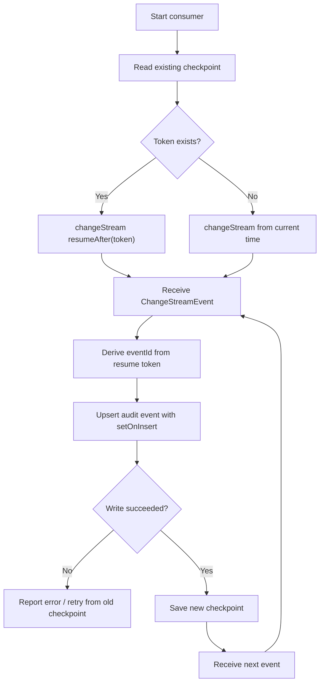

# Tracking Changes with Change Streams and Checkpoints

## 1. Capstone Practice Problem

In an order management system built with **Spring Data MongoDB**, the `orders` collection continuously receives `insert`, `update`, `replace`, and `delete` operations. Operations teams need a change log to audit and track synchronization progress, and want the event reader service to **resume from where it left off** after a disconnect or process restart.

Build an **Order Change Stream Consumer** service using Java, Spring Boot, MongoDB, and `ReactiveMongoTemplate`. The service must:

1. Watch changes on the `orders` collection using a MongoDB change stream.
2. Save each event to `order_change_events` with a stable unique key to **prevent duplicate writes** upon replay.
3. Persist the **checkpoint** only after processing the event succeeds.
4. On restart, load the saved resume token and reopen the stream from the next position.
5. Safely handle events without `fullDocument`, such as `delete`.
6. Provide ways to verify mid-flight crashes, replayed events, token errors, and oplog retention expiry.

This practice integrates data modeling, reactive APIs, error diagnostics, idempotency, operational monitoring, and testing—core skills of the `SPRING_DATA_MONGODB` module.

### Completion Criteria

| Criterion | Observable outcome |
| --- | --- |
| Capture changes | Every test write on `orders` emits an event received by the watcher |
| Persist audit trail | `order_change_events` contains a matching record, including for `delete` |
| Save checkpoint | `stream_checkpoints` stores a valid resume token after the event record is saved |
| Restart | Service resumes from the saved token without re-reading the entire stream |
| Replay | When an event is re-read, audit record count does not increase thanks to the idempotency key |
| Isolation | Service does not accidentally watch or loop on the checkpoint collection |
| Fatal errors | Expired/invalidated tokens are detected for controlled handling |

**Scope:** this example designs for **one active consumer** per subscription ID. Scaling to multiple instances is analyzed separately. This is an **at-least-once system with idempotent processing**, making no "exactly once" claim for arbitrary external side effects.

## 2. Background and Deployment Prerequisites

MongoDB change streams notify subscribers of committed changes on a replica set or sharded cluster. A regular standalone MongoDB instance **does not support** `$changeStream`. The app requires MongoDB running as a replica set (a single-node replica set works for learning), a user authorized to read change streams, and a compatible MongoDB Java Driver/Spring Data MongoDB version.

Spring Data offers two consumption approaches:

- **Reactive:** `ReactiveMongoTemplate.changeStream(...)` returns `Flux<ChangeStreamEvent<T>>`; suits long-lived streams, backpressure, and cancellation.
- **Imperative:** `DefaultMessageListenerContainer` registers a `ChangeStreamRequest` on a dedicated blocking task; requires managing listener lifecycles and error handlers.

This lesson chooses **reactive** as the primary implementation. If an application uses synchronous `MongoTemplate`, it can use the listener container or MongoDB Driver equivalently; never run a blocking cursor on a WebFlux request thread.

### What Is Inside an Event?

Key members of `ChangeStreamEvent<Document>`:

| Field | Meaning |
| --- | --- |
| `getResumeToken()` | Opaque `BsonValue` used to resume the stream after this event |
| `getOperationType()` | Operation type, e.g., `INSERT`, `UPDATE`, `REPLACE`, `DELETE` |
| `getRaw()` | Driver `ChangeStreamDocument<Document>`, including `documentKey` and update descriptions |
| `getBody()` | Mapped document, potentially `null` depending on event type and options |
| `getBsonTimestamp()` | Cluster time as `BsonTimestamp`, distinct from app machine clocks |

In a MongoDB change event, `_id` **is the event's resume token**, not the order's ID. The order ID resides in `documentKey._id`; calling `getBody().get("_id")` fails on `delete` when there is no full document.

**Never decode or fabricate resume tokens.** MongoDB treats tokens as opaque structures; preserve all BSON values intact when storing and restoring them. Tokens are not guaranteed to last forever once the required oplog history expires.

## 3. Data Design and Processing Flow

We use three collections:

| Collection | Role | Key/primary fields |
| --- | --- | --- |
| `orders` | Business data being watched | `_id`, `tenantId`, `status`, `updatedAt` |
| `order_change_events` | Idempotent event log | `_id` = SHA-256 of token, `operationType`, `documentKeyJson`, `observedAt` |
| `stream_checkpoints` | Latest processed position per subscription | `_id` = `orders-audit-v1`, `resumeTokenJson`, `lastEventId`, `updatedAt` |

Sample checkpoint document:

```javascript
{
  _id: "orders-audit-v1",
  resumeTokenJson: "{\"_data\":\"...opaque token...\"}",
  lastEventId: "9f...sha256...",
  updatedAt: ISODate("2026-11-20T09:00:00Z")
}
```

`resumeTokenJson` here is the **Extended JSON string** of a `BsonDocument`, not manually extracted `_data` JSON. The implementation uses `JsonMode.EXTENDED` to preserve BSON type fidelity and `BsonDocument.parse(...)` to reconstruct the token.



Two mandatory invariants:

1. **Process first, checkpoint second.** If the checkpoint updates before processing and the app crashes, the unprocessed event would be skipped on `resumeAfter`.
2. **Preserve ordering per consumer.** If multiple events execute concurrently and a later event checkpoints before an earlier one, a restart can drop the in-flight earlier event. This example uses `concatMap` for sequential processing.

## 4. Preparing MongoDB and the Application

### 4.1. Replica Set and Connection

Example lab setup: `rs0` is initialized with one member listening on port `27017`. Spring Boot connection:

```properties
# application.properties (practice environment)
spring.data.mongodb.uri=mongodb://localhost:27017/capstone_streams?replicaSet=rs0&w=majority
```

`w=majority` requests majority write acknowledgment, which helps checkpoint durability, though **it does not turn two separate writes into a transaction**. The URI/host must match your real replica set configuration. Never hardcode real credentials in docs or commit secrets to repositories.

When learning with Docker Compose or Testcontainers, ensure the MongoDB container actually **initiates a replica set**; running standalone `mongod` will make the watcher fail. With Testcontainers 1.x, `MongoDBContainer` starts a replica set for integration tests. Pick MongoDB and dependency versions matching your project BOM; never arbitrarily override Driver versions managed by Spring Boot.

Verify MongoDB from `mongosh`:

```javascript
rs.status().ok
// Expected: 1 when the replica set is active.

db.getSiblingDB("capstone_streams").runCommand({ ping: 1 })
// Expected: { ok: 1 }.
```

### 4.2. Sample Data

Run on the test database:

```javascript
use capstone_streams

db.orders.insertOne({
  _id: "ORDER-001",
  tenantId: "tenant-a",
  status: "NEW",
  totalMinor: NumberLong("125000"),
  updatedAt: new Date()
});

db.orders.createIndex({ tenantId: 1, status: 1 });
```

The `tenantId/status` index supports normal business queries and serves as part of the capstone context; change streams do not replace indexes or queries. Do not drop the collection or re-run `insertOne` with the same `_id` before verifying data state.

### 4.3. Minimum Dependencies

A Spring Boot project can use the corresponding starter:

```groovy
dependencies {
    implementation 'org.springframework.boot:spring-boot-starter-data-mongodb-reactive'
    testImplementation 'org.springframework.boot:spring-boot-starter-test'
    testImplementation 'io.projectreactor:reactor-test'
    testImplementation 'org.testcontainers:junit-jupiter'
    testImplementation 'org.testcontainers:mongodb'
}
```

The Testcontainers coordinates above follow the common **1.x** line; for **2.x**, use artifact/module names and packages matching your BOM. Explicit version numbers are omitted because compatibility depends on your Spring Boot version.

## 5. Reading a Change Stream with Spring Data MongoDB

A minimal stream watch:

```java
import org.bson.Document;
import org.springframework.data.mongodb.core.ChangeStreamEvent;
import org.springframework.data.mongodb.core.ChangeStreamOptions;
import org.springframework.data.mongodb.core.ReactiveMongoTemplate;
import reactor.core.publisher.Flux;

Flux<ChangeStreamEvent<Document>> events =
        reactiveMongoTemplate.changeStream(
                "orders",
                ChangeStreamOptions.builder()
                        .returnFullDocumentOnUpdate()
                        .build(),
                Document.class
        );
```

`reactiveMongoTemplate` is an injected `ReactiveMongoTemplate` bean. The `Flux` does nothing until subscribed; once subscribed, it keeps a long-lived stream open until cancelled or errored.

`returnFullDocumentOnUpdate()` maps to MongoDB's `updateLookup` option. For `update` events, the server looks up the **latest** document at lookup time—not necessarily the exact snapshot right after that update—and in some cases the document may no longer exist. For `delete` events, `getBody()` is typically `null`.

Consequently, this capstone records **operation type and document key** from the raw event as minimal audit data. If a domain requires exact before/after states, evaluate MongoDB change stream pre/post images (on supporting server versions and configs) or application-level domain events.

## 6. Core Code: Reading Checkpoints and Storing Events

The following class can live in `OrderChangeStreamProcessor.java`. It assumes **Java 17+**, Spring Data MongoDB reactive APIs, Reactor, and the BOM-managed MongoDB Java Driver. It uses `Document` for output to avoid entity-mapping coupling when only change metadata is needed.

```java
import java.nio.charset.StandardCharsets;
import java.security.MessageDigest;
import java.security.NoSuchAlgorithmException;
import java.time.Instant;
import java.util.Date;
import java.util.HexFormat;

import org.bson.BsonDocument;
import org.bson.BsonValue;
import org.bson.Document;
import org.bson.json.JsonMode;
import org.bson.json.JsonWriterSettings;
import org.springframework.data.mongodb.core.ChangeStreamEvent;
import org.springframework.data.mongodb.core.ChangeStreamOptions;
import org.springframework.data.mongodb.core.ReactiveMongoTemplate;
import org.springframework.data.mongodb.core.query.Criteria;
import org.springframework.data.mongodb.core.query.Query;
import org.springframework.data.mongodb.core.query.Update;
import org.springframework.stereotype.Service;
import reactor.core.publisher.Flux;
import reactor.core.publisher.Mono;

@Service
public class OrderChangeStreamProcessor {

    private static final String SUBSCRIPTION = "orders-audit-v1";
    private static final String CHECKPOINTS = "stream_checkpoints";
    private static final String EVENTS = "order_change_events";

    private static final JsonWriterSettings TOKEN_JSON =
            JsonWriterSettings.builder()
                    .outputMode(JsonMode.EXTENDED)
                    .build();

    private final ReactiveMongoTemplate mongo;

    public OrderChangeStreamProcessor(ReactiveMongoTemplate mongo) {
        this.mongo = mongo;
    }

    // Read checkpoint each time a new subscription is created.
    private Mono<ChangeStreamOptions> optionsFromCheckpoint() {
        return mongo.findById(
                        SUBSCRIPTION, Document.class, CHECKPOINTS)
                .map(stored -> {
                    String tokenJson = stored.getString("resumeTokenJson");
                    if (tokenJson == null || tokenJson.isBlank()) {
                        throw new IllegalStateException(
                                "Checkpoint exists without resume token");
                    }
                    BsonDocument token = BsonDocument.parse(tokenJson);
                    return ChangeStreamOptions.builder()
                            .resumeAfter(token)
                            .returnFullDocumentOnUpdate()
                            .build();
                })
                .defaultIfEmpty(
                        ChangeStreamOptions.builder()
                                .returnFullDocumentOnUpdate()
                                .build()
                );
    }

    // Sequential pipeline: the next event is processed only after
    // the previous event wrote its audit record and checkpoint.
    public Flux<String> consume() {
        return optionsFromCheckpoint()
                .flatMapMany(options ->
                        mongo.changeStream(
                                    "orders", options, Document.class)
                                .concatMap(this::recordAndCheckpoint, 1));
    }

    private Mono<String> recordAndCheckpoint(
            ChangeStreamEvent<Document> event) {

        BsonValue token = event.getResumeToken();
        if (token == null || !token.isDocument()) {
            return Mono.error(new IllegalStateException(
                    "Missing/unexpected change stream resume token"));
        }

        // Do not store _data alone; preserve the full BsonDocument token.
        String tokenJson = token.asDocument().toJson(TOKEN_JSON);
        String eventId = sha256Hex(tokenJson);

        String operation = event.getOperationType() == null
                ? "UNKNOWN"
                : event.getOperationType().name();

        var raw = event.getRaw();
        String documentKeyJson =
                raw == null || raw.getDocumentKey() == null
                        ? null
                        : raw.getDocumentKey().toJson(TOKEN_JSON);

        // If the same event is re-read, insert only on the first pass.
        Update audit = new Update()
                .setOnInsert("operationType", operation)
                .setOnInsert("documentKeyJson", documentKeyJson)
                .setOnInsert("observedAt", Date.from(Instant.now()));

        Query sameEvent = Query.query(Criteria.where("_id").is(eventId));

        Document checkpoint = new Document("_id", SUBSCRIPTION)
                .append("resumeTokenJson", tokenJson)
                .append("lastEventId", eventId)
                .append("updatedAt", Date.from(Instant.now()));

        // Step 1: idempotent processing.
        // Step 2: update checkpoint only after step 1 acknowledges success.
        return mongo.upsert(sameEvent, audit, EVENTS)
                .then(mongo.save(checkpoint, CHECKPOINTS))
                .thenReturn(eventId);
    }

    private static String sha256Hex(String input) {
        try {
            byte[] hash = MessageDigest.getInstance("SHA-256")
                    .digest(input.getBytes(StandardCharsets.UTF_8));
            return HexFormat.of().formatHex(hash);
        } catch (NoSuchAlgorithmException ex) {
            throw new IllegalStateException(
                    "SHA-256 unavailable in JVM", ex);
        }
    }
}
```

### Why Choose These Operations?

**`findById(...)`:** checkpoints use a fixed `_id` per subscription. If absent, we open the stream without a resume token, meaning we watch changes starting from stream startup; this is **not** a mechanism to replay all historical changes.

**`resumeAfter(token)`:** when a checkpoint exists, MongoDB resumes **after** the corresponding event. Never add offsets to timestamps or use `Instant.now()` to guess the next position—two events can share a timestamp and application clocks differ from server clocks.

**`JsonMode.EXTENDED` and `BsonDocument.parse`:** round-trip resume tokens while preserving BSON type info, even across driver/server token format evolutions.

**`sha256Hex(tokenJson)`:** yields a short, deterministic event key. Tokens remain opaque; the digest is strictly for **deduplication**, not for interpreting or ordering tokens. An alternative is storing the raw BSON token in a field with a separate stable key; here the digest leverages the default `_id` index.

**`Update.setOnInsert(...)`:** when an event replays, upsert finds `_id` already present and leaves the existing audit record untouched. Writing a new record with a random ID would create duplicates on replay.

**`concatMap(..., 1)`:** processes one event at a time so later checkpoints never overtake earlier events. This trades peak throughput for verifiable recovery semantics. Increase concurrency only after introducing safe partitioning/sequenced checkpointing.

### Atomicity Limits

`mongo.upsert(...)` and `mongo.save(...)` **are two separate writes**. If the process dies after upsert but before saving the checkpoint, the next run may redeliver that event. Idempotent upsert guarantees the audit record is not duplicated.

If audit processing involves two or more writes needing all-or-nothing semantics **within the same MongoDB replica set**, consider a transaction to commit side effects and checkpoint together (with proper reactive transaction manager configuration). Never open a change stream cursor as an operation inside a data-processing transaction. For HTTP, email, Kafka, or external systems, MongoDB transactions do not make external side effects atomic; use idempotency keys, outboxes, or dedicated reconciliation.

## 7. Managing Subscriber Lifecycles and Error Recovery

A change stream `Flux` is long-lived and does not complete like a bounded query. The application must **subscribe once when ready**, keep a `Disposable` to cancel on shutdown, and handle `onError` explicitly.

Sample coordinator component:

```java
import java.time.Duration;

import com.mongodb.MongoSocketException;
import com.mongodb.MongoTimeoutException;
import jakarta.annotation.PreDestroy;
import org.slf4j.Logger;
import org.slf4j.LoggerFactory;
import org.springframework.boot.context.event.ApplicationReadyEvent;
import org.springframework.context.event.EventListener;
import org.springframework.stereotype.Component;
import reactor.core.Disposable;
import reactor.core.publisher.Flux;
import reactor.util.retry.Retry;

@Component
public class OrderChangeStreamRunner {

    private static final Logger log =
            LoggerFactory.getLogger(OrderChangeStreamRunner.class);

    private final OrderChangeStreamProcessor processor;
    private volatile Disposable subscription;

    public OrderChangeStreamRunner(OrderChangeStreamProcessor processor) {
        this.processor = processor;
    }

    @EventListener(ApplicationReadyEvent.class)
    public synchronized void start() {
        if (subscription != null && !subscription.isDisposed()) {
            return;
        }

        // Flux.defer ensures each retry rebuilds the pipeline,
        // reading the latest saved checkpoint rather than reusing a stale offset.
        subscription = Flux.defer(processor::consume)
                .retryWhen(
                        Retry.backoff(5, Duration.ofSeconds(1))
                                .maxBackoff(Duration.ofSeconds(30))
                                .filter(OrderChangeStreamRunner::isTransportError)
                )
                .subscribe(
                        id -> log.info("Processed change event {}", id),
                        err -> log.error(
                                "Change stream stopped: intervention required",
                                err)
                );
    }

    // Preliminary error classifier; production must also recognize
    // exceptions translated/wrapped by Spring Data.
    private static boolean isTransportError(Throwable error) {
        for (Throwable cause = error; cause != null;
                cause = cause.getCause()) {
            if (cause instanceof MongoSocketException
                    || cause instanceof MongoTimeoutException) {
                return true;
            }
        }
        return false;
    }

    @PreDestroy
    public void stop() {
        Disposable current = subscription;
        if (current != null) {
            current.dispose();
        }
    }
}
```

Production apps should wire consumer state into **readiness/health metrics**: once retries exhaust or an unresumable token error occurs, a log line alone is not enough to ensure operator response. Rely on process supervisor restarts or operational alerts. Never enable infinite retries for all exceptions: schema errors, consumer bugs, or invalid tokens will loop endlessly without progress.

**Note on auto-resume:** the MongoDB Driver automatically resumes certain transient network/change stream errors. Application-level retries must still reload **the latest checkpoint**, classify errors, and apply backoff; never assume every stream error is resumable.

### Why Not Use Arbitrary `flatMap`?

```java
// Do not use this with a global checkpoint unless you have designed
// proper ordering/commit tracking:
events.flatMap(this::recordAndCheckpoint, 32);
```

If event B finishes checkpointing before event A, after a crash the system would resume from B even though A never completed. `concatMap` eliminates that hazard within a single subscriber.

## 8. Step-by-Step Practice on Test MongoDB

### Step A — Start the Watcher

Start the Spring Boot app connected to the replica set. Verify connectivity, user privileges, and subscriber monitoring. Ensure the watcher is genuinely open before emitting test events; `doOnSubscribe` only confirms Reactor has a subscriber, **not** that the server cursor is ready.

### Step B — Mutate Orders

In `mongosh`, once the watcher is ready:

```javascript
use capstone_streams

db.orders.insertOne({
  _id: "ORDER-002",
  tenantId: "tenant-a",
  status: "NEW",
  totalMinor: NumberLong("85000"),
  updatedAt: new Date()
});

db.orders.updateOne(
  { _id: "ORDER-002" },
  { $set: { status: "PAID", updatedAt: new Date() } }
);

db.orders.replaceOne(
  { _id: "ORDER-002" },
  {
    _id: "ORDER-002",
    tenantId: "tenant-a",
    status: "SHIPPED",
    totalMinor: NumberLong("85000"),
    updatedAt: new Date()
  }
);

db.orders.deleteOne({ _id: "ORDER-002" });
```

Wait for the consumer to process through the final checkpoint before inspecting. Other writers on a shared collection can inject extra events; use an isolated test database/collection to reason about exact counts.

### Step C — Inspect the Audit Trail and Token

```javascript
db.order_change_events.find(
  {},
  { operationType: 1, documentKeyJson: 1, observedAt: 1 }
).sort({ observedAt: 1 });

db.stream_checkpoints.findOne({
  _id: "orders-audit-v1"
});

db.order_change_events.countDocuments({});
```

Expect events for `INSERT`, `UPDATE`, `REPLACE`, and `DELETE`. Each audit record has its own `_id`, and the checkpoint holds `resumeTokenJson`. Do not mistake the audit record ID for the order ID; it identifies **a single change event**, so one order can have multiple audit records.

### Step D — Stop and Restart

1. Stop the application after a checkpoint is saved.
2. While the consumer is down, write another update or insert to `orders`.
3. Restart the application **before** the oplog history containing the token expires.
4. Verify the event written while offline appears in `order_change_events`.
5. Verify previously recorded events did not generate duplicate audit records.

After restart, `optionsFromCheckpoint()` uses `resumeAfter`; MongoDB emits events **after the saved token**. Keeping a service "running continuously" does not guarantee recovery if checkpoints vanish or tokens fall outside oplog retention.

## 9. Intentional Fault Testing to Understand Delivery Semantics

### Case 1 — Crash Before Writing Audit

No audit record exists and the checkpoint has not advanced. After restart, the event is re-read from the prior token (if history remains available) and gets another chance to process.

### Case 2 — Crash After Writing Audit, Before Checkpoint

The event is already in `order_change_events` while the checkpoint stays at the previous position. Upon restart, the event may arrive again:

```text
Attempt 1: receive E → upsert(E) succeeds → CRASH → checkpoint not saved
Attempt 2: resume old token → receive E → upsert(E) creates no duplicate
        → save checkpoint for E → continue to E+1
```

Because audit `_id` = token digest and `setOnInsert` preserves the existing record, audit counts remain accurate. You can simulate this with fault injection right after `upsert` and before `save`. You do not need to kill a live user-facing database to test it.

### Case 3 — Crash After Saving Checkpoint

The audit was already persisted before the checkpoint; restart resumes after E. Under a single consumer with appropriate write concern, E does not reprocess. **Never swap the order of these two operations** just to shave latency.

### Case 4 — Driver Automatic Retries

The driver may resume transparently before an error surfaces to the application; your app still needs deduplication because overall delivery semantics are at-least-once. Never count `onNext` invocations as "unique business operations" without a dedup key.

| Failure point | Audit E | Checkpoint E | On restart |
| --- | --- | --- | --- |
| Before audit | Absent | Absent | Re-reads E and processes |
| After audit, before checkpoint | Present | Absent | Re-reads E, idempotent upsert |
| After checkpoint | Present | Present | Resumes after E |
| Deterministic logic bug on E | Likely absent | Absent | Stops/alerts; fix bug or route to dead-letter process |
| Token lost from oplog | Uncertain | Stale token | Never silently drop token and jump to "now" |

## 10. Stale Checkpoints and Invalidate Events

### `resumeAfter`, `startAfter`, and `resumeAt`

| Option | Meaning | When to use |
| --- | --- | --- |
| `resumeAfter(token)` | Resume **after the saved event token** | Normal recovery path from checkpoint |
| `startAfter(token)` | Start a new stream **after the token**, allowing continuation past invalidate | Only when collection/namespace lifecycle is evaluated and handled |
| `resumeAt(Instant/BsonTimestamp)` | Start at a given cluster time | When holding a reliable server timestamp and specific recovery goal |

Never replace `resumeAfter` with `resumeAt(Instant.now())` on restart: the current timestamp skips all events written during downtime. `Instant` can also lack precision compared to `BsonTimestamp`.

### Handling `invalidate`

Renaming or dropping a collection can emit an `invalidate` event and close the stream. `resumeAfter` **cannot** resume past an invalidate event. `startAfter` is supported by MongoDB to start a new stream past an invalidate token; however, dropping/renaming changes namespaces and data semantics. Your recovery workflow must decide whether recreating the collection requires rebuilding projections.

If an error indicates the resume token is no longer in the oplog history, never delete the checkpoint and silently watch from "now"—that **drops events without anyone noticing**. Instead, halt the worker, raise an alert, and run a recovery workflow (backfill/snapshot + reconciliation). Only after rebuilding consistent state should you initialize a fresh checkpoint.

**Keep pipeline and options identical** when resuming from an old token. MongoDB warns that altering pipelines or options between stream opens can break consistency or fail to resume. When filters or namespaces change significantly, create a new subscription/checkpoint version and design migration or backfill accordingly.

## 11. Initial Bootstrap: The Snapshot and Event-Gap Problem

With the sample code, **no checkpoint** means the watcher starts from when it opens. That fits an audit log recording only new changes after deployment, yet **is not enough** if the application must reflect all pre-existing orders.

A flawed approach:

```text
1. find() all orders to build a projection.
2. After find() finishes, open the change stream.
3. Miss every write occurring between step 1 and step 2.
```

For gap-free bootstrapping, use a more reliable protocol, such as:

1. Open the change stream and record a resumable start marker **before or alongside** the snapshot.
2. Read the baseline snapshot at an appropriate consistency level.
3. Buffer or replay events emitted while the snapshot ran.
4. Deduplicate/order snapshot vs delta events so stale snapshots never overwrite newer changes.
5. Publish the new checkpoint only once snapshot and delta are reconciled.

Exact protocols depend on consistency requirements, available resources, and obtaining cluster time/post-batch tokens; a plain `find()` followed by `watch()` is not gap-free in general.

If the goal is "all changes since enabling the service," document the cutover time and checkpoint from there. If the goal is "complete historical state," design snapshot + change stream as a dedicated feature.

## 12. Event Filtering, Updates, and Deletes

### 12.1. Never Filter Out Checkpoint-Required Data

If you only care about `status`, you can add a change stream pipeline filtering `operationType` or namespace to reduce traffic. However, every filter must align with checkpointing: changing the pipeline can make old tokens unsafe to reuse.

In particular, never use `$project` to strip or alter `_id` on the **change event**; `_id` is the resume token MongoDB relies on. With custom pipelines, test against your target MongoDB version and keep filters clear so relevant inserts/replaces/deletes are not accidentally dropped.

### 12.2. Never Assume Update Returns Post-Event State

`updateLookup` fetches the latest full document, so under rapid updates it reflects state at lookup time and **differs** from the immediate post-update snapshot. If auditing needs "exact before and after field values for every change," evaluate `updateDescription` (which lists changed fields) or pre/post images where supported; never infer exact historical states from `getBody()`.

### 12.3. Delete Events Carry Only the Document Key

Sample event payload:

```javascript
{
  _id: { _data: "...resume token..." },
  operationType: "delete",
  documentKey: { _id: "ORDER-002" },
  ns: { db: "capstone_streams", coll: "orders" }
  // No fullDocument for the deleted order.
}
```

If syncing a current-state read model, process `DELETE` using `documentKey._id` rather than accessing `fullDocument._id`. For the illustrative audit log, retaining `operationType` and `documentKeyJson` suffices.

## 13. Multiple Instances, Security, and Operability

### 13.1. Why One Global Checkpoint Needs One Active Consumer

If two instances both read `orders` and both write `stream_checkpoints._id = "orders-audit-v1"`, both process events in parallel and checkpoints risk **moving backward** or jumping to the other instance's progress. Audit dedup stops duplicate audit records, yet **does not** keep checkpoints ordered.

To scale out, consider:

- Electing a **single leader** with a lease/fencing token when writing checkpoints; a deposed instance must stop processing.
- Sharding workloads into independent streams/partitions with carefully designed filters, ownership, and separate checkpoints.
- Forwarding the change stream into a durable message broker partitioned across consumer groups (after solving reliable publishing).

Never enable parallel `flatMap` or run multiple pods sharing one checkpoint based solely on idempotent upserts.

### 13.2. Access Control and Sensitive Data

The MongoDB account needs privileges to watch change streams on target collections/namespaces plus write access to the two consumer collections. Apply **least privilege**—do not grant database-wide read access if only `orders` is needed.

Resume tokens and event metadata can expose internal details; avoid logging full `fullDocument` payloads or raw tokens to standard logs, especially when customer IDs or PII are present. For instance, log only the hashed `eventId` and operation type for operations. Securing access to checkpoint/audit collections is just as important as securing business collections.

### 13.3. Metrics to Measure

| Metric/signal | Meaning |
| --- | --- |
| `events_processed_total{operationType}` | Rate of processed events |
| `event_process_failure_total` | Processing failures, ideally split transient vs fatal |
| `checkpoint_write_failure_total` | Failures saving processed position |
| `last_checkpoint_at` | Timestamp of latest checkpoint; note streams can go idle |
| `consumer_active` | Whether an active subscription exists |
| `end_to_end_lag_seconds` | Delay between cluster event time and processing time |
| `replayed_event_total` | Duplicate events caught by dedup |

Do not alert solely on `last_checkpoint_at`, as collections may legitimately receive no writes for hours. Combine readiness, cursor errors, oplog retention, write rates, and process health. On sharded clusters, high-watermark/`postBatchResumeToken` semantics add nuance; this example checkpoints only **when events arrive**, so monitor long idle intervals against oplog rollover risk.

## 14. Automated Testing and Fault Injection

### Test Levels

**Unit tests:** verify `sha256Hex` produces deterministic outputs for identical token strings, and `BsonDocument.toJson(JsonMode.EXTENDED)` / `BsonDocument.parse` preserve tokens identically.

**Integration tests:** use a real MongoDB replica set (Testcontainers), open a subscription, perform insert/update/delete writes, and assert audit records and checkpoints. Because change streams are unbounded, tests must actively cancel subscriptions once assertions pass rather than hanging forever waiting for `verifyComplete()`.

**Fault injection:** simulate a failure after audit upsert and before checkpoint save; restart the consumer and verify idempotency. Add another test simulating disconnect to verify retry and checkpoint resumption.

### Resume Token Round-Trip Test

A simple unit test requiring no MongoDB and making no assumptions about token internals:

```java
import static org.junit.jupiter.api.Assertions.assertEquals;

import org.bson.BsonDocument;
import org.bson.json.JsonMode;
import org.bson.json.JsonWriterSettings;
import org.junit.jupiter.api.Test;

class ResumeTokenEncodingTest {

    @Test
    void tokenRoundTripPreservesBson() {
        BsonDocument original = BsonDocument.parse(
                "{ \"_data\": \"opaque-sample-value\" }");

        String stored = original.toJson(
                JsonWriterSettings.builder()
                        .outputMode(JsonMode.EXTENDED)
                        .build());

        BsonDocument loaded = BsonDocument.parse(stored);
        assertEquals(original, loaded);
    }
}
```

`opaque-sample-value` only tests serialization; it is **not** a real MongoDB resume token usable for opening a change stream.

### Integration Scenario Matrix

| Scenario | Setup | Assertions |
| --- | --- | --- |
| Watch captures insert | Subscribe first, then insert | `INSERT` event and order key recorded |
| Update without relying on body | Update and inspect raw event | Audit succeeds without depending on `getBody()` |
| Delete | Delete an order | `DELETE` audit record with `documentKeyJson` |
| Restart after checkpoint | Stop watcher, write another order, restart | Receives new event without gaps |
| Crash before checkpoint | Inject failure between upsert and save | Replay creates no second audit record |
| Missing checkpoint | Start fresh consumer without token | Sees only changes after watcher start; no silent backfill |
| Expired token | Test unresumable token or short oplog TTL | Stops/alerts; never deletes token to jump to present |
| Two instances | Simulate shared checkpoint across two runners | Demonstrates need for ownership/fencing |

To avoid flaky tests, do not rely on `Thread.sleep(100)` assuming the cursor is open. Synchronize on **a readiness signal or explicit resume anchor** before writing test mutations. For parallel test suites, assign isolated collections/subscription IDs and clean up after cancelling subscriptions; never share checkpoints across runs.

## 15. Extension Exercises

**Exercise 1 — Syncing a read model:** Replace `order_change_events` with `order_read_model`. On `INSERT/UPDATE/REPLACE`, update a status summary; on `DELETE`, delete by `documentKey._id`. Explain why `updateLookup` may not match each individual update snapshot and test idempotency under replay.

**Exercise 2 — Audit with source metadata:** Add `clusterTime`, namespace, operation type, and event ID to records. Pick suitable BSON types; avoid storing full documents unless required by business/data governance.

**Exercise 3 — Publishing events externally:** On order changes, emit messages to a broker. Propose a protocol preventing lost messages between "publish" and "checkpoint"; consider transactional outbox and consumer-side idempotency keys.

**Exercise 4 — Recovering from invalidate:** Drop/rename an isolated lab collection, observe `invalidate`, and define when `startAfter` is safe versus when a full read-model rebuild is required.

**Exercise 5 — Multi-instance:** Design lease/fencing for a global checkpoint, explain how a deposed process detects loss of leadership, and prove checkpoints cannot regress after failover.

## 16. Capstone Delivery Checklist

- [ ] MongoDB runs as a replica set/sharded cluster and the user has required privileges.
- [ ] Change stream watches only the intended namespace.
- [ ] Resume tokens are stored in BSON-compatible form with a round-trip test.
- [ ] Side effects succeed **before** updating the checkpoint.
- [ ] Sequential processing prevents checkpoints from overtaking unfinished events.
- [ ] Idempotency keys handle replays safely.
- [ ] Tests cover `INSERT`, `UPDATE`, `REPLACE`, `DELETE`, and `getBody() == null`.
- [ ] Restart test covers events written while the consumer was stopped.
- [ ] Fault-injection test covers crashes after side effect and before checkpoint.
- [ ] Oplog expiry and invalidate errors are classified with a recovery runbook.
- [ ] Checkpoints do not overwrite other pipeline/subscription versions.
- [ ] Bootstrap/backfill plan exists if full historical state is required.
- [ ] Ownership/fencing exists when running multiple consumer replicas.
- [ ] Metrics, alerts, and clean shutdown cancellation are in place.

## References

- [Spring Data MongoDB — Change Streams](https://docs.spring.io/spring-data/mongodb/reference/mongodb/change-streams.html)
- [Spring Data MongoDB API — ReactiveMongoTemplate](https://docs.spring.io/spring-data/mongodb/reference/api/java/org/springframework/data/mongodb/core/ReactiveMongoTemplate.html)
- [Spring Data MongoDB API — ChangeStreamOptions Builder](https://docs.spring.io/spring-data/mongodb/docs/current/api/org/springframework/data/mongodb/core/ChangeStreamOptions.ChangeStreamOptionsBuilder.html)
- [Spring Data MongoDB API — ChangeStreamEvent](https://docs.spring.io/spring-data/mongodb/reference/api/java/org/springframework/data/mongodb/core/ChangeStreamEvent.html)
- [MongoDB Manual — Change Streams / Resume Tokens](https://www.mongodb.com/docs/manual/changestreams/)
- [MongoDB Manual — `db.collection.watch()`](https://www.mongodb.com/docs/manual/reference/method/db.collection.watch/)
- [MongoDB Manual — `$changeStream`](https://www.mongodb.com/docs/manual/reference/operator/aggregation/changestream/)
- [MongoDB Java Driver — Extended JSON](https://www.mongodb.com/docs/drivers/java/sync/current/data-formats/document-data-format-extended-json/)
