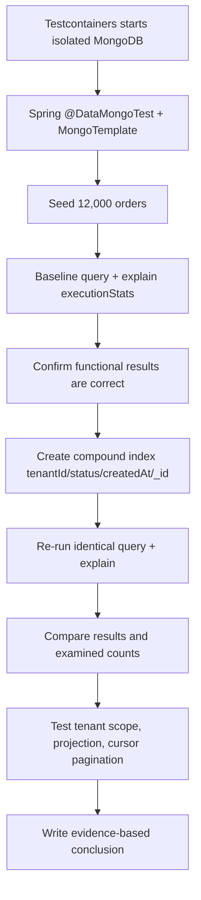

# Testing with Testcontainers and Optimizing via executionStats

## 1. Context and Objectives of the Capstone

You are developing an order management service with **Spring Data MongoDB**. Each order is stored in the `orders` collection, partitioned by `tenantId`. The admin dashboard exposes an API to fetch **the 25 most recent paid orders for a tenant**. As data grows, the endpoint slows down and periodically spikes database load.

The objective of this **Capstone Practice** is to build a **reproducible, testable, and measurable workflow**:

1. Run real MongoDB inside a dedicated container for integration tests.
2. Seed a sufficiently large test dataset with explicit distribution.
3. Execute the query via `MongoTemplate`/repository.
4. Collect `explain("executionStats")` **before** optimizing.
5. Design a compound index based on the query's filter, sort, and limit.
6. Collect `executionStats` again and prove **business results stay identical**.
7. Verify tenant isolation, projection, pagination, and measurement limits.
8. Propose next optimization steps if an index alone does not resolve bottlenecks.

This exercise is about **query and data quality**, not a contest for the lowest millisecond reading. On CI machines, latency fluctuates with CPU, disk, container startup, caches, and concurrent jobs; tests should assert **correct, reproducible conditions**, while quantitative benchmarks run under controlled conditions.

### Expected Deliverables

| Deliverable | What must be demonstrated |
| --- | --- |
| MongoDB fixture | Isolated test database and deterministic seed data |
| Integration tests | Spring Data CRUD/queries against real MongoDB, no database mocks |
| Baseline report | Includes `nReturned`, `totalDocsExamined`, `totalKeysExamined`, and execution plan |
| Compound index | Rationale for field order and trade-offs |
| Post-optimization report | Same filter, sort, limit, dataset, and results; examined counts compared |
| Regression tests | Zero cross-tenant leakage, accurate sort, accurate pagination |
| Conclusion | Evidence of improvement or analysis of why the planner chose another plan |

## 2. Practice Architecture

Suppose the application endpoint is:

```text
GET /api/tenants/{tenantId}/orders?status=PAID&limit=25
```

In production, **`tenantId` must come from an authenticated context or be authorized explicitly**, never trusting a raw path parameter blindly. In integration tests, we use a fixed `tenantId` to inspect the query. Business filter predicate:

```javascript
{
  tenantId: "tenant-2",
  status: "PAID"
}
```

First-page sort order:

```javascript
{ createdAt: -1, _id: -1 }
```

Adding `_id` to the sort key acts as a **tie-breaker** ensuring deterministic ordering when multiple orders share the same `createdAt`. `limit` is 25. On tens of thousands of records, an unindexed baseline may scan many documents and sort in memory; a compound index can sharply reduce scan volume.



### Data Model

To focus on queries and indexes, start with a model free of complex relationships:

```json
{
  "_id": "ORD-00042",
  "tenantId": "tenant-2",
  "status": "PAID",
  "createdAt": { "$date": "2026-01-01T00:00:42Z" },
  "amountCents": 1042
}
```

Fields used:

| Field | Type | Purpose |
| --- | --- | --- |
| `_id` | String in this fixture | Unique identifier and tie-breaker |
| `tenantId` | String | Tenant access boundary |
| `status` | String | Equality filter |
| `createdAt` | BSON Date | Descending sort, keyset pagination |
| `amountCents` | Long | Business payload; unnecessary to read for every summary query |

In real systems, `_id` can use `ObjectId`. This example intentionally uses strings like `ORD-00042` for clarity in tests; in real projects, **keep BSON types consistent** across filters, sorts, and checkpoints.

## 3. Setting Up Testcontainers and Spring Data MongoDB

### 3.1. Why Not Use Mocks for This Exercise?

Mocking `MongoTemplate`/repositories tests service logic, yet **cannot verify**:

- The exact MongoDB command the driver generates.
- Java ↔ BSON mapping, conversions, `@Field`, or derived queries.
- Whether the MongoDB Query Planner picks `COLLSCAN` or `IXSCAN`.
- `executionStats` and index/sort/limit behavior.
- Permissions, replica sets, transactions, or change streams when extending the exercise.

**Testcontainers** runs an isolated MongoDB via Docker/compatible runtime and exercises the real database. Tests do not depend on a local developer database or shared environment.

### 3.2. Choosing Compatible Versions

The Java examples below target **Spring Boot 3.x / corresponding Spring Data MongoDB, JDK 17+, and Testcontainers 1.x** using `org.testcontainers.containers.MongoDBContainer`. In Testcontainers 2.x or other Spring Boot versions, package names, module coordinates, and connection properties may differ. Check documentation and dependency management for your exact project version rather than blindly copying arbitrary latest tags.

Sample **illustrative** Gradle dependencies:

```groovy
dependencies {
    implementation 'org.springframework.boot:spring-boot-starter-data-mongodb'

    testImplementation 'org.springframework.boot:spring-boot-starter-test'
    testImplementation 'org.testcontainers:junit-jupiter'
    testImplementation 'org.testcontainers:mongodb'
}
```

This assumes Testcontainers versions are managed by the Spring Boot BOM or a compatible BOM; otherwise declare consistent versions explicitly. These test dependencies never belong in production runtime code.

Environment prerequisites:

1. Docker/container engine can run and pull the MongoDB image.
2. CI has access to a suitable container engine; never point tests at a public MongoDB.
3. Pin the MongoDB image to a **tested version** rather than floating `latest`.
4. Ensure container cleanup after tests; never reuse containers holding sensitive data.
5. Ensure CI runners have enough CPU/RAM/disk to seed and run `explain`; avoid benchmarking on severely starved runners.

### 3.3. Java Entity

Using a Java record keeps the example concise and immutable:

```java
import java.time.Instant;
import org.springframework.data.annotation.Id;
import org.springframework.data.mongodb.core.mapping.Document;

@Document("orders")
public record Order(
        @Id String id,
        String tenantId,
        String status,
        Instant createdAt,
        long amountCents
) {}
```

Spring Data MongoDB maps records via their canonical constructor in supported versions. Test **both directions** (`insert` and `find`) to verify mapping fidelity.

If the app uses regular Java classes, replace the record with an entity having clear constructors/getters. Either way, tests must exercise the exact mapping used in production.

### 3.4. Container and Dynamic Properties

Sample integration test starting the container **before** Spring loads the URI:

```java
import org.junit.jupiter.api.Test;
import org.springframework.beans.factory.annotation.Autowired;
import org.springframework.boot.test.autoconfigure.data.mongo.DataMongoTest;
import org.springframework.test.context.DynamicPropertyRegistry;
import org.springframework.test.context.DynamicPropertySource;
import org.testcontainers.containers.MongoDBContainer;
import org.testcontainers.junit.jupiter.Container;
import org.testcontainers.junit.jupiter.Testcontainers;
import org.testcontainers.utility.DockerImageName;

@DataMongoTest
@Testcontainers
class OrderQueryOptimizationIT {

    @Container
    static final MongoDBContainer MONGO =
            new MongoDBContainer(
                    DockerImageName.parse("mongo:7.0"));

    @DynamicPropertySource
    static void mongoProperties(DynamicPropertyRegistry registry) {
        registry.add(
                "spring.data.mongodb.uri",
                MONGO::getReplicaSetUrl);
    }

    @Autowired
    MongoTemplate mongoTemplate;

    // Seed, queries, and assertions in the following sections.
}
```

The example uses `@DataMongoTest` for a MongoDB test slice without booting the entire web stack. `MONGO.getReplicaSetUrl()` in Testcontainers 1.x provides a replica set URI, which also helps if extending to transactions or change streams. **Never assume every MongoDBContainer/driver version shares the exact same API**.

In Spring Boot 3.x, `spring.data.mongodb.uri` is the standard property. Across other Boot lines, property namespaces may change; verify your project version so tests do not silently connect to a default local URI.

If your application manually defines custom `MongoClient` or `MongoDatabaseFactory` beans, `@DynamicPropertySource` sets the property without **forcing** custom beans to honor it. Verify which `MongoClient` and database instance the test actually uses.

## 4. Preparing a Reproducible Data Fixture

Too small a dataset lets the server pick `COLLSCAN` even with an index, because scanning a few documents is cheaper than traversing an index. Conversely, huge datasets slow down CI and hurt repeatability. For this lesson, start with **12,000 orders** spread across 10 tenants and two statuses.

Data is generated **deterministically**: ID, tenant, status, timestamp, and amount derive from the loop index without `Random`. That guarantees baseline and after-index runs compare on identical data.

```java
import java.time.Instant;
import java.util.List;
import java.util.stream.IntStream;
import org.junit.jupiter.api.BeforeEach;

@BeforeEach
void seedOrders() {
    // Only drop collections inside the isolated container test DB.
    mongoTemplate.dropCollection(Order.class);

    Instant start = Instant.parse("2026-01-01T00:00:00Z");

    List<Order> orders = IntStream.range(0, 12_000)
            .mapToObj(i -> new Order(
                    "ORD-%05d".formatted(i),
                    "tenant-" + (i % 10),
                    i % 4 == 0 ? "PAID" : "NEW",
                    start.plusSeconds(i),
                    1_000L + i))
            .toList();

    mongoTemplate.insert(orders, Order.class);
}
```

`dropCollection` is **destructive** and must only run inside controlled Testcontainers fixtures. Never copy it into shared or production databases.

With this generator:

- There are 10 tenants, about 1,200 documents per tenant.
- A subset has `status=PAID`, enough for `tenant-2` to return over 25 orders.
- `createdAt` differs per record for clean sort verification; a later section tests tied timestamps specifically.
- The dataset is large enough to observe clear differences between full collection scans and index scans across most environments.

**Accuracy matters:** baseline and post-index runs must execute against **the same unmodified fixture**. If data is re-seeded differently or extra indexes exist between runs, record those differences rather than attributing everything to the new index.

## 5. Writing the Business Query with `MongoTemplate`

Endpoint query: fetch the 25 latest `PAID` orders for `tenant-2`, sorted by `createdAt` descending and `_id` descending.

```java
import java.util.List;
import org.springframework.data.domain.Sort;
import org.springframework.data.mongodb.core.query.Criteria;
import org.springframework.data.mongodb.core.query.Query;

private List<Order> findLatestPaidOrders() {
    Query query = Query.query(
            Criteria.where("tenantId").is("tenant-2")
                    .and("status").is("PAID"));

    query.with(Sort.by(
                    Sort.Order.desc("createdAt"),
                    Sort.Order.desc("_id")))
         .limit(25);

    return mongoTemplate.find(query, Order.class);
}
```

Why are filter, sort, and limit all necessary?

- `tenantId` is the tenant boundary; in production it must be derived from authorized identity.
- `status` narrows results to eligible orders.
- `createdAt: -1` orders newest first.
- `_id: -1` supplies a deterministic tie-breaker when timestamps collide.
- `limit(25)` bounds response size; it **does not** ensure the server inspects only 25 documents without a supporting index.

In MongoDB, `_id` has a default index, yet an index on `_id` alone does not efficiently serve `tenantId/status` filters combined with `createdAt` sorting.

### 5.1. Verifying Functional Correctness Before Optimizing

```java
List<Order> actual = findLatestPaidOrders();

assertThat(actual).hasSize(25);
assertThat(actual).allSatisfy(order -> {
    assertThat(order.tenantId()).isEqualTo("tenant-2");
    assertThat(order.status()).isEqualTo("PAID");
});

for (int i = 1; i < actual.size(); i++) {
    assertThat(actual.get(i - 1).createdAt())
            .isAfterOrEqualTo(actual.get(i).createdAt());
}
```

These assertions require `org.assertj.core.api.Assertions.assertThat`. When records share identical timestamps, also assert `_id` ordering to verify the secondary sort. Never stop at checking "API returned 25 items" while ignoring tenant or status.

## 6. `executionStats`: Metrics to Read

`explain` describes the plan MongoDB uses to execute a query. `executionStats` verbosity adds **actual execution statistics** beyond the query planner tree.

You can test the query directly in `mongosh` connected to the **test database**:

```javascript
db.orders
  .find({ tenantId: "tenant-2", status: "PAID" })
  .sort({ createdAt: -1, _id: -1 })
  .limit(25)
  .explain("executionStats")
```

Key fields to inspect:

| Field | Meaning | How to interpret |
| --- | --- | --- |
| `nReturned` | Documents returned | Compare against limit and expected business output |
| `totalDocsExamined` | Document reads performed by the plan | Scanning far more than 25 signals weak filter/index coverage |
| `totalKeysExamined` | Index keys examined | Meaningful only alongside the plan; 0 often indicates COLLSCAN |
| `executionTimeMillis` | Server execution time for this explain call | Do not use as a strict speed assertion in CI |
| `queryPlanner.winningPlan` and child stages | Selected execution plan | Look for scans, fetches, sorts, and index usage |
| `executionStages` or equivalent stage tree | Detailed execution breakdown | Exact structure varies by engine and server version |

### 6.1. Reading `COLLSCAN` and `IXSCAN`

- **`COLLSCAN`:** scans documents sequentially across the collection and applies filters.
- **`IXSCAN`:** traverses index keys, typically paired with `FETCH` to retrieve matching documents.
- **`SORT`:** an explicit sort stage that can consume significant CPU and memory if the index does not already supply the requested order.
- **`LIMIT`:** caps final output count, though it may not eliminate the cost of an upstream blocking sort/group.
- **Covered query:** can satisfy reads straight from index keys without fetching documents if every projected and filtered field resides in the index; confirm directly from the actual explain plan.

MongoDB uses multiple query execution engines and explain JSON shapes change across server releases. Avoid fragile assertions checking `"IXSCAN"` at a hardcoded JSON path that breaks across versions.

### 6.2. Query Efficiency Ratios

A straightforward pair of ratios:

```text
document scan ratio = totalDocsExamined / max(nReturned, 1)
index key ratio     = totalKeysExamined / max(nReturned, 1)
```

Returning 25 orders while scanning 12,000 documents yields a high document scan ratio. Adding the right index drops that ratio dramatically. **Never treat a ratio of 1 as a rigid rule for every query**: `$lookup`, complex predicates, selectivity, and projections can legitimately alter ratios.

When `nReturned=0`, `max(nReturned, 1)` merely prevents division by zero rather than measuring efficiency. Inspect empty-result queries separately.

## 7. Running Explain via the Java Driver in `MongoTemplate`

You can invoke MongoDB's `explain` command directly via `mongoTemplate.getDb().runCommand(...)` to inspect `executionStats`. That lets an integration test compare **before and after** index creation inside a single test method.

```java
import org.bson.Document;

private Document explainLatestPaidOrders() {
    Document findCommand = new Document("find", "orders")
            .append("filter", new Document("tenantId", "tenant-2")
                    .append("status", "PAID"))
            .append("sort", new Document("createdAt", -1)
                    .append("_id", -1))
            .append("limit", 25);

    Document explainCommand =
            new Document("explain", findCommand)
                    .append("verbosity", "executionStats");

    return mongoTemplate.getDb().runCommand(explainCommand);
}

private static long metric(Document report, String field) {
    Document stats = report.get("executionStats", Document.class);

    if (stats == null || !(stats.get(field) instanceof Number value)) {
        throw new IllegalStateException(
                "Missing executionStats field: " + field);
    }
    return value.longValue();
}
```

Here, the explained command mirrors the **exact collection, filter, sort, and limit** used by `MongoTemplate`. Because `Order` does not rename fields with `@Field`, BSON names match Java property names. If your project uses `@Field("tenant_id")` or custom converters, make sure the explain command matches the **actual BSON** emitted by Spring Data.

Notes:

- `explain` requires appropriate server privileges; ensure test accounts are authorized.
- `executionStats` measures the database command itself, not full HTTP/JSON serialization time.
- `explain` does not replace sustained load benchmarks; warm caches and plan caching vary over time.
- For aggregations, execution stats may sit in different stages/JSON paths; the helper above is written **for find commands**.

## 8. Designing the Compound Index from Filter and Sort

The query has two **equality** conditions:

```javascript
{ tenantId: "tenant-2", status: "PAID" }
```

and a sort:

```javascript
{ createdAt: -1, _id: -1 }
```

Candidate compound index:

```javascript
db.orders.createIndex(
  { tenantId: 1, status: 1, createdAt: -1, _id: -1 },
  { name: "idx_orders_tenant_status_created_id" }
)
```

This key order aligns with the **Equality → Sort → Range (ESR)** guideline: equality fields `tenantId` and `status` first, followed by sort keys `createdAt` and `_id`. Field ordering is a **candidate to verify with explain**, not a universal formula for every workload.

### 8.1. Creating the Index with Spring Data MongoDB

```java
import org.springframework.data.domain.Sort.Direction;
import org.springframework.data.mongodb.core.index.Index;

private static final String INDEX_NAME =
        "idx_orders_tenant_status_created_id";

private void ensureOrderIndex() {
    Index index = new Index()
            .on("tenantId", Direction.ASC)
            .on("status", Direction.ASC)
            .on("createdAt", Direction.DESC)
            .on("_id", Direction.DESC)
            .named(INDEX_NAME);

    mongoTemplate.indexOps(Order.class).ensureIndex(index);
}
```

Production apps typically manage indexes via migrations or ops tooling rather than creating/dropping indexes ad hoc during request handling. Building indexes on large collections consumes CPU, I/O, and disk and can impact writes; plan rollouts and monitor closely.

In this test, we create the index **after capturing the baseline** to observe the contrast. If auto-index creation or pre-existing fixture indexes are active, verify the baseline state rather than assuming no index existed.

### 8.2. When an Index Does Not Help as Expected

Causes worth checking:

- Actual query omits or mismatches `tenantId`/`status`.
- Query sort differs in field order or direction from the index.
- Small dataset or low selectivity causes the Query Planner to prefer COLLSCAN reasonably.
- `$expr`, regexes, computed fields, or collation mismatches prevent index usage.
- Index is partial/sparse and the query fails to satisfy the partial filter expression.
- Competing indexes, plan cache state, or skewed data distributions.
- Query fetches many large documents even when index lookup itself is fast.

An index is only worthwhile when it serves **an important query shape** at an acceptable write and storage cost.

## 9. Integration Test Comparing Before and After Optimization

Combine snippets from Sections 3–8 into a single test: seed the fixture, run baseline, create the index, re-run, and compare.

```java
@Test
void compoundIndexReducesDocumentExamination() {
    // Baseline: target compound index has not been created yet in this fixture.
    List<String> beforeIds = findLatestPaidOrders().stream()
            .map(Order::id)
            .toList();

    Document before = explainLatestPaidOrders();

    ensureOrderIndex();

    List<String> afterIds = findLatestPaidOrders().stream()
            .map(Order::id)
            .toList();

    Document after = explainLatestPaidOrders();

    // Business correctness: adding an index MUST NOT alter query results.
    assertThat(afterIds).containsExactlyElementsOf(beforeIds);
    assertThat(afterIds).hasSize(25);

    // Schema correctness: expected index actually exists.
    assertThat(mongoTemplate.indexOps(Order.class)
            .getIndexInfo())
            .anyMatch(i -> INDEX_NAME.equals(i.getName()));

    long beforeExamined = metric(before, "totalDocsExamined");
    long afterExamined  = metric(after,  "totalDocsExamined");

    long beforeKeys = metric(before, "totalKeysExamined");
    long afterKeys  = metric(after,  "totalKeysExamined");

    long beforeReturned = metric(before, "nReturned");
    long afterReturned  = metric(after,  "nReturned");

    assertThat(afterReturned).isEqualTo(beforeReturned);
    assertThat(afterReturned).isEqualTo(25);

    // Deterministic dataset has enough selectivity for the candidate index
    // to sharply reduce documents examined.
    assertThat(afterExamined).isLessThan(beforeExamined);

    System.out.printf(
            "Before: returned=%d docs=%d keys=%d%n",
            beforeReturned, beforeExamined, beforeKeys);
    System.out.printf(
            "After:  returned=%d docs=%d keys=%d%n",
            afterReturned, afterExamined, afterKeys);
}
```

These snippets use `JUnit 5`, `AssertJ`, `MongoTemplate`, `Index`, `Document`, and the imports shown in prior sections. When assembling your project, place `@BeforeEach` and helpers inside `OrderQueryOptimizationIT` and ensure `Order` is a valid class/record on the test classpath.

### 9.1. Why Assert Document Examined Counts Instead of Milliseconds?

This test intentionally uses a fixture of known structure and size: the baseline query traverses many documents, while the index walks directly to the sorted slice. In a controlled test environment, `totalDocsExamined` is a reliable signal.

Still, **`afterExamined < beforeExamined` is not a universal law**. If a different MongoDB server version or skewed dataset leads the planner to pick another valid plan, **inspect the explain output** to understand why. In important CI pipelines, assert plan properties or scan thresholds calibrated on a fixed fixture rather than applying arbitrary global thresholds.

Never write:

```java
// Fragile test example; DO NOT use in CI:
// assertThat(metric(after, "executionTimeMillis")).isLessThan(5);
```

Because `executionTimeMillis` fluctuates with JIT warmup, cache state, noisy CI CPU sharing, and disk contention. Passing an arbitrary millisecond threshold is no proof of an effective index.

### 9.2. Interpreting Illustrative Results

Sample **hypothetical** figures, not live run output:

| Metric | Baseline (example) | After index (example) | Interpretation |
| --- | ---: | ---: | --- |
| `nReturned` | 25 | 25 | Same matching result count preserved |
| `totalDocsExamined` | 12,000 | 25 | Index pinpoints just the needed documents |
| `totalKeysExamined` | 0 | 25 | Baseline scanned collection; optimized run scans index |
| Key stages | `COLLSCAN` + `SORT` | `IXSCAN` + `FETCH` | Eliminates sorting across all records |
| `executionTimeMillis` | Measure directly | Measure directly | Use repeated benchmarks; do not infer from this table |

Never fabricate metrics to make a report "PASS". When practicing, record **actual output** from your container and explain any differences.

## 10. Testing Tenant Access Scope and Projected Fields

An optimal index is only half the job. A blazing-fast query that leaks another tenant's data is still a critical bug.

### 10.1. Testing Isolation

```java
@Test
void queryMustOnlyReturnChosenTenant() {
    List<Order> result = findLatestPaidOrders();

    assertThat(result).isNotEmpty();
    assertThat(result)
            .allMatch(order -> "tenant-2".equals(order.tenantId()));
}
```

This tests the query predicate; it **does not replace** API authentication/authorization tests. In real services/controllers, derive tenant from the authenticated principal or verify membership—never trust raw client-supplied `tenantId` values without policy enforcement.

### 10.2. Fetching Only Needed Fields with Projection

Suppose the list API needs only `id`, `status`, and `createdAt`. If documents also carry sensitive payloads or large history arrays, do not return full `Order` documents just because the query is indexed.

```java
Query query = Query.query(
        Criteria.where("tenantId").is("tenant-2")
                .and("status").is("PAID"));

query.with(Sort.by(
                Sort.Order.desc("createdAt"),
                Sort.Order.desc("_id")))
     .limit(25);

query.fields()
     .include("_id")
     .include("status")
     .include("createdAt");

List<Document> rows =
        mongoTemplate.find(query, Document.class, "orders");
```

Here `Document.class` is `org.bson.Document`, so field names match stored BSON fields. At the API layer, map into a **strict response DTO** instead of returning raw `Document` objects.

Projection shrinks network and deserialization payload size, yet **does not guarantee a covered query**. Our index covers `tenantId`, `status`, `createdAt`, and `_id`; for a specific query, the planner may satisfy reads from the index without document fetches—verify using `explain` with the **actual projection**.

## 11. Optimizing Pagination: Why Use Keyset Pagination?

On large order collections, large `skip` offsets force MongoDB to walk and discard many index entries before returning results. With sort order `createdAt DESC, _id DESC`, use **cursor/keyset pagination** to fetch the next page.

Suppose the last item on the previous page has `createdAt=lastCreatedAt` and `id=lastId`. Filter for older items:

```javascript
{
  tenantId: "tenant-2",
  status: "PAID",
  $or: [
    { createdAt: { $lt: lastCreatedAt } },
    {
      createdAt: lastCreatedAt,
      _id: { $lt: lastId }
    }
  ]
}
```

Spring Data equivalent:

```java
Criteria older = new Criteria().orOperator(
        Criteria.where("createdAt").lt(lastCreatedAt),
        new Criteria().andOperator(
                Criteria.where("createdAt").is(lastCreatedAt),
                Criteria.where("_id").lt(lastId))
);

Criteria filter = new Criteria().andOperator(
        Criteria.where("tenantId").is("tenant-2"),
        Criteria.where("status").is("PAID"),
        older
);

Query nextPage = Query.query(filter)
        .with(Sort.by(
                Sort.Order.desc("createdAt"),
                Sort.Order.desc("_id")))
        .limit(25);

List<Order> olderOrders =
        mongoTemplate.find(nextPage, Order.class);
```

Properties:

- `lastCreatedAt` and `lastId` come from the **last item** of the prior page using the exact stored BSON types.
- The proposed compound index supports the equality predicates and sort/range ordering; inspect explain since `$or` and data skew affect plans.
- Deterministic ordering prevents drift when items share timestamps.
- Keyset avoids large offset skips, though it **does not automatically give an immutable snapshot** if documents change mid-pagination.

### 11.1. Testing Duplicate Timestamps

In the main fixture, every `createdAt` is distinct. To test tie-breaking, insert several `PAID` orders with identical timestamps in the target tenant, verify `_id` ordering matches requirements, and assert zero duplicates or gaps across page boundaries.

When evaluating indexes, measure both **page 1 and deep pages**; an index can make page 1 fast while deep offset pagination remains slow.

## 12. Capstone Extension: Aggregation and `executionStats`

Beyond the list endpoint, suppose the dashboard summarizes order count and revenue by `status` for a tenant:

```javascript
db.orders.aggregate([
  { $match: { tenantId: "tenant-2" } },
  {
    $group: {
      _id: "$status",
      orderCount: { $sum: 1 },
      totalCents: { $sum: "$amountCents" }
    }
  },
  { $sort: { orderCount: -1 } }
])
```

Written in Spring Data MongoDB:

```java
Aggregation aggregation = Aggregation.newAggregation(
        Aggregation.match(
                Criteria.where("tenantId").is("tenant-2")),
        Aggregation.group("status")
                .count().as("orderCount")
                .sum("amountCents").as("totalCents"),
        Aggregation.sort(
                Sort.Direction.DESC, "orderCount")
);

AggregationResults<Document> result =
        mongoTemplate.aggregate(
                aggregation, "orders", Document.class);
```

Evaluate **workload differences**:

- The list endpoint's compound index helps filter `tenantId`, yet may not fully optimize the aggregation.
- `$group` must scan matching documents; `$sort` on `orderCount` sorts **computed values**, which cannot use an index on `createdAt`.
- If the dashboard is heavily queried over huge datasets, consider materialized summaries or periodic statistics updates with explicit consistency rules.
- `allowDiskUse` only permits supported stages to spill beyond RAM limits; it never lifts the 16 MiB BSON document size limit.

You can run `explain` on `aggregate`:

```javascript
db.runCommand({
  explain: {
    aggregate: "orders",
    pipeline: [
      { $match: { tenantId: "tenant-2" } },
      { $group: { _id: "$status", orderCount: { $sum: 1 } } }
    ],
    cursor: {}
  },
  verbosity: "executionStats"
})
```

For aggregations, execution stage info may appear under `stages` or `queryPlanner/executionStats` depending on server version and pipeline shape. **Never reuse the `find` `metric(...)` helper assuming every `aggregate` explain shares the same JSON structure.**

## 13. When Testcontainers Fails: Distinguishing Environment Errors from Query Errors

A MongoDB integration test can fail due to container infrastructure rather than query logic.

| Symptom | What to check |
| --- | --- |
| Cannot start container | Docker engine, daemon/socket permissions, image registry |
| Image pull fails | Registry access, network, image tag, CI policies |
| Container starts but test times out | MongoDB startup/replica set init, URI, server-selection timeout |
| Spring context hits wrong database | Whether `DynamicPropertySource` binds properly for your version/beans |
| `AuthenticationFailed` or TLS error | URI/secrets/truststore when fixture uses auth/TLS |
| Previous test data skews numbers | Isolation, collection cleanup, parallel test execution |
| `COLLSCAN` both before and after index | Index existence, matching BSON query fields, data/cardinality |
| Latency metrics swing wildly | Warmup, cache state, CPU shares, CI disk, concurrency |
| Index scan yet API response stays slow | Projection, BSON/JSON mapping, network, payload size, service logic |

Specifically, tests passing locally but failing in CI may mean **Docker is unavailable in CI**, not that the MongoDB query is broken. Never disable TLS or widen production privileges to work around an unrelated fixture issue.

### 13.1. Test Isolation Principles

- Never run `dropCollection` against production or a shared MongoDB instance.
- Never run tests creating/dropping the same collection in parallel without separate namespaces.
- Pin MongoDB image/version; document changes when upgrading Spring Data or drivers.
- Never share mutable containers/datasets across tests if they create order dependence.
- Clean up fixtures afterward or use ephemeral containers per run.
- Never put real passwords or PII into test seeds or explain logs.

## 14. Benchmarking Beyond CI Assertions: Measuring p95/p99 and Throughput

A clean execution plan does not guarantee the endpoint is fast end-to-end. Once tests prove query correctness and scan reduction, measure:

- **API latency p50/p95/p99** under target load and concurrency.
- **Throughput** (requests/sec) along with error/timeout rates.
- **MongoDB CPU and I/O**, cache hit ratio, index size, and disk usage.
- **Driver/MongoTemplate latency**, connection pool checkout wait, active connections.
- **Bytes transferred and Java mapping cost**, especially with large arrays or payloads.
- **Write overhead** before vs after adding indexes (`insert`/`update` write amplification).
- **Other endpoint query shapes** to confirm the new index does not optimize one endpoint at disproportionate global cost.

### 14.1. Controlling Variables

Comparing before and after across dissimilar environments mixes differences in CPU, storage, data distribution, or other indexes. Always:

1. Generate datasets with identical rules or equivalent test snapshots.
2. Verify existing indexes, MongoDB server version, and settings.
3. Warm up and run enough iterations; report percentiles rather than averages alone.
4. Keep concurrency, page size, projection, and output contracts fixed.
5. Record timestamps, Docker/CI specs, cache state, and variance.
6. Compare combined read/write costs after indexing.

If you alter filters or sorts mid-optimization, you are no longer running an A/B comparison on **the same query**. Confirm whether query changes preserve business semantics before comparing performance.

## 15. Capstone Completion Criteria

A solid practice report should answer:

| Criterion | Evidence |
| --- | --- |
| Real MongoDB in tests? | `@Testcontainers` + container URI, no database mocks |
| Reproducible data? | Deterministic seed and clear lifecycle |
| Query correctness? | Assertions on tenant, status, limit, sort order |
| Baseline measured? | `explain("executionStats")` captured before indexing |
| Compound index justified? | Equality fields then sort fields, workload scope explained |
| Index actually exists? | `indexOps(...).getIndexInfo()` verified |
| Semantics unchanged after index? | Result IDs and order compared |
| Server work reduced? | `totalDocsExamined`, `totalKeysExamined`, and plan compared |
| Fragile CI timing assertions avoided? | No arbitrary `executionTimeMillis` upper-bound assertions |
| Tenant security verified? | Filter/authorization tests included |
| Write cost & other queries considered? | Compound index trade-offs documented |
| Conclusions backed by real data? | Actual measurements with stated assumptions and environment |

### Report Template to Fill After Running

```text
Dataset:
  MongoDB version: ...
  Spring Data / Driver / Testcontainers versions: ...
  Document count: ...
  Query: filter tenantId+status, sort createdAt/_id desc, limit 25

Baseline (no target compound index):
  nReturned: ...
  totalDocsExamined: ...
  totalKeysExamined: ...
  Key plan stages: ...

After compound index:
  Index key: { tenantId:1, status:1, createdAt:-1, _id:-1 }
  nReturned: ...
  totalDocsExamined: ...
  totalKeysExamined: ...
  Key plan stages: ...

Functional:
  Same result IDs and order? ...
  No cross-tenant results? ...
  Pagination behavior checked? ...

Decision:
  Keep/change/reject index because ...
  Observed write cost and additional metrics ...
```

**Never fill this table with made-up numbers presented as real runs.** Populate values strictly from an actual container run or a clearly documented benchmark environment.

## 16. Advanced Exercises

### Exercise A — Which Index Fits Both Listing and Statistics?

A project has two endpoints:

- `find` by `tenantId/status`, sorted by `createdAt DESC`.
- `aggregate` grouping by `status` and summing `amountCents` for a tenant.

Compare query plans and weigh one shared index versus separate indexes for the workload. Show why adding `amountCents` to an index may not improve aggregation enough to justify its write overhead.

### Exercise B — Growing Document Size and Projection

Add a `history` array containing hundreds of events to several orders. Measure server time, response bytes, and Java mapping cost for:

1. `find` returning full entities.
2. `find` projecting only `_id`, `status`, and `createdAt`.

Explain why projection shrinks network/mapping overhead without shrinking stored document size on disk or resolving write hotspots on those documents.

### Exercise C — Transactions and Replica Sets

Add a transactional operation creating an `Order` and updating `inventory` inside a replica-set-configured MongoDB Testcontainer. Verify:

- Commit succeeds when both writes are valid.
- Rollback occurs when the second step fails.
- Never conclude Spring Data transaction code is broken when tested against a standalone container lacking transaction support.
- Indexes on involved collections and their impact on transaction performance.

### Exercise D — Reactive MongoDB

If the project uses `ReactiveMongoTemplate` or reactive repositories, write tests with `StepVerifier` confirming publishers are subscribed and actually execute against the MongoDB container. Compare query/filter/index behavior against the blocking version; never treat reactive APIs as a substitute for compound indexes.

### Exercise E — Multi-Tenant Skewed Performance

Seed a skewed dataset: one tenant holds 80% of all orders while remaining tenants share 20%. Measure `executionStats` for both the large and small tenants; explain why **cardinality, selectivity, and real distribution** matter far more than average document counts.

## 17. Self-Check Questions

1. Why can unit tests mocking `MongoTemplate` never replace real `executionStats`?
2. For equality filters on `tenantId` and `status` with sort `createdAt DESC, _id DESC`, why is index order `tenantId/status/createdAt/_id` worth testing?
3. Why does `limit(25)` not guarantee only 25 documents are examined?
4. Distinguish `totalDocsExamined` from `totalKeysExamined`; when do the two metrics diverge meaningfully?
5. Why should you never assert that a query finishes in under 5 ms on CI?
6. Why is adding an index considered successful only when business results remain unchanged?
7. When `IXSCAN` appears yet `totalDocsExamined` remains high, what should you inspect next?
8. Why test with multi-tenant data and access controls rather than measuring speed alone?
9. How does keyset pagination differ from `skip/limit` as users navigate to deep pages?
10. Why does a `$group` aggregation require reading `explain` differently from a `find` command?
11. When Docker is unavailable in CI, how do you distinguish a fixture issue from a MongoDB query bug?
12. If an index speeds up reads while noticeably slowing down writes, what metrics should guide the team's decision?

## 18. Key Takeaways

- **Testcontainers + Spring Data MongoDB** let you test queries, BSON mapping, and indexes against real MongoDB while staying isolated from production.
- **`explain("executionStats")` is a root-cause diagnostic tool**, not decorative numbers. Inspect `nReturned`, `totalDocsExamined`, `totalKeysExamined`, and the winning plan together.
- **Compound indexes** must be derived from filters, sorts, limits, and data distribution; always verify the Query Planner uses them.
- **Optimization must preserve business correctness**: tenant isolation, status, ordering, limits, and pagination all require regression tests.
- **Never judge solely by single CI millisecond timings**. Use execution stats for plan verification alongside repeated benchmarks for latency and throughput.
- **Projection, keyset pagination, aggregation, transactions, and reactive access** are all extensions that should be measured against real use cases.
- **Indexes carry write, cache, and storage costs**; base final decisions on the overall workload and before/after evidence.

This capstone concludes when you can explain **why a query was slow, what changed, how MongoDB's execution changed, and how business correctness stayed intact**. That turns Spring Data MongoDB performance tuning into a testable, reviewable, and repeatable engineering process.
