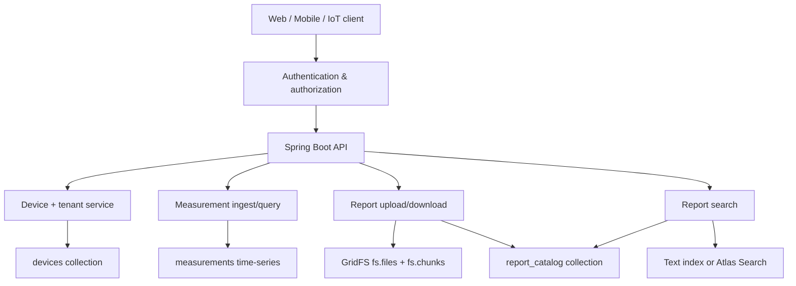
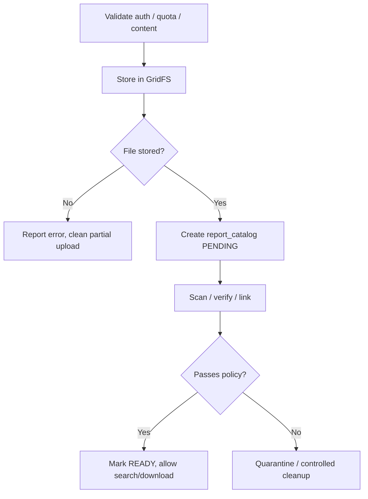

# Extension Practice: GridFS, Time Series, Search, and Multi-Tenancy

This is a capstone extension in the **Capstone Practice** chapter of the **SPRING_DATA_MONGODB** module. Rather than building four disconnected examples, learners implement part of a backend for an equipment monitoring platform: multiple customers share the service, devices stream continuous telemetry, technicians upload PDF reports or maintenance photos, and users search documents belonging to their own equipment.

The exercise combines four capabilities:

1. **GridFS** to store and serve files with metadata and download access control.
2. **Time series** to store timestamped measurements with retention policies.
3. **Search** using MongoDB text indexes or Atlas Search depending on deployment support.
4. **Multi-tenancy** ensuring every query, upload, download, and analytics call is scoped to the authenticated tenant.

Learners apply `MongoTemplate`, repositories, the Java Driver where collection-specific features are needed, indexes, aggregations, real-MongoDB testing, and performance measurements. Not every real project needs GridFS, time-series collections, or Atlas Search: the goal is understanding when each fits, designing safe boundaries, and proving behavior with tests.

> **Technical scope:** Examples target Java 17+, Spring Boot 3.x, Spring Data MongoDB, and MongoDB Server **7.0 in test environments**. Time-series collections arrived in MongoDB 5.0, though specific index, update, delete, transaction, retention, and query capabilities depend on server version. Before implementing, check capabilities against your **actual MongoDB Server version**; Atlas Search works only in environments supporting that service. Code snippets are annotated building blocks rather than a complete buildable project.

## 1. Context and Business Requirements

A company provides cold-chain equipment monitoring for multiple clients. Each client is a **tenant** owning multiple devices. The system ingests temperature and humidity over time, stores PDF inspection reports and maintenance photos, and supports searching by device name, report title, or topic tags.

### 1.1. Roles and Planned APIs

| Role | Permissions | Example |
| --- | --- | --- |
| Tenant viewer | Read devices, measurements, and reports in tenant | View 24-hour chart, search docs |
| Tenant technician | Read and upload reports, submit authorized measurements | Upload maintenance PDF |
| Tenant admin | Manage devices and tenant policies | Register sensors, check usage |
| Ingest service | Write measurements for authorized devices | Push telemetry batches |

Reference APIs:

| Method and path | Action | Protection principle |
| --- | --- | --- |
| `POST /api/devices/{id}/measurements` | Write one or more measurements | Verify device belongs to tenant, bound batch size |
| `GET /api/devices/{id}/measurements?from=&to=` | Read measurements in range | Bound time range and document count |
| `POST /api/devices/{id}/reports` | Upload file | Verify write permission, size, file type, and quota |
| `GET /api/reports/{id}/content` | Download file | Verify tenant and permissions before streaming bytes |
| `GET /api/reports/search?q=&limit=` | Search documents | Bind keyword, tenant filter, limit results |
| `GET /api/devices/{id}/temperature-summary` | Aggregate measurements | Tenant filter, time-bounded aggregation |

**Never read `tenantId` from query parameters or request bodies to establish security scope.** Derive tenant strictly from the verified authentication identity after checking membership and permissions. Throughout this lesson, `authenticatedTenantId` denotes a value verified at the security layer.

### 1.2. Logical Architecture



GridFS manages **bytes** and file metadata; `report_catalog` stores searchable metadata; the time-series collection stores telemetry. Splitting them gives each dataset its own lifecycle, indexes, and access patterns.

## 2. Data Design and ID Contracts

Sample documents:

```javascript
// devices: device catalog; _id is a BSON ObjectId.
{
  _id: ObjectId("64b7f37a4e92b315c21d0abc"),
  tenantId: "tenant-A",
  serial: "FREEZER-007",
  displayName: "North Warehouse Freezer 7",
  location: "North Warehouse",
  active: true
}

// measurements: each document is a timestamped measurement event.
{
  measuredAt: ISODate("2026-01-20T10:00:00Z"),
  metadata: {
    tenantId: "tenant-A",
    deviceId: "64b7f37a4e92b315c21d0abc"
  },
  temperatureC: -17.8,
  humidityPercent: 53.2
}

// report_catalog: metadata and reference to GridFS.
{
  _id: ObjectId("64b7f37a4e92b315c21d0abd"),
  tenantId: "tenant-A",
  deviceId: "64b7f37a4e92b315c21d0abc",
  gridFsId: ObjectId("64b7f37a4e92b315c21d0abe"),
  title: "January Compressor Inspection",
  description: "Pressure and compressor health check",
  tags: ["maintenance", "compressor"],
  createdAt: ISODate("2026-01-20T10:05:00Z")
}
```

**Important convention:** here `devices._id` and `report_catalog._id` are BSON ObjectIds, whereas `measurements.metadata.deviceId` and `report_catalog.deviceId` are **Strings holding the hex representation** of the device ID. Convert explicitly at boundaries rather than expecting MongoDB to treat ObjectId and String as equal. Another system may standardize on one BSON type everywhere, as long as it is consistent.

### 2.1. Base Indexes

```javascript
// Each serial is unique only within a tenant, not globally.
db.devices.createIndex(
  { tenantId: 1, serial: 1 },
  { unique: true }
);

// List reports by device and time.
db.report_catalog.createIndex(
  { tenantId: 1, deviceId: 1, createdAt: -1 }
);

// List all reports for a tenant by time.
db.report_catalog.createIndex(
  { tenantId: 1, createdAt: -1 }
);
```

Evaluate indexes against real filters, sorts, data distributions, write volumes, and server-version constraints; never treat this list as an absolute optimum. `tenantId` is part of **the query contract**, not merely a display field.

## 3. Exercise A — Storing and Serving Reports with GridFS

### 3.1. When to Use GridFS?

MongoDB caps BSON documents at 16 MiB. GridFS splits file contents into chunks, storing metadata in `fs.files` and chunks in `fs.chunks` (or a custom bucket prefix). GridFS fits when you want large files stored inside the MongoDB ecosystem with application-controlled downloads and metadata.

If dedicated object storage is already available, compare cost, streaming performance, file serving, and retention policies before choosing GridFS. GridFS does not automatically provide virus scanning, tenant authorization, quotas, or full-text indexing of file contents.

### 3.2. Uploading with Tenant Metadata

`GridFsTemplate` is Spring Data MongoDB's API for GridFS. Minimal service example:

```java
package example.capstone;

import java.io.InputStream;
import java.time.Instant;
import java.util.Date;
import org.bson.Document;
import org.bson.types.ObjectId;
import org.springframework.data.mongodb.gridfs.GridFsTemplate;
import org.springframework.stereotype.Service;

@Service
public class ReportFileService {
    private final GridFsTemplate gridFsTemplate;

    public ReportFileService(GridFsTemplate gridFsTemplate) {
        this.gridFsTemplate = gridFsTemplate;
    }

    public ObjectId store(
            String authenticatedTenantId,
            String authorizedDeviceId,
            InputStream content,
            String safeFilename,
            String verifiedContentType) {

        // Required checks BEFORE calling store:
        // 1) tenant and device belong to caller's authorized scope;
        // 2) filename is sanitized and content type verified;
        // 3) byte limits/quotas and file-scanning policies are enforced.
        Document metadata = new Document(
                "tenantId", authenticatedTenantId)
                .append("deviceId", authorizedDeviceId)
                .append("uploadedAt", Date.from(Instant.now()));

        return gridFsTemplate.store(
                content, safeFilename, verifiedContentType, metadata);
    }
}
```

This code **does not automatically enforce file sizes or scan for malware**; those are exercise preconditions, not built-in features of `GridFsTemplate.store(...)`. In real implementations, enforce byte limits **while reading the stream**, not solely via the client-supplied `Content-Length` header. If size limits or scans fail, close the stream and clean up partial files/chunks per policy.

Sample upload rules: maximum 20 MiB per file, accept only PDF/PNG/JPEG after verifying magic bytes/signatures, sanitize filenames against path traversal, enforce per-tenant storage quotas, scan, and mark status before publishing. These limits are **illustrative exercise requirements**, not GridFS limits.

### 3.3. Downloads Must Filter by Tenant Before Streaming

Never call `findOne` by `_id` alone and stream bytes to any logged-in user. Check tenant metadata before reading from GridFS:

```java
import com.mongodb.client.gridfs.model.GridFSFile;
import org.bson.types.ObjectId;
import org.springframework.data.mongodb.core.query.Criteria;
import org.springframework.data.mongodb.core.query.Query;
import org.springframework.data.mongodb.gridfs.GridFsResource;

public GridFsResource openForTenant(
        ObjectId fileId, String authenticatedTenantId) {
    Query scopedQuery = Query.query(
            Criteria.where("_id").is(fileId)
                    .and("metadata.tenantId").is(authenticatedTenantId));
    GridFSFile file = gridFsTemplate.findOne(scopedQuery);
    if (file == null) {
        throw new java.util.NoSuchElementException("Report not found");
    }
    return gridFsTemplate.getResource(file);
}
```

Add this method to `ReportFileService` above. The controller must also verify the caller is authorized to view **that specific report/device** (tenant scope is a floor, not complete authorization), stream `GridFsResource` to the HTTP response, and close the `InputStream` properly. Never load large files completely into a `byte[]` just to return an HTTP response.

Returning 404 both when a file does not exist and when it belongs to another tenant avoids disclosing whether another tenant's file exists. Never log file contents, credentials, or sensitive metadata on error.

### 3.4. Metadata and Catalog Consistency

Once `store(...)` returns an `ObjectId`, the app creates a `report_catalog` document with `gridFsId`, title, description, and tags. GridFS files/chunks and catalog documents span multiple collections, so never assume a single upload enjoys an **atomic transaction** across everything by default.

Design a stateful workflow:



If creating the catalog entry fails after GridFS succeeds, run a **compensation** step deleting the tenant-scoped file by its returned ID, or run a reconciliation job finding orphaned GridFS files lacking catalog records. During cleanup, delete strictly by verified ID and tenant, and make recovery idempotent across mid-step failures. Never expect GridFS to supply transactional guarantees beyond what the driver/server supports.

**Exercise A completion requirements:** upload/download PDFs or images; tenant A cannot open/delete tenant B's files; metadata tracks tenant/device; file size/quota limits are tested; catalog and GridFS reconcile on failures.

## 4. Exercise B — Storing Measurements in a Time-Series Collection

Time-series collections are built for chronological measurement streams with a timestamp field and grouping metadata. This lesson uses them for device telemetry instead of growing unbounded arrays inside device documents.

### 4.1. Creating the Collection with timeField and metaField

Run **once** in the test database (e.g., via `mongosh` or a controlled migration script) before inserting data:

```javascript
db.createCollection("measurements", {
  timeseries: {
    timeField: "measuredAt",
    metaField: "metadata",
    granularity: "seconds"
  },
  expireAfterSeconds: 60 * 60 * 24 * 30
});
```

In this design:

- `measuredAt` must be a genuine BSON Date; never store timestamps as arbitrary Strings.
- `metadata` holds relatively static series identifiers, such as `tenantId` and `deviceId`. Never place rapidly changing temperature readings in metadata.
- `temperatureC` and `humidityPercent` are the measurements; quality flags or ingest source fields can be added.
- `expireAfterSeconds` illustrates **30-day retention**; TTL cleanup runs asynchronously and does not delete at the exact millisecond of expiration. Archive measurements prior to TTL expiry if long-term history is required.

Never call `createCollection` repeatedly per request. If an existing collection has different options, plan a proper migration and verify version compatibility rather than treating `createCollection` as an in-place alter.

### 4.2. Writing Measurements via MongoTemplate / Java Driver

Example using the Java Driver collection via `MongoTemplate` to guarantee `Date` types and explicit BSON structure:

```java
package example.capstone;

import java.time.Instant;
import java.util.Date;
import org.bson.Document;
import org.springframework.data.mongodb.core.MongoTemplate;

public class MeasurementWriter {
    private final MongoTemplate template;

    public MeasurementWriter(MongoTemplate template) {
        this.template = template;
    }

    public void insert(
            String authenticatedTenantId,
            String authorizedDeviceId,
            Instant measuredAt,
            double temperatureC,
            double humidityPercent) {
        if (measuredAt == null
                || !Double.isFinite(temperatureC)
                || !Double.isFinite(humidityPercent)
                || humidityPercent < 0
                || humidityPercent > 100) {
            throw new IllegalArgumentException("Invalid measurement");
        }

        Document metadata = new Document(
                "tenantId", authenticatedTenantId)
                .append("deviceId", authorizedDeviceId);
        Document measurement = new Document(
                "measuredAt", Date.from(measuredAt))
                .append("metadata", metadata)
                .append("temperatureC", temperatureC)
                .append("humidityPercent", humidityPercent);

        template.getCollection("measurements").insertOne(measurement);
    }
}
```

In this practice, **the calling service must verify** `authenticatedTenantId` and `authorizedDeviceId` from the trust boundary, validate write permissions, check valid sensor temperature bounds, guard past/future timestamp skew, and rate-limit device throughput. Never accept an arbitrary `metadata` object straight from a client into the document, as clients could spoof tenant IDs.

For high ingest rates, evaluate `insertMany`/bounded bulk writes, per-item errors, write concern, and retries. Time-series collections impose version-specific restrictions on updates, deletes, and transactions compared to regular collections; design ingest as **append-only** rather than mutating historical measurements arbitrarily.

### 4.3. Querying by Tenant, Device, and Time Range

```java
import java.time.Instant;
import java.util.Date;
import java.util.List;
import org.bson.Document;
import org.springframework.data.domain.Sort;
import org.springframework.data.mongodb.core.query.Criteria;
import org.springframework.data.mongodb.core.query.Query;

public List<Document> recentMeasurements(
        MongoTemplate template,
        String authenticatedTenantId,
        String authorizedDeviceId,
        Instant fromInclusive,
        Instant toExclusive) {
    if (fromInclusive == null || toExclusive == null
            || !fromInclusive.isBefore(toExclusive)) {
        throw new IllegalArgumentException("Invalid time range");
    }

    Query query = Query.query(new Criteria().andOperator(
            Criteria.where("metadata.tenantId")
                    .is(authenticatedTenantId),
            Criteria.where("metadata.deviceId").is(authorizedDeviceId),
            Criteria.where("measuredAt")
                    .gte(Date.from(fromInclusive))
                    .lt(Date.from(toExclusive))));

    query.with(Sort.by(Sort.Direction.DESC, "measuredAt"));
    query.limit(100);
    return template.find(query, Document.class, "measurements");
}
```

In a real API, **cap the maximum time span** (e.g., max 7 days for list endpoints), verify device ownership by the tenant, and paginate when more than 100 measurements match. A query with `limit` is not automatically cheap if filters/sorts miss indexes; inspect `explain("executionStats")` and index support on your MongoDB version.

### 4.4. Computing Hourly Averages

MongoDB aggregations roll up time series into intervals. Example computing hourly mean temperature over a day:

```javascript
db.measurements.aggregate([
  {
    $match: {
      "metadata.tenantId": "tenant-A",
      "metadata.deviceId": "64b7f37a4e92b315c21d0abc",
      measuredAt: {
        $gte: ISODate("2026-01-20T00:00:00Z"),
        $lt: ISODate("2026-01-21T00:00:00Z")
      }
    }
  },
  {
    $group: {
      _id: {
        $dateTrunc: {
          date: "$measuredAt",
          unit: "hour",
          timezone: "UTC"
        }
      },
      avgTemperatureC: { $avg: "$temperatureC" },
      count: { $sum: 1 }
    }
  },
  { $sort: { _id: 1 } }
]);
```

In Spring Data MongoDB, build the equivalent pipeline via `Aggregation`, or use application-controlled raw BSON stages if your API version lacks a specific operator. Never accept raw aggregation pipelines from clients. Always put the tenant filter in `$match`; if joining another collection with `$lookup`, enforce access scope on the joined collection too.

**Exercise B completion requirements:** create the time-series collection, insert and read typed BSON Dates, filter by tenant/device/time, aggregate hourly averages, and explain retention/TTL and ingest limits.

## 5. Exercise C — Searching the Report Catalog

### 5.1. Basic Approach: MongoDB Text Index

On standard MongoDB, create a text index over title, description, and tags:

```javascript
db.report_catalog.createIndex(
  { title: "text", description: "text", tags: "text" },
  { name: "report_text_v1",
    weights: { title: 8, tags: 4, description: 1 } }
);
```

Run a verification search:

```javascript
db.report_catalog.find(
  {
    tenantId: "tenant-A",
    $text: { $search: "compressor pressure" }
  },
  { title: 1, deviceId: 1, createdAt: 1,
    score: { $meta: "textScore" } }
).sort({ score: { $meta: "textScore" } }).limit(20);
```

In Spring Data, use `TextCriteria` and `TextQuery` to bind search terms safely without string-concatenating JSON queries:

```java
import java.util.List;
import org.springframework.data.mongodb.core.MongoTemplate;
import org.springframework.data.mongodb.core.query.Criteria;
import org.springframework.data.mongodb.core.query.TextCriteria;
import org.springframework.data.mongodb.core.query.TextQuery;

public List<ReportCatalog> searchCatalog(
        MongoTemplate template,
        String authenticatedTenantId,
        String validatedKeyword) {
    if (validatedKeyword == null
            || validatedKeyword.isBlank()
            || validatedKeyword.length() > 100) {
        throw new IllegalArgumentException("Invalid search");
    }
    TextCriteria words = TextCriteria.forDefaultLanguage()
            .matching(validatedKeyword);
    TextQuery query = TextQuery.queryText(words).sortByScore();
    query.addCriteria(
            Criteria.where("tenantId").is(authenticatedTenantId));
    query.limit(20);
    return template.find(query, ReportCatalog.class);
}
```

This snippet assumes `ReportCatalog` maps to `report_catalog`. In real projects, verify `TextQuery` API behavior on your Spring Data version, language/stemming rules, stop words, and matching results against test fixtures.

### 5.2. Minimal Catalog Entity

```java
package example.capstone;

import java.time.Instant;
import java.util.List;
import org.bson.types.ObjectId;
import org.springframework.data.annotation.Id;
import org.springframework.data.mongodb.core.mapping.Document;

@Document(collection = "report_catalog")
public record ReportCatalog(
        @Id ObjectId id,
        String tenantId,
        String deviceId,
        ObjectId gridFsId,
        String title,
        String description,
        List<String> tags,
        Instant createdAt
) {}
```

Even after finding a catalog hit, **still** verify permissions on the GridFS download endpoint; never treat a search hit as authorization to stream bytes. Clients must never send raw field names, operators, or arbitrary JSON queries; if sorting by date or score is supported, restrict to fixed options and bound result counts.

### 5.3. Extension: Atlas Search

When apps need autocomplete, fuzzy matching, highlighting, or advanced search, Atlas Search fits if deployed on MongoDB Atlas with search support. Unlike standard text indexes, Atlas Search requires creating a **dedicated search index** with appropriate mappings.

Illustrative pipeline after configuring a search index named `report-search-v1` where `tenantId` is indexed for `equals`:

```javascript
db.report_catalog.aggregate([
  {
    $search: {
      index: "report-search-v1",
      compound: {
        must: [
          { text: {
              query: "compressor",
              path: ["title", "description", "tags"]
          }}
        ],
        filter: [
          { equals: { path: "tenantId", value: "tenant-A" } }
        ]
      }
    }
  },
  { $limit: 20 },
  { $project: {
      tenantId: 1, deviceId: 1, gridFsId: 1,
      title: 1, createdAt: 1,
      score: { $meta: "searchScore" }
  }}
]);
```

With Atlas Search, place the **tenant filter in `$search.compound.filter`** to scope directly inside search; also enforce application-level authorization before returning content. `$search` generally must be the first stage in the pipeline per Atlas Search rules; verify version/service specifics when combining stages. Never accept raw pipeline JSON from clients.

Text indexes and Atlas Search differ in semantics and availability. Atlas Search indexes update near-real-time asynchronously, so tests must account for indexing lag rather than assuming newly written records appear instantaneously everywhere. Without Atlas, **Exercise C requires** a text index, while Atlas Search is an optional extension.

**Exercise C completion requirements:** search validated keywords, bound result counts, enforce tenant scope and prove other tenants' catalog entries never appear, and explain trade-offs between text indexes and Atlas Search.

## 6. Exercise D — Multi-Tenancy from API to Database

SaaS apps can pick shared database/shared collections, database-per-tenant, or cluster-per-tenant. This lesson selects **shared collections with `tenantId` in every document** so learners must enforce tenancy on every single operation.

| Model | Advantages | Risks/costs |
| --- | --- | --- |
| Shared collection + tenantId | Centralized operations, indexes, and pooling | Risk of data leaks if any tenant filter is missed |
| Database per tenant | Clearer data boundaries, per-tenant config | Many databases, complex migrations/indexes |
| Cluster per tenant | Strong resource/tenant isolation | High cost and operational overhead |

In a shared-collection model, **`tenantId` is never an optional filter**. It is a mandatory part of every query and write.

### 6.1. Obtaining Tenant Reliably

```java
// Assume authentication middleware already verified token/identity.
String authenticatedTenantId =
        tenantContext.requireAuthorizedTenant();

// NEVER do this:
// String authenticatedTenantId = request.getParameter("tenantId");
```

`tenantContext` is an application abstraction, not a built-in Spring Data class. In practice, map principal → tenant membership/roles and enforce authorization at entry points. In reactive WebFlux apps, propagate tenant via Reactor/Security Context rather than relying arbitrarily on `ThreadLocal` across schedulers.

### 6.2. Repositories Always Include Tenant

For the device domain:

```java
package example.capstone;

import java.util.Optional;
import org.bson.types.ObjectId;
import org.springframework.data.mongodb.repository.MongoRepository;

public interface DeviceRepository
        extends MongoRepository<Device, ObjectId> {
    Optional<Device> findByIdAndTenantId(
            ObjectId id, String tenantId);
}
```

This assumes `Device` declares `@Id ObjectId id` and a `tenantId` field. **Never** call `findById(id)` to authorize access and return contents blindly; ID lookups must combine tenant/owner authorization. For writes via `MongoTemplate`, include tenant in the query filter:

```java
import org.springframework.data.mongodb.core.query.Criteria;
import org.springframework.data.mongodb.core.query.Query;
import org.springframework.data.mongodb.core.query.Update;

Query scoped = Query.query(new Criteria().andOperator(
        Criteria.where("_id").is(authorizedDeviceObjectId),
        Criteria.where("tenantId").is(authenticatedTenantId)));
Update changes = new Update().set("displayName", validatedDisplayName);
mongoTemplate.updateFirst(scoped, changes, "devices");
```

`authorizedDeviceObjectId` is already parsed and validated; `validatedDisplayName` is checked for type, length, and content. Never accept raw BSON updates from clients or permit arbitrary updates to modify `tenantId`.

### 6.3. Enforcing Tenant Scope Across GridFS, Time Series, and Search

| Resource | Required check | Typical risk |
| --- | --- | --- |
| `devices` | `tenantId` in query and device authorization | Reading/updating another tenant's device ID |
| `measurements` | `metadata.tenantId` and device scope | Spoofing tenant writes, cross-tenant analytics |
| `fs.files` | `metadata.tenantId` before streaming/deleting | Downloading files by GridFS ID alone |
| `report_catalog` | `tenantId` in queries/searches | Exposing another tenant's titles/metadata |
| Aggregation/`$lookup` | Scope across all joined sources | Cross-tenant joins on colliding keys |
| Cache/API/queues | Tenant in cache keys and message identities | Serving wrong-tenant data despite clean MongoDB queries |

When joining via String `deviceId` in `$lookup`, never forget `tenantId` on the foreign collection; identical `deviceId` or logical keys can exist in multiple tenants. In this lesson, write a dedicated cross-tenant test using identical keywords, device names, and reports across two tenants.

## 7. Integrating All Four Parts into One Business Flow

A technician in tenant A receives a high-temperature alert and uploads a maintenance report:

1. API authenticates technician, extracts tenant A, confirms device belongs to tenant A.
2. Device sends telemetry: service validates and writes time-series document with `metadata.tenantId=A`.
3. Aggregation computes hourly averages/peaks strictly for tenant A and authorized devices.
4. Technician uploads report; service validates file, quota, and policy before storing in GridFS.
5. Catalog entry links `gridFsId`, tenant, device, title, and tags; marks ready once scanned.
6. Viewer searches `compressor`, querying catalog scoped to tenant A.
7. On download, server verifies catalog and GridFS metadata match tenant/device permissions, then streams bytes.
8. Reconciliation job detects orphaned GridFS files and catalog records pointing to missing files.

The four exercises connect at boundaries: IDs, tenancy, data lifecycles, error handling, and resource limits. Never "build GridFS first and leave permission checks until the end," because early tests risk exposing cross-tenant files.

## 8. Testing Against Real MongoDB

Mock repositories cannot prove BSON mapping, GridFS file/chunk mechanics, time-series options, search indexes, or real MongoDB filter execution. Use Testcontainers or a dedicated test MongoDB service.

### 8.1. Testcontainers for Spring Boot 3.x

Sample test dependencies for Testcontainers Java 1.x: `spring-boot-starter-test`, `org.testcontainers:junit-jupiter`, `org.testcontainers:mongodb`. Align with a compatible Spring Boot BOM/Testcontainers BOM; check artifact and package names on newer releases. Setup template:

```java
import org.springframework.boot.test.context.SpringBootTest;
import org.springframework.test.context.DynamicPropertyRegistry;
import org.springframework.test.context.DynamicPropertySource;
import org.testcontainers.containers.MongoDBContainer;
import org.testcontainers.junit.jupiter.Container;
import org.testcontainers.junit.jupiter.Testcontainers;
import org.testcontainers.utility.DockerImageName;

@SpringBootTest
@Testcontainers
class CapstoneIntegrationTest {
    @Container
    static final MongoDBContainer MONGO =
            new MongoDBContainer(DockerImageName.parse("mongo:7.0"));

    @DynamicPropertySource
    static void mongoUri(DynamicPropertyRegistry registry) {
        registry.add("spring.data.mongodb.uri", MONGO::getReplicaSetUrl);
    }

    // @Autowired services, repositories, MongoTemplate, GridFsTemplate...
    // @BeforeEach creates fixtures and cleans test-owned collections.
}
```

This is a test skeleton: your project needs a Spring Boot application configuration in an enclosing package along with application beans. On Spring Boot 3.1+, you can use `@ServiceConnection` with `spring-boot-testcontainers` instead of `@DynamicPropertySource`. If CI provides an external test MongoDB service, inject its URI via environment properties without starting containers.

**Important:** Time-series collections must be created with proper options before inserting documents. An existing standard collection named `measurements` will not automatically convert into a time-series collection just from entity annotations. In tests, inspect `listCollections`/collection options after initialization; create the test collection once per fixture setup.

### 8.2. Mandatory Test Scenario Matrix

| Test ID | Scenario | Expected result |
| --- | --- | --- |
| T01 | Upload report with valid tenant | GridFS stores file/chunks and tenant metadata |
| T02 | Tenant B downloads tenant A's file | Zero bytes returned; 404/403 per policy |
| T03 | Upload exceeds quota or wrong type | Rejected; no catalog/partial file published |
| T04 | Catalog save fails after GridFS store | Compensation or reconciliation resolves orphan |
| T05 | Insert valid measurement | BSON Date and tenant/device metadata accurate |
| T06 | Measurement with invalid timestamp/value | Rejected before database write |
| T07 | Query tenant A time range | Returns only A's measurements within range and limit |
| T08 | Hourly aggregation | Accurate buckets and averages, explicit UTC |
| T09 | Standard keyword search | Returns tenant A catalog hits, max 20 |
| T10 | Tenant B has identical keyword | Excluded from A's search results |
| T11 | Abnormal `sortBy`/query JSON input | Blocked or treated strictly as literal data |
| T12 | Update device outside tenant | Zero tenant B documents modified |
| T13 | Re-run and reorder tests | Zero dependence on leftover state |
| T14 | Referenced report ID exists | Cannot stream without catalog/authorization |

For cross-tenant tests, seed at least two tenants with **matching-looking data**; seeding only one tenant cannot prove queries do not leak across tenants. Test authorization at both the controller/security layer and the service/query layer, because background jobs or alternate entry points may invoke services directly.

### 8.3. Reactive as an Optional Extension

If your project uses `ReactiveMongoTemplate` or reactive repositories, queries/ingest can use reactive APIs—just remember publishers must be **subscribed** to execute. Use `StepVerifier` to assert items, completion, errors, and cancellation:

```java
import reactor.test.StepVerifier;

StepVerifier.create(reactiveDeviceRepository
        .findByTenantId(authenticatedTenantId))
        .expectNextCount(1)
        .verifyComplete();
```

This snippet assumes a reactive repository and a fixture with one device in the tenant; the project needs `reactor-test`. Never call `subscribe()` manually inside an HTTP service to fire-and-forget a write and return success before completion. Adopt reactive only when load/concurrency goals warrant it and you have observability for errors, backpressure, pools, and timeouts.

## 9. Performance, Indexes, and Resource Governance

### 9.1. Measuring Across Layers Instead of HTTP Alone

| Measurement | Reason |
| --- | --- |
| Per-endpoint HTTP p50/p95/p99 | User-perceived latency |
| Driver command count/duration | Detect N+1 queries, `getMore` loops, or retries |
| CMAP pool checkout wait/failures | Separate pool contention from slow queries |
| `explain("executionStats")` | Inspect `totalDocsExamined`, `totalKeysExamined`, `nReturned` |
| Total BSON/result bytes | Control time-series/catalog payload sizes |
| GridFS upload/download throughput | Streaming latency, network, and I/O pressure |
| MongoDB CPU/memory/disk/network bytes | Monitor server load and resource cost |
| Per-tenant quotas/rates | Prevent one tenant from starving others |

API timing and MongoDB driver/server timing measure different scopes; never equate `executionTimeMillis` from `explain` with HTTP p95. For time series, compare queries with and without time bounds; for search, test representative catalog sizes and keyword distributions. For GridFS, test streaming varied file sizes as well as mid-download cancellations.

### 9.2. Indexes for Time Series and Search

Candidate indexes must be measured before approval:

```javascript
// Verify time-series index support on your running server version.
db.measurements.createIndex({
  "metadata.tenantId": 1,
  "metadata.deviceId": 1,
  measuredAt: -1
});
```

Time-series index restrictions vary across server versions; verify command support in your real environment and run `explain` to see planner behavior. Text indexes also incur write maintenance overhead on catalog updates; Atlas Search maintains its own separate indexing tier. Never add indexes merely because example statements look plausible.

### 9.3. Operational Failures Requiring Explicit Handling

- **Interrupted GridFS upload:** detect partial files/chunks, clean incomplete uploads, and release quota per policy.
- **File exists with metadata but missing catalog:** reconcile and never serve unready files.
- **Late time-series arrivals:** decide whether historical timestamps are permitted and trigger aggregation recalculation if needed.
- **TTL retention:** TTL sweeps are not instantaneous; never use TTL for immediate access revocation.
- **Search misses recent documents:** check indexes, tenant filters, language settings, and index propagation lag.
- **Sudden tenant traffic spike:** enforce rate limits/quotas, pool bounds, batch sizes, and per-tenant dashboards while avoiding unbounded metric tag cardinality.
- **Query timeouts:** distinguish Reactor timeouts, connection pool checkout timeouts, server selection timeouts, and MongoDB server `maxTimeMS`.

## 10. Sequencing Implementation and Deliverables

You do not need to build every extension in one pass. Split work into reviewable milestones:

| Milestone | Scope | Delivery evidence |
| --- | --- | --- |
| M0 — Security foundation | Auth/tenant context, device model, indexes | Two-tenant test, zero cross-tenant reads/writes |
| M1 — GridFS | Upload, metadata, download, quota, reconciliation | T01–T04 and endpoint smoke tests |
| M2 — Time series | Collection creation, ingest, queries, aggregation, retention | T05–T08, BSON Date checks, and explain |
| M3 — Search | Text index, tenant-scoped queries, result bounds | T09–T11, overlapping keyword tests across tenants |
| M4 — Integration | End-to-end technician → report → search → download flow | T12–T14, failure observations |
| M5 — Operations | Benchmarks, dashboards, CI, rollback | p95/p99 table, rates, pool metrics, checklist |

Student deliverables:

1. Spring Boot / Spring Data MongoDB source code implementing required APIs and services with zero hardcoded tenant IDs.
2. Setup scripts for test MongoDB collections, indexes, and fixtures, documenting MongoDB version and required options.
3. Integration tests against real MongoDB with data from at least two tenants.
4. Sample success and error requests/responses, annotating authorization and cleanup behavior.
5. Performance baseline table, `explain` outputs for at least two queries, and trade-off notes.
6. Architecture notes justifying GridFS/time-series/search/tenancy choices and documenting security/operational limits.

## 11. Suggested Grading Rubric

| Category | Max points | Evaluation criteria |
| --- | ---: | --- |
| Data model & ID contracts | 15 | Clear BSON types, metadata, indexes, no String/ObjectId confusion |
| GridFS & file lifecycle | 20 | Tenant-scoped upload/download, quotas, streaming, orphan handling |
| Time series | 20 | Proper collection options, ingest, range queries, aggregation, retention |
| Search | 15 | Text index or Atlas Search, bound inputs, tenant filter, pagination |
| Multi-tenancy & security | 15 | Zero cross-tenant leakage across all read paths and writes |
| Testing & performance | 15 | Core tests, explain, latency/pool/byte metrics, reproducible CI |
| **Total** | **100** | |

**Mandatory gate:** Any file download, search, time-series query, or update path allowing cross-tenant access fails automatically regardless of feature score. Never publish uploaded files without file-type/size validation just because storage succeeded.

## 12. Extended Questions for Project Defense

1. Why is `GridFsTemplate.findOne` by ID alone insufficient to protect files in a multi-tenant system?
2. A file is saved in GridFS, then inserting into `report_catalog` fails: how will the system detect and recover if the worker is killed at that exact instant?
3. Why are `metadata.tenantId`/`metadata.deviceId` better suited as a time-series metaField than current temperature? What time-series collection limits vary by server version?
4. When an aggregation returns 24 hourly buckets yet `docsExamined` is 2 million, what diagnostic steps come before simply raising the timeout?
5. When is a standard text index enough versus when is Atlas Search needed? How does asynchronous Atlas Search indexing affect tests?
6. An account in tenant A passes `tenantId=B` in a request: why must the system still use the authenticated tenant instead of client-supplied data?
7. A file named `report.pdf` actually contains executable code: why are checking the filename extension and browser-sent MIME type insufficient?
8. When migrating from shared collections to database-per-tenant, where must services, indexes, migrations, and `MongoTemplate` resolution change?
9. If a reactive flow subscribes twice to a cold publisher saving a report, what operations can duplicate and how do you design idempotency?
10. If TTL deletes telemetry after 30 days yet customers request 1-year historical reports, how should the data lifecycle change?

## 13. Summary and Completion Criteria

This extension succeeds when learners **do more than call the right MongoDB APIs**—they prove every request's data is tenant-bounded, BSON types are accurate, files follow safe lifecycles, telemetry queries stay time-bounded, and search results never leak another tenant's documents.

Learners must be able to explain:

- GridFS stores chunked files and requires checking both tenant metadata and domain authorization before streaming downloads.
- Time-series collections have specialized storage and retention mechanics; telemetry should be append-only and bounded by tenant/device/time.
- Text search and Atlas Search differ in capabilities and deployment prerequisites, and both require tenant filtering plus keyword validation.
- Multi-tenancy is an **end-to-end invariant**, not an optional flag on selected endpoints.
- Real MongoDB tests, `explain("executionStats")`, command/pool metrics, and reproducible benchmarks provide evidence of both correctness and performance.

**Final completion criteria:** all four capability groups run cleanly against test MongoDB, two-tenant fixtures stay isolated, all cross-tenant tests PASS, file/catalog failures are handled cleanly, hourly aggregations produce accurate results, and performance reports document test conditions clearly. Optional extensions like Atlas Search, reactive ingest, and database-per-tenant are evaluated within environment constraints rather than mandated if infrastructure lacks support.
