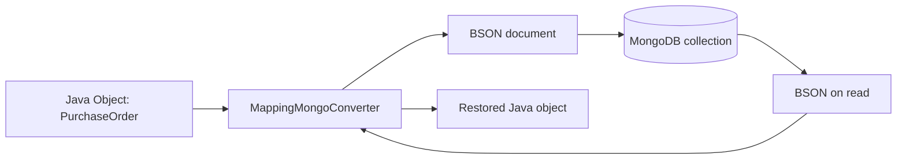

# Class and Property Name Mapping Conventions

> **Chapter:** Basic Mapping  
> **Module:** `SPRING_DATA_MONGODB` — using Spring Data MongoDB to connect, map documents, and operate on MongoDB via `MongoTemplate` or repositories. Mastering collection names and field names is a prerequisite for writing correct queries, aggregations, indexes, transactions, reactive access, tests, and performance diagnostics.

## 1. How Does a Java Object Become a MongoDB Document?

In MongoDB, data is stored as **BSON documents** inside **collections**. In Java, we typically work with a domain type such as `PurchaseOrder` having properties `id`, `customerCode`, and `createdAt`. Spring Data MongoDB uses its mapping subsystem, primarily through `MappingMongoConverter` and entity metadata, to convert back and forth between Java objects and BSON documents.

Three questions to answer when reading a class:

1. **Which collection does the document belong to?** The collection name is inferred from the class name or declared with `@Document(collection = "...")`.
2. **Which BSON field corresponds to each Java property?** By default the Java property name is used; `@Field` lets you declare a different name.
3. **Which property is the identifier?** `@Id` and certain naming conventions map to the special `_id` field.

Mapping flow:



Spring Data handles mapping on both **writes** and **reads**. This does not mean MongoDB knows Java getter, class, or package names; those names are conventions used by the application layer to decide which collection and fields are stored on the server.

## 2. Class-to-Collection Name Mapping Conventions

### 2.1. When No Collection Name Is Specified

For a regular domain class, Spring Data MongoDB defaults to taking the **simple class name with its first letter lowercased** as the collection name.

| Java Class Name | Default Collection Name |
| --- | --- |
| `Person` | `person` |
| `Order` | `order` |
| `PurchaseOrder` | `purchaseOrder` |
| `CustomerProfile` | `customerProfile` |

The default convention **does not pluralize automatically** (`Order` does not become `orders`) and **does not convert camelCase to snake_case** (`PurchaseOrder` does not become `purchase_orders`). Collection names in MongoDB are case-sensitive, so `order` and `Order` are not always the same collection.

Example:

```java
import org.springframework.data.mongodb.core.mapping.Document;

@Document
public class PurchaseOrder {
    // Properties omitted to focus on the collection name.
}
```

Unless configured otherwise, the domain class above maps to `purchaseOrder`. `@Document` expresses the mapping intent of the domain class; in many cases, the mapping mechanism can also recognize classes used via `MongoTemplate` even without this annotation. For domains needing long-term stability, declare the collection explicitly.

### 2.2. Explicit Declaration with `@Document`

```java
@Document(collection = "purchase_orders")
public class PurchaseOrder {
    // ...
}
```

From here on, even though the class name is `PurchaseOrder`, MongoDB stores documents in the `purchase_orders` collection when a repository or template uses the class metadata.

**Why name explicitly in production systems?** Suppose the team renames class `PurchaseOrder` to `OrderAggregate` while keeping existing data. If using the inferred collection name from the class, the application might suddenly access `orderAggregate` instead of `purchaseOrder`. Declaring `@Document(collection = "purchase_orders")` keeps data boundaries stable across class-renaming refactors.

The annotation does not automatically rename an existing collection and does not migrate old data: changing `collection` on a class can make the code start reading/writing in a different place. If you genuinely need to rename a collection, you must have a migration plan and control the cutover window.

### 2.3. Nested Classes Do Not Default to Separate Collections

A property that is an object or a list of objects is usually written **embedded** inside the parent document:

```text
PurchaseOrder
├── id
├── customerCode
├── shippingAddress
│   ├── city
│   └── postalCode
└── lines[]
    ├── sku
    └── quantity
```

`ShippingAddress` and `OrderLine` in the example do not become two separate collections just because they have Java class names. Storing a reference to an independent document requires an explicit design, potentially using `@DocumentReference` or `@DBRef` depending on requirements and Spring Data version. A reference is not a foreign key with automatic constraints like in a relational DBMS; lifecycle and data consistency must be considered.

## 3. Property-to-BSON-Field Name Mapping Conventions

### 3.1. Without `@Field`: Preserving the Property Name

For regular properties, the default BSON field name matches the **Java property name**:

| Java property | Default BSON field |
| --- | --- |
| `customerCode` | `customerCode` |
| `createdAt` | `createdAt` |
| `shippingAddress` | `shippingAddress` |
| `lines` | `lines` |
| `unitPriceVnd` | `unitPriceVnd` |

Spring Data MongoDB does not automatically convert `customerCode` to `customer_code` unless you configure a different naming strategy or use `@Field`. Writing queries in the Mongo shell with the wrong field name can yield empty results without throwing any syntax error.

### 3.2. Using `@Field` for a Storage Name Different from the Java Name

```java
import org.springframework.data.mongodb.core.mapping.Field;

@Field("customer_code")
private String customerCode;

@Field("created_at")
private Instant createdAt;
```

The annotations here declare **BSON field names**:

- Java still accesses `customerCode` and `createdAt`.
- MongoDB stores them under `customer_code` and `created_at`.
- When reading BSON, `MappingMongoConverter` restores the values back into the right Java properties.

`@Field` does not rename the Java variable, does not change the collection name, and does not automatically create an index. In repository/`Criteria` Java code, you generally still reference the **Java property path** so Spring Data applies mapping metadata.

A REST API might use `@JsonProperty("customerCode")` or another Jackson rule for returned JSON. **Field names in HTTP JSON and field names stored in MongoDB are two independent contracts**: `@JsonProperty` belongs to Jackson, while `@Field` belongs to Spring Data MongoDB. Similarly, JPA's `@Column` is not a tool for renaming MongoDB fields.

### 3.3. Conventions for the `_id` Identifier

Every MongoDB document has an `_id` identifier field that is unique within the collection. Spring Data MongoDB has special rules:

| Java Property | BSON field | Notes |
| --- | --- | --- |
| `@Id String id` | `_id` | Clear, readable declaration. |
| `@Id ObjectId id` | `_id` | Java directly uses `org.bson.types.ObjectId`. |
| Property named `id` without `@Id` | Usually `_id` | Automatic detection convention when no conflicting metadata exists. |
| Property named `_id` without `@Id` | `_id` | Can map by name, though usually less natural in the Java layer. |

With `@Id String id`, Spring Data can convert a string representing a valid ObjectId into a BSON ObjectId; if it cannot be converted, the value may be stored as a BSON string. For example, `"ORDER-001"` is a business string ID, whereas a valid 24-character hex string can be handled as an ObjectId. Do not randomly mix two BSON types for `_id` in the same collection because query filters and migrations will become complicated.

When you want explicit control over ID type and conversion rules, look into `@MongoId` and `FieldType` for your Spring Data MongoDB version; `@MongoId` has different conversion semantics than `@Id`. Changing the `_id` type after data has already been saved is a significant schema change, not a routine Java refactor.

**Note:** `@Field("some_name")` is not a way to rename the `_id` identifier field. For domain entities, use a clear ID property and rely on `@Id`/`@MongoId` rules.

## 4. Complete Example: Java Class and Actual Document

The example uses a **Java record** (Java 17+) and a modern version of Spring Data MongoDB that supports constructor-based record mapping. Place the types below in `PurchaseOrder.java` in the same package; auxiliary records are not declared `public`.

```java
package demo.orders;

import java.time.Instant;
import java.util.List;
import org.springframework.data.annotation.Id;
import org.springframework.data.mongodb.core.mapping.Document;
import org.springframework.data.mongodb.core.mapping.Field;

@Document(collection = "purchase_orders")
public record PurchaseOrder(
    @Id String id,
    @Field("customer_code") String customerCode,
    @Field("created_at") Instant createdAt,
    ShippingAddress shippingAddress,
    List<OrderLine> lines
) {}

record ShippingAddress(
    String city,
    @Field("postal_code") String postalCode
) {}

record OrderLine(
    String sku,
    int quantity
) {}
```

An object to write:

```java
PurchaseOrder order = new PurchaseOrder(
    "ORDER-001",
    "C-42",
    Instant.parse("2026-11-20T02:00:00Z"),
    new ShippingAddress("Ha Noi", "100000"),
    List.of(new OrderLine("BOOK-01", 2))
);

PurchaseOrder saved = orderRepository.save(order);
```

Assume `orderRepository` is a configured `MongoRepository<PurchaseOrder, String>` bean. The ID `"ORDER-001"` is not a valid ObjectId string, so the example stores `_id` as a BSON string. The document can be represented in **Extended JSON** for readability:

```json
{
  "_id": "ORDER-001",
  "customer_code": "C-42",
  "created_at": { "$date": "2026-11-20T02:00:00Z" },
  "shippingAddress": {
    "city": "Ha Noi",
    "postal_code": "100000"
  },
  "lines": [
    { "sku": "BOOK-01", "quantity": 2 }
  ],
  "_class": "demo.orders.PurchaseOrder"
}
```

`$date` is the representation of a BSON date-time type in Extended JSON; it does not mean the value in MongoDB is merely a JSON string. The `_class` field at the end is a **type hint** that `MappingMongoConverter` may write by default for root documents; different type mapper configurations can alter or remove it. Do not write business logic assuming every document has `_class`.

### 4.1. Exact Mapping Table in the Example

| Java Element | MongoDB Storage Location | Reason |
| --- | --- | --- |
| `PurchaseOrder` | `purchase_orders` collection | `@Document(collection = "...")` |
| `id` | `_id` | `@Id` |
| `customerCode` | `customer_code` | `@Field("customer_code")` |
| `createdAt` | `created_at` | `@Field("created_at")` |
| `shippingAddress` | Nested object with same name | No `@Field` on parent property |
| `shippingAddress.city` | `shippingAddress.city` | Property name preserved |
| `shippingAddress.postalCode` | `shippingAddress.postal_code` | `@Field("postal_code")` on nested record |
| `lines` | Embedded document array `lines` | Collection/list mapping |
| `lines[].quantity` | `lines[].quantity` | Property name preserved |

Because the collection was explicitly specified, renaming the `PurchaseOrder` class to a different Java name **does not require** changing the collection. However, if using the `_class` type hint with the fully qualified Java class name, package/class refactors can affect reading old documents; plan compatibility or use an appropriate type alias.

### 4.2. `_class` and `@TypeAlias` Are Not Collection Names

One way to reduce reliance on fully qualified class names in BSON is to use `@TypeAlias` (Spring Data Commons), for example:

```java
import org.springframework.data.annotation.TypeAlias;
import org.springframework.data.mongodb.core.mapping.Document;

// Alternative configuration: keep the same fields as the example above.
@Document(collection = "purchase_orders")
@TypeAlias("purchase-order")
public class PurchaseOrder {
    // Declare properties according to the application domain model.
}
```

When mapping type hints with the default configuration and the entity has been recognized by `MappingContext`, `_class` can contain the alias `"purchase-order"` instead of a long package/class name. `@TypeAlias` **does not replace** `@Document(collection = "purchase_orders")` and does not create a new collection. If changing an alias after data has already been written, old type hints must be handled; reading type aliases also depends on the entity being registered/discovered in the mapping context.

## 5. Which Names Do Repositories and MongoTemplate Use to Query?

The crucial point is that **names in Java code** and **names stored in MongoDB** belong to two different layers.

### 5.1. Repository: Naming Methods After Java Properties

```java
import java.util.List;
import org.springframework.data.mongodb.repository.MongoRepository;

public interface PurchaseOrderRepository
        extends MongoRepository<PurchaseOrder, String> {

    List<PurchaseOrder> findByCustomerCodeOrderByCreatedAtDesc(
        String customerCode
    );
}
```

Spring Data parses `CustomerCode` and `CreatedAt` against `PurchaseOrder` properties. Each property name is mapped to the corresponding BSON field, so the actual query uses `customer_code` and `created_at`. There is no need to name the method `findByCustomer_code...` after the storage schema; doing so can be misparsed and cause query-creation errors.

### 5.2. `MongoTemplate` and `Criteria`: Use Java Property Paths

```java
import java.util.List;
import org.springframework.data.domain.Sort;
import org.springframework.data.mongodb.core.MongoTemplate;
import org.springframework.data.mongodb.core.query.Criteria;
import org.springframework.data.mongodb.core.query.Query;

Query query = Query.query(
    Criteria.where("customerCode").is("C-42")
);
query.with(Sort.by(Sort.Direction.DESC, "createdAt"));

List<PurchaseOrder> results =
    mongoTemplate.find(query, PurchaseOrder.class);

String collectionName =
    mongoTemplate.getCollectionName(PurchaseOrder.class);
// collectionName == "purchase_orders"
```

For queries given a domain class, Spring Data has the mapping context and translates Java names to BSON fields. Nested case:

```java
Query query = Query.query(
    Criteria.where("shippingAddress.postalCode").is("100000")
);

List<PurchaseOrder> results =
    mongoTemplate.find(query, PurchaseOrder.class);
```

The property path `shippingAddress.postalCode` maps to the BSON path `shippingAddress.postal_code`. This is useful when also using projections, sorting, and domain-context aggregations; inspect raw pipelines or steps using custom field names because not every lower-level API applies mapping identically.

### 5.3. Mongo Shell / Raw Driver: Use Stored Field Names

The MongoDB server does not understand the Java property `customerCode`. When querying directly with `mongosh`, use the exact BSON names:

```javascript
db.purchase_orders.find({ customer_code: "C-42" })
  .sort({ created_at: -1 })

db.purchase_orders.find({
  "shippingAddress.postal_code": "100000"
})
```

If using `MongoTemplate.getCollection("purchase_orders")` to obtain a Java Driver `MongoCollection<Document>`, direct driver calls also work with **actual BSON names** and do not automatically translate `customerCode` to `customer_code`. This boundary is especially important when debugging queries, writing raw aggregation pipelines, creating indexes via the shell, or analyzing `explain("executionStats")`.

### 5.4. Explicitly Passing a Collection Name to Template

Some `MongoTemplate` APIs allow passing a custom collection name, for example:

```java
List<PurchaseOrder> archived =
    mongoTemplate.find(query, PurchaseOrder.class, "purchase_orders_archive");
```

In this case, the template uses the `purchase_orders_archive` collection specified by the caller instead of the default name from `@Document`. Therefore, if you edit the collection name on the entity while code still passes a manual collection name, results may differ from expectations. Check **both** the annotation **and** template call sites when diagnosing missing data.

## 6. Excluding Certain Properties from Mapping with `@Transient`

Sometimes a property is only for display or is derived from other data and **should not be saved to MongoDB**:

```java
import org.springframework.data.annotation.Transient;

public class CustomerProfile {
    private String firstName;
    private String lastName;

    @Transient
    private String displayLabel;
}
```

`@Transient` here is the annotation from **`org.springframework.data.annotation`**. Spring Data skips `displayLabel` when persisting and does not restore this value from BSON on read, even though Java still has the property. Do not rely on runtime-generated transient values remaining intact after reloading a document. If needed, compute the display value from `firstName` and `lastName` in a service or DTO.

Comparison:

| Annotation | Affected Layer |
| --- | --- |
| `@Field` | BSON field name or characteristics in MongoDB mapping |
| `@Id` / `@MongoId` | MongoDB `_id` identifier and related conversion rules |
| `@Transient` (Spring Data) | Excludes property from persistence mapping |
| `@JsonProperty` / `@JsonIgnore` (Jackson) | JSON contract at API/serialization layer, does not dictate BSON fields |
| `@Column` (JPA) | JPA relational mapping, not a MongoDB mapping annotation |

## 7. A Consistent Naming Strategy for the Whole Project

If a project wants all BSON fields in `snake_case` while Java uses `camelCase`, there are two approaches:

1. **Declare `@Field` explicitly** on properties whose names differ: looking at a class immediately shows where data is stored; requires more annotations.
2. **Configure `FieldNamingStrategy` in `MongoMappingContext`** to change the default convention for fields without an explicit alias, such as a strategy converting camelCase to snake_case. This requires proper integration with the Spring Data configuration mechanism of your application version and checking its impact on all entities.

Do not turn on a global naming strategy on a database that already contains data by changing Java code alone: a `createdAt` property previously stored as `createdAt` may start being queried at `created_at`. This is a **storage schema change** requiring migration, compatibility testing, and a rollout strategy.

A practical convention could be:

- Name collections explicitly via `@Document(collection = "...")`, e.g., `purchase_orders`.
- Name Java properties in readable camelCase, e.g., `customerCode`.
- When the BSON name differs from Java, declare `@Field("customer_code")` and avoid scattering BSON strings in business code.
- Repository/`MongoTemplate` operations use Java properties; Mongo shell queries and indexes use BSON names.
- Class names and collection names are managed independently so Java refactoring does not accidentally move data to a new collection.

### Dots and Special Characters in Field Names

MongoDB has special rules for field names containing dots (`.`) or starting with `$`. In Spring Data, dots in a field path normally represent **nested property paths**. Some versions support configuring how dotted names are treated as literal keys when using `@Field`, but hard-to-query names like these should not be introduced in basic examples. For new systems, prefer clear field names and avoid special characters unless there is a specific business requirement.

## 8. Renaming After Data Already Exists: Practical Risks

### 8.1. Renaming a Java Property While Preserving the BSON Field

Suppose a class initially had `customerCode` stored by default as `customerCode`. If refactored to `buyerCode` without an annotation, Spring Data will start looking for the `buyerCode` field; old documents only have `customerCode` and the new value may be `null` on read.

Storage compatibility can be preserved with:

```java
@Field("customerCode")
private String buyerCode;
```

Here the Java name changes to `buyerCode`, while the BSON field remains `customerCode`. If you want to **also change the storage name** to `buyer_code`, you must perform a migration and coordinate application versions during the transition period.

### 8.2. Renaming a Class Changes the Collection or Type Hint

- If using default collection names, renaming `PurchaseOrder` to `SalesOrder` can shift the target from `purchaseOrder` to `salesOrder`.
- If using `@Document(collection = "purchase_orders")`, the target collection stays the same, but the default `_class` may still store the old class/package name in previously written documents.
- If using `@TypeAlias`, the alias must be maintained or migrated consistently and the mapping context must recognize the type properly.

Therefore, **renaming in an IDE is not equivalent to a schema migration**. Run integration tests reading legacy documents before broad deployment.

### 8.3. Missing Fields, `null`, and Legacy Data

MongoDB allows documents in the same collection to have different fields. If a new application version adds a Java property, old documents may lack the corresponding field. The value read depends on the Java type, constructor, mapping/converter, and defaults. For primitive types like `int`, pay attention to missing fields and the default `0`; reference types can typically receive `null`.

Do not treat `null`, missing fields, and empty strings as always equivalent when writing queries. When the schema changes, define how default values, validation, and data migrations are handled to satisfy business rules.

### 8.4. Indexes, Aggregations, and Schema Validation Also Use BSON Field Names

Suppose a repository queries by `customerCode` while BSON stores `customer_code`. Indexes written directly in the Mongo shell must use:

```javascript
db.purchase_orders.createIndex({
  customer_code: 1,
  created_at: -1
})
```

Do not create `{ customerCode: 1 }` using the Java name if that field does not exist in the database. For index annotations on entities, Spring Data can use mapping metadata to compute field names, but **annotations do not guarantee the index exists**: automatic index creation policies depend on configuration and version. In production, verify indexes on the server and maintain a rollout/migration plan.

## 9. How to Verify That Mapping Works Correctly

Run against a MongoDB instance dedicated to development or testing, with the Spring Data MongoDB dependency and a valid connection.

**Step 1: Verify the collection name computed by Spring Data.**

```java
String actualName = mongoTemplate.getCollectionName(PurchaseOrder.class);
// Expected: "purchase_orders"
```

**Step 2: Save an object with data that distinguishes Java names from BSON names.** Use the `PurchaseOrder` example from section 4 or an equivalent repository.

**Step 3: Inspect the raw document using the Mongo shell.**

```javascript
db.purchase_orders.findOne({ _id: "ORDER-001" })
```

Confirm that `customer_code`, `created_at`, and `shippingAddress.postal_code` appear, while `customerCode` and `createdAt` are **not** the stored fields in this example.

**Step 4: Compare the Java query with the BSON query.**

```java
// Spring Data: Java property, gets mapped.
Criteria.where("customerCode").is("C-42");
```

```javascript
// mongosh: actual BSON field.
db.purchase_orders.find({ customer_code: "C-42" })
```

**Step 5: Add integration tests.** With a dedicated test database, verify `mongoTemplate.getCollectionName(PurchaseOrder.class)`, the raw BSON contents read via the raw driver, round-trip entity reading, and queries by Java properties. If using `@DataMongoTest` or Testcontainers, ensure the environment initializes properly for your Spring Boot version and does not accidentally connect to a production database.

### Diagnostic Checklist When Queries Return Empty

| Symptom | What to Check |
| --- | --- |
| Repository finds no documents but shell sees data | Inferred/`@Document` collection name and connected database. |
| `Criteria.where("customerCode")` does not match | Is the Java property named accurately and does it have the corresponding `@Field`? |
| Shell query by `customerCode` returns no results | Is the BSON name `customer_code` or something else? |
| Nested query fails | Check `shippingAddress.postal_code` instead of `shippingAddress.postalCode` in the shell. |
| New empty collection seen after class refactor | Did the default collection name change? |
| Old data becomes `null` after field refactor | Old data still uses the old BSON name; needs an alias or migration. |
| Only some documents fail to deserialize | Legacy `_class` type hint, missing required fields, different types, or incompatible converter? |

When analyzing performance issues with `explain("executionStats")` or designing aggregations/indexes, first establish the **actual field names stored in MongoDB**. With wrong mapping, adding indexes under Java names will not solve the actual problem.

## 10. Questions and Practice Exercises

### Self-Check Questions

1. Why does class `PurchaseOrder` default to collection `purchaseOrder` instead of `purchase_orders`?
2. Given an existing `customerProfile` collection, what happens if you rename class `CustomerProfile` to `ClientProfile` without setting `@Document(collection = "...")`?
3. Which name does `@Field("customer_code")` change: the Java variable name, JSON API name, BSON name, or collection name?
4. When a repository has `findByCustomerCode`, should you use `customerCode` or `customer_code` in the method name? What about when using `mongosh`?
5. How does `@Id String id` differ from a regular field? Why must the BSON type of `_id` be controlled?
6. Why does `shippingAddress.postalCode` in `Criteria` correspond to `shippingAddress.postal_code` in the Mongo shell?
7. How do `@TypeAlias` and `@Document(collection = ...)` solve two different needs?

### Mini Practice Exercise

Create a `ProductCatalogItem` class containing `id`, `productCode`, `displayName`, `priceVnd`, and a `dimensions` object having `widthCm` and `heightCm`. Requirements:

1. Store in collection `product_catalog`, keeping Java names intact while BSON uses `product_code` and `price_vnd`; leave the remaining fields to default conventions.
2. Use `@Id` for the identifier and `@Field` for the two aliases.
3. Write a repository method `findByProductCode` and a `MongoTemplate` query by `productCode`.
4. Write a document, use `mongosh` to verify the exact BSON fields, and record the actual collection name from `getCollectionName`.
5. Explain what change is needed if you want to rename `displayName` to `name` in Java while keeping the BSON field `displayName` for already stored data.

**Expected outcome:** a Java class whose name is independent of the collection; Java properties that intentionally maintain names different from MongoDB fields; mapping-context code querying by Java properties, while raw queries and indexes use BSON field names.

## 11. Takeaways

- **Default collection name** is usually the class name with the first letter lowercased; it does not automatically append `s` or convert to `snake_case`.
- **`@Document(collection = "...")`** pins the collection name to reduce risk when refactoring class names.
- **Default field name** matches the Java property; **`@Field("...")`** allows using a different BSON name.
- **`@Id`** maps the identifier to `_id`; watch out for `String`/`ObjectId` conversion rules.
- **Nested objects** are embedded by default and do not automatically generate separate collections or foreign keys.
- **Repositories and `MongoTemplate`** use Java properties for mapping; **mongosh/raw driver** work with stored BSON names.
- **Renaming classes, properties, or naming strategies** can be a real schema change, requiring testing and migration when data already exists.

Reference documentation to cross-check APIs with your version: [Spring Data MongoDB Reference](https://docs.spring.io/spring-data/mongodb/reference/), especially the **Object Mapping**, **Mapping Annotation Overview**, and **MongoTemplate** sections.
