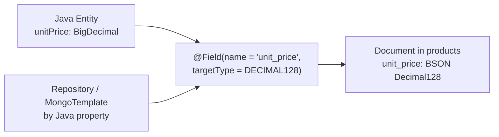

# Renaming Fields with @Field and Configuring Target BSON Types

## 1. Lesson Objectives

In **Spring Data MongoDB**, a Java entity is the programmatic representation of a BSON document in MongoDB. Java property names and field names stored in MongoDB **can differ**; Java types do not necessarily correspond one-to-one with BSON types either. The `@Field` annotation helps describe both decisions:

- **Renaming the stored field**: for example, Java property `displayName` is written to BSON field `display_name`.
- **Specifying the target BSON type**: for example, Java property `BigDecimal unitPrice` is written as BSON **Decimal128** rather than relying solely on converter defaults.

Both matter when querying with repositories or `MongoTemplate`, building indexes, performing aggregations, testing schemas, and diagnosing data issues.

After this lesson, you will be able to read an entity with `@Field`, predict the stored document, use the right field names in queries, and identify risks when renaming fields or changing BSON types on a collection that already contains data.

## 2. Distinguishing Three Layers: Java Property, MongoDB Field, and BSON Type

Consider a product with code `BOOK-101`, a display name, and a price of 199.90:

| On the Java Side | Field Name in MongoDB | Desired BSON Type | Role |
| --- | --- | --- | --- |
| `id`, type `String`, with `@Id` | `_id` | Usually `ObjectId` if the ID is generated by default mechanism | Document identifier |
| `sku`, type `String` | `sku` | String | Product code |
| `displayName`, type `String` | `display_name` | String | Name shown in the UI |
| `unitPrice`, type `BigDecimal` | `unit_price` | Decimal128 | Price requiring decimal representation |
| `createdAt`, type `Instant` | `created_at` | Date | Creation timestamp |
| `supplier.displayName` | `supplier.display_name` | String | Embedded supplier name |

In this example:

1. **Java property name** is used in source code, such as `unitPrice`.
2. **MongoDB field name** appears in the BSON document and in commands written directly in `mongosh`, such as `unit_price`.
3. **BSON type** determines how data is stored and compared in MongoDB, e.g., Decimal128 vs. String or Double.



Note: `@Field` is **mapping information between the two sides**. It does not automatically modify existing data in the database and does not automatically create indexes or schema constraints.

## 3. How Does `@Field` Rename Fields?

By default, when there is no custom naming rule, Spring Data MongoDB usually stores a property under the property's own name:

```java
private String displayName;
```

The document will have a `displayName` field. If you want the BSON field name in snake_case, use `@Field`:

```java
import org.springframework.data.mongodb.core.mapping.Field;

@Field("display_name")
private String displayName;
```

When writing the document, the value from `displayName` is stored in `display_name`; when reading the document, the converter moves the value from `display_name` back into `displayName`.

Common syntax forms:

```java
@Field("display_name")
private String displayName;

@Field(name = "created_at")
private Instant createdAt;
```

`value` (shorthand) and `name` are used to specify the **stored field name**; on a single property, pick one style. Naming explicitly keeps the MongoDB schema less coupled to Java property refactors, though renaming in BSON is still a schema change and must be managed carefully.

### When `@Field` Is Not Needed

```java
private String sku;
```

If you want the BSON field name to also be `sku`, no separate annotation is needed. Only add `@Field` when there is a mapping intent or a need to specify the target BSON type. Over-annotating makes code more verbose without adding information.

### `@Id` and the `_id` Field

`_id` is MongoDB's special identifier field. With Spring Data MongoDB, use `@Id` or an appropriate ID configuration to map the identifier property:

```java
import org.springframework.data.annotation.Id;

@Id
private String id;
```

Do not treat `@Field("_id")` as a replacement for identifier design. `@Id` has dedicated mapping and conversion rules; with `String`, values may be converted into BSON `ObjectId` when applicable. If you need exact control over how the ID type is stored, Spring Data also offers `@MongoId`, which is a separate topic from ordinary field renaming.

## 4. Complete Entity Example: Storage Names and Decimal128

Suppose a product catalog application has a `products` collection. We use Spring Data MongoDB annotations:

```java
package com.example.catalog;

import java.math.BigDecimal;
import java.time.Instant;
import org.springframework.data.annotation.Id;
import org.springframework.data.mongodb.core.mapping.Document;
import org.springframework.data.mongodb.core.mapping.Field;
import org.springframework.data.mongodb.core.mapping.FieldType;

@Document(collection = "products")
public class Product {

    @Id
    private String id;

    private String sku;

    @Field("display_name")
    private String displayName;

    @Field(name = "unit_price", targetType = FieldType.DECIMAL128)
    private BigDecimal unitPrice;

    @Field("created_at")
    private Instant createdAt;

    protected Product() {
        // Supports object instantiation during mapping.
    }

    public Product(String sku, String displayName,
                   BigDecimal unitPrice, Instant createdAt) {
        this.sku = sku;
        this.displayName = displayName;
        this.unitPrice = unitPrice;
        this.createdAt = createdAt;
    }

    public String getId() {
        return id;
    }

    public String getSku() {
        return sku;
    }

    public String getDisplayName() {
        return displayName;
    }

    public BigDecimal getUnitPrice() {
        return unitPrice;
    }

    public Instant getCreatedAt() {
        return createdAt;
    }
}
```

When saving a new `Product`, the BSON document can be observed in `mongosh` in a form similar to:

```javascript
{
  _id: ObjectId("507f1f77bcf86cd799439011"),
  sku: "BOOK-101",
  display_name: "Introduction to Spring Data MongoDB",
  unit_price: NumberDecimal("199.90"),
  created_at: ISODate("2026-11-20T03:00:00Z")
}
```

This is a human-readable representation in `mongosh`: `NumberDecimal("199.90")` denotes **BSON Decimal128** and `ISODate(...)` denotes **BSON Date**. Not all MongoDB management tools display BSON identically. The `_id` and timestamp values above are for illustration only.

| Annotation / property | Result |
| --- | --- |
| `@Document(collection = "products")` | Selects the `products` collection |
| `@Id` on `id` | Maps to `_id` |
| No `@Field` on `sku` | Stored with name `sku` |
| `@Field("display_name")` | Renames the stored field |
| `@Field(name = "unit_price", targetType = FieldType.DECIMAL128)` | Both renames the field and requests the BSON Decimal128 type |
| `@Field("created_at")` on `Instant` | Renames the field; the date-time type is handled by the appropriate converter mechanism |

Writing `@Field("created_at")` **does not mean** the annotation picks a time zone. `Instant` represents a point in time; BSON Date stores a timestamp value, typically interpreted as UTC, while displaying it in a specific time zone is a separate responsibility of the application.

## 5. Why Is `targetType` Needed for `BigDecimal`?

### Difference Between `BigDecimal` and BSON Types

Java's `BigDecimal` represents decimal numbers with arbitrary precision by Java class design; MongoDB provides the **Decimal128** BSON type, which has precision and value-range limits according to the decimal128 standard. The two types are related but not identical.

Without requesting a specific BSON type, Spring Data MongoDB may apply the converter's default mapping; in common configurations, `BigDecimal` can be stored as a **String** to preserve its decimal representation. When data is used for numeric comparisons, summing, or sorting by price, String is not equivalent to Decimal128.

Example of two prices:

| Value | Stored as String | Stored as Decimal128 |
| --- | --- | --- |
| 20.00 | `"20.00"` | `NumberDecimal("20.00")` |
| 100.00 | `"100.00"` | `NumberDecimal("100.00")` |

**String** comparison in lexicographical order can produce different results from **numeric** comparison. At the same time, MongoDB evaluates comparison queries based on the BSON type of both the stored value and the query value. Therefore, agree on the storage type upfront rather than assuming Java `BigDecimal` always produces BSON Decimal128.

### Explicitly Declaring the Target BSON Type

```java
import java.math.BigDecimal;
import org.springframework.data.mongodb.core.mapping.Field;
import org.springframework.data.mongodb.core.mapping.FieldType;

@Field(name = "unit_price", targetType = FieldType.DECIMAL128)
private BigDecimal unitPrice;
```

In this annotation:

- `name = "unit_price"` decides the **BSON field name**.
- `targetType = FieldType.DECIMAL128` asks the converter to handle the value as **BSON Decimal128** when saving.
- `BigDecimal` remains the **Java property type** used by the business logic.

These are two independent decisions; you can rename only:

```java
@Field("display_name")
private String displayName;
```

Or specify the BSON type while keeping the property name:

```java
@Field(targetType = FieldType.DECIMAL128)
private BigDecimal price;
```

The second case stores in field `price` with BSON type Decimal128.

**Important limitations:** Decimal128 cannot represent every arbitrary `BigDecimal`. If a value exceeds representation limits or requires a different rounding policy, conversion can fail or require explicit handling. For monetary data, you must also define currency units, decimal places, rounding rules, and input validation; `targetType` does not replace those business rules.

### When Should You Choose Decimal128?

Decimal128 is suitable when the system wants **MongoDB to perform comparisons, range filtering, or decimal aggregations** on values genuinely stored as a decimal type. Another option for money is an integer in minor units, such as `Long priceMinor`; the right choice depends on currency units and calculation rules. No type automatically guarantees all monetary calculations are right without precision and rounding policies.

## 6. Writing and Inspecting the Actual BSON Type

With a Spring Data repository:

```java
package com.example.catalog;

import java.util.List;
import java.util.Optional;
import org.springframework.data.mongodb.repository.MongoRepository;

public interface ProductRepository extends MongoRepository<Product, String> {

    Optional<Product> findBySku(String sku);

    List<Product> findByDisplayName(String displayName);
}
```

A snippet using the repository:

```java
import java.math.BigDecimal;
import java.time.Instant;

Product newProduct = new Product(
    "BOOK-101",
    "Introduction to Spring Data MongoDB",
    new BigDecimal("199.90"),
    Instant.parse("2026-11-20T03:00:00Z")
);

Product saved = productRepository.save(newProduct);
System.out.println("ID: " + saved.getId());

productRepository.findBySku("BOOK-101").ifPresent(p ->
    System.out.println(p.getDisplayName() + " / " + p.getUnitPrice())
);
```

The snippet above sits **inside a service or runner that has `ProductRepository` injected**; the `productRepository` variable is a repository instance from Spring, not a predefined global variable. Use the constructor `new BigDecimal("199.90")` instead of `new BigDecimal(199.90)` to avoid introducing inaccuracy from a `double` literal into the initial value.

After `save` succeeds, inspect from `mongosh`:

```javascript
use catalog_demo

db.products.findOne({ sku: "BOOK-101" })
```

To **verify BSON types** without depending on tool formatting, use the `$type` aggregation operator:

```javascript
db.products.aggregate([
  { $match: { sku: "BOOK-101" } },
  {
    $project: {
      _id: 0,
      sku: 1,
      priceType: { $type: "$unit_price" },
      createdAtType: { $type: "$created_at" },
      nameType: { $type: "$display_name" }
    }
  }
])
```

The expected output has `priceType: "decimal"`, `createdAtType: "date"`, and `nameType: "string"`. This directly inspects the **stored** data, which is more reliable than only looking at the entity's Java types.

In this example, the `catalog_demo` database is where the application is configured to connect (e.g., URI `mongodb://localhost:27017/catalog_demo`). Be sure to connect to the application's database before running `mongosh`; the `@Document` annotation only selects the collection, not the database.

## 7. Do Queries Use the Java Name or the BSON Name?

One of the most confusing points is that Spring Data's **mapping-aware APIs** and **direct MongoDB commands** operate from two different perspectives.

### Derived Queries in Repositories

For a `Product` entity declaring `@Field("display_name")`, the method:

```java
List<Product> findByDisplayName(String displayName);
```

is named after the **Java property** `displayName`. Spring Data consults entity metadata and generates a query targeting the `display_name` BSON field. Naming a method `findByDisplay_name` after the storage schema does not fit standard derived query conventions.

### `MongoTemplate` with a Mapped Entity

```java
import java.math.BigDecimal;
import java.util.List;
import org.springframework.data.mongodb.core.MongoTemplate;
import org.springframework.data.mongodb.core.query.Criteria;
import org.springframework.data.mongodb.core.query.Query;

public class ProductSearch {

    private final MongoTemplate mongoTemplate;

    public ProductSearch(MongoTemplate mongoTemplate) {
        this.mongoTemplate = mongoTemplate;
    }

    public List<Product> findExpensiveProducts(BigDecimal minPrice) {
        Query query = Query.query(
            Criteria.where("unitPrice").gte(minPrice)
        );
        return mongoTemplate.find(query, Product.class);
    }
}
```

Because `find(query, Product.class)` has the mapping context of `Product`, the `unitPrice` criterion is mapped to `unit_price` and the `BigDecimal` value is processed according to the field's conversion settings. For typical entity queries, use **Java property names** so code is not coupled to physical naming.

When adding sorting or projections in Spring Data, also verify whether the API works via entity metadata or via a raw BSON document. When using raw MongoDB constructs, you may need to specify the **stored field name**.

### `mongosh` and Direct BSON Queries

`mongosh` does not read Java annotations:

```javascript
db.products.find({
  display_name: "Introduction to Spring Data MongoDB",
  unit_price: { $gte: NumberDecimal("100.00") }
})
```

Here you must use **`display_name`** and **`unit_price`**, along with an appropriate decimal query value. A command using `displayName` only works if the database actually has a field by that name.

| Tool | Field Name Typically Written | Example |
| --- | --- | --- |
| Repository derived query | Java property | `findByDisplayName(...)` |
| `MongoTemplate.find(..., Product.class)` | Java property, mapped | `Criteria.where("unitPrice")` |
| `mongosh` | BSON field name | `{ unit_price: { $gte: NumberDecimal("100.00") } }` |
| Hand-written raw BSON pipeline without entity mapping context | BSON field name | `"$unit_price"` |

With aggregations built using Spring Data's mapping API, some stages may be mapped against the entity. With raw pipelines, behavior depends on the API and context; inspect the emitted command or test it rather than assuming every field-name string is automatically translated.

## 8. `@Field` on Nested Objects

A MongoDB document can contain **embedded documents**. Field renaming follows the object structure, not just the top level.

Example:

```java
public class Supplier {

    @Field("display_name")
    private String displayName;

    @Field("phone_number")
    private String phoneNumber;

    protected Supplier() {}

    public Supplier(String displayName, String phoneNumber) {
        this.displayName = displayName;
        this.phoneNumber = phoneNumber;
    }
}
```

Added to the `Product` entity:

```java
private Supplier supplier;
```

And when saved, the document may contain:

```javascript
{
  sku: "BOOK-101",
  supplier: {
    display_name: "Bookstore A",
    phone_number: "0123456789"
  }
}
```

With `MongoTemplate` and the `Product` entity, the following statement uses the **Java property path**:

```java
Query query = Query.query(
    Criteria.where("supplier.displayName").is("Bookstore A")
);
List<Product> result = mongoTemplate.find(query, Product.class);
```

Spring Data can map that path to `supplier.display_name` when it knows the nested object's metadata. In `mongosh`, you must use the BSON field name:

```javascript
db.products.find({ "supplier.display_name": "Bookstore A" })
```

This shows that field renaming must also be checked at **nested levels**, especially for search queries, indexes on nested fields, and aggregations.

## 9. Indexes and Aggregations Must Match the BSON Schema

When using `mongosh` to create an index, the index key is the **physical field name in MongoDB**:

```javascript
db.products.createIndex(
  { unit_price: 1 },
  { name: "products_unit_price" }
)
```

If you accidentally create `{ unitPrice: 1 }` while actual data is stored in `unit_price`, that index will not serve the intended query pattern. Conversely, Spring Data's index-creation mechanisms driven by entity metadata can map Java property names when properly configured; always verify that the index actually exists in the database.

For aggregations, distinguish prices stored as decimal from prices mistakenly stored as strings:

```javascript
db.products.aggregate([
  { $match: { unit_price: { $type: "decimal" } } },
  {
    $group: {
      _id: null,
      averagePrice: { $avg: "$unit_price" },
      totalPrice: { $sum: "$unit_price" },
      productCount: { $sum: 1 }
    }
  }
])
```

The pipeline illustrates calculations over **documents where `unit_price` has type Decimal128**. The `$type` filter avoids mixing mismatched types in the example; real systems should ensure a uniform schema through validation and migration processes. When computing financial figures, also apply business rules for currency, status, and result precision.

Regarding performance, indexes assist certain filter and sort patterns, but each index carries storage and write costs. Only create indexes based on actual query patterns and inspect `explain("executionStats")` with representative data. Different BSON types can cause filter, sort, and aggregation results to differ from expectations even under the same field name.

## 10. When Renaming or Changing Types on Existing Data

Suppose the old version stored:

```javascript
{
  sku: "BOOK-101",
  displayName: "Introduction to Spring Data MongoDB",
  unit_price: "199.90"
}
```

Whereas the new version expects:

```javascript
{
  sku: "BOOK-101",
  display_name: "Introduction to Spring Data MongoDB",
  unit_price: NumberDecimal("199.90")
}
```

If you only add `@Field("display_name")` and `targetType = FieldType.DECIMAL128` and deploy the new code:

- **Old documents do not automatically rename** `displayName` to `display_name`.
- **Prices stored as Strings do not automatically become Decimal128** without executing a data update.
- The collection may contain **multiple schema generations**, causing the application to read missing fields or range queries to miss expected results.

A schema change plan needs at minimum: backups or recovery guarantees, measuring affected document counts, checking for invalid values, testing conversion in a staging environment, verifying results, and coordinating deployment timing for the Java release.

### Data Conversion Example Using `mongosh`

Once you confirm the old name is `displayName`, you might consider:

```javascript
db.products.updateMany(
  {
    displayName: { $exists: true },
    display_name: { $exists: false }
  },
  { $rename: { displayName: "display_name" } }
)
```

If `unit_price` strings are all valid decimals within Decimal128 range, you can **test** converting on sample data first:

```javascript
db.products.updateMany(
  { unit_price: { $type: "string" } },
  [
    {
      $set: {
        unit_price: { $toDecimal: "$unit_price" }
      }
    }
  ]
)
```

This is a **data-mutating** migration example: do not run it in production without testing and having a rollback plan. `$toDecimal` can error on unconvertible strings or out-of-range numbers; when you need to handle malformed records intentionally, consider `$convert` with `onError` and `onNull` branches. Operations must account for old and new application versions running concurrently, as well as indexes, validators, and queries depending on the field name.

After conversion, re-check types using `$type` and reconcile the affected document count. If the application needs backward compatibility during a rolling version transition, design clear dual-read/write transition logic before retiring the old schema.

## 11. Testing Mapping and Diagnosing Errors

To confirm mapping works as expected, write **integration tests against a real MongoDB** (e.g., a test MongoDB instance, such as one run via Testcontainers) and verify both sides:

1. Create a `Product` with `displayName = "Introduction to Spring Data MongoDB"` and `unitPrice = new BigDecimal("199.90")`.
2. Save it via `ProductRepository.save`.
3. Read it back via the repository and confirm the Java properties retain the expected values.
4. Inspect the raw document directly: verify `display_name` and `unit_price` are present and unwanted `displayName` or `unitPrice` fields were not generated.
5. Use `$type` to verify `unit_price` is `"decimal"`.
6. Verify a `Criteria.where("unitPrice").gte(...)` query finds the product and targets the right BSON field name.
7. Check historical data if there is a migration plan.

A BSON type check via `MongoTemplate` can be written as follows:

```java
import org.bson.Document;
import org.bson.types.Decimal128;
import org.springframework.data.mongodb.core.MongoTemplate;

Document stored = mongoTemplate.getCollection("products")
    .find(new Document("sku", "BOOK-101"))
    .first();

if (stored == null) {
    throw new IllegalStateException("Sample product not found");
}

if (!stored.containsKey("display_name")) {
    throw new IllegalStateException("Incorrect BSON field name");
}

if (!(stored.get("unit_price") instanceof Decimal128)) {
    throw new IllegalStateException("unit_price is not BSON Decimal128");
}
```

This snippet uses the **MongoDB Driver API directly** via `getCollection`, so `new Document("sku", ...)` and `stored.get("unit_price")` use BSON field names. This is for inspecting raw data; repository and entity classes should remain the primary access path for everyday business logic.

### Common Errors

| Symptom | Possible Cause | Inspection and Resolution |
| --- | --- | --- |
| `findByDisplayName` returns empty even though `mongosh` sees the document | Legacy data stores `displayName` while new code queries `display_name`; or wrong database | Inspect raw document, URI/database, and migration |
| `getUnitPrice()` looks fine in Java but aggregations calculate wrongly | Actual BSON field is String or mixed types exist | Use `$type`, check `targetType`, and inspect historical data |
| Query using `unitPrice` in `mongosh` returns no results | The BSON field name is `unit_price` | Use `unit_price` in direct MongoDB queries |
| Index does not improve price queries | Index created on wrong field name or query doesn't match the index | Inspect `getIndexes()`, `explain`, and actual filters |
| Saving very large `BigDecimal` fails conversion | Value exceeds Decimal128 range or precision | Define domain range limits and rounding policies |
| Changing annotation leaves old documents with old schema | `@Field` is not a migration tool | Plan a data migration |
| Query on nested field is wrong | Confusing `supplier.displayName` with `supplier.display_name` | Cross-check Java properties, `@Field` on embedded class, and actual BSON |

## 12. Takeaways and Self-Practice

**Three questions you must answer when seeing `@Field`:**

1. What is the Java property name and where is it used? For example, `unitPrice` is accessed from Java and in derived queries.
2. Under what name is the MongoDB field stored? For example, `unit_price` appears in `mongosh`, indexes, and raw documents.
3. What is the actual BSON type? For example, `Decimal128`, which should be verified via `$type` when query results or aggregations depend on data types.

### Exercise 1: Reading an Annotation

```java
@Field(name = "discount_rate", targetType = FieldType.DECIMAL128)
private BigDecimal discountRate;
```

**Question:** What is the Java property name, what is the MongoDB field name, and what is the desired BSON type?

**Answer:** `discountRate`; `discount_rate`; Decimal128. If querying via `MongoTemplate` on the mapped entity, you can write `Criteria.where("discountRate")`.

### Exercise 2: Spotting a Query Error

An entity has `@Field("display_name") private String displayName;` yet you run:

```javascript
db.products.find({ displayName: "Book A" })
```

**Question:** Why might the command fail to find the document?

**Answer:** `mongosh` queries BSON fields directly; if data is stored under `display_name`, you must use `{ display_name: "Book A" }`.

### Exercise 3: Legacy Data

A collection has `unit_price` as a String, while the application just added `@Field(targetType = FieldType.DECIMAL128)`. **Question:** Is that already enough to run numeric aggregations consistently?

**Answer:** Not yet. You must check and convert legacy data to Decimal128 (or adjust the schema per your design), verify converted values, and re-test queries/aggregations.

**Conclusion:** `@Field` describes the **stored field name** and can specify the **target BSON type** for a Java property. Use `@Field("...")` when the BSON name needs to differ from Java; use `targetType = FieldType.DECIMAL128` when you need to store `BigDecimal` as a real decimal type. Every mapping decision should be verified against actual BSON documents, real queries, and existing data.
