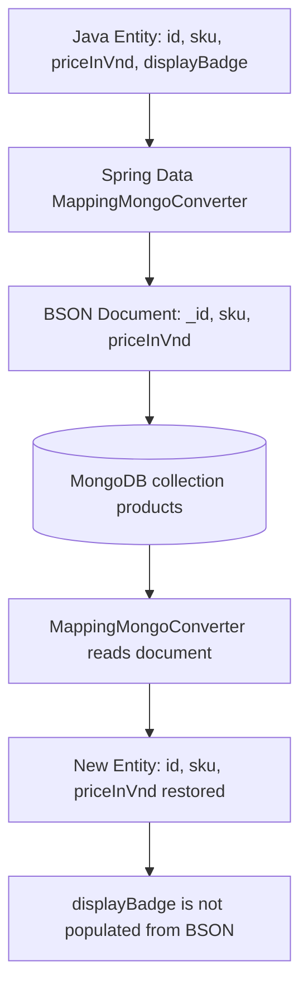

# Excluding Non-Persistent Data with @Transient

## 1. Why Exclude a Property from a Document?

In **Spring Data MongoDB**, a Java entity typically has properties mapped into a MongoDB document. However, not all data present on a Java object needs or should be written to the database.

Suppose a product screen needs to display:

- `sku`: product code, which must be persisted for searching and updating;
- `priceInVnd`: listed price, which must be stored for business operations;
- `displayBadge`: a temporary label such as "Today's Deal", computed based on the active campaign or current viewer.

`displayBadge` serves only a single request or response. If this label were saved into the `products` collection, the application could easily retain expired information, increase write operations, and introduce discrepancies between source data and displayed values.

Spring Data provides the **`org.springframework.data.annotation.Transient`** annotation to mark a property as **excluded from persistent data mapping**.

```java
import org.springframework.data.annotation.Transient;

@Transient
private String displayBadge;
```

When Spring Data converts an entity to BSON for storage, that property is omitted from the generated document. When Spring Data reads a document to reconstruct the entity, it also does not read any value from MongoDB to populate that property.

**Core point:** `@Transient` controls *persistence mapping* in Spring Data MongoDB. It does not decide whether data is returned over HTTP/JSON, written to logs, or retained by Java in memory.

## 2. How @Transient Works in Both Mapping Directions

Consider the processing flow of an entity:



| Operation | For regular properties | For properties annotated with `@Transient` |
| --- | --- | --- |
| `MongoTemplate.save(entity)` | Mapped and written to BSON | Ignored when the converter builds the document |
| `MongoRepository.save(entity)` | Same, via Spring Data mapping | Ignored |
| `MongoTemplate.findById(...)` | Value is read and assigned to entity | Not loaded from BSON |
| `ReactiveMongoTemplate` / reactive repository | Same mapping as synchronous branch | Still excluded from mapping |
| Mutating value in memory | Java object receives the new value | Still mutates normally in memory |
| Jackson HTTP JSON output | Follows JSON serialization rules | Not automatically hidden just because of Spring Data `@Transient` |

Unless initialized otherwise, an unassigned `@Transient` reference field will be `null` on an object freshly read from MongoDB. If the field has an initializer, e.g. `private String displayBadge = "Default";`, that initial value may still be present after Spring instantiates the object; it does not come from MongoDB.

**An important note on legacy data:** adding `@Transient` to an entity does not automatically run a migration to remove that field from previously saved documents. Raw BSON writes or direct `$set` commands on that field can still create it in MongoDB. The annotation affects Spring Data's converter, not a server-enforced schema rule.

## 3. Complete Example with @Document, @Id, and @Transient

### 3.1. Entity Declaration

The following example uses `long` for whole VND amounts to focus on mapping. In real financial applications, choose monetary representations, units, and rounding rules carefully.

```java
package example.catalog;

import org.springframework.data.annotation.Id;
import org.springframework.data.annotation.Transient;
import org.springframework.data.mongodb.core.mapping.Document;

@Document(collection = "products")
public class Product {

    @Id
    private String id;

    private String sku;

    private long priceInVnd;

    @Transient
    private String displayBadge;

    public Product() {
    }

    public Product(String id, String sku, long priceInVnd) {
        this.id = id;
        this.sku = sku;
        this.priceInVnd = priceInVnd;
    }

    public String getId() {
        return id;
    }

    public String getSku() {
        return sku;
    }

    public long getPriceInVnd() {
        return priceInVnd;
    }

    public String getDisplayBadge() {
        return displayBadge;
    }

    public void setDisplayBadge(String displayBadge) {
        this.displayBadge = displayBadge;
    }
}
```

Here:

- `@Document(collection = "products")` declares the entity's collection;
- `@Id` maps `id` to MongoDB's `_id` key;
- `sku` and `priceInVnd` are persisted properties;
- `displayBadge` exists on the Java object, but is neither stored nor loaded from the document by Spring Data MongoDB.

### 3.2. Writing Data with MongoTemplate

```java
import org.springframework.data.mongodb.core.MongoTemplate;

public class ProductWriter {
    private final MongoTemplate template;

    public ProductWriter(MongoTemplate template) {
        this.template = template;
    }

    public void saveSample() {
        Product product = new Product(
            "product-demo-001",
            "SKU-001",
            350_000L
        );

        product.setDisplayBadge("Weekend Discount");
        template.save(product);
    }
}
```

After calling `save`, the actual document has a structure equivalent to:

```javascript
{
  _id: "product-demo-001",
  sku: "SKU-001",
  priceInVnd: NumberLong("350000")
}
```

The `displayBadge` field is not written. In this example, `_id` is intentionally a string not shaped like a valid ObjectId for simplicity; if using `@Id String` with other values, `_id` conversion behavior must follow Spring Data MongoDB conversion rules.

### 3.3. Reading Data and Enriching Temporary Values

```java
import java.util.Objects;
import org.springframework.data.mongodb.core.MongoTemplate;

public class ProductReader {
    private final MongoTemplate template;

    public ProductReader(MongoTemplate template) {
        this.template = template;
    }

    public Product findForDisplay(String id) {
        Product product = Objects.requireNonNull(
            template.findById(id, Product.class),
            "Product not found"
        );

        // Data used only for the current display.
        product.setDisplayBadge("Fast delivery today");
        return product;
    }
}
```

Because `displayBadge` is not mapped from BSON, the application can recompute the badge for the current context. The value set on the object before returning is in-memory data; if the entity is later saved via `save`, that value is still not written to the collection by Spring Data MongoDB.

For systems serving multiple clients or users, per-request presentation data is often better suited to a **DTO/response model**. `@Transient` is an option when temporary fields are needed on an entity, though not all display data belongs on the entity class.

## 4. Distinguishing Commonly Confused Mechanisms

| Mechanism | Primary Effect | Excludes field from Spring Data MongoDB mapping? | Automatically hides field in JSON output? |
| --- | --- | --- | --- |
| `org.springframework.data.annotation.Transient` | Excludes property from persistence mapping | Yes | Not guaranteed |
| Java `transient` keyword | Marks field excluded from standard Java object serialization; Spring Data also typically ignores transient-declared fields | Usually yes per Spring Data property discovery rules; use the annotation to state intent clearly | Depends on JSON library and configuration |
| `com.fasterxml.jackson.annotation.JsonIgnore` | Controls Jackson serialization/deserialization | No | Yes, within Jackson's scope |
| `org.springframework.data.annotation.ReadOnlyProperty` | Read-only property from the datastore under Spring Data mapping | Different from `@Transient`: can be read, but not written by mapping | Not guaranteed |
| Query projection (`fields().exclude(...)`) | Limits fields returned by a specific query | No; data is still stored | Not necessarily |
| `@Field("...")` | Renames/types BSON field during mapping | No; field still participates in mapping | Does not dictate JSON |
| DTO or response view | Shapes data exchanged with clients | Does not directly alter entity mapping | Follows DTO structure and serializer |

### 4.1. Spring Data @Transient vs. Java transient

The two look similar:

```java
// Spring Data annotation
@org.springframework.data.annotation.Transient
private String displayBadge;

// Java language modifier
private transient String temporaryNote;
```

The `transient` keyword comes from Java's serialization mechanism. Spring Data also excludes Java fields marked `transient` when discovering persistent properties in typical mappings. Nevertheless, using Spring Data's `@Transient` makes the **intent to exclude from persistence** clearer and avoids coupling with Java serialization requirements.

Do not swap `org.springframework.data.annotation.Transient` for a same-named annotation from another ORM and assume Spring Data MongoDB behaves identically. For this task, use the **Spring Data** annotation.

### 4.2. @Transient Is Not Equivalent to @JsonIgnore

Suppose `internalNote` is information only for internal application processing:

```java
import com.fasterxml.jackson.annotation.JsonIgnore;
import org.springframework.data.annotation.Transient;

@Transient
@JsonIgnore
private String internalNote;
```

Here `@Transient` excludes the property from MongoDB mapping while `@JsonIgnore` tells Jackson not to include the corresponding property in JSON. For Jackson, exact behavior also depends on getters/setters and property-access configuration.

If you only apply `@Transient` while keeping a public getter, an API using Jackson can still return that field in JSON. Therefore, **do not use `@Transient` as an API data-security mechanism**. Control response payloads using DTOs, access control, and appropriate JSON annotations.

### 4.3. @Transient Differs from Omitting Fields on Read with Projection

```java
import org.springframework.data.mongodb.core.query.Criteria;
import org.springframework.data.mongodb.core.query.Query;

Query query = Query.query(Criteria.where("sku").is("SKU-001"));
query.fields().include("sku").exclude("_id");
```

Projection only causes a specific query to return fewer fields. `priceInVnd` is still stored in MongoDB, but will be absent from the result of the query above. By contrast, when marking `displayBadge` with `@Transient`, Spring Data MongoDB excludes that property from entity read/write mapping in standard operations.

For results missing fields due to projection, consider an appropriate DTO or projection interface instead of loading a partially populated entity and accidentally overwriting complete data with `save`.

### 4.4. @ReadOnlyProperty Is for a Different Scenario

If a value **already exists in MongoDB** and the application needs to read it while preventing Spring Data from writing it back, `@ReadOnlyProperty` has different semantics than `@Transient`. A field read from the datastore should not be marked `@Transient` if the application still expects the mapper to populate its value.

Another variation is a computed field in an aggregation query mapped into a dedicated projection; choose annotations and classes to fit the actual read path.

## 5. When Should @Transient Be Used?

### 5.1. Values Computed from Stored Data

For example, an entity stores `firstName` and `lastName`, but needs a `fullName` string for display. You can use a computed getter without any field:

```java
public String getFullName() {
    return firstName + " " + lastName;
}
```

If you want to cache the computed value in the object because the calculation is expensive or called repeatedly, you can declare a cache field:

```java
@Transient
private String cachedFullName;

public String getFullName() {
    if (cachedFullName == null) {
        cachedFullName = firstName + " " + lastName;
    }
    return cachedFullName;
}
```

When `firstName` or `lastName` changes, you must clear or recompute the cache. `@Transient` does not manage cache invalidation; it only prevents saving the cached value to the database. For simple string concatenation, a directly computed getter is usually easier to maintain.

### 5.2. Data That Exists Only for a Single Request

Examples may include a temporary verification code within a processing step, metadata for business validation, unconfirmed form values, or an on-the-fly lookup result from another system. Such data does not necessarily belong in MongoDB's persistent state.

However, sensitive data needs separate management for lifetime, access control, logging, and serialization; `@Transient` **does not clear values from RAM, encrypt them, or hide them from responses**.

### 5.3. Expiring Display Information

Daily promotional labels, real-time partner delivery status, or localized descriptions can be computed on each fetch. Weigh whether to place them on the entity, build a DTO in a service, or use an external TTL cache.

### 5.4. Reducing Redundant Data

If a value is completely derived from stored fields and always needs recomputation, excluding it avoids inconsistent state. For example, storing `quantity`, `unitPrice`, and `calculatedTotal` together can create contradictions if an update forgets to recalculate the total.

However, if the domain requires **capturing the total amount at order placement** for invoicing or reconciliation, that total becomes persistent data that must be saved. You cannot decide on `@Transient` based solely on whether a value is computable.

## 6. When Should @Transient Not Be Used?

| Requirement | Why `@Transient` can be wrong | Appropriate Direction |
| --- | --- | --- |
| Need to filter or sort in MongoDB by the field | The field is not written by the mapper, so queries have no persistent data to rely on | Store the field intentionally, create query-matching indexes, or compute in aggregation |
| Need to keep financial snapshots or audit history | Values may need to be restored exactly as they occurred | Store immutable records/snapshots or events |
| Need server-side pagination by the field | Fields computed in RAM after reading do not directly support database sort/pagination | Persist queryable data, or design projection/aggregation |
| Need concurrent updates and version control | Marking a version field transient prevents version data from being saved as required | Use `@Version` properly and test optimistic locking |
| Need to retain an ID to update the entity | The ID must be mapped properly to identify the document | Use `@Id` or appropriate key mapping |
| Want to hide data from the API | `@Transient` does not control all JSON serializers | Use DTOs and serialization/authorization controls |
| Want to delete an old field from the database | The annotation does not automatically migrate historical data | Write a controlled migration/`$unset` |

### 6.1. Do Not Use Transient Fields as Persistent Search Criteria

The following snippet creates the false impression that the entity can be queried by `displayBadge`:

```java
// Unsuitable idea when displayBadge is transient:
// repository.findByDisplayBadge("Fast delivery today");
```

This value is not stored by Spring Data MongoDB for the entity, so there is no persistent database field to filter on. How query APIs handle transient property names also depends on repository method form and mapping context; do not rely on this to build features.

If filtering by a computed value is needed, consider persisting the source data for querying, using an appropriate aggregation, or filtering by another indexed criterion and computing the label on the results.

### 6.2. Be Careful with Constructors Used to Restore Entities

Spring Data can use a chosen constructor to instantiate objects from BSON. For a class with a persistence constructor, parameters must map to data the mapper knows how to supply.

```java
// Example illustrating a situation to avoid:
@PersistenceCreator
public Product(String id, String sku, String displayBadge) {
    this.id = id;
    this.sku = sku;
    this.displayBadge = displayBadge; // transient, no BSON source to bind
}
```

A parameter corresponding to a transient property has no value read by the mapper from the document, which can cause entity materialization to fail. A safe approach is for the persistence constructor to accept only mapped fields; set temporary data after the object is constructed. The `Product` example in section 3 uses a no-args constructor and a constructor with only the fields to persist.

In projects using Lombok, Java records, or Kotlin data classes, verify which constructor/canonical constructor the framework selects. Language-specific immutability constructs can affect whether a temporary property can live on the entity.

### 6.3. Do Not Confuse Object State with Stored State

After calling:

```java
product.setDisplayBadge("Being processed");
Product saved = repository.save(product);
```

Both `product` and `saved` may still contain the temporary value in memory, depending on how the repository and converter handle the object. **Do not take that as proof that MongoDB saved this field.**

To confirm, read the raw document from the collection or reload the entity via a fresh query and inspect the mapping path.

## 7. Do Repositories and Reactive Access Handle This Differently?

No. Spring Data MongoDB uses mapping metadata to decide which fields are persisted. An entity annotated with `@Transient` has the exact same semantics when accessed via:

- `MongoRepository<Product, String>`;
- `MongoTemplate`;
- `ReactiveMongoRepository<Product, String>`;
- `ReactiveMongoTemplate`.

Example with a reactive repository:

```java
import org.springframework.data.mongodb.repository.ReactiveMongoRepository;

public interface ReactiveProductRepository
        extends ReactiveMongoRepository<Product, String> {
}
```

```java
import reactor.core.publisher.Mono;

public Mono<Product> saveForPreview(
        ReactiveProductRepository repository,
        Product product) {
    product.setDisplayBadge("Display only");
    return repository.save(product);
}
```

`Mono<Product>` describes a reactive operation executed via subscription. Whether `displayBadge` is saved is still governed by `@Transient` and Spring Data mapping, regardless of whether the publisher is a `Mono` or whether the thread is blocking.

When working with MongoDB at a lower level using the Java driver or raw `Document`/BSON instead of the entity mapper, remember that those operations do not automatically follow annotations on the `Product` class: raw data is stored with whatever fields the command sends to MongoDB.

## 8. Testing: Inspect Actual BSON

A good test should prove three things at the same time:

1. The Java entity can hold a `displayBadge` value in memory.
2. The actual saved document does not contain the `displayBadge` key.
3. Reading a fresh entity from MongoDB does not restore `displayBadge` from the document.

Integration test example using JUnit 5, Spring Boot Test, and `MongoTemplate`:

```java
package example.catalog;

import static com.mongodb.client.model.Filters.eq;
import static org.junit.jupiter.api.Assertions.*;

import java.util.UUID;
import org.bson.Document;
import org.junit.jupiter.api.Test;
import org.springframework.beans.factory.annotation.Autowired;
import org.springframework.boot.test.autoconfigure.data.mongo.DataMongoTest;
import org.springframework.data.mongodb.core.MongoTemplate;

@DataMongoTest
class ProductMappingTest {

    @Autowired
    MongoTemplate template;

    @Test
    void transientFieldIsNotStoredOrRestored() {
        String id = "p-" + UUID.randomUUID();
        Product product = new Product(id, "SKU-001", 350_000L);
        product.setDisplayBadge("Request-scoped promotion");

        assertEquals(
            "Request-scoped promotion",
            product.getDisplayBadge()
        );

        template.save(product);

        Document stored = template.getCollection("products")
            .find(eq("_id", id))
            .first();

        assertNotNull(stored);
        assertEquals("SKU-001", stored.getString("sku"));
        assertFalse(stored.containsKey("displayBadge"));

        Product reloaded = template.findById(id, Product.class);
        assertNotNull(reloaded);
        assertEquals(350_000L, reloaded.getPriceInVnd());
        assertNull(reloaded.getDisplayBadge());
    }
}
```

The test requires a MongoDB reachable from the test environment; you can configure a dedicated MongoDB or use Testcontainers MongoDB for integration testing. `@DataMongoTest` only scopes the Spring context to the MongoDB slice; it does not mean a MongoDB server is always started automatically.

Across different Spring Boot versions, test annotation imports or test configuration mechanisms may vary. Use dependency versions consistent with Spring Data MongoDB in your project.

### When Legacy Data Already Contains the Excluded Field

Suppose a document saved by an earlier version still contains:

```javascript
{
  _id: "product-legacy-001",
  sku: "SKU-OLD",
  priceInVnd: NumberLong("250000"),
  displayBadge: "Old badge"
}
```

After adding `@Transient` to the Java entity, Spring Data ignores `displayBadge` when reading the entity. However, **old documents may still retain this field**; a full-document replacement later on can affect the old field differently than a partial update.

If the goal is to clean up old data, a separate migration is needed, such as:

```javascript
db.products.updateMany(
  { displayBadge: { $exists: true } },
  { $unset: { displayBadge: "" } }
);
```

Before running against real data, determine scope, backups, rollback capability, and impact on application versions still reading the old field. This migration is an intentional operational task, not an automatic behavior of the annotation.

## 9. Common Errors and How to Diagnose Them

| Symptom | Possible Cause | How to Check |
| --- | --- | --- |
| After saving, the object still shows the label, but querying loses it | Transient value only existed on the object during processing | Query raw BSON and load a fresh entity |
| Field still appears in HTTP JSON | Jackson and Spring Data MongoDB are two separate mechanisms | Check getters, DTOs, and Jackson annotations |
| Old field still exists in MongoDB | `@Transient` does not automatically delete fields from historical documents | Inspect raw documents and plan a migration |
| Cannot filter by the transient property | No corresponding persistent data field exists to query | Check actual query, persist vs. aggregation options |
| Entity read fails with custom constructor | Constructor requires a transient value absent from BSON | Inspect selected constructor and field mappings |
| Computed data becomes stale | Transient cache is not invalidated when source data changes | Recompute or use DTO/service |
| Assuming the annotation protects secret data | Field can still appear in logs, JSON, heap | Check response paths, logging, access control |
| Using driver directly still writes the field | Raw BSON driver does not read Spring Data entity annotations | Check write paths and object types sent to driver |

A short diagnostic workflow:

1. Confirm you imported `org.springframework.data.annotation.Transient`.
2. Check that the annotation is placed on the property Spring Data actually maps.
3. Inspect the object in memory before/after `save` and *separate* it from the raw document.
4. Read the document via Mongo shell/driver or `MongoTemplate.getCollection(...)`.
5. Reload a fresh entity via repository/template, then inspect JSON/DTOs if the issue is at the HTTP layer.
6. If it still differs from expectations, check custom converters, lifecycle callbacks, constructors, and direct BSON write paths.

## 10. Practice Exercises

### Exercise 1 — Non-Persisted Display Property

Create a `Customer` entity with `id`, `email`, and `temporaryGreeting`. Annotate `temporaryGreeting` with `@Transient`. Save an entity via `MongoRepository`, then inspect the raw document and the reloaded entity. Explain why the greeting value is not stored even though the getter can still return the greeting on the initial object.

### Exercise 2 — Distinguishing JSON and BSON

Build an endpoint returning `Customer` from Exercise 1 as JSON. Try both the case with only `@Transient` and the case adding `@JsonIgnore`. Observe JSON and BSON using two different tools and explain the difference.

### Exercise 3 — Should Computed Data Be Saved or Not?

An order has `quantity`, `unitPrice`, `discountPercent`, and `finalAmount`. Consider two scenarios:

- A shopping cart being edited by the user, where the total is always recalculated from current prices.
- A paid invoice, where the exact transaction amount must be recoverable in the future.

For each scenario, decide which fields should be persisted, which can be recomputed, and whether `@Transient` or a DTO should be used. Explain the consequences for consistency and auditing.

### Exercise 4 — Reactive Mapping

Use `ReactiveMongoRepository` to save a `Product` with a temporary `displayBadge`, then use `StepVerifier` or an equivalent reactive test to read it back. Confirm `displayBadge` is not restored from MongoDB and explain why reactive execution does not alter mapping rules.

### Self-Check Questions

- Does Spring Data's `@Transient` affect writes, reads, or both?
- Can a transient field appear in HTTP JSON? Why?
- If `@Transient` is added to a field already stored in old documents, is the old data immediately deleted?
- Why shouldn't a required transient field be passed into a constructor Spring Data uses to restore the entity?
- When should you create a DTO instead of adding a `@Transient` field to an entity?

## Takeaways

In **Spring Data MongoDB**, `@Transient` is an explicit directive to **exclude a property from persistence mapping on both writes and reads**. It fits temporary data, display values, and in-memory computed caches. The annotation does not automatically delete previously saved fields, does not control JSON, does not replace authorization, and does not allow MongoDB to query on an unpersisted value. When designing entities, distinguish which values are **persistent state** and which exist only for the **current processing context**, and verify with actual BSON documents.
