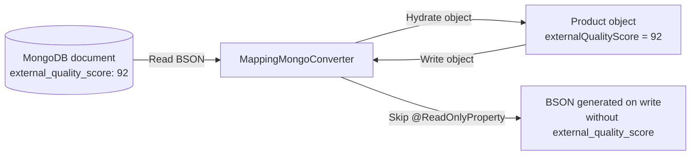

# Read-Only Properties with @ReadOnlyProperty

## 1. Context and Objectives

In **Spring Data MongoDB**, a Java object is normally mapped bidirectionally: reading BSON documents from MongoDB to instantiate objects and writing objects back to the database via `MongoTemplate` or repositories. However, there are fields that need to be **readable from MongoDB while omitted from the write payload generated by the Spring Data mapper**. `@ReadOnlyProperty` is used for that requirement.

This lesson belongs to the **Basic Mapping** section and continues using the **Mini Commerce** domain model with `Product`, `Customer`, and `Order`. Assume an external quality-inspection system populates a quality score on product documents. The commerce application needs to display this score, while deciding and updating the score belongs to the inspection system.

After this lesson, learners will be able to:

- Understand that `@ReadOnlyProperty` is a **Spring Data mapping** annotation, not a database access-control mechanism.
- Map a field already present in BSON into a Java property that is read-only from the persistence perspective.
- Distinguish `@ReadOnlyProperty` from `@Transient`, `@Field`, Java `final`, JSON annotations, and `@Version`.
- Use `MongoTemplate`/`MongoRepository` to verify that a field is **read** but not **written out** by `MappingMongoConverter`.
- Recognize the risk of **full-document replacement when calling `save()`**, and understand safer partial field updates when multiple systems share ownership of data.
- Know when to combine `@ReadOnlyProperty` with `@DocumentReference` and how to test it in practice.

**Prerequisites:** a Spring Boot application with `spring-boot-starter-data-mongodb`, a working MongoDB connection, and basic knowledge of `@Document`, `@Id`, BSON, repositories, and `MongoTemplate`. Java examples target the synchronous API; mapping principles also apply to the reactive branch.

## 2. What Does @ReadOnlyProperty Actually Do?

The annotation is imported from:

```java
import org.springframework.data.annotation.ReadOnlyProperty;
```

This annotation belongs to **Spring Data Commons** and can be placed on fields, methods, or meta-annotations according to its definition. In Spring Data MongoDB, a marked field remains part of the mapping model to **read values from the document**, but when the converter writes the object into a document, that field is **not written out**.



Key behaviors to know:

1. On **read**, if the corresponding BSON field exists and has a compatible type, the mapping framework populates the Java property.
2. On **insert** via `MongoTemplate.insert(entity)` or `repository.save(entity)` for a new entity, the converter does not emit the read-only field into BSON.
3. When **writing an object**, any value set on the object in memory does not override the rule: the field is still skipped during write mapping.
4. The annotation does not automatically compute, sync, or fetch a value from an external service. The document must contain the field, or an appropriate lookup/reference mechanism must be used.
5. The annotation does not protect the field from direct MongoDB commands, explicit `$set`, raw driver calls, scripts, or external systems.

The last point is crucial: `@ReadOnlyProperty` is an **object mapper rule**, not an immutability constraint enforced by MongoDB.

## 3. Comparison with Commonly Confused Mechanisms

| Mechanism | Read BSON into entity | Write entity into BSON | Purpose |
| --- | --- | --- | --- |
| Regular field | Yes | Yes | Normal read/write business data |
| `@ReadOnlyProperty` | Yes, when matching data exists | **No** via object mapping | Read fields managed by another source or derived relationships |
| Spring Data `@Transient` | **No** | **No** | Runtime-only values outside persistence mapping |
| `@Field("...")` | Yes, renames/types storage if configured | Yes, per other mapping rules | Maps BSON name/type; does not make it read-only |
| Java `final` or missing setter | Depends on constructor and materialization strategy | Still writable | Immutability at Java object/API level |
| Jackson `@JsonProperty(access = READ_ONLY)` | Does not control MongoDB mapping | Does not control MongoDB mapping | Controls HTTP API JSON |
| `@Version` | Yes | Yes; supports optimistic locking | Detects concurrent update conflicts across versions |

**Example:** `@Transient String displayLabel` can be computed from SKU and name for UI display. If you need to read an `external_quality_score` value already stored in MongoDB, `@ReadOnlyProperty` is a better fit. If you need to compute a score on every getter call, use a computed method or DTO; the read-only annotation **does not generate values on its own**.

## 4. End-to-End Example: Quality Score Managed by Another System

Suppose MongoDB holds a document in the `products` collection:

```json
{
  "_id": "prod-001",
  "sku": "LAP-001",
  "name": "Mini Mechanical Keyboard",
  "stock": 20,
  "external_quality_score": 92
}
```

- `sku`, `name`, and `stock` are managed by the commerce application.
- `external_quality_score` is updated by the quality-inspection service. The commerce application only displays it or uses it to filter data.
- The value `92` is sample data, not a score calculated by Spring Data.
- `_id` is chosen as string `"prod-001"` so the example does not deal with hexadecimal string conversion to BSON `ObjectId`.

### 4.1. Entity Declaration

```java
package com.example.minicommerce.domain;

import org.springframework.data.annotation.Id;
import org.springframework.data.annotation.ReadOnlyProperty;
import org.springframework.data.annotation.Transient;
import org.springframework.data.mongodb.core.mapping.Document;
import org.springframework.data.mongodb.core.mapping.Field;

@Document(collection = "products")
public class Product {

    @Id
    private String id;

    private String sku;
    private String name;
    private int stock;

    @ReadOnlyProperty
    @Field("external_quality_score")
    private Integer externalQualityScore;

    @Transient
    private String displayLabel;

    public Product() {}

    public Product(String id, String sku, String name, int stock) {
        this.id = id;
        this.sku = sku;
        this.name = name;
        this.stock = stock;
    }

    public String getId() { return id; }
    public void setId(String id) { this.id = id; }

    public String getSku() { return sku; }
    public void setSku(String sku) { this.sku = sku; }

    public String getName() { return name; }
    public void setName(String name) { this.name = name; }

    public int getStock() { return stock; }
    public void setStock(int stock) { this.stock = stock; }

    public Integer getExternalQualityScore() {
        return externalQualityScore;
    }

    public void setExternalQualityScore(Integer score) {
        this.externalQualityScore = score;
    }

    public String getDisplayLabel() {
        return displayLabel;
    }

    public void setDisplayLabel(String displayLabel) {
        this.displayLabel = displayLabel;
    }
}
```

The annotations serve distinct roles:

- `@Document(collection = "products")` chooses the collection.
- `@Id` maps `id` to the `_id` key.
- `@Field("external_quality_score")` maps Java name `externalQualityScore` to BSON key `external_quality_score`.
- `@ReadOnlyProperty` instructs Spring Data mapping to **omit the field when writing the object**.
- `@Transient` excludes `displayLabel` from both reading and writing by the mapper.

To make the behavior easy to observe, the example includes a setter for `externalQualityScore`. Having a setter **does not disable `@ReadOnlyProperty`**: the application can still change the value in memory, yet the converter will not emit that field into BSON when writing the object.

In a domain model designed to be immutable, you can omit setters and use an appropriate constructor/`@PersistenceCreator`. However, constructors, `final` fields, or getter-only access are matters of **Java object materialization**; they do not replace the mapping's read-only rule.

### 4.2. Simulating Two Writers

In the Mini Commerce application, let's separate responsibilities:

| Component | Fields Authorized by Business Rules |
| --- | --- |
| Commerce service | `sku`, `name`, `stock`, product status |
| Inspection service | `external_quality_score` |
| Catalog read API | Reads both product details and inspection score |

This is a **business agreement**. Turning that agreement into an actual technical boundary requires write-permission controls, update routing, and proper monitoring. Do not treat annotations as a security barrier.

## 5. Verifying with MappingMongoConverter Before Running Against a Database

The most direct way to understand the annotation is to inspect the document produced by the Spring Data converter. `MongoTemplate` exposes the converter via `getConverter()`.

### 5.1. Read Path: Present BSON Field Populates the Entity

```java
Document bson = new Document("_id", "prod-001")
    .append("sku", "LAP-001")
    .append("name", "Mini Mechanical Keyboard")
    .append("stock", 20)
    .append("external_quality_score", 92);

Product product = mongoTemplate.getConverter()
    .read(Product.class, bson);

System.out.println(product.getExternalQualityScore()); // 92
System.out.println(product.getSku());                  // LAP-001
```

In the snippet above, `Document` is `org.bson.Document`; `mongoTemplate` is an injected `org.springframework.data.mongodb.core.MongoTemplate` bean. Reading `92` proves the field is mapped onto the entity.

If the document **does not contain** `external_quality_score`, the `Integer` property typically receives `null`; handle absent data explicitly in services/DTOs.

### 5.2. Write Path: Converter Omits the Read-Only Field

```java
Product product = new Product(
    "prod-002", "MOU-001", "Wireless Mouse", 12);
product.setExternalQualityScore(99);
product.setDisplayLabel("Mouse - MOU-001");

Document bson = new Document();
mongoTemplate.getConverter().write(product, bson);

System.out.println(bson.toJson());
System.out.println(
    bson.containsKey("external_quality_score")); // false
System.out.println(
    bson.containsKey("displayLabel"));            // false
```

The converter still writes normal fields like `_id`, `sku`, `name`, `stock`, and may add mapping metadata such as `_class` depending on configuration. **Do not compare the entire JSON string byte-for-byte** because type mapper settings and field ordering can vary; check the relevant keys instead.

Difference between the two skipped fields:

- `externalQualityScore`: **readable** from BSON, **not writable** via object mapping.
- `displayLabel`: **neither readable nor writable** via object mapping.

## 6. Using Repositories and MongoTemplate in a Real Application

Repository declaration:

```java
package com.example.minicommerce.repository;

import java.util.Optional;
import org.springframework.data.mongodb.repository.MongoRepository;
import com.example.minicommerce.domain.Product;

public interface ProductRepository
        extends MongoRepository<Product, String> {
    Optional<Product> findBySku(String sku);
}
```

Suppose document `prod-001` already exists with the field written by the inspection service. When calling:

```java
Product product = repository.findById("prod-001")
    .orElseThrow();

Integer score = product.getExternalQualityScore();
// score == 92 if the document stores value 92.
```

`MongoRepository` also uses mapping metadata, so the read result includes the read-only property just like `MongoTemplate`. No manual MongoDB query is needed solely to retrieve this field.

### 6.1. Seeding Data Outside Spring Data Mapping

To simulate data written by another service, in a practice environment you can use `mongosh`:

```javascript
use mini_commerce

db.products.insertOne({
  _id: "prod-001",
  sku: "LAP-001",
  name: "Mini Mechanical Keyboard",
  stock: 20,
  external_quality_score: 92
})

db.products.findOne({ _id: "prod-001" })
```

Only run the insert command the first time in a test database; if `_id` already exists, MongoDB returns a duplicate key error. Or use `$set` per the inspection system's policy to add/update the score on an existing document.

Then call `repository.findById("prod-001")` or `mongoTemplate.findById("prod-001", Product.class)`. Both should read `externalQualityScore = 92`.

### 6.2. Conditionally Updating an Application-Owned Field

For example, updating the product name while **preserving the field managed by another system**:

```java
import org.springframework.data.mongodb.core.query.Criteria;
import org.springframework.data.mongodb.core.query.Query;
import org.springframework.data.mongodb.core.query.Update;

Query query = Query.query(
    Criteria.where("_id").is("prod-001"));

Update update = new Update()
    .set("name", "Mini Mechanical Keyboard V2");

mongoTemplate.updateFirst(query, update, Product.class);
```

The `$set` operation here only changes `name`. Other fields, including `external_quality_score`, are not overwritten by a new document. Read back raw BSON to confirm the score is still `92`:

```javascript
db.products.findOne(
  { _id: "prod-001" },
  { name: 1, external_quality_score: 1 }
)
```

Updating only a single field is safer in **change scope** than replacing the entire document. For stock updates, use `$inc` combined with a `stock >= quantity` filter to prevent overselling; the read-only annotation does not replace concurrency checks.

## 7. Important Warning: save() Can Replace the Entire Document

A dangerous misconception is: "Marking `@ReadOnlyProperty` guarantees that calling `repository.save(product)` will preserve the external field in MongoDB."

That is **not guaranteed**. Distinguish two things:

- **Mapping write:** the converter skips `external_quality_score` when building the replacement document.
- **MongoDB replace:** when saving an existing entity, `save` can replace the **entire document**. Any field absent from the replacement document can be **removed from the stored document**.

State illustration:

```text
Before save:
{ _id: "prod-001", name: "Mini Mechanical Keyboard",
  external_quality_score: 92 }

Mapping Product -> replacement BSON:
{ _id: "prod-001", name: "Mini Mechanical Keyboard V2" }
                      // No external_quality_score

After full-document replace:
{ _id: "prod-001", name: "Mini Mechanical Keyboard V2" }
                      // External score may have been deleted
```

Therefore, if multiple systems write different fields on the **same document**, do not rely on `@ReadOnlyProperty` as a field-preservation mechanism during `save`:

1. Prefer `$set`/`$inc` commands targeting only the fields owned by your service.
2. Design update API DTOs with an explicit list of editable fields; avoid arbitrarily binding every field from requests.
3. Consider storing data managed by another service in a separate collection and combining on read, especially when lifecycles and update frequencies differ.
4. If full-document replacement is unavoidable, explicitly define merge/concurrency handling; do not assume the mapper preserves omitted fields.
5. Write integration tests covering **reading a document with an external field and saving it back**; this is an essential test for catching data loss.

An isolated converter-level test only shows that the field is omitted from newly generated BSON; it is **not enough** to prove existing data in MongoDB survives `save`.

## 8. Is @ReadOnlyProperty an Absolute Write Control Mechanism?

**No.** The annotation applies to Spring Data MongoDB's object mapping pipeline. The following operations can take different write paths:

| Update Path | Does the annotation prevent all changes? | Notes |
| --- | --- | --- |
| `mongoTemplate.insert(product)` | Read-only field is not emitted by converter | This is the primary purpose |
| `repository.save(product)` | Converter omits the field, but replace can erase old field | Test before relying on it |
| `mongoTemplate.updateFirst(query, update, Product.class)` | Does **not** act as a security filter for every `Update` | Code can intentionally `$set` the field |
| `mongoTemplate.getCollection(...).updateOne(...)` | No | Calls MongoDB driver directly |
| `mongosh` or another service | No | Bypasses Java entity mapping |
| HTTP request body | No | JSON/binding rules need separate enforcement |

The following example **can still write** the field owned by another system because the developer explicitly specifies the update:

```java
mongoTemplate.updateFirst(
    Query.query(Criteria.where("_id").is("prod-001")),
    new Update().set("external_quality_score", 10),
    Product.class
);
```

This is an example of an **operation disallowed by Mini Commerce business rules**, not a recommended usage for the sales flow. To block unauthorized writes, enforce database permissions, separate service roles, validate DTOs, and review update queries. In particular, do not rely on omitting a Java setter as a security measure.

## 9. When to Use @Transient, Computed Getters, or Snapshots?

In Mini Commerce there are several kinds of "read-only data", and not all of them use `@ReadOnlyProperty`.

### 9.1. Fields Populated by the Database or Another Service

For example, `external_quality_score` is already in BSON as written by the inspection system. Use:

```java
@ReadOnlyProperty
@Field("external_quality_score")
private Integer externalQualityScore;
```

This is a good candidate for read-only mapping, paired with the safe update strategy from section 7.

### 9.2. Fields Computed in the Application, Absent from BSON

For example, a display label derived from SKU and name:

```java
public String getComputedDisplayLabel() {
    return sku + " - " + name;
}
```

`@ReadOnlyProperty` is not needed to make Spring Data "auto-compute" the label; the getter itself performs the calculation. If a field is needed to cache a temporary value on the object outside persistence, use Spring Data's `@Transient`. This value will not automatically appear when reading from MongoDB unless populated by the application.

### 9.3. Prices and Product Names Captured on Order Lines

`OrderLine.productName` and `OrderLine.unitPrice` must be **written into the order** when the customer checks out. Those fields remain immutable by business rules once the order is placed, yet they **must be persisted** so order history does not change if `Product` changes price. Do not mark them `@ReadOnlyProperty` just because "placed orders cannot be edited"; preventing later edits belongs to the business/API layer and update flow design.

### 9.4. Version Control Fields

`@Version` supports optimistic locking when concurrent requests update a document. `@ReadOnlyProperty` performs no version checks and does not detect concurrent modifications. For `Product.stock`, use conditional atomic updates or an appropriate concurrency mechanism.

## 10. Advanced Pattern: Reverse Relationships with @DocumentReference

In MongoDB, an `Order` typically stores `customerId` to reference a `Customer`, while the `Customer` document **does not need to store the full list of order IDs**. Sometimes when reading a customer, we want to view related orders without storing a link array inside the customer document.

Spring Data MongoDB supports a **reverse lookup** pattern combining `@ReadOnlyProperty` with `@DocumentReference`. Example:

```java
import java.util.List;

import org.springframework.data.annotation.Id;
import org.springframework.data.annotation.ReadOnlyProperty;
import org.springframework.data.mongodb.core.mapping.Document;
import org.springframework.data.mongodb.core.mapping.DocumentReference;

@Document(collection = "customers")
public class Customer {
    @Id
    private String id;

    private String fullName;

    @ReadOnlyProperty
    @DocumentReference(
        lookup = "{ 'customerId' : ?#{#self._id} }"
    )
    private List<Order> orders;

    // Constructors/getters/setters suitable for persistence mapping.
}

@Document(collection = "orders")
public class Order {
    @Id
    private String id;

    private String customerId;
    private String status;

    // Constructors/getters/setters...
}
```

Suppose MongoDB stores:

```json
{
  "_id": "customer-001",
  "fullName": "Nguyen Thi Lan"
}
```

And another document:

```json
{
  "_id": "order-001",
  "customerId": "customer-001",
  "status": "PLACED"
}
```

Here:

- `Order.customerId` is the link stored on the **order**.
- `Customer.orders` is a derived relationship queried dynamically, without storing an array of IDs on the **customer**.
- `#self._id` references the ID of the `Customer` document being read.
- `@ReadOnlyProperty` prevents writing the reverse reference array into the customer document through the object mapper.
- When reading the reference, Spring Data must query the `orders` collection to resolve the relationship; there is no automatic cascade save to orders.

**Performance warning:** if a customer has thousands of orders, automatically materializing `List<Order>` can load excessive data, add round-trips, or trigger N+1 queries when listing customers. For paginated order history APIs, it is **usually better** to use `OrderRepository.findByCustomerIdOrderByPlacedAtDesc(...)` with an index `{ customerId: 1, placedAt: -1 }` and a page-size limit. This reverse lookup pattern is only appropriate when relationship cardinality and read frequency are controlled.

The `@DocumentReference` pattern is a specific feature of Spring Data MongoDB; check your version if an older project does not yet support this annotation/lookup. Do not confuse `@DocumentReference` with `@DBRef`.

## 11. Testing Behavior with a Real MongoDB

There should be two layers of tests: **mapping converter** and **real MongoDB interaction**. Real MongoDB testing can use Testcontainers to avoid dependencies on developer environments.

### 11.1. Testing Pure Mapping Through the Converter

In a test with an available `MongoTemplate` bean (for example, an integration test bootstrapped by Spring Boot):

```java
import static org.junit.jupiter.api.Assertions.*;

import org.bson.Document;
import org.junit.jupiter.api.Test;
import org.springframework.beans.factory.annotation.Autowired;
import org.springframework.boot.test.context.SpringBootTest;
import org.springframework.data.mongodb.core.MongoTemplate;

@SpringBootTest
class ProductReadOnlyMappingTest {
    @Autowired
    MongoTemplate template;

    @Test
    void readsFieldButDoesNotWriteIt() {
        Document stored = new Document("_id", "prod-001")
            .append("sku", "LAP-001")
            .append("name", "Mini Mechanical Keyboard")
            .append("stock", 20)
            .append("external_quality_score", 92);

        Product loaded = template.getConverter()
            .read(Product.class, stored);
        assertEquals(92, loaded.getExternalQualityScore());

        loaded.setExternalQualityScore(13);

        Document writeResult = new Document();
        template.getConverter().write(loaded, writeResult);

        assertFalse(writeResult.containsKey("external_quality_score"));
        assertEquals("LAP-001", writeResult.getString("sku"));
    }
}
```

The snippet above requires importing `Product` from the right application package. Because it only invokes the converter, it does not require MongoDB to actually contain document `prod-001`; however, `@SpringBootTest` setup may still require a valid Spring context configuration.

### 11.2. Testing Single-Field Updates Without Losing External Data

When running integration tests with a real MongoDB:

```java
@Test
void partialUpdatePreservesExternalScore() {
    String id = "prod-partial-update-test";
    MongoCollection<Document> raw = template.getCollection("products");

    // Clean up fixture from a previous run if present.
    raw.deleteOne(new Document("_id", id));

    try {
        raw.insertOne(new Document("_id", id)
            .append("sku", "KEY-TEST")
            .append("name", "Old Name")
            .append("stock", 5)
            .append("external_quality_score", 92));

        Product readBack = template.findById(id, Product.class);
        assertNotNull(readBack);
        assertEquals(92, readBack.getExternalQualityScore());

        template.updateFirst(
            Query.query(Criteria.where("_id").is(id)),
            new Update().set("name", "New Name"),
            Product.class
        );

        Document after = raw.find(new Document("_id", id)).first();
        assertNotNull(after);
        assertEquals(92, after.getInteger("external_quality_score"));
        assertEquals("New Name", after.getString("name"));
    } finally {
        raw.deleteOne(new Document("_id", id));
    }
}
```

This is a test method placed inside the test class with `@Autowired MongoTemplate template` above. Import `com.mongodb.client.MongoCollection`, `org.springframework.data.mongodb.core.query.Query`, `Criteria`, and `Update`. Fixture cleanup is strictly for a **dedicated test database**, never production.

Write an additional comparison test calling `repository.save(readBack)` on an isolated test collection to demonstrate document-replacement risk: check the exact value of `external_quality_score` after saving, and choose an update strategy accordingly. Do not extrapolate field preservation on replace from converter-level tests.

### 11.3. Minimum Test Matrix

| Case | Observed Outcome |
| --- | --- |
| BSON contains `external_quality_score` | `Product.externalQualityScore` receives the right value |
| BSON lacks that field | Object reads successfully; code handles `null` properly |
| Converter writes entity with non-null score | Generated BSON **does not contain** `external_quality_score` |
| Converter writes entity with `displayLabel` | BSON does not contain `displayLabel` |
| Raw insert from external source read by repository | Repository still returns the score |
| `MongoTemplate.updateFirst` with `$set name` only | Raw score on the document remains intact |
| `repository.save` on a loaded entity | Verify replace consequence; do not assume score is preserved |
| Filter query by inspection score | Verify right BSON name mapping and proper index |
| Reverse lookup on customer (if used) | Orders are fetched by `customerId`; no orders array in customer document |

## 12. Queries and Performance with Read-Only Fields

`@ReadOnlyProperty` **does not mean you cannot search by that field**. If BSON stores `external_quality_score` and the entity has `@Field("external_quality_score")`, the application can filter for products with high quality scores.

```java
Query query = Query.query(
    Criteria.where("externalQualityScore").gte(80));

List<Product> result = mongoTemplate.find(query, Product.class);
```

For queries bound to an entity class, Spring Data mapping translates the Java property name `externalQualityScore` into the BSON key `external_quality_score`. For `mongosh` or raw driver queries, use the exact BSON name:

```javascript
db.products.find({ external_quality_score: { $gte: 80 } })
```

If filtering/sorting by score frequently, evaluate an index to support the query:

```javascript
db.products.createIndex({ external_quality_score: -1 })
db.products
  .find({ external_quality_score: { $gte: 80 } })
  .explain("executionStats")
```

Indexes depend on **actual workload**, not on the read-only annotation. Monitor `totalDocsExamined`, `totalKeysExamined`, and `nReturned`; avoid adding indexes just because a field is queryable. If the score is updated frequently by an external source, the index also carries write overhead.

Aggregations, repository derived queries, and reactive queries still operate on the **stored BSON data**. The annotation only affects write mapping for that field; it does not create indexes or change aggregation results.

## 13. How Do Reactive Access and Transactions Relate?

If the project uses `spring-boot-starter-data-mongodb-reactive`, the mapping semantics of `@ReadOnlyProperty` remain the same. The difference is that data-access APIs return `Mono`/`Flux` and use `ReactiveMongoTemplate`/`ReactiveMongoRepository`.

Example interface:

```java
public interface ReactiveProductRepository
        extends ReactiveMongoRepository<Product, String> {
    Mono<Product> findBySku(String sku);
}
```

Import `ReactiveMongoRepository` from Spring Data MongoDB and `Mono` from Reactor. When the subscriber receives the entity, `externalQualityScore` is already mapped if BSON has a value; no blocking is needed to read the score. Avoid calling `block()` inside a reactive request pipeline.

Transactions also do not turn `@ReadOnlyProperty` into an immutable write constraint. When a transaction simultaneously updates `Product.stock` and inserts an `Order`, choose appropriate conditional updates and transaction managers; multi-document transactions in MongoDB require a supporting topology. Raw writes or `Update.set(...)` calls inside a transaction must still follow field-ownership policies.

## 14. Common Errors

| Symptom | Common Cause | Resolution |
| --- | --- | --- |
| Annotation is not recognized | Wrong import or missing Spring Data | Use `org.springframework.data.annotation.ReadOnlyProperty` |
| Reading score returns `null` | BSON lacks the field, key name differs, or projection excluded it | Inspect raw BSON, `@Field`, projections, and query |
| Score appears in JSON API despite being marked read-only | Annotation affects persistence, not JSON serialization | Use DTOs/Jackson annotations separately for the API |
| Clients can still edit score via requests | Lack of input filtering/authorization | Accept only editable fields, authorize, and validate |
| Score disappears after `repository.save` | Save replaces entire document; converter omits read-only field | Use partial updates or redesign data ownership |
| Assuming Spring computes the score automatically | Read-only is not a computed expression | Compute in service/aggregation or use an actually stored value |
| Field disappears on reads as well | Used `@Transient` instead of `@ReadOnlyProperty` | Pick annotation matching desired read/write behavior |
| Mapper fails to instantiate immutable entity | Incompatible constructor/property access | Adjust constructor, `@PersistenceCreator`, or withers if needed |
| Reverse lookup is slow when listing customers | Materializing many `orders`, missing index/N+1 | Use paginated repository with an index on `customerId` |
| Data updated without permission despite annotation | Raw MongoDB/`$set` commands are not blocked by annotations | Enforce database permissions and service controls |

## 15. Applied Exercises and Completion Criteria

**Exercise 1 — Reading an externally owned field.** Create `products` with `external_quality_score` using `mongosh`. Declare `Product.externalQualityScore` with `@ReadOnlyProperty` and `@Field`. Read via repository, verify the value, and handle the null case.

**Exercise 2 — Comparing mappings.** Add `@Transient String displayLabel`, construct an object with both properties, call `mongoTemplate.getConverter().write(...)`, and verify neither key appears. Read a BSON document containing the score to show the difference between read-only and transient.

**Exercise 3 — Update safety.** Update `Product.name` using `$set`, verifying the externally written score does not change. Then on isolated test data, try `repository.save(...)` and observe how the field can be lost during replacement. Propose update rules so both systems operate safely together.

**Extension Exercise — Reverse relationship.** Let `orders.customerId` reference `customers._id`. Build `Customer.orders` using `@ReadOnlyProperty` and `@DocumentReference(lookup = "...")`, then compare it against querying order history via a paginated repository. Evaluate query counts, result sizes, and required indexes.

Learners finish when they can confidently answer five questions:

1. How does `@ReadOnlyProperty` affect **reads** and **writes** in `MappingMongoConverter`?
2. Why does `@Transient` not replace `@ReadOnlyProperty` when BSON already holds a field that needs to be read?
3. Why can `repository.save(entity)` lose the existing value of a read-only field?
4. Is `MongoTemplate.updateFirst(..., new Update().set(...))` restricted by access-control rules from the annotation?
5. When should a reverse lookup be placed on an entity with `@DocumentReference`, and when should a paginated repository be used instead?

**Expected outcome:** a clear grasp of `@ReadOnlyProperty` as a tool for **mapped reads and skipped writes on object mapping**, awareness of full-document replacement limits, and the ability to implement and test safe data-update strategies in Mini Commerce. This foundation leads to more accurate entity design, queries, indexes, transactions, reactive access, and testing in Spring Data MongoDB.

## References

- [Spring Data Commons — `@ReadOnlyProperty` API](https://docs.spring.io/spring-data/commons/docs/current/api/org/springframework/data/annotation/ReadOnlyProperty.html) — annotation definition and mapping scope.
- [Spring Data MongoDB — Object Mapping](https://docs.spring.io/spring-data/mongodb/reference/mongodb/mapping/mapping.html) — entity mapping, constructors, `@Field`, and `@Transient`.
- [Spring Data MongoDB — Document References](https://docs.spring.io/spring-data/mongodb/reference/mongodb/mapping/document-references.html) — `@ReadOnlyProperty` combined with `@DocumentReference` for reverse lookups.
- [Spring Data MongoDB — Saving, Updating, and Removing Documents](https://docs.spring.io/spring-data/mongodb/reference/mongodb/template-crud-operations.html) — the difference between partial field updates and document replacement.
