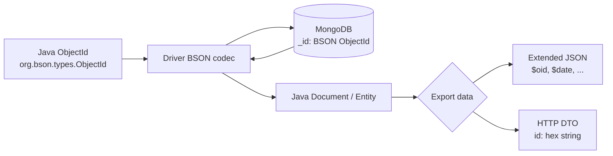

# ObjectId in Java and Extended JSON Representation

In applications using **Spring Data MongoDB**, the `_id` field uniquely identifies a document in a collection. You can represent this value using `org.bson.types.ObjectId` in Java, store it as a **BSON ObjectId** in MongoDB, and serialize it as **Extended JSON** when exchanging or inspecting data. These three representations are related but not identical: a 24-character string that looks like an ObjectId is not necessarily stored as a BSON ObjectId.

This lesson belongs to the **Identity and State** chapter and clarifies ObjectId structure, ID lifecycle when writing/reading via repositories or `MongoTemplate`, `@Id`/`@MongoId` mapping mechanics, the two Extended JSON modes, and how to test and troubleshoot common errors in Java systems.

## 1. Distinguishing Identity, BSON Type, and Display Format

Suppose there are two documents:

```javascript
// Document A: the _id field has type BSON ObjectId.
{
  _id: ObjectId("674000000000000000000123"),
  customer_id: "KH-101",
  status: "NEW"
}

// Document B: the _id field has type BSON String.
{
  _id: "674000000000000000000123",
  customer_id: "KH-102",
  status: "NEW"
}
```

Although the characters inside look the same, **A and B have two `_id` keys of different types**. MongoDB compares values by BSON type; a query `{_id: ObjectId("...")}` is not equivalent to `{_id: "..."}`. This is especially critical when migrating data from legacy systems, writing `$lookup` queries, handling HTTP input, or using Java `String` as the ID.

| Concept | Example | Role |
| --- | --- | --- |
| Java ObjectId | `new ObjectId("674000000000000000000123")` | Java object provided by the MongoDB BSON library |
| BSON ObjectId | 12 bytes, BSON ObjectId type | Value encoded by the driver for storage/transmission to MongoDB |
| Hex string | `"674000000000000000000123"` | 24-character text representation of the 12 bytes |
| MongoDB Shell | `ObjectId("674000000000000000000123")` | JavaScript syntax in mongosh |
| Extended JSON | `{"$oid":"674000000000000000000123"}` | Standardized JSON representation for a BSON ObjectId value |
| Standard JSON | `"674000000000000000000123"` | A plain string; carries no BSON ObjectId type information |

**Identity is not state:** `_id` primarily answers "which document?", whereas fields like `status`, `version`, and `createdAt` describe business state and data lifecycle. Certain bytes in ObjectId hold ID creation time information, but they do not replace business timestamp fields.

## 2. The 12-Byte Structure of an ObjectId

A MongoDB ObjectId is typically generated by the driver. The value is **12 bytes** in size and displayed as **24 hexadecimal characters** (each byte corresponds to two hex characters).

```text
ObjectId: 67400000 123456789a 00abcd
          └── 4B ──┘└── 5B ───┘└─3B─┘
           timestamp  random   counter
           (seconds)  value
```

| Component | Size | Description |
| --- | ---: | --- |
| Timestamp | 4 bytes | Seconds since the Unix epoch, encoded inside the ObjectId |
| Random value | 5 bytes | Random value generated once per ID-generation process in typical ObjectId generation |
| Counter | 3 bytes | Incrementing counter starting from a random value |
| **Total** | **12 bytes** | Can be represented by a 24-character hex string |

This is the common layout of a modern ObjectId; the middle 5 bytes should not be interpreted as a machine address, PID, or an auditable identifier. ObjectId is designed for very low collision probability when multiple processes generate keys concurrently, but it is **not a security mechanism or a guarantee of strict global ordering**.

ObjectId offers useful properties:

- Typically generated on the application/driver side before insert, making the ID known before the document write completes.
- Contains a **one-second** resolution timestamp, helpful for estimating roughly when the ID was created.
- When comparing ObjectIds generated under normal conditions, the leading timestamp component usually provides an approximate chronological order.
- MongoDB automatically creates a **unique index on `_id`** for standard collections, ensuring no two documents share the same `_id` value in that collection.

However, ObjectId is unsuitable as a password, access token, secret code, or sole basis for authorization. Nor should the timestamp inside ObjectId be used as the server write-commit time, because clocks on ID-generating sources can differ and IDs may be pre-generated or re-imported from another system.

## 3. Working With `org.bson.types.ObjectId` in Java

The MongoDB Java Driver provides `ObjectId` in the `org.bson.types` package.

### 3.1. Creating, Reading Hex Strings, and Timestamps

```java
import java.time.Instant;
import org.bson.types.ObjectId;

public class ObjectIdDemo {
    public static void main(String[] args) {
        ObjectId generated = new ObjectId();

        String hex = generated.toHexString();
        ObjectId parsed = new ObjectId(hex);

        boolean same = generated.equals(parsed);  // true
        int epochSeconds = generated.getTimestamp();
        Instant approximateCreationTime =
                generated.getDate().toInstant();

        System.out.println(hex);
        System.out.println("Equal IDs? " + same);
        System.out.println("Timestamp (seconds): " + epochSeconds);
        System.out.println("Approximate time: " + approximateCreationTime);
    }
}
```

`new ObjectId()` generates a new value. `new ObjectId(hex)` reconstructs the same ID from a valid hex string. `toHexString()` returns the canonical lowercase representation, suitable for passing over APIs or writing into URIs. `getDate()` is computed from the timestamp embedded inside the ObjectId, **not the time MongoDB acknowledged the write**.

To avoid confusion when displaying times, Java `Instant` represents a UTC instant; the UI can format it into the display time zone. If the business requires millisecond precision or tracking actual operations, store `createdAt`/`updatedAt` separately.

### 3.2. Validating Input Strings

```java
import org.bson.types.ObjectId;

public final class ObjectIds {
    private ObjectIds() {}

    public static ObjectId parseRequired(String rawId) {
        if (rawId == null || !ObjectId.isValid(rawId)) {
            throw new IllegalArgumentException(
                    "ID must be a 24-character ObjectId hex string");
        }
        return new ObjectId(rawId);
    }
}
```

`ObjectId.isValid(String)` verifies the 24-character hex string format before constructing the object; strings that are too short, contain non-hex characters, or are `null` are not valid ObjectIds. In web APIs, an `IllegalArgumentException` from malformed input can be mapped to **HTTP 400 Bad Request**; a well-formed ID whose document is not found typically maps to **HTTP 404 Not Found**. Distinguishing these two cases makes the API clearer and easier to diagnose.

**Valid format does not prove a document exists**, nor does it prove the caller is authorized to access that document. After parsing, the service must still check authorization and business rules.

## 4. Mapping `@Id ObjectId` in Spring Data MongoDB

A clear choice is to use `ObjectId` as the ID type on the Java entity.

```java
import java.time.Instant;
import org.bson.types.ObjectId;
import org.springframework.data.annotation.Id;
import org.springframework.data.mongodb.core.mapping.Document;
import org.springframework.data.mongodb.core.mapping.Field;

@Document(collection = "orders")
public class Order {
    @Id
    private ObjectId id;

    @Field("customer_id")
    private String customerId;

    private String status;
    private Instant createdAt;

    public Order() {}

    public Order(String customerId, String status, Instant createdAt) {
        this.customerId = customerId;
        this.status = status;
        this.createdAt = createdAt;
    }

    public ObjectId getId() { return id; }
    public String getCustomerId() { return customerId; }
    public String getStatus() { return status; }
    public Instant getCreatedAt() { return createdAt; }
}
```

`@Id` indicates that the Java `id` property corresponds to the BSON `_id` field; the `customerId` field is renamed to `customer_id` via `@Field`. `Instant` is converted to a BSON date/time value according to the configured conversion mechanism. The constructors/getters in this example suffice to illustrate the model; you can use immutable constructors, records, or callbacks depending on your architecture.

The corresponding repository must use the same **ID type**:

```java
import org.bson.types.ObjectId;
import org.springframework.data.mongodb.repository.MongoRepository;

public interface OrderRepository
        extends MongoRepository<Order, ObjectId> {
}
```

Creating and finding by ID:

```java
import java.time.Instant;
import java.util.Optional;
import org.bson.types.ObjectId;

Order draft = new Order("KH-101", "NEW", Instant.now());
Order saved = orderRepository.save(draft);

ObjectId id = saved.getId();
String idForHttp = id.toHexString();

Optional<Order> loaded =
        orderRepository.findById(new ObjectId(idForHttp));
```

When inserting a new document without an ID, Spring Data/the driver can generate an ObjectId and assign it back to the entity during the save. The `saved.getId()` value ties the newly written document to the request or API resource. For a `save` call on an entity that already has an ID, Spring Data decides the write path based on entity state; do not assume every `save` call is an insert.

### 4.1. Using `MongoTemplate` With IDs

```java
import org.bson.types.ObjectId;
import org.springframework.data.mongodb.core.MongoTemplate;
import org.springframework.data.mongodb.core.query.Criteria;
import org.springframework.data.mongodb.core.query.Query;

ObjectId id = ObjectIds.parseRequired(idFromRequest);

Order byId = mongoTemplate.findById(id, Order.class);

Query query = Query.query(Criteria.where("id").is(id));
Order viaQuery = mongoTemplate.findOne(query, Order.class);
```

Both approaches work with `Order` having `@Id ObjectId`. When using `Criteria.where("id")` in the context of `Order.class`, Spring Data maps the `id` property to the stored `_id` field; when querying directly through mongosh or the native driver, use the actual name `_id`.

```javascript
db.orders.findOne({
  _id: ObjectId("674000000000000000000123")
});
```

For an ID stored as BSON ObjectId, the following query is not equivalent:

```javascript
// This is a BSON String, not an ObjectId.
db.orders.findOne({
  _id: "674000000000000000000123"
});
```

If `findById` returns empty even though the document exists, check the **database/collection**, the BSON type of `_id`, the supplied value, and the entity's mapping rules before concluding MongoDB is broken.

## 5. When Java Uses `String id`: Difference Between `@Id` and `@MongoId`

Because HTTP path parameters and JSON APIs typically use strings, some applications declare `String id` on entities. Spring Data MongoDB has ID conversion rules that must be clearly understood.

```java
import org.springframework.data.annotation.Id;
import org.springframework.data.mongodb.core.mapping.Document;

@Document("string_id_examples")
class OrderWithStringId {
    @Id
    private String id;
}
```

Under default mapping rules, `@Id String` is converted to a BSON ObjectId **if the string value can be converted into an ObjectId**; values that cannot be converted may be stored as BSON String. Thus, the same Java `String id` entity can cause a collection to hold **multiple BSON types for `_id`** if the application generates inconsistent IDs.

Spring Data also provides `@MongoId` to declare more explicitly how the ID field's data type should be handled:

```java
import org.springframework.data.mongodb.core.mapping.Document;
import org.springframework.data.mongodb.core.mapping.FieldType;
import org.springframework.data.mongodb.core.mapping.MongoId;

@Document("external_orders")
class ExternalOrder {
    @MongoId(FieldType.STRING)
    private String id;
}

@Document("object_id_orders")
class OrderWithExplicitObjectId {
    @MongoId(FieldType.OBJECT_ID)
    private String id;
}
```

| Declaration | Interpretation and Choice |
| --- | --- |
| `@Id ObjectId id` | Both Java and BSON use ObjectId; type is explicit, repository accepts `ObjectId` |
| `@Id String id` | Lets the application use strings, but applies a rule converting valid hex strings to BSON ObjectId |
| `@MongoId String id` | Defaults to preserving the declared type, avoiding `@Id`'s string-to-ObjectId conversion |
| `@MongoId(FieldType.STRING) String id` | Expresses clear intent to store the ID as a BSON String |
| `@MongoId(FieldType.OBJECT_ID) String id` | Requests conversion to BSON ObjectId when valid; verify handling of non-convertible values per configuration/version |

Do not change identifier annotations arbitrarily on live data. Changing `@Id String` to `@MongoId(FieldType.STRING)` can cause post-deployment queries to use **BSON String** to search for documents whose `_id` was previously stored as **BSON ObjectId**, resulting in missing records.

**Practical recommendation:** pick one ID strategy per collection, document the expected BSON type, standardize ID generation and parsing at the API boundary, and test round-trips against a real MongoDB instance.

## 6. BSON, Standard JSON, and MongoDB Extended JSON

BSON supports data types that standard JSON cannot fully express, such as `ObjectId`, `Date`, `Int32`, `Int64`, `Decimal128`, binary, and MongoDB timestamps. When exporting to JSON text, conventions are needed to **preserve types**.

**MongoDB Extended JSON version 2 (EJSON v2)** defines how to represent BSON types using JSON objects with keys starting with `$`, for example:

```json
{
  "_id": {
    "$oid": "674000000000000000000123"
  },
  "customer_id": "KH-101",
  "status": "NEW"
}
```

Here `{"$oid":"..."}` is how a **BSON ObjectId value is represented in Extended JSON**. The `$oid` key does not mean MongoDB stores a subdocument containing a field named `$oid` inside `_id`. When parsed properly as EJSON, the value of `_id` is a BSON ObjectId.

### 6.1. Relaxed Extended JSON vs. Canonical Extended JSON

Two EJSON v2 modes are commonly used:

- **Relaxed:** favors human readability and broader compatibility; some numeric types are represented as plain JSON numbers when appropriate.
- **Canonical:** explicitly expresses BSON types, convenient when round-trip type fidelity is required, such as distinguishing Int32 from Int64.

| BSON Type | Relaxed EJSON v2 (example) | Canonical EJSON v2 (example) |
| --- | --- | --- |
| ObjectId | `{"$oid":"674000000000000000000123"}` | Same as Relaxed |
| Int32 (42) | `42` | `{"$numberInt":"42"}` |
| Int64 (42) | `42` | `{"$numberLong":"42"}` |
| Double (3.5) | `3.5` | `{"$numberDouble":"3.5"}` |
| Decimal128 (19.90) | `{"$numberDecimal":"19.90"}` | Same as Relaxed |
| BSON Date at `2024-01-01T00:00:00Z` | `{"$date":"2024-01-01T00:00:00Z"}` | `{"$date":{"$numberLong":"1704067200000"}}` |

A document with multiple data types, expressed in Canonical EJSON:

```json
{
  "_id": {"$oid": "674000000000000000000123"},
  "quantity": {"$numberInt": "2"},
  "totalVnd": {"$numberLong": "1250000"},
  "createdAt": {
    "$date": {"$numberLong": "1704067200000"}
  },
  "status": "PAID"
}
```

In Relaxed EJSON, several numeric types lose distinguishing markers when emitted as JSON numbers. When JavaScript or an intermediary system processes integers larger than JavaScript's safe integer limit (`2^53 - 1`), round-tripping can lose precision. For data exchange requiring exact type preservation, choose Canonical EJSON or an API contract that serializes large values as strings.

### 6.2. mongosh Syntax Is Not Extended JSON Text

In MongoDB Shell, examples such as:

```javascript
ObjectId("674000000000000000000123")
ISODate("2024-01-01T00:00:00Z")
NumberLong("1250000")
```

are expressions/display forms inside **mongosh**, not valid standard JSON text. Do not feed `ObjectId("...")` into a JSON parser expecting it to understand BSON types. Conversely, a plain JSON string `"674..."` does not automatically restore an ObjectId type without explicit conversion logic.

## 7. Converting BSON Documents to Extended JSON in Java

To produce Extended JSON, use the BSON library's encoding facilities instead of manually concatenating `$oid` and numeric/date fields. The following example uses `org.bson.Document`, `JsonWriterSettings`, and `JsonMode`:

```java
import java.time.Instant;
import java.util.Date;
import org.bson.Document;
import org.bson.json.JsonMode;
import org.bson.json.JsonWriterSettings;
import org.bson.types.ObjectId;

public class ExtendedJsonDemo {
    public static void main(String[] args) {
        ObjectId id = new ObjectId("674000000000000000000123");

        Document document = new Document("_id", id)
            .append("quantity", 2)
            .append("totalVnd", 1_250_000L)
            .append("createdAt",
                Date.from(Instant.parse("2024-01-01T00:00:00Z")));

        JsonWriterSettings relaxed = JsonWriterSettings.builder()
            .outputMode(JsonMode.RELAXED)
            .build();

        JsonWriterSettings canonical = JsonWriterSettings.builder()
            .outputMode(JsonMode.EXTENDED)
            .build();

        String relaxedJson = document.toJson(relaxed);
        String canonicalJson = document.toJson(canonical);

        Document restored = Document.parse(canonicalJson);
        ObjectId restoredId = restored.getObjectId("_id");

        System.out.println(relaxedJson);
        System.out.println(canonicalJson);
        System.out.println(id.equals(restoredId)); // true
    }
}
```

In the Java Driver, `JsonMode.EXTENDED` is the **Canonical Extended JSON** encoding mode. `Document.parse(...)` understands valid EJSON wrappers and reconstructs the corresponding BSON values, such as `getObjectId("_id")` for the restored ID. With data from untrusted sources, still validate structure, size, and schema before using it in queries or writes.

`Document.toJson()` uses a JSON format supported by the BSON library; when you need to guarantee a specific mode, pass `JsonWriterSettings` explicitly. Do not assume other HTTP/JSON frameworks will also use EJSON: Jackson, JSON-B serializers, or an API gateway may produce different representations.



The diagram separates two distinct goals: **EJSON** targets typed BSON representation, whereas **HTTP DTOs** target a simple, stable JSON contract for application clients.

## 8. API Design: When to Return Hex Strings vs. Extended JSON

For typical REST APIs, a DTO with a string ID is usually easier to consume:

```java
public record OrderResponse(
    String id,
    String status,
    String customerId
) {
    public static OrderResponse from(Order order) {
        return new OrderResponse(
            order.getId().toHexString(),
            order.getStatus(),
            order.getCustomerId()
        );
    }
}
```

JSON sent to the frontend:

```json
{
  "id": "674000000000000000000123",
  "status": "NEW",
  "customerId": "KH-101"
}
```

This is an application contract: the frontend sees a **string ID** while the backend still stores a BSON ObjectId. For this kind of API, the server is responsible for parsing the ID on input and handling errors clearly:

```java
public OrderResponse loadOrder(String pathId) {
    ObjectId id = ObjectIds.parseRequired(pathId);

    Order order = orderRepository.findById(id)
        .orElseThrow(() ->
            new OrderNotFoundException("Order not found"));

    return OrderResponse.from(order);
}
```

`OrderNotFoundException` is an illustrative business error that should be defined and mapped to the appropriate HTTP status. For APIs that do not need to preserve full BSON types, there is no need to expose `$oid` externally. Conversely, when building **MongoDB data export/import tools**, technical audit logs, or protocols that specify EJSON, the `$oid` wrapper is very useful.

### Note on Using Jackson

Do not assume that simply returning an entity containing `ObjectId id` from Spring MVC/WebFlux will always serialize JSON as `{"$oid":"..."}` or always as a hex string. The result depends on the serializer and configuration. Use DTOs or intentional serialization configuration, and write HTTP contract tests to verify the exact JSON shape clients receive.

## 9. Queries, Indexes, Aggregations, and References Involving ObjectId

### 9.1. The `_id` Index

In standard MongoDB collections, the unique `_id` index is maintained by MongoDB. Exact lookups by `_id` are typically efficient when the correct type and value are supplied. However, do not assume queries on `customer_id`, `status`, or linked collections are fast just because the collection has an `_id` index: those fields require index design tailored to their own queries.

```javascript
db.orders
  .find({_id: ObjectId("674000000000000000000123")})
  .explain("executionStats");
```

Inspect `winningPlan`, `nReturned`, `totalKeysExamined`, and `totalDocsExamined` to observe actual execution. An `_id` query with the wrong type can return empty even though the index is functioning properly.

### 9.2. `$lookup` Requires Matching Both Value and BSON Type

For example, an `order_items` collection stores `order_id` pointing to `orders._id`:

```javascript
// orders:
{ _id: ObjectId("674000000000000000000123"), status: "NEW" }

// order_items:
{
  _id: ObjectId("674000000000000000000456"),
  order_id: ObjectId("674000000000000000000123"),
  sku: "SKU-01"
}
```

If `order_items.order_id` is stored as `"674000..."` (BSON String), a `$lookup` matching `order_id` against `_id` will fail to match the ObjectId in the parent collection. Maintain a consistent ID type across linked collections or execute an explicit migration.

In Java, `ObjectId` can also be used as the type for reference fields:

```java
@Document("order_items")
class OrderItem {
    @Id
    private ObjectId id;

    @Field("order_id")
    private ObjectId orderId;

    private String sku;
}
```

With `orderId` above, the data is stored as a BSON ObjectId; MongoDB does not create foreign keys or guarantee `orderId` points to an existing document. Integrity rules and parent deletion handling are the responsibility of application design or corresponding transaction workflows.

### 9.3. Time-Based Sorting and Filtering With ObjectId

Because the first 4 bytes contain a second-precision timestamp, an ObjectId `_id` can provide **approximate chronological ordering**. For instance, `sort({_id: -1})` is often useful when IDs are generated under normal sequencing and only an approximate order is needed.

However, within the same second, across different processes/machines, or when IDs are pre-generated and imported later, ObjectId order **does not strictly correspond** to write time or business event time. If pagination requires exact "order creation time", store `createdAt` separately, create an appropriate index, and use `_id` as a stable tie-breaker:

```javascript
db.orders.createIndex({ createdAt: -1, _id: -1 });

db.orders.find({status: "PAID"})
  .sort({createdAt: -1, _id: -1})
  .limit(20);
```

The index example above supports sorting by `createdAt` and `_id`, while the query also filters on `status`; run `explain` on realistic data and consider a compound index including `status` if this is a common access pattern. Do not automatically treat ObjectId as `createdAt` or rely on the ObjectId timestamp alone to drive TTL indexes.

## 10. Converting From `String` to `ObjectId` on a System With Existing Data

A common scenario: a system previously stored `_id` as a string, and later the Java entity changes to `ObjectId`. This is a **data schema change**, not just swapping a Java type.

Before converting:

1. Check the actual `_id` types in MongoDB (`objectId`, `string`, or a mix of both), and inspect which fields in other collections reference the ID.
2. Decide on the target ID type and API mapping; verify whether existing IDs can even be represented as valid ObjectIds.
3. Build a controlled data migration plan covering reference updates, unique constraints, and compatibility across application versions.
4. Test lookups, `$lookup`, aggregations, updates, deletes, and pagination against representative data before switching production.

Never use `$set: {_id: ...}` to change the `_id` type on an existing document: **MongoDB does not allow modifying a document's `_id` value**. Switching to another ID requires creating the target document, updating all related references, verifying, and handling the old document according to the data plan.

If existing data uses business `String` IDs like `"ORDER-2026-001"`, you cannot coerce that string into an ObjectId while keeping the same value. In that case, keep the business ID in a separate field (such as `orderNumber`) and use an ObjectId `_id` if truly needed, or continue using BSON String as `_id` consistently.

## 11. Testing ObjectId and Extended JSON

### 11.1. Unit Tests for Formatting and Round-Trip

Example using JUnit 5 and the BSON library:

```java
import static org.junit.jupiter.api.Assertions.*;

import org.bson.Document;
import org.bson.json.JsonMode;
import org.bson.json.JsonWriterSettings;
import org.bson.types.ObjectId;
import org.junit.jupiter.api.Test;

class ObjectIdMappingTest {
    @Test
    void shouldRoundTripThroughCanonicalExtendedJson() {
        ObjectId id = new ObjectId("674000000000000000000123");
        Document source = new Document("_id", id);

        String json = source.toJson(
            JsonWriterSettings.builder()
                .outputMode(JsonMode.EXTENDED)
                .build()
        );

        Document restored = Document.parse(json);

        assertTrue(json.contains("\"$oid\""));
        assertEquals(id, restored.getObjectId("_id"));
        assertEquals(24, id.toHexString().length());
    }

    @Test
    void shouldRejectMalformedObjectIdText() {
        assertFalse(ObjectId.isValid("not-an-object-id"));
        assertThrows(IllegalArgumentException.class,
            () -> new ObjectId("not-an-object-id"));
    }
}
```

This is a unit test for BSON serialization and input format validation. It **does not verify** Spring Data's `@Id String` or `@MongoId` mapping when reading/writing against the server.

### 11.2. Integration Tests With a Real MongoDB Instance

When using Testcontainers or a dedicated test MongoDB instance, verify:

- `repository.save(order)` with `@Id ObjectId` creates a BSON ObjectId `_id`, and `findById(ObjectId)` reads the entity back properly.
- `@Id String`, `@MongoId(FieldType.STRING)`, and `@MongoId(FieldType.OBJECT_ID)` save and query according to the chosen data type contract.
- Native queries using `ObjectId("...")` and `"..."` strings are not confused.
- Exporting Canonical/Relaxed EJSON and parsing it back preserves ObjectId; when Int32/Int64/Date are present, check their respective types and values.
- HTTP APIs return the ID in the expected shape and translate invalid IDs into clear errors.
- If cross-collection references exist, `$lookup` and indexes still work after migrations.

Example of analyzing `_id` types directly in MongoDB Shell:

```javascript
db.orders.aggregate([
  { $group: { _id: { $type: "$_id" }, count: { $sum: 1 } } },
  { $sort: { count: -1 } }
]);
```

The result can split into `"objectId"` and `"string"` buckets if the collection was written using different strategies over time. This is an important signal before changing mappings, updating queries, or adding references.

## 12. Common Errors and How to Handle Them

| Symptom | Possible Cause | Diagnostic Direction |
| --- | --- | --- |
| Query by `_id` finds no document, yet Shell shows the data | BSON String and BSON ObjectId are mixed | Use `$type` to inspect `_id`, compare types of filter and field |
| `new ObjectId(rawId)` throws `IllegalArgumentException` | String is not a valid 24-character hex string | Validate at the API boundary, return HTTP 400 |
| REST JSON has an unexpected shape | HTTP framework serializer differs from BSON EJSON codec | Use DTOs or configure JSON serialization explicitly |
| Exporting and re-importing large integers corrupts values | Relaxed JSON passes through a system using imprecise floating-point numbers | Use Canonical EJSON or a contract keeping large numbers as strings |
| `@Id String` reads some IDs but misses others | Collection mixes `string`/`objectId` or annotation changed | Inspect mapping and actual data; plan a migration |
| `_id` sort order differs from write order | ObjectIds were generated at different times/processes | Maintain a dedicated `createdAt` and tie-breaker when business requires strict ordering |
| Assuming `$oid` is an actual field inside the document | Confusing EJSON serialization with stored BSON | Use BSON codecs and inspect value types instead of hand-assembling JSON |
| Checking only `_id` to grant access | Equating identification with authentication/authorization | Always verify user/tenant and authorization rules |

## 13. Self-Assessment and Practice

**Question 1.** Why is `"674000000000000000000123"` in JSON not equivalent to `{"$oid":"674000000000000000000123"}`?  
**Answer:** The first is a JSON String; the second is a tagged EJSON representation used to restore a BSON ObjectId.

**Question 2.** With `@Id ObjectId id`, should the repository declare `MongoRepository<Order, String>` or `MongoRepository<Order, ObjectId>`?  
**Answer:** `MongoRepository<Order, ObjectId>`, so the `findById` parameter type matches the ID property.

**Question 3.** Is it safe to change `@Id String id` to `@MongoId(FieldType.STRING) String id` when the collection already holds BSON ObjectIds?  
**Answer:** It cannot be assumed safe; verify the actual BSON type, how queries are mapped, and run a migration if needed.

**Question 4.** Is `ObjectId.getDate()` the exact time MongoDB committed a transaction?  
**Answer:** No; it is an approximate timestamp encoded when the ID was generated, with one-second resolution, and can differ from server write time.

**Question 5.** Why should Canonical EJSON be used when exchanging Int64 data with a JavaScript system that needs type preservation?  
**Answer:** Canonical EJSON uses `$numberLong` to preserve type information and represents the value as a string, preventing misinterpretation as an imprecise JSON number.

**Practice exercise:** Create an entity with `@Id ObjectId`, save it via `MongoRepository`, return `toHexString()` from an API, parse it back from a request using `ObjectId.isValid` and `new ObjectId(...)`, query it by ID, and then use `Document.toJson(JsonWriterSettings)` to print both Relaxed and Canonical EJSON. Compare `_id` lookups using `ObjectId(...)` versus `"..."` in mongosh; finally verify the round-trip with tests.

When analyzing an identity issue in Spring Data MongoDB, trace **four layers** clearly: Java property (`ObjectId` or `String`) → mapping rule (`@Id`/`@MongoId`) → **actual BSON type of `_id`** → output format (`$oid` in EJSON or string in APIs). Keeping these four layers distinct prevents query type mismatches, data loss during schema changes, and discrepancies when exchanging MongoDB documents between systems.
